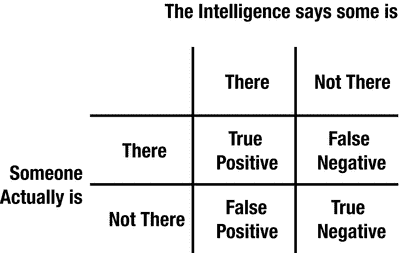

# 6. 为什么创建智能体验如此困难

本章探讨了基于智能的体验与传统体验之间的一些差异。核心要点是：智能会犯错。

智能系统会犯错；要创建有效的智能体验，你必须坦然接受这一事实。你必须拥抱错误。你必须就如何应对和处理这些错误做出明智的决策。

智能系统所犯的错误：
*   不一定符合直觉。
*   并非每天相同。
*   不易提前发现。
*   无法通过“再稍微改进一下智能”来修复。

本章将探讨智能系统所犯的错误。其目标是向你介绍在创建有效智能体验时需要应对的挑战。理解智能系统犯错的方式以及潜在的权衡，将帮助你了解未来可能遇到的情况，更重要的是，帮助你设计出能够——尽管智能系统会犯错——为用户带来最佳结果并实现系统目标的智能体验。

## 智能系统会犯错

智能系统会犯错，这是无法避免的。有些错误会带来不便，有些则可能相当严重。如果不加以缓解，这些错误会让智能系统显得愚蠢；甚至可能使智能系统变得无用或危险。

以下是一些因智能系统犯错而可能出现的场景示例：
*   你让手机订披萨，它却告诉你印度孟买的人口数量。
*   你的自动驾驶汽车开始沿着一条不存在的道路行驶，最终你掉进了湖里。
*   你的智能门铃告诉你有人正在靠近前门，但查看视频后，你发现根本没人。
*   你把一片面包放进智能烤面包机，五分钟后回来，发现面包还是凉的——烤面包机根本没工作。

这类错误以及其他许多错误，只是使用智能系统所需付出的部分代价，尤其是在使用由机器学习创造的智能系统时。

而且，这些错误并非智能系统开发者的过错。我的意思是，我猜这些错误可能是他们的责任——人们总有可能工作不力——但即使是那些在应用机器学习领域表现出色、堪称世界级水平的人，所创造的智能系统也会犯错。

因此，在智能系统中，经验的一个重要角色就是呈现智能，使其在正确时高效运作，同时将其所犯的错误最小化，并便于从中恢复。

试想，一个准确率为`95%`的智能系统，每二十次交互就会犯一次错误。而`95%`已经是非常高的准确率了。如果你的智能系统开发者达到了`95%`的准确率，他们会觉得自己干得很棒。他们会希望因自己的辛勤工作而获得奖励，然后继续去开发其他项目。他们可不想听你说这个智能系统还不够准确。

但在一个每天有百万次用户交互的系统中，`95%`的准确率意味着每天会有`5`万次错误。这可是大量的错误。如果这些错误耗费了用户的时间或金钱，那就会累积成一个真正的问题。

另一种思考错误的有用方式是，用户在一次错误出现之前会经历多少次交互。例如，一个每天进行`20`次交互、使用准确率为`97%`的智能系统的用户，预计每周会遇到`4.2`次错误。

这是灾难吗？

这取决于错误的严重程度以及用户有哪些恢复选项。

但请考虑一下构建会犯错的系统之外的另一种选择——即，在围绕智能系统构建产品之前，要求其达到完美。完美非常昂贵，在很多情况下甚至是不可能的。而且，从智能系统中获得真正价值并不需要完美——坐等完美是错失大量潜力的好方法。看看这些例子：
*   语音识别并不完美，而且可能永远都不会完美。
*   搜索引擎并不总能返回正确答案。
*   游戏AI常因绕圈跑和对着墙壁射击而受到嘲笑。
*   自动驾驶汽车会发生事故。

但所有这些（某种程度上）不准确的智能系统，都是我们许多人每天使用的产品的一部分——它们让我们的生活更美好。缓解错误是打造智能体验的一项基本活动。

## 智能系统会犯离谱的错误

冒着啰嗦的风险再说一遍，智能系统会犯离谱的错误。那些错误是疯狂的、莫名其妙的、反直觉的。

试想——如果一位人类专家有`99%`的正确率，你可能会认为他们犯的错误也接近正确。你假设这位专家基本理解情况，如果他们犯了错，那很可能也符合对世界运作方式的理性看法。

机器学习和人工智能可不是这样。

一个人工智能系统可能有`99.9%`的正确率，但千分之一的情况下，它会说出完全离谱的话。例如：
*   一个推荐音乐的系统可能会推荐你`999`首摇滚歌曲，然后推荐一首青少年流行歌曲。
*   一个智能烤面包机可能会完美地烤好`99`片面包，然后决定第`100`片面包不需要任何烘烤——无论如何，都不加热。
*   一个通过图像读取人类情绪的系统可能正确识别出`999`个人是开心的，然后它看到我的脸，无论我咧着嘴笑得有多傻，它都会说我是悲伤的。

这些离谱的错误是使用智能系统工作的一部分。

即使是离谱的错误，也可以被缓解、从中恢复并最小化。但要设计出能与智能系统良好配合的体验，你应该摒弃对理性事物会如何行动的固有观念。相反，你需要培养与你所使用的智能系统之间的直觉。使用它。看看什么容易让它困惑，以及是如何困惑的。思考支持它的方法。

一种本能反应是去找开发智能系统的人说：“拜托，这太离谱了。修好这个错误吧。它让我们受不了了！”

这没问题。他们很可能可以修改智能系统来修复困扰你的那个错误。

但修复一个错误通常会在其他地方引入一个新错误。这个新错误很可能同样离谱。而且你不会知道新错误何时以及如何出现。修复明显的错误并不总是正确的做法；事实上，像打地鼠一样处理明显的错误可能是有害的。有时，更好的做法是让智能系统尽可能优化，然后通过优雅的体验来掩盖错误，从而支持智能系统。

## 智能系统会犯不同类型的错误

尽管你可能觉得我一直在强调这一点，但智能系统确实会犯不同类型的错误。例如：
*   智能门铃可能会在没人的时候提示有人靠近门口；也可能在有人靠近门口时未能通知用户。
*   智能烤面包机可能把面包烤得不够熟；也可能烤过头。
*   语音识别系统可能错误理解用户说的话；也可能拒绝尝试猜测用户说了什么。

这里主要有三种错误类型：
1.  将一种情况误判为另一种情况。
2.  估算出错误的值（例如，正确的烤面包时间）。
3.  因过于困惑（或保守）而完全无法给出任何判断。

或许最简单的错误形式就是混淆不同情况，就像智能门铃的例子那样。对于这类系统的智能判断，存在四种可能的结果（`图6-1`）：

`图6-1`

不同类型的错误：
*   **真阳性**——当门口有人，且智能系统判断门口有人时，称为真阳性（这是正确判断，而非错误）。
*   **真阴性**——当门口没人，且智能系统判断门口没人时，称为真阴性（这是另一种正确判断，而非错误）。
*   **假阳性**——当门口没人，但智能系统判断门口有人时，称为假阳性（这是一种错误）。
*   **假阴性**——当门口有人，但智能系统判断门口没人时，称为假阴性（这是另一种错误）。

通常可以通过调整系统的智能参数来控制它犯错误的类型，让某一类错误增多，另一类错误减少。（这通常涉及调整驱动智能的模型所输出的概率阈值。）

例如，在设计智能门铃的体验时，是让系统在没人的时候提醒用户更好，还是在有人的时候不提醒用户更好？

如果以增加一次第二种错误为代价，能够消除三次第一种错误呢？这对用户来说是更划算的权衡吗？是否更有助于实现系统的目标？

这取决于具体的体验。每种类型的错误会让用户感到多恼火？哪种错误更容易被掩盖？哪种错误更妨碍系统目标的实现？用户每天/每月/每年会经历多少次这类错误？他们是否会因此感到疲惫，最终完全不再响应系统的提醒？或者他们会不再信任系统，直接将其关闭？

其他权衡的例子包括：
*   在低估与高估之间权衡。例如，当智能烤面包机预测烤面包时间时，是烤过`5%`更好，还是烤不足`5%`更好？
*   在智能系统给出的选项数量之间权衡。例如，在推荐系统中，系统可能相当确定用户想读`15`本不同书籍中的某一本。是让用户从排名前`5`的书籍中选择更好？还是展示全部`15`本更好？
*   在智能系统“给出判断”与“保持沉默”之间权衡。例如，在计算机视觉系统中，智能系统可能有`90%`的把握识别出图像中的人物。是让系统给图像中的人脸打上一个有十分之一概率出错的标签更好？还是让系统什么都不做更好？或者请求用户帮助更好？

## 智能会发生变化

传统的用户体验是确定性的。它们对相同的指令做出相同的响应。例如，当你右键点击一个文件时，每次都会弹出一个菜单（除非出现bug）。确定性在很多方面都是好的。

智能系统会随着时间的推移自我改进。昨天执行某个操作得到的结果，今天可能就不同了。而这可能是一件非常好的事情。试想：
*   昨天你搜索了你最喜欢的乐队，得到了一些还不错的文章。今天你再次搜索同一个乐队，得到了更新、更好的信息。
*   昨天你用微波炉爆了一些爆米花，有几颗烤焦了。今天你再爆爆米花，微波炉加热时间没那么长，爆米花就完美了。
*   昨天你的导航应用指引你穿过一个施工区，你的通勤时间比平时多了一个小时。今天应用指引你走另一条路线，你上班时心情更愉快，工作效率也更高。

这些都是积极变化的例子，这类变化正是智能系统的目标——从用户的角度来看，系统今天比昨天工作得更好。如果现在有点小问题，那也没关系——用户可以相信系统会改进，问题会随着时间的推移而减少。

这是目标。但变化也可能带来干扰。即使是长期来看积极的变化，短期内也可能让用户感到困惑和失控。想象以下场景：
*   昨天你用智能笔做笔记，墨水是漂亮的蓝色。但一夜之间，笔连接了它的服务，而该服务——为了优化某个你可能永远不知道的指标——决定调整蓝色的色度。今天你做的笔记变成了另一种颜色。

# 智能系统的动态变化

昨天你去附近的便利店，买了一大杯你最喜欢的冰爽汽水，喝得很开心。一夜之间，汽水机连接了它的服务并调整了配方。今天你又买了一杯汽水，却没那么喜欢了。

这些变化是好的吗？也许吧。也许它们改善了相关业务中某些非常重要的属性。也许你最终会意识到自己其实喜欢这种改变后的行为——尽管一开始让你感到困扰。

又或者，这些变化简直就是灾难性的。

在处理不断变化的智能时，需要考虑以下几点：

1.  能否控制变化的速度？这可以通过对智能的提供者施加一些限制来实现。例如，也许智能系统每天对不超过 5% 的交互改变其预测。如果限制过严，可能导致智能停滞不前（并消除智能随时间改进的大部分潜力），但一些简单的限制会大有帮助。
2.  体验能否帮助用户应对变化？也许可以通过告知用户变化已经发生来实现。或者保留旧的行为，同时将改变后的行为作为选项提供给用户。例如，智能笔可以告知用户它发现了一种新的墨水颜色，能让笔记的实用性提高 5%，并询问用户是否愿意更改，或者如果用户更喜欢旧颜色，则保持不变。
3.  体验能否限制系统中变化部分的影响，同时仍让它们保持足够的显著性以发挥作用？例如，对变化最频繁的智能部分采用更被动的体验方式？

## 人的因素

`智能体验`的成功在于以积极的方式与用户互动，让用户更快乐、更高效，并帮助他们以更具生产力的方式行事（或更好地契合积极业务成果的方式）。

但处理`智能系统`对某些用户来说可能充满压力，因为它挑战了他们的预期。

我们可以这样来理解这个问题。

人类使用工具，比如锯子、书籍、汽车、物品。这些东西的行为是可预测的。我们经过漫长的进化，已经学会理解它们、依赖它们、知道对它们能有什么期待。有时它们会坏掉，但这种情况很少见。大多数时候，它们就是它们本来的样子；我们学会使用它们，然后就不再过多思考它们。

工具在某种程度上成为了我们自身的一部分，赋予我们原本不具备的能力。

它们能让我们感觉非常良好、安全且舒适。

`智能系统`却并非完全如此。

`智能系统`会犯错。它们会改变“主意”。它们在决定行动时会考虑非常细微的因素。有时它们不会连续两次做同样的事情，即使用户看不出任何不同。有时它们甚至有自己的动机，而这些动机与用户的动机并不完全一致。

与`智能系统`互动，感觉更像是一种人际关系，而不是使用工具。以下是一些可能影响用户的方式：

*   **困惑**：当`智能系统`行为怪异或犯错时，用户会感到困惑。他们可能想要（或需要）投入一些思考和精力来理解发生了什么。
*   **不信任**：当`智能系统`影响用户行为时，用户是否会喜欢？例如，系统可能神奇地让用户的生活变得更好，也可能不断唠叨用户去做事，尤其是那些让用户觉得是在把他人利益置于自身利益之上的事（比如向用户展示广告）。
*   **缺乏信心**：用户是否足够信任系统，让它自行运作？还是用户逐渐认为系统效率低下，总是想帮忙，却总是帮倒忙？
*   **疲劳**：当系统需要用户关注时，它是否善用了这种关注，还是对用户要求过多？用户很擅长忽略他们不喜欢的东西。
*   **不适感**：这些互动会让用户感到不舒服吗？也许系统太了解他们了。也许系统会迫使他们做不想做的事，或者将他们认为私密的信息发布到公共论坛。如果一台`智能电视`看到一对情侣在沙发上亲热，它可以调暗灯光并播放一些巴里·怀特的音乐——但它应该这么做吗？

要留意用户对`智能体验`的感受。通过明智地选择呈现什么内容以及以何种力度呈现，来管理他们的感受。

## 总结

智能会犯错。无论如何，它都会犯错。抱怨无济于事。犯错并非因为别人工作不力。而追着错误不放，玩打地鼠游戏，通常（往往）是有害的。

智能犯的错误可能非常反直觉。即使是通常正确的智能，也可能犯下非常奇怪的错误（人类绝不会犯的那种）。

错误有不同的类型。一种常见的表述方式是：`误报`（声称某事发生了，但实际上没有）和`漏报`（声称某事没发生，但实际上发生了）。`智能系统`常常需要在不同类型的错误之间进行权衡（例如，通过增加一些`误报`来减少一些`漏报`）。

变化可能会给用户带来困扰，即使从长远来看这种变化是积极的。`智能系统`会定期变化。帮助用户应对变化是创建有效`智能系统`的一部分。

`智能系统`可能对用户产生负面影响，导致他们不喜欢和不信任该系统。

创造`智能体验`是困难的。

## 思考题……

阅读本章后，你应该能够：

*   理解智能会犯错——这是`智能体验`需要应对的基本挑战之一。
*   认识到为什么这些挑战不是`智能系统`的漏洞（需要修复），而是与`智能系统`打交道时固有的问题（必须接受）。
*   了解用户将如何体验`智能系统`的负面部分，并具备一些同理心，以帮助创造能帮助用户的体验。

你应该能够回答如下问题：

*   你见过`智能系统`犯过的最严重的错误是什么？
*   `智能体验`本可以做些什么来减轻这个错误的严重性？
*   对于哪个产品变更，你最初的反应最强烈，一开始不喜欢，但后来却越来越喜欢？为什么？