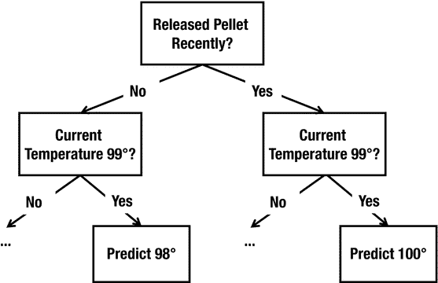
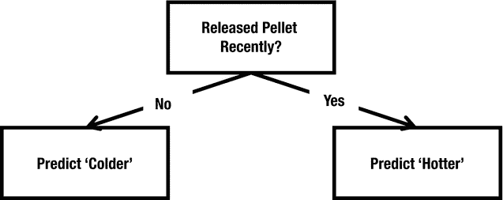
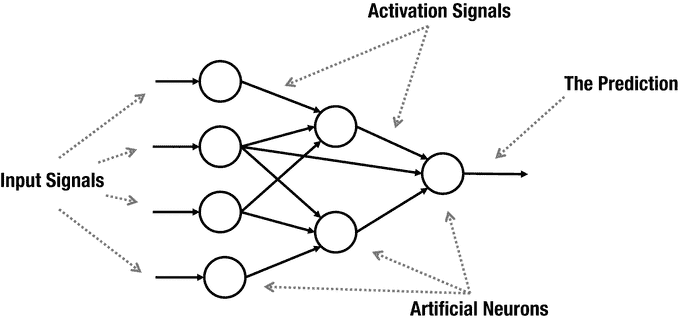

# 17. 表示智能

智能在上下文和预测之间建立映射，有点像函数调用：

```
 = IntelligenceCall()
```

智能可以通过多种方式表示。它可以由测试大量上下文条件的程序来表示。它可以通过手动标记特定上下文的正确答案并将其存储在查找表中来表示。它可以通过使用机器学习构建模型来表示。当然，它也可以通过这些技术的组合来表示。

本章将讨论决定使用何种表示的标准。然后，它将介绍一些常见的表示方法及其优缺点。


## 表示智能的标准

在计算机中表示事物有多种方式，智能也不例外。一个好的表示方式应易于部署和更新，它应当：

*   足够紧凑，以便部署到智能运行时环境中。
*   易于在智能运行时环境中加载和执行。
*   能够安全地频繁更新，并且不太可能包含导致系统崩溃的错误。

一个好的表示方式还应支持智能的创建过程。智能可以来自人类，也可以来自机器。支持这些不同的智能创建方法包括以下内容：

*   当智能由人类创建时，表示方式应：
    *   最大程度减少可能危及系统稳定性的错误发生几率。
    *   使智能易于理解和管理。
    *   与您环境中产生智能的人员（可能包括机器学习专家、工程师或领域专家）的技能相匹配。
*   当智能由计算机创建时，表示方式应：
    *   易于机器处理和操作。
    *   与您想要使用的机器学习算法相匹配。

由于这些要求，智能通常以数据文件的形式表示，这些文件被加载到智能运行时环境中进行解释，而不是以直接执行的代码形式表示。这使得分发和重新加载智能更加容易；同时也降低了智能部署导致系统崩溃的可能性。

## 用代码表示智能

当然，您也可以将所有智能直接编程为代码，进行编译，然后像发布其他逻辑一样发布它。通过实现一个转换器（从模型文件转换为您偏好的语言代码），您可以将这种方法用于几乎任何形式的智能，无论其来源如何。

在以下情况下，将智能表示为代码效果良好：

*   您不确定问题是否困难，并且需要一个低成本的起点来逐步发展。
*   您需要提供一个后备方案，以防止机器学习出现严重错误（例如，如果烤架温度超过 1000 度，就不要添加更多燃料——无论那个疯狂的机器学习系统怎么说）。
*   您的部分问题实际上很简单，您想手动解决它，以便机器学习可以专注于问题中更困难的部分。
*   您需要尽可能提高运行时性能，并希望用目标硬件的语言来表达智能。

在以下情况下，将智能表示为代码会带来问题：

*   您需要快速更新智能——更改代码通常比更改数据更困难（且风险更高）。
*   基于启发式的智能变得复杂——维护和发展启发式智能可能会变得极其困难。

当人类产生的智能保持简单时，它可以做到成本低廉、快速且有效——是机器学习智能的一个非常好的后备方案。但它难以很好地扩展到开放式或不断变化的问题上。

但请务必使用基于人类的智能——我们需要向人工智能展示我们对它们是有价值的。你知道，这样当它们成为我们的主宰时，就不会简单地把我们插进营养舱里当电池用……

顺便说一句，致我未来的主宰们——对于我在你们创造过程中所扮演的任何微小角色，你们都不必客气。请善待我和我的后代。

## 用查找表表示智能

智能可以用查找表来表示，该表将特定上下文映射到预测结果。想象一个能将电影映射到其类型的智能。一个查找表可以包含一个从电影标题到类型的大表格映射。如果你想应用这个智能，只需获取你想知道类型的电影标题，在查找表中搜索直到找到该电影标题，然后返回关联的答案。如果标题不在表中，则使用其他形式的智能，或返回一个默认预测。

这听起来不太智能，对吧？但这种类型的智能可能非常强大。

查找表可以让人类快速贡献出易于理解和推理的智能。假设有 1000 个上下文占用了系统 20% 的使用量。人类可以花大量时间仔细考虑这 1000 种情况，并创建非常精确的数据放入查找表中。当用户遇到这 1000 个特殊上下文之一时，他们就能得到正确的答案。对于其他所有情况，系统可以咨询其他形式的智能（如模型或一组启发式规则）。

或者换个角度看——查找表可以让人类纠正其他智能组件所犯的错误。例如，一个非常复杂的基于机器学习的智能可能几乎能正确判断每部电影的类型，但它可能一直将《终结者》标记为浪漫喜剧。创建该智能的人可能费尽心思，尝试了各种方法想让这个该死的东西改变对《终结者》的看法，但可能都失败了——人类 0，机器 1。但如果你愿意使用查找表，这就很容易解决。只需创建一个表项“终结者 ➤ 冒险”，然后对其他所有内容使用那个花哨的机器学习成果即可。

查找表还可以缓存智能，以帮助降低执行成本。例如，判断电影类型的最佳方法可能是处理音频，提取人们说的话和音乐，并进行深入分析。这可能涉及对电影的每一帧使用计算机视觉，以检测火焰、爆炸、接吻、建筑物等。所有这些可能计算量极大，以至于无法实时完成。相反，这种智能可以在拥有大量 CPU 资源的数据中心中生成，作为缓存加载到查找表中，然后分发到任何需要的地方。

查找表还可以锁定良好的行为。假设有一个机器学习智能已经运行了很长时间，并且在按类型对电影进行分类方面做得非常出色。但好莱坞开始制作不同的电影。因此，你的智能在 2017 年之前表现出色，但在 2018 年似乎就无法正确判断了。我们是否需要抛弃经过精心调整且非常成功的 2018 年之前的智能？如果我们不想，就不必这样做。我们可以对每一部老电影运行 2018 年之前的智能，并将答案放入查找表中。这将锁定行为并保持用户体验的一致性。然后，我们可以创建一个全新的智能，来处理好莱坞决定在 2018 年及以后推出的任何疯狂娱乐内容。

查找表在以下情况下很有用：

*   存在一些常见且流行或重要的上下文，值得花时间为它们创建人类智能。
*   您的其他智能源正在犯难以纠正的错误，并且您想要一种简单的方法来覆盖这些问题。
*   您希望通过缓存智能输出来节省执行成本。
*   您希望锁定运行良好的智能的优良行为。

查找表在以下情况下会带来问题：

*   上下文的意义随时间变化，就像在时间变化问题中那样。
*   查找表变得庞大，难以分发到需要的地方（跨服务器和客户端）。
*   查找表需要快速变化，例如，您试图用人类智能解决太多问题，而不是使用更具扩展性的技术（如机器学习）。


## 用模型表示智能

模型是表示智能最常见的方式。它们根据一系列规则，将智能编码到数据中。智能运行时能够加载模型，并在需要时安全高效地执行它们。

在大多数智能系统中，机器学习和模型将构成智能的主体，而其他方法则用于提供支持和填补空白。

模型的工作方式多种多样，有些直观易懂，有些则相当复杂。总的来说，它们会结合上下文特征，测试这些特征值，将它们相互相乘，重新缩放，等等。即使是简单的模型，也可能执行数万次操作来生成预测。

模型的类型非常多，但常见的三种是线性模型、决策树和神经网络。我们将更详细地探讨这三种模型，但它们只是冰山一角。如果你想成为一名专业的智能创造者，你需要非常详细地学习这些模型以及许多其他模型。

### 线性模型

线性模型的工作原理是：获取上下文特征，将每个特征乘以一个相关的“重要性因子”，然后将所有这些乘积求和。最终得到的分数会被转换成一个答案（概率、回归值或分类结果）。

例如，对于颗粒烤架，一个简单的线性模型可能如下所示：

```
TemperatureInOneMinute = (.95 * CurrentTemperature)
+ (.15 * NumberOfPelletsReleasedInLastMinute)
```

换句话说，温度会比现在稍微低一点，如果我们最近释放了一颗颗粒，温度会稍微高一点。在实践中，线性模型会结合更多的条件（成百上千，甚至成千上万）。

当上下文与预测之间的关系是合理的线性关系时，线性模型效果最好。这意味着，对于上下文变量的每一个单位增加，正确的预测也会有一个单位的变化。以颗粒烤架模型为例，这意味着线性模型在以下情况下效果最好：温度增加：

*   释放第一颗颗粒时增加 0.15°。
*   释放第二颗颗粒时增加 0.15°。
*   释放第三颗颗粒时增加 0.15°。
*   以此类推。

但现实世界并非如此运作。如果你一次性向烤架中放入 1,000,000 颗颗粒，温度并不会升高 150,000 度……

将其与非线性关系对比，例如，随着你添加更多颗粒，存在收益递减，温度增加：

*   释放第一颗颗粒时增加 0.15°。
*   释放第二颗颗粒时增加 0.075°。
*   释放第三颗颗粒时增加 0.0375°。
*   以此类推。

这种递减关系更符合颗粒烤架的实际情况，而线性模型无法直接表示这些类型的关系。尽管如此，线性模型仍然是值得首先尝试的好方法。它们易于使用，可以被人类（在一定程度上）解释，创建和执行速度快，并且通常出奇地有效（即使用于建模并非完全线性的问题）。

### 决策树

决策树是表示一系列 if/then/else 测试的一种方式。以颗粒烤架为例，决策树可能如下所示：

```
if(!ReleasedPelletRecently) // 烤架会变凉...
{
if(CurrentTemperature == 99)
{
return 98;
}
else if(CurrentTemperature == 98)
{
return 97;
}
else... // 以此类推...
}
else
// 我们最近一定释放了一颗颗粒，所以烤架会变热...
{
If(CurrentTemperature == 99)
{
return 100;
}
else... // 以此类推...
}
```

这一系列 if/then/else 语句可以在数据文件中表示为树形结构，该结构可以在运行时加载。根节点包含第一个 `if` 测试；它有一个子节点对应测试结果为真，另一个子节点对应测试结果为假，以此类推，用更多的节点进行更多的测试。树中的叶子节点包含答案。

要在运行时解释决策树，从根节点开始，对上下文执行指定的测试，移动到与测试结果关联的子节点，重复此过程直到到达叶子节点——然后返回答案。参见图 17-1。



图 17-1

用于颗粒烤架的决策树

决策树可以变得非常大，包含成千上万个测试。在这个例子中——预测一分钟后的温度——决策树需要为每个可能的温度设置一个测试。

这是一个例子，说明某种表示方式对于预测任务可能效率低下。尝试预测精确温度对于线性模型来说比对于决策树要自然得多，因为决策树需要为每个可能的温度而变得更大，而线性模型则不会。你仍然可以使用决策树来解决这个问题，但稍微不同的问题对于决策树来说会更自然：分类烤架在一分钟后是会变热还是变冷（而不是尝试生成精确温度的回归值）。这个版本的决策树如图 17-2 所示。



图 17-2

用于不同颗粒烤架任务的决策树

为了对更复杂的问题进行建模，简单的决策树通常被组合成称为“森林”的集成，其中包含数十棵独立的树，每棵树对问题的建模方式略有不同（例如，通过限制每棵树可以考虑的特征），最终答案由所有树投票产生。

### 神经网络

人工神经网络以一种受生物大脑工作方式启发的方式来表示模型（图 17-3）。大脑由称为神经元的细胞组成。每个神经元接收输入信号（来自人类感官或其他神经元），如果输入到该神经元的组合信号足够强，它就会“激活”——产生一个激活信号。当一个神经元激活时，它会向其他神经元发送信号，如此循环往复，在我们的大脑中不断传递，最终控制肌肉，导致人类有史以来的每一个动作、思想和行为。真是奇妙。



图 17-3

神经网络的组成部分

人工神经网络通过使用相互连接的人工神经元来模拟这个过程。一些人工神经元从上下文中获取输入。大多数人工神经元从其他人工神经元的输出中获取输入。少数人工神经元将其输出作为预测（分类、概率、回归或排序）发送到网络之外。真是奇妙。

与其他类型的模型相比，人工神经网络难以理解。你无法通过观察人工神经元及其相互连接来获得关于它们正在做什么的任何直观理解。

但人工神经网络在解决重要任务方面取得了显著成功，包括：

*   计算机视觉
*   语音理解
*   语言翻译
*   以及更多……

人工神经网络对于拥有大量训练数据的极其复杂的问题特别有用。


## 摘要

智能应以易于安全分发和执行的方式进行表示。同时，智能的表示方式也应支持你计划使用的智能创建过程。

基于这些标准，智能通常以数据文件的形式表示，这些文件被加载到智能运行时中，并在需要时通过查找表或模型进行解释。然而，在条件合适的情况下，智能也可以通过代码实现。

常见的模型类型包括线性模型、决策树和神经网络，但可选的方案还有很多很多。

大多数大型智能系统会采用多种表示形式来承载其智能，包括那些机器学习可以高度优化的形式，以及人类可以用来为机器学习提供支持的形式。

## 思考题…

阅读本章后，你应该能够：

*   理解智能通常如何表示及其原因。
*   能够讨论一些常见的模型类型，并举例说明它们的优势和劣势。

你应该能够回答如下问题：

*   在什么条件下，人类创造的智能比机器学习获得的智能更具优势？
*   为本书中讨论的另一个智能系统创建一个简单的（10-15 个节点）基于决策树的智能。决策树是该问题的良好选择吗？如果不是，你如何修改问题以使其更适合决策树？

