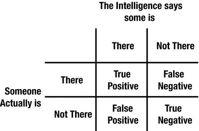
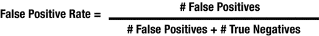
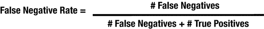
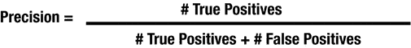
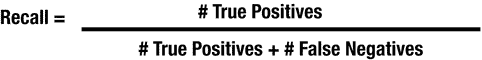
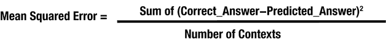
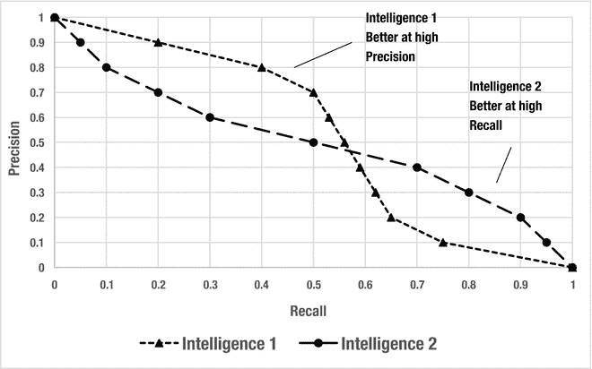

# 19. 评估智能

评估即创造，至少在为智能系统构建智能时是如此。这是因为智能的创造通常涉及对有效智能的迭代搜索：生成一个新的候选智能，将其与之前的候选智能进行比较，然后选择两者中更优的那个。要做到这一点，你需要能够审视一对智能，并回答以下问题：

*   我应该在我的智能系统中使用哪一个？

*   哪一个能更好地实现系统目标？

*   哪一个会给我和我的用户带来更少的麻烦？

*   它们中是否有任何一个已经足够好，可以交付给客户，还是仍有更多工作要做？

评估智能主要有两种方式：

*   **在线评估**：通过将其暴露给客户并观察他们的反应。我们在之前的章节中讨论过这一点，当时我们谈到了评估体验和管理智能（通过静默智能、受控发布和灰度发布）。

*   **离线评估**：通过观察其在历史数据上的表现。这是本章的主题，因为它对智能创造过程至关重要。

本章将讨论智能的“准确”意味着什么。然后，它将解释如何使用数据来评估智能，以及一些常见的陷阱。它将介绍用于比较智能的概念性工具。最后，它将探讨主观评估智能的方法。

## 评估准确性

智能当然应该是准确的。但“准确”并非一个直截了当的概念，智能可能以多种方式失效。一个有效的智能应具备以下特性：

*   它能泛化到未曾见过的情况。

*   它会犯正确类型的错误。

*   它能很好地分散所犯的错误。

本节将更详细地探讨这些特性。

### 泛化

智能创造中的关键挑战之一是，要创造出在你创建智能时未知的事物上也能良好运行的智能。

想象一个学生阅读了课程教科书并记住了每一个事实。这很好。这个学生在复述教科书中的内容时会非常准确。但现在想象一下，老师设计了一个测试，不是让学生复述教科书中的事实。相反，老师希望学生展示他们理解了教科书中的概念，并将其应用到新的情境中。如果学生对该主题建立了良好的心智模型，他们可能会通过这个测试。如果学生对该主题的心智模型有误，或者根本没有心智模型（只是记住了事实），那么他们在新情境中应用知识时就不会表现得那么好。这与智能系统中的智能是一样的——它必须能够泛化到新的情境。

让我们看一个例子。假设要构建一个智能，用于检查书籍并按类型对其进行分类——科幻、爱情、技术、惊悚、历史小说等等。

你收集了 1000 本书，手动为它们标注了类型，然后开始创建智能。目标是能够拿一本新书（不属于这 1000 本中的一本）并准确预测其类型。

如果你通过记住作者信息来构建这个智能会怎样？你可能会查看你的 1000 本书，发现它们由 815 位不同的作者所写，并列出如下清单：

*   罗伊·罗耶森写恐怖小说。

*   蒂姆·泰尼写科幻小说。

*   尼尔·诺特森写技术书籍。

*   等等。

当你拿到一本新书时，你会在清单中查找其作者。如果作者在清单中，就返回其类型。如果作者不在清单中——好吧，你就卡住了。这个模型并不理解“类型”的概念，它只是记住了一些事实，并且无法泛化到它不认识的作者（而且对于那些写两种不同类型书籍的作者，它会非常困惑）。

在评估智能的准确性时，测试其泛化能力非常重要。确保你将智能置于它未曾见过的情况中，并衡量其适应能力。

### 错误类型

智能体可能犯多种类型的错误，有些错误比其他错误造成的麻烦更大。我们在第 6 章讨论智能体验时，已经探讨过假阳性和假阴性的概念，但让我们回顾一下（见图 19-1）。在预测分类时，智能体可能会犯以下错误：

图 19-1

不同类型的错误。

*   将不属于某类别的事物判定为该类别。

*   将属于某类别的事物判定为不属于该类别。

例如，假设智能体做了以下事情：

*   说门口有人，但实际上没人；或者说门口没人，但实际上有人。

*   说该往火里添燃料了，但实际上不需要（火已经够旺了）；或者说不需要添燃料，但实际上需要（因为火快熄灭了）。

*   说这本书是爱情小说，但实际上不是；或者说这本书不是爱情小说，但实际上是。

为了有用，智能体必须犯正确类型的错误，以补充其智能系统。例如，考虑一个检查网页是否有趣的智能体。想象一下，我告诉你我有一个准确率达 99% 的智能体。给这个智能体展示一个新网页（它从未见过的），智能体做出预测（有趣或不有趣），并且 99% 的情况下预测是正确的。这很棒。泛化能力非常准确。这个智能体在我们的“有趣网页检测器”智能系统中应该很有用。

但假如结果发现大多数网页并不有趣——准确地说，99% 的网页都是无趣的。在这种情况下，一个智能体可以 100% 地预测“不有趣”，并且仍然能达到 99% 的准确率。对于无趣的网页，它的准确率是 100%。对于有趣的网页，它的准确率是 0%。总体加起来就是 99% 的准确率。但这也意味着——完全没用。

衡量这些错误类型之间权衡的一个指标是讨论假阳性率与假阴性率。对于有趣网页查找器来说，“阳性”指的是一个实际上有趣的网页。“阴性”指的是一个不有趣的网页。（实际上，你可以用任何一种方式定义阳性——但务必清晰定义，否则项目中的其他人可能会以不同方式定义，导致大家困惑。）所以：

*   假阳性率定义为所有阴性中被错误分类为阳性的比例（即有多少次对无趣网页的访问被标记为有趣）。

*   假阴性率定义为所有阳性中被错误分类为阴性的比例（即有多少次对有趣网页的访问被标记为无趣）。

用这个术语来说，那个死板的“总是无趣”智能体将拥有 0% 的假阳性率（这很棒）和 100% 的假阴性率（这毫无用处）。

另一种非常常见的讨论这些错误权衡的方式是谈论模型的精确率和召回率。

*   精确率定义为模型所有阳性响应中实际为阳性的比例（即“这个页面有趣”的响应中有多少是正确的）。

*   召回率定义为模型判定为阳性的阳性样本比例（即有趣的网页中有多少得到了阳性响应）。

用这个术语来说，那个死板的“总是无趣”智能体将拥有未定义的精确率（因为它从不输出阳性，而且你不能除以零，即使有机器学习也不行）和 0% 的召回率（因为它对 0% 的阳性页面输出了阳性）。

一个有效的智能体必须适当平衡其所犯错误的类型，以支持智能系统的需求。

### 错误的分布

为了有效，智能体必须对所有用户都表现合理。也就是说，它不能将其错误集中在特定的子群体中。考虑以下情况：

*   一个检测门口是否有人的系统，对身高不足 5 英尺的人从不奏效。

*   一个在图像中查找人脸的系统，永远找不到戴眼镜的人。

*   一个过滤垃圾邮件的系统，总是删除来自银行的邮件。

这类错误可能会令人尴尬。它们会导致用户不满、差评。有可能存在一个智能体，它泛化良好，各种错误类型之间取得了很好的平衡，但却完全无法使用，因为它将错误集中在特定用户（或特定情境）上。

而且，发现这类问题并不容易。潜在的子群体如此之多，以至于很难甚至不可能列举出所有因错误分布不均而对智能系统造成问题的方式。

## 评估其他类型的预测

上一节介绍了评估分类的方法。但评估智能体给出的答案的方式有很多很多种。你可以阅读整本关于这个主题的书，但本节将简要介绍如何评估回归、概率和排序的直觉方法。

### 评估回归

回归返回数值。你可能想知道它们在多大比例上得到了“正确”的数字。但了解预测答案与正确答案的接近程度，几乎总是比了解答案完全正确的频率更有用。

最常用的方法是计算均方误差（MSE）。也就是说，取智能体给出的答案，减去正确答案，然后对结果求平方。然后，在与你的测量相关的所有情境中取这些值的平均值。

当 MSE 较小时，智能体给出的答案通常接近正确答案。当 MSE 较大时，智能体给出的答案通常与正确答案相差甚远。

### 评估概率

概率是一个介于 0 到 1.0 之间的数字。评估概率的一种方法是使用阈值将其转换为分类，然后像评估分类一样评估它们。

想知道一本书是否是爱情小说？向智能体询问它是爱情小说的概率。如果概率高于某个阈值，比如 0.3（30%），则判定该书为爱情小说；否则判定为其他类别。

使用高阈值（如 0.99（99%））将概率转换为分类，通常会导致更高的精确率但更低的召回率——只有当智能体超级确定时，你才会判定一本书是爱情小说。

使用低阈值（如 0.01（1%））将概率转换为分类，通常会导致更低的精确率但更高的召回率——你几乎会把任何一本书都判定为爱情小说，除非智能体超级确定它不是爱情小说。

我们稍后将在讨论操作点和比较智能体时进一步探讨这个阈值概念。

另一种评估概率的方法称为`对数损失`。从概念上讲，`对数损失`与`均方误差`（用于回归）非常相似，但涉及更多数学运算（此处略过）。简而言之——损失越小越好。

### 评估排序

排序功能会根据内容与特定情境的相关性来排列顺序。例如，根据用户的历史记录，他们最有可能点哪种口味的汽水？排序智能会将所有可能的口味按顺序排列，例如：

1.  可乐

2.  橙味汽水

3.  沙士汽水

4.  健怡可乐

那么，我们如何判断这个排序是否正确呢？

一种简单的评估方法是设想智能体验。假设智能汽水机可以在其显示屏上展示 3 种汽水。如果用户实际选择的汽水排在前 3 名，则排序效果良好；如果用户实际选择的汽水不在前 3 名，则排序效果不佳。

你可以考虑前 3 名、前 1 名、前 10 名——只要对你的`智能系统`最有意义即可。

因此，评估排序的一种简单方法是计算用户选择的项目出现在前`K`个答案中的时间百分比。

## 使用数据进行评估

数据是评估智能的关键工具。从概念上讲，评估智能是通过获取历史情境，对其运行智能，然后将实际发生的输出与智能预测的输出进行比较来完成的。

当然，使用历史数据存在风险，包括：

*   你可能会意外地使用创建智能时所用的数据来评估该智能，从而导致对智能质量的估计过于乐观。基本上，这相当于在测试前让智能看到了测试的答案。

*   在收集测试数据的时间点与部署新智能的时间点之间，底层问题可能发生变化，从而导致对智能质量的估计过于乐观。当问题发生变化时，智能可能非常擅长——但只是擅长应对过去的问题。

本节将讨论如何处理测试数据以最大程度地减少这些问题。

### 独立的评估数据

用于评估智能的数据必须与用于创建智能的数据完全分开。

想象一下这个场景。你想出了一个启发式智能的点子，实现了它，并在一些评估数据上进行了评估，发现准确率为 54%。此时一切正常。该智能的准确率大概在 54% 左右（由于样本量等原因，会存在基于统计特性的上下浮动），如果你将其部署给用户，他们看到的结果大概也差不多。

但现在你查看了智能在评估数据上犯的一些错误。你发现了一个模式，于是修改了智能，进行了改进。然后你在相同的测试数据上评估该智能，发现准确率现在变成了 66%。

此时，情况就不妙了。你查看了评估数据，并根据发现的结果修改了智能。此时很难说当你将智能部署给用户时，它的准确率会是多少；几乎可以肯定低于你在第二次评估中看到的 66%。甚至可能比你最初的 54% 还要差。

这是因为你作弊了。你在构建智能时查看了测试的答案。你根据你能看到的那部分问题调整了你的智能。这是不好的做法。

避免这种情况的一种常见方法是创建一个单独的`测试集`用于评估。`测试集`是通过将可用数据随机分成两部分来创建的。一部分用于创建和调整智能，另一部分用于评估。

现在，当你调整和优化智能时，不要查看`测试集`——哪怕一点点都不要。你可以在`训练集`上随意调整。当你认为完成时，再在`测试集`上进行评估，以获得对你工作的无偏评估。

### 实践中的独立性

用于评估智能的数据必须与用于产生智能的数据完全分开。我知道——这和我开始上一节时用的句子一模一样。但这正是因为它如此重要。

机器学习的一个关键假设是每条数据都是相互独立的。也就是说，取任意两条数据（两个情境，各自有其结果）。只要你在一条数据上创建智能，并在另一条数据上评估它，你就无法作弊——这两条数据是独立的。但在实践中，情况并非如此。考虑以下哪些数据对更（或更不）独立：

*   来自不同用户的一对交互，与来自同一用户的一对交互相比。

*   来自不同网站的两个网页，与来自同一网站的两个网页相比。

*   不同作者的两本书，与同一作者的两本书相比。

*   不同奶牛的两张照片，与同一奶牛的两张照片相比。

显然，其中一些数据不像其他数据那样独立，使用具有这些强关联关系的数据来同时创建和评估智能将导致不准确的评估。在实践中，将数据随机拆分为`训练集`和`测试集`并不总是有效。

在实践中实现独立性的两种方法是按时间或按身份划分数据。

*   **按时间划分数据**。即，保留最近几天的遥测数据用于评估，并使用之前几天、几周或几个月的数据来构建智能。例如，如果今天是 2017 年 9 月 5 日，智能创建者可能会保留 9 月 2 日、3 日和 4 日的数据用于测试，并使用 2017 年 9 月 1 日及之前的所有数据来产生智能。

    *   如果问题非常稳定（即，没有随时间变化的成分），这种方法会非常有效。

    *   如果问题具有随时间变化的成分，则最近的遥测数据将比更早的遥测数据更有用，因为它能更准确地代表问题的当前状态。在这些情况下，你需要权衡将多少宝贵的、最新的、最相关的数据用于评估（相对于训练），以及在选择训练数据时要回溯到多久以前。

*   **按身份划分数据**。即，确保与单个身份的所有交互最终都落在同一个数据分区中。例如：

    *   与特定用户的所有交互要么用于创建智能，要么用于评估智能。

    *   与同一网站的所有交互要么用于创建智能，要么用于评估智能。

    *   来自同一房屋的所有传感器读数要么用于创建智能，要么用于评估智能。

    *   来自同一台烤面包机的所有烘烤事件要么用于创建智能，要么用于评估智能。

大多数智能系统在选择用于评估的数据时，会按时间以及至少一个身份进行划分。

### 评估子群体

有时，关键在于智能系统不会在关键子群体（性别、年龄、种族、内容类型、地理位置等）上出现系统性失败。

例如，设想一个需要为所有英语使用者提供良好服务的语音识别系统。随着时间的推移，用户抱怨该系统对他们效果不佳。经过调查，你发现许多问题集中在夏威夷——那里的皮钦语太难处理了，老兄？

咳咳……

这个问题可能严重到导致产品无法在夏威夷这个主要市场销售。必须采取行动！

要解决问题，必须先进行衡量（记住，验证先行）。因此，我们需要更新评估流程，专门针对有问题的子群体测量准确率。每次系统评估一个潜在的智能方案时，都会通过两种方式进行评估：

*   一次针对所有用户。

*   一次仅针对使用夏威夷皮钦语口音英语的用户。

这种评估流程可能会发现，总体准确率为 95%，但对于讲皮钦语的子群体成员，准确率仅为 75%。这是一个相当大的差距。

评估子群体的准确率会带来一些复杂性。首先是识别一次交互是否属于该子群体。一条新的遥测数据到达，包含上下文和结果。但现在你需要一些额外信息——你需要知道该上下文（例如遥测数据中的音频片段）是否来自讲夏威夷皮钦语的人。解决这个问题的一些方法包括：

1.  手动识别交互。通过手动检查上下文（收听音频片段），从目标子群体成员中找出数千个样本。这可能会很昂贵，并且难以定期重复，但通常有效。由此产生的数据集可以长期保留，用于评估该子群体的准确率（除非问题变化非常快）。

2.  识别子群体中的实体。例如，将用户标记为“皮钦语使用者”或非皮钦语使用者。来自你标记用户的每一次交互都可以用于评估该子群体。当上下文包含身份信息（如用户 ID）时，这种方法非常有价值。但这并非总是可行。

3.  使用子群体的代理指标，例如地理位置。所有在夏威夷的用户，无论他们是否讲夏威夷皮钦语，都被标记为子群体的一部分。这并不完美，但有时已经足够好，而且有时你可以自动完成，从而节省大量金钱和时间。

评估子群体准确率的第二个复杂性在于为每个子群体获取足够的评估数据。如果子群体很小，随机抽取的评估数据可能只包含少量样本。处理这个问题的两种方法是：

1.  使用更大的评估集。预留足够的评估数据，以便最小的关键子群体有足够的代表性来进行评估（关于合适数据量的更多细节，请参见下一节）。

2.  对评估用的子群体成员进行上采样。调整你的系统，使子群体成员更有可能出现在遥测数据中，并且更有可能被用于评估而非用于智能创建。这样做时，你必须确保在报告评估结果时对偏差进行校正。例如，如果来自夏威夷的用户在遥测数据中被抽样的频率是其他用户的两倍，那么在估算总体准确率时，来自夏威夷用户的每次交互的权重就应该是其他用户的一半。

### 合适的数据量

那么，评估一个智能系统需要多少数据呢？这取决于具体情况——当然。

回想一下，统计学可以表达一个答案的确定程度，例如：我的智能系统的准确率是 92%加减 4%（这意味着它可能在 88%到 96%之间）。

所以你需要多少数据取决于你需要多大的确定性。

假设你的数据非常独立，问题变化不太快，并且你不是试图从非常困难的问题（如语音识别）中优化最后那 0.1%：

*   几十个数据点对于评估智能系统来说太少了。

*   几百个数据点适合做一次快速检查，但确实不够。

*   几千个数据点对于大多数情况来说可能是一个合适的规模。

*   几万个数据点可能有些过头，但也不算离谱。

选择多少数据来评估智能系统的一个起点可能是：

1.  确保你预留了数千个最近的数据点用于评估。

2.  确保你为每个重要的子群体预留了数百个最近的数据点。

3.  使用其余（相对较新的）数据用于智能创建。

4.  除非你有海量数据，在这种情况下，只需预留大约 10%的数据用于评估智能系统，其余用于智能创建。

但你需要在你的具体环境中培养自己的直觉（或者使用一些统计学方法，如果你喜欢这样思考的话）。

## 比较智能系统

# 智能系统性能评估

现在我们知道了一些评估智能系统性能的指标，以及如何从数据中衡量这些指标。但是，我们如何判断一个智能系统是否比另一个更有效呢？考虑尝试判断一本书的类型是否为爱情小说：

*   一个智能系统可能具有 80% 的精确率和 20% 的召回率。
*   另一个智能系统可能具有 50% 的精确率和 40% 的召回率。

哪个更好？嗯，这取决于体验，以及智能系统的更广泛目标。例如，一个试图为狂热的爱情小说读者寻找下一本书的系统，可能更倾向于更高的召回率（这样用户就不会错过任何一个浪漫情节）。

## 工作点

一个有助于评估智能系统的工具是选择一个工作点。也就是说，一个与你的智能体验相匹配的精确率点或召回率点。每个智能系统都必须达到这个工作点，然后表现最好的那个被采用。例如：

*   在一个搞笑网页检测器中，工作点可能设定为 95% 的精确率。所有智能系统都应调整到在 95% 精确率下获得最佳可能的召回率。
*   在一个垃圾邮件过滤系统中，工作点可能设定为 99% 的精确率（因为它要删除用户的邮件，所以必须非常确定）。所有智能系统都应努力标记尽可能多的垃圾邮件，同时将精确率保持在 99% 或以上。
*   在一个智能门铃系统中，工作点可能设定为 80% 的召回率。所有智能系统都应设定为在有人走到门前时 80% 的情况下触发标记，并在该约束下竞争减少误报。

通过选择智能系统可能犯的错误类型之一并设定一个目标，这减少了变量的数量。我们需要一个精确率达到 90% 的智能系统来支持我们的体验——现在，智能系统的创造者先生或女士，去在这个精确率下创造出你能达到的最佳召回率吧。

在比较两个智能系统时，通常方便的做法是在一个工作点上进行比较。在目标召回率下更精确（或在目标精确率下召回率更高）的那个更好。简单明了。

## 曲线

但有时工作点会发生变化。例如，体验可能需要变得更具强制性，工作点需要移动到更高精度以支持这种变化。智能体可以在多个工作点范围内进行评估。例如，通过改变将概率转化为分类的阈值，某个智能体可能具有以下数值：

*   召回率 40% 时，精度为 91%。
*   召回率 45% 时，精度为 87%。
*   召回率 50% 时，精度为 85%。
*   召回率 55% 时，精度为 80%。

以此类推。请注意，任何能够生成概率或分数的智能体都可以采用这种方式进行评估（包括许多、许多机器学习方法）。

许多启发式智能体和许多“仅分类”的机器学习技术不具备分数或概率的概念，因此它们只能在单个工作点（而非沿曲线）进行评估。

当比较两个能够在错误类型之间进行权衡的智能体时，你可以在任何工作点对它们进行比较。例如：

*   在 91% 精度下，一个模型的召回率为 40%，另一个模型的召回率为 47%。
*   在 87% 精度下，一个模型的召回率为 45%，另一个模型的召回率为 48%。
*   在 85% 精度下，一个模型的召回率为 50%，另一个模型的召回率为 49%。

一个模型可能在某些类型的权衡上表现更好，而在其他类型上表现更差。例如，当你需要高精度时，一个模型可能更好；但当你需要高召回率时，第二个模型（使用完全不同的方法构建）可能更优。

将智能体能够做出的各种权衡可视化有时会很有帮助。精确率-召回率曲线（PR 曲线）绘制了模型所有可能的权衡。x 轴是每个可能的召回率（从 0% 到 100%），y 轴是模型在指定召回率下能够达到的精度。

通过将两个模型绘制在同一个 PR 曲线上，可以很容易地看出哪个模型在不同工作点范围内表现更优。

一个类似的概念称为接收者操作特征曲线（ROC 曲线）。ROC 曲线的 x 轴是假阳性率，y 轴是真阳性率。

### 主观评估

有时，一个智能体从数据上看表现不错，但实际效果就是……不行…… 这种情况可能发生在你：

*   使用的指标与实际目标不一致。
*   在体验与智能体之间存在沟通不畅。
*   有一个尚未识别的重要子群体。
*   以及其他原因……

正因如此，审视一些数据，退后几步，然后思考一下，总是有益的。做一个数据侦探，站在用户的角度，想象你的智能体会为他们创造什么。一些有助于主观评估的方法包括：

*   探索错误。
*   想象用户体验。
*   找出可能发生的最坏情况。

我们将依次讨论这些方法。

#### 探索错误

统计数据（例如，用于通过精确率和召回率表示模型质量的统计数据）很好，很简洁；它们将大量信息总结为简单的、可以上下浮动的小数字。它们对于创建智能体至关重要。但它们也可能隐藏各种问题。你需要时不时地去查看数据。

一个有用的技术是随机抽取 100 个智能体出错的上下文并查看它们。在查看错误时，请考虑：

*   有多少错误是用户难以恢复的？
*   有多少错误对用户来说是有意义的（相对于看起来相当愚蠢）？
*   这些错误是否有任何结构？是否有任何共同属性？也许这些属性将来会演变成重要的子群体类型问题？
*   你是否能找到任何线索，表明实现或评估过程的某个部分可能存在错误？
*   是否有任何可以帮助改进智能体，使其不再犯这些错误的方法？是否有一些新的信息可以添加到上下文中？是否有一些新的特征类型？

除了检查随机错误之外，查看智能体对答案最确定——但却是错误的地方（模型声称 100% 确定是正例的假阳性，或模型声称正例概率为 0% 的假阴性）也很有帮助。这些地方通常会导致实现中的错误或智能体创建过程中的缺陷。

#### 想象用户体验

在查看错误时，想象一下用户的体验。想象他们进入该上下文。设身处地地想象他们遇到错误时的情景。他们在想什么？他们注意到问题的可能性有多大？如果他们没有注意到，会付出什么代价？如果他们确实注意到了，他们需要做什么来恢复？

这也是思考用户整体体验的好时机。例如：

*   他们会看到多少错误？
*   在两次错误之间，他们会有多少次正面交互？
*   如果他们必须向朋友总结，他们会如何描述系统犯的错误类型？

设身处地为用户着想，将帮助你判断智能体是否足够好，或者是否需要更多改进。它还可以帮助你提出改进智能体验的想法。

#### 找出最坏的情况

想象一下可能发生的最坏情况。系统可能犯哪些类型的错误会真正伤害其用户或你的业务？例如：

*   一个推广言情小说的系统，将某位特定言情作家的书籍 100% 归类为非言情类。这位作家不再获得推广，销量下降，没有能力找出原因或应对方法，最终倒闭。他们的孩子圣诞节收不到礼物……
*   某个特定律师事务所的所有网页都被归类为搞笑类。它们并不搞笑，但人们还是开始发笑（因为他们被告知这些页面是搞笑的）。没有人愿意雇佣一个满是“小丑”的律师事务所。该事务所愤怒地起诉你的公司——他们有点恼火，而且有的是时间……
*   颗粒烤炉控制器的温度传感器坏了。因此，智能体总是认为火不够热。它不断地向火中倾倒燃料颗粒，引发了一场巨大的、熊熊燃烧的大火，但智能体仍然认为需要更多燃料……

这些例子有点滑稽，但重点是——要发挥创造力。在你的用户不得不为你承受糟糕体验之前，为他们找出真正糟糕的情况，并利用你的发现来打造更好的智能体，或影响系统的其他部分（体验和实现）做得更好。

## 总结

智能的准确性，其本质在于评估与创造。

准确性包含三个主要方面：泛化到新情境、犯对类型的错误，以及在用户/情境间合理分配错误。

*   智能在已知情境中可能表现良好，但在未曾遇到的情境中可能失败。
*   智能可能犯多种类型的错误（包括误报和漏报）。
*   智能可能随机犯错，也可能集中针对特定用户和情境犯错——集中性错误会引发问题。

评估分类、回归、概率估计和排序有特定的技术。本章介绍了一些简单的方法和概念，但如有需要，你可以找到更多信息。

智能可以通过数据进行评估。部分数据应被保留，专门用于评估智能（而非用于创建智能）。这些数据必须与创建智能所用的数据完全独立（应来自不同的用户、不同的时间段等）。

工作点有助于将智能聚焦于在更广泛的系统中取得成功所需犯的错误类型。精确率-召回率曲线是一种理解（并可视化）智能在所有可能工作点下运行情况的方式。

审视你的智能所犯的错误至关重要。尝试理解问题所在，同时也要站在用户的角度，想象他们可能遇到的最坏结果。

## 思考题

阅读本章后，你应该能够：

*   描述智能具备准确性的含义。
*   根据一系列广泛的实践标准评估智能的质量。
*   为智能设定有用的质量目标，并朝着目标取得进展。
*   站在用户的角度，通过他们的视角看待智能所犯的错误。

你应该能够回答如下问题：

*   描述三种需要智能系统具备极高召回率的情境。
*   针对上述三种情境，分别描述对系统目标进行何种微小调整后，系统反而需要高精确率。
*   从本章提及的智能系统中选择一个，描述一个（本章未提及的）可能发生严重错误的潜在子群体。
*   考虑一个将书籍按类型分类的系统。假设你将检查该系统犯下的 100 个错误。描述两种不同的方式，对你检查的错误进行分类，以帮助理解问题所在。（例如，错误发生在短书与长书之间——哎呀！现在你的答案中不能使用书籍长度了。抱歉。）