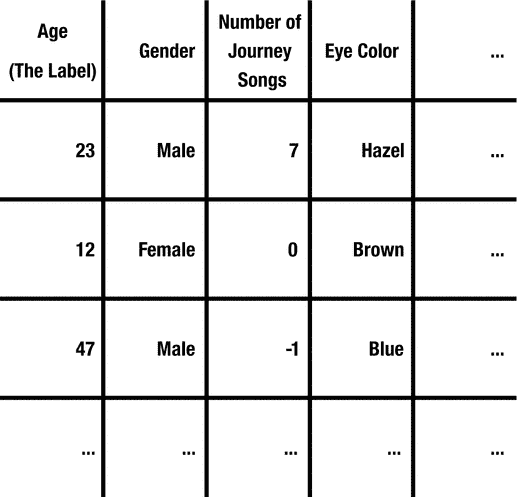
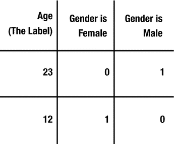
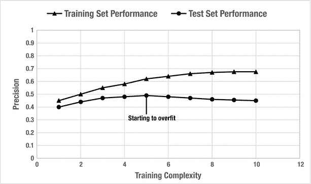

# 20. 机器学习智能

机器学习是一种强大的技术，用于为大规模、困难、开放式、随时间变化的问题生成智能。它的工作原理是向计算机展示大量（大量）的情境示例及其期望结果。计算机根据这些示例生成模型。这些模型可用于预测未来情境的结果。

机器学习可以成为巨大的效能倍增器，让计算机专注于其擅长的事情（例如调整庞大模型的每一个细节，使其在数百万种情境中有效运行），而人类则可以专注于自己擅长的事情（例如选择能够良好泛化的模型表示，并构建将模型转化为客户和商业价值的系统和智能体验）。本章将概述机器学习，介绍其步骤和一些关键问题。

## 机器学习的工作原理

机器学习算法本质上是一种搜索过程，它利用训练数据评估准确性，以寻找准确的模型。通常，机器学习算法会执行以下操作：

*   从一个简单模型开始。
*   尝试模型的略微改进版本（通常根据训练数据得出）。
*   检查改进版本是否更好（使用训练数据）。
*   并（大致）迭代，直到其搜索过程无法找到更好的模型。

有时，改进的形式是向模型增加更多复杂性（例如，向决策树添加更多的 if-then-else 测试）。有时，改进的形式是调整模型中的参数（例如，更新线性模型中的权重）。

例如，回想一下，决策树用树形结构表示智能。每个节点包含一个 `if` 条件，当 `if` 测试为真时有一个子节点，为假时有另一个子节点。以下是一个用于预测电影票房收入的示例决策树：

```
如果 <电影有知名演员?>:
  为真: 如果 <电影是续集?>:
    为真: 则 1 亿美元。
    为假: 则 100 万美元。
  为假: 如果 <电影预算高?>:
    为真: 则 5000 万美元。
    为假: 则 1000 美元。
```

用于决策树的机器学习通过添加 if 测试来生成日益复杂的树，直到没有进一步的添加能改进模型（或直到模型达到某个复杂性阈值）。例如，上述电影成功预测示例决策树的一个改进版本可能是：

```
如果 <电影有知名演员?>:
  为真: 如果 <电影是续集?>:
    为真: 如果 <导演曾获奥斯卡?>:
      为真: 则 5 亿美元。
      为假: 则 1000 万美元。
    为假: 则 100 万美元。
  为假: 如果 <电影预算高?>:
    为真: 则 5000 万美元。
    为假: 则 1000 美元。
```

这个模型稍微复杂一些，也可能更准确一些。

人类可以手动执行相同的过程，但机器学习算法自动化了这一过程，并且可以在人类输入“hello world”的时间内，考虑数百万种情境并产生数十万次微小的改进。

使用机器学习时，智能创建者必须控制的因素包括：

*   **特征工程**：如何将情境转换为机器学习算法可以添加到其模型中的特征。你选择的特征应与目标概念相关，并且应包含足够的信息以做出良好的预测。
*   **模型结构复杂度**：模型变得有多大。例如，决策树中的测试数量或线性模型中的特征数量。
*   **模型搜索复杂度**：机器学习算法在其搜索中尝试了多少种东西。这与结构复杂度不同（但相关）。搜索尝试的东西越多，它偶然发现看起来不错但泛化能力不佳的东西的机会就越大。
*   **数据规模**：你拥有的训练数据量。可用于指导机器学习搜索的良好、多样化的数据越多，你的模型就能变得越复杂、越准确。

必须平衡这些要素，才能从机器学习过程中获得最佳模型。

## 复杂性的利与弊

机器学习的关键挑战之一是控制其产生的模型的复杂性。核心矛盾如下：

1.  解决困难、庞大、开放式的问题需要非常复杂的模型。
2.  允许的复杂性越高，学习到一个误解概念的模型的机会就越大。

作为应用机器学习从业者，你的工作就是平衡这些矛盾。机器学习过程可能以两种方式失败：

*   **欠拟合**概念：其对概念的理解可能过于简单。
*   **过拟合**概念：其对概念的理解是错误的；它在某些情境中碰巧有效，但本质上并不正确。

让我们看一个例子。考虑构建一个智能系统，用于检查书籍并按类型分类——科幻、浪漫、技术、惊悚、历史小说等。

你收集了 1000 本书，手动为它们标注类型，然后开始创建智能。目标是能够拿一本新书（不属于这 1000 本中的一本）并准确预测其类型。


### 欠拟合

如果你采用的方法过于简单，以至于无法理解“流派”是什么，就会导致欠拟合。具体可能如下所示：

1.  对于每种流派，找出最能代表该流派的词：
    *   对于爱情小说，这个“代表性词语”可能是“爱”。
    *   对于科幻小说，可能是“激光”。
    *   以此类推。
2.  当你拿到一本新书时，检查它是否包含任何代表性词语，并将该书标记为对应的流派：
    *   如果书中包含“爱”这个词，就将其归类为爱情小说。
    *   如果书中包含“激光”这个词，就将其归类为科幻小说。

如果每本书都恰好包含且仅包含一个代表性词语，那么这个模型可能效果不错。但大多数书籍包含大量词语。如果一本书同时使用了“爱”和“激光”这两个词，我们该怎么办？应该将其归类为爱情小说还是科幻小说？无论我们做出哪种选择，都会犯错，因为有些科幻小说会谈论爱情；而有些爱情小说也会提到激光。

这种建模方法（每种流派只检查一个词）过于简单。这种简单的方法无法充分拟合“流派”这一概念，并且泛化能力会很差。

### 过拟合

现在想象另一种方法——使用一个非常非常复杂的决策树，本质上将书中确切的词语序列编码成树形结构，例如：

1.  如果书的第一个词是“当”
2.  并且书的第二个词是“那”
3.  并且书的第三个词是“地球”
4.  以此类推，精确匹配书中的每一个词……
5.  那么该书的流派就是“科幻小说”

这个模型非常复杂，并且（在用于创建它的数据上）高度准确，但它完全无法泛化到新书上。

这听起来很愚蠢，精确记忆书中的每一个词，但这只是一个例子。根本问题在于，机器学习几乎总是以与底层现象不匹配的方式来对问题进行建模。正因为如此，模型的某些部分可能恰好在你已知的所有数据上有效，但在新情况下却会失效。这个现象的技术术语就是过拟合，而避免过拟合是创建有效智能体的关键挑战之一。

当一个智能体对问题欠拟合或过拟合时，它在处理新情境时就不会准确；它将无法泛化。

### 平衡复杂度

对于我们书籍流派的例子，一个更好的模型应该介于两者之间。也许它会检查与每种流派相关性最高的 50 个词是否存在：

*   对于科幻小说，它可能会使用激光、曲速、恒星、光束等词。
*   对于爱情小说，它可能会使用……其他词……

然后，你可以使用决策树、线性模型或神经网络来自动学习每个词对每种流派的重要性，以及如何组合和加权它们以准确预测流派。

这将比另外两种方法更好。你能看出来，我也能看出来。但机器呢？也许不能。

而且这种 50 个词的方法仍然不完美。它肯定会对“流派”这一概念欠拟合，因为它没有考虑词语的上下文、它们所在的句子以及它们所描述的思想。

但这没关系。机器学习的重点不是为问题找到“正确”的表示。重点在于找到能产生最佳泛化能力的建模过程。你需要有意识地选择在何处以及如何欠拟合和过拟合，才能实现这一目标。

## 特征工程

智能系统中的上下文编码了与交互相关的所有数据。这可能包括关于用户的信息、用户的历史记录、用户正在做什么、用户正在交互的内容等等。特征工程是将上下文转化为机器学习可以处理的表示形式的过程。这包括使信息具有适合模型表示的格式，还包括使信息能够与用于学习模型的搜索过程良好配合。

本节的其余部分将讨论实现此目的的方法，包括以下内容：

*   将数据转换为可用形式。
*   帮助模型使用数据。
*   归一化特征值。
*   暴露隐藏信息。
*   扩展上下文。
*   消除误导性信息。

### 将数据转换为可用格式

通常，机器学习算法将训练集作为输入。训练集由一组训练样本组成。每个训练样本包含一组编码上下文的变量。这些变量被称为特征。每个训练样本还包含一个结果变量，它指示该上下文的正确答案。这通常被称为标签。

回想一下，结果通常是以下几种之一：一组可能类别中的某个类别（用于分类）；一个数字（用于回归）；或一个概率（可能是一个 0 到 1 之间的数字，代表 0 到 100%的概率，按比例缩放到 0.0–1.0 的范围）。

可以将训练样本视为电子表格中的一行。一列包含标签；其余列包含特征值。训练集中的每个训练样本必须具有相同数量的特征，尽管某些特征值可能缺失——机器学习对此类情况具有鲁棒性。

例如，如果你试图构建一个根据人们听的音乐类型来预测其年龄的模型，你可能会有代表性别、眼睛颜色以及他们上周听的 Journey 歌曲数量的特征（图 20-1）。有些用户可能听了 7 首；有些可能听了 14 首。这些用户的训练样本中，“Journey 歌曲数量”这一列（特征）会填入正确的值（7 或 14 等）。但也许你的父亲不会告诉你他听了多少首 Journey 歌曲——也许他对这类事情感到害羞。因此，你父亲的训练样本仍然有“Journey 歌曲数量”这一列（特征），但该值未定义（或者为-1、0，或根据你的工具使用其他特殊代码）。



图 20-1

示例特征

机器学习系统通常处理两种类型的特征：

*   数值特征，即整数或浮点数（例如上周听的 Journey 歌曲数量）。
*   类别特征，即来自一小部分值的标签（例如人的性别）。

大多数机器学习模型和算法都支持数值特征和类别特征。但有时需要进行一些预处理。例如，神经网络内部只处理数值特征。要将类别特征输入神经网络，你必须将其转换为数值。一种常见的方法是使用独热编码，它将一个类别特征转换为 N 个数值特征，每个特征对应一个可能的类别值。例如，用这种方式编码性别，你会进行以下转换：

*   男性 -> [ 0, 1 ]
*   女性 -> [ 1, 0 ]

图 20-2 以表格形式展示了这种编码。



图 20-2

性别的独热编码


### 帮助你的模型利用数据

特征工程是一门将上下文转化为适合你的问题及模型结构的特征的艺术。例如，考虑一个根据用户收听的歌曲来预测年龄的模型。一种方法是为每一位曾录制过歌曲的艺术家创建一个特征。每个训练样本都有成千上万列，每列对应一位艺术家，表示用户收听了该艺术家的多少首歌曲。

这种表示方法包含了大量信息，这有助于机器学习过程避免欠拟合。但它也很复杂。它要求学习算法在做出决策时考虑非常多的因素，并可能鼓励过拟合。那么，这是最佳方法吗？

也许吧，这取决于你的工具和你拥有多少数据。唯一的方法就是尝试各种不同的方法，构建模型，评估它们，然后观察结果。

以下是为这个问题创建特征的其他一些可能方法：

*   **按年代划分歌曲：** 每个年代设一个特征，其值为用户收听的该年代歌曲数量。
*   **区分热门歌曲和冷门歌曲：** 因为在特定年代成长的人可能接触的音乐更广泛，所以收听冷门歌曲可能会暴露他们的年龄。因此，每个年代会有两个特征，一个用于该年代的热门歌曲收听次数，另一个用于该年代的冷门歌曲收听次数。
*   **按流派划分歌曲：** 每个流派设一个特征，其值为收听的该流派歌曲数量。
*   **流派、年代和流行度的某种组合：** 即同时采用上述三种方法。

一旦你开始行动，你会想到各种分解问题的方法，从上下文（用户收听的歌曲及其收听模式）中提取信息，并部分消化这些信息，以将其中最相关的部分暴露给机器学习算法。

可以这样理解。如果你碰巧知道存在一个名为“流派”的相关概念，并且你以有用的方式在特征中暴露了这个概念，那么机器学习算法就可以利用它。这需要你付出努力，但通过编码你对世界的先验知识，它可以帮助生成更符合问题空间实际情况的模型。

将此与将原始数据直接交给机器学习过程（让算法自己搞定一切）进行对比。如果你拥有非常非常多的数据以避免过拟合，那么从你需要付出的努力角度来看，这种方法可能极其有效和高效。

不同的算法在不同的方法下表现会更好。学习你的工具，培养直觉，并确保你的评估框架能让你非常轻松地进行探索。

### 归一化

有时，数值特征的值差异很大。例如，年龄（范围在 0 到 100 左右）和收入（范围在 0 到 1 亿左右）。归一化是改变数值特征使其更具可比性的过程。与其说一个人 45 岁，收入 75,000 美元，不如说这个人的年龄比平均年龄高 5%，收入比平均收入高 70%。

一种标准的归一化方法是后处理所有数值特征，并用它们的归一化值替换：

1.  减去均值（将均值移至零点）。
2.  除以变量的标准差。

例如，在每个训练样本中替换：


学习算法当然可以处理未归一化的数据。但进行预处理可以降低复杂性，使建模任务稍微容易一些，从而让算法可以专注于其他事情。有时这会有所帮助。

### 暴露隐藏信息

有些特征单独使用并无用处。它们需要与其他特征结合才能发挥作用。或者（更常见的是）有些特征单独使用有用，但与其他特征结合后会变得更加有用。

例如，如果你正在尝试构建一个预测箱子运输成本的模型，你可能会有箱子的高度、宽度和深度这些特征。这些都有用。但一个更有用的特征是箱子的总体积。

有些机器学习算法能够自行发现这些类型的关系。有些则不能。

你可以基于自己的直觉和对问题的理解来创建复合特征。或者，你也可以通过组合你最初提出的特征来创建新特征，从而自动尝试大量组合。

### 扩展上下文

你可以利用外部知识或查找来添加上下文中未明确包含的信息。例如，你可以执行以下任何操作：

*   查找上下文中某个身份的历史记录，例如对 Web 服务器的访问流量。
*   根据位置从 Web 服务查找外部温度。
*   对一段文本运行情感分析程序，并将预测的情感作为一个特征包含进来。

请记住，只有在智能运行环境和智能创建环境中能够以完全相同的方式创建这些特征时，你才能使用它们。

下一章将讨论更多组织智能的方法，这将帮助你决定如何最好地利用来源或遗留智能来扩展上下文。

### 消除误导性信息

另一种方法是从你的数据中删除特征。

什么？！！

是的。你刚刚费了这么大劲从上下文中创建了特征，现在我却说你应该删除其中一些。真是疯了！

但你可能创建了一些非常糟糕的特征（抱歉）。这些特征会增加学习过程的复杂性，却没有任何价值。例如，用一个人的眼睛颜色来预测他的年龄。当然，每个人都有眼睛颜色。当然，它存在于上下文中。但它与预测这个人的年龄相关吗？并不相关。

包含不相关的特征会降低你学习出具有良好泛化能力模型的能力——因为有时不相关的特征会偶然看起来不错，从而欺骗你的机器学习算法将其包含在模型中。

或者，你可能创建了远超数据支持能力的特征。你所有的特征可能都很出色，但它们仍然可能导致过拟合并损害泛化能力。

所以，你真的应该：

1.  移除那些对结果不包含任何信息的特征。
2.  选择尽可能多的、你的数据、模型结构和搜索过程能够支持的特征，并选出最好的那些。

这被称为特征选择。有许多执行特征选择的技术。以下是一些简单的方法：

1.  测量每个特征与结果特征之间的互信息（可以理解为相关性），并移除得分最低的特征。
2.  分别训练包含和不包含每个特征的模型，评估每个模型，然后移除那些无助于提高泛化准确率的特征。
3.  运用你的直觉和对问题的理解，删除那些没有意义的特征。

这些技术也可以帮助你调试关于特征工程的决策。创建一个新特征。将其添加到现有的特征集中。训练一个新模型——如果结果没有变好，你可能就走错了方向。仔细审视一会儿。然后停下来思考。也许这能帮助你理解真正发生了什么。


## 建模

建模是利用机器学习算法搜索有效模型的过程。智能创建者可以通过多种方式辅助这一过程：

*   决定使用哪些特征。
*   决定使用哪些机器学习算法和模型表示。
*   决定使用哪些数据作为训练输入。
*   控制模型创建过程。

但在所有这些工作中，目标是获得泛化能力最强、错误分布最优、能为客户创造最大价值的模型。本节将讨论实现这一目标的方法，包括调整建模过程的常见辅助手段。

### 复杂度参数

每种机器学习算法都有参数，允许智能创建者控制其引入的复杂度。

有些算法提供参数来控制算法生成模型的大小。有些模型在搜索过程中会增加结构，例如，向决策树添加节点；向随机森林添加树。这类算法通常具有对结构数量（树中的节点数或随机森林中的树数）设置硬性限制的参数。许多算法还具有参数，用于设定在训练集上需要看到的最小增益，以决定是否继续搜索。

当出现过拟合时，应限制模型大小；当出现欠拟合时，应允许更大的模型规模。

机器学习算法可能具有控制算法搜索策略的参数。目前最常见的做法是沿着梯度采取贪心步骤，即做出最能提升模型在训练数据上性能的更改。其他选项可能包含一些随机性，例如随机重启（以防搜索陷入局部最优），或某种前瞻策略。

算法也可能具有控制搜索步长的参数。也就是说，它们找到梯度后，需要决定模型沿梯度移动多远。较小的步长允许引入更多复杂度。某些算法会在搜索过程中自适应地调整步长，开始时使用大步长以找到良好的大致区域，然后逐步减小步长以精炼模型。

当出现过拟合时，应使用更简单的搜索策略；当出现欠拟合时，可以尝试更复杂的搜索。

某些算法也直接使用优化算法；例如，通过将问题内部表示为矩阵，并使用线性代数来寻找关键属性。这些算法可能支持多种在复杂度上有所权衡的优化选项。

基本上，你始终应该根据问题的复杂度和拥有的数据量来调整这些类型的参数。在不调整算法复杂度参数的情况下成功进行机器学习是极其罕见的。

### 识别过拟合

回顾一下，建模的目标是构建最能泛化到新场景的模型。识别建模过程何时开始过拟合的一种策略如下：

1.  在训练数据上构建一系列复杂度递增的模型，从极其简单开始，一直到极其复杂。如果你的特征和模型表示选择合理，那么在训练数据上，更复杂的模型应该比简单模型表现更好。
2.  现在，在保留测试集上运行这些模型。极其简单的模型应该表现（大致）最差。下一个稍复杂的模型应该表现（稍好）一些。再下一个更复杂的模型应该表现更好。如此类推——直到某个临界点。最终，更复杂的模型在保留测试数据上的表现将开始不如较简单的模型。而它们开始表现变差的那个点，就是你的特征集、模型搜索策略、模型表示和可用数据开始出现问题的地方。

例如，参见图 20-3。



图 20-3

过拟合示例

如果开始出现过拟合，你将需要：

*   更贴合问题的特征。
*   更贴合问题的模型结构。
*   减少搜索以生成模型。
*   或者更多数据！

更多数据是避免过拟合的最佳方式，它允许你创建更复杂、更精确的模型。谢天谢地，你已经完成了所有工作，建立了一个拥有出色智能体验和大量用户为你生成数据的智能系统。这正是智能系统大放异彩之处，随着更多用户与之交互，你的智能得以不断成长。

## 总结

机器学习能够自动从数据中产生智能。它涉及让计算机搜索在数据（训练集）上表现良好的模型。其中一个关键矛盾在于提高准确性与因过拟合导致的泛化能力差之间的权衡。

特征工程是机器学习的关键部分。它涉及将上下文转换为模型可以处理的表示形式。但这也意味着要充分理解你的表示形式、你的问题以及机器学习算法的搜索策略，以便以正确的方式呈现数据。常用技术包括归一化、特征选择和组合特征。

建模过程涉及大量迭代：选择合适的机器学习算法、调整参数，并通过精心管理复杂度，从可用的训练数据中榨取最大价值。

## 思考题…

阅读本章后，你应该能够：

*   对机器学习有良好的概念性理解，包括特征、模型、建模过程以及复杂度与过拟合之间的关键矛盾。
*   了解应用机器学习的步骤，并大致了解通用机器学习算法的工作原理。
*   能够使用机器学习工具包生成可用的模型，并准备好进一步学习特定的算法和技术。

你应该能够回答如下问题：

描述一个你之前在本书问题答案中未曾使用过的智能系统上下文。

*   为该上下文创建十个数值特征。
*   为该上下文创建五个分类特征。
*   提出一种降低特征复杂度的方法。
*   创建一个使用你的特征进行过拟合的模型示例——尽情发挥，找到极端过拟合的极限。
*   附加题：设计一个非常简单的机器学习算法。你的表示形式是什么？你的搜索策略是什么？你的复杂度参数是什么？

