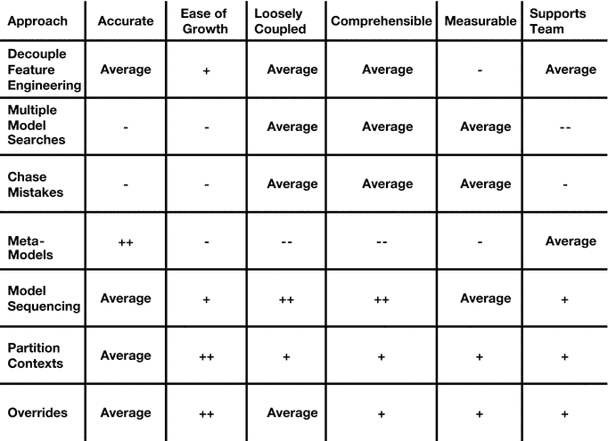

# 21. 组织智能

在大多数大规模系统中，智能创建是一项团队活动。多人可以同时处理智能工作，构建其不同部分，或研究不同的问题领域。多人也可以在不同时间接手智能工作，接替已离开的团队成员，或重新审视一个曾经有效但开始出现问题的智能。组织智能的一些方式示例如下：

*   对大多数事情使用机器学习智能，但使用人工智能来纠正错误。
*   对来自法国的用户使用一种机器学习智能，对来自日本的用户使用另一种。
*   将启发式智能的输出作为特征输入到机器学习智能中。

本章讨论组织智能的方法以及创建智能的过程，以使其健壮，并允许多人有效协作。

## 组织智能的理由

你可能希望从构建单一整体智能（例如，单个机器学习模型）转向组织化智能，原因有很多：

*   **协作**：大规模智能构建是一项协作活动。你可能需要 3 人、5 人或 15 人共同为一个智能系统构建智能。如果是这样，你就需要找到方法让他们高效地协同工作，而不是相互竞争，争夺那个“一统天下”的智能的所有权。
*   **清理错误**：每个智能都会犯错，修正一个错误往往会导致其他位置出现更多错误。此外，试图让基于机器学习的智能停止犯某个特定错误并不容易——这通常需要一些实验和运气。组合多个智能可以快速缓解错误，为更复杂的智能提供支撑。
*   **用简单方法解决简单部分**：有时问题的一部分很简单，用少量启发式方法就能出色（或完美）地解决。在这些情况下，你可以尝试让机器学习去学习一个你已经知道如何做的模型，或者你可以将问题分解，让启发式方法解决简单的部分，而机器学习则专注于问题中更困难的部分。
*   **整合遗留智能**：世界上已经存在大量智能。现有的智能和智能创建过程可能非常有价值。你可能希望将它们整合到一个智能系统中，以发挥其优势，并帮助它们变得更有效。

## 良好组织智能的特性

组织智能可能既困难又问题重重。如果组织不当，各层智能会相互依赖各自的特性。对某个智能的任何更改都会导致其他智能发生意外（且难以追踪）的变化。你最终可能会陷入一种明知需要做出改变，却根本无法改变的境地——就像意大利面条式代码一样，你可能会得到意大利面条式智能。

一个组织良好的智能应具备以下所有特性：

*   **准确性**：组织方式不应过多降低准确性潜力。它应该是在短期成本（即较低的即时准确性）与长期收益（即智能系统整个生命周期内更高的准确性）之间做出的良好权衡。
*   **易于扩展**：任何人都应该能够轻松地获得洞察、创建一些智能，并将其放入系统中。
*   **松散耦合**：应尽量减少一个智能影响其他智能行为的能力。智能之间的接口应该清晰，并且智能之间不应使用彼此内部运作的信息。
*   **可理解性**：对于用户遇到的每个结果，系统应能精确定位参与决策的智能（或多个智能），并且每个决策/结果所涉及的智能数量应尽可能少。
*   **可衡量性**：对于智能的每个部分，都应能够确定该部分智能为用户带来了多少益处。
*   **支持团队**：组织策略应与团队协作。组织应允许智能创建者的成功相互放大彼此的工作。它应避免设定相互冲突的目标，或造成参与者以非生产性方式竞争的需求。

## 组织智能的方法

本节讨论多种组织智能以及智能创建过程的技术，并根据良好组织智能的关键特性对其进行评估。大多数大型智能系统会同时使用其中多种方法。而且，选择非常非常多——这里的技术只是一个起点：

*   解耦特征工程
*   多模型搜索
*   追踪错误
*   元模型
*   模型排序
*   划分上下文
*   覆盖规则

以下部分将描述这些方法，并根据它们满足良好组织智能标准的程度进行排名。这是一个主观的评分标准，旨在突出相对的优势/劣势，如下所示：

| ++ | 真正的优势 |
| + | 优于平均水平 |
|   | 平均水平 |
| - | 低于平均水平 |
| - - | 需要关注的挑战 |

所有这些方法都是可行的，并在实践中使用。但你应该准备好应对所选组织策略中固有的挑战。

### 解耦特征工程

组织智能创建的一种方法是分离特征工程任务，使每个智能创建者都能探索上下文中明确划分的部分，并将其转化为特征。例如，在尝试理解一个网页时：

*   一个智能创建者可以专注于页面内容，使用词袋模型和 n-gram 等标准方法将词语转化为特征。
*   另一个智能创建者可以专注于理解页面文本的语义，使用词性标注、情感分析等方法。
*   另一个可以查看网站的历史记录、托管位置、创建者以及他们创建的其他内容。
*   另一个可以探索网页上的图像，并尝试从中创建特征。
*   另一个可以查看用户的属性。

每个参与者都需要能够将他们的特征提取代码注入到建模过程中。他们需要能够调整模型参数，以充分利用新的工作成果。他们还需要能够部署自己的工作。

解耦特征工程面临的一些挑战包括：

*   **模型构建冲突**：一种模型/参数集可能对某类特征效果更好，而对另一类特征效果较差。参与者需要权衡取舍，以促进整个系统的成长，而不是简单地蚕食现有特征集的价值。
*   **冗余特征**：多种特征创建方法可能利用上下文中相同的基础信息。由此产生的特征可能彼此非常相似。智能创建者之间可能会就如何消除冗余产生冲突。
*   **特征值的不稳定性**：当向机器学习算法引入新特征时，通常会改变模型构建搜索的方向，这可能会对其他特征的值以及模型所犯的错误类型产生剧烈影响。添加新特征可能需要全局理解特征集/模型，并对特征创建代码的其他部分进行一些调整，以保持整体平衡。

总而言之，解耦特征工程的方法：

*   **准确性：一般** 这种方法没有太多妥协之处，智能创建者可以并行工作以取得进展。
*   **易于扩展：+** 向现有模型添加几个新特征在概念上很简单。虽然不是绝对最简单，但相当不错。
*   **松散耦合：一般** 特征之间可以相互影响，但只要积极消除冗余，耦合就不应成为主要问题。
*   **可理解性：一般** 在调试交互时，缺乏精确定位问题特征的良好工具，许多模型类型使得调试尤其困难。有时你只能“尝试一次移除一个特征并重新训练，看看问题何时消失”。
*   **可衡量性：–** 在初始添加特征时，衡量改进很容易。但随着时间的推移（例如，当问题发生变化时），追踪特征的贡献就不那么容易了。
*   **支持团队：一般** 当上下文中有清晰的边界时，事情可以顺利进行，但肯定有很多方式会导致关于哪些特征应该保留、哪些应该剔除的冲突，尤其是在存在任何运行时约束（CPU 或 RAM）的情况下。

### 多模型搜索

另一种组织智能的方式是允许多个创建者尝试模型构建过程。例如，也许一个团队成员是线性模型的专家，而另一个是神经网络的大师。这些实践者都可以尝试使用他们最熟悉的方法来创建智能，最终由最佳模型胜出。

在以下情况下，使用多模型搜索可能有效：

*   你的智能创建者对不同方法有丰富经验。
*   你正处于构建智能系统的早期阶段，希望广泛撒网，看看哪些方法效果最好。
*   你的系统发生了重大变化（例如问题发生重大变化或使用量大幅增加），并且希望重新验证你选择了正确的建模方法。

但使用多模型搜索可能导致重复工作和冲突，因为最终一种方法会胜出，而其他方法则会失败。

多模型搜索的方法：

*   **准确性：-** 这种方法使得长期利用众多智能创建者变得困难。它应仅在智能创建过程的关键部分谨慎使用，例如当明确需要改变时。
*   **易于扩展：-** 要交付一个新的智能，你必须击败旧的智能。这意味着新想法需要相当完整，并在部署前进行广泛评估。
*   **松散耦合：一般** 只有一个智能，因此不存在特别的耦合问题。
*   **可理解性：一般** 只有一个智能，因此不存在特别的理解问题。
*   **可衡量性：一般** 只有一个智能，因此不存在特别的可衡量性问题。
*   **支持团队：- -** 这是一种赢家通吃的工作方式，意味着会有建模的赢家和输家。它也倾向于导致浪费工作——追逐一个永远无法实现的建模想法。

### 追逐错误

另一种方法是将智能问题视为软件缺陷。缺陷可以分配给智能创建者，他们可以自行找出需要做出哪些改变来修复问题。例如，如果你在处理某个子群体（比如儿童）时遇到困难，就派一个人去弄清楚需要在上下文中添加什么，或者改变哪些特征，或者改变哪些建模方法，以便在儿童群体上做得更好。

智能总会犯错，因此这种方法可能会永无止境。

这种方法的一个关键问题是，要弄清楚哪些错误只是随机错误，哪些是可以通过改变智能创建来帮助解决的系统性问题。使用这种方法时，很容易陷入追逐错误问题的困境，让所有人沮丧，却毫无进展。

在我看来，这种方法应少用，并且仅在项目初期（当存在大量合理缺陷时）或出现灾难性问题时使用。

追逐错误的方法：

*   **准确性：-** 智能有时会以这种方式工作（比如处理子群体问题），但很容易被吸引去追逐错误的错误。
*   **易于扩展：-** 每个人都需要了解一切，才能发现和追踪错误，制定有效的变更，并部署修复。此外，这种方法往往导致在解决哪些问题上做出糟糕的决策。
*   **松散耦合：一般** 实际上不影响耦合。
*   **可理解性：一般** 实际上不影响可理解性。
*   **可衡量性：一般** 实际上不影响可衡量性。

*   **支持团队：-** 这种方法没有为人们提供良好的工作边界。而且，很容易通过修复一个错误而引发另一个错误，并且通常要到很久以后才能清楚一个修复导致了另一个错误。如果操作不当，这种方法可能会造成糟糕的工作环境。

### 元模型

元模型方法是将系统中各种智能体的预测视为元智能体的特征。每个基础智能体运行并做出决策，然后元智能体审视所有提出的预测，并决定真正的输出应该是什么。使用元模型可以：
*   **非常准确**，因为它汇集了尽可能多的方法，并学习每种方法在哪些情境下有效、在哪些情境下表现不佳。
*   **整合旧有智能体的绝佳方式**。例如，当你发现一个比原有启发式方法更优的新智能体时，你可以抛弃原有的启发式方法……或者将它们作为新智能体的一个特征来使用。
*   **促进多个智能体创建者协作的好方法**。对他们可以尝试的内容没有限制。元模型会使用它们产生的有价值信息，并忽略无价值的信息。

但元模型的管理也可能相当棘手。一些复杂性包括：
*   **元智能体与基础智能体紧密耦合**，更改其中任何部分都可能需要重新训练和调整所有部分。
*   **如果系统的任何部分出现故障**（例如，某个模型开始表现不佳），整个系统都可能崩溃，并且很难追踪问题发生的地点和方式。

如果你想使用元模型，就需要一些方法来控制相互依赖模型带来的复杂性，例如：
*   **对哪些模型可以更改以及何时更改强制执行一些结构**——例如，冻结旧有智能体，只有在发现严重问题时才更改它。
*   **构建额外的机制**，以便非常、非常容易地重新训练和调整构成系统的所有智能体。

总而言之，使用元模型的方法：
*   **准确性**：++ 短期内，元模型有能力成为此处列出的方法中最准确的一种。其代价体现在其他方面。追求原始准确性，请使用元模型。
*   **易于扩展**：- 要部署一个新的智能体，你需要重新训练元智能体，这可能导致整体结果不稳定的风险。可能需要仔细测试。
*   **松散耦合**：- - 更改任何基础智能体通常都需要重新训练元智能体。任何智能体中的意外变化（例如，其依赖的某个数据源发生变化）都可能影响整个系统，甚至导致其完全崩溃。
*   **可理解性**：- - 每个智能体都对每个决策有贡献。当出现问题时，可能极难（甚至不可能？）追溯到根源。
*   **可衡量性**：- 当新智能体加入系统时，很容易衡量其效果。但随着时间的推移（例如，当问题发生变化时），追踪各个智能体的贡献则不那么容易。
*   **团队支持度**：一般 智能体之间可能存在冲突，但它们可以独立创建。当智能体需要在资源受限的环境中运行时，也可能出现资源竞争。

### 模型排序

模型排序是元模型方法的一种受限版本，其中元模型被限制为超级简单。在排序方法中，模型由智能体创建者排序。每个模型都有机会对结果进行投票。第一个以高置信度投票的模型获胜，并决定答案。

对于分类问题，可以通过设置一个默认答案来实现——如果没有人投票，答案就是“男性”——并允许每个模型以高精度的操作点来运行“女性”答案。如果任何模型非常确定它能给出高精度的“女性”答案，那么它就给出；如果没有模型确定，则返回默认的“男性”作为结果。

模型排序的准确性潜力低于可以同时组合所有投票的元模型，但它更容易编排和控制。

模型排序的方法：
*   **准确性**：一般 这种方法用部分潜在的准确性换取了易于管理和扩展。
*   **易于扩展**：+ 智能体创建者可以在序列中放入一个新模型（只要它具有足够高的精度），而不会影响系统的任何其他部分。
*   **松散耦合**：++ 模型完全解耦，并通过一个每个人都能理解的简单程序进行组合。
*   **可理解性**：++ 每个交互都可以追溯到决定结果的智能体，并且每个智能体都可以有明确的所有者。
*   **可衡量性**：一般 很容易衡量每个智能体给用户带来了多少正面和负面交互。缺点是第一个高置信度的答案被采纳，因此其他智能体可能无法获得它们应得的全部功劳（或责任）。
*   **团队支持度**：+ 任何人都可以轻松地增加价值。潜在的冲突点包括模型排序的顺序以及要求的精度阈值。但遥测技术应该能提供良好的数据来经验性地做出这些决策，因此它们不应该引起太多争论。

### 分区上下文

按上下文分区是组织多个智能体的另一种简单方法。它的工作原理是在上下文上定义一些简单的规则，将其划分为多个分区，然后为每个分区配备一个智能体（或模型序列、元模型等）。例如：
*   一个智能体负责美国的服务器，另一个负责所有其他地区的服务器。
*   一个智能体负责小型网站，一个负责大型网站，一个负责聚合内容的网站。
*   一个智能体负责灰度图像，一个负责彩色图像。
*   一个智能体负责新用户，一个负责有大量历史记录的用户。

这种方法有优势，它允许你在问题的不同部分使用不同类型的智能体，用简单的方式解决简单的情况，并且还能控制各个分区上错误的发生率。当然，机器学习算法在技术上可以在内部使用这类信息——并且可能在原始准确性方面选出更好的分区——但手动分区对于编排和组织来说可能非常方便。

分区的方法：
*   **准确性**：一般 这种方法将一个难题变成了几个难题。这不一定会影响准确性，但可能会，尤其是在一个领域的创新可能无法移植到所有其他可能受益的领域时。
*   **易于扩展**：++ 智能体创建者可以定义一个特定的分区，并为其提供量身定制的智能体，而不会影响其他分区。
*   **松散耦合**：+ 模型完全解耦，并通过一个可理解的程序进行组合（除非分区失控）。
*   **可理解性**：+ 每个交互都可以追溯到决定结果的智能体，并且每个智能体都可以有明确的所有者。
*   **可衡量性**：+ 很容易衡量每个智能体给用户带来了多少正面和负面交互。
*   **团队支持度**：+ 任何人都可以轻松地增加价值。此外，当一个团队成员接手一个问题（通过划分出给其他模型带来麻烦的部分）时，这可以被视为一种帮助：“我很高兴你处理了那些错误，这样我的模型就可以专注于增加其他价值了……”

### 覆盖机制

覆盖机制是处理错误时极其重要的概念。这种组织智能的结构通过赋予一个受信任的智能（通常由人类创建和维护）权限，使其能够覆盖所有其他智能（通常由机器学习创建）的输出——无论这些智能给出什么结论。

其应用方式之一是通过手动为特定上下文标注特定结果。这可用于精准修正某些破坏性错误。例如：
*   无论任何智能认为如何，这个网页都不好笑。
*   当烤面包机的所有传感器读取到特定组合时，无论智能如何判断，都烤制 2 分钟（因为我们确切知道那是哪种产品）。

另一种应用方式是创建可作为护栏的规则，防止出现明显错误的情况。例如：
*   如果过去 5 分钟内已向颗粒烤炉投放了 10 颗颗粒，则无论智能如何指示，都不要再投放。
*   如果网页包含这 15 个冒犯性词汇/短语中的任何一个，则无论智能如何判断，它都不好笑。

覆盖智能应极其谨慎地使用。它不应试图解决问题；而应仅用于掩盖最严重的错误。

使用覆盖机制的方法具有以下特点：
*   **准确性：中等** 只要覆盖机制使用得当。它们应作为最后一道防线，而非复杂的手工智能。
*   **易于扩展：++** 智能创建者（或具备常识的非专业人士）可以定义上下文并指定结果。工具可提供帮助。
*   **松散耦合：中等** 覆盖机制与其所修正的错误存在一定耦合，可能会在系统中存在的时间超过实际需要。如果管理不善，久而久之可能成为维护难题。
*   **可理解性：+** 每次交互都可追溯到影响它的任何覆盖机制。不过，智能创建者在评估新智能时可能会忘记检查所有覆盖机制，这可能导致一些混淆。
*   **可衡量性：+** 很容易衡量每个覆盖机制为用户节省或带来了多少正面和负面交互。
*   **支持团队：+** 只要覆盖机制使用得当，它们就能提供一种简单的方法来提高智能创建者的生产力。智能创建者与生成覆盖机制的人员之间可能存在潜在冲突。

## 总结

大多数大型智能系统并非由单一智能构成；它们拥有组织化的智能集合。组织化智能允许多个智能创建者有效协作；以低成本清理错误；使用正确的智能类型来针对问题的正确部分；并整合遗留智能。

一个组织良好的智能系统应具备：准确性、易于扩展、松散耦合、可压缩性、可衡量性，并支持团队。当然，它也必须准确，有时为了准确性需要牺牲组织性。

组织智能的方法有很多种。本章介绍了一些主要方法，但其他方法也是可行的。重要的组织技术包括：解耦特征工程；执行多模型搜索；追踪错误；元模型；模型序列化；上下文分区；以及覆盖机制。图 21-1 显示了汇总表。

图 21-1 智能组织方法比较

## 思考题…

阅读本章后，你应该能够：
*   理解在大型、复杂的智能系统上工作，或与智能创建者团队合作需要什么。
*   能够实现一种智能架构，使正确的智能能够处理问题的正确部分，并且所有参与者都能高效协作。

你应该能够回答如下问题：
*   描述一个不需要任何智能组织的智能系统——即仅通过单一模型就能工作的系统。
*   这可能会在哪些方面引发问题？最可能发生的问题是什么？
*   设计一个简单的智能组织方案，以解决最可能发生的问题。