# 1. 数据工程中的核心技术

好的，作为一名高级文档工程师和翻译员，我将严格遵循您提供的注意事项和示例，将给定的英文文本翻译成中文。

## 引言

本章旨在帮助你快速入门。在我们开始探索高级数据工程实践之旅时，打好关键概念和工具的基础至关重要。本章旨在提供关于Python编程、使用GitHub进行软件版本控制以及结构化查询语言（SQL）高级概述的复习。虽然这些内容看似互不相关且各不相同，但它们在开发高效的数据工程管道中扮演着重要角色。Python的数据生态系统、使用Git的软件版本控制系统以及使用SQL处理关系数据库系统，无疑将巩固你的基础，并帮助你应对数据工程挑战。这些都是具有挑战性和复杂性的主题，尤其是将它们放在一起复习；我希望你能坚持下来，自己学习和实践。

在本章结束时，你将能够：

*   理解与高级软件工程实践相关的一些关键Python编程概念。
*   了解软件版本控制系统和Git；创建Git仓库；并执行基本的版本控制操作，如分支、复刻和提交拉取请求。
*   掌握足够的知识，在GitHub上建立自己的代码仓库。
*   复习在数据库系统中查询和操作数据的基本SQL概念。
*   识别高级SQL概念以及编写高效、优化SQL代码的最佳实践。

工程化数据管道并非易事。其中涉及大量复杂性，并且需要运用分析性思维。这种复杂性包括但不限于：多变的数据模型、复杂的业务逻辑、接入各种数据源，以及构成该职业的众多其他任务和项目。通常，数据工程师会构建机器学习模型来识别异常，并对数据进行高级插补。我根据自身经验选取了一些主题，这些主题对于正在构建管道的数据工程师或软件开发人员来说具有价值。

## Python编程

Python编程语言有两个主要版本：Python 2和Python 3。Python 2已停止支持。Python 3是Python编程的事实标准语言版本。Python编程语言（3.*版本）仍然是开发中最受欢迎的语言，它拥有大量社区支持的数据处理库，并被广泛采用。在本节中，让我们花些时间，在你已有的基础编程知识之上，了解一些可能有帮助的Python编程概念。这些概念将以较高层次进行讨论。我鼓励你进一步研究这些类、方法以及可以传递给这些方法的参数。

### F字符串

Python的`f`字符串允许你轻松地将变量和表达式插入到打印字符串中。与传统的字符串格式化相比，`f`字符串更具可读性，也更易于理解。你可以通过在字符串前面、引号之前放置字符`F`来创建一个`f`字符串。该字符不区分大小写，这意味着你可以使用大写`F`或小写`f`。示例如下：

```python
Greetings = f"Hello, it is a beautiful day here, at the park today"
```

现在，你可以在`f`字符串中插入变量和表达式。为了演示，我们上面展示的`f`字符串没有插入内容。以下是具体操作方法：

```python
Fruit = "berries"
Cost = 1.5
Number = 3
print(f"the {Fruit} costs {Cost} per piece, totals to $ {Cost*Number} dollars")
```

将返回：

```
the oranges costs 1.5 per piece, totals to $ 4.5 dollars
```

### Python函数

在编程中，函数是一组可以一起执行以完成特定任务或操作的指令。它可能接受输入，也可能不接受；可能返回输出，也可能不返回。让我们看一个函数的例子：

```python
def add(a,b):
    c = a+b
    return c
```

当你调用这个函数时：

```python
print(add(2,3))
```

它将返回：

```
5
```

让我们看一个更复杂一点的函数。这里，我们有一个函数，它接收摄氏温度作为输入，并计算华氏温度作为输出：

```python
def f_calc(celsius):
    return ((9/5 * celsius) + 32)
```

这与下面的函数是等价的。两者在语法上是相同的。我们将在另一节中讨论这种定义函数的方式：

```python
def f_calc(celsius: int) -> float:
    return ((9/5 * celsius) + 32)
```

在前面的代码中，我们传递了一个名为`celsius`的整型变量。在函数内部，我们计算一个值，并以浮点类型返回该值。这就是函数如何接受输入参数、处理它们并提供输出的方式。

### 高级函数参数

#### *args

让我们看看如何在函数中使用`*args`参数。函数中的参数（arguments）参数可用于向函数传递可变数量的参数。如果你使用了`*args`语法，就可以传递多个变量，而无需逐个定义它们。让我们对比两个例子来更好地理解这个概念：

```python
def add(a,b):
    c = a+b
    return c
```

当你运行这段代码：

```python
add(2,3)
```

它将返回：

```
5
```

如果我们不知道需要多少个输入参数怎么办？我们可以在这里使用参数（arguments）：

```python
def add_args(*args):
    total_sum = 0
    for i in args:
        total_sum += i
    return total_sum
```

所以，当你运行这段代码：

```python
add_args(3,4,5,6,7)
```

它将返回：

```
25
```

注意，你也可以向函数传递一个列表，仍然可以实现相同的功能。但是使用参数（arguments），你可以调用一个空函数并返回`None`。

#### **kwargs

这与参数（arguments）非常相似，区别在于你可以为参数中的每个项关联一个键：

```python
def add_kwargs(**kwargs):
    total_sum = 0
    for i in kwargs.values():
        total_sum += i
    return total_sum
```

使用`*args`和`**kwargs`对于增强函数的灵活性、补充装饰器实现以及传递可变数量的输入参数非常有益。

### Lambda函数

在Python中，`lambda`是`lambda`表达式的简称。它们是内联函数，用于计算单个表达式。当表达式被调用时，该单个表达式会被求值。让我们通过一个例子来说明：

```python
calculate_fahrenheit = lambda celsius: 9/5*celsius + 32
```

所以，当你调用这个函数时：

```python
calculate_fahrenheit(27)
```

它将返回：

```
80.6
```

### Python中的装饰器

Python中的装饰器是一种为现有函数添加额外功能的方式。装饰器本身就是一个函数。在参数列中，它会将另一个函数作为输入参数。用微积分的术语来说，它相当于函数的函数。如果数学不是你的强项，那么让我们看一个简单的例子。

这是一个测试装饰器：

```python
def testdec(func):
    def wrapper():
        print("+++Beginning of Decorator Function+++")
        func()
        print("+++End of Decorator Function+++")
    return wrapper
```

让我们尝试在一个示例函数上使用这个装饰器：

```python
@testdec
def hello():
    print("Hello!")
```

当我们运行这个函数时：

```python
hello()
```

它将输出：

```
+++Beginning of Decorator Function+++
Hello!
+++End of Decorator Function+++
```

### 类型提示

类型提示是Python的一项功能，允许你指定变量声明、函数参数以及函数返回变量的数据类型。类型提示有助于更清晰地理解期望的数据类型以及函数返回何种类型的数据。类型提示背后的理念是提高代码的可读性、可维护性，并能够更快地调试和排查错误。类型提示并非强制要求；你仍然可以在不指定数据类型的情况下传递参数（Python在运行时仍会对其进行检查）。

以下是一个演示Python中类型提示功能的简单示例：

```python
def some_function(a: float, b: float) -> float:
    c = a+b
    return c
```

### Typing模块

`typing`模块支持对高级数据结构进行类型提示，并提供了多种功能。以下是一个字典的示例：

```python
from typing import Dict
var2: Dict[int, str] = {234: "JohnDoe"}
```

注意“`Dict`”的用法。它的作用与“`dict`”（Python核心提供的字典类型）相同。“`Dict`”并没有提供额外的功能，只是你必须为字典的键和值都指定数据类型。如果你使用的是Python 3.9或更高版本，你可以使用“`Dict`”或“`dict`”。

# Python 类型提示与常用模块

让我们看另一个名为 `Union` 的示例，其中变量可以是几种类型之一：

```python
from typing import Union
var4: list[Union[int, float]] = [3, 5, 5.9, 6.2]
```

在 Python 3.10+ 中，你还可以使用 `|` 运算符。以下是一些示例：

```python
var5: list[int | float] = [3, 5, 5.9, 6.2]
var6: list[int | str | float] = [5, 6, "foo", "bar", 7.8]
```

## Python 中的生成器

生成器类似于 Python 中的常规函数，但它使用 `yield` 关键字而不是 `return` 关键字来返回结果。`yield` 关键字有助于返回一个迭代器，当对其进行迭代时，该迭代器会提供一系列值。而 `return` 关键字则返回函数的一次性结果。

让我们看一个简单的示例：

```python
def generator_square(n):
x = 0
while x <= n:
yield x*x
x += 1
for i in generator_square(10):
print(i)
```

在这个示例中，我们有一个生成给定数字平方的函数。这个函数在被调用时，不会一次性返回一个列表，而是只返回函数的一个实例。该函数返回一个生成器对象。因此，当你迭代这个函数时，每次迭代都会得到一个值。

## Enumerate 函数

《牛津英语词典》将“enumerate”定义为“逐一列出或提及若干事物”。你只需要记住这一点。`enumerate` 函数应用于某种数据类型时，会返回一个枚举对象。这些枚举对象返回带有索引的数据类型，索引从 0 开始，并包含索引对应的值。

以下是一个基本说明：

```python
a = ['apples','oranges','melons','bananas']
print(a)
```

会输出：

```python
['apples', 'oranges', 'melons', 'bananas']
```

然而，如果你枚举同一个列表，你会得到类似这样的结果：

```python
for i in enumerate(a):
print(i)
```

会输出：

```python
(0, 'apples')
(1, 'oranges')
(2, 'melons')
(3, 'bananas')
```

以下是一个使用带类型提示的元组以提高可读性的示例：

```python
var10: tuple[int, str] = ([1,"apple"],[2,"orange"],[3,"melon"],[4,"banana"])
print(var10)
([1, 'apple'], [2, 'orange'], [3, 'melon'], [4, 'banana'])
for i,j in enumerate(var10):
print(i,"-->",j)
```

会输出：

```python
0 --> [1, 'apple']
1 --> [2, 'orange']
2 --> [3, 'melon']
3 --> [4, 'banana']
```

对于字典来说，字典本身已经有键，因此没有必要再添加索引。然而，这并非限制因素。我们仍然可以使用 `enumerate` 来迭代字典，但需要遍历每个（键，值）元组。我们需要使用 `items()` 方法来从字典中获取每个元组。

以下是一个迭代字典的示例：

```python
sample_dict = {1:"apple", 2:"orange",3:"melon",4:"banana"}
print(sample_dict)
```

会输出：

```python
{1: 'apple', 2: 'orange', 3: 'melon', 4: 'banana'}
```

这是另一个示例：

```python
for i,j in sample_dict.items():
print(f"Key is {i} and Value is {j}")
```

会输出：

```python
Key is 1 and Value is apple
Key is 2 and Value is orange
Key is 3 and Value is melon
Key is 4 and Value is banana
```

让我们使用 `enumerate`，其中变量“i”代表索引，变量“j”代表字典中的每个键值对：

```python
for i, j in enumerate(sample_dict.items()):
print(i,j)
```

会输出：

```python
0 (1, 'apple')
1 (2, 'orange')
2 (3, 'melon')
3 (4, 'banana')
```

让我们在这里尝试另一种变体：

```python
for index, (key, value) in enumerate(sample_dict.items()):
print(index, key, value)
```

会输出：

```python
0 1 apple
1 2 orange
2 3 melon
3 4 banana
```

以下是一个迭代字符串对象的示例：

```python
name = "JohnDoe"
for i,j in enumerate(name):
print(i,"-->",j)
```

会输出：

```python
0 --> J
1 --> o
2 --> h
3 --> n
4 --> D
5 --> o
6 --> e
```

## 列表推导式

列表推导式是一种通过 Python 表达式定义和创建列表的方法。列表推导式返回一个列表。它可以被视为 lambda 表达式的替代品。

让我们看一个简单的示例：

```python
readings_in_km = [10,12,13,9,15,21,24,27]
readings_in_miles = [(i/1.6) for i in readings_in_km]
print(readings_in_miles)
[6.25, 7.5, 8.125, 5.625, 9.375, 13.125, 15.0, 16.875]
```

我们能够动态地（且优雅地）根据以公里为单位的读数创建一个以英里为单位的读数列表。

让我们看另一个示例，根据数字是奇数还是偶数来计算其平方或立方。这意味着需要有一个迭代循环和一个决策循环来检查列表中的每个项目。以下是未使用列表推导式的代码可能的样子：

```python
a: list[int] = [1,2,3,4,5,6,7,8,9,10]
b: list[int] =[]
for x in a:
if x % 2 == 0:
b.append(x**2)
else:
b.append(x**3)
print(b)
```

让我们尝试将列表推导式应用于此操作：

```python
a: list[int] = [1,2,3,4,5,6,7,8,9,10]
b = [x**2 if x % 2 == 0 else x**3 for x in a]
```

这是另一个在列表中创建元组的示例。以下是执行此操作的常规方法：

```python
var13: list[int, int] = []
a_list: list[int] = [1,2,3]
b_list: list[int] = [3,1,3]
for x in a_list:
for y in b_list:
if x+y <= 4:
var13.append((x,y))
```

以下是使用列表推导式执行相同操作：

```python
var12 = [(x, y) for x in a_list for y in b_list if x+y <= 4]
print(var12)
```

会输出：

```python
[(1, 1), (1, 2), (1, 3), (2, 1), (2, 2), (3, 1)]
```

## Random 模块

`random` 模块是 Python 的内置模块，用于生成随机数或伪随机数，包括整数、浮点数和序列。让我们看看一些在构建数据管道时可能更常用的方法。

### `random()`

此方法返回一个介于 0.0 和 1.0 之间的随机浮点数：

```python
import random
var14 = random.random()
print(var14)
```

### `randint()`

此方法返回一个介于用户提供的最小值和最大值之间的整数：

```python
import random
print(random.randint(1,33))
```

### `getrandbits()`

`random` 库中的 `getrandbits()` 方法会生成一个介于 0 到 2^k – 1 之间的随机整数。当你需要比 `randint` 更大的随机整数，或者需要生成随机布尔值时，这个方法非常有用。

我们来看一下这两种情况：

```python
import random
print(random.getrandbits(20))
print(random.getrandbits(20))
print(random.getrandbits(20))
```

会输出

```

```

以下是生成随机布尔值的示例：

## Python random 库常用函数

```
print(bool(random.getrandbits(1)))
print(bool(random.getrandbits(1)))
print(bool(random.getrandbits(1)))
print(bool(random.getrandbits(1)))
```

会输出

```
True
False
True
True
```

如你所见，你可以生成 k 个随机位的值，也可以传入参数 1 将其转换为布尔值，这样就能得到一个随机布尔生成器。

#### choice( )

`choice`函数从用户提供的序列（如列表、元组等）中随机选择一个元素：

```
import random
fruit = ['apple','banana','melon','orange']
print(random.choice(fruit))
```

会返回

```
'apple'
```

如果你再次运行`choice`方法

```
print(random.choice(fruit))
```

它会返回不同的结果。以下是另一个输出：

```
'orange'
```

#### shuffle( )

`shuffle()`方法会打乱序列，改变其中字符的当前排列顺序。例如，我们已有

```
print(fruit)
fruit = ['apple','banana','melon','orange']
```

现在

```
random.shuffle(fruit)
```

于是

```
print(fruit)
['melon', 'banana', 'apple', 'orange']
```

#### sample( )

`random`库中的`sample`方法从总体列表或集合中返回 k 个唯一的元素。此方法生成无放回样本，意味着一个元素被选中后，就不能再次被选中：

```
Import random
alpha = list("abcdefghijklmnopqrstuvwxyz")
print(alpha)
['a', 'b', 'c', 'd', 'e', 'f', 'g', 'h', 'i', 'j', 'k', 'l', 'm', 'n', 'o', 'p', 'q', 'r', 's', 't', 'u', 'v', 'w', 'x', 'y', 'z']
print(random.sample(alpha, 7))
['n', 'v', 'x', 'u', 'p', 'i', 'k']
print(random.sample(alpha, 7))
['s', 'y', 'i', 't', 'k', 'w', 'u']
print(random.sample(alpha, 7))
['n', 'u', 'm', 'z', 'o', 'r', 'd']
print(random.sample(alpha, 7))
['e', 'y', 'a', 'i', 'o', 'c', 'z']
```

#### seed( )

`random`库中的`seed()`方法用于设置生成随机数的种子。因此，如果你用某个整数指定了种子，其原理是你会得到相似的随机数，从而每次都能复现相同的输出。这在机器学习、仿真模型等领域有助于生成随机样本。

## Git 源代码管理

Git 是一个软件版本控制系统，用于追踪软件程序的更新和变更。同事之间会采用版本控制系统来协作开发软件。在当前的实践之前，开发者通过电子邮件或即时通讯平台共享代码来进行协作。即使你是一名独立开发者，使用版本控制系统也能让你从中受益，这样你可以从上次中断的地方继续工作，并在需要时参考代码的早期版本。

### Git 基础

Git 是一个分布式版本控制系统，其中同一份代码存在远程副本和服务器副本。代码数据库被称为仓库，或简称为 `repo`。你从服务器获取一份仓库副本并开始使用它。这个过程称为分支。然后，你可以提交一个提案，将你的分支合并到集中式副本（主分支），这通常被称为拉取请求。提交后，它会交给仓库管理员，他们会执行所谓的批准拉取请求操作。

### GitHub

让我们来看看 GitHub，它是领先的 Git 平台之一。GitHub 被认为是世界上最大的分布式版本控制系统，它托管并追踪软件代码的变更，同时为开发提供大量功能。

#### 安装与设置

访问 [`https://github.com/`](https://github.com/) 并点击“注册”以创建新账户。系统会要求你通过提供用户名、密码和电子邮件地址来完成注册。你可以选择个性化你的 GitHub 或跳过个性化设置。现在，打开终端，使用以下命令检查是否已安装 git 和 Secure Shell (SSH) 客户端：

```
sudo apt update
sudo apt install git ssh
```

或者，你也可以访问 git-scm 网站，在“下载”部分获取 git 软件包。网站地址如下：

```
https://git-scm.com/downloads
```

下载并安装完成后，我们继续在工作站中设置 git。以下是入门步骤。

让我们设置用户名和电子邮件，因为每次提交文件更改时，`git commit` 都会使用这些信息。相关命令如下：

```
git config --global user.name ""
git config --global user.email 
```

请记住，要提供你在注册过程中创建的唯一用户名，并且注册用户名时请使用引号。对于电子邮件，你需要提供你在 GitHub 注册过程中使用的电子邮件地址。同时，请务必使用 `--global` 关键字选项，这样 git 在与 git 系统的任何交互中都会始终使用这些凭据。如果你想用另一组不同的凭据覆盖这些信息，可以运行相同的命令，但不要加 `--global` 选项。

你可以直接在自己的终端中使用安全外壳协议访问 GitHub 仓库并写入文件。你需要生成一个 SSH 密钥和密码短语，登录你的 GitHub 账户，然后将从终端生成的 SSH 密钥和密码短语添加到 GitHub 账户中。这样，你就在你的工作站和 GitHub 账户之间建立了一个安全握手。

让我们生成一个新的 SSH 密钥：

```
ssh-keygen -t ed25519 -C ""
```

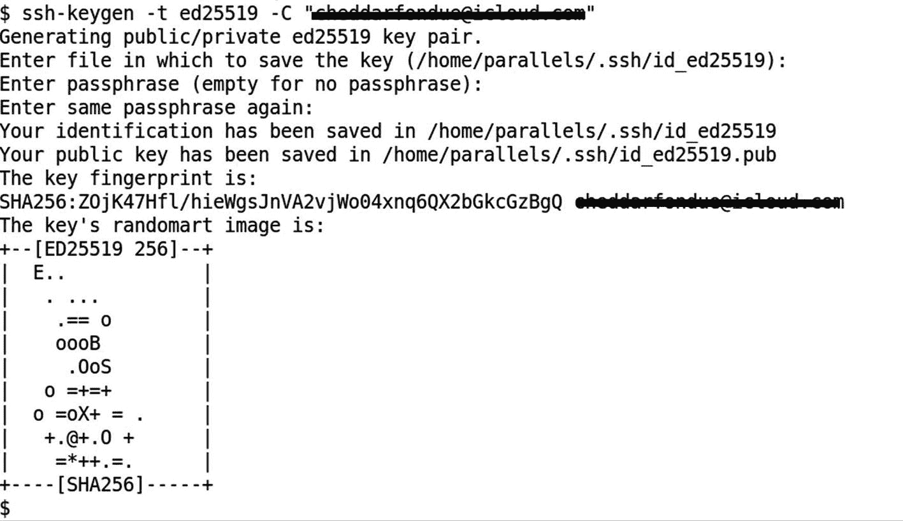

一个显示生成公钥或私钥对命令行的文本图。

图 1-1

在终端中生成新的 SSH 密钥

现在，当系统提示输入密码短语或其他选项时，请跳过（按回车键）。让默认位置保持不变。你的操作界面可能如下所示。

让我们在终端中启动 SSH 代理：

```
eval "$(ssh-agent -s)"
```

此命令将在后台启动 SSH 守护进程。现在，使用以下命令将 SSH 私钥添加到 SSH 代理中：

```
ssh-add ~/.ssh/id_ed25519
```

现在，在网页浏览器中打开一个新标签页，登录你的 GitHub（如果你已登出）；点击屏幕右上角的图标，从选项列表中选择“设置”。操作界面可能如下所示：

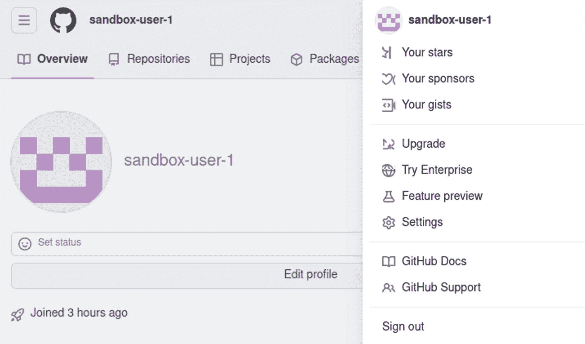

一个用户界面窗口的截图，标题为“sandbox user 1”。其中有名为“概览”、“仓库”、“项目”和“软件包”的菜单。“sandbox user 1”的菜单项已展开，包括：你的星标、你的赞助者、你的代码片段、升级以及其他选项。

图 1-2

访问 GitHub 账户的设置

进入 GitHub 设置后，导航并点击名为“SSH and GPG Keys”的选项，然后在浏览器右上侧选择“New SSH Key”选项。

你将获得一个添加之前步骤中创建的 SSH 公钥的选项。要执行此操作，你需要先复制 SSH 公钥。

打开终端，使用以下命令获取 SSH 公钥：

```
cat ~/.ssh/id_ed25519.pub
```

你可能会得到类似如下的输出：

```
ssh-ed25519 DH37589D364RIUHFIUSDHsr4SFFsdfx4WFRoc9Ks/7AuOsNpYy4xkjH6X youremail@emailprovider.com
```

复制此公钥，然后导航到你打开 GitHub 的网页浏览器——具体路径为：设置 ➤ SSH and GPG Keys——以添加新的 SSH 密钥。粘贴你刚刚复制的密钥。操作界面如下所示：

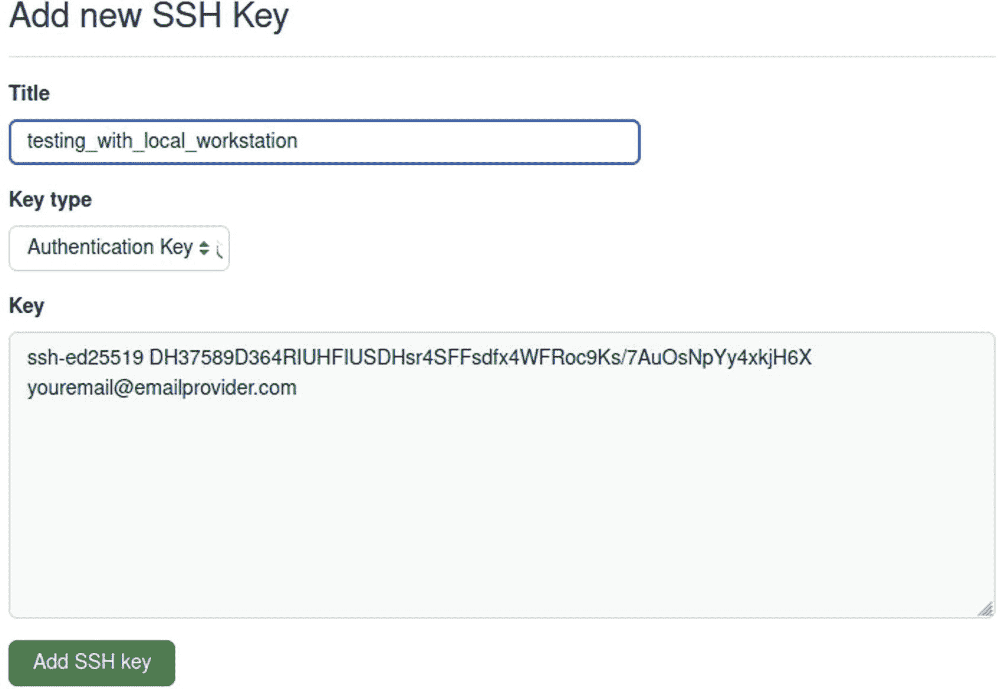

标题为“添加新 SSH 密钥”的软件窗口截图，其中包含标题、密钥类型和密钥等信息。底部有一个“添加 SSH 密钥”按钮。

图 1-3

添加新的 SSH 密钥

你可以根据自己的意愿提供一个方便记忆的标题，并将密钥类型保留为“身份验证密钥”。点击“添加 SSH 密钥”。

现在我们已经添加了 SSH 公钥，接下来通过以下命令从我们的 shell 测试与远程 GitHub 服务器的连接：

```
ssh -T git@github.com
```

你可能会收到一条警告。选择“是”。你的操作界面可能如下所示：

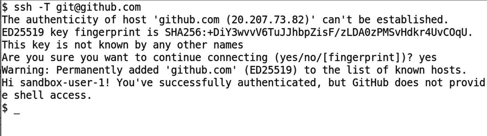

# Git入门指南

一个测试从shell到远程GitHub服务器连接的命令行文本图。

图 1-4

测试SSH连接

你可以忽略最后一行“GitHub不提供shell访问权限”。总的来说，如果你看到上述消息，则说明你已经正确设置了GitHub。

让我们创建一个新的仓库，并使用GitHub对其进行版本控制。要创建新仓库，请打开终端并将目录更改为一个可以测试`git`功能的文件夹。或者创建一个新文件夹并执行`git`初始化：

```
mkdir firstrepo
cd firstrepo
```

现在，在该文件夹内，使用以下命令初始化一个`git`仓库：

```
git init
```

上述命令将创建一个隐藏文件夹并初始化一个数据库。你可以将目录切换到该隐藏文件夹并查看其中的文件。你的操作界面可能如下所示：

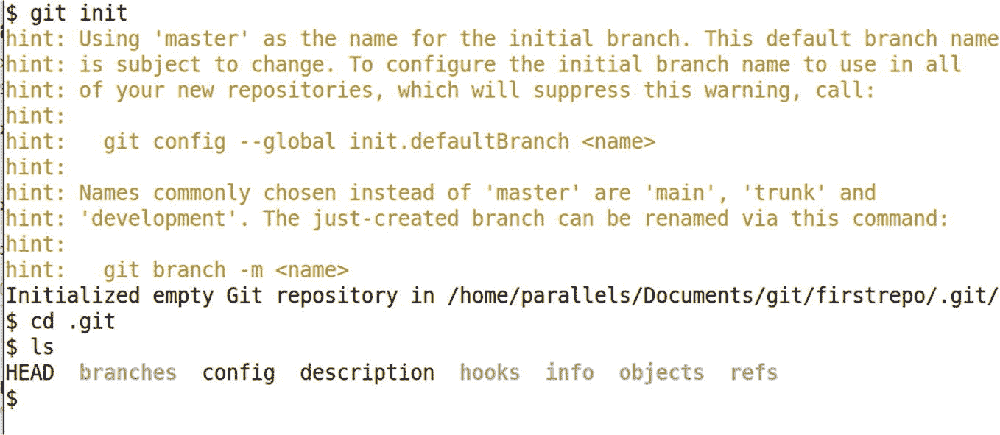

一个创建隐藏文件夹并初始化数据库的命令行文本图。

图 1-5

初始化一个新的`git`仓库

需要注意的是，`HEAD`文件是一个指向当前分支的文本文件，而`config`文件是另一个存储仓库本地配置的文本文件。无需更改任何内容，直接退出隐藏文件夹。

如果你想查看仓库的历史记录，可以使用以下命令：

```
git log
```

由于你刚刚创建这个仓库，可能还获取不到任何日志。另一个有用的命令是`git status`，它有助于获取仓库的状态：

```
git status
```

这将提供当前`git`仓库的状态。目前，我们还没有添加或更改任何文件，所以让我们尝试添加一个新文件。

这里有一个你可以使用的Python脚本：

```
import random
def somefunct(n: int) -> None:
for i in range(n):
print(random.randint(1,100))
somefunct(5)
```

当你运行这段代码时，它会打印出0到100之间的五个随机整数。现在让我们检查一下`git`仓库的状态是否发生了变化：

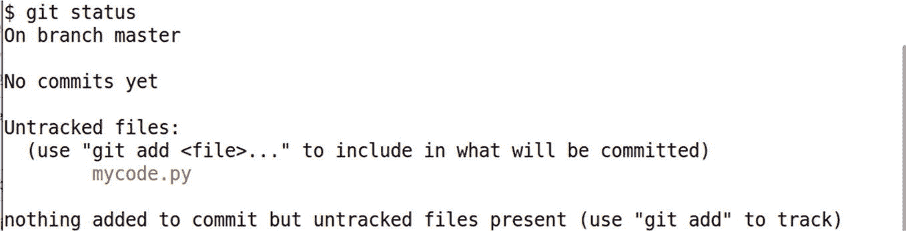

一个检查`git`仓库状态是否发生变化的命令行文本图。

图 1-6

检查`git`仓库状态

现在让我们将Python代码添加到`git`中，以便`git`系统可以跟踪代码的进展：

```
git add mycode.py
```

`git add`命令开始对文件`mycode.py`启用`git`跟踪功能；从工作流程的角度来看，`git`系统已将此文件从你的本地工作站提取出来，并将其移动到一个暂存区，在该区域启用了`git`跟踪功能。

到目前为止，我们只是将文件从本地文件系统移动到了一个暂存区，`git`可以在此识别该文件并开始跟踪。该文件尚未进入`git`仓库。如果你输入`git log`，你会得到类似如下的响应：

```
fatal: your current branch 'master' does not have any commits yet
```

确实如此。该文件尚未提交。那么，让我们尝试使用以下命令提交此文件：

```
git commit -m "created a function that returns k random numbers"
```

此提交已将代码移动到了位于本地目录中的实际`git`仓库中。引号中的消息实际上是一条提交消息，描述了此提交中所做的更改。

如果你想将本地`git`仓库推送到远程`git`仓库，那么你需要使用`git push`命令。这也称为同步，即将包含文件的本地`git`仓库上传到远程`git`仓库。

注意

重要的是要知道，到目前为止我们只在本地工作站上工作。这个仓库在远程GitHub上并不存在。因此，我们必须推送当前分支并将其设置为主分支。我们将在其他示例中看到如何开始使用远程分支。

## Git的核心概念

到目前为止我们所看到的内容被认为是`git`中的“hello world”。让我们再深入一点。假设我们的`git`仓库中有一个代码仓库。我们如何使用`git`与团队协作？让我们探索一下`git`中的一些核心概念。

假设你有一个包含两个Python代码的文件夹。假设`hello.py`包含以下内容：

```
def hello():
print("hello world")
```

另一个代码`main1.py`包含以下内容：

```
from hello import hello
hello()
print("this is from the main1")
```

你想在这个项目上工作，添加另一个函数。因此，你需要从GitHub服务器获取此现有代码的副本到你的本地工作站。嗯，有几种方法可以实现这一点。让我们详细了解一下。

### 克隆

`git`中的克隆是指从远程GitHub服务器获取此仓库的副本到你的本地工作站。其理念是获取一个本地副本并在本地工作。这通常在新项目开始时或作为最新团队成员加入现有项目时进行。克隆是必须的。以下是一些示例：

```
git clone git@github.com:sandbox-user-1/testrepo.git
git clone https://github.com/sandbox-user-1/testrepo.git
```

### 分支

分支是代码库中与主代码库（称为主分支或master分支）并行的版本。顾名思义，分支使你能够处理新功能和故障排除代码，并通过拉取请求将更改提交回主分支。分支用于临时更改和协作。

以下是创建新分支的方法：

```
git clone git@github.com:sandbox-user-1/testrepo.git
git branch
```

默认情况下，指针将位于主分支。如果你想访问开发分支，你需要手动切换到它。方法如下：

```
git checkout
```

或

```
git switch
```

### 复刻

复刻也是仓库的一个副本，不同之处在于你在自己的`git`环境中创建了自己的主分支或master分支。假设团队有一个主分支。当你创建分支时，你会得到一个开发分支（或任何你命名的分支）。当你复刻时，你会在你的`git`账户中获得一个master或main分支。复刻在特殊情况下、外部项目以及并行进行的独立工作中使用。

在GitHub网页图形用户界面（GUI）中，你可以打开需要复刻的仓库，并点击右上角的“Fork”按钮。你的操作界面可能如下所示：

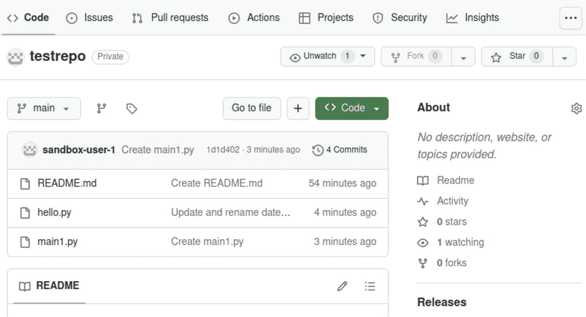

一个用户界面窗口的截图。有名为代码、议题、拉取请求、操作、项目、安全和洞察的菜单。sandbox user 1下的文件列表是打开的。

图 1-7

在GitHub上复刻一个仓库

注意

“Fork”按钮是灰色的，因为我无法将我的仓库“复刻”到自己的账户中。

### 拉取请求

拉取请求是一种向当前代码库提议更改的方式。通过提出拉取请求，意味着你已经开发了一个功能，或完成了代码中的某些工作，现在提议将你的代码合并到主仓库中。

创建拉取请求的步骤：

1.  你已经有一个正在使用的分支，或者创建你自己的分支。
2.  你对代码进行必要的更改。
3.  现在你要提交这些更改：
    *   `git add <文件列表> 或 "."`
    *   `git commit -m "<你的引号内的消息>"`
4.  你需要将这些更改推送到源仓库（你的分支或你的复刻）：
    *   `git push origin <新功能>`

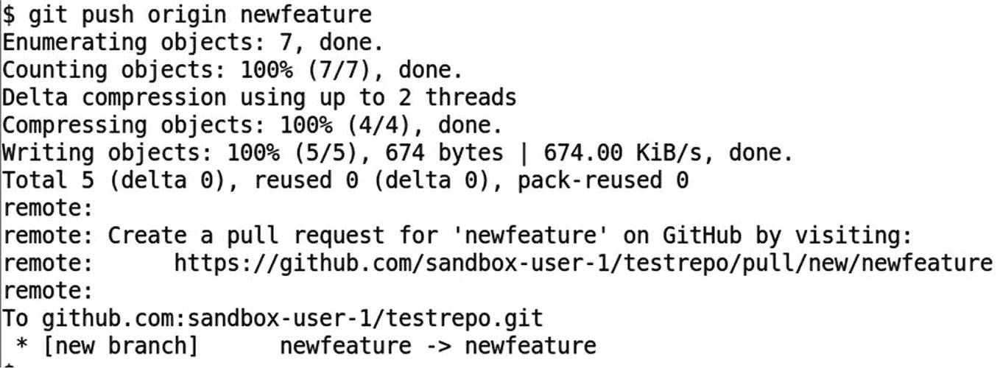

一个展示将更改推送到源仓库的命令行文本图。

图 1-8

将更改推送到Git分支

以下是在终端上执行`git push`可能的样子：

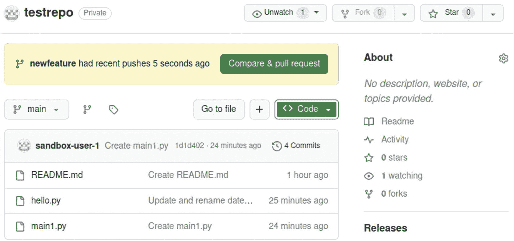

一个用户界面窗口的截图。有名为代码、议题、拉取请求、操作、项目、安全和洞察的菜单。沙盒用户1下的文件列表是打开的。

图 1-9

在GitHub上比较更改并创建拉取请求

现在你可以执行拉取请求了。在GitHub图形用户界面中，你会看到弹出消息，提示最近收到了一个拉取请求。只需点击“Compare & pull request”。

现在你需要为这个拉取请求输入标题和消息。GitHub会通过将新代码高亮为绿色来显示对文件所做的更改。你可以点击“Create pull request”。

以下是它的样子：

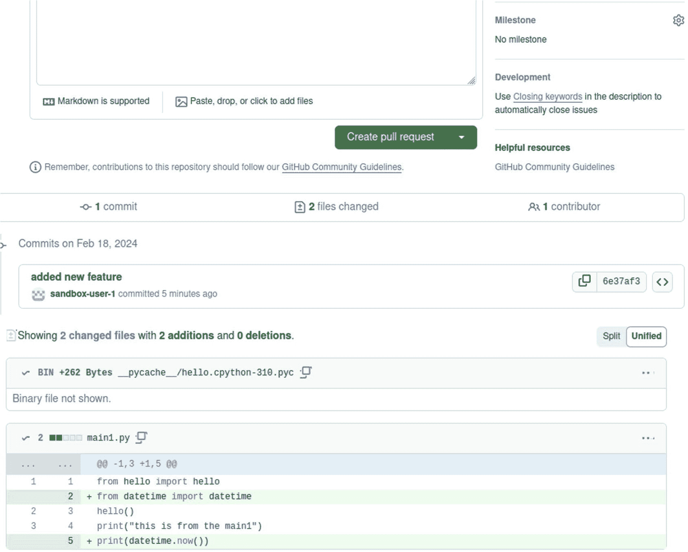

一个用户界面窗口的截图，展示了比较更改和创建拉取请求的过程。

图 1-10

比较更改并创建拉取请求的过程

一旦你创建了拉取请求，现在你需要将拉取请求合并到远程主分支。

以下是它的可能样子：

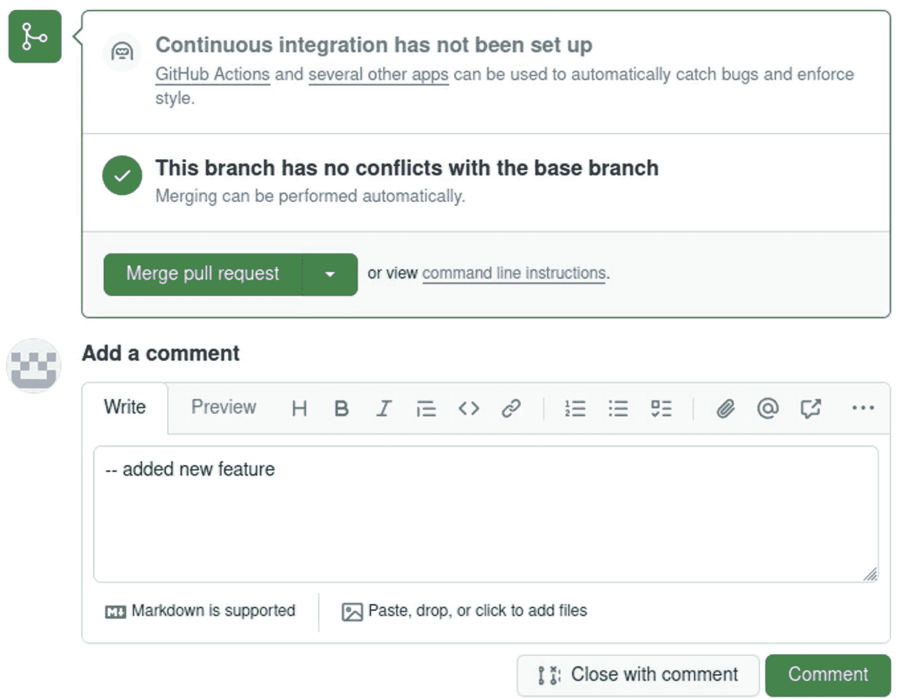

一个用户界面窗口的截图，用于合并拉取请求。存在一个名为“添加评论”的文本窗口，并带有“关闭并评论”和“评论”按钮。

图 1-11

合并拉取请求

点击“Merge pull request”，然后点击“Confirm pull request”。

完成后，你可以删除该分支。以下是它的可能样子：

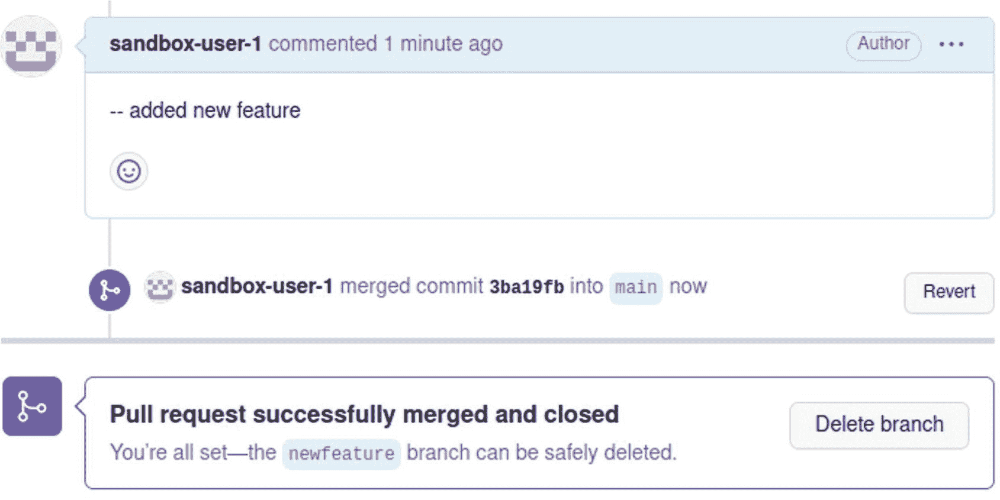

一个用户界面窗口的截图，标题为“沙盒用户 1”。一个对话框显示“拉取请求已成功合并并关闭”，并带有一个名为“删除分支”的按钮。

图 1-12 合并后删除分支

### Gitignore

数据管道有时包含敏感信息，如密码、临时文件以及其他不应提交到仓库的信息。我们使用`.gitignore`功能来有意忽略某些文件。

在你的文件夹根目录下创建一个`.gitignore`文件，并指定 GitHub 应忽略的各种文件。

以下是一个简单的`.gitignore`示例，你也可以将其纳入你的数据管道中：

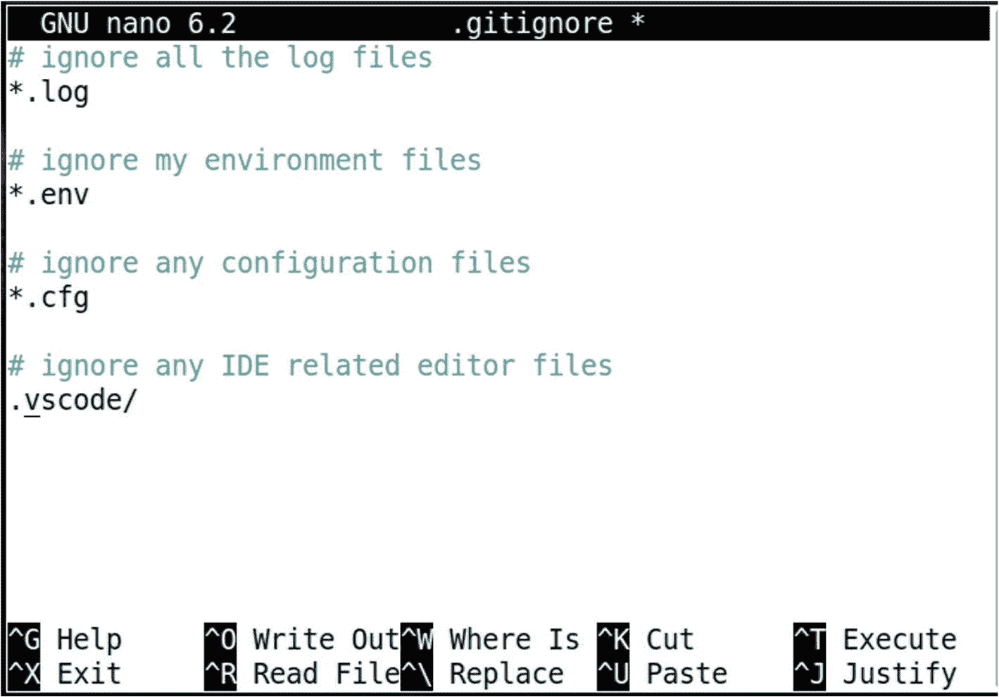

一个用户界面文件窗口的截图，标题为“G N U nano 6.2”。内部文本显示：忽略所有日志文件，忽略我的环境文件，忽略任何配置文件，以及忽略任何与集成开发环境相关的编辑器文件。

图 1-13 一个`.gitignore`文件示例

创建完成后，让我们暂存此文件并将其添加到本地仓库：

```bash
git add .gitignore
git commit -m "添加了 .gitignore 文件"
```

**注意**

建议谨慎操作，不要将机密信息推送到你的仓库。如果你已经有一些不需要被 git 跟踪的文件，那么你可以通过`git rm —cached secret_passwords.txt`来移除这些文件。

我们在这里只是浅尝辄止地介绍了 git。我鼓励你访问 [`http://git-scm.org`](http://git-scm.org) 来了解更多关于 git 的功能。

## SQL 编程

SQL 是每个数据工程职业的核心。我们所有的历史数据和企业系统都配备了关系型数据库系统。SQL 是访问、查询和处理这些关系型数据库系统中数据的方式。SQL 代表结构化查询语言。让我们看一些基本语法。我们将使用 Postgres 数据库语法来演示一些我认为在日常任务中相关的概念和功能。

### 基本 SQL 查询

任何 SQL 查询的起点是

```sql
SELECT * FROM TableName
```

这将返回包含所有行和列的表。

```sql
SELECT
    fieldname1,
    fieldname2
FROM
    TableName
```

将返回这两个字段的所有行。

```sql
SELECT
    fieldname1,
    fieldname2
FROM
    TableName
LIMIT 10
```

将返回所有列，但只返回十行。

通常，我们可能不会编写执行全表扫描的 SQL 代码，除非它是一个“相对”较小的表，或者由于其他原因有必要这样做。典型的 SQL 查询会携带字段名以及带有条件表达式的某种过滤器。

### 条件数据过滤

以下是一个查询，它根据两个条件返回产品类别：产品类别的起始字母和字符数：

```sql
SELECT
    product_id,
    LENGTH(product_id) as charlength
FROM
    productTable
WHERE
    product_id LIKE 'H%' AND
    LENGTH(product_id) BETWEEN 2 and 4
ORDER BY
    charlength
```

### 连接 SQL 表

在某些情况下，我们必须处理多个表才能获取特定数据。这涉及到连接这些表。有几种类型的连接，即左连接、右连接、内连接、外连接、笛卡尔连接和自连接。以下是一个示例：

```sql
SELECT
    productTable.fieldname1,
    productTable.fieldname2,
    inventory.fieldname1,
    inventory.fieldname4
FROM
    productTable
LEFT JOIN
    inventory
ON
    productTable.id = inventory.product_id
```

#### SQL 中的自连接

另一个有助于你开发工作的重要概念是自连接的概念。它基本上是将一个给定的表与完全相同的表进行连接。假设你有一个员工表，包含员工 ID、姓名和经理 ID，其中每个员工都被分配了一个 ID、他们的姓名以及他们主管的 ID。我们需要获得一个包含员工姓名和经理姓名的表。

以下是它的样子：

```sql
SELECT
    Emp.id,
    Emp.name,
    Mang.name
FROM
    Employee Emp
INNER JOIN
    Employee Mang
ON
    Emp.id = Mang.manager_id
```

在上述代码中，我们使用不同的别名引用同一个表，并根据它们的 ID 值进行连接。还有公用表表达式（CTE）的概念，其中一个查询的结果被临时持久化，以便与另一个查询执行特定操作。

### 公用表表达式

公用表表达式包含子查询，这些子查询临时存储一个结果，主查询可以使用适当的 SQL 命令引用该结果并执行。CTE 是简化复杂查询并增强可读性的一种方式。

以下是一个通用的 CTE：

```sql
WITH productRaw AS (
    SELECT
        p_name AS name,
        p_qty AS qty,
        p_price AS price
    FROM
        productsTable
),
calculateGT AS (
    SELECT
        name,
        qty,
        price,
        (qty*price) AS grand_total
    FROM
        productRaw
)
SELECT
    name,
    qty,
    price,
    grand_total
FROM
    calculateGT
```

当然，可能有更优化的方法来计算给定每个产品的价格和数量的总计金额。这里的想法是展示如何利用多个查询结果的临时持久化，并利用该结果生成最终的结果表。

### SQL 中的视图

在 SQL 中，我们可以将这些查询的结果作为数据库中的对象持久化。这是通过视图的形式完成的。有两种类型的视图：标准视图和物化视图。

#### 标准视图

标准视图是您可以在数据库中设置的视图，用于显示包含多个连接、筛选条件、函数等特定查询的结果。当您查询一个标准视图时（而不是运行一大段复杂的 SQL 代码），它总是会返回最新的结果。

以下是标准视图可能的样子：

```sql
CREATE VIEW prod_inventory_report AS
SELECT
    productTable.fieldname1,
    productTable.fieldname2,
    inventory.fieldname1,
    inventory.fieldname4
FROM
    productTable
LEFT JOIN
    inventory
ON
    productTable.id = inventory.product_id;
```

让我们查询这个视图：

```sql
SELECT * FROM prod_inventory_report
```

#### 物化视图

物化视图将视图的结果存储在一个物理表中（标准视图不会物理存储结果，而是每次调用底层的查询）。因此，您以物化视图的名义创建了一个物理表，所以性能会显著提升。但是，您需要设置触发器来定期刷新物化视图。

以下是物化视图可能的样子（语法与标准视图类似）：

```sql
CREATE MATERIALIZED VIEW IF NOT EXISTS prod_inventory_report AS
SELECT
    productTable.fieldname1,
    productTable.fieldname2,
    inventory.fieldname1,
    inventory.fieldname4
FROM
    productTable
LEFT JOIN
    inventory
ON
    productTable.id = inventory.product_id
WITH DATA
WITH REFRESH ON DEMAND
WITH TABLESPACE pg_default
```

### SQL 中的临时表

临时表是 SQL 中另一个有用的工具。这些表在特定的数据库会话期间创建，并且只持续到会话结束。它们有限的生命周期以及会话结束时自动删除这些表的特点，正是它们被称为临时表的原因。

以下是其可能的样子：

```sql
CREATE TEMPORARY TABLE prod_report
(
    product_name VARCHAR(80),
    product_quantity INTEGER,
    inventory_city VARCHAR(50),
    inventory_state VARCHAR(50)
)
ON COMMIT PRESERVE ROWS;
```

对于临时表，其模式和数据（如果在创建表后插入数据）都只在该数据库会话期间存在。当您指定`PRESERVE ROWS`时，它们会在会话结束时被删除。您也可以指定`DELETE ROWS`，这样会立即删除。

### SQL 中的窗口函数

窗口函数用于计算表中给定列的聚合值；但是，它们会保留其身份标识。SQL 中的聚合通常只涉及获取指标，而会忽略其他字段。窗口函数则会保留表的身份标识。

#### SQL 聚合函数

让我们看一个例子：

```sql
SELECT
    Department,
    EmpID,
    Salary,
    avg(Salary) OVER (PARTITION BY Department)
FROM
    Employees;
```

这个例子会获取各个字段，并计算每个部门的平均薪资。结果可能如下所示：

```
Department | EmpID | Salary | avg
-----------+-------+--------+-------
IT        |    11 |   5200 | 4633.0
IT        |     7 |   4200 | 4633.0
IT        |     9 |   4500 | 4633.0
DS        |     5 |   3500 | 3700.0
DS        |     2 |   3900 | 3700.0
HR        |     3 |   4800 | 4900.0
HR        |     1 |   5000 | 4900.0
```

如您所见，窗口函数计算了统计平均薪资，并按每个部门分组，同时保留了表结构，并为计算出的平均值添加了一个新列。

#### SQL 排名函数

让我们看另一个例子。让我们根据每个部门内员工的收入为其分配一个排名。

以下是其实现方式：

```sql
SELECT
    Department,
    EmpID,
    Salary,
    RANK() OVER (PARTITION BY Department ORDER BY Salary DESC)
FROM
    Employees;
```

这可能会返回一个如下所示的表：

```
Department | EmpID | Salary | rank
-----------+-------+--------+-------
IT        |    11 |   5200 | 1
IT        |     9 |   4500 | 2
IT        |     7 |   4200 | 3
DS        |     2 |   3900 | 1
DS        |     5 |   3500 | 2
HR        |     1 |   5000 | 1
HR        |     3 |   4800 | 2
```

#### 查询调优与执行计划优化

SQL 是数据领域中极其强大的工具。然而，理解 SQL 查询在底层是如何工作的非常重要，这样才能避免过度使用 SQL 引擎和托管 SQL 数据库的服务器。在本节中，我将与您分享一些方法，用于最小化查询执行时间、提升查询性能以及减少硬件资源消耗。

理解对于特定项目、每个数据库以及每个模式，最常被查询的表以及您施加条件的字段至关重要。然后，为这些最常用表的字段创建索引。

您还可以创建涉及多个字段（通常是两到三个字段）的索引。这被称为复合索引，有助于提升查询性能。

当您有一个涉及连接和其他操作的较大查询时，请使用公用表表达式（`CTE`）的概念来简化复杂的逻辑。

尽量通过定义具体字段来最小化任何涉及全表扫描的查询，避免使用`Select *`。

如果您确实有一个复杂查询，请考虑使用物化视图来预计算并存储这些查询的结果。当复杂查询的结果在读取操作上负载很重时，物化视图是最佳选择。

在需要将结果临时写入一个表，但又不想让该表持久存在于数据库中的情况下，可以考虑使用临时表。

尽量减少在 SQL 查询中使用子查询；如果您最终编写了子查询，请始终将排序操作放在主查询中，并尽量避免在子查询中指定`ORDER BY`。

当指定包含`OR`语句的条件时，这里有一个您可以考虑的方法：编写两个独立的查询，然后将查询结果合并。

## 结论

到目前为止，我们已经涵盖了很多内容，从复习 Python 编程到动手实践 git 和 GitHub，再到回顾 SQL 基础知识。您在这里学到的概念和技术将作为解决复杂数据工程项目的基础。Python 的数据生态系统将使您能够编写高效的数据管道，用于数据转换和分析任务。Git 将使您能够与团队协作，参与协作式软件开发，并在数据管道演进过程中维护一个清晰且有文档记录的历史。SQL 技能对于处理构成几乎所有数据架构基础的关系型数据库系统来说，将证明是不可或缺的。我鼓励您练习、探索并应用您所学到的知识。话虽如此，让我们在接下来的几章中，一起进入数据整理这个激动人心的主题。