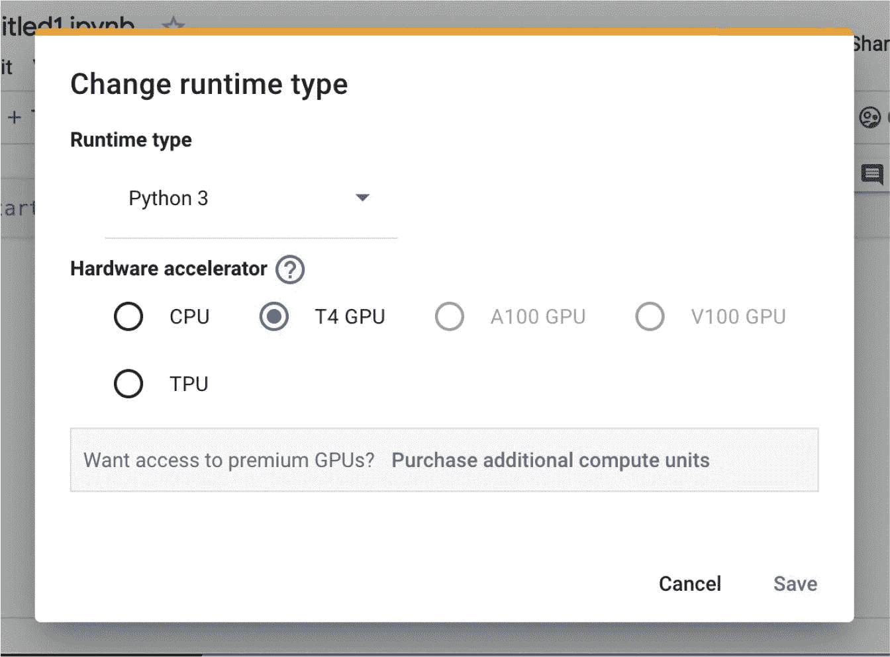
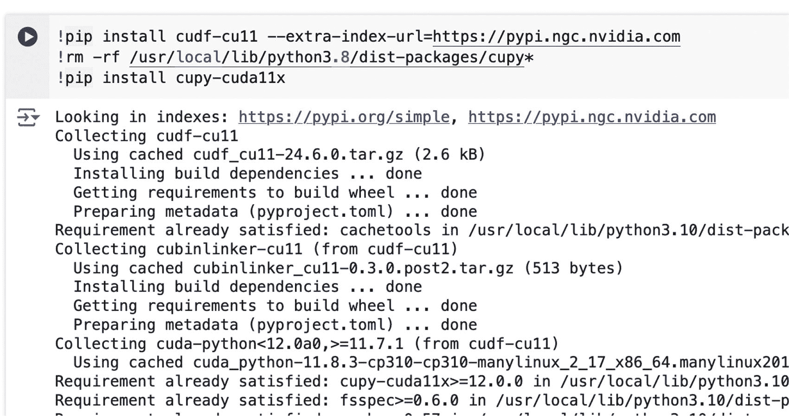
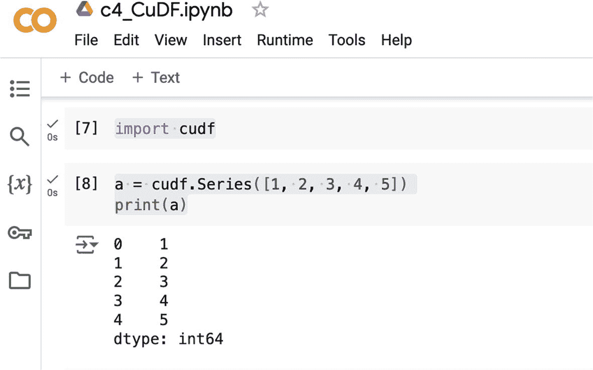
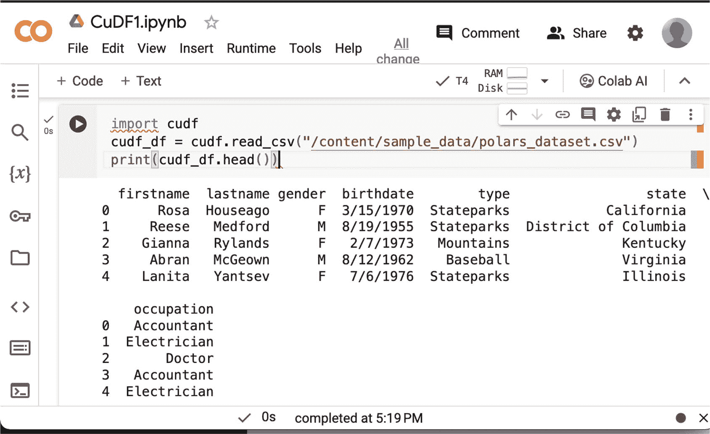
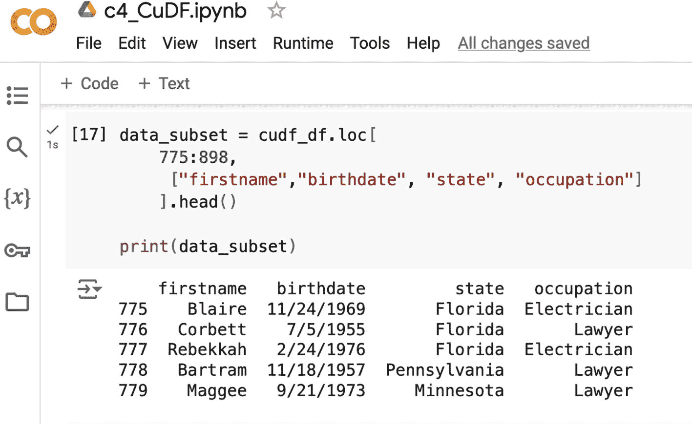
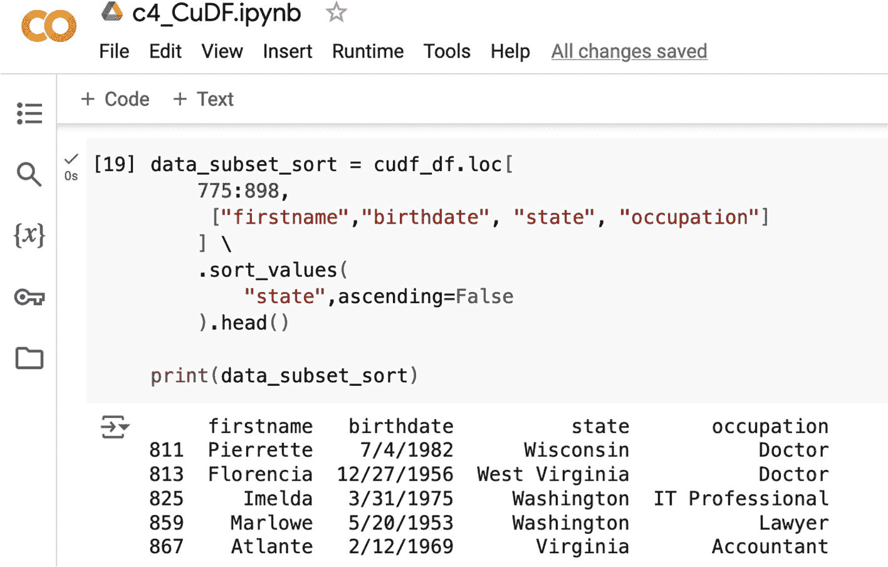

# 4. 使用 CuDF 进行 GPU 驱动的数据整理

## 引言

随着数据量的持续增长，有时基于 CPU 的数据处理可能难以在合理的时间内提供一致的结果。这时 GPU 计算就派上了用场，它利用图形处理单元来革新数据操作和分析。在本章中，我们将探讨 CuDF，这是一个与现有 Python 生态系统良好集成的 GPU 加速数据操作库。在深入了解 CuDF 之前，让我们也回顾一下基于 CPU 和 GPU 的计算架构以及 GPU 编程的概念。

在本章结束时，你将能够

*   理解 CPU 与 GPU 计算的区别，以及它们如何影响数据处理。
*   熟悉 GPU 编程概念。
*   在 Google Colab 上设置 CuDF 并执行基本的数据加载操作。
*   应用高级数据转换，如分组、聚合和窗口函数，并探索特征工程能力。
*   使用各种连接方式组合多个 CuDF 对象，并利用 CuDF 的 Pandas 加速模式来加速 Pandas 代码。

## CPU 与 GPU

CPU 代表中央处理单元。CPU 处理计算机中的所有处理任务。在硬件层面，CPU 有一个微处理器，它将程序转换为机器语言并执行字节码。CPU 内部还有一个时钟机制，用于设置 CPU 的电子脉冲生成频率。时钟频率越高，处理速度越快。

注意：CPU 也有缓存，这是一个存储单元，用于保存给定计算迭代所需的数据。缓存应该比物理内存更快，目前似乎有三个级别的缓存。还有一个内存管理单元，负责在 CPU 和 RAM 之间进行通信和协调以处理各种任务时控制数据移动。

在各种任务的处理类型中，图形处理被认为是复杂的，并涉及复杂的数学运算。例如，渲染精确的图形、高细节视频、科学模拟，甚至带有物理引擎的视频游戏。这些任务需要同时（并行）进行复杂的处理和计算复杂的数学函数。图形处理单元的发展主要是为了应对这些大规模并行的复杂计算任务。

与 CPU 类似，图形处理单元也拥有微处理器、内存管理单元和其他此类组件。微处理器由多个计算核心组成。然而，与 CPU 相比，这些核心更小，但它们在并行处理能力方面非常强大。CPU 和 GPU 之间的区别在于，CPU 专注于处理更多样化和多变的任务和指令。例如，CPU 可能执行诸如将文件从一个地方复制到另一个地方、运行用户提供的程序、加载系统程序以及在电子表格程序中进行数字运算等任务。这些任务在性质上并不相似。CPU 可以在完成处理的同时轻松地在它们之间切换。另一方面，GPU 专注于对某种程度相似的计算进行大规模并行处理。GPU 从 CPU 接收指令并并行执行它们，以加速处理并渲染显示。

### CUDA 简介

CUDA 代表计算统一设备架构。CUDA 是由 NVIDIA 开发的软件框架，专门用于为 NVIDIA GPU 编写代码。它支持在 NVIDIA GPU 上执行内核，利用其并行计算能力进行复杂的数据处理。虽然用 C 语言编写，但 CUDA 也通过`CuPy`和`PyCUDA`等库支持 Python 编程。然而，需要注意的是，使用 CUDA 软件框架开发的程序仅适用于 NVIDIA GPU，不兼容其他制造商的 GPU。

注意：在当前的硬件制造市场中，有几家公司生产 GPU。NVIDIA 是著名的 GPU 制造商之一。还有 OpenCL，它也是一个类似于 CUDA 的固件。OpenCL 更通用，也可以用于非 NVIDIA GPU。

## GPU 编程概念

GPU 编程通常始于接收来自 CPU 的指令。CPU 被称为主机，它负责识别可用的 GPU 及其处理核心，并为 GPU 提供指令。GPU 则被称为设备单元。例如，如果要执行一个大型软件程序，CPU 会首先识别出所有指定给 GPU 的特定函数。一旦这些特定函数被识别出来，它们就会在 GPU 上执行。

### 内核

内核是由开发者编写的代码包（包含特定函数）。它们通过 CUDA 编译器编译成机器码。内核是为在 GPU 上执行而编写的函数。

该过程始于 CPU 调用内核函数。除了调用内核，主机还会调用执行配置，确定内核执行需要多少个并行线程。GPU 使用一个由块组成的网格来执行内核，每个块包含一组线程。GPU 块的调度部分会将这些线程发送到 GPU 上的流式多处理器。一旦执行完成，主机将从 GPU 内存中检索结果。至此，一个完整的执行周期就完成了。

### 内存管理

在 GPU 上执行内核函数期间，执行（相同）内核函数的线程可能会在不同的内存位置读写数据。这些线程可以访问本地内存、共享内存和全局内存。本地内存的作用域主要限于给定线程。共享内存是仅限给定块作用域的内存，但可由其下的所有线程访问。全局内存是 GPU 和 CPU 都可以访问的内存。给定块中的所有线程可以同步它们的执行，以实现更好的内存访问。

## CuDF 简介

CuDF 是一个 Python 库，提供各种专门在 NVIDIA GPU 上执行的数据操作和转换方法及函数。CuDF 利用 Apache Arrow 实现列式格式的数据结构。所有 CuDF 的函数和方法都基于`libcudf`，这是一个用于 C++ 编程的 CUDA 库。

CuDF 与 Pandas 类似，区别在于它是专门为在 NVIDIA GPU 上运行而设计的。这个 GPU 加速的数据操作和转换库在处理大型数据集时（与 Pandas 相比）提供了更高效的数据处理能力。

### CuDF 与 Pandas 对比

CuDF 和 Pandas 提供了大多数执行类似操作的方法和函数。然而，这两个 Python 库在某些方面存在差异。

首先，CuDF 和 Pandas 都支持类似的数据结构（`Series`、`DataFrames` 等）。两者都支持对数据结构进行类似的转换操作，例如各种连接、数据框过滤、索引、分组和窗口操作。CuDF 支持许多现有的 Pandas 数据类型，并为特殊数据类型提供支持。最好查阅相关文档以获取详细信息。

在 Pandas 中，空值会被转换为非数字（NaN），而在 CuDF 中，所有数据类型都可以包含缺失值。

在 CuDF 中，遍历数据结构并非最佳实践。你仍然可以编写代码来循环遍历数据框中的给定列并执行某种计算；然而，这可能会导致性能不佳。更好的选择是使用内置的 CuDF 方法执行转换，或者将 CuDF 数据框转换为 Pandas 或 Arrow 数据框，执行必要的操作，然后将结果数据框转换回 CuDF 数据框。

在执行连接或分组操作时，Pandas 会对数据框进行排序，而 CuDF 不会对元素进行任何排序或排序操作。如果你需要对元素进行某种排序，则需要在代码中启用`sort=True`。

### 环境搭建

尽管安装页面提供了更多安装和使用 CuDF 的选项，但我推荐以下方法，以便你能快速上手 CuDF。

你需要一块计算能力为 6.0 及以上的 NVIDIA GPU。首先，CuDF 库构建在 CUDA 之上，CUDA 是专为 NVIDIA GPU 设计的并行处理框架。NVIDIA 提供各种 GPU 产品，你可以在其产品目录中查看。

其次，计算能力只是表示其 GPU 更新型号的一个高级术语。我对计算能力的理解是，版本号越高，GPU 性能越好，能够处理更复杂的操作，并且效率更高。

注意：可以把它想象成 iPhone，较新的版本相比旧款 iPhone 拥有更多功能。计算能力就像是在说更新的 iPhone 型号。

你还需要一个 Linux 发行版。虽然你可能可以通过 WSL 在 Windows 操作系统上工作，但拥有一个安装了 gcc++ 9.0 及以上版本的 Linux 实例可能会更有帮助。

注意：如果你使用的是 Windows 操作系统，那么你可能需要一块计算能力为 7.0 或更高（更新的型号）的 GPU。

你需要合适的 NVIDIA 驱动程序和 CUDA 驱动程序，可能需要 CUDA 驱动程序版本 11.2 或更新版本。

你还需要在系统上安装最新版本的 Python 3。

最好卸载任何默认加载的现有 CUDA 工具包和 CUDA 包。

我建议使用一个专门的虚拟环境来执行 CuDF 管道。更好的做法是在你的系统中设置一个 conda 或 miniconda 环境，然后执行 conda 安装。

具体操作如下：

```
conda create --solver=libmamba -n rapids-23.12 -c rapidsai -c conda-forge -c nvidia  \
rapids=23.12 python=3.10 cuda-version=12.0
```

对于那些无法使用上述方法的人，可以考虑一些基于云的选项。所有主要的云提供商都提供基于 GPU 的计算选项。虽然这将在后续章节中详细介绍，但让我们先看一个云提供商的例子，以便我们能够实际使用 CuDF。我（任意地）选择了基于 Google Cloud Platform 的 Google Colab。

要开始使用 Google Colab，只需访问以下门户网站并使用你的 Google 帐户登录（如果你还没有帐户，请创建一个）：

`https://colab.google/`

然后点击“新建笔记本”选项：


# Google Colab 与 CuDF 入门

## Google Colab 界面介绍

一张 Google Colab 的截图显示顶部有一段文字，底部有两个按钮。按钮上分别标有“打开 Colab”和“新建笔记本”。


图 4-1

Google Colab 界面

Google Colab 提供免费选项和专业版选项。就我们的目的而言，免费选项可能就足够了。

你可能会看到以下界面：


图 4-2

Google Colab 中的 Jupyter Notebook 环境

在学习时，关闭“使用 AI 生成”选项可能是明智之举。如果你确实想关闭它，请点击菜单中的“工具”，然后选择“设置”选项。


图 4-3

Google Colab 中的设置选项

在设置中，找到“Colab AI”并勾选“隐藏生成式 AI 功能”。

## 更改运行时环境

现在，让我们将 Jupyter notebook 的运行环境从 CPU 更改为 GPU。让我们导航到 Google Colab 内的主页面。在那里，从菜单中选择“运行时”，然后选择“更改运行时类型”。


图 4-4

更改 Google Colab 笔记本的运行时环境

为运行时类型选择“Python 3”，并为硬件加速器选择一个包含“GPU”字样的选项。在此例中，选择 T4 GPU 选项。请注意，其他 GPU 选项也是 NVIDIA 的产品。

您的界面可能如下所示：



图 4-5

更改运行时类型和硬件加速器

## 安装 CuDF

现在，是时候安装 CuDF 了。将以下命令复制并粘贴到您的代码框中。这可能需要一些时间，所以最好稍等片刻：

```
!pip install cudf-cu11 --extra-index-url=https://pypi.ngc.nvidia.com
!rm -rf /usr/local/lib/python3.8/dist-packages/cupy*
!pip install cupy-cuda11x
```

在某些情况下，安装可能会因为包版本冲突等原因而失败。如果安装和设置过程看起来有挑战性，请考虑安装一个更旧且稳定的版本。



图 4-6

在 Google Colab 环境中安装 CuDF

### 测试安装

一旦我们安装了 CuDF，就该测试安装了。请执行以下代码并观察输出：

```
import cudf
a = cudf.Series([1, 2, 3, 4, 5])
print(a)
```

将输出

```
0    1
1    2
2    3
3    4
4    5
dtype: int64
```

输出结果可能如下所示：



图 4-7

使用样本数据初始化 CuDF 序列

## 文件 IO 操作

CuDF 支持大数据和机器学习中大多数常用的数据格式。语法如下所示：

```
csv_file = "/path-to-folder/path-to-file.csv"
cudf_df = cudf.read_csv(
filepath,
sep=",",
header="infer")
```

### CSV

如果您计划将给定的 CuDF 数据帧导出为 CSV 格式，操作方法如下：

```
cudf.to_csv(
"/path-to-file.csv",
sep=",",
header=True,
index=True)
```

### Parquet

正如我们之前讨论的，Parquet 是一种更高效的数据存储格式。CuDF 库提供了读取 Parquet 文件以及将当前数据帧导出为 Parquet 文件的方法，并且这些操作都启用了 GPU 加速。

以下是读取外部 Parquet 文件的方法：

```
import cudf
filename = "/some-file-path/some-file-name.parquet"
df = cudf.read_parquet(filename)
```

要将 CuDF 数据帧导出为 Parquet 格式，语法可能如下所示：

```
df.to_parquet(filename="/some-file-path/some-file-name.parquet")
```

### JSON

CuDF 支持 JSON 文件格式；但是，许多用于读取 JSON 文件的属性似乎并未启用 GPU 加速。

示例如下：

```
import cudf
filename = "/filepath/file.json"
cudf_dataframe = cudf.read_json(filename)
```

写入 JSON 文件的方法如下：

```
cudf_dataframe = cudf.to_json("/filepath/filename.json")
```

类似地，CuDF 还支持其他数据文件格式，如 ORC、Avro 等。

## 基本操作

让我们通过导入一个示例数据集来了解 CuDF 的一些基本操作。代码如下所示：

```
import cudf
cudf_df = cudf.read_csv("/content/sample_data/polars_dataset.csv")
print(cudf_df.head())
```

我们可以观察到以下输出：



图 4-8

读取外部 CSV 文件并检查前几行

### 列过滤

让我们尝试选择数据的一个子集。以下是仅获取某些列的方法：

```
name_and_occupation = cudf_df[
    ["firstname","occupation"]
].head()
print(name_and_occupation)
```

将输出

```
firstname   occupation
0      Rosa   Accountant
1     Reese  Electrician
2    Gianna       Doctor
3     Abran   Accountant
4    Lanita  Electrician
```

### 行过滤

以下是仅获取某些行的方法：

```
data_subset = cudf_df.loc[
    775:898,
    ["firstname","birthdate", "state", "occupation"]
].head()
print(data_subset)
```

效果如下所示：



图 4-9

在 CuDF 中检查数据子集

### 数据集排序

让我们尝试按特定列对数据集进行升序或降序排序：

```
data_subset_sort = cudf_df.loc[
    775:898,
    ["firstname","birthdate", "state", "occupation"]
] \
.sort_values(
    "state",ascending=False
).head()
print(data_subset_sort)
```

将输出


```
firstname   birthdate          state       occupation
811  Pierrette    7/4/1982      Wisconsin           Doctor
813  Florencia  12/27/1956  West Virginia           Doctor
825     Imelda   3/31/1975     Washington  IT Professional
859    Marlowe   5/20/1953     Washington           Lawyer
867    Atlante   2/12/1969       Virginia       Accountant
```

在 Google Colab 上的效果如下所示：



一张截图展示了一组以表格形式排列的数据。列分别代表名字、出生日期、州和职业。顶部提供了一段根据州对数据进行排序的代码片段。文件名显示为`c4CuDF.ipynb`。

图 4-10

按特定列对数据子集进行排序并返回前几行

## 组合多个 CuDF 对象

CuDF 支持数据帧之间按列或按索引进行类似数据库的连接操作。让我们详细了解它们。

注意

CuDF 不支持右连接。

### 左连接

左连接是指保留左表的所有数据，同时在右表中查找可能的匹配项。我们使用`cudf.merge`在 GPU 数据帧上执行左连接。

让我们通过一个示例来了解：

```python
import cudf
left_df1 = cudf.DataFrame(
{
'ID': [1, 2, 3, 4, 5],
'Name': ['Alice', 'Bob', 'Charlie', 'David', 'John'],
'DeptID': [101, 102, 103, 104, 103]
}
)
right_df1 = cudf.DataFrame(
{
'DeptID': [101, 102, 103],
'DeptName': ['HR', 'IT', 'Marketing']
}
)
```

现在我们可以执行连接操作了：

```python
leftjoin = left_df1.merge(
right_df1,
on=["DeptID"],
how="left"
)
print(leftjoin)
```

将输出

```
ID     Name  DeptID   DeptName
0   1    Alice     101         HR
1   2      Bob     102         IT
2   3  Charlie     103  Marketing
3   5     John     103  Marketing
4   4    David     104       
```

### 外连接

外连接是指用于执行连接的列或索引来自两个数据帧的并集。操作如下所示：

```python
outerjoin = left_df1.merge(
right_df1,
on=["DeptID"],
how="outer"
)
print(outerjoin)
```

将输出

```
ID     Name  DeptID   DeptName
0   1    Alice     101         HR
1   2      Bob     102         IT
2   3  Charlie     103  Marketing
3   5     John     103  Marketing
4   4    David     104       
```

### 内连接

内连接是外连接的反向操作。内连接是在两个数据框上对列或索引进行交集运算。

让我们看一个例子：

```python
innerjoin = left_df1.merge(
right_df1,
on=["DeptID"],
how="inner"
)
print(innerjoin)
```

会输出：

```
ID     Name  DeptID   DeptName
0   1    Alice     101         HR
1   2      Bob     102         IT
2   3  Charlie     103  Marketing
3   5     John     103  Marketing
```

### 左半连接

左半连接是一种只返回左表中与右表匹配的行的连接类型；左表中在右表中没有匹配项的行将被忽略。

具体实现如下：

```python
leftsemi = left_df1.merge(
right_df1,
on=["DeptID"],
how="leftsemi"
)
print(leftsemi)
```

会输出：

```
ID     Name  DeptID
0   1    Alice     101
1   2      Bob     102
2   3  Charlie     103
3   5     John     103
```

### 左反连接

左反连接可以看作是左半连接的反向操作。左反连接会返回左表中与右表没有匹配项的行。

以下示例进一步说明：

```python
leftanti = left_df1.merge(
right_df1,
on=["DeptID"],
how="leftanti"
)
print(leftanti)
```

会输出：

```
ID   Name  DeptID
0   4  David     104
```

## 高级操作

让我们看看使用 CuDF 进行的一些高级数据整理操作。

### 分组函数

分组函数尝试对序列或数据框中的值进行分组。列的分组可以在单列或多列上进行。CuDF 支持一些最常用的 Pandas 分组函数。让我们详细了解其中几个：

```python
import cudf
groupbydata = {
'Person': ['Alice', 'Bob', 'Charlie', 'David'],
'Dept': ['Marketing', 'Marketing', 'DigitalM', 'DigitalM'],
'Sales': [20, 12, 35, 42]
}
gb_df = cudf.DataFrame(groupbydata)
print(gb_df)
```

会输出：

```
Person       Dept  Sales
0    Alice  Marketing     20
1      Bob  Marketing     12
2  Charlie   DigitalM     35
3    David   DigitalM     42
```

现在，让我们尝试按部门获取总销售额。为此，我们需要按部门对数据集进行分组，并获取该部门内销售额的总和。

实现方法如下：

```python
totsale_dept = gb_df \
.groupby('Dept')\
.agg('sum')
print(totsale_dept)
```

会输出：

```
Sales
Dept
Marketing     32
DigitalM      77
```

### 转换函数

`transform()` 函数是数据转换中的一个重要函数。`transform()` 函数执行聚合操作，并返回与数据框或序列大小相似的结果。这样，输出结果就可以添加到数据框中。

对于相同的数据集，实现如下：

```python
dept_sum = gb_df \
.groupby('Dept', sort=True)\
.transform('sum')
print(dept_sum)
```

会输出：

```
Sales
0     32
1     32
2     77
3     77
```

注意结果数据集的大小。将其添加到数据框中也很容易。

```python
gb_df['totalDeptSales'] = dept_sum
print(gb_df)
```

会输出：

```
Person       Dept  Sales  dept_sales  totalDeptSales
0    Alice  Marketing     20          32              32
1      Bob  Marketing     12          32              32
2  Charlie   DigitalM     35          77              77
3    David   DigitalM     42          77              77
```

### apply()

尽管 CuDF 在 GPU 加速器模式下提供了许多常用方法和函数，但肯定存在需要编写自定义函数（也称为用户定义函数）的情况。这些用户定义函数通常应用于给定列或列集上的序列或数据框对象。这时`apply()` 方法就很有用了。`apply()` 方法允许在给定列上实现用户定义函数。


以下是 `apply()` 方法的示例。让我们定义一个序列对象：

```python
ap1 = cudf.Series([1, cudf.NA, 3, 5, 6, 8])
print(ap1)
```

会输出：

```
0       1
1    <NA>
2       3
3       5
4       6
5       8
dtype: Int64
```

现在，我们创建一个需要应用于 CuDF 序列对象的自定义方法：

```python
def transformData(x):
    if x is cudf.NA:
        return 42
    else:
        return x + 100
```

现在，我们准备将此用户定义函数应用于我们的序列对象：

```python
ap1.apply(transformData)
```

会输出：

```
0    101
1     42
2    103
3    105
4    106
5    108
dtype: int64
```

让我们看看使用之前数据集的另一个应用。我们有：

```python
print(gb_df)
```

会输出：

```
    Person       Dept  Sales  dept_sales  totalDeptSales
0    Alice  Marketing     20          32              32
1      Bob  Marketing     12          32              32
2  Charlie   DigitalM     35          77              77
3    David   DigitalM     42          77              77
```

现在，让我们为此数据集创建一个用户定义函数，根据是否超过某个销售额阈值来分配排名：

```python
def salesRank(y):
    if y > 25:
        return 1
    else:
        return 2
```

现在，让我们应用此函数并添加一个新列来保存排名：

```python
gb_df['SalesRank'] = gb_df['Sales'].apply(salesRank)
print(gb_df)
```

会输出：

```
    Person       Dept  Sales  dept_sales  totalDeptSales  SalesRank
0    Alice  Marketing     20          32              32          2
1      Bob  Marketing     12          32              32          2
2  Charlie   DigitalM     35          77              77          1
3    David   DigitalM     42          77              77          1
```

## 交叉表

让我们看看 CuDF 中的一些高级函数。首先，我们将尝试使用 `crosstab` 函数。`Crosstab` 代表交叉制表，它以表格形式显示变量的频率分布，其中行和列属于一个数据点，表格中的值表示该值出现的频率。交叉表视图对于探索数据、分析关系，甚至只是查看变量在不同类别中的分布都很有用。

让我们在 CuDF 中为两个数据点创建一个交叉表：

```python
from cudf import crosstab
data = cudf.DataFrame(
    {
        'A': [1, 2, 1, 2, 3, 2, 3, 3, 1, 2],
        'B': ['x', 'y', 'x', 'y', 'z', 'z', 'x', 'y', 'x', 'y']
    }
)
crosstab = crosstab(data['A'], data['B'])
print(crosstab)
```

会输出：

```
B    x  y  z
A
1    3  0  0
2    0  3  1
3    1  1  1
```

### 使用 `cut()` 进行特征工程

`cut` 函数用于创建具有离散区间的分箱或桶，并将数值放入适当的桶中。它通常用于将连续数据转换为分类数据。此函数的一个常见应用是从连续变量创建分类特征。

让我们看看如何使用 `cut` 函数创建特征：

```python
from cudf import cut
data = cudf.DataFrame(
    {
        'Age': [25, 30, 35, 40, 45, 50, 55, 60, 65, 86, 96, 97]
    }
)
bins = [0, 30, 50, 70, 100]
labels = ['0-30', '31-50', '51-70', '>70']
data['AgeGroup'] = cut(data['Age'], bins=bins, labels=labels)
print(data)
```

会输出：

```
    Age AgeGroup
0    25     0-30
1    30     0-30
2    35    31-50
3    40    31-50
4    45    31-50
5    50    31-50
6    55    51-70
7    60    51-70
8    65    51-70
9    86      >70
10   96      >70
11   97      >70
```

### 因子化函数

因子化函数是特征工程中的另一个关键操作。它用于将分类变量编码为数值（但非连续），因此适用于需要数值输入的机器学习算法。其工作原理是为每个类别分配一个唯一值，从而得到一个与特定类别对应的数值向量。具体实现如下：

```python
from cudf import factorize
fact_data = cudf.Series(
    [
        'apple', 'banana', 'apple',
        'orange', 'banana', 'apple',
        'banana', 'banana', 'orange'
    ]
)
fact_labels = factorize(fact_data)
print(fact_labels)
```

将输出：

```
(array([0, 1, 0, 2, 1, 0, 1, 1, 2], dtype=int8),
 Index(['apple', 'banana', 'orange'], dtype='object'))
```

### 窗口函数

窗口函数是另一种关键的分析函数，它对特定数据窗口（通常是数据所在位置）执行操作。一个典型的例子是计算某些数据的移动平均值。让我们看一个示例：

```python
ts_data = cudf.Series(
    [10, 20, 30, 40, 50, 55, 60, 65, 70, 72, 74, 76, 78, 80]
)
moving_avg = ts_data.rolling(window=3).mean()
print("Moving average:", moving_avg)
```

将输出：

```
Moving average:
0          NaN
1          NaN
2    20.000000
3    30.000000
4    40.000000
5    48.333333
6    55.000000
7    60.000000
8    65.000000
9    69.000000
10   72.000000
11   74.000000
12   76.000000
13   78.000000
dtype: float64
```

### CuDF Pandas

CuDF 提供了 `cudf.pandas` 加速器模式，支持所有 Pandas API 函数的方法。这意味着 CuDF 可以在 GPU 上加速 Pandas 代码，而无需完全重写代码。当代码可能无法利用 GPU 时，此 Pandas 加速器模式会自动回退到在 CPU 上执行 Pandas 代码。

值得回顾的是，CuDF 支持大多数常用的 Pandas 函数和方法。如果可能，更好的做法是将 Pandas 代码重写为 CuDF 代码。此外，如果你正在处理包含各种复杂操作的大型数据集，最好先用数据子集测试 `cudf.pandas`，并与 Pandas 进行比较。

`cudf.pandas` 与 Pandas、NumPy、scipy、TensorFlow、scikit-learn 和 XGBoost 等包配合良好，因此你不仅可以在数据分析中，还可以在机器学习流水线中利用 GPU 加速器模式。

要启用 `cudf.pandas`，只需在 Pandas 代码中添加以下行以启用 GPU 加速器模式：

```python
%load_ext cudf.pandas
```

> 注意：GPU 加速意味着在 GPU 而非 CPU 上执行处理任务。

具体用法如下：

```python
%load_ext cudf.pandas
import pandas as pd

df = pd.DataFrame(
    {
        'A': [1, 2, 3],
        'B': [4, 5, 6]
    }
)

def transform(data: pd.DataFrame) -> pd.DataFrame:
    data['C'] = data['A'] + data['B']
    data = data[data['C'] > 5]
    return data

result = transform(df)
print(result)
```

将输出：

```
   A  B  C
2  3  6  9
```

```
A  B  C
1  2  5  7
2  3  6  9
```

上述代码完全用 Python 编写。你可以将数据框中的值替换为足够大的数值，使 CPU 需要一分钟来计算，然后尝试运行。你会观察到`CuDF` `Pandas`加速器模式的实际效果。你也可以通过以下方式执行 Python 脚本来启用 GPU 加速器模式：

```
python3 yourprogram.py -m cudf.pandas
```

## 总结

到目前为止，我们已经对传统 CPU 环境和 GPU 加速环境下的数据处理有了深入理解。我们探讨了 GPU 编程的关键概念，如内核、线程和内存管理，这些构成了高效利用 GPU 的基础。我们还通过实践掌握了`CuDF`编程，执行了高级数据操作、特征工程和复杂连接。本章可作为构建经济高效且稳健的机器学习流水线的基础。我们将在后续章节中看到更多相关内容。