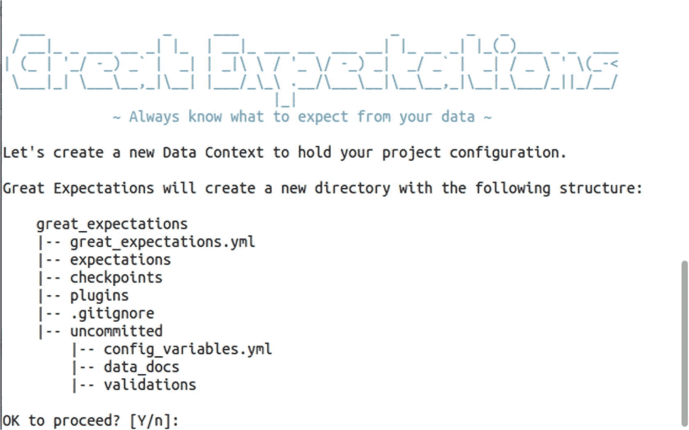
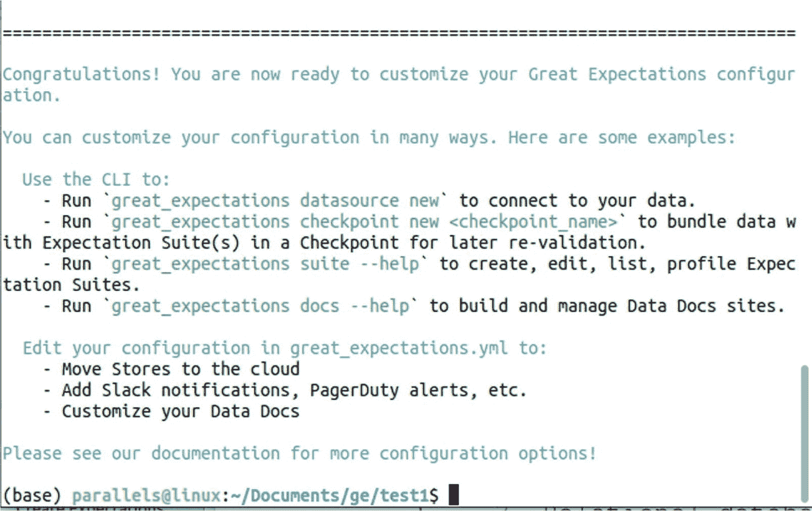
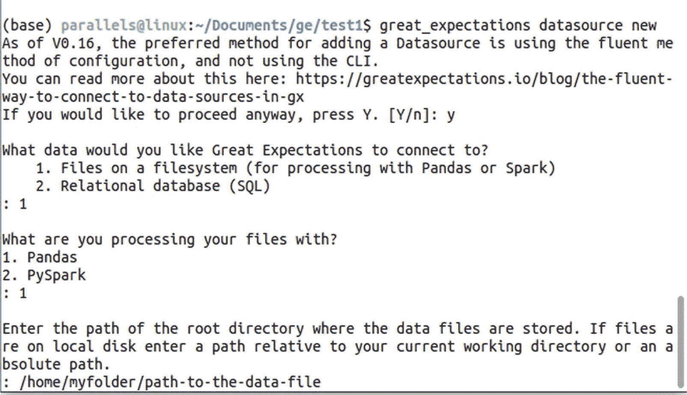
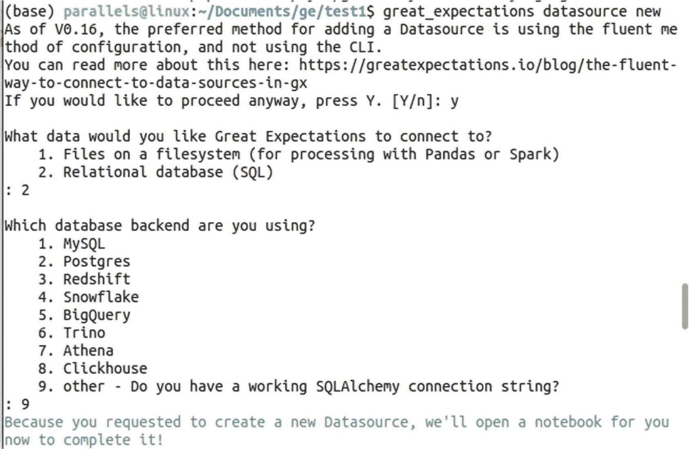
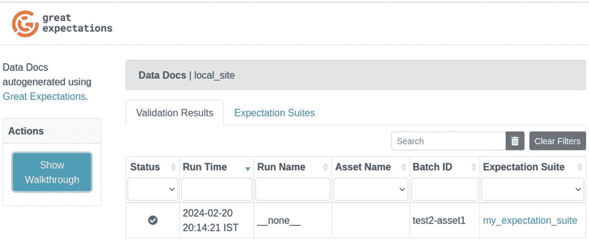
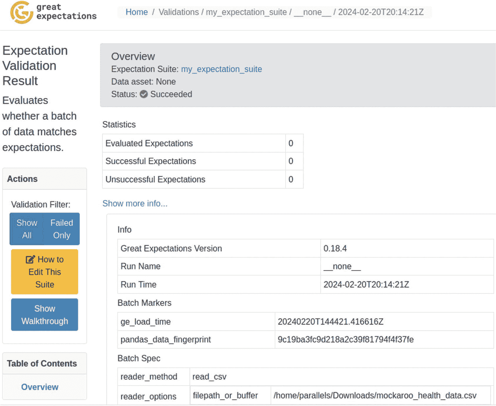
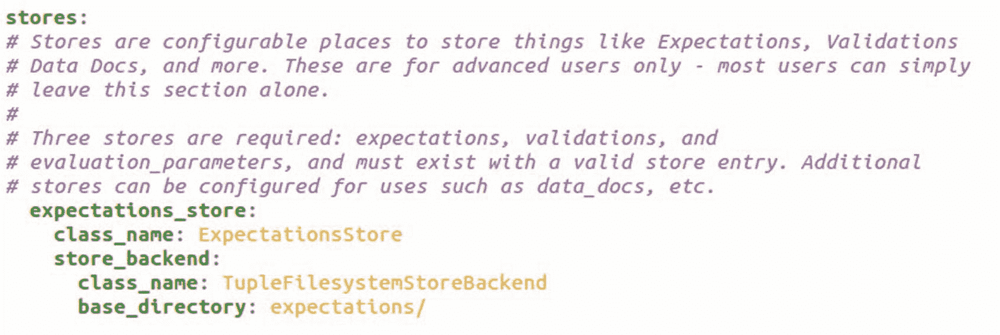

# 6. 使用 Great Expectations 进行数据验证

## 引言

到目前为止，我们了解了数据验证的必要性和背后的理念、数据验证的原则，以及数据未经验证时会发生什么。我们还了解了关键的 Python 数据验证库 `Pydantic` 和 `Pandera`。`Pydantic` 是 Python 中使用最广泛的库之一。我们学习了如何创建一个模型类并从该类实例化一个对象。我们还了解了 `Pandera`，这是一个专门的开源 Python 库，具有高级数据验证选项，例如在列级别检查条件等。在本章中，我们将介绍 `Great Expectations`，这是一个完整的数据验证框架，旨在为多个生产管道管理数据验证和测试。

在本章结束时，你将学习到：

*   `Great Expectations` 框架的构建模块
*   设置、安装和故障排除
*   `Great Expectations` 数据管道的典型工作流程
*   为数据管道开发期望
*   创建期望套件和检查点

## Great Expectations 简介

`Great Expectations` 是一个用于在数据管道中测试和验证数据集的 Python 框架。它帮助数据专业人员定义测试和验证规则、编写文档以及测试数据的完整性。数据专业人员可以对数据集的结构、数据类型和各种其他属性设置各种期望。在此上下文中，每个测试和验证标准（单元测试）都被定义为一个期望。因此，我们将更频繁地使用“期望”一词来为给定的数据集定义各种测试和验证标准。

`Great Expectations` 可以帮助你定义你希望从已加载和/或转换的数据中得到什么。通过应用这些期望，你可以识别数据中的瓶颈和问题。此外，`Great Expectations` 会生成关于数据的文档以及数据集的数据质量评估报告。

### Great Expectations 的组件

目前，`Great Expectations` 可在本地环境和云环境中使用。我们将介绍本地部署选项，即在你的计算机上本地设置 `Great Expectations`。在内部，`Great Expectations` 由四个核心组件组成，这些组件使其能够正常运行。它们如下所示。

#### 数据上下文

数据上下文被称为 `Great Expectations` API 的起点；对于给定的 `Great Expectations` 项目，此组件包含设置、元数据、配置参数以及验证数据的输出。元数据通常存储在一个称为 `Great Expectations` 存储的对象中。`Great Expectations` API 提供了一种使用 Python 配置和与这些方法交互的方式。你可以通过 `Great Expectations` 公共 API 访问它们。`Great Expectations` 还会自动生成数据文档，其中包含数据的来源以及数据集所经历的验证。

#### 数据源

数据源组件告诉 `Great Expectations` 如何连接到给定的数据集。该数据集可以是平面文件、JSON 文档、SQL 数据库、位于本地的 `Pandas` 数据帧、远程机器或云环境中的数据集。数据源组件包含一个或多个数据资产。数据资产是来自源数据的记录集合。数据资产以批次存储，其中给定的批次可能包含一个唯一的记录子集。`Great Expectations` 在内部提交一个批次请求以访问数据来执行验证和测试。值得注意的是，`Great Expectations` 中的一个数据资产可能包含来自多个文件、多个数据库表等的数据，而给定的批次可能恰好包含来自一个数据资产的数据。

#### 期望

期望将是本章的核心！如前所述，期望是需要针对数据点进行验证的断言。期望提供了一种描述性的方式来描述给定数据的预期行为。这些期望直接应用于数据。因此，当 `Great Expectations` 应用一个给定的期望时，它会返回一个报告，其中包含该期望是否得到满足。`Great Expectations` 已经提供了大量预定义的期望；但是，你也可以编写自定义期望。以下是一个期望的示例：

```python
my_custom_dataframe.expect_column_values_to_be_in_set(
    "Hobbies",
    ["mountain hiking", "city surfing", "long drives"]
)
```

#### 检查点

检查点是 `Great Expectations` 框架在生产管道中验证数据的方式。检查点提供了一个框架，用于将一个或多个数据批次组合在一起，并针对所述批次数据执行期望。一个检查点接收一个或多个批次，并将它们提供给验证器模块。验证器模块生成结果，然后将这些结果传递给一系列验证操作。验证结果告诉你数据相对于定义的期望处于何种状态以及处于何处。最后一步是验证操作，这些操作可以根据你的需求完全配置。操作包括发送电子邮件、更新数据文档等。

## 安装与设置

`Great Expectations` 建议使用虚拟环境来创建项目。因此，我们将采用虚拟环境进行设置。

首先，请确保您已安装最新版本的 `Python`，即 3.x 版本。

现在，让我们在工作区中创建一个虚拟环境：

```bash
python3 -m venv gework
```

这将在当前目录下创建一个名为“gework”的新文件夹。

接着，激活该虚拟环境：

```bash
source gework/bin/activate
```

如果您使用的是 `Windows` 电脑，请使用以下命令激活虚拟环境：

```bash
gework/Scripts/activate
```

我们使用 `pip` 来安装 `Python` 包。在安装 `Great Expectations` 之前，请先将 `pip` 更新到最新版本：

```bash
python3 -m ensurepip —upgrade
```

要在您的机器上安装 `Great Expectations`，请执行以下命令：

```bash
pip3 install great_expectations
```

或者

```bash
python3 -m pip install great_expectations
```

如果您需要将 `SQL` 数据库作为数据源，那么还需要安装 `SQLAlchemy` 包。要安装 `Great Expectations` 及其可选的 `SQL` 依赖项，请使用以下命令：

```bash
pip install 'great_expectations[sqlalchemy]'
```

开始一个新的 `Great Expectations` 项目有两种方式。一种是传统的命令行界面交互方式，另一种是通过现代的流畅数据源方法。

让我们简要了解一下与 `Great Expectations` CLI 的交互：

```bash
great_expectations init
```

随后，屏幕会显示如下提示：



终端窗口中的提示截图显示了代码。它以一条消息开始，询问用户是否要创建一个新的数据上下文来保存项目配置。同时，它也展示了将要创建的目录结构。

图 6-1

命令行上的 `Great Expectations` 提示界面

`Great Expectations` 将为您的项目创建一个项目结构。要继续，请键入“y”；如果不继续，请键入“n”并重新启动流程。

项目结构创建完成后，您将看到以下界面：



`Great Expectations` 配置页面的截图显示了一条消息，内容为“恭喜，您现在可以自定义您的 Great Expectations 配置了”。它还展示了如何自定义配置的示例。

图 6-2

自定义 `Great Expectations` 配置页面

我们可以通过执行以下命令来开始连接数据源：

```bash
great_expectations datasource new
```



页面截图。文本描述了一系列关于连接数据源的问题和答案。问题是：您希望 `Great Expectations` 连接到什么数据？以及您使用什么来处理文件？

图 6-3

在 `Great Expectations` 中添加新数据源

如果我们选择关系数据库而不是文件系统中的文件，选项如下所示：



页面截图。文本描述了一系列关于连接数据源的问题和答案。问题是：您希望 `Great Expectations` 连接到什么数据？以及您使用的是哪种数据库后端？

图 6-4

在 `Great Expectations` 中为新数据源选择合适的选项

随后，这将打开一个 `Jupyter` notebook，您可以在其中完成新数据源的设置。

## 开始编写期望

让我们来看看如何编写期望。本示例旨在展示期望作为一种功能的工作原理。在生产或开发流水线中，通常需要初始化数据上下文、定义数据资产、连接到期望存储、编写验证、并针对期望测试验证等步骤。

这里我们有一个数据集，包含受试者的性别及其相应的血糖水平。我们将编写一个期望，以查看数据集中有哪些性别类型。

首先，导入所需的库和方法：

我们将从头开始创建一个数据集。因此，需要使用`random`库以及以下代码：

```python
import great_expectations as ge
import pandas as pd
import random
```

```python
gender = ["Male","Female","Others"]
random.seed(10)
blood_sugar_levels = [random.randint(70, 130) for i in range(20)]
gender = [random.choice(gender) for i in range(20)]
```

现在，创建一个`Pandas`数据框：

```python
data = {"Gender": gender, "BloodSugarLevels": blood_sugar_levels}
df = pd.DataFrame(data)
```

接着，将`Pandas`数据框导入到`Great Expectations`数据框中：

```python
df_ge = ge.from_pandas(df)
```

很好。现在，让我们创建期望。我们期望数据集中可能只包含男性和女性。代码如下所示：

```python
gender_exp = df_ge.expect_column_values_to_be_in_set(
"Gender",
["Male", "Female"]
)
print(gender_exp)
```

在上述代码中，我们同时指定了列名和期望看到的类别。输出结果如下：

```python
{
"success": false,
"expectation_config": {
"expectation_type": "expect_column_values_to_be_in_set",
"kwargs": {
"column": "Gender",
"value_set": [
"Male",
"Female"
],
"result_format": "BASIC"
},
"meta": {}
},
"result": {
"element_count": 20,
"missing_count": 0,
"missing_percent": 0.0,
"unexpected_count": 5,
"unexpected_percent": 25.0,
"unexpected_percent_total": 25.0,
"unexpected_percent_nonmissing": 25.0,
"partial_unexpected_list": [
"Others",
"Others",
"Others",
"Others",
"Others"
]
},
"meta": {},
"exception_info": {
"raised_exception": false,
"exception_traceback": null,
"exception_message": null
}
}
```

您还可以通过执行以下代码来探索数据集中的各种类别：

```python
print(df_ge.Gender.value_counts())
```

在本例中，我们得到：

```python
Gender
Female    10
Male       5
Others     5
Name: count, dtype: int64
```

现在，如果我们重新编写期望，将“Others”类别包含进来，我们将得到以下结果。代码如下：

```python
gender_exp = df_ge.expect_column_values_to_be_in_set(
"Gender",
["Male", "Female","Others"]
)
print(gender_exp)
```

输出结果如下：

```python
{
"success": true,
"expectation_config": {
"expectation_type": "expect_column_values_to_be_in_set",
"kwargs": {
"column": "Gender",
"value_set": [
"Male",
"Female",
"Others"
],
"result_format": "BASIC"
},
"meta": {}
},
"result": {
"element_count": 20,
"missing_count": 0,
"missing_percent": 0.0,
"unexpected_count": 0,
"unexpected_percent": 0.0,
"unexpected_percent_total": 0.0,
"unexpected_percent_nonmissing": 0.0,
"partial_unexpected_list": []
},
"meta": {},
"exception_info": {
"raised_exception": false,
"exception_traceback": null,
"exception_message": null
}
}
```

## Great Expectations 中的数据验证工作流

到目前为止，我们已经了解了如何通过命令行界面入门，遵循各种选项和设置，并创建了一个非常简单的“Hello World”式的`Great Expectations`项目。上一节的目的在于让你熟悉`Great Expectations`的功能和环境，因为它与创建`Pydantic`模型类或`Pandera`模式验证有所不同。

在本节中，我们将探讨开发数据管道时需要遵循的典型数据验证工作流。以下是`Great Expectations`制定的步骤：

1.  在工作站上安装`Great Expectations`。

2.  创建数据上下文，初始化数据上下文组件以存储元数据和其他设置管理。

3.  连接数据，列出从`Pandas`数据帧到基于云的数据库的所有数据源，并为每个数据源执行必要步骤。

4.  创建验证器，以便针对数据验证期望套件。

5.  创建期望，为数据编写断言。

6.  运行检查点，使用验证器对一批数据运行期望。

7.  查看验证结果，即数据针对某个期望或期望套件进行验证后生成的结果。

我们在“设置与安装”部分已经了解了在使用`CLI`之前安装`Great Expectations`的过程。成功安装`Great Expectations`后，就该设置数据上下文了。数据上下文包含期望、期望存储、检查点和数据文档的配置。初始化数据上下文非常简单，只需导入库并运行`get_context()`方法：

```python
import great_expectations as ge
context = ge.get_context()
print(context)
```

你将得到类似如下的输出：

```
{
"anonymous_usage_statistics": {
"explicit_url": false,
"explicit_id": true,
"data_context_id": "14552788-844b-4270-86d5-9ab238c18e75",
"usage_statistics_url": "https://stats.greatexpectations.io/great_expectations/v1/usage_statistics",
"enabled": true
},
"checkpoint_store_name": "checkpoint_store",
"config_version": 3,
"data_docs_sites": {
"local_site": {
"class_name": "SiteBuilder",
"show_how_to_buttons": true,
"store_backend": {
"class_name": "TupleFilesystemStoreBackend",
"base_directory": "/tmp/tmp_oj70d5v"
},
"site_index_builder": {
"class_name": "DefaultSiteIndexBuilder"
}
}
},
"datasources": {},
"evaluation_parameter_store_name": "evaluation_parameter_store",
"expectations_store_name": "expectations_store",
"fluent_datasources": {},
"include_rendered_content": {
"expectation_validation_result": false,
"expectation_suite": false,
"globally": false
},
"profiler_store_name": "profiler_store",
"stores": {
"expectations_store": {
"class_name": "ExpectationsStore",
"store_backend": {
"class_name": "InMemoryStoreBackend"
}
},
"validations_store": {
"class_name": "ValidationsStore",
"store_backend": {
"class_name": "InMemoryStoreBackend"
}
},
"evaluation_parameter_store": {
"class_name": "EvaluationParameterStore"
},
"checkpoint_store": {
"class_name": "CheckpointStore",
"store_backend": {
"class_name": "InMemoryStoreBackend"
}
},
"profiler_store": {
"class_name": "ProfilerStore",
"store_backend": {
"class_name": "InMemoryStoreBackend"
}
}
},
"validations_store_name": "validations_store"
}
```

在 Great Expectations 的最新版本中，所有期望都存储为期望套件。期望套件是关于数据的一个或多个期望或断言的集合，以 JSON 格式存储。因此，我们需要配置如何连接到期望套件。这就是期望存储发挥作用的地方。

流程的下一步是连接到数据资产。数据资产就是原始形式的数据。数据源是这些数据资产的存储位置。由于我们在本地文件系统上运行 Great Expectations，让我们指定本地存储在文件系统中的平面文件，以便读入数据资产：

```python
import great_expectations as ge
context = ge.get_context()
validator = context.sources.pandas_default.read_csv(
"/home/parallels/Downloads/mockaroo_health_data.csv"
)
```

在上述代码中，我们直接将数据资产写入验证器。下一步是创建数据源。

首先，创建一个数据源：

```python
datasource_name = "test2"
ge.datasource = context.sources.add_pandas(datasource_name)
```

然后，创建一个数据资产：

```python
asset_name = "asset1"
path_to_data = "/home/parallels/Downloads/mockaroo_health_data.csv"
asset = ge.datasource.add_csv_asset(asset_name, filepath_or_buffer=path_to_data)
```

现在，让我们构建一个批次请求：

```python
batch_request = asset.build_batch_request()
```

现在，让我们创建期望套件：

```python
context.add_or_update_expectation_suite("my_expectation_suite")
```

现在让我们创建一个验证器。

验证器需要知道包含数据的批次（用于验证期望）以及期望套件（包含你创建的期望组合列表）：

```python
validator = context.get_validator(
batch_request=batch_request,
expectation_suite_name="my_expectation_suite",
)
print(validator.head())
```

我们将得到

```
Calculating Metrics:   0%|          | 0/1 [00:00<?, ?it/s]
id              name  age state  gender exercise_daily? copay_paid
0   1   Allayne Moffett  NaN    SC    Male             NaN    $206.76
1   2  Kerby Benjafield  NaN    NM    Male            True     $21.58
2   3   Raina Vallentin  NaN    MI  Female            True    $125.18
3   4     Kaela Trodden  NaN    OH  Female           False     $86.20
4   5    Faber Kloisner  NaN    MN    Male           False    $219.38
```

注意：上述示例中使用的数据集是随机生成的，其中包含缺失值等情况。

现在，让我们运行验证器来创建并运行一个期望。让我们查看某一列（例如“age”）的缺失值。我们用于此操作的期望是 `expect_column_values_to_not_be_null`。

代码如下所示：

```python
expectation_notnull = validator.expect_column_values_to_not_be_null(
column="age"
)
print(expectation_notnull)
```

这将产生

```
Calculating Metrics:   0%|          | 0/6 [00:00<?, ?it/s]
{
"success": false,
"expectation_config": {
"expectation_type": "expect_column_values_to_not_be_null",
"kwargs": {
"column": "age",
"batch_id": "test2-asset1"
},
"meta": {}
},
"result": {
"element_count": 1000,
"unexpected_count": 1000,
"unexpected_percent": 100.0,
"partial_unexpected_list": [
null,
null,
null,
null,
null,
null,
null,
null,
null,
null,
null,
null,
null,
null,
null,
null,
null,
null,
null,
null
]
},
"meta": {},
"exception_info": {
"raised_exception": false,
"exception_traceback": null,
"exception_message": null
}
}
```

通过运行验证器，该期望已被记录到期望套件中。现在，让我们针对另一列“copay_paid”运行与缺失值相关的期望。

代码如下所示：

```
expectation_notnull = validator.expect_column_values_to_not_be_null(
    column="copay_paid"
)
print(expectation_notnull)
```

这将返回

```
Calculating Metrics:   0%|          | 0/6 [00:00<?, ?it/s]
{
    "success": false,
    "expectation_config": {
        "expectation_type": "expect_column_values_to_not_be_null",
        "kwargs": {
            "column": "copay_paid",
            "batch_id": "test2-asset1"
        },
        "meta": {}
    },
    "result": {
        "element_count": 1000,
        "unexpected_count": 126,
        "unexpected_percent": 12.6,
        "partial_unexpected_list": [
            null,
            null,
            null,
            null,
            null,
            null,
            null,
            null,
            null,
            null,
            null,
            null,
            null,
            null,
            null,
            null,
            null,
            null,
            null,
            null
        ]
    },
    "meta": {},
    "exception_info": {
        "raised_exception": false,
        "exception_traceback": null,
        "exception_message": null
    }
}
```

如你所见，大约有 126 条记录的 `copay_paid` 值缺失。

到目前为止，我们已经运行了两个期望。虽然期望已保存在 `validator` 对象的期望套件中，但验证器在当前 Python 会话之外不会持久存在。要重用当前的期望，必须将其保存。操作如下：

```
validator.save_expectation_suite("/home/parallels/Documents/my_expectation_suite.json", discard_failed_expectations=False)
```

运行程序后，Great Expectations 会创建一个 JSON 文档形式的期望套件。

对于我们当前的程序，该 JSON 文档的内容如下：

```
{
    "data_asset_type": null,
    "expectation_suite_name": "my_expectation_suite",
    "expectations": [
        {
            "expectation_type": "expect_column_values_to_not_be_null",
            "kwargs": {
                "column": "age"
            },
            "meta": {}
        },
        {
            "expectation_type": "expect_column_values_to_not_be_null",
            "kwargs": {
                "column": "copay_paid"
            },
            "meta": {}
        }
    ],
    "ge_cloud_id": null,
    "meta": {
        "great_expectations_version": "0.18.4"
    }
}
```

## 创建检查点

检查点是一种使用 Great Expectations 在生产管道中验证数据的方法。检查点允许你将期望套件与数据关联起来；其理念是针对数据验证期望。

创建检查点的方法如下：

```
checkpoint = context.add_or_update_checkpoint(
    name="my_checkpoint",
    validations=[
        {
            "batch_request": batch_request,
            "expectation_suite_name": "my_expectation_suite",
        },
    ],
)
```

你可以使用以下代码返回检查点结果：

```
checkpoint_result = checkpoint.run()
print(checkpoint_result)
```

这将产生以下输出：

## 检查点运行结果

```
Calculating Metrics: 0it [00:00, ?it/s]
{
"run_id": {
"run_name": null,
"run_time": "2023-12-15T13:40:18.348374+05:30"
},
"run_results": {
"ValidationResultIdentifier::my_expectation_suite/__none__/20231215T081018.348374Z/test2-asset1": {
"validation_result": {
"success": true,
"results": [],
"evaluation_parameters": {},
"statistics": {
"evaluated_expectations": 0,
"successful_expectations": 0,
"unsuccessful_expectations": 0,
"success_percent": null
},
"meta": {
"great_expectations_version": "0.18.4",
"expectation_suite_name": "my_expectation_suite",
"run_id": {
"run_name": null,
"run_time": "2023-12-15T13:40:18.348374+05:30"
},
"batch_spec": {
"reader_method": "read_csv",
"reader_options": {
"filepath_or_buffer": "/home/parallels/Downloads/mockaroo_health_data.csv"
}
},
"batch_markers": {
"ge_load_time": "20231215T081018.350419Z",
"pandas_data_fingerprint": "9c19ba3fc9d218a2c39f81794f4f37fe"
},
"active_batch_definition": {
"datasource_name": "test2",
"data_connector_name": "fluent",
"data_asset_name": "asset1",
"batch_identifiers": {}
},
"validation_time": "20231215T081018.363378Z",
"checkpoint_name": "my_checkpoint",
"validation_id": null,
"checkpoint_id": null
}
},
"actions_results": {
"store_validation_result": {
"class": "StoreValidationResultAction"
},
"store_evaluation_params": {
"class": "StoreEvaluationParametersAction"
},
"update_data_docs": {
"local_site": "file:///tmp/tmpy1si_l4d/validations/my_expectation_suite/__none__/20231215T081018.348374Z/test2-asset1.html",
"class": "UpdateDataDocsAction"
}
}
}
},
"checkpoint_config": {
"config_version": 1.0,
"notify_on": null,
"default_validation_id": null,
"evaluation_parameters": {},
"expectation_suite_ge_cloud_id": null,
"runtime_configuration": {},
"module_name": "great_expectations.checkpoint",
"template_name": null,
"slack_webhook": null,
"class_name": "Checkpoint",
"validations": [
{
"name": null,
"expectation_suite_name": "my_expectation_suite",
"expectation_suite_ge_cloud_id": null,
"id": null,
"batch_request": {
"datasource_name": "test2",
"data_asset_name": "asset1",
"options": {},
"batch_slice": null
}
}
],
"action_list": [
{
"name": "store_validation_result",
"action": {
"class_name": "StoreValidationResultAction"
}
},
{
"name": "store_evaluation_params",
"action": {
"class_name": "StoreEvaluationParametersAction"
}
},
{
"name": "update_data_docs",
"action": {
"class_name": "UpdateDataDocsAction"
}
}
],
"site_names": null,
"notify_with": null,
"batch_request": {},
"profilers": [],
"run_name_template": null,
"name": "my_checkpoint",
"expectation_suite_name": null,
"ge_cloud_id": null
},
"success": true
}
```

你也可以向当前检查点添加更多验证：

```
checkpoint = context.add_or_update_checkpoint(
name="my_test_checkpoint", validations=more_validations
)
```

## 数据文档

数据文档（简称 data doc）提供了 Great Expectations 处理的数据验证结果的交互式文档。

以下是在 Great Expectations 中生成数据文档的方法：

```
context.build_data_docs()
```



**图 6-5 Great Expectations 中的数据文档**

Great Expectations 将生成一个完整的基于 Web 的文档以及其他元数据。你也可以编辑该文档。你看到的文档可能如下所示。

当你点击期望套件时，你将能够看到更多元数据。你看到的可能如下所示：



**图 6-6 Great Expectations 中的期望验证结果**

## 期望存储

到目前为止，我们已经了解了如何连接到数据资产、构建批次请求、创建验证器、在验证器上运行期望以及将期望保存到 JSON 文档中。现在，让我们看看如何管理我们在期望存储中构建的期望。期望存储是连接到存储的连接器，有助于检索关于数据的期望集合。

这个过程相对简单，你需要在 Great Expectations 文件夹中创建一个文件夹，将所有 JSON 文档移动到该文件夹中，并更新配置文件以包含一个用于存储期望结果的存储：

```
mkdir shared_expectations
mv path-to/my_expectation_suite.json destination-path/shared_expectations/
```

然后更新配置文件的“基础目录”。以下是其外观的截图：



**图 6-7 Great Expectations 中的期望存储**

## 结论

我们继续深入探讨了数据验证的相关内容。`Great Expectations` 是一个创新的数据验证库，它内置了预定义的期望规则。这些预定义期望的数量持续增长，也为探索对数据进行验证的各种方法提供了丰富的资源。你还可以使用这些预定义期望创建一个模板，称为期望存储。在我看来，`Great Expectations` 社区发展非常迅速，因为在撰写本书的过程中，我已经经历了两个不同的版本。当你阅读本书时，你将见证一个重大的 1.0 版本发布。