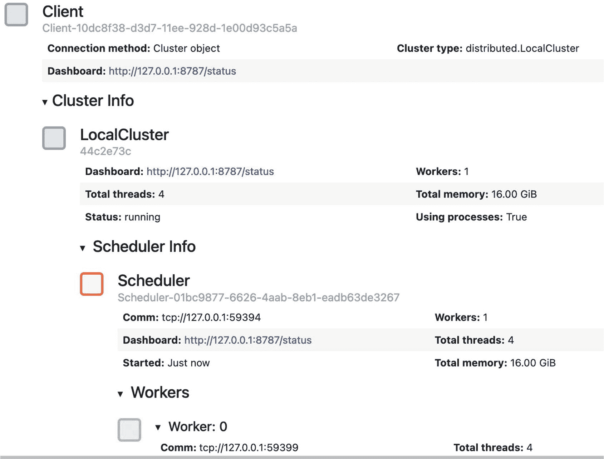
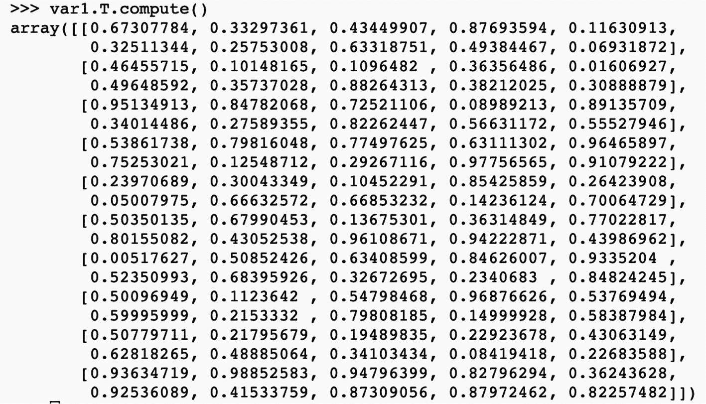

# 7. 并发编程与 Dask 简介

## 引言

我们之前讨论过，高效且有效地处理大型数据集至关重要。随着数据集不断增长，传统的单线程处理方式逐渐显现出其局限性。默认情况下，Python 有一个全局解释器锁（GIL），它只允许一个线程在任意时刻持有解释器。虽然这种设计保证了提交计算的完整性，但在如今普遍使用的多核 CPU 中，利用多个线程会高效得多。在本章中，你将学习并行编程、并发编程以及 Dask 的概念。Dask 是一个支持分布式处理的 Python 库，它通过使用多个进程来绕过全局解释器锁的限制。Dask 还支持我们在前几章中见过的各种数据处理库。

学完本章后，你将了解到：

*   并行处理的概念及其与顺序处理的区别
*   并发处理的基础知识
*   Dask
*   Dask 的架构与概念
*   Dask 的核心数据结构及其如何实现分布式计算
*   优化 Dask 计算

## 并行与并发处理简介

一般来说，并行处理是将一个大任务分解成若干个小任务，并同时执行这些小任务的过程，这样既能显著缩短完成任务所需的时间，又能使所有资源得到最优利用。在计算领域也是如此。它是一个将大型编程任务分解成若干个小任务，同时执行这些任务，然后将所有小任务的结果汇总以得到最终结果的过程。从编程的角度来看，这可能不那么明显。

### 历史

当 CPU 开始在其微处理器架构中包含多个处理单元时，并行处理开始受到重视。一般来说，在微处理器中携带数字信号的电子传输速度非常快；但单个处理器的运行速度存在上限。这些限制，加上减少热量产生等需求，为多核处理器铺平了道路。如今，我们笔记本电脑、手机、电脑等设备中的微处理器都包含多个处理单元（我们称之为核心）。

### Python 与全局解释器锁

我们使用的 Python 编程语言是用 C 语言实现的。出于特定目的，也有基于 Java 和 .NET 的其他实现；然而，用于数据处理、工程和机器学习的 Python 是基于 C 语言的。核心 Python 解释器中可用的机制之一称为全局解释器锁，即 GIL。GIL 的目的是简化内存管理。因此，当我们有多个 Python 字节码（例如）时，每个字节码都会通过获取 GIL 来执行 Python 字节码指令。一旦该过程完成，GIL 就会被释放，以便下一个可用的 Python 字节码可以获取它来执行。虽然这保证了线程安全计算，但它也通过多线程方法禁用了并行处理。不过，还有其他方法可以实现并行处理，并且一些文件输入/输出操作不受 GIL 限制，这是个好消息。

### 并行处理的概念

当我们谈论进程时，在任意给定时间点，设备中都有多个进程在同时运行。进程本质上是一个正在运行的程序（代码）。任何给定的进程都可以有多个线程。

可以说，线程就像一个子进程。一个进程可以包含一个或多个线程。多个线程可以同时执行（在某些情况下也可能不执行）。从 CPU 的角度来看，线程并不是微处理器上物理存在的东西；相反，它是一个逻辑执行单元。

核心是一个物理执行单元，可以执行计算操作。一个核心可以执行一个线程。一个微处理器可以有一个或多个核心。

简而言之：

进程是操作系统级别的抽象。
线程是软件级别的抽象。
核心是物理级别的抽象。

有一个名为“multiprocessing”的 Python 库，它可以绕过 Python 中的全局解释器锁。该 Python 库没有利用多线程的概念，而是采用了子进程同时在多个核心上运行的思想；因此，它的工作方式是，“multiprocessing”库提供了一个进程间通信系统，该系统通过使用多个核心为并行处理的有效协作提供了机制。“multiprocessing”库可以使用的核心数量受限于你系统中的核心数量。

### 识别 CPU 核心

你可以编写简单的 Python 代码来确定你的计算机上有多少个核心。

代码如下所示：

```
from multiprocessing import cpu_count
numberOfCores = cpu_count()
print(f"There are {numberOfCores} cores in your CPU")
```

这将返回一个数字，表示你计算机微处理器上的核心数量。

以下是一个使用“multiprocessing”库进行并行处理的简单示例：

```
from multiprocessing import Pool
def cube(a):
return a * a * a
inputs = [5,12,17,31,43,59,67]
with Pool(processes=4) as parallelprocess:
cubevalue = parallelprocess.map(cube, inputs)
print(cubevalue)
```

上述代码将显示所提供输入的立方值。输出结果可能如下所示：

```
[125, 1728, 4913, 29791, 79507, 205379, 300763]
```

在代码中，你可以看到 Pool 方法及其名为 processes 的参数。

### 并发处理

并发处理在处理同时发生的任务时，与并行处理的概念类似。然而，其执行方式与我们之前所了解的不同。并发处理指的是两个或多个任务在同一时间点开始执行，但它们可能并非在完全相同的时刻运行。

例如，在单个核心中，一个任务可能启动并运行一段时间。假设第一个任务可能需要等待其他进程执行另一个操作，于是它进入等待状态；在此期间，一个或多个任务可能开始执行，甚至可能完成，具体取决于它们的计算、内存和存储需求以及可用资源。

并发并非等待一个任务完全结束后再执行下一个，它允许在运行时动态共享和分配内存、计算和存储资源。这是一种无缝利用资源的方式。

注意

想象你是一家餐厅的厨师。有五份订单同时到达。你知道菜单上的菜品所需烹饪时间各不相同。你只有一台炉子和一台微波炉来处理这五份订单。为简单起见，假设你只有一个油炸锅、烤架或类似设备。现在我们来阐述并发和并行。

**并发**

想象先开始烹饪一道慢炖的菜。在慢炖的同时，为另一道菜准备蔬菜。切好蔬菜后，定期检查慢炖的菜，或许搅拌一下。将慢炖的菜转移到烤箱，同时把准备好的蔬菜放到炉子上。蔬菜开始烹饪时，为另一道菜准备鸡蛋。定期检查蔬菜和烤箱。你在不同任务之间切换，即使独自工作，也能同时推进三道菜的进度。这就是并发。

**并行**

想象五位厨师处理五份订单。每位厨师负责一份订单，拥有自己完整的一套设备（炉子、烤箱等）和工具（刀、勺等）。他们各自使用自己的设备和工具，专注于自己的菜品。这就是并行。

**并发**是指一个 CPU 核心处理多个任务，使用共享资源，并在任务之间快速切换。**并行**是指“n”个 CPU 核心处理“n”个任务，每个核心使用专用资源。

## Dask 简介

Dask 是一个专门的 Python 库，用于在 Python 中实现数据分析和机器学习任务的并行与分布式计算。Dask 是一个 Python 原生库，其实现不依赖于非 Python 编程语言。

Dask 能与 Pandas、Polars、CuDF、scikit-learn 和 XGBoost 等主流 Python 库良好协作。如果你正在处理数据量和计算、内存需求超出单台机器能力的数据处理和机器学习管道，那么在技术栈中采用 Dask 可能会带来好处。

Dask 的学习曲线相对较快，并且将 Dask 集成到生产数据管道中也相对容易。Dask 被大型银行、主要医疗机构、国家实验室和组织所使用。

Dask 支持大数据管道中常见的多种数据格式，如 Avro、HDF5、Parquet 等，同时也支持 CSV、JSON 等传统数据格式。

Dask 主要利用 CPU 来执行其计算和操作。不过，Dask 也可以与 GPU 协同工作。Dask 和 CuDF Python 库之间具有良好的互操作性。我们将在接下来的章节中详细探讨这个主题。

### 安装与设置

在开发环境中设置 Dask 相对简单。你可以通过命令行使用 pip 或 conda 安装 Dask 包：

```
sudo apt install graphviz
```

以及

```
python3 -m pip install "dask[complete]"
```

或

```
pip3 install dask dask distributed bokeh —-upgrade
```

或

```
conda install dask
```

你也可以在分布式计算集群中安装 Dask。Dask 与 Hadoop 集群配合良好；你可以使用 YARN（Hadoop 的资源管理器，用于在给定 Hadoop 集群内部署各种服务）来部署 Dask。你还可以在 AWS 或 GCP 上创建云计算 Dask 集群。

以下是一个使用 Dask 的简单“Hello World”式实现：

```
import dask
import dask.array as da
arr = da.from_array(
[1,2,3,4,5,6,7,8,9,10]
, chunks=2
)
squared = arr ** 2
result = squared.compute()
print(result)
```

在上面的例子中，我们首先导入了必要的类和方法。然后创建了一个块大小为 2 的 Dask 数组，意味着将这个数组分成两个不同的块。接着创建了一个名为 squared 的新函数，用于计算数组中每个值的平方。之后通过调用名为 `compute()` 的方法来执行该函数，该方法会触发实际计算并返回结果。这是由于 Dask 的惰性求值特性所致。

当我们打印结果时，会返回：

```
[  1   4   9  16  25  36  49  64  81 100]
```

## Dask 的特性

### 任务与图

在 Dask 中，计算被表示为一系列任务，这些任务作为节点，通过边连接起来。这些节点和边以有向无环图（DAG）的形式组织。需要完成的任务表示为节点。不同任务之间的数据依赖关系（或无数据依赖关系）表示为边。有向无环图的表示方式使 Dask 能够有效地在多个线程、进程甚至跨多个 CPU 上执行任务及其底层依赖关系。

### 惰性求值

我们在之前的章节中已经了解过惰性求值的概念。为了唤起你的记忆，惰性求值是指计算不会立即发生。只有在实际需要时，才会执行给定的代码集。在此之前，这段代码可能会被延迟执行，有时甚至根本不会执行。正如我们已经知道的，Dask 会创建一个有向无环图来表示其执行流程。但它实际上并不会执行每个节点，除非有必要。通过这种方式，Dask 优化了计算。

### 分区与分块

分区是指将一个非常大的数据集拆分成多个更小或更易于管理的数据集部分。这些较小的数据集可以独立处理。通过利用分区的概念，Dask 可以处理比其可用内存更大的数据集。分块与分区的概念类似，只是其应用范围更小。“分区”一词在数据库和数据表的上下文中使用较多，指的是将给定的表拆分成多个较小的表。这些表在处理后，可能会被重新组合或连接回其原始结构（类似于 MapReduce 编程的概念）。

另一方面，“分块”主要与将数组拆分成更小的块相关。你可以在创建 Dask 数组时指定块的大小。在 Dask 的上下文中，可以更容易地得出结论：“分区”一词适用于数据库、表和数据帧的情况，而“分块”一词适用于一维或多维数组的情况。

### 序列化与 Pickling

序列化是指将给定的数据集转换为一种可以高效存储或传输的格式。在需要时，这种格式可以被重建回原始数据格式。Dask 使用序列化来转换数据集，以便能够将序列化数据的分区或块高效地传输到各个工作节点进行处理。在处理大型数据框、n 维数组等时，Dask 会决定采用哪种序列化技术。

Pickling 是 Python 编程中独有的一种序列化方法。Pickling 是一种将 Python 数据对象序列化为字节流的方式，这些字节流可以被存储或传输到各个工作节点。之后，这些字节流可以被重建回原始格式的数据集。Dask 是一个通用计算框架，包含多种序列化技术。然而，我们有必要承认 pickling 序列化在 Python 生态系统中的机器学习建模领域所扮演的关键角色。

### Dask-CuDF

在前一章中，我们已经详细讨论了 GPU 计算和 CuDF。正如我们所知，CuDF 是一个 GPU 计算框架，它能够在一个或多个 GPU 上进行数据框处理。CuDF 提供了多种方法和函数，用于导入、导出和执行复杂的数据转换，这些操作可以严格在 GPU 上运行。

另一方面，Dask 是一个通用的并行和分布式计算库。我们可以在 Pandas 和其他主流数据分析库之上使用 Dask，以跨多个 CPU 扩展我们的工作流。

Dask-CuDF 是一个专门的 Python 包，它允许使用 CuDF 而非 Pandas 来处理数据框分区。例如，如果你调用 Dask-CuDF 来处理一个数据框，它可以高效地调用 CuDF 的方法来处理数据（通过将数据发送到 GPU）。如果你的数据处理流程中的数据量非常大，超出了机器的限制，那么使用 Dask-CuDF 可能会让你受益。

## Dask 架构

让我们回顾一下 Dask 中的各个组件。Dask 的架构非常灵活，支持单实例计算、单实例多核计算以及分布式计算。

### 核心库

在 Dask 系统的核心，我们有由各种数据结构组成的 Dask 集合。其中一些包括：类似于 NumPy 数组的 Dask 数组；类似于 Pandas 数据框的 Dask 数据框；以及分别类似于 Python 列表和迭代器的 Dask bag。这些集合使你能够原生地执行并行和分布式计算。只需调用 Dask 的集合，你就能并行化或异步地执行计算。

### 调度器

Dask 调度器是 Dask 执行机制的主要组成部分。Dask 调度器位于集群的核心，管理计算、在工作节点间执行任务，以及与工作节点和客户端进行通信。调度器组件本身是异步的，因为它可以跟踪多个工作节点的进度，并响应来自多个客户端的各种请求。调度器将工作跟踪为一个不断变化的任务有向无环图。在这些有向无环图中，每个节点可以是一个任务，每条弧（节点之间的边）可以是任务之间的依赖关系。

任务（Task）是 Dask 中的计算单元，本质上是一个 Python 函数或对 Python 对象的执行操作。Dask 中有不同类型的调度器。有单线程调度器，它在单台机器的单个线程上执行任务；还有多线程调度器，它使用单台机器的多个线程执行任务；还有多核调度器，它使用处理器的多个核心执行任务；以及分布式调度器，任务在给定集群中使用多个工作节点执行。

### 客户端

Dask 的客户端是与 Dask 通信的主要方式。你通过客户端与 Dask 进行通信。客户端是默认的调度器和工作节点；它管理和协调调度器之间的通信。从计算的角度来看，客户端管理与调度器进程的通信，而调度器则协调并将工作分配给工作进程；这些工作进程会执行必要的计算，并将结果返回给客户端。Dask 的客户端也与调度器通信，并从工作节点收集结果。以下是实例化 Dask 客户端的方法：

```
from dask.distributed import (
Client,
progress
)
client = Client(
threads_per_worker=4
, n_workers=2
)
client
```

你可能会得到如下响应：



截图显示了客户端下的下拉菜单列表。下拉菜单包括集群信息、调度器信息和工作节点。集群类型、总内存、总线程数和进程数的详细信息显示在右侧。

图 7-1

Dask 客户端的初始化

### 工作节点

工作节点是执行计算的终端机器，它们执行由调度器分配的计算任务。一个工作节点可以是单个线程、一个单独的进程或集群中的一台独立机器；每个工作节点都可以访问计算资源、内存和存储。工作节点与调度器通信以接收任务、执行任务并报告结果。

### 任务图

如前文所述，任务中的计算被表示为一个不断变化的任务有向无环图，其中的边可能是任务之间的依赖关系。任务图定义了各个任务之间的依赖关系。当你编写 Dask 代码时，通过对 Dask 数组、Dask DataFrame 或 Dask bag 执行操作，你就在隐式地创建任务图。Dask 系统会自动设计底层的任务图。

## Dask 数据结构与概念

Dask 实现了 NumPy 和 Pandas 数据结构的子集，同时支持在其上进行并行和分布式计算。

### Dask 数组

Dask 数组是 NumPy 的 ndarray 的一种实现。Dask 数组由许多 NumPy 数组组成，并被分割成更小且大小均匀的数组块，这些块被称为 chunks。Dask 使用分块算法来执行此操作。您可以指定希望 Dask 将数组分割成多少个块，也可以让 Dask 自动分割数组以进行计算和运算。这些块随后被独立处理，从而允许在集群内的核心或工作节点上对数据进行分布式和并行处理。Dask 数组开箱即用地支持并行化和多核处理，因此您无需编写额外的代码或添加装饰器来启用并发。

让我们创建一个简单的 Dask 数组：

```
from dask import array
var1 = array.random.random(
(10,10),
chunks=(2,2)
)
print(var1)
```

将返回

```
dask.array
```

这里，我们有一个维度为 (10 × 10) 的随机数组，它被分解成每个维度为 (2 × 2) 的更小块。

当我们对变量添加 `.T.compute()` 时，我们会得到一个转置后的随机矩阵。如下所示：

```
print(var1.T.compute())
```



一个由十进制数值组成的数组，排列成 5 列。顶部文字显示 V a r 1 点 T 点 compute。

图 7-2

检索 Dask 数组的结果

以下操作不建议在本地尝试，而应在云账户中进行。假设您有足够的内存来处理数据集，您可以尝试将数据持久化到内存中。

操作方法如下：

```
var2 = var1.persist()
```

您还可以重新分块您的 Dask 数组。操作方法如下：

```
var1 = var1.rechunk((5,5))
print(var1)
```

将返回

```
dask.array
```

我们可以将 Dask 数组导出为多种格式。让我们看看 HDF5 格式，它旨在存储开源的大型复杂数据。为此，我们需要首先安装 Python 库 `h5py`：

```
pip install h5py
```

让我们创建一个稍大一点的随机数组：

```
import dask.array as da
import h5py
var3 = da.random.random(
(10000,10000),
chunks=(100,100)
)
da.to_hdf5(
'daskarray.hdf5',
'/dask',
var3
)
```

我们已经导入了必要的库并创建了 Dask 数组。我们使用 `to_hdf5` 方法将 Dask 数组导出为 HDF5 文件，同时指定了要存储文件的路径以及要导出为 HDF5 文件的变量。

使用 Dask 数组，您可以执行许多 NumPy 操作。以下是计算数组 `mean()` 函数的方法：

```
dask_mean = da.array(var3) \
.mean() \
.compute()
print(dask_mean)
```

将得到

```
0.5000587201947724
```

### Dask 包

Dask 包是另一种数据结构，旨在处理和操作类似列表的对象。在某种程度上，它们与 Python 列表或迭代器非常相似，但增加了能够进行并行和分布式计算的功能。“包”这个词实际上是一个数学术语。让我们快速回顾一下什么是集合。它是一个无序列表，其中没有重复元素。包基本上是集合，但其中的元素可以重复。它也被称为多重集。

注意

列表是一个可以包含重复元素的集合。

集合是一个包含唯一元素且没有重复项的集合。

多重集是一个可以包含重复元素的集合。

以下是创建新 Dask 包的方法：

```
from dask import bag
new_bag = bag.from_sequence(
[1,2,3,4,5,6,7,8,9,10]
,npartitions=2
)
print(new_bag)
print(new_bag.compute())
```

将得到

```
dask.bag
[1, 2, 3, 4, 5, 6, 7, 8, 9, 10]
```

以下是将文件作为 Dask 包导入的方法：

```
import json
from dask import bag
file = "/content/dask_data1.json"
bags = bag \
.read_text(file) \
.map(json.dumps) \
.map(json.loads)
print(bags.take(1))
```

将得到

```
('[{"id":1,"name":"Godard Bloomer","language":"Greek","gender":"Male","occupation":"Financial Analyst"},\n',)
```

以下是另一个将 CSV 文件读入 Dask 包的示例：

```
from dask import bag
import csv
file = "/your-folder-path-here/mockdata-0.csv"
bags = bag \
.read_text(file) \
.map(
lambda x: next(csv.reader([x]))
)
print(bags.take(5))
```

将得到

```
(['name', 'age'], ['Ermentrude Azema', '22'], ['Joey Morteo', '56'], ['Jordan Corp', '56'], ['Jehu Kettlesing', '25'])
print(bags2.count().compute())
```

将得到

```

```

### Dask 数据框

Dask 数据框是 Pandas 数据框对象的实现，区别在于 Dask 的数据框能够并行化，并在系统内同一处理器的多个核心上或给定集群中的多个系统上执行分布式计算。Dask 数据框还支持多种可以并行执行的 Python 原生函数。让我们来看一些 Dask 数据框的示例：

```
!pip install -q dask-expr
import dask
import dask.dataframe as dd
import pandas as pd
import numpy as np
dask.config.set(
{
'dataframe.query-planning': True
}
)
df = dd.from_pandas(
pd.DataFrame(
np.random.randn(10,3),
columns=['A','B','C']
),
npartitions=3)
print(df)
```

将输出

```
Dask DataFrame Structure:
A        B        C
npartitions=3
0              float64  float64  float64
4                  ...      ...      ...
7                  ...      ...      ...
9                  ...      ...      ...
Dask Name: frompandas, 1 expression
Expr=df
```

“dask-expr”是一个 Dask 表达式库，它在 Dask 数据框之上提供了查询优化功能。至于设置为“True”的“query-planning”属性，在即将推出的 Dask 版本中，该属性可能默认启用。此“query-planning”属性为 Dask 数据框的执行提供了更好的优化规划。

要将惰性的 Dask 集合转换为内存数据，我们可以使用 `compute()` 函数。需要注意的是，整个数据必须能够放入内存中：

```
print(df.compute())
```

将输出

```
A         B         C
0 -0.580477  0.299928  1.396136
1  0.076835 -0.343578 -0.381932
2 -0.092484 -2.525399  1.520019
3 -0.631179  0.215883  0.409627
4 -0.655274  0.117466 -0.525950
5 -0.003654 -0.215435 -0.522669
6  0.947839 -1.978668  0.641037
7 -0.755312  0.247508 -1.881955
8  1.267564  1.342117  0.601445
9 -1.395537  0.413508 -0.896942
```

在内部，Dask 数据框管理着多个按索引排列的较小的 Pandas 数据框。当你有一个需要多核甚至多台机器执行的大型数据集时，你才会真正看到 Dask 数据框的性能。如果你处理的是较小的数据框（在单核上计算时间不到几秒），你无法真正体会到 Dask 的价值。

默认情况下，Dask 中的数据框被分割成一个分区。如果你将分区数指定为一个数字，那么 Dask 将相应地划分数据集。在我们前面的示例中，我们将值设置为 3。这将使 Dask 创建三个 Pandas 数据框，并在索引上垂直分割。我们定义分区的方式会严重影响数据整理脚本的性能。例如，如果我们需要对特定月份（比如一月）进行聚合，而该月份的数据落在两个分区上，那么 Dask 就必须处理这两个分区。另一方面，如果我们的分区是按月份划分的，那么查询的执行速度会更快、效率更高。

关于加载数据，你可以从任意数量的源加载数据。让我们看一个例子：

```
import dask
import dask.dataframe as dd
import pandas as pd
import numpy as np
dask.config.set(
{
'dataframe.query-planning': True
}
)
csvfile = "/content/mock_health_data.csv"
df1 = dd.read_csv(csvfile)
print(df1)
```

可能会输出类似这样的内容

```
Dask DataFrame Structure:
id    name      age   state  gender exercise_daily? copay_paid
npartitions=1
int64  string  float64  string  string       string     string
...     ...      ...     ...     ...          ...        ...
Dask Name: to_pyarrow_string, 2 graph layers
```

让我们尝试运行以下命令：

```
print(df1.compute())
```

将输出

```
id               name  age state  gender exercise_daily? copay_paid
0       1    Allayne Moffett  NaN    SC    Male                $206.76
1       2   Kerby Benjafield  NaN    NM    Male            True     $21.58
2       3    Raina Vallentin  NaN    MI  Female            True    $125.18
3       4      Kaela Trodden  NaN    OH  Female           False     $86.20
4       5     Faber Kloisner  NaN    MN    Male           False    $219.38
..    ...                ...  ...   ...     ...             ...        ...
995   996        Rani Wiskar  NaN    CA  Female            True    $122.31
996   997      Nona McMaster  NaN    Female           False    $198.55
997   998       Eduard Trail  NaN    MI    Male                $258.98
998   999  Shaylynn Hutchins  NaN    NY  Female           False    $227.44
999  1000      Gelya Seabert  NaN    FL  Female           False    $116.78
[1000 rows x 7 columns]
```

在前面的示例中，应用了 `compute()` 函数来执行 Dask 数据框上的分组函数计算。如前所述，Dask 默认启用惰性求值，因此你需要显式调用 `compute()` 函数来开始执行该函数。

### Dask Delayed

在某些情况下，问题不容易适配到序列、数组或数据框的抽象中。这时就需要用到 Dask delayed 功能。使用 Dask delayed，你可以并行化执行自己的算法。让我们考虑以下示例：

```
def add(x):
return x + 1
def square(x):
return x * x
def square_add(a,b):
return a+b
data = [1, 2, 3, 4, 5]
output = []
for x in data:
a = add(x)
b = square(x)
c = square_add(a,b)
output.append(c)
[print(i) for i in output]
```

在前面的示例中，我们有一些互不依赖的函数；因此，它们可以并行执行。但这并非易事，或者我们根本无法将其适配到序列、数组或数据框中。现在，让我们在这个问题上使用 Dask delayed 功能：

```
import dask
output = []
for x in data:
a = dask.delayed(add)(x)
b = dask.delayed(square)(x)
c = dask.delayed(square_add)(a, b)
d = c.compute()
output.append(d)
```

在这段代码中，我们使用 Dask delayed 功能装饰了我们的函数。Dask delayed 将启用这些函数的并行计算。但是，请注意这些函数并不会执行。它们只是被添加到任务图中，该图表示按特定顺序执行的计算。为了执行该函数，我们需要添加 `compute()` 函数。因此，当你运行这段代码时，你会看到

```
> python3 dd.py

```

启用 Dask delayed 的另一种方式也是可行的：

```
@dask.delayed
def add(x):
return x + 1
@dask.delayed
def square(x):
return x * x
@dask.delayed
def square_add(a,b):
return a+b
output = []
for x in data:
a = add(x)
b = square(x)
c = square_add(a,b)
output.append(c)
results = dask.compute(*output)
```

好的，作为一名高级文档工程师和翻译员，我将严格遵循您提供的注意事项和示例，将给定的英文文本翻译成中文。

### Dask Futures

在 Python 中，Future 简单来说，代表一个尚未执行的操作。它基本上是一个尚未计算出的结果的占位符，但该结果可能在某个时刻产生。在 Python 中，`concurrent.future` 模块提供了函数的异步执行。该模块提供了一种并发执行任务并获取结果的方法。Dask 支持此 `concurrent.future` 模块，以便在给定集群中的多个系统上扩展您当前的数据管道，且只需最少的代码更改。

Dask futures 是 Dask 更大的异步执行模型的一部分，该模型位于 Dask 的分布式调度器内。因此，当您向 Dask 调度器提交一个任务时，它会返回一个代表该给定任务结果的 future。之后，调度器可能会通过使用可用的工作节点（可以在系统内或集群中的另一个系统内）在后台执行该任务。现在可能是我们回顾 future 允许并发执行并能够实现代码并行计算的好时机。

让我们也重新审视一下急切求值和惰性求值的概念，以及 future 在此观点中的位置。急切求值会立即执行代码，无论给定的函数或代码集是否与结果相关。惰性求值则不会执行任何操作，除非您明确指定要执行，此时它只会执行结果所需的必要代码。您已经见过对 Dask 执行惰性求值的 `compute()` 函数。Dask futures 可以被视为介于两者之间。

Dask futures 不是惰性求值；当您提交一个 future 进行处理时，它将在后台开始执行任务。Dask futures 也不是急切求值，因为 futures 原生地支持任务和函数的并行与分布式计算。可以简单（但需谨慎）地将 Dask futures 视为具有在分布式环境中异步执行和并行性、错误处理和任务调度等附加功能的急切求值。

在内部，Dask futures 默认是异步的。当您提交一个计算时，它会立即返回一个 future 对象。使用该 future，您可以检查计算在某个时间点的状态，或者等待它在后台使用工作节点完成。Dask futures 在设计数据管道时非常有用，因为您可能需要对任务调度进行更精细的控制。

要使用 Dask futures，您需要实例化 Dask 客户端。您还可以在仪表板中查看结果：

```
from dask.distributed import Client
import dask
client = Client() # Client(processes=False)
```

当您不带任何参数实例化客户端时，它会将本地工作节点作为进程启动；当您提供参数“`processes=False`”时，它会将本地工作节点作为线程启动。在容错性方面，进程比线程提供更好的性能。以下是如何向 Dask 调度器提交任务：

```
def square(x):
return x ** 2
a = client.submit(square, 10)
c = client.submit(square, 20)
```

在前面的示例中，提交任务的 submit 方法返回一个 future。此任务的结果可能尚未完成，并将在某个时刻使用某个进程完成。除非您明确请求，否则此函数的结果将保留在该特定进程中。让我们看看变量“a”的内容：

```
print(a)
```

将返回

```
<Future: pending, key: square-8c2e1...>
```

您必须明确要求它返回结果。如下所示：

```
print(a.result())
```

将返回

```

```

还有一个 `cancel()` 方法，如果 future 已计划运行，它将停止其执行；如果它已经运行，那么 `cancel()` 方法将删除它。如下所示：

```
a.cancel()
```

您可以使用 `wait()` 函数等待一个 future 或一组 futures。一旦您要求一个 future 等待，它将等待直到所有其他任务都已完成或成功执行完毕。如下所示：

```
wait(a)
```

在计算领域，我们有一个术语叫做“发射后不管”，用于描述无需等待响应或结果即可执行的进程或任务。Dask 也为任务提供了“发射后不管”功能，即提交任务执行，无需检查其结果甚至无需任务完成。一旦任务被发射，系统被告知忘记它，因此系统不再监视该任务，甚至不等待任务完成：

```
client.fire_and_forget(a)
```

或者简单地

```
fire_and_forget(a)
```

### 优化 Dask 计算

在 Dask 分布式计算中，调度器执行动态任务调度，这是一个构建有向无环图的过程，其中的节点会随时间变化。所谓动态，是指我们在执行过程中做出决策，随着任务的完成和新任务准备就绪，动态地进行调整。其思想是在消耗最少时间的同时，以正确的顺序执行任务。让我们详细了解每个任务在 Dask 计算中如何经历各个阶段。

让我们看下面的例子：

```
def square(x):
return x ** 2
a = client.submit(square, 10)
c = client.submit(square, 20)
print(a.result())
print(c.result())
```

当我们调用 `client.submit` 函数时，Dask 客户端会将该函数发送给 Dask 调度器。正如我们已经知道的，Dask 客户端会创建一个 future 并将该 future 对象返回给开发者。这发生在调度器接收到该函数之前。
然后，调度器接收此函数，并更新其关于如何计算 a 或 c（无论哪个先到达）的状态。此外，它还会更新其他几个状态。一旦调度器在内存中收集了所有必需的信息，它就会继续将此任务分配给一个工作节点。所有这些都在几毫秒内发生。
现在，调度器会遵循其规则手册，该手册定义了一组用于确定将此项工作分配给哪个工作节点的标准。它首先会检查是否已有工作节点在其本地内存中保存了此算法。如果没有，它将选择一个工作节点处理此函数可能需要的字节数最少的那个。如果有多个工作节点共享相似的最小值，它将选择工作负载最少的工作节点。
调度器现在将此计算置于堆栈顶部。会生成一条包含此函数、分配的工作节点和其他元数据的消息；调度器序列化此消息并通过 TCP 套接字将其发送给工作节点。
工作节点接收此消息，反序列化该消息，并从任务的角度理解需要做什么。工作节点开始执行此计算。它通过检查“who_has”字典来查看是否需要可能存在于其他工作节点上的值。`who_has` 字典基本上是一个包含所有工作节点及其任务元数据的列表，并包含使工作节点能够相互查找的其他元数据。在此步骤之后，工作节点启动实际计算并完成任务。工作节点将输出发送给调度器。
调度器接收此消息，并重复将另一个任务发送给可用工作节点的过程。现在，调度器与客户端通信，告知计算已准备就绪，因此处于等待模式的 future 对象应该唤醒并接收结果。
此时，Python 垃圾回收过程被触发。如果没有进一步基于当前任务的计算，它会从本地调度器中移除此计算的键，并将其分配给一个定期删除的列表。
在不深入探讨底层细节的情况下，这捕获了任务调度的典型过程。优化任务调度过程可以保证 DAG 中所有任务的高效执行。

### 数据局部性

在分布式系统环境中，在工作节点之间移动数据或不必要的数据传输会限制数据管道的性能。**数据局部性** 在更广泛的分布式计算背景下是一个重要的术语。正如我们之前提到的，调度器会智能地将任务分配给已经拥有数据或位于网络数据传输附近的工作节点。让我们看一个场景：

```
from dask.distributed import Client
import dask.dataframe as dd
client = Client()
df = dd.read_csv("/home/parallels/dask/mockdata-*.csv")
result = df["age"].mean()
final_result = result.compute()
```

在此示例中，我们加载存储在给定文件夹中的多个 CSV 文件。Dask 会智能地将此数据集分区到给定集群中的各个工作节点上。加载数据集后，下一行执行分组计算和求和操作。Dask 会智能地识别哪些工作节点已经拥有可用的数据集副本。在这种情况下，工作节点将是那些已经持有此数据集分区的工作节点。Dask 将利用这些工作节点来最小化网络传输并提高计算量级。

正如我们在前面章节中讨论的，在某些情况下（例如自定义算法），您可能需要更精细地控制哪个工作节点处理哪种类型的数据。某些数据可能需要 GPU 密集型的工作节点，因此您可以按以下方式指定：

```
f_result = client.submit(result, *args, workers= IP 地址/主机名)
f_result = client.submit(square, 3453453, workers = [192.168.100.1, 192.168.100.2, 192.168.100.3]
```

例如：

```
workers = ['主机名 1','主机名 2', 等等...]
Workers [IP 地址 1, IP 地址 2]
```

### 工作优先级

当 Dask 集群的队列中有许多项目要处理时，Dask 必须决定首先处理哪个任务以及优先处理哪些任务。Dask 倾向于处理较早提交的任务。Dask 的策略是先进先出。您可以自定义定义优先级关键字，其中优先级较高的任务将比优先级较低的任务更早运行：

```
a = client.submit(square, 5, priority=10)
b = client.submit(square, 7, priority=-1)
```

优先级设置为 10 的操作具有最高优先级，而优先级设置为 –1 的操作具有相对较低的优先级。

### 工作窃取

在 Dask 分布式计算中，工作窃取是作为性能优化的一部分采用的另一种策略。由于处理性质或特定工作节点中存在的任务依赖关系，某个任务可能更倾向于在特定工作节点上运行。在执行计算所需的时间长于与调度器通信所需的时间的情况下，窃取策略可能是有益的。其他适合窃取的情况包括从过载的工作节点获取工作负载以及复制更常使用的数据。在 Dask 中，工作窃取默认启用，其理念是最小化计算时间，同时允许优化工作节点的使用。

### 结论

我们在本章中看到了很多概念；我们学习了如何将一个大型操作分解为几个较小的操作，并并行或并发地运行它们，这比在单个线程上运行所有内容消耗更少的资源。我们了解了 Dask，一个可以执行并发任务并克服传统 Python 局限性的 Python 分布式计算库。我们还了解了 Dask 的各种数据结构和各种优化概念。Dask 也能很好地与现代数据栈集成。您在本章中学到的工具和概念为并行和并发数据处理奠定了良好的基础。

