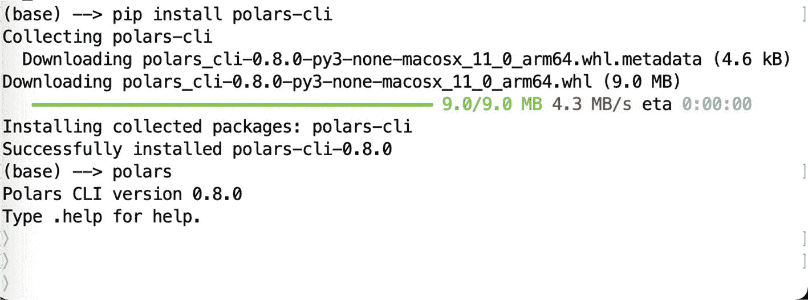
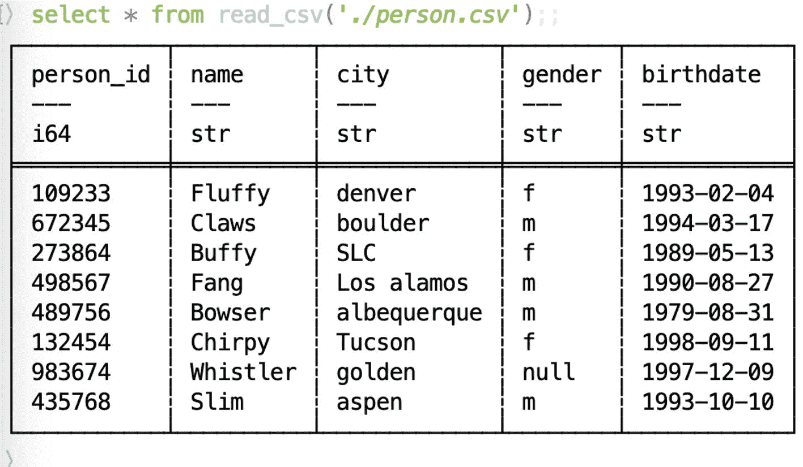
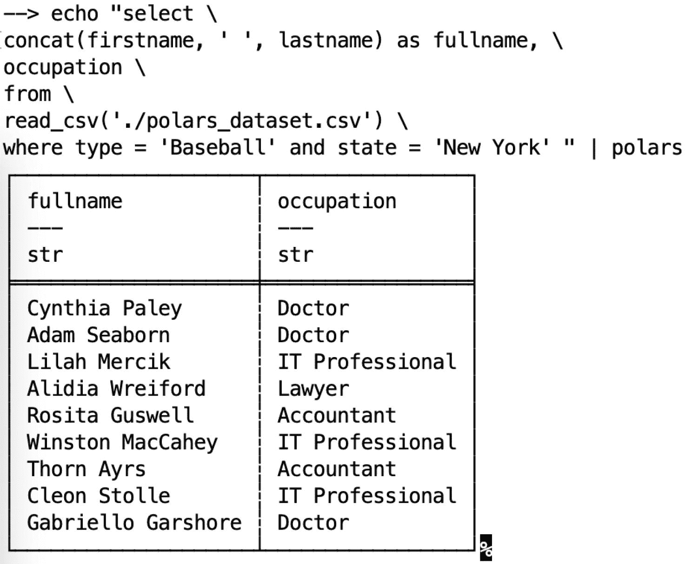

# 3. 使用 Rust 的 Polars 进行数据整理

## 引言

到目前为止，Pandas 库一直是数据操作和分析中最著名的库。然而，Pandas 在处理海量数据集时可能会面临性能挑战。当处理大型数据集时，我们需要一个无需增加额外内存和计算资源就能良好运行的解决方案。这正是 Polars 的强项。Polars 是一个用 Rust 编程语言编写的快速数据操作库，并且与 Python 的数据分析生态系统集成良好。Polars 支持惰性求值和自动查询优化，使数据工程师能够轻松处理最苛刻的数据整理任务。

在本章结束时，你将能够：

*   精通 Polars 的关键概念、其架构、惰性求值和即时求值。
*   理解 Polars 的数据结构，如 DataFrames、Series 和 LazyFrames。
*   以各种格式提取和加载数据。
*   使用 Polars 的方法执行数据转换、过滤和聚合。
*   使用 Polars 组合多个数据对象，并研究数据重塑、缺失值和唯一值识别等高级主题。
*   在 Polars 中编写类似 SQL 的语句，并使用 Polars 命令行界面 (CLI) 查询文件系统中的平面文件。

## Polars 简介

Polars 是 Python 语言数据处理生态系统中一个前景广阔、新兴的 Python 库。Polars 库的数据结构基于 Apache Arrow 项目，这意味着 Polars 在内部使用 Apache Arrow 数组存储数据，类似于 Pandas 库在内部使用 NumPy 以 NumPy 数组的形式存储数据。

Polars 库是用 Rust 编程语言编写的。Rust 是一种较新的编程语言，展现出类似 C/C++ 的效率。Rust 为并发和并行操作提供了强大的支持。Python 上的 Polars 库在几乎每条命令和每行代码上都启用了多线程和并行化。无需提供特殊指令来启用并行化——无需装饰器或调整不同设置。并行处理和多线程默认是启用的。

Polars 库可能与 Python 数据分析生态系统中的其他库一起使用。然而，Python 库通常是单线程的。如果数据处理任务可以并行化，可以利用诸如 `multiprocessing` 等其他库来加速整个数据管道。

Python 中 Polars 库的语法与 Pandas 库相比可能看起来非常相似。然而，存在一些差异，这些将在接下来的主题中讨论。首先，与 Pandas 不同，Polars 不支持其数据结构的索引或多重索引。因此，在编写 Polars 代码时，可能无法使用 Python 中可用的 `loc` 或 `iloc` 等方法。

Polars 库同时支持惰性求值和即时求值，而 Python 仅支持即时求值。Polars 会自动优化查询计划，并找到最佳利用内存的机会，同时加速查询的执行。


### 惰性求值 vs. 主动求值

为了有效理解和使用 Polars 库，了解编程中的惰性求值和主动求值可能会有所帮助。

主动求值是指在代码中看到表达式时立即对其进行求值的过程。主动求值是大多数编程语言中的默认行为。Python 也不例外。

惰性求值是一种仅在运行时需要执行代码时才运行该代码的过程。

下面是一个示例。让我们看看以下 Python 代码：

```
def ap(a: int, b: int) -> None:
c = a + b
print("the numbers are",a,"and", b)
print("the sum is", c)
```

因此，当调用此函数时

```
ap(4,3)
```

它将输出

```
the numbers are 4 and 3
the sum is 7
```

这里，这个程序是一个简单的主动求值案例。该函数中的每一行都被处理。当使用参数调用函数时，所有三行都被求值，并打印出语句。

相比之下，在惰性求值的情况下，包含`c = a + b`的行将被延迟执行，直到实际需要它的时候。你能猜到什么时候实际需要`c = a + b`吗？那将是最后一行，我们正在打印总和的地方。那才是加法运算实际执行的时候。该函数需要计算`c`的值。

注意

为了进一步说明这一点，让我们以去餐厅吃饭为例。主动求值就像去一家提供标准菜品且没有定制选项的自助餐厅。每道菜都已烹制好并准备上桌，无论顾客会消费多少，甚至是否有人会吃那道菜。

惰性求值就像去一家餐厅，服务员会询问你喜欢哪些配菜和菜品、你喜欢如何烹饪、你是否对某些东西过敏以及其他一些事情。然后厨师会根据顾客的具体回答来准备菜肴并加入相应的食材。

**主动求值**会预先计算所有结果，消耗系统资源来计算所有内容，无论它们最终是否需要，并且初始性能可能较慢，但后续访问可能更快。**惰性求值**只计算所需的结果，通过仅执行必要的操作来节省系统资源，并且初始可能看起来更快，但访问后续结果可能会更慢。

建议在 Polars 中尽可能使用惰性求值。除了默认的并行化、多线程、“接近底层”的编程架构、类似 Rust 的高效性以及自动查询优化之外，您还可以从仅执行所需代码中受益，这可以减轻计算资源的负担。

## Polars 中的数据结构

要在系统中设置 Polars，只需通过 Python 包安装程序安装即可：

```
pip install polars
```

或

```
pip install polars[all]
```

或

```
conda install -c conda-forge polars
```

以下是如何在项目中使用该库：

```
import polars as pl
```

Polars 提供了与 Pandas 库类似的数据结构。它们是 Series、DataFrames 和 LazyFrames（具有惰性求值功能）。可以稳妥地说，数据框是 Python 生态系统中最常用的数据结构。

### Polars Series

以下是一个 Series 的示例：

```
a = pl.Series([1,4,7,9,16,25])
print(a)
```

也可以按以下方式为序列命名：

```
b = pl.Series(
"firstSeries",
[1,4,7,9,16,25]
)
print(b)
```

将输出

```
shape: (6,)
Series: 'firstSeries' [i64]
[

]
```

以下是如何追加数据元素：

```
b1 = pl.Series(
"secondSeries",
[36,47]
)
b = b.append(b1)
print(b)
```

将输出

```
shape: (8,)
Series: 'firstSeries' [i64]
[

]
```

Series 还支持其他几种方法；以下是一个获取唯一值总数的示例：

```
a1 = pl.Series(
[1,4,7,9,16,25,5,25,9,5]
)
print(a1.n_unique())
```

将输出

```

```

### Polars Data Frame

Polars 中的数据框类似于 Pandas 中的数据框概念。有多种选项可以重塑数据以及执行聚合和转换操作。

以下是一个初始化数据框的简单示例：

```
df = pl.DataFrame(
{
"fruits":
["Apple","Peach","Melon","Pineapple","Orange"],
"price":
[1.5, 0.75, 3.0, 3.25, 1.33],
"quantity":
[4, 3, 1, 2, 6]
}
)
print(df)
```

将输出

```
shape: (5, 3)
┌────────┬─────┬───────┐
│ fruits    ┆ price ┆ quantity │
│ ---       ┆ ---   ┆ ---      │
│ str       ┆ f64   ┆ i64      │
╞════════╪═════╪═══════╡
│ Apple     ┆ 1.5   ┆ 4        │
│ Peach     ┆ 0.75  ┆ 3        │
│ Melon     ┆ 3.0   ┆ 1        │
│ Pineapple ┆ 3.25  ┆ 2        │
│ Orange    ┆ 1.33  ┆ 6        │
└────────┴─────┴───────┘
```

默认情况下，Polars 打印时带有对齐的行和列以及边框。这类似于 Python 中的漂亮打印库。与 Pandas 一样，只需分别调用`head(n)`和`tail(n)`即可查看数据框的头部和尾部。

`describe()`选项将返回数据框的汇总统计信息。语法如下所示：

```
print(df.describe())
```

将输出

```
shape: (9, 4)
┌─────────┬────────┬───────┬───────┐
│ describe   ┆ fruits    ┆ price    ┆ quantity │
│ ---        ┆ ---       ┆ ---      ┆ ---      │
│ str        ┆ str       ┆ f64      ┆ f64      │
╞═════════╪════════╪═══════╪═══════╡
│ count      ┆ 5         ┆ 5.0      ┆ 5.0      │
│ null_count ┆ 0         ┆ 0.0      ┆ 0.0      │
│ mean       ┆ null      ┆ 1.966    ┆ 3.2      │
│ std        ┆ null      ┆ 1.097511 ┆ 1.923538 │
│ min        ┆ Apple     ┆ 0.75     ┆ 1.0      │
│ 25%        ┆ null      ┆ 1.33     ┆ 2.0      │
│ 50%        ┆ null      ┆ 1.5      ┆ 3.0      │
│ 75%        ┆ null      ┆ 3.0      ┆ 4.0      │
│ max        ┆ Pineapple ┆ 3.25     ┆ 6.0      │
└─────────┴────────┴───────┴───────┘
```

### Polars Lazy Frame

惰性数据框是一种在 Polars 中启用惰性求值的数据结构。惰性数据框除了支持并行性之外，还启用了查询优化功能。建议尽可能利用惰性求值，以从 Polars 中获得最佳性能。惰性数据框不一定能被称作 Polars 提供的原生数据结构之一；但是，给定一个数据框，有办法将其转换为惰性数据框。

让我们看看上一节讨论的示例。虽然它是一个 Polars 数据框，但它并未设置为进行惰性求值。

以下是如何将其设置为进行惰性求值：

```
plf1 = pl.DataFrame(
{
"fruits":
["Apple","Peach","Melon","Pineapple","Orange"],
"price":
[1.5, 0.75, 3.0, 3.25, 1.33],
"quantity":
[4, 3, 1, 2, 6]
}
).lazy()
```

通过添加`.lazy()`，数据框现在被设置为惰性数据框。

以下是如何将现有的 Pandas 数据框转换为惰性数据框。

首先，让我们初始化一个 Pandas 数据框：

```
import pandas as pd
pandas_df1 = pd.DataFrame(
{
"a":
["alpha","beta","gamma","delta","eta"],
"b":
[1, 2, 3, 4, 5]
}
)
print(pandas_df1)
```

将输出

```
a  b
0  alpha  1
1   beta  2
2  gamma  3
3  delta  4
4    eta  5
```

以下是如何创建一个惰性数据框：

```
pandas_lazyframe = pl.LazyFrame(pandas_df1)
print(pandas_lazyframe)
```

将输出

```
naive plan: (run LazyFrame.explain(optimized=True) to see the optimized plan)
DF ["a", "b"]; PROJECT */2 COLUMNS; SELECTION: None
```

也可以将 Pandas 数据框覆盖为惰性数据框。

## 数据提取与加载


### CSV

Polars 支持导入和导出多种常见数据格式。以下是处理 CSV 文件的方法：

以下是导入 CSV 的方法：

```
polars_df = pl.read_csv("path to file.csv")
```

上述代码旨在执行即时求值。若要启用惰性计算并利用惰性数据框，则需要使用 `scan_csv` 方法。扫描操作会延迟文件的解析，除非绝对必要：

```
polars_df_lazy = pl.scan_csv("path to file.csv")
```

以下是将 Polars 数据框导出为 CSV 的方法：

```
polars_df.write_csv("destination to file.csv")
```

### JSON

Polars 支持 JSON 和 ndJSON 的读写操作。

ndJSON 代表换行符分隔的 JSON，能够实现更快的文件插入和读取。

以下是读取 JSON 的方法：

```
json_df = pl.read_json("path to file.json")
```

以下是将 ndJSON 读入数据框的方法：

```
ndjson_df = pl.read_ndjson("path to the ndjson.file")
```

为了启用惰性求值，Polars 提供了一个仅限于 ndJSON 文件的选项：

```
lazyjson_df = pl.scan_ndjson("path to the file.json")
```

以下是将 Polars 数据框写入 JSON 文件的方法：

```
jsonwrite_df = pl.write_json("path to location.file")
```

以下是针对 ndJSON 的写法：

```
jsonwrite_df = pl.write_ndjson("path to location.file")
```

### Parquet

如前所述，Parquet 是一种列式数据存储格式，被认为比许多数据源更快。以下是从 Polars 读取 Parquet 文件的方法：

```
parquet_df = pl.read_parquet("path to file.parquet")
```

以下是对 Parquet 文件使用惰性求值的方法：

```
parquet_df = pl.scan_parquet("path to file.parquet")
```

以下是将 Polars 数据框写入 Parquet 文件的方法：

```
parquet_df = pl.write_parquet("path to destination file.parquet")
```

Polars 还可以提供惰性求值，并支持读写其他多种格式的数据，如 Avro、ORC、Feather 等。

## Polars 中的数据转换

要使用 Polars 进行数据分析和转换，理解 Polars 的核心组件至关重要。这些组件是上下文和表达式。我们先来看表达式。表达式指的是对各个列执行的实际转换和数据操作，以获取新值。例如，对整个列应用公式（如将华氏度转换为摄氏度），或从列中提取数据子集等。

### Polars 上下文

上下文就是表达式被求值和执行的场所。Polars 中有三种主要的上下文：选择上下文、过滤上下文和分组上下文。我们来详细了解一下。

#### 选择上下文

选择上下文是指将选择的概念应用于给定的 Polars 数据框。在选择上下文中可以执行的一些操作包括：

```
dataframe.select([" ... "])
dataframe.with_columns([" ... "])
```

让我们看一个例子：

```
import polars as pl
df = pl.DataFrame(
{
"A": [1, 2, 3],
"B": [4, 5, 6]
}
)
print(df)
```

查看数据时，我们看到：

```
shape: (3, 2)
┌────┬────┐
│ A   ┆ B   │
│ --- ┆ --- │
│ i64 ┆ i64 │
╞════╪════╡
│ 1   ┆ 4   │
│ 2   ┆ 5   │
│ 3   ┆ 6   │
└────┴────┘
```

如果我们需要选择特定的列，可以使用：

```
print(df.select(['A']))
```

这将输出：

```
shape: (3, 1)
┌────┐
│ A   │
│ --- │
│ i64 │
╞════╡
│ 1   │
│ 2   │
│ 3   │
└────┘
```

然而，这个语句的作用范围非常有限。如果你想对选中的列进行进一步的转换，你需要包含一个额外的表达式。

具体如下所示：

```
timesTwo = df.select(
( pl.col(['A']) * 2 )
.alias("NewCol_A")
)
print(timesTwo)
```

这将输出：

```
shape: (3, 1)
┌───────┐
│ NewCol_A │
│ ---      │
│ i64      │
╞═══════╡
│ 2        │
│ 4        │
│ 6        │
└───────┘
```

#### 过滤上下文

过滤上下文是指给定的表达式对数据集进行过滤，并提供一个符合用户指定条件的数据框。在此上下文中可以执行的操作包括：

```
dataframe.filter([" ... "])
dataframe.where([" ... "])
```

以下是在前述数据集中使用 filter 的示例：

```
conFilter = df.filter(pl.col('A')>1)
print(conFilter)
```

这将输出：

```
shape: (2, 2)
┌────┬────┐
│ A   ┆ B   │
│ --- ┆ --- │
│ i64 ┆ i64 │
╞════╪════╡
│ 2   ┆ 5   │
│ 3   ┆ 6   │
└────┴────┘
```

#### 分组上下文

分组上下文允许对现有的 Polars 数据框执行聚合和汇总，同时还能在聚合后的数据框之上进行计算。在此上下文中可以执行的操作是：

```
dataframe.group_by([...]).agg([...])
```

让我们看一个 group_by 函数的示例：

```
df1 = pl.DataFrame(
{
"Region":
["CityBranch", "CampusBranch", "CityBranch",
"SuburbBranch", "CampusBranch", "SuburbBranch",
"CityBranch", "CampusBranch"],
"Product":
["A", "B", "B",
"A", "B", "A",
"A", "B"],
"Sales":
[100, 200, 150, 300, 250, 400, 350, 180]
}
)
print(df1)
```

这将输出：

```
shape: (8, 3)
┌──────────┬───────┬─────┐
│ Region       ┆ Product ┆ Sales │
│ ---          ┆ ---     ┆ ---   │
│ str          ┆ str     ┆ i64   │
╞══════════╪═══════╪═════╡
│ CityBranch   ┆ A       ┆ 100   │
│ CampusBranch ┆ B       ┆ 200   │
│ CityBranch   ┆ B       ┆ 150   │
│ SuburbBranch ┆ A       ┆ 300   │
│ CampusBranch ┆ B       ┆ 250   │
│ SuburbBranch ┆ A       ┆ 400   │
│ CityBranch   ┆ A       ┆ 350   │
│ CampusBranch ┆ B       ┆ 180   │
└──────────┴───────┴─────┘
```

现在让我们对这个数据集执行 group_by 操作：

```
groupbydf = df1\
.group_by(["Region", "Product"])\
.agg(
[
pl.col("Sales")
.sum()
.alias("Total"),
pl.col("Sales")
.max()
.alias("Max Sales"),
pl.count("Sales")
.alias("TransactionsCount")\
]
)
print(groupbydf)
```

这将输出：

```
shape: (4, 5)
┌──────────┬───────┬─────┬────────┬──────────────┐
│ Region       ┆ Product ┆ Total ┆ Max Sales ┆ TransactionsCount │
│ ---          ┆ ---     ┆ ---   ┆ ---       ┆ ---               │
│ str          ┆ str     ┆ i64   ┆ i64       ┆ u32               │
╞══════════╪═══════╪═════╪════════╪══════════════╡
│ CityBranch   ┆ B       ┆ 150   ┆ 150       ┆ 1                 │
│ CityBranch   ┆ A       ┆ 450   ┆ 350       ┆ 2                 │
│ SuburbBranch ┆ A       ┆ 700   ┆ 400       ┆ 2                 │
│ CampusBranch ┆ B       ┆ 630   ┆ 250       ┆ 3                 │
└──────────┴───────┴─────┴────────┴──────────────┘
```

在上面的例子中，`group_by` 方法根据产品和区域列进行聚合。在聚合方法中，总销售额通过 `sum()` 方法计算，最大销售额通过 `max()` 方法计算，总交易次数通过 `count()` 方法计算。

在处理这些上下文和表达式时，你也可以利用惰性求值的概念。具体如下所示：

```
df1_lazy = pl.LazyFrame(
{
"Region":
["CityBranch", "CampusBranch", "CityBranch",
"SuburbBranch", "CampusBranch", "SuburbBranch",
"CityBranch", "CampusBranch"],
"Product":
["A", "B", "B",
"A", "B", "A",
"A", "B"],
"Sales":
[100, 200, 150,
300, 250, 400,
350, 180]
}
)
print(df1_lazy)
```

这将输出：

```
naive plan: (run LazyFrame.explain(optimized=True) to see the optimized plan)
DF ["Region", "Product", "Sales"]; PROJECT */3 COLUMNS; SELECTION: None
```


### 基本操作

让我们看看在 Polars 中使用表达式时执行的基本操作。

这里，我们将回顾之前的例子。

```
df3 = pl.DataFrame(
{
"A": [1, 2, 3],
"B": [4, 5, 6]
}
)
print(df3)
```

会得到

```
shape: (3, 2)
┌────┬────┐
│ A   ┆ B   │
│ --- ┆ --- │
│ i64 ┆ i64 │
╞════╪════╡
│ 1   ┆ 4   │
│ 2   ┆ 5   │
│ 3   ┆ 6   │
└────┴────┘
```

以下是对这些列执行的一些算术运算：

```
modified_df3 = df3.select(
(pl.col("A") + 12)
.alias("A+12"),
(pl.col("B") - 3)
.alias("B-3")
)
print(modified_df3)
```

会得到

```
shape: (3, 2)
┌─────┬────┐
│ A+12 ┆ B-3 │
│ ---  ┆ --- │
│ i64  ┆ i64 │
╞═════╪════╡
│ 13   ┆ 1   │
│ 14   ┆ 2   │
│ 15   ┆ 3   │
└─────┴────┘
```

让我们看看选择上下文中的 with_columns() 方法：

```
modified_df3_wc = df3.with_columns(
(pl.col("A") + 12)
.alias("A+12"),
(pl.col("B") - 3)
.alias("B-3")
)
print(modified_df3_wc)
```

会返回

```
shape: (3, 4)
┌────┬────┬─────┬────┐
│ A   ┆ B   ┆ A+12 ┆ B-3 │
│ --- ┆ --- ┆ ---  ┆ --- │
│ i64 ┆ i64 ┆ i64  ┆ i64 │
╞════╪════╪═════╪════╡
│ 1   ┆ 4   ┆ 13   ┆ 1   │
│ 2   ┆ 5   ┆ 14   ┆ 2   │
│ 3   ┆ 6   ┆ 15   ┆ 3   │
└────┴────┴─────┴────┘
```

`df.select()` 方法和 `df.with_columns()` 方法的区别在于，后者会创建新列，而前者仅显示结果，除非将结果存储到单独的数据框中。

让我们看一个逻辑运算符：

```
logical_df3 = df3.select(
(pl.col('A')>1)
.alias("Is A > 1?")
)
print(logical_df3)
```

会得到

```
shape: (3, 1)
┌────────┐
│ Is A > 1? │
│ ---       │
│ bool      │
╞═════════╡
│ false     │
│ true      │
│ true      │
└────────┘
```

你也可以使用 `with_columns()` 方法创建一个新列：

```
logical_df3_wc = df3.with_columns(
(pl.col('A')>1)
.alias("Is A > 1?")
)
print(logical_df3_wc)
```

会返回

```
shape: (3, 3)
┌────┬────┬────────┐
│ A   ┆ B   ┆ Is A > 1? │
│ --- ┆ --- ┆ ---       │
│ i64 ┆ i64 ┆ bool      │
╞════╪════╪════════╡
│ 1   ┆ 4   ┆ false     │
│ 2   ┆ 5   ┆ true      │
│ 3   ┆ 6   ┆ true      │
└────┴────┴─────────┘
```

### 字符串操作

Polars 使用 Apache Arrow 作为其后端，这为其所有操作提供了连续内存模型。连续内存是指元素按顺序存储，以便 CPU 可以更快地检索这些元素并实现更高效的操作。随着数据量的增长，字符串处理的开销会变得很大。

### 聚合与分组

Polars 在即时（eager）API 和惰性（lazy）API 中都提供了强大的聚合和汇总功能。让我们通过加载一个数据集来看看一些聚合操作：

```
polars_dataset = pl.read_csv(
"/path-to-the-folder/polars_dataset.csv",
separator=",",
infer_schema_length=0
) \
.with_columns(
pl.col("birthdate")
.str.to_date(strict=False)
)
print(polars_dataset)
```

会得到

```
shape: (1_000, 7)
┌───────┬───────┬─────┬────────┬────────┬──────────┬──────────┐
│ firstname ┆ lastname ┆ gender ┆ birthdate  ┆ type      ┆ state       ┆ occupation     │
│ ---       ┆ ---      ┆ ---    ┆ ---        ┆ ---       ┆ ---         ┆ ---            │
│ str       ┆ str      ┆ str    ┆ date       ┆ str       ┆ str         ┆ str            │
╞════════╪═══════╪═════╪════════╪═══════╪═════════╪══════════╡
│ Rosa      ┆ Houseago ┆ F      ┆ null       ┆ Stateparks┆ California  ┆ Accountant     │
│ Reese     ┆ Medford  ┆ M      ┆ null       ┆ Stateparks┆ District of ┆ Electrician    │
│           ┆          ┆        ┆            ┆           ┆ Columbia    ┆                │
│ Gianna    ┆ Rylands  ┆ F      ┆ 1973-07-02 ┆ Mountains ┆ Kentucky    ┆ Doctor         │
│ Abran     ┆ McGeown  ┆ M      ┆ 1962-12-08 ┆ Baseball  ┆ Virginia    ┆ Accountant     │
│ Lanita    ┆ Yantsev  ┆ F      ┆ 1976-06-07 ┆ Stateparks┆ Illinois    ┆ Electrician    │
│ ...       ┆ ...      ┆ ...    ┆ ...        ┆ ...       ┆ ...         ┆ ...            │
│ Selina    ┆ Heyworth ┆ F      ┆ 1951-04-10 ┆ Baseball  ┆ Ohio        ┆ IT Professional│
│ Rubi      ┆ Licari   ┆ F      ┆ null       ┆ Oceans    ┆ Michigan    ┆ Lawyer         │
│ Rubin     ┆ Stanworth┆ M      ┆ 1956-09-08 ┆ Baseball  ┆ Indiana     ┆ Electrician    │
│ Benjie    ┆ Amort    ┆ M      ┆ 1957-07-07 ┆ Museums   ┆ Kentucky    ┆ Doctor         │
│ Gallard   ┆ Samuels  ┆ M      ┆ 1961-07-09 ┆ Oceans    ┆ California  ┆ Doctor         │
└───────┴───────┴──────┴────────┴───────┴─────────┴───────────┘
```

## 组合多个 Polars 对象

Polars 支持广泛的数据转换和连接操作，类似于 Pandas。让我们详细了解一下。

### 左连接

左连接返回左表中的所有行，扫描右表中的行，识别匹配项，并将其附加到左表中。让我们看一个例子。

这里我们初始化两个数据框：

```
import polars as pl
df1 = pl.DataFrame({
'ID': [1, 2, 3, 4, 5],
'Name': ['Alice', 'Bob', 'Charlie', 'David', 'John'],
'DeptID': [101, 102, 103, 104, 103]
})
df2 = pl.DataFrame({
'DeptID': [101, 102, 103],
'DeptName': ['HR', 'IT', 'Marketing']
})
```

现在，我们通过部门 ID 执行左连接：

```
leftjoin = df1.join(
df2,
on = "DeptID",
how = "left",
coalesce=True
)
print(leftjoin)
```

如果你指定 `coalesce = True`，则执行连接操作的列不会出现在最终结果中。这会得到

```
shape: (5, 4)
┌────┬───────┬──────┬────────┐
│ ID  ┆ Name    ┆ DeptID ┆ DeptName  │
│ --- ┆ ---     ┆ ---    ┆ ---       │
│ i64 ┆ str     ┆ i64    ┆ str       │
╞════╪═══════╪══════╪═════════╡
│ 1   ┆ Alice   ┆ 101    ┆ HR        │
│ 2   ┆ Bob     ┆ 102    ┆ IT        │
│ 3   ┆ Charlie ┆ 103    ┆ Marketing │
│ 4   ┆ David   ┆ 104    ┆ null      │
│ 5   ┆ John    ┆ 103    ┆ Marketing │
└────┴───────┴──────┴────────┘
```

如果 `coalesce` 设置为 `false`，我们的数据集会变成这样：

```
leftjoin = df1.join(
df2,
on = "DeptID",
how = "left",
coalesce=False
)
print(leftjoin)
```

会得到

```
shape: (5, 5)
┌────┬───────┬──────┬──────────┬────────┐
│ ID  ┆ Name    ┆ DeptID ┆ DeptID_right ┆ DeptName  │
│ --- ┆ ---     ┆ ---    ┆ ---          ┆ ---       │
│ i64 ┆ str     ┆ i64    ┆ i64          ┆ str       │
╞════╪═══════╪══════╪══════════╪════════╡
│ 1   ┆ Alice   ┆ 101    ┆ 101          ┆ HR        │
│ 2   ┆ Bob     ┆ 102    ┆ 102          ┆ IT        │
│ 3   ┆ Charlie ┆ 103    ┆ 103          ┆ Marketing │
│ 4   ┆ David   ┆ 104    ┆ null         ┆ null      │
│ 5   ┆ John    ┆ 103    ┆ 103          ┆ Marketing │
└────┴───────┴──────┴──────────┴────────┘
```

### 外连接

外连接是指，当在两个给定表之间找到匹配时，它会检索所有匹配的行：

```
outerjoin = df1.join(
df2,
on = "DeptID",
how = "full",
coalesce=True
)
print(outerjoin)
```

会得到

```
shape: (5, 4)
┌────┬───────┬──────┬────────┐
│ ID  ┆ Name    ┆ DeptID ┆ DeptName  │
│ --- ┆ ---     ┆ ---    ┆ ---       │
│ i64 ┆ str     ┆ i64    ┆ str       │
╞════╪═══════╪══════╪════════╡
│ 1   ┆ Alice   ┆ 101    ┆ HR        │
│ 2   ┆ Bob     ┆ 102    ┆ IT        │
│ 3   ┆ Charlie ┆ 103    ┆ Marketing │
│ 4   ┆ David   ┆ 104    ┆ null      │
│ 5   ┆ John    ┆ 103    ┆ Marketing │
└────┴───────┴──────┴────────┘
```

### 内连接

内连接是外连接的反向操作，仅返回两个表中具有匹配值的行：

```
innerjoin = df1.join(
df2,
on = "DeptID",
how = "inner",
coalesce=True)
print(innerjoin)
```

会得到

```
shape: (4, 4)
┌────┬───────┬──────┬────────┐
│ ID  ┆ Name    ┆ DeptID ┆ DeptName  │
│ --- ┆ ---     ┆ ---    ┆ ---       │
│ i64 ┆ str     ┆ i64    ┆ str       │
╞════╪═══════╪══════╪════════╡
│ 1   ┆ Alice   ┆ 101    ┆ HR        │
│ 2   ┆ Bob     ┆ 102    ┆ IT        │
│ 3   ┆ Charlie ┆ 103    ┆ Marketing │
│ 5   ┆ John    ┆ 103    ┆ Marketing │
└────┴───────┴──────┴────────┘
```


### 半连接

半连接会筛选出在右侧表中有匹配项的行：

```
semijoin = df1.join(
df2,
on = "DeptID",
how = "semi",
coalesce=True)
print(semijoin)
```

将得到

```
shape: (4, 3)
┌────┬───────┬──────┐
│ ID  ┆ Name    ┆ DeptID │
│ --- ┆ ---     ┆ ---    │
│ i64 ┆ str     ┆ i64    │
╞════╪═══════╪══════╡
│ 1   ┆ Alice   ┆ 101    │
│ 2   ┆ Bob     ┆ 102    │
│ 3   ┆ Charlie ┆ 103    │
│ 5   ┆ John    ┆ 103    │
└────┴───────┴──────┘
```

### 反连接

反连接会筛选出在右侧表中没有匹配项的行：

```
antijoin = df1.join(
df2,
on = "DeptID",
how = "anti",
coalesce=True)
print(antijoin)
```

将得到

```
shape: (1, 3)
┌────┬─────┬──────┐
│ ID  ┆ Name  ┆ DeptID │
│ --- ┆ ---   ┆ ---    │
│ i64 ┆ str   ┆ i64    │
╞════╪═════╪══════╡
│ 4   ┆ David ┆ 104    │
└────┴─────┴──────┘
```

### 交叉连接

交叉连接会对给定的两个表执行笛卡尔积。

示例如下。我们先初始化两个数据框：

```
df_one = pl.DataFrame(
{
'ID': [1, 2],
'Name': ['John', 'Doe']
}
)
df_two = pl.DataFrame(
{
'ItemID': [101, 102],
'Item': ['Laptop', 'Cable']
}
)
```

现在让我们对这两个数据框执行笛卡尔积：

```
crossjoin = df_one.join(
df_two,
how = "cross",
coalesce=True
)
print(crossjoin)
```

将得到

```
shape: (4, 4)
┌────┬─────┬──────┬──────┐
│ ID  ┆ Name ┆ ItemID ┆ Item   │
│ --- ┆ ---  ┆ ---    ┆ ---    │
│ i64 ┆ str  ┆ i64    ┆ str    │
╞════╪═════╪══════╪══════╡
│ 1   ┆ John ┆ 101    ┆ Laptop │
│ 1   ┆ John ┆ 102    ┆ Cable  │
│ 2   ┆ Doe  ┆ 101    ┆ Laptop │
│ 2   ┆ Doe  ┆ 102    ┆ Cable  │
└────┴─────┴──────┴──────┘
```

## 高级操作

让我们看看 Polars 数据分析库中的一些高级方法。为了分析，我们将使用之前的数据集：

```
import polars as pl
polars_dataset = pl.read_csv(
"/Users/pk/Documents/polars_dataset.csv",
separator=",",
infer_schema_length=0
) \
.with_columns(
pl.col("birthdate")
.str.to_date(strict=False)
)
print(polars_dataset)
```

### 识别缺失值

让我们尝试查看数据集中指定列上的缺失值。这将使我们能够定位包含缺失数据的行：

```
missingdata = polars_dataset.filter(
pl.col("birthdate").is_null()
)
print(missingdata)
```

将得到

```
shape: (588, 7)
┌─────────┬───────┬──────┬────────┬─────────┬────────────────┬────────────┐
│ firstname  ┆ lastname ┆ gender ┆ birthdate ┆ type       ┆ state                ┆ occupation      │
│ ---        ┆ ---      ┆ ---    ┆ ---       ┆ ---        ┆ ---                  ┆ ---             │
│ str        ┆ str      ┆ str    ┆ date      ┆ str        ┆ str                  ┆ str             │
╞═════════╪═══════╪══════╪════════╪═════════╪════════════════╪═════════════╡
│ Rosa       ┆ Houseago ┆ F      ┆ null      ┆ Stateparks ┆ California           ┆ Accountant      │
│ Reese      ┆ Medford  ┆ M      ┆ null      ┆ Stateparks ┆ District of Columbia ┆ Electrician     │
│ Alicia     ┆ Farrant  ┆ F      ┆ null      ┆ Oceans     ┆ Florida              ┆ Accountant      │
│ Shawn      ┆ Fenlon   ┆ M      ┆ null      ┆ Stateparks ┆ Michigan             ┆ IT Professional │
│ Lenette    ┆ Blackly  ┆ F      ┆ null      ┆ Mountains  ┆ Texas                ┆ Accountant      │
│ ...        ┆ ...      ┆ ...    ┆ ...       ┆ ...        ┆ ...                  ┆ ...             │
│ Perla      ┆ Brixey   ┆ F      ┆ null      ┆ Stateparks ┆ Washington           ┆ Doctor          │
│ Bobbi      ┆ Longea   ┆ F      ┆ null      ┆ Mountains  ┆ Massachusetts        ┆ Accountant      │
│ Skip       ┆ Urry     ┆ M      ┆ null      ┆ Oceans     ┆ Arizona              ┆ Doctor          │
│ Amory      ┆ Cromie   ┆ M      ┆ null      ┆ Baseball   ┆ Virginia             ┆ Lawyer          │
│ Rubi       ┆ Licari   ┆ F      ┆ null      ┆ Oceans     ┆ Michigan             ┆ Lawyer          │
└─────────┴───────┴──────┴────────┴─────────┴────────────────┴────────────┘
```

### 识别唯一值

在前面的数据集中，我们想了解有多少种不同的职业。让我们尝试通过以下方式获取该信息：

```
various_occupations = polars_dataset.group_by('occupation') \
.agg(
pl.count('occupation') \
.alias('various_occupations')
)
print(various_occupations)
```

将得到

```
shape: (5, 2)
┌────────────┬───────────────┐
│ occupation      ┆ various_occupations │
│ ---             ┆ ---                 │
│ str             ┆ u32                 │
╞════════════╪═══════════════╡
│ Doctor          ┆ 225                 │
│ IT Professional ┆ 196                 │
│ Accountant      ┆ 178                 │
│ Lawyer          ┆ 200                 │
│ Electrician     ┆ 201                 │
└────────────┴───────────────┘
```

### 数据透视与逆透视示例

`pivot` 函数会将整个数据集转换为更宽的格式，列类别变成列和行，聚合指标会填充到对应的行和列中。

示例如下：

```
pivotdata = polars_dataset.pivot(
index="state",
columns="occupation",
values="firstname",
aggregate_function="first"
)
print(pivotdata)
```

将得到

```
shape: (51, 6)
┌────────────────┬─────────┬──────────┬──────┬────────────┬──────┐
│ state                ┆ Accountant ┆ Electrician ┆ Doctor ┆ IT Professional ┆ Lawyer │
│ ---                  ┆ ---        ┆ ---         ┆ ---    ┆ ---             ┆ ---    │
│ str                  ┆ str        ┆ str         ┆ str    ┆ str             ┆ str    │
╞════════════════╪═════════╪═════════╪═══════════════════╪══════╡
│ California           ┆ Rosa       ┆ Margret     ┆ Devin  ┆ Joana           ┆ Yetta  │
│ District of Columbia ┆ Ginger     ┆ Reese       ┆ Giles  ┆ Zorina          ┆ Nancey │
│ Kentucky             ┆ Neila      ┆ Aurea       ┆ Gianna ┆ Cesare          ┆ Orren  │
│ Virginia             ┆ Abran      ┆ Claudelle   ┆ Kalil  ┆ Gwendolen       ┆ Rog    │
│ Illinois             ┆ Gareth     ┆ Lanita      ┆ Axel   ┆ Darelle         ┆ Nancee │
│ ...                  ┆ ...        ┆ ...         ┆ ...    ┆ ...             ┆ ...    │
│ Hawaii               ┆ Barr       ┆ Lauretta    ┆ null   ┆ null            ┆ Kiel   │
│ Kansas               ┆ null       ┆ Sarena      ┆ null   ┆ Cherye          ┆ Helyn  │
│ Vermont              ┆ null       ┆ null        ┆ null   ┆ Kerrie          ┆ null   │
│ South Dakota         ┆ Thorvald   ┆ null        ┆ null   ┆ null            ┆ null   │
│ Maine                ┆ null       ┆ null        ┆ Rustin ┆ null            ┆ null   │
└────────────────┴─────────┴──────────┴──────┴────────────┴──────┘
```


## Polars/SQL 交互

虽然 Polars 库没有底层的 SQL 引擎，但它支持使用类似 SQL 的语句与数据对象进行交互。因此，当你向 Polars 数据对象发出类似 SQL 的语句时，Polars 会将其转换为相应的表达式，并继续为你提供快速的结果（一如既往）。你可以在平面文件、JSON 文件甚至 Pandas 数据对象上执行“SQL 查询”。让我们看一个包含随机健康数据的数据集的示例。

让我们初始化这个随机数据集：

```
import polars as pl
df = pl.read_csv(
"path-to-your-folder/random_health_data.csv"
)
print(df.head())
```

将输出

```
shape: (5, 7)
┌────┬──────────────┬────┬─────┬──────┬────────────┬─────────┐
│ id  ┆ name             ┆ age  ┆ state ┆ gender ┆ exercise_daily? ┆ copay_paid │
│ --- ┆ ---              ┆ ---  ┆ ---   ┆ ---    ┆ ---             ┆ ---        │
│ i64 ┆ str              ┆ str  ┆ str   ┆ str    ┆ bool            ┆ str        │
╞════╪═════════════╪═════╪═════╪══════╪════════════╪═════════╡
│ 1   ┆ Allayne Moffett  ┆ null ┆ SC    ┆ Male   ┆ null            ┆ $206.76    │
│ 2   ┆ Kerby Benjafield ┆ null ┆ NM    ┆ Male   ┆ true            ┆ $21.58     │
│ 3   ┆ Raina Vallentin  ┆ null ┆ MI    ┆ Female ┆ true            ┆ $125.18    │
│ 4   ┆ Kaela Trodden    ┆ null ┆ OH    ┆ Female ┆ false           ┆ $86.20     │
│ 5   ┆ Faber Kloisner   ┆ null ┆ MN    ┆ Male   ┆ false           ┆ $219.38    │
└────┴──────────────┴────┴─────┴──────┴────────────┴─────────┘
```

这个虚构的数据集包含患者姓名、人口统计数据点（如性别和年龄）、他们居住的州，以及另一个名为“copay_paid”的列。请注意最后一列“copay_paid”，它是一个字符串，开头包含一个特殊字符。要将此列转换为数值数据类型，我们需要移除特殊字符（美元符号），并将剩余部分转换为小数。

以下是我们如何从数据集中移除特殊字符的方法：

```
df = df.with_columns(
pl.col("copay_paid") \
.str \
.slice(1) \
.alias("copay_paid")
)
print(df.head())
```

将输出

```
shape: (5, 7)
┌────┬──────────────┬────┬─────┬──────┬────────────┬─────────┐
│ id  ┆ name             ┆ age  ┆ state ┆ gender ┆ exercise_daily? ┆ copay_paid │
│ --- ┆ ---              ┆ ---  ┆ ---   ┆ ---    ┆ ---             ┆ ---        │
│ i64 ┆ str              ┆ str  ┆ str   ┆ str    ┆ bool            ┆ str        │
╞════╪═════════════╪═════╪═════╪══════╪════════════╪═════════╡
│ 1   ┆ Allayne Moffett  ┆ null ┆ SC    ┆ Male   ┆ null            ┆ 206.76     │
│ 2   ┆ Kerby Benjafield ┆ null ┆ NM    ┆ Male   ┆ true            ┆ 21.58      │
│ 3   ┆ Raina Vallentin  ┆ null ┆ MI    ┆ Female ┆ true            ┆ 125.18     │
│ 4   ┆ Kaela Trodden    ┆ null ┆ OH    ┆ Female ┆ false           ┆ 86.20      │
│ 5   ┆ Faber Kloisner   ┆ null ┆ MN    ┆ Male   ┆ false           ┆ 219.38     │
└────┴──────────────┴────┴─────┴──────┴────────────┴─────────┘
```

现在，我们可以将字符串数据类型转换为小数数据类型。以下是实现方法：

```
df = df.with_columns(
pl.col("copay_paid")\
.str \
.to_decimal() \
.alias("copay"))
print(df.head())
```

将输出

```
shape: (5, 8)
┌────┬──────────────┬─────┬─────┬──────┬────────────┬─────────┬──────────┐
│ id  ┆ name             ┆ age  ┆ state ┆ gender ┆ exercise_daily? ┆ copay_paid ┆ copay        │
│ --- ┆ ---              ┆ ---  ┆ ---   ┆ ---    ┆ ---             ┆ ---        ┆ ---          │
│ i64 ┆ str              ┆ str  ┆ str   ┆ str    ┆ bool            ┆ str        ┆ decimal[*,2] │
╞════╪═════════════╪═════╪═════╪══════╪════════════╪═════════╪══════════╡
│ 1   ┆ Allayne Moffett  ┆ null ┆ SC    ┆ Male   ┆ null            ┆ 206.76     ┆ 206.76       │
│ 2   ┆ Kerby Benjafield ┆ null ┆ NM    ┆ Male   ┆ true            ┆ 21.58      ┆ 21.58        │
│ 3   ┆ Raina Vallentin  ┆ null ┆ MI    ┆ Female ┆ true            ┆ 125.18     ┆ 125.18       │
│ 4   ┆ Kaela Trodden    ┆ null ┆ OH    ┆ Female ┆ false           ┆ 86.20      ┆ 86.20        │
│ 5   ┆ Faber Kloisner   ┆ null ┆ MN    ┆ Male   ┆ false           ┆ 219.38     ┆ 219.38       │
└────┴──────────────┴─────┴─────┴──────┴────────────┴─────────┴──────────┘
```

现在让我们初始化 Polars 的 SQL 上下文。SQL 上下文对象存储了类似 SQL 的语句与 Polars 表达式之间的映射关系。因此，这一步是必不可少的。

以下是实现方法：

```
pl_sql = pl.SQLContext(
random_health_data = df
)
```

你会注意到 Polars 数据框被引用为“random_health_data”。这将是我们在编写类似 SQL 的语句时的表名。让我们定义查询：

```
query1 = """
select
state,
count(name) as total_Patients,
max(copay) as most_Expensive
from
random_health_data
where
state is not null
and copay is not null
group by
state
order by
mostExpensive desc
limit

"""
```

现在，我们可以使用 SQL 上下文来执行 SQL 查询。以下是实现方法：

```
sqlresult = pl_sql.execute(
query1,
eager=True
)
print(sqlresult)
```

将输出

```
shape: (10, 3)
┌─────┬──────────┬───────────┐
│ state ┆ totalPersons ┆ mostExpensive │
│ ---   ┆ ---          ┆ ---           │
│ str   ┆ u32          ┆ decimal[*,2]  │
╞═════╪══════════╪═══════════╡
│ CA    ┆ 95           ┆ 274.51        │
│ HI    ┆ 8            ┆ 274.03        │
│ VA    ┆ 26           ┆ 273.82        │
│ AZ    ┆ 22           ┆ 273.68        │
│ WI    ┆ 11           ┆ 273.41        │
│ NY    ┆ 35           ┆ 272.23        │
│ FL    ┆ 62           ┆ 271.62        │
│ IA    ┆ 16           ┆ 270.97        │
│ TN    ┆ 16           ┆ 270.54        │
│ MA    ┆ 16           ┆ 269.18        │
└─────┴──────────┴───────────┘
```

注意

你可能已经注意到在 SQL 上下文中执行 SQL 查询时使用了“`eager=True`”。你也可以将该选项设置为 False 以启用惰性执行。这将返回一个 Polars 惰性数据框。你可以继续在下游数据处理任务中使用该惰性数据框。


## Polars 命令行界面

Polars 还提供了一种通过命令行界面访问库的选项。你可以直接在命令行中执行 Polars 命令和类似 SQL 的命令。以下是如何开始使用 Polars 命令行界面：

```
pip install polars-cli
```

然后输入“polars”即可进入命令行界面。效果如下所示：



一张命令行界面的截图，展示了 Polars CLI 的下载和安装状态。Polars CLI 的版本标记为 0.8.0。

图 3-1

Polars 命令行界面

以下是如何对文件系统中的平面文件执行 SQL 查询：

```
〉select * from read_csv('./person.csv');
```

将得到



一个表格展示了 person id、name、city、gender 和 birth date 的详细信息。顶部一行代码如下：Select, asterisk, from, read c s v, open parenthesis, single quotation, dot slash, person dot c s v, single quotation, closed parenthesis。

图 3-2

使用 Polars CLI 对平面文件编写 SQL 查询

你甚至可以直接在 shell 中指定 SQL 查询，并使用管道操作符在 Polars CLI 中调用并执行该 SQL 命令。效果如下所示：

```
--> echo "select \
concat(firstname, ' ', lastname) as fullname, \
occupation \
from \
read_csv('./polars_dataset.csv') \
where type = 'Baseball' and state = 'New York' " | polars
```

将得到

```
┌──────────────┬────────────┐
│ fullname           ┆ occupation      │
│ ---                ┆ ---             │
│ str                ┆ str             │
╞══════════════╪════════════╡
│ Cynthia Paley      ┆ Doctor          │
│ Adam Seaborn       ┆ Doctor          │
│ Lilah Mercik       ┆ IT Professional │
│ Alidia Wreiford    ┆ Lawyer          │
│ Rosita Guswell     ┆ Accountant      │
│ Winston MacCahey   ┆ IT Professional │
│ Thorn Ayrs         ┆ Accountant      │
│ Cleon Stolle       ┆ IT Professional │
│ Gabriello Garshore ┆ Doctor          │
└──────────────┴────────────┘
```

在你的环境中效果如下：



一个表格包含不同人员的全名列表及其各自的职业。顶部提供了一段代码片段。该代码将名字和姓氏拼接为全名，并从 Polars dataset dot c s v 中读取职业信息。

图 3-3

在 Polars CLI 中执行 SQL

## 结论

恭喜你读到这里！到目前为止，你已经通过这几章学习了 Python、SQL、git、Pandas 和 Polars 的大量内容。Polars 潜力巨大。至此，我们了解了如何以各种格式提取和加载数据，执行过滤和聚合等数据转换操作，以及使用连接操作组合多个 Polars 对象。我们还探讨了处理缺失值、识别唯一值以及使用数据透视操作重塑数据。我希望你能在数据管道中采用 Polars，为组织展现更高的效率和价值。虽然 Polars 可能是处理基于 CPU 的数据整理任务的完美解决方案，但在下一章中，我们将探讨基于 GPU 的数据整理库，以及如何使用 GPU 处理海量数据。希望你对下一章保持期待。

