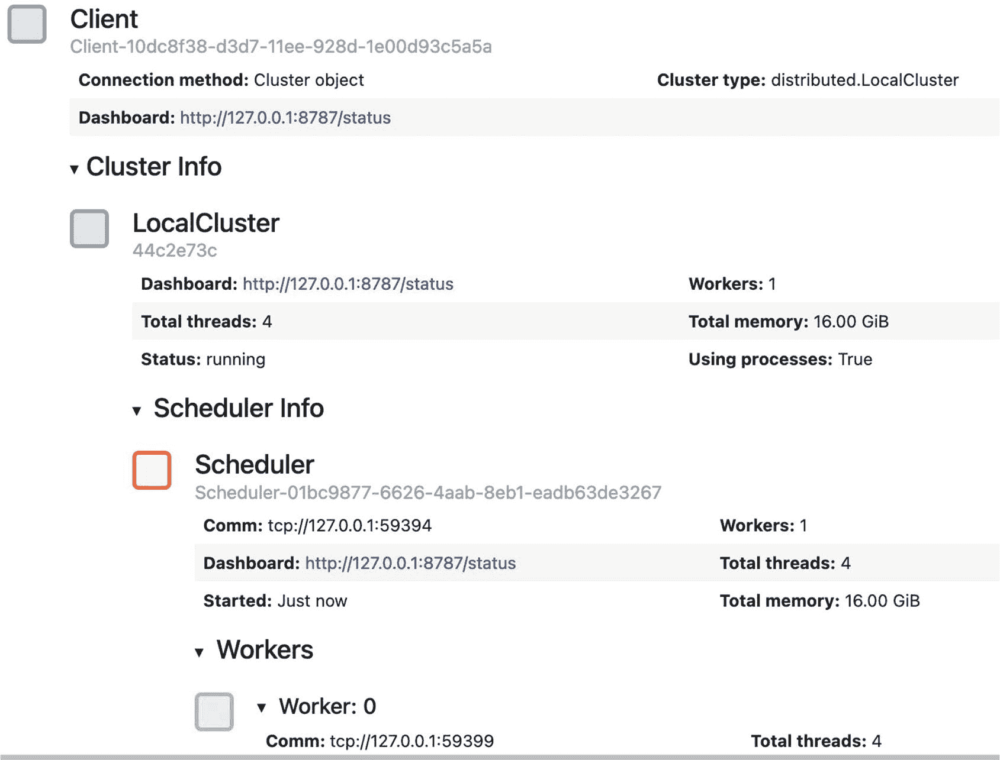
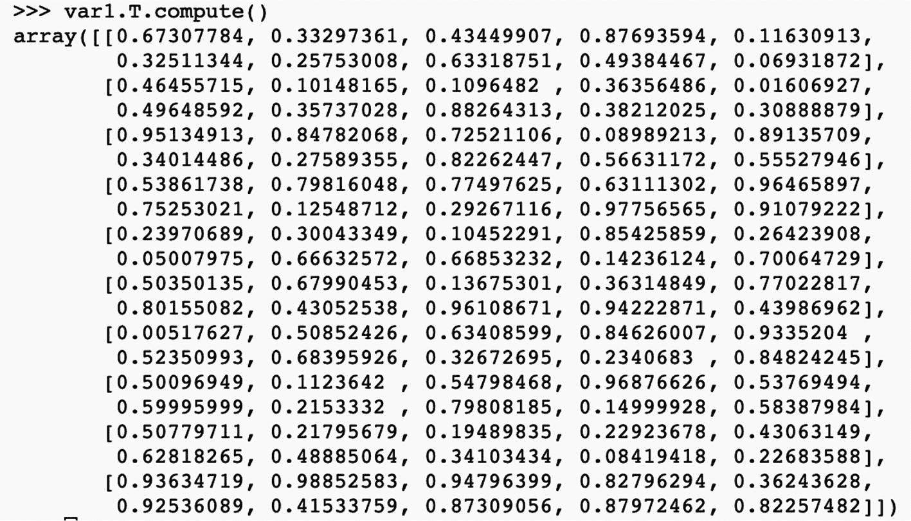
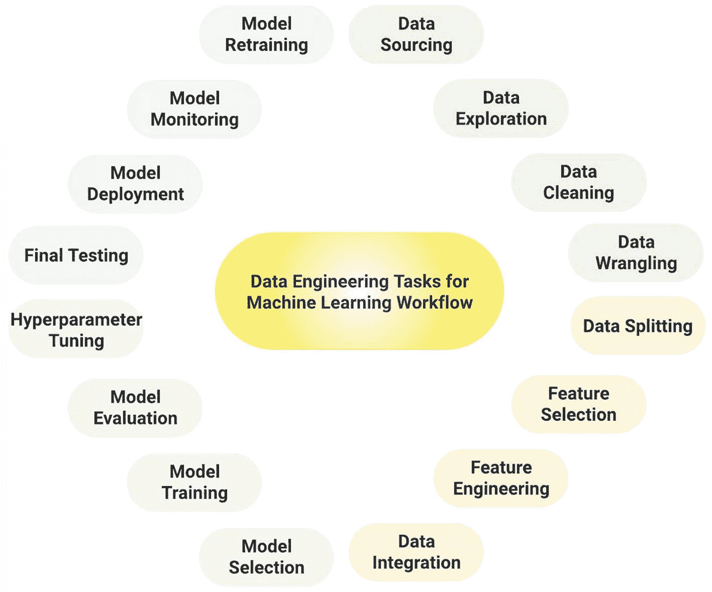
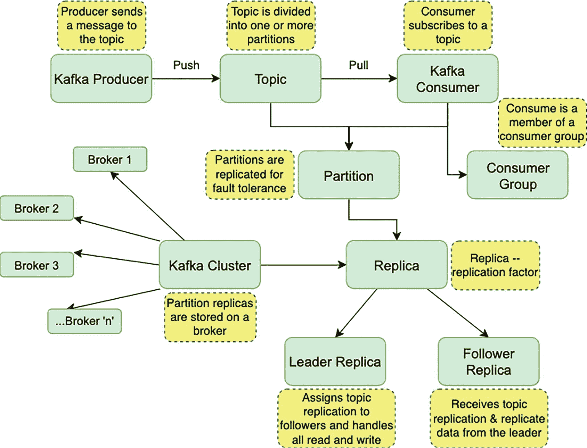
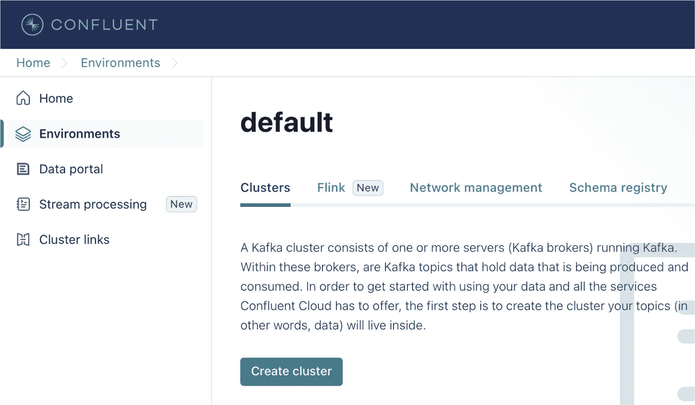
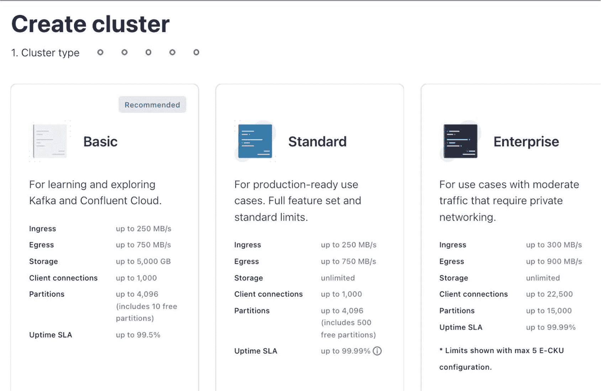
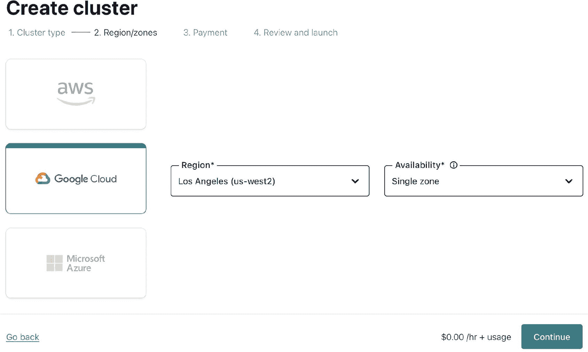
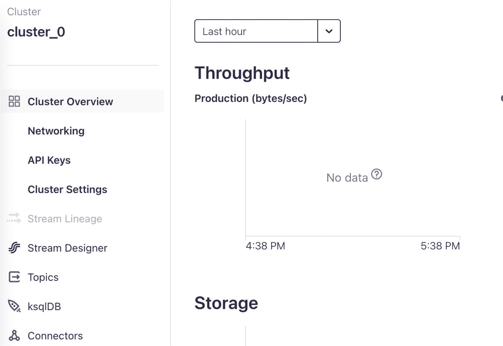
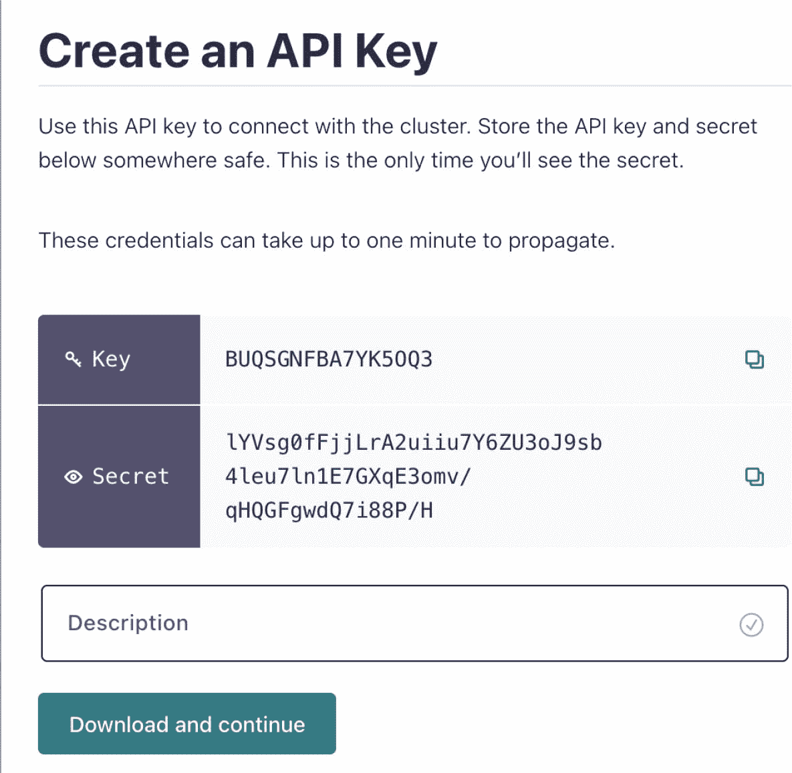

# 7. 并发编程与 Dask 简介

## 引言

我们之前讨论过，高效且有效地处理大型数据集至关重要。随着数据集不断增长，传统的单线程处理方式逐渐显现出其局限性。默认情况下，Python 有一个全局解释器锁（GIL），它只允许一个线程在任意时刻持有解释器。虽然这种设计保证了提交计算的完整性，但在如今普遍使用的多核 CPU 中，利用多个线程会高效得多。在本章中，你将学习并行编程、并发编程以及 Dask 的概念。Dask 是一个支持分布式处理的 Python 库，它通过使用多个进程来绕过全局解释器锁的限制。Dask 还支持我们在前几章中见过的各种数据处理库。

学完本章后，你将了解到：

*   并行处理的概念及其与顺序处理的区别
*   并发处理的基础知识
*   Dask
*   Dask 的架构与概念
*   Dask 的核心数据结构及其如何实现分布式计算
*   优化 Dask 计算

## 并行与并发处理简介

一般来说，并行处理是将一个大任务分解成若干个小任务，并同时执行这些小任务的过程，这样既能显著缩短完成任务所需的时间，又能使所有资源得到最优利用。在计算领域也是如此。它是一个将大型编程任务分解成若干个小任务，同时执行这些任务，然后将所有小任务的结果汇总以得到最终结果的过程。从编程的角度来看，这可能不那么明显。

### 历史

当 CPU 开始在其微处理器架构中包含多个处理单元时，并行处理开始受到重视。一般来说，在微处理器中携带数字信号的电子传输速度非常快；但单个处理器的运行速度存在上限。这些限制，加上减少热量产生等需求，为多核处理器铺平了道路。如今，我们笔记本电脑、手机、电脑等设备中的微处理器都包含多个处理单元（我们称之为核心）。

### Python 与全局解释器锁

我们使用的 Python 编程语言是用 C 语言实现的。出于特定目的，也有基于 Java 和 .NET 的其他实现；然而，用于数据处理、工程和机器学习的 Python 是基于 C 语言的。核心 Python 解释器中可用的机制之一称为全局解释器锁，即 GIL。GIL 的目的是简化内存管理。因此，当我们有多个 Python 字节码（例如）时，每个字节码都会通过获取 GIL 来执行 Python 字节码指令。一旦该过程完成，GIL 就会被释放，以便下一个可用的 Python 字节码可以获取它来执行。虽然这保证了线程安全计算，但它也通过多线程方法禁用了并行处理。不过，还有其他方法可以实现并行处理，并且一些文件输入/输出操作不受 GIL 限制，这是个好消息。

### 并行处理的概念

当我们谈论进程时，在任意给定时间点，设备中都有多个进程在同时运行。进程本质上是一个正在运行的程序（代码）。任何给定的进程都可以有多个线程。

可以说，线程就像一个子进程。一个进程可以包含一个或多个线程。多个线程可以同时执行（在某些情况下也可能不执行）。从 CPU 的角度来看，线程并不是微处理器上物理存在的东西；相反，它是一个逻辑执行单元。

核心是一个物理执行单元，可以执行计算操作。一个核心可以执行一个线程。一个微处理器可以有一个或多个核心。

简而言之：

进程是操作系统级别的抽象。
线程是软件级别的抽象。
核心是物理级别的抽象。

有一个名为“multiprocessing”的 Python 库，它可以绕过 Python 中的全局解释器锁。该 Python 库没有利用多线程的概念，而是采用了子进程同时在多个核心上运行的思想；因此，它的工作方式是，“multiprocessing”库提供了一个进程间通信系统，该系统通过使用多个核心为并行处理的有效协作提供了机制。“multiprocessing”库可以使用的核心数量受限于你系统中的核心数量。

### 识别 CPU 核心

你可以编写简单的 Python 代码来确定你的计算机上有多少个核心。

代码如下所示：

```
from multiprocessing import cpu_count
numberOfCores = cpu_count()
print(f"There are {numberOfCores} cores in your CPU")
```

这将返回一个数字，表示你计算机微处理器上的核心数量。

以下是一个使用“multiprocessing”库进行并行处理的简单示例：

```
from multiprocessing import Pool
def cube(a):
return a * a * a
inputs = [5,12,17,31,43,59,67]
with Pool(processes=4) as parallelprocess:
cubevalue = parallelprocess.map(cube, inputs)
print(cubevalue)
```

上述代码将显示所提供输入的立方值。输出结果可能如下所示：

```
[125, 1728, 4913, 29791, 79507, 205379, 300763]
```

在代码中，你可以看到 Pool 方法及其名为 processes 的参数。


### 并发处理

并发处理在处理同时发生的任务时，与并行处理的概念类似。然而，其执行方式与我们之前所了解的不同。并发处理指的是两个或多个任务在同一时间点开始执行，但它们可能并非在完全相同的时刻运行。

例如，在单个核心中，一个任务可能启动并运行一段时间。假设第一个任务可能需要等待其他进程执行另一个操作，于是它进入等待状态；在此期间，一个或多个任务可能开始执行，甚至可能完成，具体取决于它们的计算、内存和存储需求以及可用资源。

并发并非等待一个任务完全结束后再执行下一个，它允许在运行时动态共享和分配内存、计算和存储资源。这是一种无缝利用资源的方式。

注意

想象你是一家餐厅的厨师。有五份订单同时到达。你知道菜单上的菜品所需烹饪时间各不相同。你只有一台炉子和一台微波炉来处理这五份订单。为简单起见，假设你只有一个油炸锅、烤架或类似设备。现在我们来阐述并发和并行。

**并发**

想象先开始烹饪一道慢炖的菜。在慢炖的同时，为另一道菜准备蔬菜。切好蔬菜后，定期检查慢炖的菜，或许搅拌一下。将慢炖的菜转移到烤箱，同时把准备好的蔬菜放到炉子上。蔬菜开始烹饪时，为另一道菜准备鸡蛋。定期检查蔬菜和烤箱。你在不同任务之间切换，即使独自工作，也能同时推进三道菜的进度。这就是并发。

**并行**

想象五位厨师处理五份订单。每位厨师负责一份订单，拥有自己完整的一套设备（炉子、烤箱等）和工具（刀、勺等）。他们各自使用自己的设备和工具，专注于自己的菜品。这就是并行。

**并发**是指一个 CPU 核心处理多个任务，使用共享资源，并在任务之间快速切换。**并行**是指“n”个 CPU 核心处理“n”个任务，每个核心使用专用资源。

## Dask 简介

Dask 是一个专门的 Python 库，用于在 Python 中实现数据分析和机器学习任务的并行与分布式计算。Dask 是一个 Python 原生库，其实现不依赖于非 Python 编程语言。

Dask 能与 Pandas、Polars、CuDF、scikit-learn 和 XGBoost 等主流 Python 库良好协作。如果你正在处理数据量和计算、内存需求超出单台机器能力的数据处理和机器学习管道，那么在技术栈中采用 Dask 可能会带来好处。

Dask 的学习曲线相对较快，并且将 Dask 集成到生产数据管道中也相对容易。Dask 被大型银行、主要医疗机构、国家实验室和组织所使用。

Dask 支持大数据管道中常见的多种数据格式，如 Avro、HDF5、Parquet 等，同时也支持 CSV、JSON 等传统数据格式。

Dask 主要利用 CPU 来执行其计算和操作。不过，Dask 也可以与 GPU 协同工作。Dask 和 CuDF Python 库之间具有良好的互操作性。我们将在接下来的章节中详细探讨这个主题。

### 安装与设置

在开发环境中设置 Dask 相对简单。你可以通过命令行使用 pip 或 conda 安装 Dask 包：

```
sudo apt install graphviz
```

以及

```
python3 -m pip install "dask[complete]"
```

或

```
pip3 install dask dask distributed bokeh —-upgrade
```

或

```
conda install dask
```

你也可以在分布式计算集群中安装 Dask。Dask 与 Hadoop 集群配合良好；你可以使用 YARN（Hadoop 的资源管理器，用于在给定 Hadoop 集群内部署各种服务）来部署 Dask。你还可以在 AWS 或 GCP 上创建云计算 Dask 集群。

以下是一个使用 Dask 的简单“Hello World”式实现：

```
import dask
import dask.array as da
arr = da.from_array(
[1,2,3,4,5,6,7,8,9,10]
, chunks=2
)
squared = arr ** 2
result = squared.compute()
print(result)
```

在上面的例子中，我们首先导入了必要的类和方法。然后创建了一个块大小为 2 的 Dask 数组，意味着将这个数组分成两个不同的块。接着创建了一个名为 squared 的新函数，用于计算数组中每个值的平方。之后通过调用名为 `compute()` 的方法来执行该函数，该方法会触发实际计算并返回结果。这是由于 Dask 的惰性求值特性所致。

当我们打印结果时，会返回：

```
[  1   4   9  16  25  36  49  64  81 100]
```

## Dask 的特性

### 任务与图

在 Dask 中，计算被表示为一系列任务，这些任务作为节点，通过边连接起来。这些节点和边以有向无环图（DAG）的形式组织。需要完成的任务表示为节点。不同任务之间的数据依赖关系（或无数据依赖关系）表示为边。有向无环图的表示方式使 Dask 能够有效地在多个线程、进程甚至跨多个 CPU 上执行任务及其底层依赖关系。

### 惰性求值

我们在之前的章节中已经了解过惰性求值的概念。为了唤起你的记忆，惰性求值是指计算不会立即发生。只有在实际需要时，才会执行给定的代码集。在此之前，这段代码可能会被延迟执行，有时甚至根本不会执行。正如我们已经知道的，Dask 会创建一个有向无环图来表示其执行流程。但它实际上并不会执行每个节点，除非有必要。通过这种方式，Dask 优化了计算。

### 分区与分块

分区是指将一个非常大的数据集拆分成多个更小或更易于管理的数据集部分。这些较小的数据集可以独立处理。通过利用分区的概念，Dask 可以处理比其可用内存更大的数据集。分块与分区的概念类似，只是其应用范围更小。“分区”一词在数据库和数据表的上下文中使用较多，指的是将给定的表拆分成多个较小的表。这些表在处理后，可能会被重新组合或连接回其原始结构（类似于 MapReduce 编程的概念）。

另一方面，“分块”主要与将数组拆分成更小的块相关。你可以在创建 Dask 数组时指定块的大小。在 Dask 的上下文中，可以更容易地得出结论：“分区”一词适用于数据库、表和数据帧的情况，而“分块”一词适用于一维或多维数组的情况。


### 序列化与 Pickling

序列化是指将给定的数据集转换为一种可以高效存储或传输的格式。在需要时，这种格式可以被重建回原始数据格式。Dask 使用序列化来转换数据集，以便能够将序列化数据的分区或块高效地传输到各个工作节点进行处理。在处理大型数据框、n 维数组等时，Dask 会决定采用哪种序列化技术。

Pickling 是 Python 编程中独有的一种序列化方法。Pickling 是一种将 Python 数据对象序列化为字节流的方式，这些字节流可以被存储或传输到各个工作节点。之后，这些字节流可以被重建回原始格式的数据集。Dask 是一个通用计算框架，包含多种序列化技术。然而，我们有必要承认 pickling 序列化在 Python 生态系统中的机器学习建模领域所扮演的关键角色。

### Dask-CuDF

在前一章中，我们已经详细讨论了 GPU 计算和 CuDF。正如我们所知，CuDF 是一个 GPU 计算框架，它能够在一个或多个 GPU 上进行数据框处理。CuDF 提供了多种方法和函数，用于导入、导出和执行复杂的数据转换，这些操作可以严格在 GPU 上运行。

另一方面，Dask 是一个通用的并行和分布式计算库。我们可以在 Pandas 和其他主流数据分析库之上使用 Dask，以跨多个 CPU 扩展我们的工作流。

Dask-CuDF 是一个专门的 Python 包，它允许使用 CuDF 而非 Pandas 来处理数据框分区。例如，如果你调用 Dask-CuDF 来处理一个数据框，它可以高效地调用 CuDF 的方法来处理数据（通过将数据发送到 GPU）。如果你的数据处理流程中的数据量非常大，超出了机器的限制，那么使用 Dask-CuDF 可能会让你受益。

## Dask 架构

让我们回顾一下 Dask 中的各个组件。Dask 的架构非常灵活，支持单实例计算、单实例多核计算以及分布式计算。

### 核心库

在 Dask 系统的核心，我们有由各种数据结构组成的 Dask 集合。其中一些包括：类似于 NumPy 数组的 Dask 数组；类似于 Pandas 数据框的 Dask 数据框；以及分别类似于 Python 列表和迭代器的 Dask bag。这些集合使你能够原生地执行并行和分布式计算。只需调用 Dask 的集合，你就能并行化或异步地执行计算。

### 调度器

Dask 调度器是 Dask 执行机制的主要组成部分。Dask 调度器位于集群的核心，管理计算、在工作节点间执行任务，以及与工作节点和客户端进行通信。调度器组件本身是异步的，因为它可以跟踪多个工作节点的进度，并响应来自多个客户端的各种请求。调度器将工作跟踪为一个不断变化的任务有向无环图。在这些有向无环图中，每个节点可以是一个任务，每条弧（节点之间的边）可以是任务之间的依赖关系。

任务（Task）是 Dask 中的计算单元，本质上是一个 Python 函数或对 Python 对象的执行操作。Dask 中有不同类型的调度器。有单线程调度器，它在单台机器的单个线程上执行任务；还有多线程调度器，它使用单台机器的多个线程执行任务；还有多核调度器，它使用处理器的多个核心执行任务；以及分布式调度器，任务在给定集群中使用多个工作节点执行。

### 客户端

Dask 的客户端是与 Dask 通信的主要方式。你通过客户端与 Dask 进行通信。客户端是默认的调度器和工作节点；它管理和协调调度器之间的通信。从计算的角度来看，客户端管理与调度器进程的通信，而调度器则协调并将工作分配给工作进程；这些工作进程会执行必要的计算，并将结果返回给客户端。Dask 的客户端也与调度器通信，并从工作节点收集结果。以下是实例化 Dask 客户端的方法：

```
from dask.distributed import (
Client,
progress
)
client = Client(
threads_per_worker=4
, n_workers=2
)
client
```

你可能会得到如下响应：



截图显示了客户端下的下拉菜单列表。下拉菜单包括集群信息、调度器信息和工作节点。集群类型、总内存、总线程数和进程数的详细信息显示在右侧。

图 7-1

Dask 客户端的初始化

### 工作节点

工作节点是执行计算的终端机器，它们执行由调度器分配的计算任务。一个工作节点可以是单个线程、一个单独的进程或集群中的一台独立机器；每个工作节点都可以访问计算资源、内存和存储。工作节点与调度器通信以接收任务、执行任务并报告结果。

### 任务图

如前文所述，任务中的计算被表示为一个不断变化的任务有向无环图，其中的边可能是任务之间的依赖关系。任务图定义了各个任务之间的依赖关系。当你编写 Dask 代码时，通过对 Dask 数组、Dask DataFrame 或 Dask bag 执行操作，你就在隐式地创建任务图。Dask 系统会自动设计底层的任务图。

## Dask 数据结构与概念

Dask 实现了 NumPy 和 Pandas 数据结构的子集，同时支持在其上进行并行和分布式计算。


### Dask 数组

Dask 数组是 NumPy 的 ndarray 的一种实现。Dask 数组由许多 NumPy 数组组成，并被分割成更小且大小均匀的数组块，这些块被称为 chunks。Dask 使用分块算法来执行此操作。您可以指定希望 Dask 将数组分割成多少个块，也可以让 Dask 自动分割数组以进行计算和运算。这些块随后被独立处理，从而允许在集群内的核心或工作节点上对数据进行分布式和并行处理。Dask 数组开箱即用地支持并行化和多核处理，因此您无需编写额外的代码或添加装饰器来启用并发。

让我们创建一个简单的 Dask 数组：

```
from dask import array
var1 = array.random.random(
(10,10),
chunks=(2,2)
)
print(var1)
```

将返回

```
dask.array
```

这里，我们有一个维度为 (10 × 10) 的随机数组，它被分解成每个维度为 (2 × 2) 的更小块。

当我们对变量添加 `.T.compute()` 时，我们会得到一个转置后的随机矩阵。如下所示：

```
print(var1.T.compute())
```



一个由十进制数值组成的数组，排列成 5 列。顶部文字显示 V a r 1 点 T 点 compute。

图 7-2

检索 Dask 数组的结果

以下操作不建议在本地尝试，而应在云账户中进行。假设您有足够的内存来处理数据集，您可以尝试将数据持久化到内存中。

操作方法如下：

```
var2 = var1.persist()
```

您还可以重新分块您的 Dask 数组。操作方法如下：

```
var1 = var1.rechunk((5,5))
print(var1)
```

将返回

```
dask.array
```

我们可以将 Dask 数组导出为多种格式。让我们看看 HDF5 格式，它旨在存储开源的大型复杂数据。为此，我们需要首先安装 Python 库 `h5py`：

```
pip install h5py
```

让我们创建一个稍大一点的随机数组：

```
import dask.array as da
import h5py
var3 = da.random.random(
(10000,10000),
chunks=(100,100)
)
da.to_hdf5(
'daskarray.hdf5',
'/dask',
var3
)
```

我们已经导入了必要的库并创建了 Dask 数组。我们使用 `to_hdf5` 方法将 Dask 数组导出为 HDF5 文件，同时指定了要存储文件的路径以及要导出为 HDF5 文件的变量。

使用 Dask 数组，您可以执行许多 NumPy 操作。以下是计算数组 `mean()` 函数的方法：

```
dask_mean = da.array(var3) \
.mean() \
.compute()
print(dask_mean)
```

将得到

```
0.5000587201947724
```

### Dask 包

Dask 包是另一种数据结构，旨在处理和操作类似列表的对象。在某种程度上，它们与 Python 列表或迭代器非常相似，但增加了能够进行并行和分布式计算的功能。“包”这个词实际上是一个数学术语。让我们快速回顾一下什么是集合。它是一个无序列表，其中没有重复元素。包基本上是集合，但其中的元素可以重复。它也被称为多重集。

注意

列表是一个可以包含重复元素的集合。

集合是一个包含唯一元素且没有重复项的集合。

多重集是一个可以包含重复元素的集合。

以下是创建新 Dask 包的方法：

```
from dask import bag
new_bag = bag.from_sequence(
[1,2,3,4,5,6,7,8,9,10]
,npartitions=2
)
print(new_bag)
print(new_bag.compute())
```

将得到

```
dask.bag
[1, 2, 3, 4, 5, 6, 7, 8, 9, 10]
```

以下是将文件作为 Dask 包导入的方法：

```
import json
from dask import bag
file = "/content/dask_data1.json"
bags = bag \
.read_text(file) \
.map(json.dumps) \
.map(json.loads)
print(bags.take(1))
```

将得到

```
('[{"id":1,"name":"Godard Bloomer","language":"Greek","gender":"Male","occupation":"Financial Analyst"},\n',)
```

以下是另一个将 CSV 文件读入 Dask 包的示例：

```
from dask import bag
import csv
file = "/your-folder-path-here/mockdata-0.csv"
bags = bag \
.read_text(file) \
.map(
lambda x: next(csv.reader([x]))
)
print(bags.take(5))
```

将得到

```
(['name', 'age'], ['Ermentrude Azema', '22'], ['Joey Morteo', '56'], ['Jordan Corp', '56'], ['Jehu Kettlesing', '25'])
print(bags2.count().compute())
```

将得到

```

```


### Dask 数据框

Dask 数据框是 Pandas 数据框对象的实现，区别在于 Dask 的数据框能够并行化，并在系统内同一处理器的多个核心上或给定集群中的多个系统上执行分布式计算。Dask 数据框还支持多种可以并行执行的 Python 原生函数。让我们来看一些 Dask 数据框的示例：

```
!pip install -q dask-expr
import dask
import dask.dataframe as dd
import pandas as pd
import numpy as np
dask.config.set(
{
'dataframe.query-planning': True
}
)
df = dd.from_pandas(
pd.DataFrame(
np.random.randn(10,3),
columns=['A','B','C']
),
npartitions=3)
print(df)
```

将输出

```
Dask DataFrame Structure:
A        B        C
npartitions=3
0              float64  float64  float64
4                  ...      ...      ...
7                  ...      ...      ...
9                  ...      ...      ...
Dask Name: frompandas, 1 expression
Expr=df
```

“dask-expr”是一个 Dask 表达式库，它在 Dask 数据框之上提供了查询优化功能。至于设置为“True”的“query-planning”属性，在即将推出的 Dask 版本中，该属性可能默认启用。此“query-planning”属性为 Dask 数据框的执行提供了更好的优化规划。

要将惰性的 Dask 集合转换为内存数据，我们可以使用 `compute()` 函数。需要注意的是，整个数据必须能够放入内存中：

```
print(df.compute())
```

将输出

```
A         B         C
0 -0.580477  0.299928  1.396136
1  0.076835 -0.343578 -0.381932
2 -0.092484 -2.525399  1.520019
3 -0.631179  0.215883  0.409627
4 -0.655274  0.117466 -0.525950
5 -0.003654 -0.215435 -0.522669
6  0.947839 -1.978668  0.641037
7 -0.755312  0.247508 -1.881955
8  1.267564  1.342117  0.601445
9 -1.395537  0.413508 -0.896942
```

在内部，Dask 数据框管理着多个按索引排列的较小的 Pandas 数据框。当你有一个需要多核甚至多台机器执行的大型数据集时，你才会真正看到 Dask 数据框的性能。如果你处理的是较小的数据框（在单核上计算时间不到几秒），你无法真正体会到 Dask 的价值。

默认情况下，Dask 中的数据框被分割成一个分区。如果你将分区数指定为一个数字，那么 Dask 将相应地划分数据集。在我们前面的示例中，我们将值设置为 3。这将使 Dask 创建三个 Pandas 数据框，并在索引上垂直分割。我们定义分区的方式会严重影响数据整理脚本的性能。例如，如果我们需要对特定月份（比如一月）进行聚合，而该月份的数据落在两个分区上，那么 Dask 就必须处理这两个分区。另一方面，如果我们的分区是按月份划分的，那么查询的执行速度会更快、效率更高。

关于加载数据，你可以从任意数量的源加载数据。让我们看一个例子：

```
import dask
import dask.dataframe as dd
import pandas as pd
import numpy as np
dask.config.set(
{
'dataframe.query-planning': True
}
)
csvfile = "/content/mock_health_data.csv"
df1 = dd.read_csv(csvfile)
print(df1)
```

可能会输出类似这样的内容

```
Dask DataFrame Structure:
id    name      age   state  gender exercise_daily? copay_paid
npartitions=1
int64  string  float64  string  string       string     string
...     ...      ...     ...     ...          ...        ...
Dask Name: to_pyarrow_string, 2 graph layers
```

让我们尝试运行以下命令：

```
print(df1.compute())
```

将输出

```
id               name  age state  gender exercise_daily? copay_paid
0       1    Allayne Moffett  NaN    SC    Male                $206.76
1       2   Kerby Benjafield  NaN    NM    Male            True     $21.58
2       3    Raina Vallentin  NaN    MI  Female            True    $125.18
3       4      Kaela Trodden  NaN    OH  Female           False     $86.20
4       5     Faber Kloisner  NaN    MN    Male           False    $219.38
..    ...                ...  ...   ...     ...             ...        ...
995   996        Rani Wiskar  NaN    CA  Female            True    $122.31
996   997      Nona McMaster  NaN    Female           False    $198.55
997   998       Eduard Trail  NaN    MI    Male                $258.98
998   999  Shaylynn Hutchins  NaN    NY  Female           False    $227.44
999  1000      Gelya Seabert  NaN    FL  Female           False    $116.78
[1000 rows x 7 columns]
```

在前面的示例中，应用了 `compute()` 函数来执行 Dask 数据框上的分组函数计算。如前所述，Dask 默认启用惰性求值，因此你需要显式调用 `compute()` 函数来开始执行该函数。

### Dask Delayed

在某些情况下，问题不容易适配到序列、数组或数据框的抽象中。这时就需要用到 Dask delayed 功能。使用 Dask delayed，你可以并行化执行自己的算法。让我们考虑以下示例：

```
def add(x):
return x + 1
def square(x):
return x * x
def square_add(a,b):
return a+b
data = [1, 2, 3, 4, 5]
output = []
for x in data:
a = add(x)
b = square(x)
c = square_add(a,b)
output.append(c)
[print(i) for i in output]
```

在前面的示例中，我们有一些互不依赖的函数；因此，它们可以并行执行。但这并非易事，或者我们根本无法将其适配到序列、数组或数据框中。现在，让我们在这个问题上使用 Dask delayed 功能：

```
import dask
output = []
for x in data:
a = dask.delayed(add)(x)
b = dask.delayed(square)(x)
c = dask.delayed(square_add)(a, b)
d = c.compute()
output.append(d)
```

在这段代码中，我们使用 Dask delayed 功能装饰了我们的函数。Dask delayed 将启用这些函数的并行计算。但是，请注意这些函数并不会执行。它们只是被添加到任务图中，该图表示按特定顺序执行的计算。为了执行该函数，我们需要添加 `compute()` 函数。因此，当你运行这段代码时，你会看到

```
> python3 dd.py

```

启用 Dask delayed 的另一种方式也是可行的：

```
@dask.delayed
def add(x):
return x + 1
@dask.delayed
def square(x):
return x * x
@dask.delayed
def square_add(a,b):
return a+b
output = []
for x in data:
a = add(x)
b = square(x)
c = square_add(a,b)
output.append(c)
results = dask.compute(*output)
```


好的，作为一名高级文档工程师和翻译员，我将严格遵循您提供的注意事项和示例，将给定的英文文本翻译成中文。


### Dask Futures

在 Python 中，Future 简单来说，代表一个尚未执行的操作。它基本上是一个尚未计算出的结果的占位符，但该结果可能在某个时刻产生。在 Python 中，`concurrent.future` 模块提供了函数的异步执行。该模块提供了一种并发执行任务并获取结果的方法。Dask 支持此 `concurrent.future` 模块，以便在给定集群中的多个系统上扩展您当前的数据管道，且只需最少的代码更改。

Dask futures 是 Dask 更大的异步执行模型的一部分，该模型位于 Dask 的分布式调度器内。因此，当您向 Dask 调度器提交一个任务时，它会返回一个代表该给定任务结果的 future。之后，调度器可能会通过使用可用的工作节点（可以在系统内或集群中的另一个系统内）在后台执行该任务。现在可能是我们回顾 future 允许并发执行并能够实现代码并行计算的好时机。

让我们也重新审视一下急切求值和惰性求值的概念，以及 future 在此观点中的位置。急切求值会立即执行代码，无论给定的函数或代码集是否与结果相关。惰性求值则不会执行任何操作，除非您明确指定要执行，此时它只会执行结果所需的必要代码。您已经见过对 Dask 执行惰性求值的 `compute()` 函数。Dask futures 可以被视为介于两者之间。

Dask futures 不是惰性求值；当您提交一个 future 进行处理时，它将在后台开始执行任务。Dask futures 也不是急切求值，因为 futures 原生地支持任务和函数的并行与分布式计算。可以简单（但需谨慎）地将 Dask futures 视为具有在分布式环境中异步执行和并行性、错误处理和任务调度等附加功能的急切求值。

在内部，Dask futures 默认是异步的。当您提交一个计算时，它会立即返回一个 future 对象。使用该 future，您可以检查计算在某个时间点的状态，或者等待它在后台使用工作节点完成。Dask futures 在设计数据管道时非常有用，因为您可能需要对任务调度进行更精细的控制。

要使用 Dask futures，您需要实例化 Dask 客户端。您还可以在仪表板中查看结果：

```
from dask.distributed import Client
import dask
client = Client() # Client(processes=False)
```

当您不带任何参数实例化客户端时，它会将本地工作节点作为进程启动；当您提供参数“`processes=False`”时，它会将本地工作节点作为线程启动。在容错性方面，进程比线程提供更好的性能。以下是如何向 Dask 调度器提交任务：

```
def square(x):
return x ** 2
a = client.submit(square, 10)
c = client.submit(square, 20)
```

在前面的示例中，提交任务的 submit 方法返回一个 future。此任务的结果可能尚未完成，并将在某个时刻使用某个进程完成。除非您明确请求，否则此函数的结果将保留在该特定进程中。让我们看看变量“a”的内容：

```
print(a)
```

将返回

```
<Future: pending, key: square-8c2e1...>
```

您必须明确要求它返回结果。如下所示：

```
print(a.result())
```

将返回

```
100
```

还有一个 `cancel()` 方法，如果 future 已计划运行，它将停止其执行；如果它已经运行，那么 `cancel()` 方法将删除它。如下所示：

```
a.cancel()
```

您可以使用 `wait()` 函数等待一个 future 或一组 futures。一旦您要求一个 future 等待，它将等待直到所有其他任务都已完成或成功执行完毕。如下所示：

```
wait(a)
```

在计算领域，我们有一个术语叫做“发射后不管”，用于描述无需等待响应或结果即可执行的进程或任务。Dask 也为任务提供了“发射后不管”功能，即提交任务执行，无需检查其结果甚至无需任务完成。一旦任务被发射，系统被告知忘记它，因此系统不再监视该任务，甚至不等待任务完成：

```
client.fire_and_forget(a)
```

或者简单地

```
fire_and_forget(a)
```

### 优化 Dask 计算

在 Dask 分布式计算中，调度器执行动态任务调度，这是一个构建有向无环图的过程，其中的节点会随时间变化。所谓动态，是指我们在执行过程中做出决策，随着任务的完成和新任务准备就绪，动态地进行调整。其思想是在消耗最少时间的同时，以正确的顺序执行任务。让我们详细了解每个任务在 Dask 计算中如何经历各个阶段。

让我们看下面的例子：

```
def square(x):
return x ** 2
a = client.submit(square, 10)
c = client.submit(square, 20)
print(a.result())
print(c.result())
```

当我们调用 `client.submit` 函数时，Dask 客户端会将该函数发送给 Dask 调度器。正如我们已经知道的，Dask 客户端会创建一个 future 并将该 future 对象返回给开发者。这发生在调度器接收到该函数之前。
然后，调度器接收此函数，并更新其关于如何计算 a 或 c（无论哪个先到达）的状态。此外，它还会更新其他几个状态。一旦调度器在内存中收集了所有必需的信息，它就会继续将此任务分配给一个工作节点。所有这些都在几毫秒内发生。
现在，调度器会遵循其规则手册，该手册定义了一组用于确定将此项工作分配给哪个工作节点的标准。它首先会检查是否已有工作节点在其本地内存中保存了此算法。如果没有，它将选择一个工作节点处理此函数可能需要的字节数最少的那个。如果有多个工作节点共享相似的最小值，它将选择工作负载最少的工作节点。
调度器现在将此计算置于堆栈顶部。会生成一条包含此函数、分配的工作节点和其他元数据的消息；调度器序列化此消息并通过 TCP 套接字将其发送给工作节点。
工作节点接收此消息，反序列化该消息，并从任务的角度理解需要做什么。工作节点开始执行此计算。它通过检查“who_has”字典来查看是否需要可能存在于其他工作节点上的值。`who_has` 字典基本上是一个包含所有工作节点及其任务元数据的列表，并包含使工作节点能够相互查找的其他元数据。在此步骤之后，工作节点启动实际计算并完成任务。工作节点将输出发送给调度器。
调度器接收此消息，并重复将另一个任务发送给可用工作节点的过程。现在，调度器与客户端通信，告知计算已准备就绪，因此处于等待模式的 future 对象应该唤醒并接收结果。
此时，Python 垃圾回收过程被触发。如果没有进一步基于当前任务的计算，它会从本地调度器中移除此计算的键，并将其分配给一个定期删除的列表。
在不深入探讨底层细节的情况下，这捕获了任务调度的典型过程。优化任务调度过程可以保证 DAG 中所有任务的高效执行。

### 数据局部性

在分布式系统环境中，在工作节点之间移动数据或不必要的数据传输会限制数据管道的性能。**数据局部性** 在更广泛的分布式计算背景下是一个重要的术语。正如我们之前提到的，调度器会智能地将任务分配给已经拥有数据或位于网络数据传输附近的工作节点。让我们看一个场景：

```
from dask.distributed import Client
import dask.dataframe as dd
client = Client()
df = dd.read_csv("/home/parallels/dask/mockdata-*.csv")
result = df["age"].mean()
final_result = result.compute()
```

在此示例中，我们加载存储在给定文件夹中的多个 CSV 文件。Dask 会智能地将此数据集分区到给定集群中的各个工作节点上。加载数据集后，下一行执行分组计算和求和操作。Dask 会智能地识别哪些工作节点已经拥有可用的数据集副本。在这种情况下，工作节点将是那些已经持有此数据集分区的工作节点。Dask 将利用这些工作节点来最小化网络传输并提高计算量级。

正如我们在前面章节中讨论的，在某些情况下（例如自定义算法），您可能需要更精细地控制哪个工作节点处理哪种类型的数据。某些数据可能需要 GPU 密集型的工作节点，因此您可以按以下方式指定：

```
f_result = client.submit(result, *args, workers= IP 地址/主机名)
f_result = client.submit(square, 3453453, workers = [192.168.100.1, 192.168.100.2, 192.168.100.3]
```

例如：

```
workers = ['主机名 1','主机名 2', 等等...]
Workers [IP 地址 1, IP 地址 2]
```

### 工作优先级

当 Dask 集群的队列中有许多项目要处理时，Dask 必须决定首先处理哪个任务以及优先处理哪些任务。Dask 倾向于处理较早提交的任务。Dask 的策略是先进先出。您可以自定义定义优先级关键字，其中优先级较高的任务将比优先级较低的任务更早运行：

```
a = client.submit(square, 5, priority=10)
b = client.submit(square, 7, priority=-1)
```

优先级设置为 10 的操作具有最高优先级，而优先级设置为 –1 的操作具有相对较低的优先级。

### 工作窃取

在 Dask 分布式计算中，工作窃取是作为性能优化的一部分采用的另一种策略。由于处理性质或特定工作节点中存在的任务依赖关系，某个任务可能更倾向于在特定工作节点上运行。在执行计算所需的时间长于与调度器通信所需的时间的情况下，窃取策略可能是有益的。其他适合窃取的情况包括从过载的工作节点获取工作负载以及复制更常使用的数据。在 Dask 中，工作窃取默认启用，其理念是最小化计算时间，同时允许优化工作节点的使用。

### 结论

我们在本章中看到了很多概念；我们学习了如何将一个大型操作分解为几个较小的操作，并并行或并发地运行它们，这比在单个线程上运行所有内容消耗更少的资源。我们了解了 Dask，一个可以执行并发任务并克服传统 Python 局限性的 Python 分布式计算库。我们还了解了 Dask 的各种数据结构和各种优化概念。Dask 也能很好地与现代数据栈集成。您在本章中学到的工具和概念为并行和并发数据处理奠定了良好的基础。

## 8. 使用 DaskML 构建机器学习工程管道

### 引言

机器学习是人工智能和计算机科学的一个分支。机器学习模型是一个可以从数据中学习以做出决策的智能系统。各种类型的组织都通过在其流程中利用机器学习模型获得了显著价值。训练机器学习模型是使用算法完成的，这可能需要大量的计算。随着数据集在数据点的数量和复杂性方面不断增长，可扩展的机器学习解决方案备受追捧。在本章中，我们将了解 Dask-ML，这是一个在分布式计算环境中运行 ML 算法并与现有现代数据科学库良好集成的库。

在本章结束时，您将学习到

*   典型机器学习管道的工作流程
*   Dask-ML
*   Dask 与当前机器学习库的集成
*   设置与安装
*   使用 Dask-ML 进行数据预处理
*   Dask-ML 中的交叉验证、超参数调优和统计插补
*   使用 Dask-ML 的机器学习管道

### 机器学习数据管道工作流程

用于开发机器学习模型的数据工程任务涉及一系列相互连接的步骤，这些步骤构成了应用程序开发和部署的有组织的工作流程。以下阶段为您构建和实施机器学习解决方案提供了一个大纲。请注意，这些步骤本质上是迭代的；它们通常需要在适当的时候重新审视某个步骤。这些步骤绝不是短暂的或线性的。让我们更详细地探讨这些步骤。



一张图说明了机器学习工作流程的数据工程任务。这些任务包括模型重新训练、模型监控、模型部署、数据源获取、数据探索、数据清洗、数据整理、超参数调优、模型评估、模型训练、数据拆分、特征选择和数据集成都。

图 8-1
机器学习的数据工程任务

注意

这代表了我从该领域的经验中得出的最佳实践。我发现根据这些阶段对项目任务进行分类是有效的。这种方法帮助我管理了复杂的项目，并且相信遵循这种方法对您的工作有益。

### 数据源获取

数据源获取是从各种来源确定和收集数据的过程。在此之前，甚至需要确定各种来源以及新数据生成的频率。数据源还可能涉及各种数据类型，包括但不限于文本、视频数据、音频数据、图片等。传入的数据量、新数据生成的频率以及处理所需的各种数据类型为数据源获取和摄取工具及策略奠定了基础。

### 数据探索

**数据探索** 就是了解数据集。数据集有其自身的性质和特征，这取决于数据点的性质、类型和上下文。数据探索包括理解每个数据点的分布、理解一个或多个数据点之间的相关性、查看各种模式、识别是否存在缺失值，并对数据集的准确性、完整性和一致性（即使是近似的）进行初步评估。数据探索有助于识别关于数据点的关键见解，最小化潜在的偏差结果（如果一个或多个数据点代表同一事物；例如，花瓣长度以毫米、厘米等单位表示），最重要的是，减少导致无果而终的盲目数据分析工作。

### 数据清洗

数据清洗是关注数据集的卫生。简而言之，干净的数据有助于有效的数据分析。数据清洗包括清理数据点中可能对数据集产生负面影响并可能导致偏差的错误和异常值。数据清洗还涉及处理之前“发现”的缺失值，决定是插补缺失值还是完全删除该行。数据清洗还可能涉及处理数据重复，这很可能是删除它。干净的数据可以带来准确的分析和准确的回归模型，并使判断更可靠。

### 数据整理

**数据整理** 是一个持续转换数据以使其能够用于分析和模型构建目的的过程。最常见的数据整理技术通常被称为数据标准化，即将数据转换为可以在共同尺度上测量的值范围。其他数据整理工具包括特征缩放和变量编码，其中数据被归一化，分类变量被转换为特定格式的数值，以便数学模型可以轻松分析。虽然模型构建过程中的每一步都同等重要，但数据整理直接关系到提高机器学习模型的准确性。

### 数据集成

**数据集成** 是将来自一个或多个数据源的一个或多个数据集组合成一个能够提供全面视图的单一数据集的想法。数据集成还将涉及进一步识别和删除因组合多个数据源而可能出现的重复项。数据集成涉及模式对齐，即来自一个或多个源的数据是兼容且对齐的。数据集成还涉及数据质量，即开发验证和检查以确保从多个源集成数据后数据质量良好。数据集成有助于扩展整个项目的范围。数据集成还有助于提高数据集的准确性和完整性。

### 特征工程

一旦我们有了数据集，我们就可以进入下一步，即特征工程。此时，数据集可能包含多个数据点。除了数据集中的现有数据点之外，**特征工程** 涉及基于现有数据点创建新的数据点。一些最简单的数据点包括计算一个人的年龄（出生时或特定日期）、将华氏度转换为摄氏度，或基于特定距离度量计算两点之间的距离，仅举几例。有时特征工程可能涉及复杂的计算，如傅里叶变换或其他计算成本高昂的复杂方法。其思想是提出与模型要预测或分类的数据点具有更高相关性的新数据点。

### 特征选择

既然您已经拥有了项目所需的数据集，并基于现有数据集的数据点设计了新特征，那么是时候选择哪些数据点进入模型了。对于给定的机器学习模型，有多种选择特征的方法。像卡方检验这样的测试有助于确定分类变量之间的关系，而像 Fisher 分数这样的指标有助于为各种数据点生成排名。有一些方法，如前向选择或后向选择，它们迭代地生成各种特征组合和相应的准确率分数；然而，随着数据和特征超出实验室实验的范围，它们可能会变得昂贵。其他技术包括使用主成分分析和自编码器等工具进行降维，这些工具将数据编码为较低维度进行处理，然后解码回原始形状以进行输出。

### 数据拆分

**数据拆分** 是将整个数据集分割成更小的块以用于训练机器学习模型的过程。根据训练策略的不同，数据拆分的方法可能会有所不同。最常见的数据拆分方法是保留训练集、验证集和测试集。训练集通常用于让模型从数据中学习，验证集主要用于超参数调优目的，而测试集用于评估具有选定超参数的模型的性能。还有 k 折交叉验证，其中数据集被分成 k 个块，并通过保留 k – 1 个块作为训练集，剩余的一个作为测试集进行迭代训练。甚至可以更进一步，利用像分层抽样这样的高级统计方法来获得具有相似特征和分布的分区。

### 模型选择

因此，我们对数据集有了很好的理解，执行了各种操作，从多个来源进行了集成，生成了特征，并查看了数据分布。下一步是开始考虑选择合适的机器学习模型。这也是决定基于进入模型的变量来讲述目标变量故事的重要性的好时机。在预测客户流失的情况下，基于少数变量（如人口统计、偏好等）来讲述故事可能是相关的，而在图像分类的情况下，人们更关注图片是猫还是狗，而不太关心图片是如何变成这样或那样的。在监督学习的情况下，通常从逻辑回归作为起点开始，然后转向集成方法，如自助法或堆叠法。

注意

**自助法** 基本上是获取数据集的几个样本，构建机器学习模型，并通过投票或计算其均值来组合结果。**堆叠法** 是在同一总体上训练多个机器学习模型，然后基于这几个模型训练一个元模型并获取结果。

### 模型训练

根据数据的特征以及我们试图使用机器学习模型解决的问题的性质和上下文，训练策略和算法会有所不同。常见的训练策略是监督学习和无监督学习。监督学习是使用带标签的数据集训练模型的过程，其中数据点具有特定的名称，并且通常选择与决策变量相关性较高的数据点进行训练。常见的例子包括回归模型和分类模型。
**无监督学习** 是使用未标记数据集进行训练的过程。一个很好的例子是聚类算法，它根据地理邻近性等特征对相似的数据点进行分组。还存在其他几种策略；例如，增量学习，即随着新数据的可用而持续训练模型。还有集成建模，它涉及组合多个机器学习模型以提高模型的预测性能。

### 模型评估

一旦我们训练了一个机器学习模型，下一步就是模型验证。有时仅测试可能就足够了，而在其他情况下，则需要测试和验证。其思想是通过对一组全新的数据做出决策来评估模型的准确性，并通过查看精确度指标（如 R 平方、F1 分数、精确率、召回率等）来统计评估其准确性。

### 超参数调优

超参数是控制训练过程的参数。这些超参数在模型训练阶段之前设置。超参数是在数学上指导算法的技术参数。在一个 n 维向量空间中，这些超参数决定了搜索最佳值的方向以及每次迭代在该方向上走多远。
想象一个场景，您被要求在一个大型足球场上找到一个足球。您可能必须向各个方向行走，并在每个方向上决定走多少步，然后环顾四周，看看是否能在您的区域内找到足球。这基本上就是训练算法内部的工作方式。**超参数调优** 是为机器学习模型寻找最优参数的过程。想象一下，如果我说：“向左转 45 度，走 10 步，向右转，走 5 步。你会找到足球。”想象一个能指导您找出这些步骤的过程。这就是超参数调优。

### 最终测试

在构建机器学习模型的过程中，我们执行了各种检查和验证，直到为我们的机器学习模型选择最佳超参数的过程。最终测试基本上是在一个保留的测试集上测试最终选定的模型。此过程的存在是为了在模型部署到生产环境时获得现实的期望。此步骤背后的主要目标是了解该模型在暴露于新数据集时可能的表现。一旦我们测试了最终模型，就要建立对模型优缺点的理解，并记录结果以供将来参考和维护审计跟踪。

### 模型部署

一旦我们有了训练好的模型，模型通过了测试集的验证，并且超参数得到了调优，我们现在就有了一个可以部署的机器学习模型。部署的概念会随着业务和手头问题陈述的性质和上下文而变化。概念上的定义是，部署意味着在日常场景中使用模型，利用模型来为更好的决策提供信息。

### 模型监控

一旦模型部署，就需要频繁地以一定的时间间隔监控模型，以查看模型是否表现适当。模型也需要经常进行维护。维护活动可能涉及各种策略，从简单的步骤（如增量训练或稍微调整系数）到添加/修改特征，甚至完全改造模型。这将是下一步的重点。

### 模型重新训练

模型重新训练是机器学习模型过程中的一个关键步骤。此步骤涉及获取自上次以来收集的新数据，并执行各种数据整理和特征工程过程。根据生成的数据集，将决定增量训练是否足够，或者是否需要完全改造模型。根据适当的训练策略，重新训练模型，然后进行测试和验证。然后将模型重新部署到生产环境。此过程随后重复进行，以保持模型的准确性和最新性。

### Dask-ML 与其他 ML 库的集成

Dask 的机器学习库通过使用 Dask 并与 scikit-learn 等其他流行的机器学习库协作，提供可扩展的机器学习解决方案。Dask-ML 将并行计算扩展到机器学习算法的能力使得计算更快，并使使用大量数据训练模型成为可能。在本章讨论 Dask-ML 的特性和能力时，让我们简要了解一下 Dask-ML 当前集成的各种流行机器学习库。

### scikit-learn

scikit-learn 是 Python 中一个流行的机器学习和数据处理库。scikit-learn 库被学术界和工业界广泛采用，用于构建机器学习应用程序。该库支持许多监督和无监督学习算法，并且还具有用于特征工程、模型选择和交叉验证策略的预构建方法。
scikit-learn 中的许多算法都是通过指定“joblib”参数来实现并行执行的。这个“joblib”参数为某些机器学习算法提供了基于线程和基于进程的并行性。Dask-ML 库可以将这些基于“joblib”的算法扩展到在给定集群中的多台机器上执行。

### XGBoost

XGBoost 是机器学习领域中另一个用于梯度提升树的流行库。**梯度提升树** 是一种机器学习技术，用于连续和分类决策变量（分别是回归和分类）。它属于集成学习范式，其中多个决策树模型最小化误差并组合起来形成最终的预测模型。Dask 与 XGBoost 模型集成良好，Dask 将 XGBoost 的主进程设置到 Dask 调度器上，并将 XGBoost 的工作进程设置到工作节点上。然后它将 Dask 数据帧移动到 XGBoost 并让其训练。当 XGBoost 完成任务时，Dask 将清理 XGBoost 的基础设施并恢复到其原始状态。

### PyTorch

PyTorch 是一个开源机器学习库，主要用于自然语言处理、计算机视觉和神经网络等模型。PyTorch 支持张量计算，其中张量是 GPU 高效的多维数组，专为高性能计算任务而设计。PyTorch 通过一个名为 Skorch 的库与 scikit-learn 很好地集成。这个 **Skorch** 库为 PyTorch 方法提供了一个 scikit-learn 包装器。这意味着经过 Skorch 包装的 PyTorch 模型可以与 Dask-ML API 一起使用。

### 其他库

Dask-ML 还支持 Keras 和 TensorFlow 库。Keras 是一个用于开发深度学习模型的开源 Python 库。TensorFlow 是一个端到端的机器学习库，由 Google 开发。scikit-learn 包有一个针对 Keras 的 API 包装器，这使得 Dask-ML 可以与 Keras 模型一起使用。

### Dask-ML 设置与安装

您可以从 PyPI 获取最新的 wheel：

```
pip install dask-ml
```

您也可以使用此命令安装 XGBoost 和 Dask-XGBoost：

```
pip install dask-ml[xgboost]
```

您还可以安装所有依赖项：

```
pip install "dask-ml[complete]"
```

与我们之前讨论的类似，Dask 将数据集分区成多个较小的块，并将这些块分配给给定计算资源中的各个工作节点。机器学习模型在这些工作节点上并行训练，并在训练后聚合结果。Dask-ML 提供多个任务的并行处理，包括数据预处理任务（如编码）和估计器（如主成分分析）。此外，Dask-ML 还提供了有效的交叉验证方法和超参数调优方法，这些方法将使用给定计算环境中的所有工作节点来执行计算以获得更好的参数。让我们讨论这些特性。

### Dask-ML 数据预处理

Dask-ML 提供了各种数据预处理技术，可以在给定集群中的多个核心或多台机器上执行大规模数据处理。这些方法可以进一步整合到 scikit-learn 的管道方法中。

### RobustScaler( )

鲁棒缩放器方法使数据能够抵抗异常值。它采用两步方法：中心化和缩放，即减去中位数并将数据点除以四分位距。

让我们通过一个示例来看：

```
import dask.dataframe as dd
from dask_ml.preprocessing import RobustScaler
from sklearn.datasets import load_iris
iris = load_iris()
X = iris.data
df = dd.from_array(X)
RScaler = RobustScaler() \
.fit_transform(df) \
.compute()
print(RScaler.head())
```

将产生

```
Dask DataFrame Structure:
0        1        2        3
npartitions=1
0              float64  float64  float64  float64
149                ...      ...      ...      ...
Dask Name: from_array, 1 graph layer
>>> RobustScaler().fit_transform(df).compute()
0    1         2         3
0   -0.538462  1.0 -0.842857 -0.733333
1   -0.692308  0.0 -0.842857 -0.733333
2   -0.846154  0.4 -0.871429 -0.733333
3   -0.923077  0.2 -0.814286 -0.733333
4   -0.615385  1.2 -0.842857 -0.733333
```

### MinMaxScaler( )

MinMaxScaler 是 Dask-ML 预处理方法提供的另一个有用的缩放函数。对于给定列中的每个值，MinMaxScaler 减去该特征的最小值并除以范围。MinMaxScaler 背后的思想是将所有值都置于 [0,1] 范围内。
需要注意的是，如果该列有负值，那么它将尝试将数据拟合到 [–1,1] 范围内。当您尝试使用 Tanh 或 Sigmoid 激活函数拟合神经网络时，MinMaxScaler 是一个很好的选择。请注意，MinMaxScaler 可能不适用于异常值。要么移除异常值，要么改用 RobustScaler 函数。

让我们看一个例子：

```
import dask.dataframe as dd
from dask_ml.preprocessing import MinMaxScaler
from sklearn.datasets import load_iris


# 从 sklearn 数据集库中加载数据集
iris = load_iris()
X = iris.data

# 初始化 Dask 数据框
df = dd.from_array(X)
MMScaler = MinMaxScaler() \
.fit_transform(df) \
.compute()
print(MMScaler.head())
```

将返回

```
0         1         2         3
0  0.222222  0.625000  0.067797  0.041667
1  0.166667  0.416667  0.067797  0.041667
2  0.111111  0.500000  0.050847  0.041667
3  0.083333  0.458333  0.084746  0.041667
4  0.194444  0.666667  0.067797  0.041667
```

独热编码

独热编码是一种技术，它将包含“n”个类别的分类变量转换为“n”个列，其中每个类别在值存在时开启，在值不存在时关闭。与直接分配数值标签相比，这可以被视为一个更好的选择；数值标签可能会产生偏差，因为算法可能会根据其呈现的值进行解释，而不是将其视为分类变量。让我们看一个例子：

```
from dask_ml.preprocessing import OneHotEncoder
import dask.array as da
import numpy as np
encoder = OneHotEncoder()
var1 = da.from_array(
np.array(
[['Apples'], ['Melons'], ['Melons'], ['Oranges']]
),
chunks=2
)

# encoder = encoder.fit(var1)
result = encoder.fit_transform(var1)
print(result)
```

将返回

```
dask.array
print(result.compute())
```

将返回

```
'
with 4 stored elements in Compressed Sparse Row format>
```

交叉验证

正如我们在前一节中所看到的，交叉验证是一种机器学习技术，有助于评估最近训练的机器学习模型；通过交叉验证方法，您可以了解模型对非训练数据的适应程度。该方法通常将数据集划分为“k”个不同的数据块。模型被训练“k”次，每次训练时，k 个数据块中的一个作为测试集，其余所有数据块用于训练/验证。这个过程重复 k 次，每次迭代中都有一个独特的数据块作为测试集。

例如，假设我们将一个数据集划分为五个部分，分别称为 d1、d2、d3、d4 和 d5：

*   在第一次迭代中，d1 作为测试集，d2、d3、d4 和 d5 作为训练集。
*   在第二次迭代中，d2 作为测试集，d1、d3、d4 和 d5 作为训练集。
*   在第三次迭代中，d3 作为测试集，d1、d2、d4 和 d5 作为训练集。

依此类推……在每次迭代中，收集性能指标，在所有“k”次迭代结束时，汇总性能指标，并用于评估模型的性能。我们在这里看到的是 k 折交叉验证。

让我们看一个使用 Dask-ML 执行五折交叉验证的例子：

```
import dask.array as da
from dask_ml.model_selection import KFold
from dask_ml.datasets import make_regression
from dask_ml.linear_model import LinearRegression
from statistics import mean
X, y = make_regression(n_samples=200, # 选择观测数量
n_features=5, # 特征数量
random_state=0, # 随机种子
chunks=20) # 要划分的数据块数量
model = LinearRegression()

# Dask 的 KFold 方法将数据分割成 k 个连续的数据子集

# 这里我们指定 k 为 5，因此是 5 折交叉验证
kf = KFold(n_splits=5)
train_scores: list[int] = []
test_scores: list[int] = []
for i, j in kf.split(X):
X_train, X_test = X[i], X[j]
y_train, y_test = y[i], y[j]
model.fit(
X_train,
y_train
)
train_score = model.score(
X_train,
y_train
)
test_score = model.score(
X_test,
y_test
)
train_scores.append(train_score)
test_scores.append(test_score)
print("平均训练得分:", mean(train_scores))
print("平均测试得分:", mean(train_scores))
```

您可能希望在前面的代码中加入自己的示例，并尝试使用十折交叉验证，然后检查输出结果，以此作为练习。

Dask-ML 还提供了一种方法来分割一个或多个 Dask 数组。让我们看看下面的代码：

```
import dask.array as da
from dask_ml.datasets import make_regression
from dask_ml.model_selection import train_test_split
X, y = make_regression(
n_samples=200,
n_features=5,
random_state=0,
chunks=20
)


# 注意 Dask ML 库中方法的使用方式与 Sklearn 类似
X_train, X_test, y_train, y_test = train_test_split(X, y)
print(X)
```

会返回

```
dask.array
```

分割后

```
print(X_train)
```

会返回

```
dask.array
print(X_train.compute()[:5])
```

结果可能如下所示

```
array(
[[ 0.77523133, -0.92051055, -1.62842789, -0.11035289,  0.68137204],
[ 0.02295746,  1.05580299, -0.24068297,  0.33288785,  2.14109094],
[-0.40522438, -0.59160913,  0.0704159 , -1.35938371, -0.70304657],
[-1.0048465 ,  0.02732673,  0.02413585,  0.48857595, -1.22351207],
[-1.64604251,  1.44954215, -0.9111602 , -2.27627772, -0.02227428]]
)
```

使用 Dask-ML 进行超参数调优
超参数
是控制模型训练过程的参数。在开始训练模型之前，我们需要为算法提供这些参数，以便其迭代地搜索最优解。如果我们为超参数输入的值稍有偏差（可以这么说），那么模型可能无法收敛到最优解。因此，为超参数寻找合适的值是机器学习建模中的一个关键部分。

当你期望得到一个可用于生产环境的优秀模型时，计算给定问题的最佳超参数可能需要花费数小时。在扩展超参数搜索工作时，我们确实会遇到挑战。我们可能遇到的最常见问题是计算约束和内存约束。

内存约束是指模型训练所需的数据量过大，无法装入可用的物理内存。即使数据能够装入内存（通过增加更多物理内存），我们可能还会遇到另一个问题，即计算约束，即计算任务需要很长时间才能返回结果（即使数据能装入内存）。通常，当算法计算成本更高时，就会发生这种情况。

内存约束和计算约束是互斥的。当作为训练集提供的数据不构成上述任一问题（内存或计算约束）时，我们可以使用网格搜索和随机搜索方法。

网格搜索
你需要定义一个值的网格（一个值矩阵）。网格搜索会穷举搜索所有超参数组合。它会使用交叉验证方法评估网格内每种可能的超参数组合的性能。虽然它会确定性地搜索并为你的模型提供可能的最佳超参数，但随着模型规模的增长，其计算成本会变得很高，并且很大程度上取决于你所定义的网格。

随机搜索
你需要为每个超参数定义其分布。随机搜索从预定义的分布中随机采样超参数值。同样，此方法会使用交叉验证来评估模型性能。虽然这听起来是一种更高效的方法，但统计分布可能无法帮助找到这些超参数的全局最优值。

当你面临内存约束，但计算机足以执行模型训练时，你可以使用增量搜索方法。

增量搜索
增量搜索从预定义的超参数值开始，并根据每次迭代的性能进行调整。当增量调整可行时，这是一种高效的方法；它甚至可能收敛到超参数的最优值。但这种搜索策略需要一定的工作量，并且要求超参数是连续的。

当计算和内存都受到约束，并且为你的机器学习模型获取良好的超参数面临挑战时，你可以选择探索用于超参数调优的 Hyperband 算法。

我的理解是，Hyperband 算法本质上是一种网格搜索，但如果某个组合收敛所需时间过长，该算法会动态地切断分配给它的计算和内存资源，并将资源集中在那些能更快产生超参数结果的组合上。它在每次迭代中都有更激进的早停标准。一旦所有预定义的迭代完成，就会返回那些以最少计算资源收敛的超参数。

让我们看一个例子，我们创建一个随机梯度下降分类器，并分别将超参数初始化为对数均匀分布和均匀分布。Hyperband 算法会计算超参数，你可以在最后看到结果。代码如下所示：

```
from dask.distributed import Client
from dask_ml.datasets import make_classification
from dask_ml.model_selection import train_test_split
from sklearn.linear_model import SGDClassifier
from scipy.stats import uniform, loguniform
from dask_ml.model_selection import HyperbandSearchCV
client = Client()
X, y = make_classification(
chunks=10,
random_state=0
)
X_train, X_test, y_train, y_test = train_test_split(X, y)
clf = SGDClassifier(
tol=1e-3,
penalty='elasticnet', # 正则化项
random_state=0
)
params = {
'alpha': loguniform(1e-2, 1e0),
'l1_ratio': uniform(0, 1)
}
search = HyperbandSearchCV(
clf,
params,
max_iter=80,
random_state=0
)
search.fit(
X_train,
y_train,
classes=[0, 1]
)
print(search.best_params_)
print(search.best_score_)
print(search.score(X_test, y_test))
```

会输出

```
HyperbandSearchCV(
estimator=SGDClassifier(penalty='elasticnet', random_state=0),
parameters={
'alpha': ,
'l1_ratio': 
},
random_state=0
)
print(search.best_params_)
{
'alpha': 0.057240478677855075,
'l1_ratio': 0.40506608504946273
}
print(search.best_score_)
0.6
print(search.score(X_test, y_test))
0.8
```

使用 Dask-ML 进行统计插补
插补是用适当的值替换缺失数据的过程，以便你可以保留大部分数据集。Dask-ML 提供了一个名为 `SimpleImputer` 的方法，我们将用它来插补缺失值。此外，我们还将使用逻辑回归来对另一个值进行插补。让我们更详细地了解这些内容。

首先，我们将为我们的应用导入必要的类和函数：

```
import dask.dataframe as dd
import pandas as pd
from dask_ml.preprocessing import OneHotEncoder
from dask_ml.impute import SimpleImputer
from dask_ml.model_selection import train_test_split
from dask_ml.linear_model import LogisticRegression
from dask_ml.metrics import accuracy_score
```

现在，让我们创建一个样本数据集，以便使用 Dask-ML 的方法。我们将其保持为一个简单的 n 维数组，可以转换为数据框用于下游处理：

```
data = {
'color':
['red', 'orange', 'green', None, 'yellow', 'green'],
'weight':
[150, 180, 200, 160, None, 220],
'taste':
['sweet', 'sweet', 'sour', 'sweet', 'sweet', 'sour'],
'fruit':
['apple', 'orange', 'apple', 'apple', 'orange', 'melon']
}
```

现在，让我们为上述数据创建包含两个分区的 Dask 数据框：

```
df = dd.from_pandas(
pd.DataFrame(data),
npartitions=2
)
```

让我们初始化 `SimpleImputer`。你可以指定用于填充缺失值的策略。对于分类变量，最常见的方法是填充出现频率最高的类别。对于连续变量，你可以选择统计平均值来填充缺失值：

```
imputer1 = SimpleImputer(strategy='most_frequent')
df_fit = imputer1.fit(df)
df[['color']] = imputer1.transform(df[['color']])
```

让我们对水果的重量进行插补：

```
imputer2 = SimpleImputer(strategy='mean')
ddf[["weight"]] = imputer2.fit_transform(df[['weight']])
print(ddf.compute())
```

会输出

```
color  weight  taste   fruit
0     red   150.0  sweet   apple
1  orange   180.0  sweet  orange
2   green   200.0   sour   apple
3   green   160.0  sweet   apple
4  yellow   182.0  sweet  orange
5   green   220.0   sour   melon
```

注意，第一个插补器将出现频率最高的类别分配给了分类变量。第二个插补器将列的统计平均值分配给了缺失值。巧合的是，缺失的橙色水果的统计平均值接近为橙色找到的值。

让我们看看 Dask-ML 中的另一个机器学习模型，我们将线性回归模型拟合到一组数据上。线性过程主要关注预测连续变量的值。例如，根据给定时间的库存水平预测特定商品的需求，就很适合使用线性回归。让我们详细看看代码。

首先，让我们导入所有必要的类和函数：

```
import dask.dataframe as dd
import numpy as np
import pandas as pd
from dask_ml.linear_model import LinearRegression
from dask_ml.datasets import make_regression
from dask_ml.model_selection import train_test_split
```

让我们为机器学习模型生成一些样本数据：

```
number_of_samples = 1000
number_of_features = 4
X, y = make_regression(
n_samples= number_of_samples,
n_features= number_of_features,
noise=0.1,
chunks=4
)
y = np.exp(y / 200).astype(int)


# 将数据拆分为训练集和测试集
X_train, X_test, y_train, y_test = train_test_split(
X,
y,
test_size=0.2
)

# 初始化并拟合线性回归模型
linear_model = LinearRegression()
linear_model.fit(
X_train,
y_train
)

# 在测试集上评估模型得分
score = linear_model.score(
X_test,
y_test
)
print("模型得分:", score)
将输出
0.9999
print(linear_model.get_params())
{'C': 1.0, 'class_weight': None, 'dual': False, 'fit_intercept': True,
'intercept_scaling': 1.0, 'max_iter': 100,
'multi_class': 'ovr', 'n_jobs': 1, 'penalty': 'l2', 'random_state': None, 'solver': 'admm',
'solver_kwargs': None, 'tol': 0.0001, 'verbose': 0, 'warm_start': False}
```

结论
利用分布式计算在基于 Python 的生态系统中运行机器学习算法的理念，可被视为应用研究领域取得的一个重要里程碑。Dask-ML 与 scikit-learn 及其他主流库实现了良好集成。到目前为止，我们探讨了使用 Dask-ML 进行的各种预处理和调优应用。通过掌握 Dask-ML 并能在生产环境中加以运用，组织能够获取高价值洞察并实现显著的成本节约，从而在数据驱动决策方面将边界推向新的高度。

9. 使用 Apache Kafka 构建实时数据管道

引言
到目前为止，我们探讨了批处理管道。在本章中，我们将研究实时流处理管道以及一个功能极其丰富的库。我们将讨论 Apache Kafka。Apache Kafka 是一个分布式、容错的流式传输和消息传递平台。Kafka 有助于构建事件流管道，这些管道能够实时捕获新数据的创建和现有数据的修改，并将其适当地路由到各种下游消费用途。在本章中，我们将了解 Kafka、其架构，以及 Kafka 如何帮助构建实时数据管道。

到本章结束时，你将学到

*   分布式计算的基础知识及其与实时数据管道的联系

*   Apache Kafka 及其核心组件

*   Kafka 的安装与配置

*   Kafka 架构以及编写生产者和消费者

*   ksqlDB

分布式计算简介
现在是简要介绍分布式计算演进的恰当时机。传统上，计算有助于开发软件应用程序，以及利用数据进行繁重的计算编程。在这里，数据存储在关系表中，而应用程序和编程则存储在一台生产计算机上，该计算机与终端用户计算机相比可能更大。随着计算应用的普及，特定时间点生成的数据量也随之增加。此外，数据的类型和生成速度也在不断上升。鉴于对更强计算能力的需求，分布式系统和分布式计算的概念应运而生。
Apache Hadoop 作为一个成功的分布式系统项目，其采用率不断上升；其商业衍生合作伙伴对分布式系统处理的需求巨大。其他一些工具和框架补充了 Hadoop，以应对分布式数据处理中的挑战和机遇。“大数据”一词由此演变而来。计算领域采用的每一种趋势和最佳实践都受到了挑战，新的框架和理念随之涌现。例如，关系型 SQL 见证了 NoSQL 的采用，这反过来又迫使关系型 SQL 供应商开发和优化更多功能。
大数据演进中的一个方向被称为事件处理或流式数据。事件处理背后的理念是，在事件发生时捕获数据，并将其作为事件写入数据存储。关系数据模型和数据捕获方法侧重于将数据作为实体进行捕获。实体可以被视为名词；它可以是一个人、一个组织、一个项目、一个实验、一辆车，甚至是一个灯泡（根据实体的定义）。另一方面，流式数据处理基本上是在给定时间间隔内发生的动作或事件。它们可以表示任何事物。
事件数据处理或流式数据处理是以大规模方式生成的数据。与来自例如销售点系统或某天生产的产品数量等应用的关系数据相比，这些数据以更高的速度到达系统。在流式数据处理领域演进出的一个著名项目是 Kafka。Apache Kafka 起源于 LinkedIn，它帮助解决了 LinkedIn 的数据移动问题。在本章中，我们将讨论 Apache Kafka 以及流式数据处理背后的理念，并进一步深入 Kafka 的开发。

Kafka 简介

Apache Kafka 是一个分布式、可扩展、容错、弹性且安全的流式传输和消息传递平台。它使用 Java 和 Scala 编写，用于构建实时数据管道和流式管道。事件流管道有助于从数据库、设备传感器（如物联网设备等）以及其他系统等来源实时（或近实时）捕获数据。这些捕获的数据存储在数据库中，用于进一步分析、数据处理以及路由到其他下游软件应用程序。根据官方文档，Apache Kafka 提供三个核心功能：

*   实时处理发生的事件数据流

*   存储这些事件数据流

*   读写事件数据流，并持续从其他系统导入数据或向其他系统导出数据


如前所述，Kafka 是一个分布式、可扩展、弹性、容错且安全的平台。让我们学习一些软件架构术语：

**“分布式”**
指能够在一台或多台计算机上运行的能力；该软件会提供一个抽象层，该抽象层位于一台或多台商用计算机之上，使得抽象层模拟成一台单一的计算机，其资源（计算、内存、存储）可根据需要共享和利用。

**“可扩展”**
指系统处理不断增加的工作量的能力，以及系统适应其使用量增长的能力。传统计算机可能不被视为可扩展；它们受限于主板上的核心数、总存储量和内存。当系统进行“纵向扩展”时，意味着向系统添加更多资源；而“纵向缩减”则意味着系统资源被最小化。

**“弹性”**
指系统动态分配硬件资源以满足不断增长的计算需求的能力。这是根据计算资源需求自动进行纵向扩展或缩减的能力。可能存在某些高峰时段需要更多计算资源，也可能存在其他情况，系统只需最少资源即可运行。弹性也意味着优化和高效的资源利用。

**“容错”**
指系统在发生故障时持续运行的能力。容错通常通过复制的概念来实现。在分布式环境下的数据处理中，被分区成碎片的数据通常会被复制；这意味着每个数据子集在系统中会有多个副本。这些副本会分布在整个集群中。因此，当包含某个碎片副本的一个节点发生故障时，系统会自动在另一个节点上定位同一碎片的其他副本。

**“安全”**
指数据、系统和资源受到保护，防止未经授权的访问、损坏以及来自外部实体的攻击。一个安全的系统可能包含访问控制、双因素认证、传输中和静态时的加密（磁盘加密和在安全隧道中传输数据），以及定期的安全更新，以保护系统免受可能存在的潜在威胁和其他漏洞的影响。

注意

**静态加密**
静态加密指的是磁盘加密的概念。磁盘加密确保当未经授权的实体访问磁盘并尝试读取时，无法访问数据。数据被加密，需要“密钥”才能解密。

**传输中加密**
传输中加密指的是对传输中的数据进行加密的概念。传输层加密是指在数据通过特定网络传输时保护数据的安全。有一些网络协议（行业批准的指令）实现了传输中加密，其中一些是 HTTPS、TLS 和 SSL 协议。因此，当数据在传输过程中被截获时，信息是无意义的（需要某种密钥来解密）。

Kafka 支持三种主要的消息系统架构，即流式应用程序、发布-订阅模型和消息队列应用程序。作为参考，最基本的消息系统包含一个发送者、一个接收者和一条或多条消息。尽管显而易见，但发送者向接收者发送一条或多条消息，接收者会接收发送者发送的消息。还有消息代理，它们充当各种消息系统架构之间的中间层，执行验证和路由。

让我们讨论一下消息队列系统架构。在这种架构中，消息被保存在队列中等待处理。处理过程通过以异步方式消费这些消息开始。每条消息仅由一个消费者消费。一旦消息被消费，该消息就会从队列中移除。

现在，让我们讨论一下发布-订阅消息系统。Pub–sub 分别代表发布者和订阅者。在这种架构中，消息被“发布”到所谓的主题中。然后，该主题可以被另一个称为“订阅者”的程序读取。这些订阅者可以从主题接收消息。你可以有多个订阅者从主题接收消息；因此，这些消息会被广播给多个订阅者。

Kafka 架构
Kafka 可以部署在虚拟机、云环境、容器甚至裸机设备上。Kafka 在其分布式系统中包含服务器和客户端。Kafka 服务器主动提供代理和 Kafka Connect 服务。代理构成存储层，而 Kafka Connect 提供作为事件流的持续数据导入或导出。Kafka 客户端为你提供库和 API，用于编写能够处理事件流、并行运行、按需扩展且具有容错能力的分布式应用程序和微服务。让我们看看 Kafka 的一些组件。

事件

事件简单来说就是在某个时间点正在发生或已经发生的事情。当然，每天我们的世界中都会发生许多事件；在 Kafka 的上下文中，它特指与用例相关的事件。例如，在银行中，同一时间会发生许多事件——客户取款、客户存款等。事件的构成可能包含与该事件相关的键、值、时间戳和其他元数据，例如：

```
键: John
值: John 取款 100 美元现金
时间戳: 2023 年 7 月 14 日，上午 10:10:33
```

主题
主题是事件被组织并安全存储的地方。这个概念类似于文件和文件夹。文件夹是存储一个或多个文件的地方；类似地，一个或多个事件存储在主题中。在前面的例子中，John 取款 100 美元被视为一个事件。如果类似的事件被分组，那么它将被称作“现金取款”主题。事件可以根据需要多次读取，并且在消费后不会被删除。你可以定义这些事件的保留时长。这些保留期可以针对不同主题进行修改。

分区
分区是将大数据块分割成多个较小数据块的过程，这有助于读取和访问。主题是被分区的。任何给定的主题都会被分区，并分布在多个存储桶中。具有相同事件键（在前面的例子中，John 是一个事件键）的事件将被写入同一个分区。这些分区也可以被复制，这样在某个分区发生故障时，总会有另一个包含相同主题和事件的分区。复制是在主题分区级别执行的。例如，如果复制因子为 3，并且你有一个给定主题的四个分区，那么将会有 12 个不同的分区（即每个主题的每个分区有三个副本）。


**Broker（代理）**
Kafka 中的代理是 Kafka 服务器提供的存储服务。上述主题分区分布在多个代理上。这样，当一个代理发生故障时，Kafka 会定位到包含相似主题分区的另一个代理并继续处理。代理之间相互通信以进行数据复制，并努力确保整个 Kafka 集群中数据的一致性。

**Replication（复制）**
Kafka 会自动复制主题分区，每个分区会根据 Kafka 管理员设置的复制因子存储在多个代理上。这是为了实现容错，这样即使集群发生故障，消息仍然保持可用。主分区被称为领导者副本，主题分区的副本则存储在称为追随者副本的地方。每个被复制的分区都有一个领导者和 n-1 个追随者副本。当您读写数据时，始终是与领导者副本进行交互。领导者和追随者协同工作来完成复制。整个过程是自动化的，并在后台进行。

**Producers（生产者）**
生产者是 Kafka 客户端的一部分，负责将事件发布到 Kafka 主题。通常，Kafka 生产者会向主题发送一条消息。这些消息会根据某种机制（例如，键哈希）进行分区。为了成功将消息写入主题，生产者必须指定一个确认级别。Kafka 生产者的例子包括 Web 服务器、物联网设备、监控和日志记录应用程序等。Kafka 可以使用 Java 内置的序列化器或使用 Apache Avro、Protobuf 等对传入的数据进行序列化。

**注意**

键哈希是确定键到分区映射的过程。

您使用 Kafka 生产者连接到集群，生产者需要配置参数，包括集群中代理的地址等。

**Consumers（消费者）**
一旦生产者开始向 Kafka 集群发送事件，我们需要将这些事件取回到系统的其他部分。消费者就是订阅（读写）这些事件的组件。他们从生产者那里读取这些事件，并针对该事件生成响应。请注意，消费者只读取主题，而不会以其他方式“消费”；这些主题在 Kafka 集群中仍然可用。来自生产者的数据需要被准确地反序列化才能被消费。消费者从最旧到最新读取主题。

**Schema Registry（模式注册表）**
现在我们已经有了生产者和消费者，生产者将开始向主题发布消息，而消费者将开始订阅生产者发布的这些相同消息。只有当消费者识别并理解生产者发布的数据结构时，它们才会开始消费。模式注册表维护了一个数据库，其中包含生产者已发布到主题的所有模式。模式注册表是一个独立于 Kafka 代理的进程。通过使用模式注册表，您可以确保数据完整性以及其他诸多好处。

**使用 Avro**
Avro 是一种用于结构化数据的序列化器。

**使用 Protobuf**
Protobuf 代表 Protocol Buffers。它是一种序列化结构化数据的方式，并带有自己的模式定义语言。Protobuf 由 Google 开发；与 JSON 格式相比，它是基于文本且可读的。Protobuf 是基于二进制的、语言无关的，并且在速度方面效率很高。

**Kafka Connect**
Kafka Connect 是 Kafka 提供的一种数据集成机制，用于连接和集成各种企业系统。Kafka Connect 通过 API 提供必要的方法和函数，用于连接各种关系型数据库、NoSQL 数据库、文件系统等。您可以使用 Kafka 连接来自这些系统的源数据，将其发布为主题，并从 Kafka 生产者消费主题，然后将其加载到这些不同的数据库和文件系统中。Kafka Connect 可以在独立模式下运行以进行开发和测试，也可以在分布式模式下运行以进行大规模生产部署。

**Kafka Streams 和 ksqlDB**
Kafka Streams 是一种支持流式数据管道概念的服务。流式数据管道是在数据生成或事件发生时处理数据的管道。流式数据管道不一定需要提取数据；相反，它们只是从给定系统持续不断的数据流中接收数据。最容易理解的方式是天气预报系统。这些系统持续不断地从卫星接收大气数据。因此，这里没有“提取”发生。相反，它们被配置为接收数据。
Kafka Streams 具有可扩展性和容错性，可以部署在主流操作系统、裸机设备、容器等中。Kafka Streams 主要服务于 Java 编程语言，使其能够编写流式管道，并利用流处理功能丰富现有的 Java 应用程序。对于其他编程语言，我们有另一个名为 ksqlDB 的服务，它支持编写 Kafka 流功能。

ksqlDB 是一个与 Kafka 集成的数据库，使您能够构建流式数据管道，类似于构建传统数据应用程序。更具体地说，ksqlDB 是一个计算层，它使用类似 SQL 的语法与存储层（即 Kafka）进行交互。您可以使用 Web、命令行和 REST API 与 ksql 进行交互。要使用 Python REST API 使用 ksqlDB，您可以安装

```
pip install ksql
```

您可以在 ksqlDB 中创建一个新表或流，并将关系表或其他文件系统中的现有数据流式传输到主题中，例如：

```
CREATE TABLE campaign(
AdvertiserID FOREIGN KEY referencing table,
CampaignID INT PRIMARY KEY,
CampaignName STRING,
StartDate DATE,
EndDate DATE,
Budget FLOAT
)
WITH (
Kafka_topic = "Campaign",
Partitions = 3,
Value_format = "Protobuf"
);
```

如果您有现有的 Kafka 主题，您可以使用 ksqlDB 创建一个流或表，然后开始将数据流式传输到 ksqlDB：

```
CREATE STREAM ads
WITH (
kafka_topic="campaign",
value_format= "protobuf"
);
```

就像关系型 SQL 一样，您可以执行查找、连接、过滤、转换和聚合操作，以从数据中获取实时分析洞察。

**Kafka Admin Client（Kafka 管理客户端）**
Kafka 管理客户端允许您管理 Kafka 集群上的资源。
以下是 Kafka 架构的基本图示：



Kafka 架构。它包括诸如 Kafka 生产者、主题、Kafka 消费者等主题，并分为 Kafka 分区和消费者组。Kafka 分区引出副本，副本分为领导者副本和追随者副本。代理引出 Kafka 集群和副本。

**图 9-1** Kafka 架构


安装与开发环境搭建
Kafka 发行版主要有三种类型。第一种是 Apache Kafka 发行版，它是开源的，并采用 Apache 许可证。第二种是 Kafka 的商业发行版，由供应商 Confluent 公司提供。最后一种是基于云的发行版，由 AWS 等主要云计算供应商提供。在生产环境中，你很可能使用安全且管理完善的 Kafka 发行版，因此探索 Confluent 公司提供的商业发行版是合理的。此外，他们还提供了大量文档，这非常有帮助。

首先，访问 Confluent 的 Kafka 网站 [`www.confluent.io/get-started/`](http://www.confluent.io/get-started/)，并按照说明设置一个新账户。系统会提供选择云供应商来托管你的 Kafka 集群。从学习者的角度来看，选择哪个供应商来托管 Kafka 集群可能并不那么重要。但是，如果你的组织正在采用特定的云计算平台，那么选择相同的供应商来托管你的 Kafka 集群可能会有所帮助。在这里，我们将以学习为目的，注册一个个人用户。首先，在 Confluent 网站上注册。点击“Environments”（环境），然后继续创建集群。

界面如下所示：



一张网页截图，标题为 Confluent。页面有一个导航栏，包含“Home”（首页）、“Environments”（环境）、“Data Portal”（数据门户）、“Stream Processing”（流处理）和“Cluster Links”（集群链接）选项。页面主要内容是对 Kafka 集群的描述。左下角的“create cluster”（创建集群）按钮被高亮显示。

**图 9-2**
Confluent Kafka 环境的主屏幕

选择合适的集群类型。出于学习目的，基本选项应该就足够了。界面如下所示：



一张网页截图，标题为“create cluster”（创建集群）。它展示了三个部分，分别名为“basic”（基础版）、“standard”（标准版）和“enterprise”（企业版）。每个部分都列出了功能及其限制。

**图 9-3**
选择具有适当带宽的集群

你将可以选择指定集群的托管位置。请随意选择你喜欢的云服务提供商以及离你最近的区域。你会在底部看到预估费用。你的界面可能如下所示：



一张网页截图，标题为“Create Cluster”（创建集群）。它包括四个步骤：集群类型、区域、付款以及审核和启动。选项有 AWS、Google Cloud 和 Microsoft Azure。其中 Google Cloud 选项被选中。区域设置为洛杉矶，并选择了单区域可用性。“continue”（继续）按钮被选中。

**图 9-4**
选择合适的区域

接下来会进入付款页面。如果你是第一次注册 Confluent，可能会获得免费额度；因此你可以跳过付款，直接启动集群。

你的集群界面可能如下所示：



一张窗口屏幕截图，标题为“cluster_0”。菜单包含以下选项：“Cluster Overview”（集群概览）、“Networking”（网络）、“API Keys”（API 密钥）、“Cluster Settings”（集群设置）、“Stream Lineage”（流谱系）、“Stream Designer”（流设计器）、“Topics”（主题）、“ksqlDB”和“Connectors”（连接器）。屏幕右侧展示了每秒生产字节数随时间变化的图表。

**图 9-5**
Confluent Kafka 中的集群仪表盘

一旦你的 Kafka 集群准备就绪，就可以在该集群中创建一个主题（topic）。主题是一个仅追加的日志寄存器，用于记录消息。

此时，导航到 Kafka 仪表盘中的集群，找到“Connect to your systems”（连接到你的系统）部分，选择 Python 编程语言，然后创建一个集群 API 密钥和一个模式注册表 API 密钥。

界面如下所示：



一张窗口屏幕截图，标题为“Create an API key”（创建 API 密钥）。有一个文本框，标签分别为“Key”（密钥）、“Secret”（密码）和“Description”（描述）。左下角的“download and continue”（下载并继续）按钮被高亮显示。

**图 9-6**
Kafka 集群的 API 密钥和密码

为了开发和沙盒测试，在你的开发环境中创建一个 `config.py` 文件，并存储以下内容：

```
config = {
'bootstrap.servers': '',
'security.protocol': 'SASL_SSL',
'sasl.mechanisms': 'PLAIN',
'sasl.username': '',
'sasl.password': ''}
sr_config = {
'url': '',
'basic.auth.user.info':':'
}
```

确保将端点、密钥和密码替换为在此过程中获得的相应数据。这对于你的本地 Kafka 代码与云中的 Kafka 集群进行交互至关重要。

现在，让我们在你的本地工作站上设置 Kafka 开发环境。我们将从回顾如何创建虚拟环境开始：

```
pip3 install venv
python3 -m venv kafkadev
source kafkadev/bin/activate
```

如果你使用的是 MS Windows 操作系统，请使用以下命令激活你的 Python 虚拟环境：

```
kafkadev\Scripts\activate
```

要停用此环境，请转到命令行并输入：

```
deactivate
```

现在，让我们从命令行设置 Kafka 开发环境：

```
pip3 install confluent-kafka config
```

现在，让我们创建一个简单的 Kafka 发布者-订阅者程序。首先，创建一个工作目录：

```
mkdir Kafka-dev
cd Kafka-dev
```

创建一个名为“config.py”的新 Python 脚本。将之前的配置复制到该脚本中，并注释掉我们程序不需要的模式注册表部分。

它看起来像这样：

```


# python kafka 集群配置
config = {
'bootstrap.servers':
'abcdef-4r47.us-north2.gcp.confluent.cloud:9092',
'security.protocol':
'SASL_SSL',
'sasl.mechanisms':
'PLAIN',
'sasl.username':
'MG2334H787GH097FRT',
'sasl.password':
'vYGUYTGuyGVJHGVUYtt76&*^YUG+ArDmnoHxENzv**o#$%^ijkjkn+buNjCb0W5E'
}
"""
sr_config = {
'url': '',
'basic.auth.user.info':':'
}
"""
```

创建一个名为 `producer.py` 的新文件，并输入以下内容：

```
from confluent_kafka import Producer
from config import config
p = Producer(config)
def callback(error, event):
if error:
print(f"生产者主题 {event.topic()} 的事件 {event.key} 发送失败")
else:
val = event.value().decode('utf-8')
print(f"值已发送到分区 {event.partition}")
greetings = ['alice','bob','jenny','rhonda','steve','miller']
for g in greetings:
p.produce("hello_topic",
f"hello {g}",
g,
on_delivery=callback
)
p.flush()
```

现在让我们检查一下代码。我们首先导入必要的库，即 Confluent 分发的 Kafka 和 config。然后，我们使用配置实例化生产者类。生产者类最重要的方法是 `produce` 和 `flush`。

`produce` 方法包含：

*   要发送消息的主题（包含一个字符串）
*   消息本身（有效载荷）
*   消息键

在前面的示例中，我们还有一个 `on_delivery` 参数，它接受一个回调函数作为参数。此回调函数包含在消息成功投递到 Kafka 集群中的相应主题时打印的信息。

当你运行此代码时：

```
python3 producer.py
```

程序将连接到云中的 Kafka 集群，定位到相应的主题，并将消息写入该主题。从程序的角度来看，它将打印以下内容：

```
value is sent to the partition 
value is sent to the partition 
value is sent to the partition 
value is sent to the partition 
value is sent to the partition 
value is sent to the partition 
```

现在，让我们创建一个 Kafka 消费者，它将从 Kafka 集群中的主题读取消息。请注意，Kafka 消费者仅尝试读取消息，不会以任何方式更改其形式或执行除读取之外的操作。这些消息将继续保留在 Kafka 集群的主题中。

创建一个名为 `consumer.py` 的新 Python 脚本，并输入以下代码：

```
from config import config
from confluent_kafka import Consumer
def consumer_config():
config['group.id'] = 'hello_group'
config['auto.offset.reset'] = 'earliest'
config['enable.auto.commit'] = False # type: ignore
consumer_config()
subscriber = Consumer(config)
subscriber.subscribe(["hello_topic"])
while True:
event = subscriber.poll(1.0)
if event is None:
continue
if event.error():
print(event.error())
val = event.value().decode('utf8')
partition = event.partition()
print(f'Received: {val} from partition {partition}')
subscriber.close()
```

我们再次从导入必要的类开始。除了 `config.py` 提供的配置外，我们还需要指定消费者组 ID、是否从最早或最新的消息开始消费等。以 `subscriber` 为名实例化一个消费者类，并将其订阅以消费来自给定主题的消息。最后，订阅者将在一个无限 while 循环中运行以输出消息，除非用户通过按键组合中断。作为消费者程序，其思路是从主题中读取消息，并在可能的情况下将其打印到控制台屏幕。

### 使用 Schema Registry 的 Kafka 应用程序

如您所见，生产者和消费者独立运行。这两个程序在运行前互不了解，并且在运行时也不会直接交互。这种程序设计方法构成了松耦合架构。虽然这是一种良好的程序设计方法，但生产者和消费者必须就数据结构达成一致，以确保数据完整性，这一点至关重要。在 Kafka 中，这可以通过 Schema Registry 实现。生产者会在将数据发送到 Kafka 集群之前将其序列化为字节。另一方面，消费者在读取 Kafka 集群主题中的消息时，需要将字节反序列化为数据。

让我们看一个例子。这里我们有学生数据，我们分别在生产者和订阅者脚本中使用 `JSONSerializer` 来序列化和反序列化数据。

让我们创建一个 `publisher.py`。内容如下：

```
from confluent_kafka import Producer
from confluent_kafka.serialization import (SerializationContext,
MessageField)
from confluent_kafka.schema_registry import SchemaRegistryClient
from confluent_kafka.schema_registry.json_schema import JSONSerializer
from config import (config,
sr_config)
class Student(object):
def __init__(self, student_id, student_name, course):
self.student_id = student_id
self.student_name = student_name
self.course = course
schema_str = """{
"$schema": "https://json-schema.org/draft/2020-12/schema",
"title": "Student",
"description": "Student course data",
"type": "object",
"properties": {
"student_id": {
"description": "id of the student",
"type": "number"
},
"student_name": {
"description": "name of the student",
"type": "string"
},
"course": {
"description": "course of the student",
"type": "string"
}
}
}
"""
def student_to_dict(stud, ctx):
return {
"student_id": stud.student_id,
"student_name": stud.student_name,
"course": stud.course
}
student_data = [
Student(55052,"Johndoe","Chem101" ),
Student(55053,"TestStudent","Physics"),
Student(55054,"JaneDoe","Biology")
]
def delivery_report(err, event):
if err is not None:
print(f'读取 {event.key().decode("utf8")} 时投递失败: {err}')
else:
print(f'学生数据 {event.key().decode("utf8")} 已生成到 {event.topic()}')
if __name__ == '__main__':
topic = 'student_data'
schema_registry_client = SchemaRegistryClient(sr_config)
json_serializer = JSONSerializer(schema_str,
schema_registry_client,
student_to_dict)
producer = Producer(config)
for i in student_data:
producer.produce(topic=topic,
key=str(i.student_id),
value=json_serializer(i,
SerializationContext(
topic,
MessageField.VALUE
)),
on_delivery=delivery_report)
producer.flush()
```

我们首先加载此发布者脚本所需的各种类和方法。我们还加载了一个数据类和一个 JSON 模式，用于演示学生数据示例。我们定义了一个将学生数据转换为字典的函数。程序的其余部分您应该很熟悉，因为我们实例化了生产者类、Schema Registry 和 JSON 序列化器，为生产者提供了序列化数据所需的各种参数，并遍历列表以将数据写入 Kafka 集群中的主题。

JSON 序列化器接受字符串格式的模式和模式实例。`student_to_dict` 函数将 Python 对象（本例中是一个列表）转换为字典。`ctx` 参数提供与序列化相关的元数据。

运行此程序时：

```
python3 publisher.py
```

我们将得到：

```
Student reading for 55054 produced to student_data
Student reading for 55052 produced to student_data
Student reading for 55053 produced to student_data
```

现在让我们关注此项目的消费者部分。创建一个名为 `consumer.py` 的文件，并将以下代码加载到文件中：

```
from confluent_kafka import Consumer
from confluent_kafka.serialization import SerializationContext, MessageField
from confluent_kafka.schema_registry.json_schema import JSONDeserializer
from config import config
class Student(object):
def __init__(self, student_id, student_name, course):
self.student_id = student_id
self.student_name = student_name
self.course = course
schema_str = """{
"$schema": "https://json-schema.org/draft/2020-12/schema",
"title": "Student",
"description": "Student course data",
"type": "object",
"properties": {
"student_id": {
"description": "id of the student",
"type": "number"
},
"student_name": {
"description": "name of the student",
"type": "string"
},
"course": {
"description": "course of the student",
"type": "string"
}
}
}
"""
def set_consumer_configs():
config['group.id'] = 'student_group'
config['auto.offset.reset'] = 'earliest'
def dict_to_student(dict, ctx):
return Student(dict['student_id'], dict['student_name'], dict['course'])
if __name__ == '__main__':
topic = 'student_data'
print(type(schema_str))
json_deserializer = JSONDeserializer(schema_str, from_dict=dict_to_student)
set_consumer_configs()
consumer = Consumer(config)
consumer.subscribe([topic])
while True:
try:
event = consumer.poll(1.0)
if event is None:
continue
student = json_deserializer(event.value(),
SerializationContext(topic, MessageField.VALUE))
if student is not None:
print(f'Student with id {student.student_id} is {student.student_name}.')
except KeyboardInterrupt:
break
consumer.close()
```

同样，程序将所有必需的类和方法加载到文件中，然后是学生数据模式的数据类和定义模式字符串的 JSON 配置。然后，我们在现有配置的基础上添加所需的消费者配置，以及一个将字典转换为列表的函数。从这里开始，我们实例化消费者类，指定特定主题，实例化 JSON 反序列化器，并创建一个循环，该循环将打印学生数据，除非被键盘按键中断。

当你运行此程序时：

```
python3 consumer.py
```

它将输出：

```
Student with id 55054 is JaneDoe.
Student with id 55053 is TestStudent.
Student with id 55052 is Johndoe.
```

### Protobuf 序列化器

正如我们之前所见，Protobuf 代表 Protocol Buffers。Protobuf 由 Google 开发，在序列化数据的速度和大小方面被认为更高效。要使用 Protobuf 序列化器，您需要遵循以下提到的指南：

*   首先，在您的模式定义文件中定义您的 Protobuf 模式。您需要定义模式并以 `.proto` 文件格式保存文件。这些 proto 模式文件非常易于人类阅读，并且与 JSON 文档相比，包含的信息更加简化。

*   其次，将 `.proto` 文件编译成您的编程语言，在我们的例子中是 Python 脚本。如前所述，Protobuf 与语言无关，支持多种编程语言。

*   最后，您必须将生成的文件导入到您的主代码中。在我们的例子中，我们将获得一个 Python 文件。这个 Python 文件需要导入到我们的主发布者或订阅者程序中。

以下是在 `.proto` 文件中定义模式的示例：

```
/*
Protobuf person model

*/
syntax = "proto3";
package com.mykafka.personmodel;
message Person {
string name = 1;
int32 age = 2;
float temperature = 3;
bool needsParkingPass = 4;
optional string email = 5;
}
```

如您所见，与 JSON 相比，该模式更易于阅读。您可以定义数据类型和字段名称，还可以通过使用关键字 `optional` 来指定特定项目是否需要填写。每行末尾分配的数字是字段编号。

要进一步研究，您可以访问 [`https://protobuf.dev`](https://protobuf.dev)。如果您在工作站上安装 protoc 时遇到问题，我建议您从 git 仓库获取二进制文件，并将适合操作系统的可执行文件复制到一个单独的文件夹中。然后，打开一个终端，在该文件夹中使用以下命令。

```
./protoc --python_out=. 
```

将 proto 文件保存在同一文件夹中至关重要。您将获得一个 Python 脚本，其模型名称后带有 `pb2` 后缀，如下所示：

```
myschemafile_pb2.py
```

该文件将被导入到我们的 Kafka 代码中。让我们看一个使用 Protobuf 序列化器的示例。这里我们将使用之前看到的同一个学生模型。Protobuf 模型可能如下所示：

```
/*
Protobuf student model

student model to interact with confluence kafka cluster
*/
syntax = "proto3";
package com.kafka.studentmodel;
message student {
int32  student_id = 1;
string  student_name = 2;
string  course = 3;
}
message student_data {
repeated student student_records = 1;
}
```

`Repeated` 是 Protobuf 语法，表示 `student_data` 可以包含多个 `student` 条目。

现在，让我们使用 Protobuf 编译器编译这个 proto 模型：

```
./protoc --python_out=. model.proto
```

这将为我们生成：

```
model_pb2.py
```

让我们检查一下这个生成的 Python 文件的内容：

```

```


