# 发送序列化数据
producer.produce('student_data', serialized_data, callback=callback)
producer.flush()
```

我们导入了必要的类和方法，包括由 Protobuf 编译器生成的 Python 文件。然后，我们创建了一个学生数据类，以及一个回调函数，该函数会在向 Kafka 集群中的主题发布消息成功或失败时，将消息输出到控制台。接着，我们实例化了一个生产者类和学生数据。随后，我们通过迭代添加了测试数据集。序列化后，数据被发布到 Kafka 集群中的 `student_data` 主题。
`SerializeToString()` 方法由基于 Python 的 Protobuf 库提供。它是一种将 Protobuf 直接序列化为二进制字符串的方法。但它与 Schema Registry 的集成效果不佳。

以下是安装 Protobuf 库的方法：

```
pip3 install protobuf
```

现在，让我们看看这个 Kafka 项目的消费者或订阅者部分：

```
from confluent_kafka import Consumer
import model_pb2
from config import config, sr_config
def set_consumer_configs():
config['group.id'] = 'student_group'
config['auto.offset.reset'] = 'earliest'
set_consumer_configs()
consumer = Consumer(config)
consumer.subscribe(['student_data'])
while True:
try:
event = consumer.poll(1.0)
if event is None:
continue
if event.error():
print(f"在 {event.error()} 处发生错误")
continue
student_data = model_pb2.student_data()
student_data.ParseFromString(event.value())
for record in student_data.student_records:
print(f"{record.student_id} 号学生 {record.student_name} 已注册课程 {record.course}")
except KeyboardInterrupt:
break
finally:
consumer.close()
```

在这个例子中，我们导入了必要的类和方法，为消费者类设置了额外的必需配置，并开始监听指定的主题。然后，我们编写了一个无限循环，用于打印从 Kafka 集群中该主题读取的消息。`ParseFromString()` 方法来自 Protobuf Python 库，它使你能够将二进制对象反序列化为结构化数据。希望这些示例能帮助你巩固 Kafka 编程中的基础思维和最常用的类与方法。

流处理
到目前为止，我们已经了解了 Kafka 如何发布和订阅事件。我们还看到 Kafka 将事件存储在 Kafka 集群中。在本节中，我们将探讨 Kafka 如何处理和分析存储在 Kafka 集群中的这些事件。这就是我们在 Kafka 中所说的流处理。让我们先定义一下事件。它就是在某个时间点发生的事情。它可以是任何东西，从学生在在线系统中注册课程，到电视观众在真人秀节目中为他们最喜欢的表演者投票。事件本质上是不可变的提交日志，只允许追加操作。你无法撤销一个事件；以学生为例，你可以退出已注册的课程，但请记住，这将成为另一个事件。
流处理可以通过两种方法执行：一种是 Kafka Streams，另一种是 kSQL。
Kafka Streams 是一个 Java 库，为流处理应用程序提供了各种方法；而 kSQL 是一个模块，允许使用 SQL 方言构建流处理管道。ksqlDB 是一个专门为存储、处理和分析来自流处理应用程序的事件而构建的数据库。
ksqlDB 不是关系型数据库，也完全不能替代关系型数据库。ksqlDB 中没有索引的概念。ksqlDB 中的表与关系型数据库管理系统中的表不同。ksqlDB 的表更像是一个物化视图，而不是一个表。
流也可以被定义为一组事件，你可以从中派生出一个表，例如，一家公司的股票在给定时间间隔内在证券交易所上市/交易的价格。一段时间内的股票价格序列就是一个流。同一个流可以被视为一个表，用于描述该公司的最新股票价格。

有状态处理 vs. 无状态处理

在 ksqlDB 中可以执行两种类型的流处理，即：有状态处理和无状态处理。Kafka 中的无状态处理是指处理事件时无需依赖与先前消息相关的信息。由于无状态处理不需要了解过去发生或将来会发生的任何消息，因此处理起来更简单、更快速。以下是一些示例：

*   对值进行转换，不涉及任何关于过去或未来消息的知识，例如，将摄氏度转换为华氏度
*   基于某个条件过滤值，该条件不需要了解其他消息，例如，过滤出温度大于 35 摄氏度的数据
*   创建分支，根据应用于消息的条件将输入流分支到多个输出流

另一方面，有状态处理需要关于先前消息的信息。通常，它涉及执行需要一个或多个状态的操作。常见的应用包括在给定的窗口（基于时间的窗口或基于计数的窗口）内准备聚合。以下是一些示例：

*   在时间窗口内执行聚合，例如，获取给定时间间隔内的总数、总和、平均值和中位数
*   基于消息之间的关系执行连接操作，例如，连接来自多个流的数据


一个流处理应用通常涉及从一条或多条流中**摄取**数据，在适用时进行转换，并将其加载到存储中。一个普通的流处理应用可能包含许多活动部件，从数据摄取和执行转换（这可能意味着数据被写入临时区域，因此这又是另一个存储）到写入存储。ksqlDB 简化了整个流处理应用，并将其缩减为仅两个服务：执行计算的 ksqlDB 和构成存储的 Kafka。在 ksqlDB 中，你可以利用 Kafka 将数据从其他系统流式传输到 Kafka，以及从 Kafka 传输到其他下游系统。

有必要重申一下，ksqlDB 是独立于 Apache Kafka 的软件包。因此，我们将继续使用我们现有的集群，并可能创建新的流。

让我们尝试搭建一个 ksqlDB 集群，以便编写流式数据管道。首先，登录 Confluent Cloud，选择合适的环境，选择正确的集群，然后点击 ksqlDB。

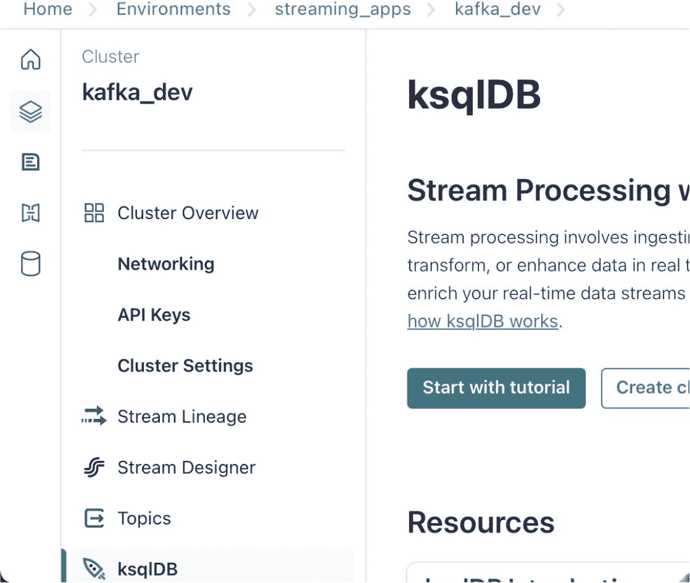

一张网页截图，左侧显示菜单，右侧显示产品描述。左侧代表集群 Kafka underscore dev，用于集群概览、网络、API 密钥、集群设置、流谱系、设计器、主题和 ksqlDB。右侧代表 ksqlDB、流处理工具和资源。

**图 9-7**
Confluent Kafka 中的 ksqlDB

你可以选择自行创建集群，或从教程开始。目标是搭建一个开发实例，以便开始使用流式数据处理管道。你可以选择为你的 ksqlDB 集群启用全局访问，并确保为模式注册表授予适当的权限。

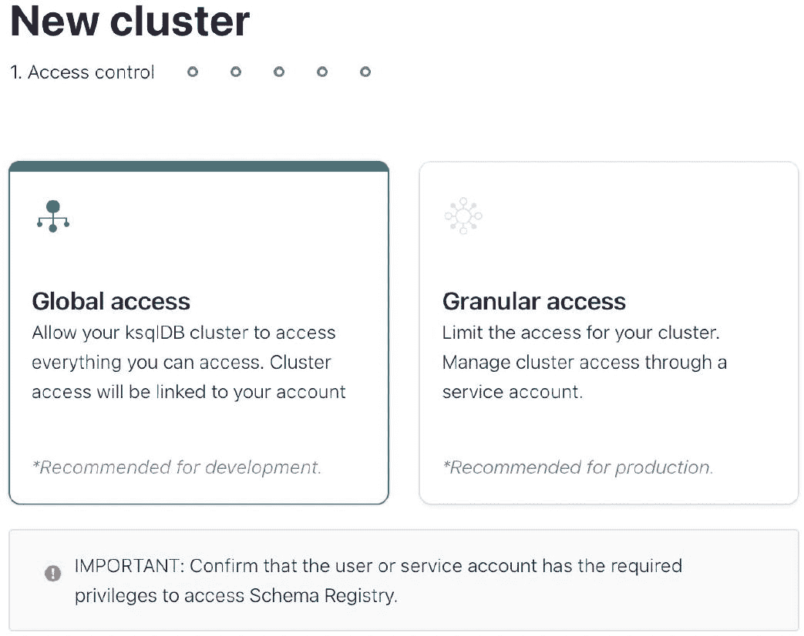

一张标题为“新集群”的网页截图。它包含两个部分，标题分别为“全局访问”和“细粒度访问”。底部的文本框显示：“重要提示：确认用户或服务账户拥有访问模式注册表所需的权限。”

**图 9-8**
创建新的 ksqlDB 集群

你可以选择最低的 Confluent 流处理单元，并选择启动集群。效果如下：

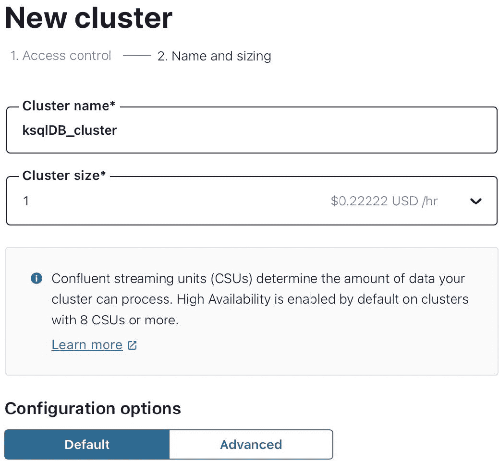

一张标题为“新集群”的网页截图。它展示了：1. 访问控制，以及 2. 名称和大小。名称和大小已选定，包括集群名称 ksqlDB underscore cluster、集群大小 1，以及配置选项“默认”和“高级”。已选择“默认”选项。

**图 9-9**
命名和调整 ksqlDB 集群大小

请等待几分钟，让您的集群完成配置。当状态从“正在配置”变为“运行中”时，您就知道集群已就绪。一旦 ksqlDB 启动并运行，我们可以尝试为 Confluent 和 ksqlDB 设置命令行界面。

最简单直接的方法是启动一个包含 Confluent 平台的 Docker 容器。您可以访问相应页面，复制 Docker Compose 文件，然后运行这些命令来启动并运行。但是，在终端中安装这些软件包会更好，因为我们还将亲身体验安装一个没有可执行文件的软件包。让我们开始研究如何在 Debian 操作系统中安装 Confluent CLI。

第一步是安装先决条件：

```
sudo apt update
sudo apt install -y software-properties-common curl gnupg
```

让我们检查一下是否已安装 Java；观察以下命令的输出：

```
java —version
```

如果未安装 Java，请继续执行以下操作：

```
sudo apt install -y default-jdk
```

让我们导入 ksqlDB 软件包的公钥。这是为了验证软件包的真实性，是称为加密签名和验证的安全机制的一部分：

注意

在加密签名和验证的世界中，软件包使用私钥进行数字签名。开发人员使用公开可用的公钥（我们正在导入的）来验证此签名。

```
wget -qO - https://packages.confluent.io/confluent-cli/deb/archive.key | sudo apt-key add
```

让我们将 ksqlDB 添加到我们的 apt 仓库并运行更新：

```
sudo add-apt-repository "deb https://packages.confluent.io/confluent-cli/deb stable main"
sudo apt update
```

让我们安装 CLI 软件包：

```
sudo apt install confluent-cli
```

就我而言，我还在本地安装了 Confluent 平台。这意味着要下载源代码，设置环境变量和路径，并检查安装是否成功。

让我们获取源代码并将 tarball 解压到您首选的目标位置：

```
curl -O https://packages.confluent.io/archive/7.5/confluent-7.5.3.tar.gz
tar xzvf confluent-7.5.3.tar.gz
```

复制文件路径以设置环境变量和路径：

```
export CONFLUENT_HOME=
export PATH=$PATH:$CONFLUENT_HOME/bin
```

在终端中输入以下帮助命令以检查安装是否成功：

```
confluent –help
```

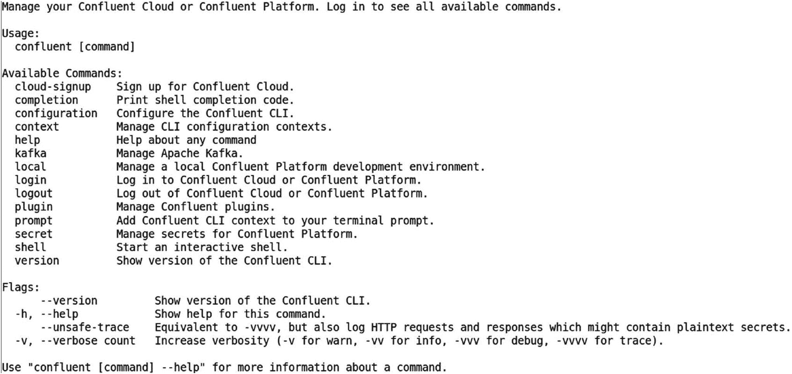

一张计算机屏幕截图，显示用于管理您的 Confluent Cloud 或 Confluent 平台的 24 行编码，登录以查看所有可用命令。它包括用法、可用命令和标志。

**图 9-10**
Confluent 命令行界面的帮助屏幕

如果您看到类似于此屏幕的内容，则说明您已成功安装 Confluent 平台。

现在是时候设置环境，以便您可以与云中的 ksqlDB 集群进行交互了。在仪表板中，单击 ksqlDB 并选择 CLI 说明。您将看到有关登录 Confluent Cloud CLI 并将上下文设置到您的环境和集群的说明：

```
confluent login
confluent environment use env-0jvd89
confluent kafka cluster use lkc-555vmz
```

为您的 ksqlDB 集群创建 API 密钥和密钥：

```
confluent api-key create --resource lksqlc-8ggjyq
```

您将得到类似以下的内容：

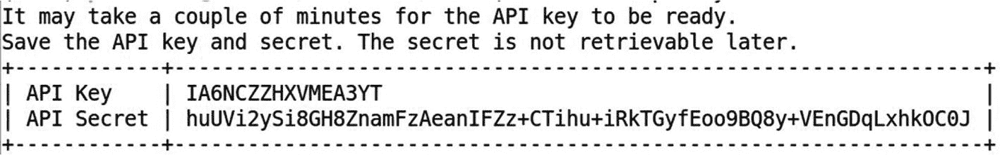

一张屏幕截图，显示 ksqlDB 集群 API 和密钥。虚线表格有 2 列和 2 行。行标题是 API 密钥和 API 密钥。

**图 9-11**
ksqlDB 集群 API 密钥和密钥

现在，输入以下内容以便您可以访问 ksqlDB 命令行界面；不要忘记输入正确的密钥和密钥：

```
$CONFLUENT_HOME/bin/ksql -u  -p  https://pksqldb-pgkn0m.us-east-2.aws.confluent.cloud:443
```

效果如下：

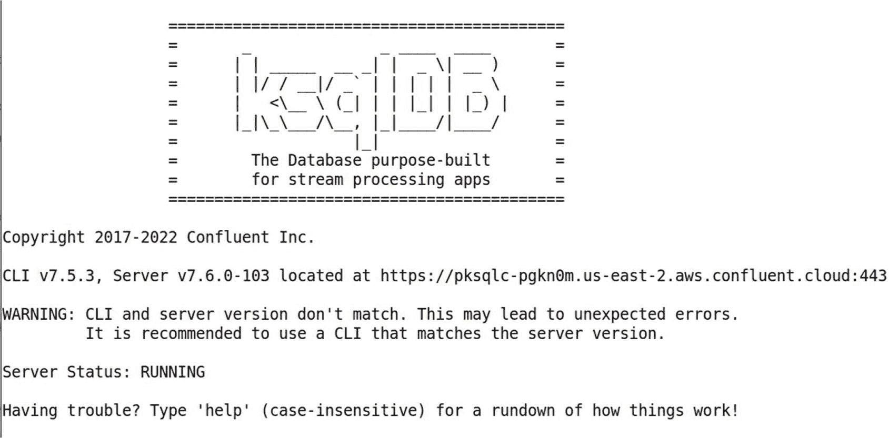

一个代码编辑器中的文本计算机屏幕。底部的详细文本代表版权信息、警告和服务器状态。

**图 9-12**
命令行界面上的 ksqlDB

现在让我们从一些基本的流应用程序开始。流将模式与底层的 Kafka 主题关联起来。让我们首先在 Kafka 集群中创建一个主题。访问集群的仪表板并单击“主题”。效果如下：

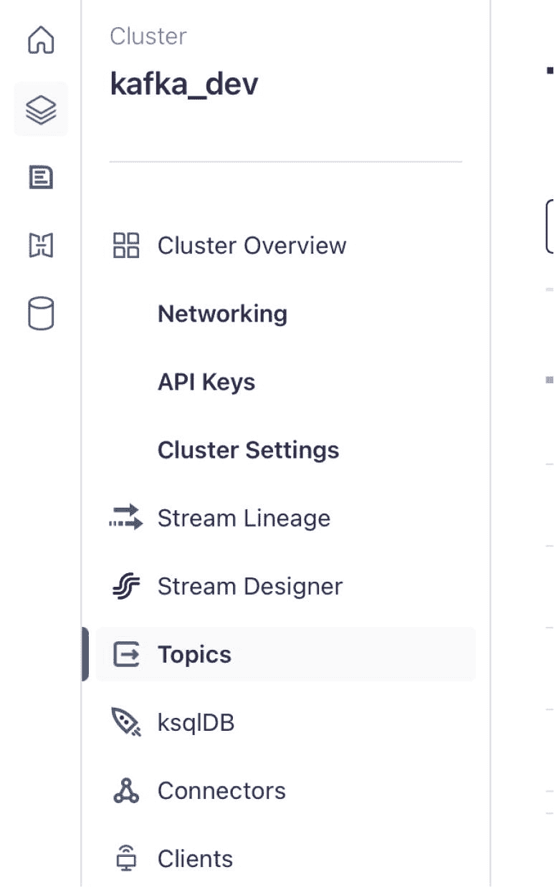

一个窗口屏幕截图，显示 Kafka 集群中的新主题。主题集群概览包括网络、API 密钥、集群设置、流谱系、流设计器、主题、ksqlDB、连接器和客户端。

**图 9-13**
在 Kafka 集群中创建新主题

选择“添加主题”并将主题命名为“students”。其他字段保留原样，然后选择“使用默认值创建”。效果如下：

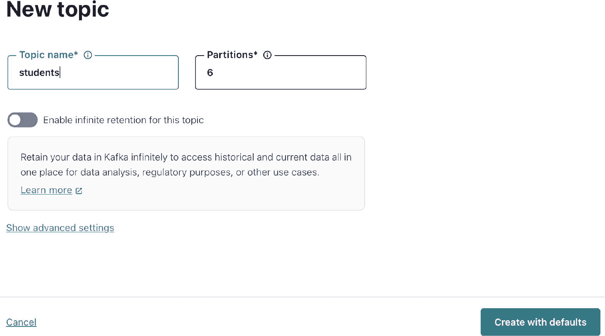

一张标题为“新主题”的窗口屏幕截图。表单有两个文本字段，主题名称 students 和分区 6。右下角，选择了“使用默认值创建”按钮。


**图 9-14**
为新主题命名并指定分区

选择为消息值创建模式的选项。在生产环境中，为消息键创建模式的选项有助于实现键结构的**一致性**以及路由到合适的分区（具有相同键的消息会被发送到同一个分区）。


网页截图，标题为“您的主题已成功创建”。它代表了数据契约的定义。在左下角，选择了“为消息值创建模式”。在右下角，选择了“创建模式”按钮。

**图 9-15**
为主题创建模式

点击“创建模式”并粘贴以下内容：

```
syntax = "proto3";
message students {
int32  id = 1;
string  name = 2;
string  course = 3;
}
```

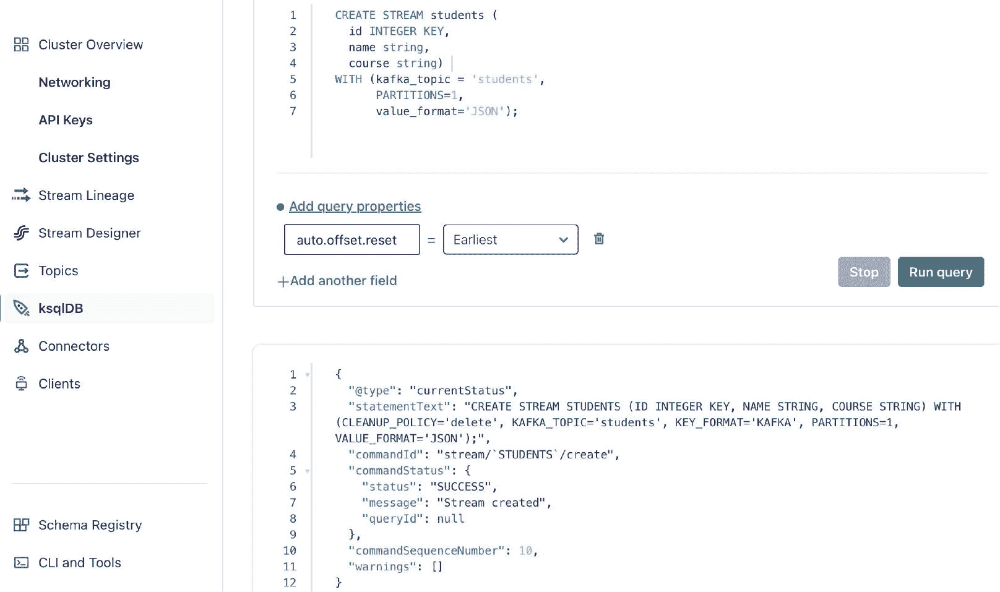

窗口屏幕截图，代表正在创建新模式。在左侧，选择了“网络”、“API 密钥”、“集群设置”和“ksqlDB”。在右上角，选择了“运行查询”按钮。

**图 9-16**
创建新模式

还可以通过 ksqlDB 命令行界面创建流。让我们详细看看这种方法。使用 CLI，我们将创建一个名为 students 的新流。找到 ksqlDB 中的“编辑器”选项卡，并输入以下代码来创建一个新的 students 流。确保将 `auto.offset.reset` 属性设置为 `earliest`。

操作如下：

```
set 'auto.offset.reset' = 'earliest';
CREATE STREAM students (
id INTEGER KEY,
name string,
course string)
WITH (kafka_topic = 'students',
PARTITIONS=1,
value_format='JSON');
```

现在，向流中插入数据：

```
INSERT INTO students (id, name, course) VALUES (5, 'John', 'Physics');
INSERT INTO students (id, name, course) VALUES (6, 'Joe', 'Math');
INSERT INTO students (id, name, course) VALUES (7, 'Jane', 'Physics');
INSERT INTO students (id, name, course) VALUES (8, 'Jan', 'Physics');
INSERT INTO students (id, name, course) VALUES (10, 'Alice', 'Math');
INSERT INTO students (id, name, course) VALUES (12, 'Al', 'Chemistry');
INSERT INTO students (id, name, course) VALUES (4, 'Moe', 'Chemistry');
```

现在我们可以尝试对这个流运行一个查询。这里有一个示例查询供您入门：

```
SELECT * FROM STUDENTS WHERE COURSE IN ('Math','Physics');
```

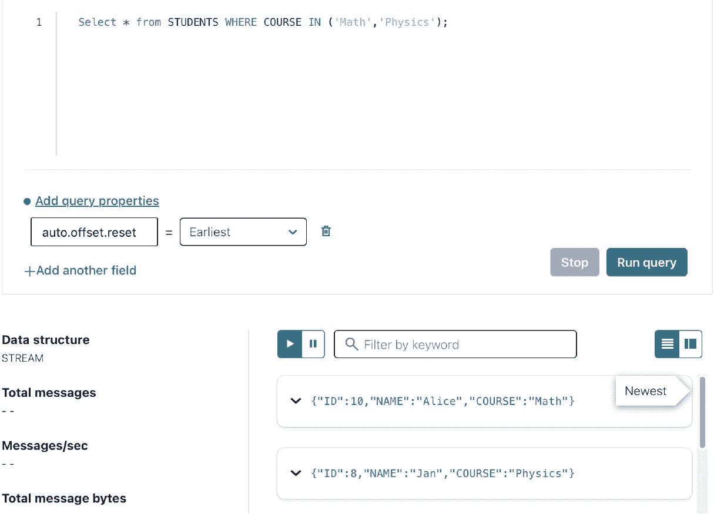

窗口屏幕截图，代表一个新查询。它表示从 students 表中选择 course 在（Math, Physics）中的记录，并添加了查询属性，同时“运行查询”按钮被选中。

**图 9-17**
执行新查询

请注意，您可以在浏览器中的仪表板上查看结果。让我们尝试通过命令行界面访问 Kafka 集群。登录我们之前安装的 Confluent Cloud，并使用相同的命令访问 ksqlDB。

在 ksqlDB 提示符下，输入以下查询：

```
ksql> select * from students where course = 'Physics' EMIT CHANGES;
```

您将看到以下结果：

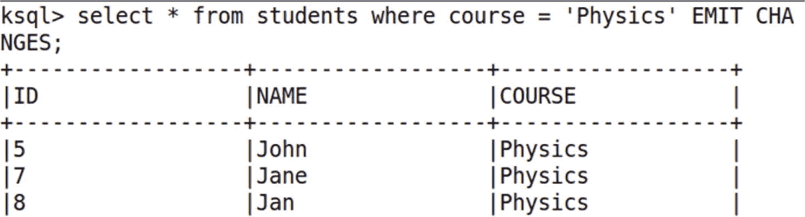

一个包含三列（ID、NAME、COURSE）的表格。该表显示了四行数据。数据为 5、7、8 和 16。名称包括 John、Jane、Jan 以及从浏览器输入的内容。

**图 9-18**
查询结果

让我们导航到浏览器上的仪表板，插入以下查询：

```
insert into students (id, name, course) values (16, 'EnteredFromBrowser', 'Physics');
```

点击“运行查询”。注意您保存 SQL 结果的终端。您很可能会看到以下内容：

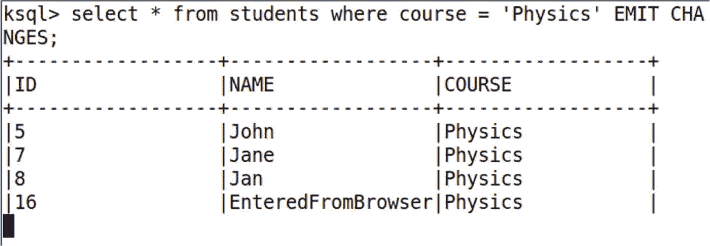

一个包含三列（ID、NAME、COURSE）的表格。该表显示了四行数据。第一行代表 ID 5、NAME John、COURSE Physics。第二行显示 ID 7、NAME Jane、COURSE Physics。第三行显示 ID 8、NAME Jan、COURSE Physics。

**图 9-19**
查询结果

我们刚刚见证了这些所谓的查询并非完全像关系数据库查询，而是流。一旦我们将数据插入流中，相同的数据就会出现在我们持续的流输出中。

**Kafka Connect**
我们在之前的讨论中看到，Kafka Connect 如何帮助我们可靠地在 Apache Kafka 和其他数据库系统之间进行扩展和数据流传输。Kafka Connect 提供了一种称为连接器的工具，它可以与其他数据系统连接，以启用和协调数据流。有两种类型的连接器，即源连接器和汇连接器。源连接器从数据系统中提取数据，将其流式传输到 Kafka 主题，而汇连接器则将数据从 Kafka 主题传送到数据系统。

Kafka Connect 服务可以以独立模式安装，也可以为生产目的以分布式模式部署。Kafka Connect 是流式数据/ETL（提取、转换、加载）管道的一个重要方面，尤其是在架构中包含 Kafka 时。您可以通过 ksqlDB 使用 Kafka Connect 服务连接到外部数据系统。请在此处查看 Oracle 数据库示例连接器；括号内包含值的字段需要填入相应的数据库凭据：

```
CREATE SOURCE CONNECTOR IF NOT EXISTS CustomerDB WITH (
'connector.class'          = 'OracleDatabaseSource',
'kafka.api.key'            = '',
'kafka.api.secret'         = '',
'connection.host'          = '',
'connection.port'          = '1521',
'connection.user'          = '',
'connection.password'      = '',
'db.name'                  = '',
'table.whitelist'          = 'CUSTOMERS',
'timestamp.column.name'    = 'created_at',
'output.data.format'       = 'JSON',
'db.timezone'              = 'UCT',
'tasks.max'                = '1'
);
```

**最佳实践**

如您所见，我们使用商业发行版 Confluent 演示了 Kafka 流式数据管道。在撰写本章时，供应商提供了数百美元的云积分，可用于获取他们的服务。这样，任何想要初步了解 Kafka 的人都可以利用他们的服务来运行示例集群。同时，注意后台未使用的 Kafka 集群也是一个好习惯。以下是一些可用于清理未使用 Kafka 资源的命令：

```
DROP STREAM IF EXISTS customers;
```

您还可以异步删除支持该表或流的相应主题：

```
DROP TABLE IF EXISTS t_customers DELETE TOPIC;
```

您也可以移除 Kafka 连接器：

```
DROP CONNECTOR IF EXISTS customerDB;
```

**结论**
可以肯定地说，Apache Kafka 代表了我们在构建实时数据管道和流分析解决方案方面的一种范式转变。其架构具有可扩展性、分布式和容错性，为构建和管理能够处理现代数据流的复杂数据管道提供了可靠的基础。我们讨论了 Kafka 架构及其各种组件，以及它们如何协同工作。我们研究了发布者-订阅者模型以及主题如何存储在数据库中。然后，我们研究了使用 ksqlDB 的流式数据管道，以及如何分析数据以获得业务洞察。希望您从本章学到的技能和知识能够帮助您构建实时数据管道。

10. 使用 FastAPI 进行机器学习工程和数据 REST API 开发


引言
在数据工程和机器学习建模这个复杂的领域中，存在多个动态环节（正如你目前所见），提供数据服务并部署机器学习模型以供使用至关重要。在本章中，我们将讨论 FastAPI。FastAPI 是一个 Python 库，主要用于支持 Web 应用程序开发和微服务开发。我们将着眼于 FastAPI，其唯一目的是利用该库来提供数据服务并将机器学习模型作为服务交付。尽管 Django 在基于 Python 的应用程序开发领域赢得了众多青睐，但 FastAPI 简单、强大且功能非常强大。对于机器学习工程师或数据工程师来说，理解应用程序编程接口的概念非常重要。

本章结束时，你将学习到

*   Web 服务和 API 的基础知识、各种类型的 API 及其概念
*   FastAPI 及其设置过程
*   Pydantic 与 FastAPI 的集成，实现强大的数据验证
*   FastAPI 依赖注入的概念与实现
*   数据库集成，包括 SQL、NoSQL 和对象关系映射方法
*   使用 FastAPI 构建 RESTful 数据 API
*   使用 FastAPI 进行机器学习 API 的开发与部署

Web 服务与 API 简介
企业倾向于通过提供有价值的数据产品来为其内部或外部客户创造价值。数据产品由数据工程师通过识别各种数据源、执行各种操作，并将来自这些多个来源的数据进行组合而构建（操作顺序不一定相同）。然后，这些数据资产被共享给各种内部和外部客户。企业和 IT 系统共享数据并相互通信的有效方式之一就是 API 的概念。API 代表应用程序编程接口。API 由各种公司和组织构建，以允许不同的用户群体利用其服务。一个提供数据即服务（DaaS）的组织的好例子是 OpenWeather API。

OpenWeather API
OpenWeather API 是由 OpenWeather 提供的一项数据服务，该公司通过 REST API 调用向个人和组织提供天气数据。OpenWeather API 使工程师能够以编程方式访问广泛的天气数据。其中一些数据包括全球各个地点的当前天气数据、预报和历史数据。他们为当前天气数据、预报天气数据、每日汇总、历史数据等提供了各种 API 端点。你可以在以下网站注册 OpenWeather API 以获取访问密钥。通过使用该访问密钥，你可以获取各种数据：
[`https://openweathermap.org/api`](https://openweathermap.org/api)

API 的类型
并非所有 API 都以相同的方式构建，它们服务的用户群体也不尽相同。最常见的 API 类别是开放 API。这些 API 由各种组织提供，并且可以免费访问和使用。工程师可以不受任何限制地访问和使用这些服务。另一类 API 是内部 API。这些 API 同样提供服务；但是，它们对组织内部是私有的。它们不对外公开。相反，它们仅由给定组织内的各个团队访问和利用，以获取数据和功能。内部 API 还有另一种变体，称为合作伙伴 API。这些 API 同样具有一定程度的机密性；但是，它们可能服务于该组织及其部分合作伙伴组织。
除了不同的类别及其服务目的之外，还有多种访问 API 的方法；其中一些如下所示。

SOAP API
SOAP 代表简单对象访问协议。SOAP API 已经存在很长时间，并用于企业级应用程序。SOAP 主要用于在两个应用程序之间交换结构化数据。SOAP 使用 HTTP 或 SMTP 来传输消息。它们使用 XML 模板进行消息格式化。

REST API
REST 代表表述性状态转移。REST 是一种用于构建轻量级和可扩展 API 的架构风格。它们利用 HTTP 方法进行通信。一些 HTTP 方法包括 GET、PUT、POST 等。REST API 以 JSON 或 XML 格式返回数据。这些 API 通常用于基于 Web 的应用程序和移动应用程序。

GraphQL API
GraphQL 代表图形查询语言。顾名思义，GraphQL 使用基于查询的请求来获取数据，确保只获取所需的数据。GraphQL 的重点在于避免过度获取。虽然这些信息对你来说可能有点难以理解（取决于你的背景），但最好知道存在这样的 API。

Webhooks
Webhooks 是另一种类型的 API，可实现系统之间的实时通信。与 REST API 类似，Webhooks 也使用 HTTP 请求进行通信。

API 的典型流程
API 充当软件应用程序之间的中间人，使它们能够更顺畅地相互交互。通信可以在两个软件应用程序之间进行，也可以是工程师寻求从主机获取服务。
这一切始于其中一方（我们称之为客户端）通过 API 向主机发送请求。API 携带消息并将其提交给主机。主机将处理该消息，准备必要的程序，并提供所请求的信息。
现在，主机（我们称之为服务器）响应客户端。响应中包含针对相应请求的信息。这种交互或通信（无论你更喜欢哪种称呼）是通过数据交换发生的。这些数据以某种方式结构化，以便 API 和服务器能够理解。这通常被称为数据格式。最常见的数据格式是 JSON 和 XML。这些数据格式确保所有三方——客户端、API 和服务器——能够理解彼此之间的交互。

端点
如前所述，API 是中介；它们充当两方之间的桥梁。API 提供了一种机制，供客户端发起与服务器的对话。其中一种机制称为 URL 或 URI，即统一资源定位符或统一资源标识符。它包含服务器的地址，以便将请求发送到正确的地址。

让我们看下面的例子：

*   简·多伊，
*   会计部，
*   ABC 公司，
*   美国某镇

假设有人向这个地址发送一封实体邮件，那么它将到达相应的城镇，到达相关的组织（在此例中是假设的），到达相应的部门，并到达该部门中指定的收件人。
REST API 端点类似于刚才提到的人的地址。

URL 或 URI 的结构如下：

```
https://developer.MyFavoriteMovieTheatre.com/api/movie-theatre/showtimes?movie_id=5&date=2023-06-06
```


在此处
[`https://developer.MyFavoriteMovieTheatre.com`](https://developer.myfavoritemovietheatre.com)
是 API 的基础 URL。
`/api/movie-theatre/showtimes`
表示用于检索放映时间的路径参数。
`movie_id=5`
和 `date=2023-06-06`
表示查询参数。它们允许你指定想要观看的电影和日期。`movie_id` 参数对应某一天上映的电影。
整个 URL 被称为端点。端点就像之前提到的物理地址一样，是地址。通过指定正确的基础 URL、正确的路径和适当的查询参数，电影院服务器将能够处理你的请求并检索响应。

API 通常需要身份验证。这样做是为了确保只有经过授权的用户或应用程序才能访问其功能。有多种方式可以对 API 进行身份验证。一些常见的方式包括使用 API 密钥、令牌和其他身份验证机制。

API 将数据从源端移动到目标端，并提供了一种更简单的方式来摄取数据。

API 开发流程
要构建一个 API，我们首先要定义 API 需求，例如它可能需要访问的数据、它将执行的操作以及它将产生的结果等等。一旦定义了需求，就可以着手构建数据模型、方法、端点，并定义请求、身份验证、授权等的响应数据格式。根据需求实现 API，在此过程中设置所需的服务器及其基础设施，实现代码和依赖项（如果有），以及其他相关任务。在实现阶段或实现后阶段，对特性和功能进行充分的测试可能是一个好步骤。最后一步是将 API 部署到生产服务器；性能和用法监控可能有助于解决任何可能需要改进的地方。

REST API
如前所述，REST 是表述性状态传递的缩写。它是符合 REST 架构标准的 Web 服务类型之一。REST 架构标准利用给定网络上的客户端-服务器通信。REST 架构是无状态的，这意味着服务器不会为来自客户端的请求维护会话信息。相反，请求消息本身将包含足够的信息供服务器处理该请求。

RESTful 服务监听 HTTP 方法并从服务器检索响应。HTTP 代表超文本传输协议。HTTP 方法的作用是告诉服务器需要执行哪个操作来为请求检索响应。HTTP 方法分为两类：安全 HTTP 方法和幂等 HTTP 方法。安全 HTTP 方法无论被调用多少次，总是返回相同或相似的响应。安全 HTTP 方法不会更改服务器上的数据。幂等方法可能能够更改服务器上的数据。一些更常见的 HTTP 方法（或动词）包括：

*   **GET**：从服务器读取数据，不以任何方式更改或修改资源。

    *   以下是一个简单的 GET 请求，用于请求某家多厅影院的所有电影：

    ```
    GET /multiplexapi/movies/
    ```

*   **HEAD**：类似于 GET，仅检索头部数据而不包含内容。

    *   以下是一个 HEAD 请求，用于查看电影的最后更新时间：

    ```
    HEAD /multiplexapi/theatreslist
    ```

*   **POST**：触发一个动作或可用于创建新数据；会在服务器上进行更改。

    *   以下是为观影者创建新预订的示例：

    ```
    POST /multiplexapi/bookings
    ```

*   **PUT**：用新数据替换当前数据；可视为执行更新操作。

    *   以下是更新电影放映时间的示例：

    ```
    PUT /multiplex/movies/SampleMovie { “showtime”: “5:55PM” }
    ```

*   **PATCH**：类似于 PUT，但部分替换或更新当前数据为新数据。

    *   以下是更新在第三影厅放映的“SampleMovie”剩余座位数的示例：

    ```
    PATCH /multiplex/threatre/3 { “seats_available” : 5 }
    ```

*   **OPTIONS**：用于获取给定 URL 到服务器的一组允许的 HTTP 方法。

    *   以下是检查各种预订选项的示例：

    ```
    OPTIONS /multiplexapi/bookings
    ```

*   **CONNECT**：用于建立到服务器的隧道的方法。

    *   以下是建立到多厅影院的 TCP 连接的示例：

    ```
    CONNECT app.multiplexapi.com:3690
    ```

HTTP 状态码

当服务器收到来自客户端的请求时，它会处理并准备一个响应。HTTP 状态码是与响应一起接收的代码。以下是客户端收到的一些常见状态码：

表 10-1
一些常见的 HTTP 状态码及其描述

| HTTP 状态码 | 描述 |
| :--- | :--- |
| 200 OK | 请求成功，服务器返回了请求的数据。 |
| 201 Created | 请求成功，作为结果创建了新资源。 |
| 204 No Content | 请求成功，但无需返回任何内容（通常用于 DELETE 操作）。 |
| 301 Permanent Redirect | 请求的页面已永久移动到新的 URL。 |
| 400 Bad Request | 由于客户端错误，服务器无法处理请求。 |
| 401 Unauthorized | 服务器需要用户身份验证（有效凭据）才能处理请求。 |
| 403 Forbidden | 服务器理解你的请求，但拒绝授权，尽管提供了有效凭据（可能权限不足）。 |
| 404 Not Found | 请求的内容在服务器上找不到。 |
| 500 Internal Server Error | 由于某些意外问题，服务器似乎无法找到请求的内容。 |
| 503 Service Unavailable | 服务器目前无法处理请求。 |

这些 Web 服务通过 API 向外界公开其数据或服务。
要使用 Python 构建 API，有相当多的包可用。有 Flask，这是一个以构建简单、易于设置和较小型的 API 而闻名的 Python 库。流行的还有 Django 和 FastAPI。Django 已经存在很长时间，功能更多，是比 Flask 更好的选择。在本章中，我们将深入探讨 FastAPI。

FastAPI
FastAPI 相对于其他 Python 库提供了一些优势；首先，FastAPI 通过 `asyncio` 支持 Python 的异步编程。FastAPI 自动生成基于 Open API 标准的文档，允许 API 的用户浏览文档并测试各种端点。最重要的是，顾名思义，FastAPI 性能高，比许多其他 Python 库更快。

设置与安装

以下是在你的机器上设置 FastAPI 的方法：

```
pip install fastapi
```

FastAPI 不附带 Web 服务器；让我们也安装一个 Web 服务器：

```
pip install "uvicorn[standard]"
```

假设你正在使用虚拟开发环境，我也鼓励你考虑这个命令：

```
pip install "fastapi[all]"
```

这将安装 FastAPI、Pydantic 和 Starlette Python 库使用的所有可选依赖项，其中包括 “uvicorn” Web 服务器和异步客户端 “http”。

现在让我们考虑一个使用 FastAPI 的简单 Hello World 应用程序。如下所示：

```
from fastapi import FastAPI, APIRouter
app = FastAPI()
api_router = APIRouter()
@api_router.get("/")
def root() -> dict:
return {"msg": "Hello, World!"}
app.include_router(api_router)
```


核心概念
FastAPI 基于 AGSI 标准和 Starlette 构建。FastAPI 利用
AGSI 服务器来实现其异步能力。AGSI 代表
异步服务器网关接口。AGSI 是一个
相对较新的 Web 标准，用于服务器与客户端进行异步通信。
FastAPI 支持 Hypercorn 和 Uvicorn Web 服务器，因为它们
与 AGSI 标准兼容。
另一方面，Starlette 是
一个 AGSI 标准框架，有助于实现 FastAPI 的核心功能。
Starlette 提供了核心的路由基础设施，处理
请求和响应、数据库集成以及许多其他
被 FastAPI 利用的功能。在 Starlette 和 AGSI 标准之上，
FastAPI 原生提供了数据验证、文档生成
等功能，因此工程师可以专注于事物的业务逻辑。

路径参数和查询参数

如你所知，路径
参数是端点（endpoint）的组成部分，而查询参数是
可选的类似过滤器的参数。让我们看一个例子；这是一个
URL：

```
https://www.amazon.com/Sweetcrispy-Ergonomic-Computer-Comfortable-Armrests/dp/B0C61DLQNH/ref=mp_s_a_1_5?crid=1CE83JNY3DEDI&keywords=chair&qid=1703648878&refinements=p_36%3A1253524011&rnid=386465011&s=home-garden&sprefix=cha%2Caps%2C478&sr=1-5
```

基础 URL 是
[`https://www.amazon.com/`](https://www.amazon.com/)

路径
参数是

```
/Sweetcrispy-Ergonomic-Computer-Comfortable-Armrests
/dp
/B0C61DLQNH
/ref=mp_s_a_1_5
```

查询
参数是

```
?
crid=1CE83JNY3DEDI &
keywords=chair &
qid=1703648878 &
refinements=p_36%3A1253524011 &
rnid=386465011 &
s=home-garden &
sprefix=cha%2Caps%2C478 &
sr=1-5
```

当你编写一个函数时，你可以将变量传递给该
函数，这些变量可以被调用。如下所示：

```
from fastapi import FastAPI, APIRouter
```

让我们创建一个示例学生和课程数据的列表：

```
Students = [
{
"Student_id": 1,
"Student_name": "StudentPerson1",
"Course" : "BIO 101",
"Department" : "Biology"
},
{
"Student_id": 2,
"Student_name": "StudentPersonTwo",
"Course" : "CHEM 201",
"Department" : "Chemistry"
},
{
"Student_id": 3,
"Student_name": "StudentPerson3",
"Course" : "MATH 102",
"Department" : "Mathematics"
},
]
```

让我们实例化 FastAPI（使用合适的标题）和 APIRouter 对象：

```
app = FastAPI(title="Student/Course Data")
api_router = APIRouter()
```

之前定义的主函数在结构上没有太大变化。
让我们添加一个名为“get_student”的新函数来检索学生
记录。注意使用了包含变量的装饰器。该
变量或参数的值将在运行时传递：

```
@api_router.get("/")
def hello() -> dict:
return {"msg": "Welcome to the root page"}
@api_router.get("/student/{Student_id}")
def get_student(Student_id: int) -> dict:
for s in Students:
if s["Student_id"] == Student_id:
result = s
return result
app.include_router(api_router)
```

让我们实时运行这段代码。这是我们运行这段代码的方式：

```
uvicorn main3:app —reload
```

将返回以下堆栈跟踪：

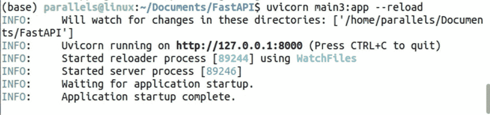

一张命令提示符的截图，正在运行 uvicorn 命令以
启动一个 FastAPI Web 应用程序。重新加载器进程启动，
随后是服务器进程。应用程序启动成功完成，
服务器已准备好处理请求。

图 10-1
执行一个简单的 FastAPI 应用

现在，让我们打开浏览器并输入
地址 `http://127.0.0.1:8000/student/3:`

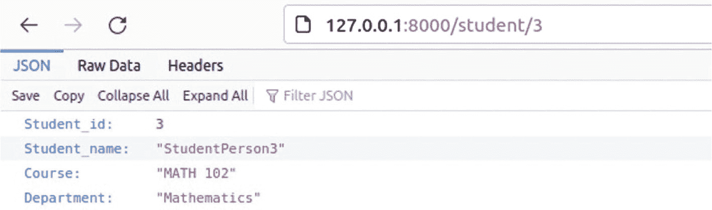

一张网页浏览器的截图，显示来自
FastAPI 应用程序的 JSON 响应。该响应包含关于
ID 为 3 的学生信息，包括其姓名、课程和院系。

图 10-2
在浏览器中查看 FastAPI 应用

注意

你甚至可以指定路径参数的数据类型。在
前面的例子中，`get_student()` 函数
有一个路径参数，该路径参数的数据类型也被定义了。


如果你输入了代码中未定义的数据类型，FastAPI 会抛出一个 HTTP 错误，如下所示：

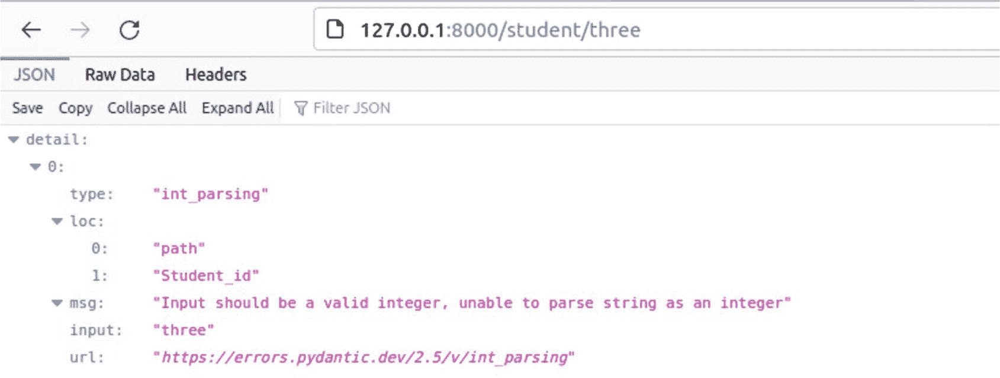

一个网页浏览器读取 FastAPI 应用程序错误信息的截图。该错误提示提供的学生 ID "three" 不是有效的整数。

图 10-3
FastAPI 抛出错误

FastAPI 期望接收的 student_id 是 3（整数），而不是 "three"（字符串）。
除了定义路径参数，你还可以在函数内部定义查询参数。回想一下我们之前关于亚马逊 URL 的例子。查询参数位于 URL 的末尾，用于过滤或向端点提供附加信息。查询参数在问号（?）之后指定。多个查询参数用与号（&）分隔。

示例如下：

```
from fastapi import FastAPI
app = FastAPI()
Students = [
{
"Student_id": 1,
"Student_name": "StudentPerson1",
"Course" : "BIO 101",
"Department" : "Biology"
},
{
"Student_id": 2,
"Student_name": "StudentPersonTwo",
"Course" : "CHEM 201",
"Department" : "Chemistry"
},
{
"Student_id": 3,
"Student_name": "StudentPerson3",
"Course" : "MATH 102",
"Department" : "Mathematics"
},
]
@app.get("/students/")
def read_item(skip: int = 0, limit: int = 10):
return Students[skip : skip + limit]
```

这个示例会执行两个过滤操作，即跳过一定数量的记录并限制结果的数量。
URL 如下所示：
`http://127.0.0.1:8000/items/?skip=1&limit=2`
查询参数是 skip 和 limit；我们打算跳过第一条记录，并将总结果限制为仅两条记录。因此输出结果如下所示：

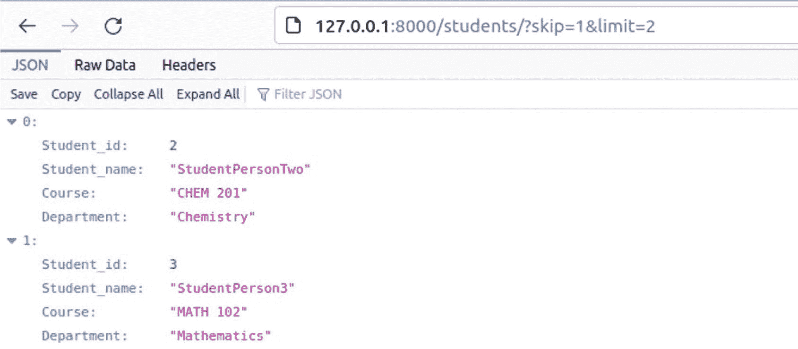

一个网页浏览器读取 FastAPI 应用程序 JSON 响应的截图。该响应包含两名学生的信息，包括他们的 ID、姓名、课程和院系。这些学生是通过分页参数 skip = 1 和 limit = 2 检索到的。

图 10-4
在 URL 地址中定义查询参数

Pydantic 集成
正如我们在前一章所见，Pydantic 是一个简单而强大的数据验证工具。FastAPI 与 Pydantic 集成得很好。

让我们看一个 Pydantic 集成的示例：

```
from fastapi import FastAPI, APIRouter
from pydantic import BaseModel
from typing import Sequence
app = FastAPI()
api_router = APIRouter()
Students = [
{
"Student_id": 1,
"Student_name": "StudentPerson1",
"Course" : "BIO 101",
"Department" : "Biology"
},
{
"Student_id": 2,
"Student_name": "StudentPersonTwo",
"Course" : "CHEM 201",
"Department" : "Chemistry"
},
{
"Student_id": 3,
"Student_name": "StudentPerson3",
"Course" : "MATH 102",
"Department" : "Mathematics"
},
]
class Student(BaseModel):
Student_id: int
Student_name: str
Course: str
Department: str
class retrieveStudent(BaseModel):
Students: Sequence[Student]
class newStudent(BaseModel):
Student_id: int
Student_name: str
Course: str
Department: str
@app.get("/")
def hello():
return {"welcome to the root"}
@api_router.get("/student/{Student_id}", response_model=Student)
def get_student(Student_id: int) -> dict:
for s in Students:
if s["Student_id"] == Student_id:
result = s
return result
@api_router.post("/student", response_model=Student)
def create_student(incomingStudent: newStudent) -> dict:
StudentEntry = incomingStudent(
Student_id = incomingStudent.Student_id,
Student_name = incomingStudent.Student_name,
Course = incomingStudent.Course,
Department = incomingStudent.Department,
)
Students.append(StudentEntry.dict())
return StudentEntry
app.include_router(api_router)
```

该代码使用了与之前实例类似的示例。get 方法通过 student_id 检索学生。post 方法将创建一个新学生及其所需的参数。请注意，此示例仅用于说明目的。数据（即发布的数据）不会持久化到磁盘上。

响应模型

在我们定义的 get 和 post 函数中，可以看到使用了 "response_model" 属性。response_model 会将给定的数据转换为 Pydantic 格式，同时仍然返回函数指定要返回的类型。response_model 实际上并不会改变函数的返回类型。response_model 参数告诉 FastAPI 将返回的数据转换为 Pydantic 对象，并在需要的地方执行必要的验证。你可以使用 FastAPI 装饰器方法的 "response_model" 参数。其中一些方法包括：

```
app.get()
app.post()
app.delete()
```

……等等。
还可以选择将 response_model 设置为 None。这将使 FastAPI 跳过执行 response_model 本应执行的验证或过滤步骤。通过将响应模型指定为 None，你仍然可以保留返回类型注解，并继续从你的 IDE 或类型检查器那里获得类型检查支持。

注意

此外，FastAPI 提供基于 Open API 标准的文档。在任何时候，如果你希望在开发中访问它，只需在你的端点后加上 "docs"。例如，`http://127.0.0.1:8000/docs` 将检索到以下文档页面（图 10-5）。

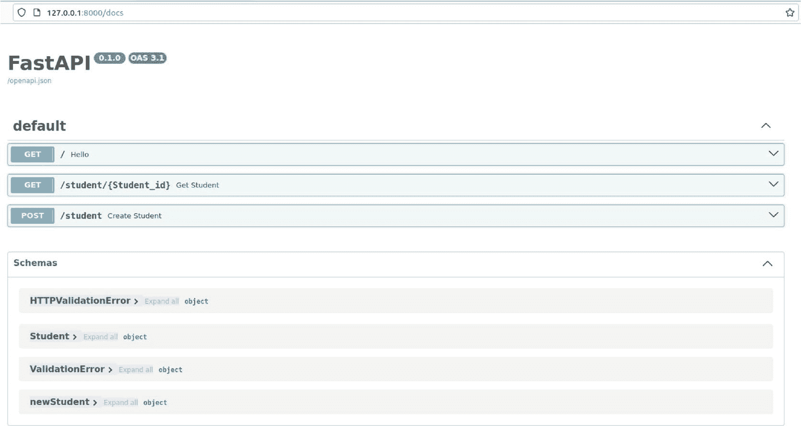

一个网页浏览器读取 FastAPI 应用程序 Swagger UI 文档的截图。该文档显示了可用的 API 端点、它们的 HTTP 方法以及它们期望的参数和响应。

图 10-5
基于 Open API 标准的 FastAPI 文档

在该窗口中，请展开任意 HTTP 方法以尝试其功能。以下是 "获取学生" 的界面：

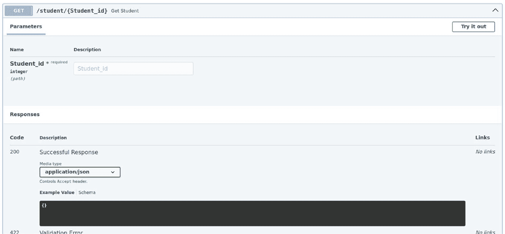

一个 Swagger UI 界面读取 FastAPI 应用程序中 GET API 端点详细信息的截图。该端点根据学生 ID 检索学生。它需要一个类型为整数的路径参数 student_id。响应是一个包含学生信息的 JSON 对象。

图 10-6
此应用的 GET 请求文档

当你点击 "Try it out" 时，文本框将变为可编辑状态，因此你可以输入一个给定的请求，让服务器处理并返回响应。服务器还会为该请求生成一个 Curl 命令、相应请求的端点、状态响应消息以及响应体。界面如下所示：

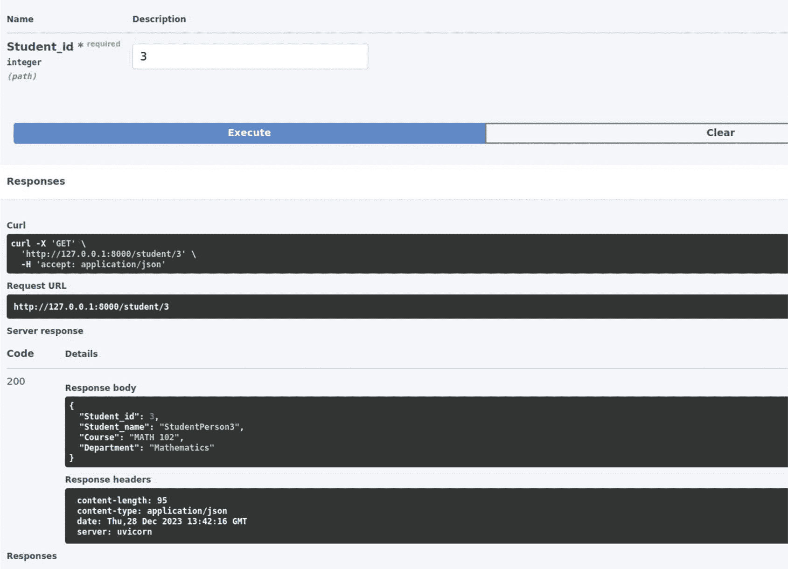

一个 Swagger UI 界面读取 FastAPI 应用程序中 GET API 端点详细信息的截图。该端点根据学生 ID 检索学生。用户输入了学生 ID 3 并点击了执行按钮。响应体显示了该学生的信息。

图 10-7
FastAPI 上的 GET 请求示例

FastAPI 中的依赖注入
当你编写数据处理管道时，可能会遇到一个或一组功能，它们本质上是相同的代码，但应用于多个数据管道。最简单、最快速的例子是连接到特定的数据库。可能存在 "n" 个数据管道都需要连接到某个特定数据库的情况。显然，所述数据管道依赖于与这个特定数据库的连接。为你的代码提供这种数据库连接依赖关系的过程称为依赖注入。

注意

注入本质上就是在这里提供功能。不是将功能的代码写在数据处理管道内部，而是将代码写在外部，然后注入到数据处理管道中。

FastAPI 有一个简单直观的依赖注入系统。"Depends" 方法为 FastAPI 提供了依赖注入功能。让我们看下面的例子：


```
from fastapi import FastAPI, Depends
from databases import Database
import sqlalchemy
app = FastAPI()
database = Database("Your database credentials here")
def dbConnect():
return database
@app.get("/users")
def get_users(db=Depends(dbConnect)):
conn = db
users = conn.fetch_all("SELECT * from users")
return {"users": users}
```

在上述示例中，我们设计了一个简单的 API，其中包含一个 GET 请求，该请求在被调用时会检索“users”。为了让 GET 方法能够检索并返回该信息，它需要与数据库建立连接。你可能已经注意到，数据库连接被定义为一个独立的函数。然后，该数据库连接通过 FastAPI 的“Depends”方法作为参数传递给 `get_users` 函数。这样，“get_users”函数就会调用 `dbConnect()` 函数，该函数会建立与数据库的连接。

FastAPI 与数据库的集成

FastAPI 可以与任何关系型数据库集成。与数据库交互的方式有多种。让我们先来看一种简单直接的关系型数据库交互方式。为了进行说明，我们将以在 Debian 工作站上使用名为 MySQL 的开源关系型数据库为例。让我们执行以下命令：

```
sudo apt update
sudo apt install mysql-server
```

检查 MySQL 是否已正确安装：

```
mysqld —version
```

让我们以 root 身份登录：

```
mysql -u root -p
```

输入相应的密码后，你将看到 mysql 提示符：

```
mysql>
```

让我们创建一个新的数据库用户：

```
create user 'newscott'@'localhost' identified with caching_sha2_password by 'Tiger@#@!!!9999';
```

要列出所有数据库，请使用

```
show databases;
```

要选择一个数据库，请使用

```
use your-database-name;
```

要创建一个数据库，请使用

```
create database your-database-name;
```

让我们创建一个数据库，在该数据库中创建一个表，并向该表中插入数据：

```
create database stu;
Use stu;
CREATE TABLE students (
id INT(11) NOT NULL AUTO_INCREMENT,
name VARCHAR(100) NOT NULL,
course VARCHAR(100) NOT NULL,
PRIMARY KEY (id)
);
```

以下命令也很有用：

```
show tables;
```

将输出

```
+---------------+
| Tables_in_stu |
+---------------+
| students      |
+---------------+
insert into students (id, name, course) values (1, "test", "tescourse");
insert into students (id, name, course) values (2, "JohnDoe", "Physics101");
insert into students (id, name, course) values (3, "Joe", "Chemistry101");
```

让我们现在查看该表：

```
select * from stu.students;
+----+---------+--------------+
| id | name    | course       |
+----+---------+--------------+
|  1 | test    | tescourse    |
|  2 | JohnDoe | Physics101   |
|  3 | Joe     | Chemistry101 |
+----+---------+--------------+
```

让我们也为新创建的数据库用户授予权限：

```
grant all privileges stu.* to 'newscott'@'localhost';
flush privileges;
```

注意

这些命令仅用于开发目的的简单数据库设置。在设置生产环境数据库实例时，你需要使用 `mysql_secure_installation` 并遵循 DBA 的最佳实践。

现在，创建一个名为“db1.py”的新 Python 脚本，并输入以下代码：

```
from fastapi import FastAPI
from mysql import connector
dbapp = FastAPI()
database_creds = connector.connect(
host="localhost",
user="newscott",
password="Tiger@#@!!!9999",
database="stu",
auth_plugin='mysql_native_password')

