# 依赖项
def get_db():
    db = SessionLocal()
    try:
        yield db
    finally:
        db.close()

@app.get("/student/{name}")
def get_stud_by_name(student: NewStudent,
                     db: Session = Depends(get_db)):
    try:
        byname = get_student_by_name(db, name=student.name)
        return byname
    except Exception:
        raise HTTPException(status_code=400)

@app.get("/students/")
def get_allstudents(db: Session = Depends(get_db)):
    try:
        allstudents = get_AllStudents(db)
        return allstudents
    except Exception:
        raise HTTPException(status_code=400)

@app.get("/student/{id}")
def get_stud_by_id(student: NewStudent,
                   db: Session = Depends(get_db)):
    try:
        by_id = get_student_by_id(db, id=student.id)
        return by_id
    except Exception:
        raise HTTPException(status_code=400)

@app.post("/students/")
def new_student(student: NewStudent,
                db: Session = Depends(get_db)):
    student_id = get_student_by_id(db, id=student.id)
    if student_id:
        raise HTTPException(status_code=400)
    return new_student(db, student=student)
```

功能与代码准备就绪后，我们来测试一下 RESTful 数据 API 应用。只需运行：

```
uvicorn main:app —reload
```

打开浏览器标签页，输入 http://127.0.0.1:8000/students/ 即可获取所有学生信息。效果如下：

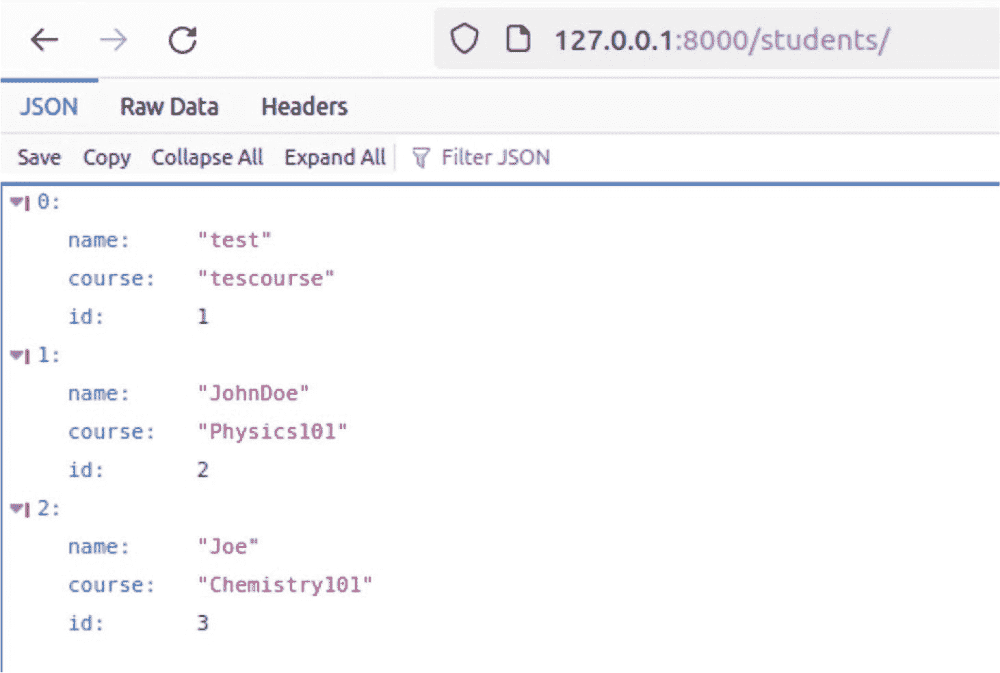

浏览器读取 FastAPI 应用返回的 JSON 响应的截图。响应中包含三名学生的信息，包括姓名、课程和 ID。

**图 10-8** 该 FastAPI 应用的 GET 请求示意图

## FastAPI 中的中间件

**中间件**是位于提供方和消费方之间的一小段函数或程序集。它同时处理请求和响应流程。在每个请求被发送到服务器处理之前，中间件可以配置为在发送到服务器之前执行特定操作。同样，它也可以接收响应，执行某些操作，然后将响应发送给消费方。中间件应用的常见示例包括执行身份验证，以及记录请求和响应的元数据日志。中间件还有助于限制来自特定消费方的请求数量。

让我们看一个简单的中间件实现示例。假设我们部署了一个向公众开放的机器学习服务。我们希望实现一个速率限制中间件，将来自特定消费方的请求数量限制为每小时 25 次。顺便提一下，这是一个很好的 async/await 实现示例。

## 使用 FastAPI 的机器学习 API 端点

让我们考虑一个简单的预测（分类）花卉种类的示例。我们将获取鸢尾花数据集。鸢尾花数据集包含三种鸢尾花，每种有 50 个样本，广泛用于测试机器学习方法（来源：[`https://archive.ics.uci.edu/dataset/53/iris`](https://archive.ics.uci.edu/dataset/53/iris)）。

以下是一个基于该数据集的简单模型。我们首先构建一个简单的机器学习模型。我们使用 R. A. Fisher 于 1936 年发表的研究论文《分类问题中多重测量的应用》中使用的鸢尾花数据集。该数据集采用知识共享许可，可在加州大学欧文分校维护的机器学习库中找到。该数据集包含鸢尾属植物中三种花卉的萼片和花瓣（花的部分）的测量值以及相应物种的名称。

我们将植物测量值提取为因变量，将植物名称提取为自变量，以便根据一组测量值识别鸢尾植物的类型。该模型存储为 pickle 文件，以便我们可以在 FastAPI 应用程序中导入它：

> **注意**
> 
> 请注意，重点在于为我们的机器学习应用演示 FastAPI 的实现。

```
import pandas as pd
from sklearn.model_selection import train_test_split
from sklearn.linear_model import LogisticRegression
from sklearn.metrics import accuracy_score, confusion_matrix
import pickle
import numpy as np

df = pd.read_csv("//iris.csv")
x = df.iloc[:,:4]
y = df.iloc[:,4]
x_train, x_test, y_train, y_test = train_test_split(x,
                                                    y,
                                                    random_state=0)
model=LogisticRegression()
model.fit(x_train,y_train)
y_pred = model.predict(x_test)
#print(confusion_matrix(y_test,y_pred))
#print(accuracy_score(y_test, y_pred)*100)
export_model = pickle.dump(model, open('irismodel1.pkl', 'wb'))
input_data_reshaped = np.asarray(input_data).reshape(1,-1)
prediction = model1.predict(input_data_reshaped)
```

一旦我们有了模型 pickle 文件，就可以继续在 FastAPI 中构建我们的应用程序，并添加一个自定义中间件，该中间件在请求达到一定数量后限制对 API 的访问。我们首先导入必要的类和方法，然后实例化 FastAPI，加载模型，并创建一个字典来存储 IP 地址和访问次数。接着我们定义中间件函数，在该函数中从请求类获取 IP 地址，并为每个 IP 地址增加访问次数。中间件的编码确保如果在给定小时内访问次数超过 5 次，则会抛出异常：

> **注意**
> 
> 理解中间件代码仅用于演示目的非常重要。我还建议研究一个名为“SlowAPI”的 Python 库来实现速率限制器。此外，也建议使用像 Redis 这样的内存存储。

```
from pydantic import BaseModel
import pickle
import json
from fastapi import FastAPI, Request
from datetime import datetime, timedelta

app = FastAPI()
model = pickle.load(open('irismodel1.pkl','rb'))
```

好的，作为一名高级文档工程师和翻译员，我将遵循您提供的注意事项和示例，将给定的英文文本翻译成中文。


# 为 IP 地址创建新的注册表
registry: dict[str, (int, datetime)] = {}
@app.middleware("http")
async def rateThreshold(request: Request, call_next):
ip_address = request.client.host
rightnow = datetime.now()
if ip_address in registry:
hits, timestamp = registry[ip_address]
if rightnow - timestamp > timedelta(hours=1):
hits = 0
else:
hits = 0
hits += 1
if hits > 5:
raise Exception("too many requests")
registry[ip_address] = (hits, rightnow)
response = await call_next(request)
return response
class ModelInput(BaseModel):
SLength: float
SWidth: float
PLength: float
PWidth: float
@app.post("/predict/")
def predict(modelparam: ModelInput):
modelparameters = json.loads(modelparam.json())
sl = modelparameters['SLength']
sw = modelparameters['SWidth']
pl = modelparameters['PLength']
pw = modelparameters['PWidth']
predictionclass = model.predict([[sl,sw,pl,pw]])
return predictionclass[0]
```

一旦我们有了应用程序，就可以通过以下方式启动：

```
uvicorn MLPipeline:app —reload
```

这将从终端启动应用程序。
要访问或测试 API，建议打开一个浏览器标签页，并输入 FastAPI 文档链接：
`http://127.0.0.1:8000/docs#/default/predict_predict__post`
或者直接输入
`http://127.0.0.1:8000/docs`
将会显示：

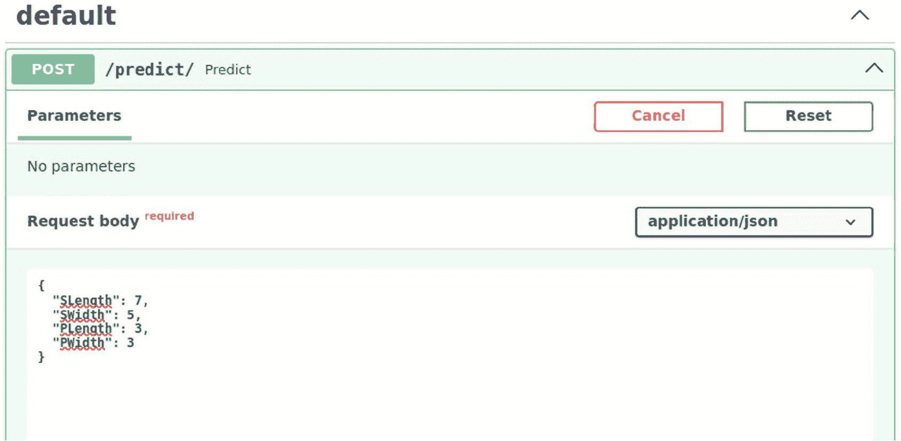

一张 Swagger UI 界面的截图，显示了 FastAPI 应用程序中一个 POST API 端点的详细信息。该端点用于进行预测。请求体需要一个具有特定键和值的 JSON 对象。

图 10-9
机器学习模型 API 的 POST 请求

您可以开始输入值，让系统对鸢尾花植物进行分类（预测）。效果如下：

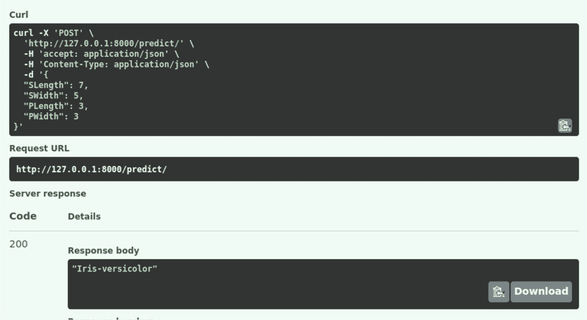

一张 Swagger UI 界面的截图，显示了 POST API 端点的详细信息。该端点用于进行预测。用户已输入一个 JSON 请求体，其中包含 SLength、SWidth、PLength 和 PWidth 的值。响应体将预测结果显示为 Iris-versicolor。

图 10-10
FastAPI 计算输入参数的预测结果并返回响应体

结论
API（应用程序编程接口）是消费数据分析和机器学习服务日益增长的方式之一。基于 API 的开发和部署本身就是一个广阔的领域；对于机器学习工程师或数据工程师来说，设置和构建一个 API 是很好的实践。在本章中，我们探讨了 API 的概念和架构。我们更详细地研究了 FastAPI 架构，并查看了各种示例。我们转向了数据库集成，构建了一个数据服务 REST API。我们还研究了如何将机器学习模型部署为 REST API。您不仅掌握了 FastAPI 的核心概念，还获得了一套弥合复杂工程与服务交付之间差距的技能。总的来说，我希望这能极大地帮助您理解如何使用 FastAPI 来设计和部署数据管道。

11. 工作流管理与编排入门

引言
组织越来越多地利用数据，创建更多的数据团队，并执行各种数据项目。除了构建和部署产品与服务外，公司还越来越多地创建更多的数据团队，并执行从数据发现到获取价值，再到确保最佳安全和隐私数据实践的各种数据项目。
数据项目可以基于 IT 产品、IT 服务、共享服务以及组织中的其他任务和活动。根据数据项目的性质和类型，数据管道可能会变得复杂和精密。有效管理这些复杂任务，确保准确编排和管理工作流以产生预期结果，这一点至关重要。
每个数据项目都需要透明度和可观测性，以了解项目做什么、如何运作、从哪些系统获取数据以及向哪些系统提供数据。每个数据作业或数据管道都足够重要，以至于在作业失败时，需要重新启动作业并对导致失败的任何系统进行故障排除。随着大数据革命，组织越来越多地寻求利用各种机器生成的数据。随着数据管道数量的增加，管理它们又增加了一层复杂性。

在本章结束时，您将学习到：

*   工作流管理的基础知识及其对工程数据管道的重要性
*   工作流编排的概念及其如何优化数据管道操作
*   cron 调度器及其在任务自动化中的作用
*   创建、监控和管理 cron 作业及 cron 日志记录
*   cron 日志记录以及调度和编排 cron 作业的实际应用

工作流编排简介

工作流
工作流编排在 IT 和数据革命之前就已经存在了很长时间。工作流本身可以意味着一组按特定顺序执行以生产产品的任务或活动。每个任务都有一组特定的输入、处理和输出。给定任务的输出作为后续任务的输入。反之，给定任务的输入包含前一个任务的输出。这样，任务必须按照特定顺序遵循一组特定的步骤。
在任何给定的数据工程或机器学习作业的上下文中，工作流基本上是一组数据管道，包含需要按特定顺序执行的任务和活动。给定管道的输入依赖于前一个管道的输出。

为了进一步说明这一点，让我们以 Acme 面包公司为例，这是一家虚构的面包制造厂。是的，这是对《乐一通》的引用。假设制作面包的基本过程包括以下需要按特定顺序执行的步骤：

1.  原料混合：将面团、酵母、水和盐按特定、测量的比例在大型搅拌机中混合在一起。
2.  发酵：将揉好的混合物分成小份，放置在室温下，使面团变得更蓬松并膨胀（变大）。
3.  烘烤：在受控的温度和压力参数下，在烤箱中烘烤面团，并将湿度控制在适当水平，以获得所需的面包稠度。
4.  质量控制：确保生产的面包均匀一致，符合质量标准。
5.  切片和包装：将制作好的面包切片，用纸袋包装，并印上烘烤时间和安全食用期限。
6.  分销：将用纸袋包装好的面包再次装入箱子，并装载到各种卡车上。然后，这些卡车将面包箱运送到包括杂货店和餐馆在内的各个目的地。

这可能看起来像这样：

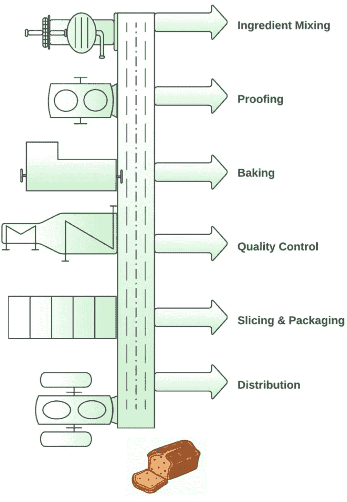

一个装配线工作流的图示，包括原料混合、发酵、烘烤、质量控制、切片和包装以及分销。

图 11-1
装配线工作流示例

这是工作流最基本的例子。
在前面列出的步骤中，不能互换给定的步骤。这些步骤必须完全按照相同的顺序执行。此外，给定步骤的输出构成下一步的输入。因此，下一步的输出成为后续步骤的输入，依此类推。

ETL 和 ELT 数据管道工作流
烘焙一条面包的过程涉及一组需要按特定顺序执行的步骤。类似地，在数据工程或机器学习项目的上下文中，存在一组需要按特定顺序执行的函数/作业/任务。编写这些数据管道的方法有很多种；其中一种最常见和众所周知的类型称为 ETL 工作流。ETL 代表提取、转换和加载。在这种类型的工作流中，数据被提取并放置在临时区域，应用必要的转换，然后将最终的工作产品传输到另一个系统，用于下游处理和使用。
一个简单的例子是工资处理数据管道。假设工资数据从像 PeopleSoft 这样的 ERP 系统中提取，其他费用数据从其他源系统中提取；然后，这些数据在临时区域中被清理、整理并整合成一个统一的数据集。下一阶段是转换阶段，在此阶段计算净工资、税金和扣除额等关键指标。然后，生成的数据集被加载到工资系统中，用于支付处理和报告。这可能看起来像这样：

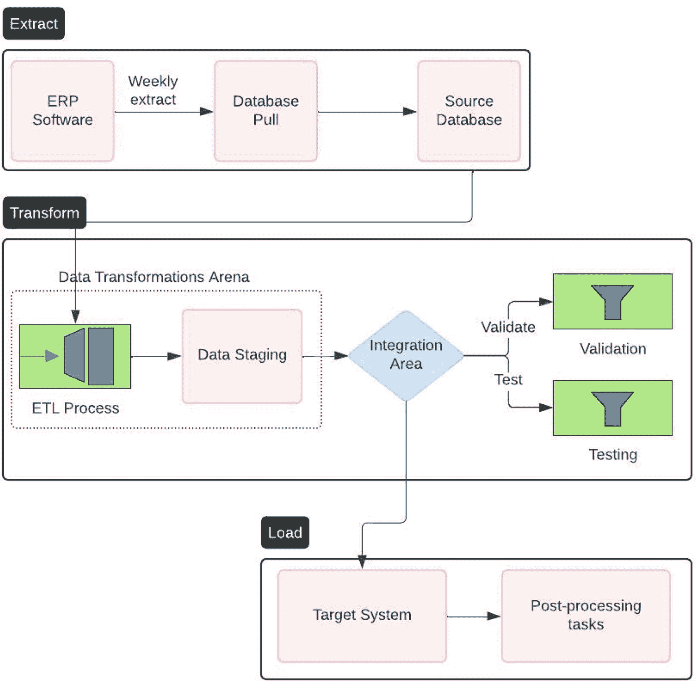

一个流程图，包括：1. 提取，包括 ERP 软件、数据库拉取和源数据库；2. 转换，包括数据转换区域、集成区域、验证和测试；3. 加载，包括目标系统和后处理任务。

图 11-2
工资处理管道的示例 ETL 架构

ETL 的一个近期变体被称为 ELT。ELT 代表提取、加载和转换。在这种情况下，来自各种来源的数据被提取并加载到目标系统中。然后，直接在数据上应用各种转换和业务规则。在 ELT 工作流中，可能有也可能没有临时层。ELT 工作流在云数据存储的情况下更为常见。当处理多样化的数据类型时，ELT 更合适。大多数云提供商提供无服务器数据湖/仓库解决方案来服务 ELT 管道，使其具有成本效益且易于维护。
让我们举一个 ELT 数据管道可能是什么样子的例子。假设关系数据库数据来自一个关于各种产品的库存系统，以及仓库日志传感器读数的 JSON 数据，以及其他一些数据。以频繁的时间间隔获取这些数据将构成提取阶段。对于加载阶段，想象我们有一个 Google BigQuery，我们将所有数据转储到其中。转换阶段是数据被清理、整理，并要么集成到统一数据集中，要么加载到维度表中以供进一步分析。
这可能看起来像这样：

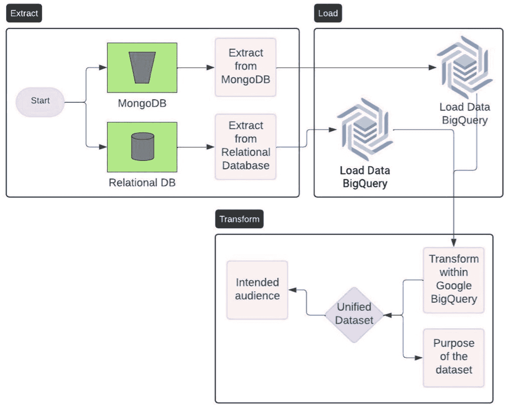

一个流程图，包括：1. 提取，包括开始、MongoDB 和关系数据库，从 Mongo 和关系数据库提取；2. 转换，包括目标受众、统一数据集、在 Google BigQuery 内转换以及数据集的目的；3. 加载，包括加载数据到 BigQuery。

图 11-3
库存数据处理管道的示例 ELT 架构

工作流配置
工作流配置是另一个需要理解的关键概念。工作流配置基本上是一组驱动工作流过程的配置参数。工作流配置对于成功交付产品或解决方案（在此例中是面包）至关重要且关键。

在这个例子中，工作流配置可能涉及以下方面：

1.  原料混合：每种原料的确切数量，并且测量使用相同的标度。
2.  发酵：发酵室的受控温度，涂抹在发酵板上的确切油量，以及一个自动计时器，一旦发酵完成的小时数达到，就会发出警报。
3.  烘烤：温度传感器的校准，需要在烤箱中停留的总时间，以及在此期间烤箱的确切温度（前 10 分钟，170°C；第二个 10 分钟，200°C；冷却 10 分钟，150°C）。
4.  质量控制：每生产 1,000 条面包，缺陷数量应减少到 3 条以下，等等。
5.  切片和包装：切片机应配置为特定尺寸，以便面包切割均匀；包装纸应清洁且无缺陷。
6.  分销：各种类型的箱子以及它们能装多少条面包；卡车内的温度；交货时间应在 x 小时内。

前面的工作流配置有助于组织简化生产流程，改进和建立均匀性和一致性，规划采购和人力需求，以及优化资源利用。这种级别的详细配置有助于理解生产优质面包所需遵循的步骤。

类似地，在数据工程或机器学习管道的情况下，也存在工作流配置参数。其中一些可能如下：

1.  如果作业被安排定期运行，那么该作业可能需要最新或新鲜的数据；因此，最近一次源系统刷新的时间和日期至关重要。
2.  组织开始采用数据治理最佳实践。其中一种实践是创建一个服务帐户或专门的用户帐户（取决于数据车间的大小、性质和复杂性）。必须配置适当的凭据才能访问正确的数据，这对于构建更好的数据产品至关重要。
3.  一个数据管道可能包含多个转换和业务规则。这些转换本质上是应用于从系统获取的数据的函数。这种转换逻辑和业务规则也是工作流配置。
4.  在尝试将最终数据产品加载到适当的系统时，可能存在强制将数据加载到模式中的约束。模式只是一个定义了所有字段及其数据类型的表结构。模式也可以是另一个工作流配置参数。

工作流编排

工作流编排指的是对整个过程的集中化管理和控制。工作流编排涉及规划、调度和控制生产过程的每个步骤及其各自的工作流配置参数，以确保所有任务都在定义的控件内并按适当顺序执行。工作流编排优化了资源利用，有助于规划原材料的采购，并在开发的每个产品中建立高质量和一致性，最终实现组织的无缝运作。在此上下文中，工作流编排将指：

1.  定义整个工作流：定义过程的每个步骤，并内置配置参数。
2.  调度：将调度已定义的工作流，其中一个过程将在装配链中的过程完成后启动。
3.  一个中央控制室，监督从原料混合到将面包包装到箱子中的整个车间，叉车操作员会将箱子放到卡车上。
4.  自动化：计算机指定并控制每个工业设备（如烤箱、发酵室等）的配置参数。
5.  错误处理和路由：如果装配链中的机器未能处理其任务，工作流编排系统将为特定设备实施重试（自动重启机器），并触发某些事件以避免瓶颈。
6.  与外部系统集成：工作流编排跟踪已发货的箱子数量、已生产的面包数量、哪个市场集群收到了多少箱子、消耗的原材料单位数量、机器开启的小时数以及其他此类数据，并将它们提供给外部系统。

工作流编排使工厂车间能够以最小化错误、高效和可预测的方式运行。

类似地，在数据管道的上下文中，一些工作流编排可以看作如下：

1.  定义整个工作流，其中数据工程管道的每个步骤都配置了适当的参数以成功执行。
2.  如果任务无法连接到源系统或目标系统，则有一种机制可以在几秒钟后自动重新执行函数，以期连接到该系统。
3.  内置或良好集成的机密管理，以便开发或生产数据管道利用适当的凭据来执行作业。
4.  自动记录作业执行的事件，这些事件以后可用于数据分析，特别是识别某些类型事件中的任何模式。
5.  集中式监控和可观测性，以便在一个界面下查看、管理、监控和控制所有数据管道。

注意

数据管道与制造车间中的任务或过程非常相似。数据管道将有一个输入（原始数据被获取的地方）、一个转换层（执行各种操作并整合业务逻辑）和一个输出（最终产品被生产出来并发送到下一个流程的地方）。数据管道之所以被称为数据管道，是因为一个过程的输入基本上是另一个过程的输出，而该给定作业的输出又成为另一个数据过程的输入。通常，数据管道本质上是瞬态的。

Cron 作业调度器简介
最早的工作流编排器之一是 Unix 操作系统中的 cron 作业调度器。Cron 代表“命令在线运行”，是一个在操作系统后台运行的守护进程。起源于 20 世纪 70 年代，cron 调度器至今仍被许多组织使用。Cron 作业调度器支持任务自动化，并调度任务在未来特定时间间隔执行。

概念
cron 调度器的核心是所谓的 cron 守护进程。该进程在系统启动时在后台运行。cron 守护进程执行在名为 crontab 的文件中提到的命令。有两个文件指定用户及其对 cron 调度器环境的访问权限。

这些文件可能位于：

```
/etc/cron.allow
/etc/cron.deny
/etc/cron.d/cron.allow
/etc/cron.d/cron.deny
```

注意

对于 Ubuntu 和 Debian 操作系统，cron.allow 和 cron.deny 文件不存在，这意味着默认情况下，Ubuntu 和 Debian 操作系统的所有用户都可以访问 cron 调度器。

cron 调度器环境的最基本单元是 cron 作业。一个 cron 作业代表一个被调度执行的任务或作业。一个 cron 作业是 crontab 中的一行，代表一个 shell 命令的一次执行。

Crontab 文件

Crontab 是 cron table 的缩写。Crontab 是一个维护用户 crontab 文件的实用程序。crontab 文件是为给定的 Linux 用户自动生成的。无论是否有任务或作业被调度运行，cron 守护进程都会运行这个 crontab 文件。crontab 文件可以被视为一个注册表，其中包含已调度作业的列表。crontab 文件属于 root 或超级用户。您可以成为超级用户来创建 crontab 文件或编辑现有的 crontab 文件。crontab 文件的默认位置是：

```
/var/spool/cron/crontabs/
```

要创建一个新的 crontab 文件，请在命令行中使用 `crontab -e`。效果如下：

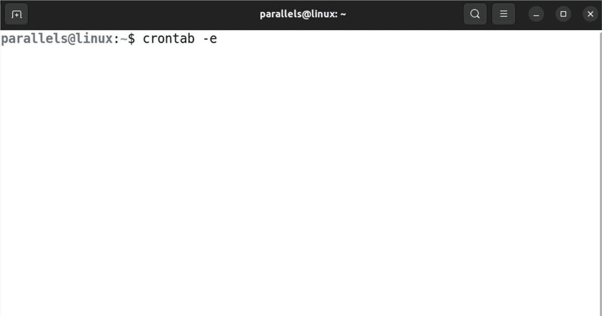

一个软件窗口，带有用于创建新 crontab 文件的命令行。

图 11-4
创建新的 crontab 文件

您将看到以下模板，用于编写您自己的 cron 作业：

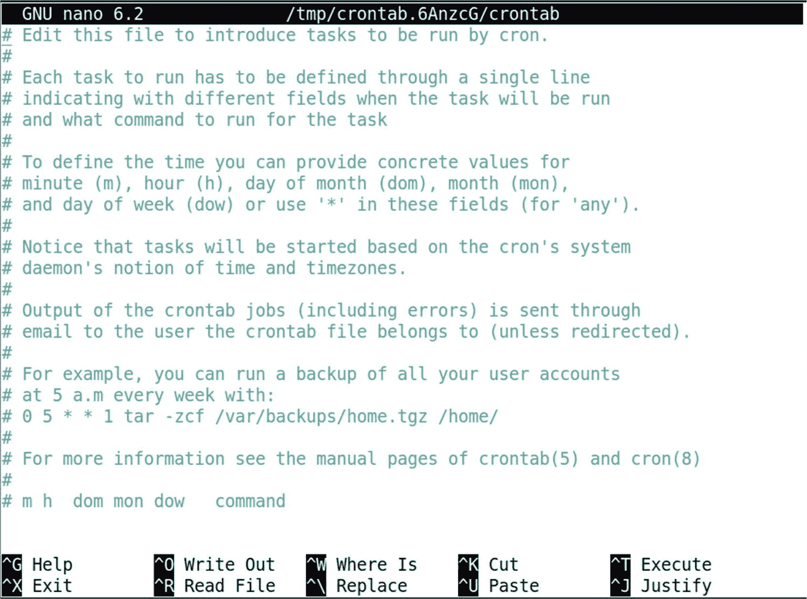

一个名为 GNU Nano 6.2 的软件窗口，带有用于向 crontab 文件写入任务的命令行。

图 11-5
向 crontab 写入任务

要列出所有当前的 crontab 文件，您可以尝试以下命令：

```
ls -l /var/spool/cron/crontabs/
```

让我们看一下 crontab 文件的语法。
crontab 文件中的每一行代表一个给定 cron 作业的条目。
一个 crontab 文件条目包含六个字段，由空格分隔。

格式如下：

```
minute hour day-of-month month weekday command
```

*   `minute` 列表示作业应该运行的具体分钟。它只能包含数值。值可以是 0 到 59 之间的任何数字。
*   `hour` 列表示作业应该运行的小时，只接受数值。值可以是 0 到 23 之间的任何数字。
*   `day-of-month` 列表示给定日历月中的某一天。如您所知，月份包含 28、29、30 或 31 天，具体取决于月份以及是否是闰年。您可以指定 1 到 31 之间的数值。
*   `month` 列表示一个日历月，可以取 1 到 12 之间的数值。这些数值分别代表从一月到十二月的日历月。
*   `weekday` 列表示一周中的某一天，从星期日到星期六。它可以取 0 到 6 之间的任何值，其中 0 代表星期日，6 代表星期六。
*   `shell command` 是发出需要运行的命令的地方。

注意

在 crontab 文件中，我们有一个星号操作符。`*` 操作符可以应用于 crontab 条目的前五列。当在相应的列中提及 `*` 时，意味着它可以在给定允许范围内的所有间隔上运行。以下是一个示例：
`15 6 * * * /user/parallels/bin/helloworld`
上述 crontab 条目将每天早上 6:15 运行 hello world 脚本。具体来说，该脚本将在每个月的每一天、每个月以及每个工作日运行。

Cron 日志记录

cron 守护进程在每次系统启动、执行新作业、解释命令时遇到问题或在作业执行期间遇到错误时，都会写入一条日志条目。不幸的是，日志条目不包含错误的来源。如果您使用的是基于 Debian 的操作系统（Ubuntu 等），那么您可以在此处找到日志：

```
/var/log/syslog
```

对于基于 Fedora 的发行版，日志位于：

```
/var/log/cron
```

您可以通过以下命令获取最近的 cron 日志条目：

```
grep CRON /var/log/syslog | tail -100
```

Cron 中的日志记录存储了许多关键信息。日志条目以作业启动时的日期时间戳开头，然后是工作站的主机名、该工作站的用户帐户以及执行的命令。以下是一个日志条目的示例：

```
Jan 29 15:55:07 linux CRON[1257]: (parallels) CMD (/home/parallels/helloworld.py)
```

在前面的示例中，日志条目以日期时间戳开头，然后是主机名（本例中为 linux），接着是主机上的用户（本例中为 parallels），最后是执行的命令（本例中为执行名为 helloworld.py 的 Python 脚本）。

Cron 作业用法
在本节中，我们将看一些编写 cron 作业的简单示例。让我们从编写一个简单的 shell 脚本开始，并使用简单的 cron 作业脚本对其进行调度。

我们将创建一个名为 `cronexample.sh` 的 shell 脚本。在终端中输入以下内容：

```
nano cronexample.sh
```

并在 nano 编辑器中输入以下代码：

```
#!/bin/bash
echo "Hello from the world of Cron scheduling"
echo "Execution at: $(date)"
```

它应该看起来像这样：

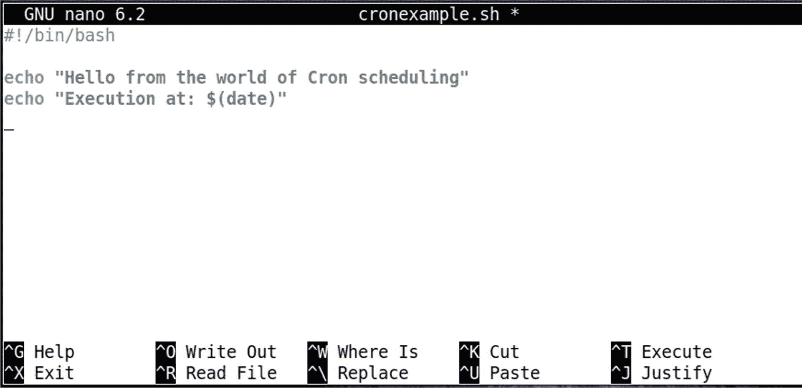

一个名为 GNU Nano 6.2 的软件窗口，带有用于编写简单 shell 脚本的命令行。

图 11-6
编写一个简单的 shell 脚本

保存文件并退出编辑器。让我们为此文件提供执行权限：

```
chmod +x cronexample.sh
```

现在进入 crontab 以调度此 shell 脚本的执行：

```
crontab -u parallels -e
```

所有这些看起来像这样：

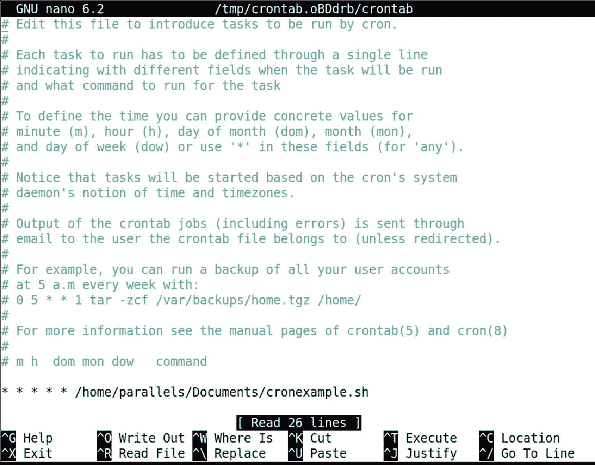

一个名为 GNU Nano 6.2 的软件窗口，带有用于调度先前编写的 shell 脚本执行的命令行。

图 11-7
调度先前编写的 shell 脚本的执行

我们得到的是：

```
* * * * * /home/parallels/Documents/cronexample.sh
```

这一行脚本将每分钟、每天、每周、每月执行该命令。

现在让我们通过另一个示例引入另一个操作符：

```
*/6 * * * * /home/parallels/Documents/cronexample.sh
```

我们有一个 `/` 操作符，称为步长值。在这种情况下，我们为分钟字段合并了步长值。这个示例意味着无论小时、天、月、日期等如何，每六分钟运行一次以下脚本。
`/` 步长操作符也可以扩展到其他字段，从而实现更复杂的应用。

以下是一个示例：

```
*/24 */4 * * * /home/parallels/Documents/cronexample.sh
```

这将使 cron 调度器在每个第 4 小时的第 24 分钟运行此脚本。以下是一个示例调度：

```
first execution at 2024-02-09 12:00:00
followed by execution at 2024-02-09 12:24:00
followed by execution at 2024-02-09 12:48:00
followed by execution at 2024-02-09 16:00:00
followed by execution at 2024-02-09 16:24:00
```

让我们看看为给定字段提供一个列表。以下是一个示例：

```
*/30 */18 * * */1,4,7 /home/parallels/Documents/cronexample.sh
```

在前面的示例中，我们在每个第 18 小时的每半小时，在星期一、星期四和星期日运行 `cronexample.sh`。以下是调度可能的样子：

```
first execution at 2024-02-09 18:00:00
followed by execution at 2024-02-09 18:30:00
followed by execution at 2024-02-10 00:00:00
followed by execution at 2024-02-10 00:30:00
followed by execution at 2024-02-10 18:00:00
```

第一次执行在 18:00 开始，随后在同一小时内间隔 30 分钟。后续执行在第二天中午进行，提供了 18 小时的时间窗口。

注意

对于任何给定的调度，时钟从 12:00:00 开始。

我们也可以在 crontab 中创建一个范围。

以下是一个示例：

```
0 22 * */6 1-5 /home/parallels/Documents/cronexample.sh
```

在此示例中，我们已将此脚本调度为在晚上 10 点运行，每周一至周五，每六个月运行一次。

以下是调度可能的样子：

```
first execution at 2024-07-01 22:00:00
followed by execution at 2024-07-02 22:00:00
followed by execution at 2024-07-03 22:00:00
followed by execution at 2024-07-04 22:00:00
followed by execution at 2024-07-05 22:00:00
```

现在，让我们尝试组合范围操作符和步长值操作符：

```
36 9-17/2 * * * /home/parallels/Documents/cronexample.sh
```

在此示例中，我们已将脚本调度为在给定小时的第 36 分钟运行，在上午 9 点到下午 5 点之间每 2 小时运行一次：

效果如下：

```
first execution at 2024-02-09 13:36:00
followed by execution at 2024-02-09 15:36:00
followed by execution at 2024-02-09 17:36:00
followed by execution at 2024-02-10 09:36:00
followed by execution at 2024-02-10 11:36:00
```

让我们看一个使用单词字符串而不是数字的示例。以下是一个示例：

```
0 9-17/3 */12 JAN,MAR,MAY,JUL,OCT,NOV,DEC MON /home/parallels/Documents/cronexample.sh
```

这个 crontab 脚本将在每个月的第 12 天执行 shell 脚本，如果该天恰好是一月、三月、五月、七月、十月、十一月和十二月的星期一，并且在执行脚本的那天，它将在上午 9 点到下午 5 点之间每三个小时执行一次。

以下是一个示例调度：

```
first execution at 2024-03-25 09:00:00
followed by execution at 2024-03-25 12:00:00
followed by execution at 2024-03-25 15:00:00
followed by execution at 2024-05-13 09:00:00
followed by execution at 2024-05-13 12:00:00
```

让我们再看几个操作符：

```
*/15 3 L 6-9 FRI#4 /home/parallels/Documents/cronexample.sh
```

注意使用了字符 `L` 和井号 `#`。`L` 字符表示给定字段的最后一个值。`#` 哈希操作符表示该月的第 n 天。在这种情况下，脚本被调度为每 15 分钟执行一次，在凌晨 3 点到 3:59 之间，在该月的最后一天执行，如果该最后一天恰好是该月的第四个星期五，并且在六月、八月和九月这些月份中。

Cron 调度器应用
在建立基础设施和工程数据系统的世界中，有许多应用涉及使用 cron 调度器。让我们详细看看其中一些应用。

数据库备份
数据库备份是创建组织主文件和事务表副本的过程。这是一项关键操作，因为数据是最有价值的资产，并且日常业务和运营都需要数据。根据备份的类型和频率，存在各种类型的数据库备份方法。有差异备份、增量备份和完整备份。

让我们看一个简单的示例，其中调度了一个执行数据库备份操作的 shell 脚本：

```
0 2 * * * /home/parallels/mysql_backup.sh
```

此脚本将每天凌晨 2 点运行，执行 shell 脚本文件中提到的指令。

数据处理
许多组织都在使用各种生成数据的系统。组织内的数据团队通常会每天生成报告或执行某些数据的文件传输。这些在特定源系统中出现的数据处理任务可以使用 cron 调度器实用程序自动化。

让我们看看调度一个执行数据处理或每天生成报告的批处理作业：

```
45 3 * * * /home/parallels/Documents/data_processing.sh
```

上述 cron 调度器将每天凌晨 3:45 处理批处理操作，从而准备报告或执行文件传输到另一个位置。

电子邮件通知
电子邮件通知是向一个或多个人发送特定消息的过程。在数据系统和工程领域，可以设置接收关于已处理任务状态（备份数据库、准备数据集、数据挖掘等）的电子邮件通知。存在多个库用于设置电子邮件服务器配置并将输出消息发送到适当的电子邮件。

让我们看一个简单的示例：

```
45 7 * * MON-FRI /home/parallels/email_notification.sh
```

上述命令将在周一至周五每天早上 7:45 发送关于各种任务的电子邮件通知。

Cron 替代方案
cron 作业调度器有几个替代方案；其中一些替代方案仍然基于早期版本的 cron 调度器实用程序。但有一个在管理员社区中被广泛使用和尊重的替代方案，称为 `systemd timer`。Systemd 是一个软件套件，提供各种组件来管理 Linux 操作系统中的系统进程。Systemd timer 是 systemd 的组件之一，提供作业调度机制。作业可以被调度在特定的时间间隔运行，或者基于某个事件运行。

结论
工作流管理和编排是数据工程中的基本组成部分。在本章中，我们研究了 crontab 和 cron 调度，以及如何使用它们来编排复杂的作业和自动化日常任务。看似简单的概念，却是自动化重复性任务的强大调度工具。您在本章中学到的基础知识和关键概念，在您研究现代数据编排平台（我们将在接下来的几章中看到）时可能会对您有所帮助。高效的工作流管理、调度和编排是释放数据基础设施全部潜力的关键。

12. 使用 Apache Airflow 编排数据工程管道

简介
Apache Airflow 是一个开源的工作流编排平台。它使工程师能够将有向无环图（DAG）形式的工作流进行定义、调度和编排。Airflow 支持与流行的数据存储和处理系统进行广泛集成，适用于从 ETL（提取、转换、加载）流程到复杂的机器学习管道的各种用例。凭借其可扩展和可扩展的架构、出色的图形用户界面以及丰富的插件和扩展集合，Airflow 被广泛用于提高生产力并确保数据的可靠性和质量。我们将深入探讨 Apache Airflow 的架构、各种组件以及使其成为强大工作流编排器的关键概念。

在本章结束时，您将学习到：

*   Apache Airflow 的基础知识及其架构
*   在开发环境中设置、安装和配置 Airflow
*   关键概念，如 DAG、操作符和宏
*   使用 Xcom 进行任务间通信，以及使用参数和变量进行灵活的工作流配置
*   使用触发器和任务流控制复杂工作流

Apache Airflow 简介
Apache Airflow 是一个开源的工作流管理和编排平台。Airflow 起源于大约十年前（2014 年）的 Airbnb。创建 Airflow 是为了以编程方式调度和编排工作流。

设置与安装

以下是我们如何开始使用 Apache Airflow。我正在使用的版本是 Apache Airflow 2.8.1。让我们从创建一个新的虚拟环境开始：

```
python -m venv airflow-dev
```

以下是在 Linux 中激活虚拟环境的方法：

```
source airflow-dev/bin/activate
```

如果您使用的是 MS Windows，请使用：

```
airflow-dev/Scripts/activate
```

在您的开发工作区中的某个位置创建一个新文件夹：

```
mkdir airflow_sandbox
```

现在，复制文件夹路径并设置 AIRFLOW_HOME 环境变量。确保在系统中安装 Apache Airflow 之前执行此操作：

```
export AIRFLOW_HOME=/home/parallels/development/airflow_sandbox
```

以下说明摘自 Apache Airflow 网站。我们将使用以下命令获取 Python 版本：

```
PYTHON_VERSION="$(python --version | cut -d " " -f 2 | cut -d "." -f 1-2)"
```

如前所述，我们希望安装 Apache Airflow 版本 2.8.1。以下是执行此步骤的命令：

```
pip install "apache-airflow==2.8.1" \
—-constraint "https://raw.githubusercontent.com/apache/airflow/constraints-2.8.1/constraints-${PYTHON_VERSION}.txt"
```

此命令将开始安装 Apache Airflow 及其依赖项。效果如下：

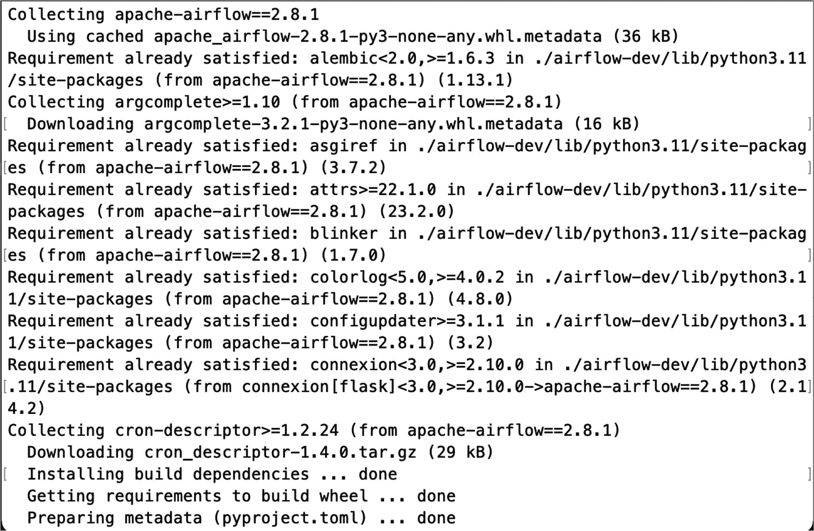

带有安装 Apache Airflow 及其依赖项的命令行的文本图形。

图 12-1
Pip 安装 Apache Airflow

现在，让我们初始化后端数据库，创建一个管理员用户，并通过输入以下内容启动所有组件：

```
airflow standalone
```

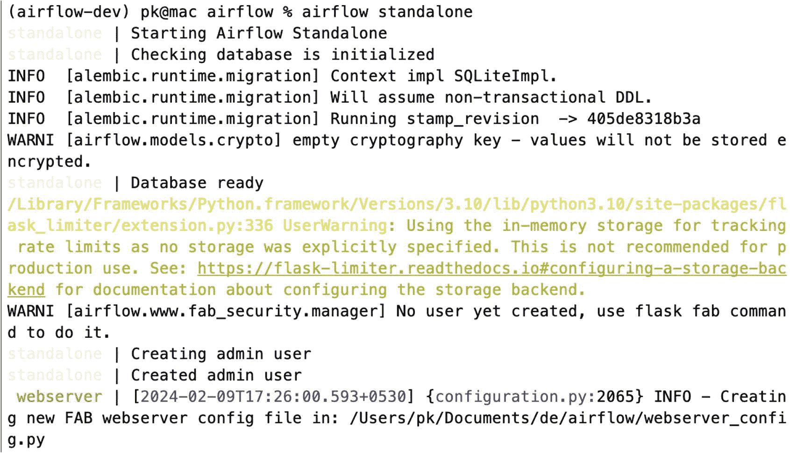

带有初始化后端数据库、创建管理员用户和启动所有组件的命令行的文本图形。

图 12-2
初始化 Apache Airflow 的后端配置

完成此步骤后，让我们通过以下命令初始化 Apache Airflow Web 服务器：

```
airflow webserver —D
```

此命令将启动 Airflow Web 服务器作为后台进程。效果如下：

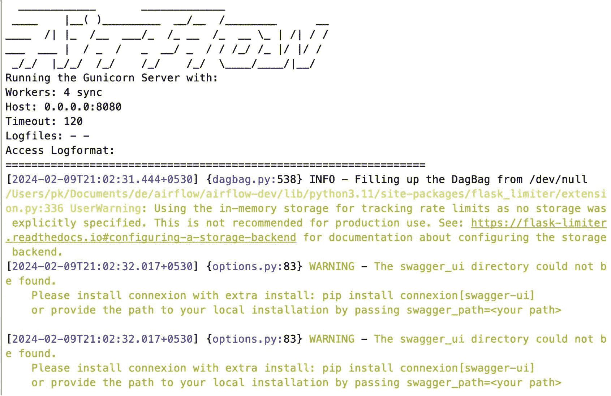

带有启动 Airflow Web 服务器作为后台进程的命令行的文本图形。

图 12-3
Apache Airflow 初始化

一旦 Web 服务器运行起来，让我们尝试运行调度器。以下命令将启动 Airflow 调度器：

```
airflow scheduler -D
```

您可以打开浏览器并输入以下 URL 来访问 Apache Airflow 图形用户界面。
URL 是：
`http://localhost:8080`
对您来说可能如下所示：

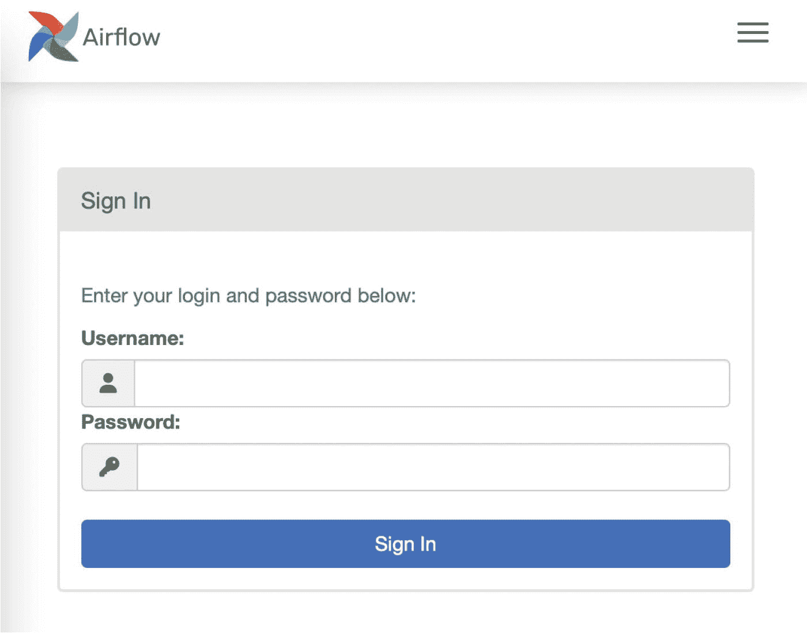

一个 Airflow 窗口的截图，收集用户名和密码等登录信息。下方有一个名为“登录”的按钮。

图 12-4
Apache Airflow GUI

当您运行 `airflow standalone` 命令时，它应该已经创建了一个管理员帐户，密码存储在 AIRFLOW_HOME 位置内的一个文本文件中。从文本文件 `standalone_admin_password.txt` 中获取密码。效果如下：

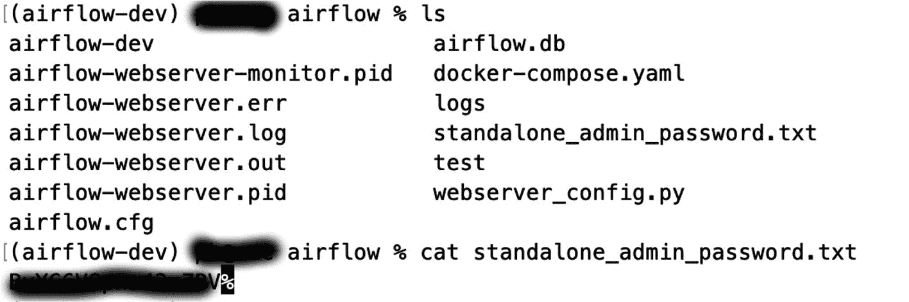

带有从文本文件获取密码的命令行的文本图形。

图 12-5
从文本文件获取用户凭据

登录成功后，您可能会看到以下包含预构建作业的屏幕：

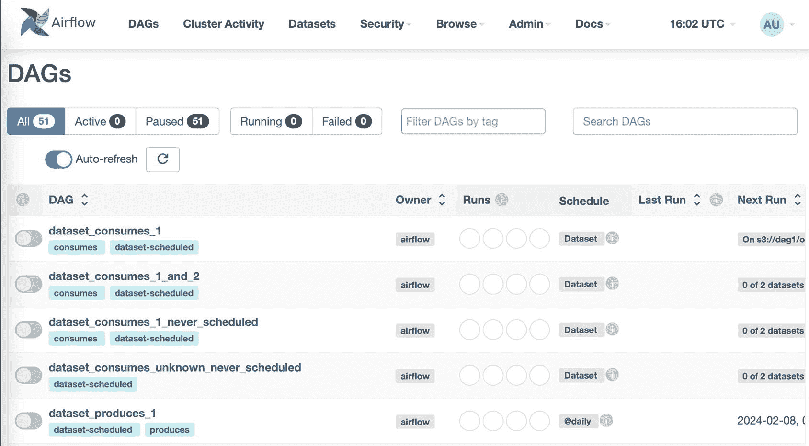

一个 Airflow 窗口的截图，菜单项 DAG 已打开。下方有五个条目，包含所有者、运行次数、调度、上次运行和下次运行的详细信息。

图 12-6
Apache Airflow 主屏幕

Airflow 架构
Airflow 为您提供了一个定义、调度和编排作业及工作流的平台。如前所述，工作流可以是一系列任务，其中给定任务的输出作为后续任务的输入。在 Apache Airflow 中，工作流由有向无环图表示。有向无环图是一个数学术语，表示由边连接的一系列节点，在其结构中任何地方都不形成闭环。在 Apache Airflow 的上下文中，有向无环图表示一系列相互连接和依赖但绝不会形成循环的任务。它们简称为 DAG。
一个 DAG 工作流将任务表示为节点；数据源和依赖关系表示为边。DAG 表示任务应执行的顺序。任务本身包含描述要做什么的程序化指令。DAG 的概念是 Apache Airflow 功能的核心。除此之外，还有一些核心组件对于 Apache Airflow 的功能至关重要。让我们详细看看这些核心特性，从我们已经熟悉的组件开始。

Web 服务器
Web 服务器组件提供 Apache Airflow 软件的用户界面功能。正如我们在上一节中看到的，Web 服务器作为守护进程运行。安装显示为本地机器/单机独立进程。您可以以分布式进程部署 Apache Airflow，其中 Web 服务器可以拥有自己的实例并具有更高的安全参数。Web 服务器为开发人员提供了一个用户界面，用于查看当前已调度的各种作业、它们被配置运行的调度、上次运行的时间以及给定作业工作流中包含的各种任务。

数据库
Apache Airflow 的数据库组件包含各种作业的元数据。其中一些元数据信息包括任务或工作流的上次运行、先前运行的状态等。具有现代用户界面的 Web 服务器从此数据库中检索信息。Apache Airflow 使用 SQLAlchemy 作为其默认数据存储。对于生产实例，建议设置不同的数据库后端，如 Postgres 或 MySQL。后端数据库设置涉及为 Airflow 实例创建一个单独的数据库、一个单独的数据库用户、向 Airflow 用户授予 Airflow 数据库的所有权限，并将新创建的 Airflow 用户添加到数据库的访问控制列表中。最后，初始化新的后端数据库，并在 Airflow 配置文件中的连接字符串中使用适当的数据库驱动程序（稍后我们将对此进行更多介绍）。

执行器
执行器是运行给定工作流中任务的方式。执行器实际上是调度器组件的一部分。它带有几个可插拔的执行器。这些执行器提供了运行工作流的不同机制。有两种主要类型的可插拔执行器，即本地执行器和远程执行器。顾名思义，本地执行器在您的工作站（本地）上运行任务，而远程执行器则在多个工作节点环境（分布式环境）中运行这些任务。例如，LocalExecutor 在您的本地工作站上运行，并支持并行性和超线程。另一个值得一提的 KubernetesExecutor，它在 Kubernetes 集群中的单独 Pod 中运行每个任务。Pod 类似于容器，而 Kubernetes 是一个容器编排平台。您必须设置一个 Kubernetes 集群才能使用 KubernetesExecutor。

调度器
这是 Apache Airflow 架构中最重要的组件。调度器组件监控所有工作流以及每个工作流中的所有任务。一旦任务的所有底层依赖项完成，调度器就会触发任务的执行。调度器是一个需要手动启动的独立服务，正如我们在“设置与安装”部分中看到的。Apache Airflow 支持同时运行多个调度器组件以提高性能。调度器组件利用执行器来执行准备就绪的任务。

配置文件

Airflow 配置文件不是 Apache Airflow 架构的一部分；但是，它控制着工作方式和功能。Apache Airflow 带有一个选项，可以通过 `airflow.cfg` 文件微调各种选项。当您在您的工作站上安装 Apache Airflow 时，会创建此文件。每个可配置的属性都提供了描述和默认配置选项。您可以使用记事本或文本编辑器简单地打开 Airflow 配置文件。您也可以通过输入以下命令从命令行获取选项列表：

```
airflow config list
```

配置在命令行上的显示方式如下：

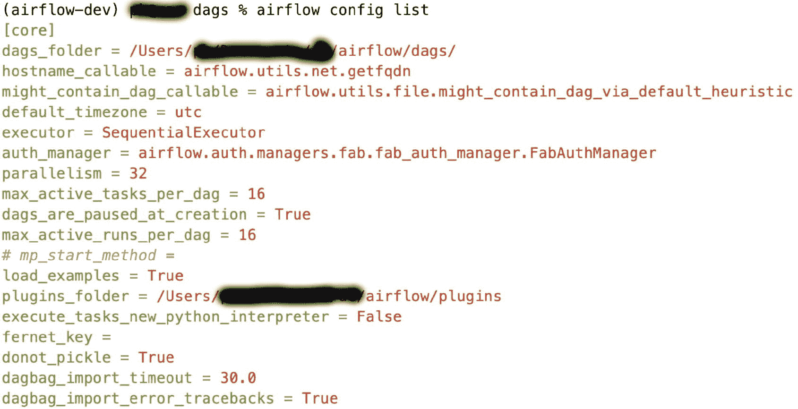

带有显示配置的命令行的文本图形。

图 12-7
Apache Airflow 配置

如果您想更改存放 DAG 的位置，那么您可以在此处指定文件夹的位置：

```
[core]
dags_folder = /user/parallels//
```

如果您想指定或更改 Airflow 打算使用的执行器，那么您可以在此处进行：

```
[core]
executor = LocalExecutor
```

如果您希望将默认的 sqlite 后端更改为 MySQL 或 Postgres 数据库实例，那么您可以将数据库字符串从 sqlite 驱动程序和凭据更改为 mysqldriver 或 psycopg2 驱动程序以及相应的凭据。您可以在此处替换数据库字符串：

```
[database]
sql_alchemy_conn = sqlite:////
```

如果您希望获得对 Apache Airflow 开发或沙箱实例的可见性，并启用查看配置的能力，则将以下参数设置为 True：

```
[webserver]
expose_config=False
```

一旦您进行了必要的更改，重新启动 Airflow 服务器至关重要。一个良好的生产实践是在 systemd 服务中创建一个服务，以便启动、停止和重新启动 Airflow 服务器。您可以在 Apache Airflow 的 GitHub 存储库中找到 systemd 服务配置文件。但是，对于开发实例，更容易的方法是识别进程 ID（也称为 PID），尝试终止该进程，然后使用以下命令启动 Apache Airflow 服务器：

```
airflow webserver -p 8080 -D
```

注意

`-p` 指的是指定端口，而 `-D` 是将服务器作为守护进程（通常称为后台进程）运行。

此外，您可以使用终端中的以下命令获取环境中加载的所有当前 DAG 的列表：

```
airflow dags list
```

一个简单的示例

让我们看一个 Apache Airflow 的简单示例，并在以下部分中检查各种组件。以下是一个简单的入门示例：

```
from datetime import datetime
from airflow import DAG
from airflow.operators.python import PythonOperator
def say_hello():
print("Hello, World!")
def print_time():
now = datetime.today()
print(now)
return now
first_airflow_dag = DAG(
'hello_world',
description='A simple DAG that prints Hello, World!',
schedule=None,
)
hello_task = PythonOperator(
task_id='say_hello_task',
python_callable=say_hello,
dag=first_airflow_dag,
)
display_time = PythonOperator(
task_id='print_time',
python_callable=print_time,
dag=first_airflow_dag
)
hello_task >> display_time
```

我们首先导入所需的类和方法。此代码中有两个函数：第一个函数将打印一个字符串，另一个函数将显示当前日期和时间。然后，我们定义 DAG，在其中指定各种详细信息，如名称、描述和调度。这些 DAG 也可以接受更复杂的配置。然后，我们为每个函数定义任务，并将它们与我们的 DAG 关联起来。最后，我们定义要执行的任务的顺序。虽然这不会在命令行中打印任何内容，但这有助于理解使用 Apache Airflow 进行工作流定义的各种部分。要让 DAG 显示在您的用户界面上，请确保将 Python 脚本放在适当的文件夹中。

注意

您必须将 Python 脚本放在 `airflow.cfg` 配置文件中引用的文件夹中，才能查看和监控您的 DAG。确保您的 `dags_folder` 属性指向包含您需要运行的脚本的适当文件夹。此外，找到名为 `expose_config` 的配置参数，并将该参数设置为 `True`。这将暴露 Web 服务器中的所有配置参数。在开发或沙箱实例中，这些可能有助于故障排除。

Airflow DAG
有向无环图，或简称为 DAG，是工作流管理和编排系统（在本例中是 Apache Airflow）的核心。一个典型的 DAG 将包含通过各种数据库连接和依赖关系相互连接的各种任务，这样图中任何地方都不会形成循环。
以下是一个 DAG 的简单示例：
连接到数据库 ➤ 提取表 ➤ 执行转换 ➤ 加载数据集 ➤ 关闭数据库 ➤ 电子邮件通知

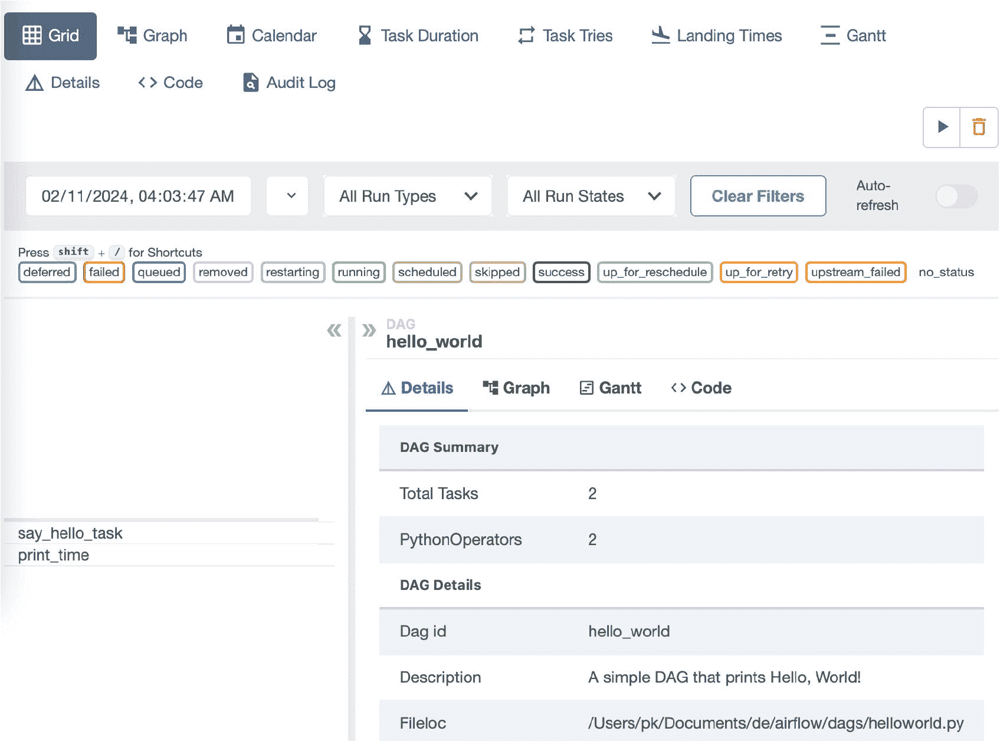

一个 Airflow 窗口的截图，菜单项 Grid 被选中。一个名为 hello world 的 DAG 已打开，显示其详细信息、图形、甘特图和代码。

图 12-8
在 Apache Airflow GUI 中查看 DAG

这些 DAG 将定义和控制这些任务如何执行；但是，它们没有关于这些任务实际做什么的信息。在某种程度上，这些 DAG 是任务无关的。

在数据管道中声明 DAG 有三种方法。最基本和熟悉的方法是使用构造函数并将 DAG 传递给您计划使用的操作符。效果如下：

```
my_test_airflow_dag = DAG(
dag_id = 'hello_world',
description='A simple DAG that prints Hello, World!',
start_date=datetime.datetime(2024,2,5)
schedule="@weekly",
)
EmptyOperator(task_id="my_task", dag="my_test_airflow_dag")
```

您也可以使用 Python 上下文管理器声明 DAG，并在上下文中添加操作符：

```
with my_test_airflow_dag(
dag_id = 'hello_world',
description='A simple DAG that prints Hello, World!',
start_date=datetime.datetime(2024,2,5)
schedule="@weekly",
):
PythonOperator(task_id="hello_world_task")
```

最后，您可以定义一个函数，在该函数中指定所有操作符；然后您可以使用装饰器将该函数转换为 DAG 生成器。效果如下：

```
@dag(
dag_id = 'hello_world',
description='A simple DAG that prints Hello, World!',
start_date=datetime.datetime(2024,2,5)
schedule="@weekly",
)
def some_random_function():
EmptyOperator(task_id="hello_world_task")
PythonOperator(task_id="print_current_date")
some_random_function()
```

每当您运行一个 DAG 时，Apache Airflow 将创建一个新的 DAG 实例并运行该实例。这些被称为 DAG 运行。类似地，在运行时也会创建 DAG 内定义的任务的新实例。这些被称为任务实例。

任务

DAG 需要任务来运行。任务是任何给定 DAG 的核心。它们可以被视为工作单元。在运行期间，您将创建一个新的任务实例，即任务实例。这些任务实例有开始日期、结束日期和状态。任务具有状态，代表生命周期的阶段。以下是一个示例生命周期：

```
None ➤ Scheduled ➤ Queued ➤ Running ➤ Success
```

有三种类型的任务，即操作符、传感器和任务流。如前一节所述，任务使用关系相互连接。在此上下文中，任务之间的依赖关系表示为关系。以下是如何在 Apache Airflow 中表示关系的示例。假设我们有三个任务，即提取、转换和加载。提取任务的输出作为转换任务的输入，转换任务的输出作为加载任务的输入。以下是这些任务在关系中的表示方式：

```
extract_data >> transform_data >> load_data
Task1 >> Task2 >> Task3
```

操作符
Apache Airflow 中的操作符代表执行特定任务的模板。Apache Airflow 拥有大量已经开发好的操作符列表。一些操作符适用于特定的云环境、数据库等。让我们看一个利用 bash 操作符下载平面文件并将其保存在特定目录中的简单示例。

以下是相同的代码：

```
from airflow.decorator import dag
from airflow.operators.bash import BashOperator
from datetime import datetime
@dag(
dag_id="extract_task",
schedule=None,
start_date=datetime(2024,2,2)
)
def extract_task():
BashOperator(
task_id="data_extract",
bash_command="wget -c https://www.dol.gov/sites/dolgov/files/ETA/naws/pdfs/NAWS_F2Y197.csv -O /Users//airflow/wash-electric-vehicles.csv",
)
extract_task()
```

每次您使用 Apache Airflow 调度和编排数据管道时，都必须重新初始化数据库。您可以使用以下命令执行此操作：

```
airflow db init
```

此命令将从文件夹中获取 DAG，您可以在用户界面中看到列出的 DAG。效果如下：

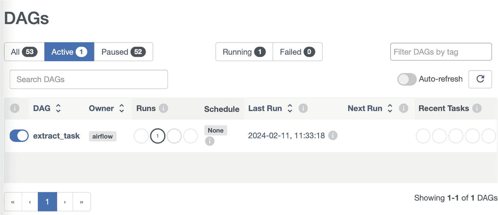

一个 Airflow 窗口的截图，菜单项 DAGs 已打开。有一个名为 Extract task 的条目，包含所有者、运行次数、调度、上次运行、下次运行和最近任务的详细信息。

图 12-9
Apache Airflow 中活动的 DAG 列表

传感器

传感器也是一种操作符，但它执行一个非常独特的功能。传感器可用于创建一个事件，等待某事发生。一旦事件发生，它将触发下游作业。如果事件没有发生，它将持续等待。传感器通常用于等待文件到达文件系统、监控外部 API 和数据库，或者只是等待不同任务的完成。以下是一些常用的传感器及其在数据管道工作流中的使用方式：

*   ExternalTaskSensor：`ExternalTaskSensor` 等待不同 DAG 中的外部任务完成。
*   SQLSensor：`SQLSensor` 执行 SQL 查询，并等待直到查询返回结果。
*   FileSensor：`FileSensor` 等待文件或文档出现在给定的文件夹或文件位置。
*   TimeSensor：等待某个时间点。

让我们看一个传感器的简单示例。我们有一个文件传感器，它会持续等待，直到文件在指定时间内到达文件夹/文件系统。每当文件到达相应的文件夹位置时，DAG 将运行下游任务，该任务会回显文件已到达。在此上下文中，假设文件将由另一个进程放置在相应的文件夹中：

```
from datetime import datetime
from airflow.decorators import dag
from airflow.sensors.filesystem import FileSensor
from airflow.operators.bash import BashOperator
@dag(
dag_id = "file_sensor_example",
start_date=datetime(2024,2,3)
)
def wait_for_file():
FileSensor(
task_id="wait_for_file",
filepath="/Users//airflow/testfile.txt",
mode="poke",
timeout=300,
poke_interval=25,
)
@dag(
dag_id = "file_sensor_example",
start_date=datetime(2024,2,3)
)
def file_notification():
BashOperator(
task_id="file_notification_task",
bash_command='echo "file is available here"'
)
wait_for_file >> file_notification
```

任务流

正如您在之前的章节中所看到的，在开发数据管道时，您必须开始规划任务和 DAG。如果您有主要用纯 Python 代码编写而不使用 Airflow 操作符的数据管道，那么任务流装饰器将有助于创建 DAG，而无需编写额外的操作符代码：

```
from airflow.decorators import dag, task
@dag(schedule="@daily", start_date=(2024,2,2))
def taskflow_example():
@task(task_id="extract", retries=5)
def extract():
"""
Extract data from the data source.
If there is a connection issue, attempt to
establish the connection again
"""
return dataset
@task(task_id="transform")
def transform(dataset):
"""
Perform the necessary transformation for
the extracted dataset
"""
return processed_dataset
@task(task_id="loaddata", retries=5)
def load(processed_dataset):
"""
Obtain the dataset and transport it to file system.
Retry the task if there is an issue with connection.
"""
pass
extract_data = extract()
transform_data = transform(dataset)
load_data = load(processed_dataset)
taskflow()
```

在此示例中，我们有三个函数，每个函数执行一个单独的活动。我们有一个任务装饰器，它会使这些函数成为一个任务，而父函数已用 DAG 装饰。

Xcom
默认情况下，任务会孤立地执行或运行它们被提供的指令，并且不与其他任务或进程通信。Xcom 是 Apache Airflow 独有的概念，支持任务之间的交叉通信。使用 Xcom，您可以从一个任务实例获取信息或值，并在另一个任务实例中使用它。虽然也可以通过将值导出到文件或数据库，然后读取文件或数据库来获取值，从而以编程方式实现这一点，但 Xcom 功能是原生的，并且可以被认为是更安全的。

从开发的角度来看，交叉通信可以通过两个步骤实现。首先，您为任务创建一个 Xcom，然后从您创建它的地方拉取值。就创建 Xcom 而言，您可以简单地返回一个函数的值，或者您可以使用 Xcom push 方法。效果如下：

```
@task
def some_function(value):
result = some_other_function(*args)
value.xcom_push(key="Result_Func1", value=result)
```

Xcom pull 方法将尝试使用 task_id 和键来获取值。以下是一个示例：

```
def another_function(value):
value_from_some_function = value.xcom_pull(key="Result_Func1", task_id="some_function")
pass
```

钩子
Apache Airflow 通过钩子的概念，让您可以轻松地连接到外部数据平台和系统。Airflow 中的钩子让您可以连接到外部系统，而无需编写代码手动连接到这些系统。钩子还内嵌了可选的“重试”逻辑。Airflow 提供了许多内置钩子，并且还有一个开发者社区正在为各种应用程序开发自定义钩子。让我们看一个简单的说明。

让我们看看以下连接到数据库的代码：

```
import psycopg2
def querydb():
conn_params = {
"host": localhost,
"database": testDB1,
"port": 5432,
"user": "username",
"password": "password"
}
try:
conn = psycopg2.connect(**conn_params)
cur = conn.cursor()
sql = "select * from table1"
cur.execute(sql)
rows = cur.fetchall()
for row in rows:
print(row)
except:
print("error connecting to database")
```

现在让我们使用 Airflow 钩子连接到同一个数据库。代码可能如下所示：

```
from airflow.hooks.postgres_hook import PostgresHook
def querydb():
dbhook = PostgresHook(postgres_conn_id='Postgres_TestDB1')
sql = "select * from table1"
rows = dbhook.get_records(sql)
for row in rows:
print(row)
```

注意在连接和检索行时使用了 Postgres 数据库钩子；此处不需要指定数据库连接参数。

注意

在 Airflow 中使用钩子之前，您必须先在 Airflow 中单独设置外部数据系统的凭据。
您可以访问 Airflow UI ➤ Admin ➤ Connections ➤ New Connection。
一旦您配置了外部数据系统，您就可以获得一个连接 ID，可以在钩子中使用它。

变量
Apache Airflow 变量是可以在 Airflow DAG 中定义和使用的键值对。这些变量的作用域是全局的，可以从任何任务中访问。DAG 中的任务可以查询这些变量。您也可以在模板中使用这些变量。以下是如何在 Apache Airflow 中设置变量。一个很好的应用是存储一些在项目期间保持静态的数据库或访问凭据。当使用 Airflow 变量存储 API 密钥、密码和其他敏感信息时，Airflow 会自动屏蔽这些变量。此外，Airflow 还会加密这些变量。因此，建议使用变量来存储敏感信息，而不是其他可能缺乏屏蔽和加密功能的选项。

您可以通过管道、命令行界面甚至用户界面（Web 服务器）以编程方式创建 Apache Airflow 变量。以下是在命令行界面中设置 Airflow 变量的示例：

```
airflow variables set server_ip 192.0.0.1
airflow variables set -j aws_creds '{"AWS_SECRET": "your_secret_here"}'
```

您也可以从 Apache Airflow Web 服务器设置或批量上传 JSON。要开始，请导航到 Web 服务器中的 Admin 菜单，然后单击 Variables：

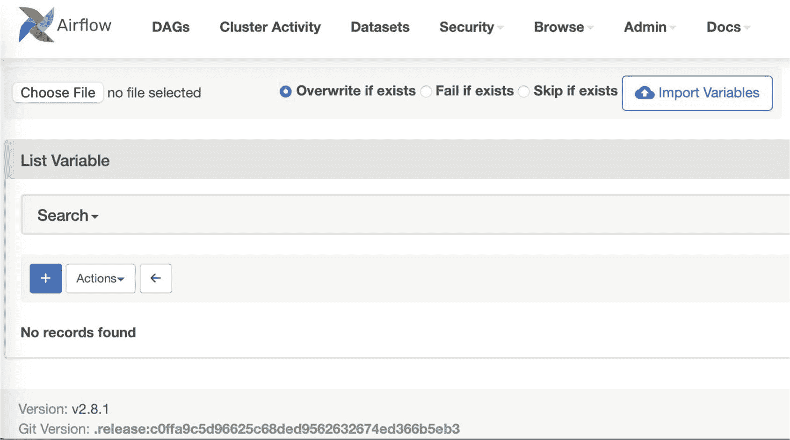

一个 Airflow 窗口的截图，菜单项包括 DAGs、Cluster activity、Datasets、Security、Browse、Admin 和 Docs。未找到任何记录。

图 12-10
在 Apache Airflow 中创建变量

您可以单击 `+` 按钮创建一个新变量。它将呈现一个新屏幕，您可以在其中输入键、值和描述。
效果如下：

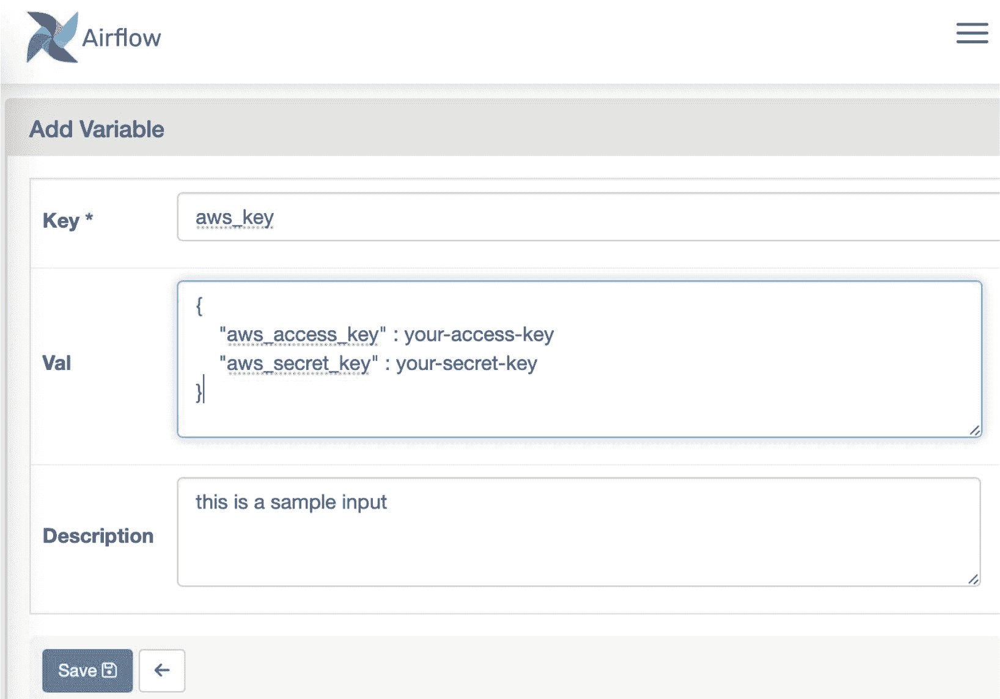

一个 Airflow 窗口的截图，用于添加变量信息，如键、值和描述。底部有一个保存按钮。

图 12-11
填充变量的键、值和描述

您可以使用以下语法检索这些变量：

```
var.value.
```

以下是一个示例说明：

```
from airflow.models import Variable
def get_aws_parameters():
aws_access_key = Variable.get("aws_key",default_var=None)["aws_access_key"]
aws_secret_key = Variable.get("aws_key",default_var=None)["aws_secret_key"]
PythonOperator(
task_id="get_aws_parameters",
python_callable=get_aws_parameters,
)
```

参数
Params 是 parameters 的缩写。与变量类似，参数是您可以在运行时传递给 Airflow DAG 运行或任务实例的参数。不同之处在于，传递给参数的值不会被加密，因此不应将其用于存储敏感信息。您可以在 DAG 级别或单个任务级别传递参数。任务级别的参数优先于 DAG 级别的参数。

让我们看看在任务级别传递参数：

```
BashOperator(
task_id="an_example_task",
bash_command="echo {{ params.my_param }}",
params={"my_param": "this is an example parameter"},
)
```

以下是另一个在 DAG 级别传递参数的说明：

```
from datetime import datetime
from airflow.decorators import dag, task
@dag(
start_date=datetime(2024, 2, 2),
schedule=None,
catchup=False,
params={
"Person": "JohnDoe",
"Value": 10
},
)
def demo_dag():
@task
def demo_task(**context):
print(context["params"]["Person"])
print(context["params"]["Value"] + 10)
print_all_params()
demo_dag()
```

与 Apache Airflow 中的变量相比，参数更加本地化。如果您想在每次运行时为任务传递不同的值，参数将是一个不错的选择。

模板

在 Apache Airflow 中，模板化的概念利用了一个名为 `Jinja` 的 Python 模板框架，它允许您在运行时将数据传递到任务实例中。这些 Jinja 模板使您能够在运行时填充值。此模板化的语法如下：

```
{{ your-value-here }}
```

模板化最常见的应用是获取 Apache Airflow 中的执行信息。这些包括正在运行的任务实例的日期、执行日期以及当前 DAG 的开始和结束日期间隔。这些模板在 Apache Airflow 中最常用的操作符中得到支持。您还可以通过添加过滤器或函数来扩展这些模板的功能。以下是如何在 Airflow 中使用模板：

```
BashOperator(
task_id="begin and end date interval"
bash_command='echo "the DAG started at {{ data_interval_start }} and finished at {{ data_interval_end }}"'
)
```

宏

Apache Airflow 中的宏使您能够注入预定义的函数，以便在模板中使用。它们位于模板中的 `macros` 命名空间下。目前，Airflow 宏支持来自 Python 库的方法，即 time、datetime、uuid、random 和 dateutil。以下是一个使用宏的示例：

```
from datetime import datetime
BashOperator(
task_id="display_current_datetime",
bash_command='echo "It is currently {{ macros.datetime.now() }}"'
)
```

在前面的示例中，我们使用 macros 命名空间调用了 Python 库中的一个方法。如果您尝试在没有 macros 命名空间的情况下调用它，该命令将不会返回日期时间。

控制 DAG 工作流
通常，生产应用程序或数据管道会变得更加复杂，任务流可能比我们看到的示例更复杂。可能需要在生产数据管道的各个阶段设置决策循环。典型的场景可能看起来像根据给定上游任务的结果，执行下游任务的子集或仅执行管道下游的某些部分。其他场景可能看起来像根据条件跳过整个下游任务。因此，不仅需要调度和编排 DAG 数据管道，还需要控制这些 DAG 的条件执行逻辑。在 Apache Airflow 中，这被称为分支。
您可以通过两种不同的概念来控制 DAG 的执行：分支和触发。在分支中，您利用操作符来定义条件执行。在本节中，我们将介绍两个常用的操作符：BranchPythonOperator 和 ShortCircuitOperator。

BranchPythonOperator 是 Apache Airflow 中的一个操作符，它允许您评估某个条件（或决策循环），并决定您希望执行下游任务的哪个子集。它的工作方式是，操作符会评估来自任务的条件，并返回一个任务 ID 或任务 ID 列表以在下游执行。以下是 BranchPythonOperator 的示例说明：

```
def decision_loop(result):
if value > 0.5:
return ['third_task', 'fifth_task']
return ['fourth_task']
branching = BranchPythonOperator(
task_id='branch',
python_callable=decision_loop,
)
```

此示例使用了较旧的语法，您可以在其中创建相应操作符类的实例，而最新的语法则使用一个装饰器来处理相应操作符的实例化和操作。

让我们看一个使用新语法的示例：

```
from airflow.decorators import dag, task
from datetime import datetime
from random import randint
@dag(
start_date=datetime(2024, 2, 2),
schedule=None,
catchup=False
)
def branch():
@task
def cur_task():
return randint(1,100)
@task.branch
def decision_loop(value_from_cur_task):
if ((value_from_cur_task > 0) and (value_from_cur_task  40) and (value_from_cur_task <= 80)):
return 'other_task'
else:
return 'hello_world'
@task
def i_am_next():
pass
@task
def next_to_that():
pass
@task
def other_task():
pass
@task
def hello_world():
pass
value_from_cur_task = cur_task()
decision_loop(value_from_cur_task)
```

此示例使用了任务装饰器。根据给定任务生成的值，检查一个条件，并根据评估结果返回相应的任务 ID，这将决定运行哪个下游任务。在代码中，`@task.branch` 是 `BranchPythonOperator` 的装饰器版本。

另一个可用于控制工作流的操作符称为 ShortCircuitOperator。如果 ShortCircuitOperator 满足给定条件，它将跳过所有下游任务。让我们看一个示例：

```
from airflow.decorators import task, dag
from airflow.models.baseoperator import chain
from datetime import datetime
from random import getrandbits
@dag(
start_date=datetime(2024, 2, 2),
schedule='@daily',
catchup=False,
)
def sc1():
@task
def begin():
return bool(getrandbits(1))
@task.short_circuit
def decision_loop(value):
return value
@task
def success():
print('Not skipping the execution')
chain(decision_loop(begin()), success())
sc1()
```

在此示例中，我们有一个简单的函数，它返回一个随机的 true 或 false，并将其提供给决策循环函数。如果随机函数返回 true，则执行下游任务 success()；如果随机函数未返回 true，则跳过下游任务。因此，每次运行此 DAG 时，您都会获得不同的结果。

触发器
正如我们在前面的章节中讨论的，一个给定的任务只有在所有前置任务成功完成后才会执行。我们已经看到了根据条件控制执行的方法。让我们想象一个场景，其中有 `n` 个任务线性调度，一个任务在其前置任务成功完成后开始执行。
假设我们有一个需求：如果一个任务失败，则忽略所有其他后续任务，并且必须只运行结论任务。您不能短路剩余的工作流，因为那样会跳过包括结论任务在内的所有任务。这就是触发器概念的有用之处。

您可以通过向任务添加 `trigger_rule` 参数，在任务本身内部配置触发器。让我们看一个示例：

```
from airflow.decorators import dag, task
from airflow.utils.trigger_rule import TriggerRule
from datetime import datetime
import random
@dag(
start_date=datetime(2024,2,2),
dag_id="trigger_illustration",
schedule="@daily"
)
def dag_trigger():
@task(task_id="begin")
def begin():
print("Task execution begins")
@task(task_id="random_task")
def random_task():
if random.choice([True,False]):
raise ValueError("Task 2nd in queue unsuccessful")
else:
print("Task 2nd in queue executed")
@task(
task_id="task3",
trigger_rule=TriggerRule.NONE_FAILED_MIN_ONE_SUCCESS
)
def task3():
print("Task 3rd in queue executed")
@task(
task_id="task4",
trigger_rule=TriggerRule.NONE_FAILED_MIN_ONE_SUCCESS
)
def task4():
print("Task 4th in queue executed")
@task(
task_id="conclusion_task",
trigger_rule=TriggerRule.ONE_FAILED
)
def conclusion_task():
print("One of the tasks unsuccessful")
#begin() >> random_task()
#random_task() >> [task3(), task4()] >> conclusion_task()
begin() >> random_task() >> [task3(), task4()] >> conclusion_task()
dag_trigger()
```

在前面的示例中，我们有五个任务，其中一个任务被配置为执行或不执行，在此期间必须执行结论任务。通过指定各种触发规则，我们能够在任务未执行的情况下跳过下游任务并执行结论任务。

结论
正如我们在本章中所探讨的，Apache Airflow 是一个强大的工作流编排工具，也是编排数据工程和机器学习作业的良好解决方案。Apache Airflow 已经存在了近十年，支持工作流编排并提供高级功能和自定义选项。所有云供应商似乎都提供 Apache Airflow 即服务，这表明它在行业中被广泛采用。我们研究了如何设置 Airflow、Airflow 系统的架构、组件以及它们如何协同工作。然后，我们研究了 DAG、钩子、操作符、变量、宏、参数、触发器和其他概念，以及如何利用它们来编排数据管道。在下一章中，我们将介绍另一个工作流编排工具，它更加强大，并且使您能够无需 DAG 即可工作。工作流编排工具的选择取决于项目需求、当前基础设施和团队。

13. 使用 Prefect 编排数据工程管道

简介
之前我们研究了 Apache Airflow，这是最广泛采用的工作流编排解决方案。Apache Airflow 得到了社区的广泛采用和支持。在本章中，我们将介绍另一个名为 Prefect 的工作流编排解决方案。我们将研究其架构以及如何在没有 DAG 的情况下创建工作流。不过，您仍然可以在 Prefect 中定义 DAG。Prefect 的特性、组件和典型工作流看起来与我们之前看到的 Apache Airflow 不同。至于哪个工具是更好的选择，这取决于许多因素，如团队、需求、基础设施等。

在本章结束时，您将学习到：

*   Prefect 工作流编排的基础知识和关键概念
*   设置、安装和配置 Prefect 开发环境
*   Prefect 的核心概念，如流程、任务和结果
*   工件、变量和持久化结果
*   状态、块和状态更改钩子
*   任务运行器

Prefect 简介
Prefect 是第二代开源工作流编排平台，旨在帮助自动化、编排、执行和管理各种基于 Python 的任务和流程。Prefect 可以在运行时生成动态工作流。Prefect 的学习曲线平缓，这意味着使用 Prefect 进行工作流所需的时间相对较少。使用 Prefect，可以将 Python 函数转换为可被编排、监控和观察的工作单元。Prefect 提供的一些突出特性是：
调度：调度作业或任务通常通过 cron 调度或使用专用的编排服务来完成。使用 Prefect，可以在简约的 Web UI 中创建、修改和查看调度。Prefect 提供 cron 调度、间隔调度和用于更复杂事件调度的重复规则调度。
重试：数据工程师经常编写代码，以便在失败时重试某个操作。这通常用于需要连接到数据库的情况，作为定期运行的数据集成/工程管道的一部分。使用 Prefect，可以简单地使用 Python 装饰器来指定重试次数，从而消除了对多行代码及其相关可维护性的需求。
日志记录：日志记录是在数据管道执行期间发生事件时注册或记录信息的过程。日志记录可以包括高级信息，如注册连接到数据库的状态，以及低级信息，如捕获执行期间某个时间点的变量值。Prefect 会自动记录各种操作的日志，而无需使用 Prefect 执行额外的配置。
缓存：缓存是一种将数据副本存储在特定位置（通常称为缓存）的方法。其思想是高效地检索这些项目，以便在其他作业中重用。使用 Prefect，可以缓存任务的结果并将其持久化到指定位置。
异步：Async 是 asynchronous 的缩写，是一种在主流程之外执行任务的方法。使用 Prefect，可以异步运行任务，这意味着 Prefect 可以在等待另一个任务完成时启动另一个任务，而不会停止程序的执行。
通知：通知是数据管道在数据管道执行之前、期间或之后发送的关于事件或更新的消息。Prefect Cloud 通过提供各种警报机制（如电子邮件、短信以及 Slack、MS Teams 等平台）来启用关于数据管道的通知。
可观测性：Prefect Cloud 提供了一个类似仪表板的用户界面，用户可以在其中观察和监控各种已调度、正在运行或已完成的任务和流程。
在传统的数据栈中，必须编写多行代码，并且在某些情况下，需要利用另一个工具或软件来实现这些功能。与类似的编排平台相比，Prefect 能够开箱即用地提供这些功能，这被认为是有吸引力的。
Prefect 有两个不同的版本，即 Prefect Core 和 Prefect Cloud。Prefect Cloud 是 Prefect Technologies, Inc. 的商业产品，带有一个类似仪表板的用户界面，用户可以在其中观察和监控工作流，以及一些其他功能，如基于角色的访问控制和与其他工具和技术的集成等。
Prefect Core 是一个提供核心功能的开源框架。您可以在自己的基础设施内运行 Prefect Core。Prefect Core 是一个 Python 包，提供 Prefect 的核心组件。您可以从 Python 包安装程序中获取 Prefect。

设置与安装

要在您的工作站上设置 Prefect，让我们在您的系统中创建一个新的虚拟环境：

```
sudo apt update / brew update
python3 -m venv prefect
source prefect/bin/activate
```

如果您使用的是 MS Windows 操作系统，请使用以下命令：

```
prefect/Scripts/activate
```

接下来，在您的系统中安装 Prefect：

```
pip install -U prefect
```

让我们通过运行以下命令来验证安装过程：

```
prefect version
```

终端将打印类似这样的内容：

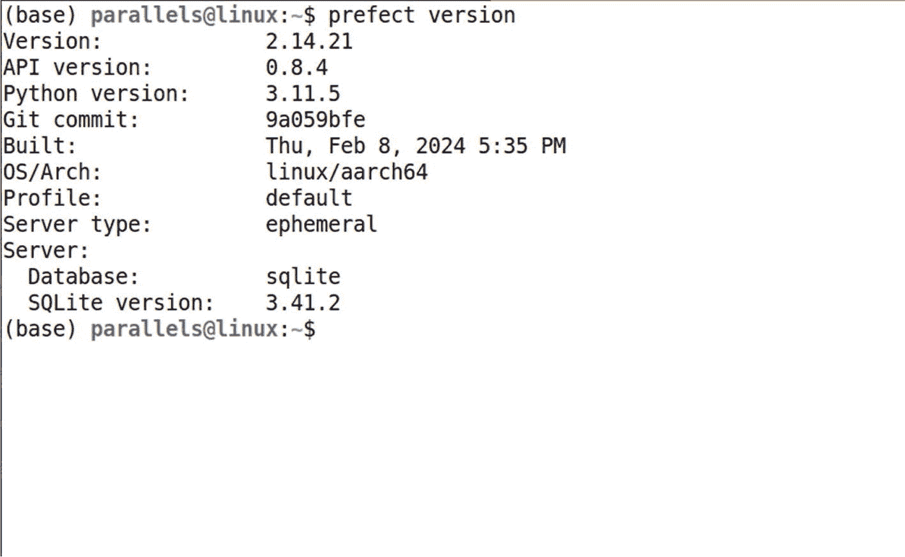

一个终端输出的截图，显示已安装的 Prefect 版本 2.14.21，API 版本 0.8.4，Python 版本 3.11.5，以及系统详细信息，包括 Linux 架构、SQLite 数据库版本 3.41.2 和 Git 提交哈希。

图 13-1
检查已安装的 Prefect 版本

Prefect 服务器

Prefect Server 是一个开源后端，有助于监控和执行 Prefect 流程。Prefect Server 是 Prefect Core 包的一部分。Prefect Server 在其用户界面中提供以下选项：

*   流程运行
*   流程
*   部署
*   工作池
*   块
*   变量
*   通知
*   任务运行并发
*   工件

以下是如何设置本地服务器：

```
prefect server start
```

如果 Web 服务器成功启动，您将看到以下屏幕：

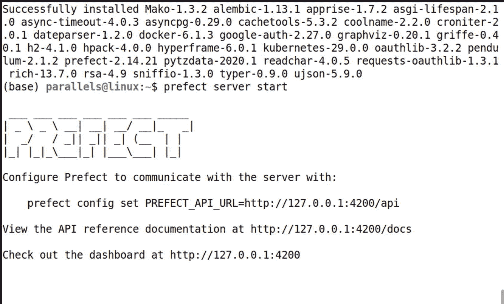

一个终端输出，指示各种包（包括 Prefect 2.14.21）已成功安装。提供了启动 Prefect 服务器并使用本地 API URL `http://127.0.0.1:4200` 进行配置的说明，以及 API 文档和仪表板的链接。

图 13-2
启动 Prefect 服务器

导航到浏览器并输入此 URL 以访问用户界面：
`http://127.0.0.1:4200`

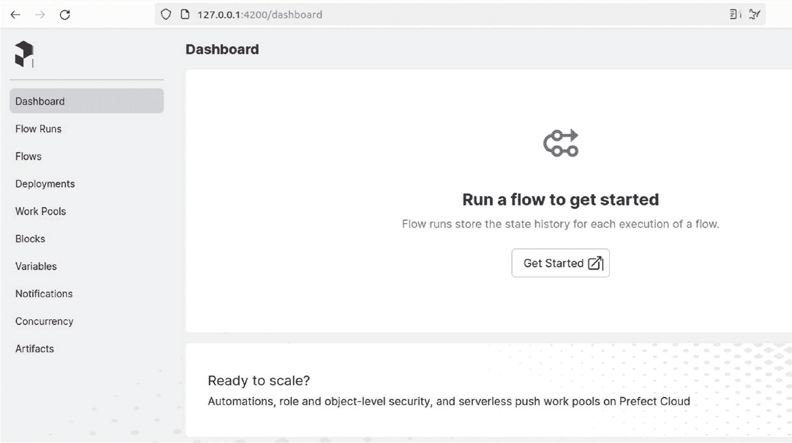

Prefect 仪表板在 localhost 127.0.0.1:4200 的截图，侧面板突出显示了 Dashboard 选项。主区域提示用户运行一个流程以开始，并带有一个标有“开始”的按钮。底部有一条消息提到了 Prefect Cloud 的扩展选项。

图 13-3
Web 浏览器中的 Prefect 用户界面

从软件设计的角度来看，似乎有三个主要组件：

*   Prefect 核心，提供核心的 Prefect 功能和工作流编排引擎
*   用于 Prefect 元数据的后端数据库，默认附带 sqlite，并且可以配置为 Postgres 数据库
*   用于观察和监控工作流、机密管理和其他编排相关功能的 Web 服务器

您可以通过发出以下命令来重置后端 Prefect 数据库：

```
prefect server database reset -y
```

Prefect 是一个开源的工作流编排系统，它管理组织的数据管道，并提供各种开箱即用的功能，使所有数据作业和管道具有一致性。此外，Prefect 提供了整个组织数据管道的集中视图，包括当前运行的状态和运行历史。Prefect 还提供了一个机密管理系统，可以在其中存储安全的登录凭据和其他关键凭据，与组织当前的工具集集成，并提供自定义集成。

Prefect 开发

流程

流程是 Prefect 开发中最基本的单元。流程是工作流逻辑的容器，允许用户管理和理解其工作流的状态。它在 Python 中表示为一个单一函数。要将 Python 函数转换为 Prefect 流程，需要向该函数添加以下装饰器：

```
@flow
```

添加此装饰器后，函数的行为会发生变化，呈现以下特性：

*   流程状态的变化会报告给 API，从而实现对流程执行的实时观察。
*   可以验证输入参数，从而实现数据完整性和一致性。
*   可以在失败时执行重试（需要作为参数提及）。
*   可以强制执行超时，以防止意外的长时间运行的工作流。

流程可以包含对其他流程或任务的调用，Prefect 将其称为“子流程”。

流程运行
流程运行代表流程执行的单个实例。可以通过简单地运行包含该流程的 Python 脚本来创建流程运行。也可以通过设置 Prefect Cloud 或自托管 Prefect Server 上的部署来启动流程运行。如果流程运行包含任务或子流程，则 Prefect 将跟踪每个子流程运行与父流程运行的关系。

以下是一个基本 Prefect 流程的示例：

```
from prefect import flow
@flow()
def hello_world():
print("Hello World of Prefect!")
hello_world()
```

让我们看一个利用可以传递给装饰器的各种参数的 Prefect 流程的说明：

```
from prefect import flow
@flow(name = "MyFirstFlow",
description = "This flow prints Hello World",
retries = 3,
retry_delay_seconds = 10,
flow_run_name = "Hello World Flow",
timeout_seconds = 300
)
def hello_world():
print("Hello World of Prefect!")
hello_world()
```

除了流程的名称和描述，我们还可以配置重试。`retries` 参数是在流程运行失败时重试执行的次数。您还可以通过设置 `retry_delay_seconds` 参数来指定失败后重试流程前等待的秒数。此外，还有 `timeout_operator`，如果流程超过指定的运行时间，它会将流程标记为失败。
要执行此 Python 程序，只需从终端执行该程序。执行后，您将看到类似于以下所示的日志跟踪：

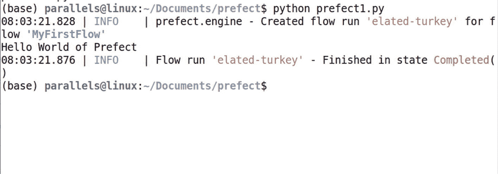

一个终端输出，指示使用 Prefect 执行 Python 脚本 prefect_1.py。名为 elated turkey 的流程运行已成功创建并完成，并显示消息 Hello World of Prefect。流程运行完成状态显示为 completed。

图 13-4
执行 Prefect 流程

如您所见，Prefect 已执行了一个流程实例，并且此流程运行已被赋予一个名称。您还可以看到流程以 completed 状态结束。让我们看看用户界面：

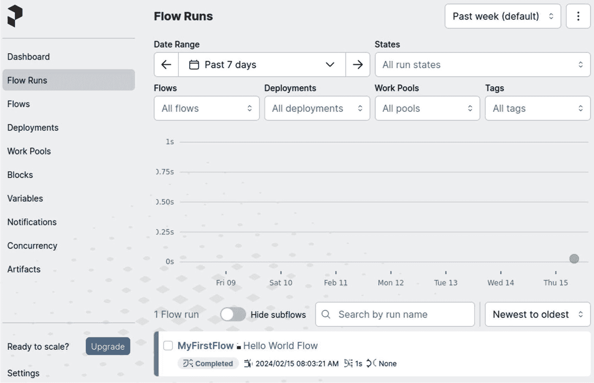

Prefect 流程运行仪表板的截图。提供了流程、部署、工作池和标签的过滤器，以及过去一周的数据范围和一个状态字段。底部显示了一个标题为“my first flow hello world flow”的流程运行，时间戳为 2024 年 2 月 15 日。

图 13-5
在用户界面中观察 Prefect 流程

界面
回想一下，我们分别为流程和流程实例分配了名称“MyFirstFlow”和“Hello World Flow”。当您单击流程运行名称时，可以获得相同的日志跟踪和一些其他详细信息。效果如下：

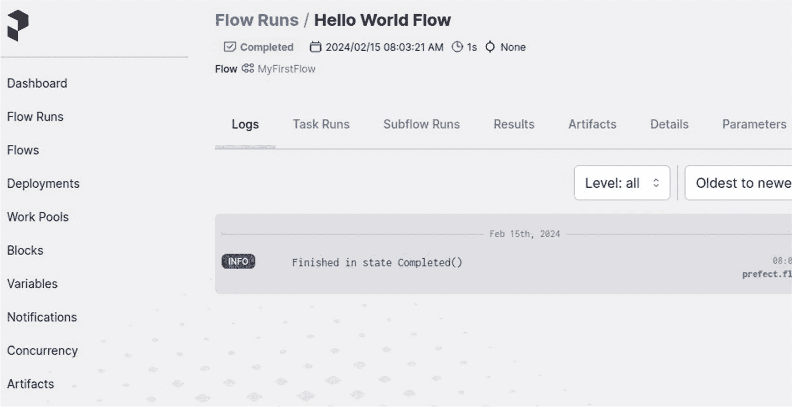

Prefect 流程运行仪表板的截图，显示 1 个标题为“My first flow hello world flow”的流程运行。该流程标记为已完成，时间戳为 2024 年 2 月 15 日。日志选项卡已突出显示，并选择了级别“全部”和排序“从旧到新”。信息选项显示“finished in state completed”。

图 13-6
Prefect 流程的日志跟踪

虽然流程是 Prefect 中工作流的基本概念，但一个流程可以包含一个或多个任务。
让我们看看任务的概念。

任务
任务是 Prefect 中代表单个离散工作单元的函数。完全有可能仅使用流程来创建工作流，其中过程被封装为带有流程装饰器的 Python 函数。然而，任务允许将工作流逻辑分解为更小的包，这些包可以在各种其他流程和子流程中重用。任务类似于函数，它们接受输入、执行函数并返回输出。任务可以在定义流程的同一个 Python 文件中定义。任务也可以在一个模块中定义，并可以被导入以在流程定义中使用。所有任务都必须从流程内部调用，这一点至关重要。
任务从上游依赖项接收元数据，包括在执行之前依赖项的状态，无论是否从它们接收数据输入。这使开发人员能够使任务在另一个任务完成之前等待。在 Prefect 中，任务的使用是可选的。您可以将所有代码写在一个巨大的函数中，并为该函数使用 `@flow` 装饰器。Prefect 可以执行该函数。但是，将代码组织成尽可能多的小任务可能有助于获得运行时状态的可见性，并有助于调试代码。如果没有任务，如果一个作业在一个流程中运行并且任何一行代码失败，那么整个流程将失败。如果使用任务将流程分解为多个任务，那么调试起来会相对容易。

每个 Prefect 工作流必须包含一个主要的、入口点的 `@flow` 函数。从该流程函数中，可以调用许多任务、子流程和其他 Python 函数。默认情况下，任务不能在其他任务中调用；在从其他任务调用任务时，必须使用特殊的语法：

```
from prefect import flow, task
@task
def task1():
print("I am task1")
@task
def task2():
task1.fn()
print("I am task2")
@flow
def flow1():
task1()
task2()
flow1()
```

在前面的示例中，我们看到了两个合并到一个流程中的任务。虽然 Prefect 不允许从其他任务触发任务，但有一个选项可以通过使用 `fn()` 方法直接调用任务的函数。您可以看到函数 `task1` 已在 `task2()` 函数内部被调用。这将是该函数的一次性执行，并且当从任务调用此函数时，您无法利用重试等 Prefect 功能。
让我们看看这个程序的输出。
当您从终端运行此代码时，您可能会收到类似于以下的日志跟踪：

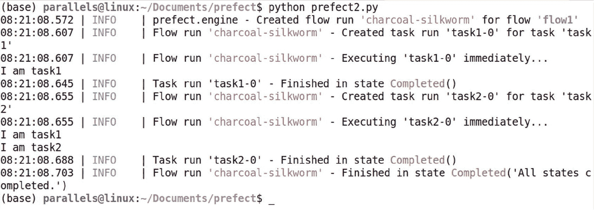

一个终端输出，指示执行了一个名为 charcoal silkworm 的 Prefect 流程，包含 2 个任务：task1 和 task2，两者都已创建并成功执行。流程运行和任务运行以 completed 状态结束，任务立即执行。

图 13-7
在命令行中观察 Prefect 流程的输出

此 Prefect 流程有两个任务，即 task1 和 task2，其中 task2 直接调用 task1 的函数。因此，您将看到 task1() 的执行和 task2() 的执行，其中包括 task1 的打印函数。

任务提供参数以进行进一步自定义。其中一些列在下面。以下是一个包含可选参数的任务示例：

```
from prefect import flow, task
@task
def task1(
name="Task1",
description="This is the task1 returns a string",
tags=[test],
retries=2,
retry_delay_seconds=10
):
print("I am task1")
@task
def task2(
name="Task2",
description="This is the task2 returns a string and \
calls the task1 function directly",
tags=[test],
retries=2,
retry_delay_seconds=10
):
task1.fn()
print("I am task2")
@flow
def flow1(
name="MainFlow",
description="Main flow with tasks included",
retries=1
):
task1()
task2()
flow1()
```

除了提供任务的名称和描述，您还可以指定在任务执行失败时重试特定任务的次数，以及重试前等待的持续时间。还有一个布尔参数，用于指定是否将任务运行结果持久化到存储中。

结果
结果非常直接。它们代表流程或任务返回的数据。如前所述，任务或流程基本上是可能返回值的 Python 函数。

以下是一个如何返回结果的简单示例：

```
from prefect import flow, task
@task
def my_task():
return 1
@flow
def my_flow():
task_result = my_task()
return task_result + 1
result = my_flow()
assert result == 2
```

在前面的示例中，您可以看到任务（带有任务装饰器的函数）的输出被保存到一个变量中。流程的输出也被保存到一个变量中。虽然此程序能够将任务和流程的结果保存到变量中，但该程序无法持久化它们。

持久化结果
Prefect 不会存储结果，除非它们有助于 Prefect 减少读写结果存储的开销。结果被持久化到一个存储位置，Prefect 存储对结果的引用。

以下功能依赖于结果的持久化：

*   任务缓存键
*   流程运行重试
*   禁用内存中缓存

要在 Prefect 中持久化结果，您需要启用结果持久化参数，指定存储位置，并且还可以选择将输出序列化为 JSON 或使用 pickle 序列化器。根据程序中使用的参数，结果可以持久化到给定任务、所有任务或一个流程。考虑以下示例：

```
from prefect import flow, task
@task
def task1(a: int, b: int) -> int:
c = a + b
return c
@flow(retries=2)
def flow():
ans = task1(2,3)
print(ans)
flow()
```

在此示例中，流程启用了 `retries` 参数，这将要求所有任务的结果都被持久化。但是，流程重试不需要流程本身被持久化。让我们尝试运行此程序：

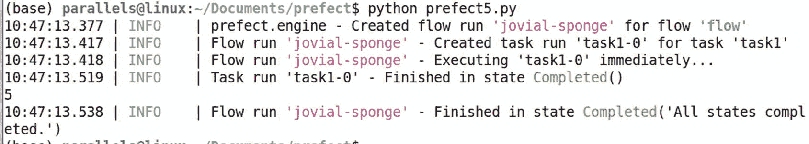

一个终端输出，指示执行了一个名为 jovial sponge 的 Prefect 流程，包含一个任务 task1。该任务已立即执行并以 completed 状态结束，流程在命令行中持久化了其结果。

图 13-8
在命令行中观察 Prefect 流程的输出持久化

我们可以观察到程序成功执行。当您在 Prefect 服务器中检查结果时，您可能会看到结果被持久化了，而流程没有。效果如下：

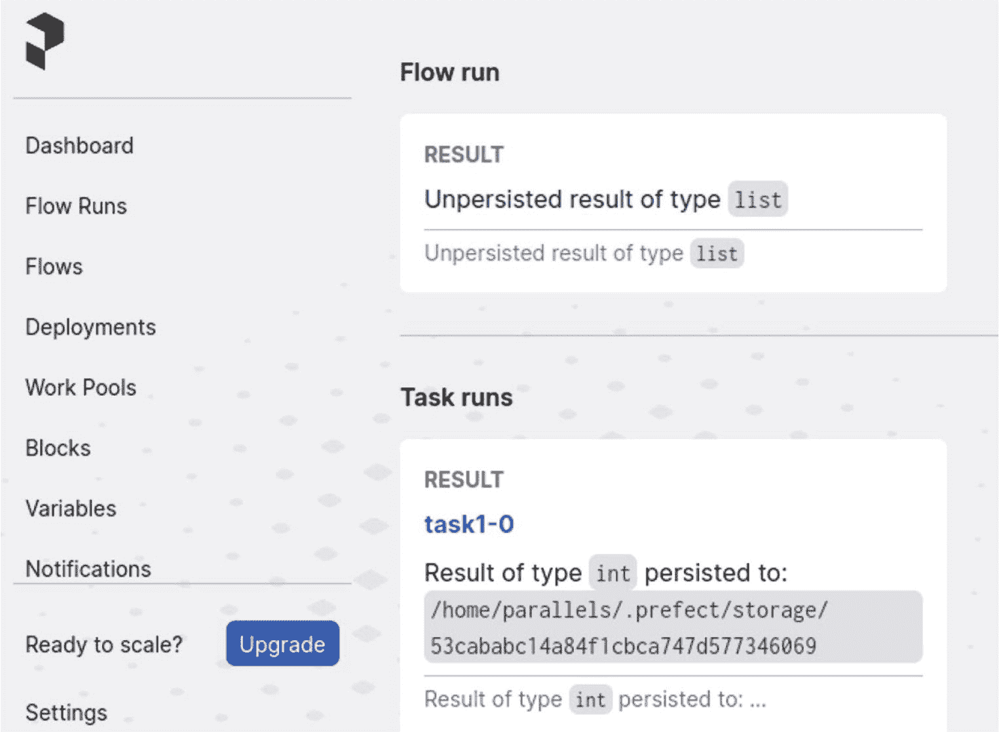

一个 Prefect 仪表板，带有流程运行选项卡。类型为 list 的未持久化结果，以及 task1-0 运行的结果（类型为 int）被持久化到特定文件路径。

图 13-9
结果持久化在存储中

您也可以手动切换结果持久化。切换持久化将覆盖 Prefect 可能自行做出的任何操作。以下是一个示例：

```
from prefect import flow, task
@task(persist_result=False)
def my_task(a: int, b: int) -> int:
c = a * b
return c
@flow(persist_result=True)
def my_flow() -> int:
result = my_task(5,6)
return result
my_flow()
```

在前面的示例中，任务的 `persist_result` 已设置为 False。这意味着该任务永远不会持久化。任何依赖于持久化的功能都可能无法工作并导致错误。但是，对于流程，`persist_result` 已设置为 True。即使某个功能不需要，流程也会持久化结果。
让我们运行此代码：

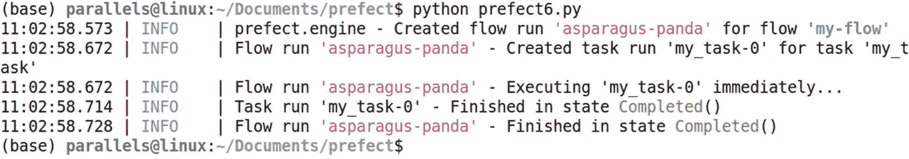

一个终端输出，指示执行了一个名为 asparagus panda 的 Prefect 流程，其中任务 my_task_0 立即执行并成功完成，流程以 completed 状态结束。

图 13-10
切换持久化

代码运行没有错误。回想一下，我们要求任务不持久化结果，而要求流程持久化结果。让我们看看 Prefect 服务器中的流程运行输出：

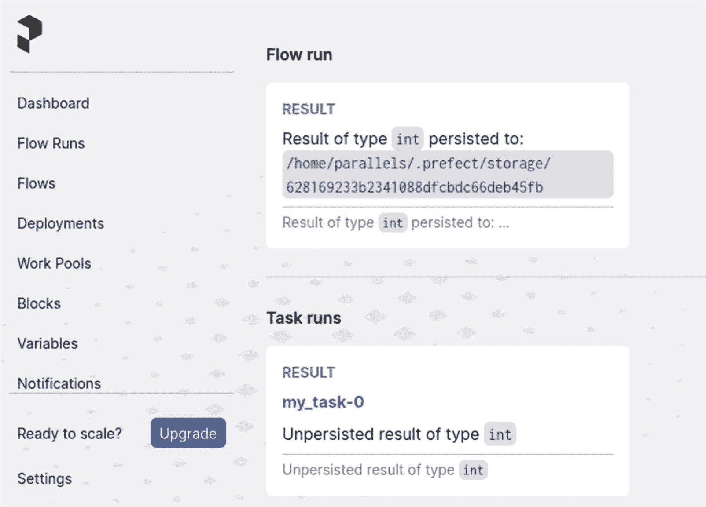

一个 Prefect 流程运行仪表板，结果显示为类型 int 的结果已持久化到某处，而任务运行显示 my_task_0 的结果为类型 int 的未持久化结果。

图 13-11
Prefect 服务器中的流程运行输出

在这里，我们看到虽然任务没有持久化结果，但流程将结果存储在了本地存储中。

进一步检查，该文件的序列化输出如下：

```
{
"serializer": {
"type": "pickle",
"picklelib": "cloudpickle",
"picklelib_version": "2.2.1"
},
"data": "gAVLHi4=\n",
"prefect_version": "2.14.21"
}
```

您可以选择指定一个特定的位置来存储结果。

Prefect 中的工件
在 Prefect 中，工件指的是持久化的输出，如链接、报告、表格或文件。它们存储在 Prefect Cloud 或 Prefect Server 实例上，并在用户界面中呈现。工件支持轻松跟踪和监控流程随时间产生和更新的对象。已发布的工件可以与任务运行、任务名称或流程运行相关联。工件提供了显示表格、Markdown 报告和指向各种外部数据的链接的能力。
工件可以帮助管理与团队或组织共享信息，提供有用的见解和上下文。工件的一些常见用例是：
文档：文档是 Prefect 工件最常见的用途。可以发布关于特定流程的各种报告和文档，其中可能包括示例数据，以便与团队共享信息并帮助跟踪工作进度。还可以随时间跟踪工件，以帮助查看数据的进展和更新。为此，工件必须共享相同的键。
数据质量报告：工件可以帮助在任务期间发布数据质量检查。在训练大型机器学习模型的情况下，可以利用工件发布性能图表。通过为多个工件指定相同的键，还可以跟踪非常具体的内容，例如数据管道中的异常。
调试：使用工件，可以发布关于结果写入时间和位置的各种信息。还可以添加指向存储位置的外部或内部链接。

链接工件
可以通过调用 `create_link_artifact()` 方法来创建工件。每个 `create_link_artifact()` 方法都会生成一个不同的工件，并具有以下参数。

以下是一个包含链接的工件的简单示例：

```
from prefect import flow
from prefect.artifacts import create_link_artifact
@flow
def my_flow():
create_link_artifact(
key="artifcatkey1",
link="https://www.google.com/",
link_text="Google",
description="Here is a search engine"
)
if __name__ == "__main__":
my_flow()
```

当我们运行此代码时，它将为我们生成一个工件。让我们尝试找到它。在您的 Prefect 服务器中，单击 Flow Runs 并导航到 Artifacts 列：

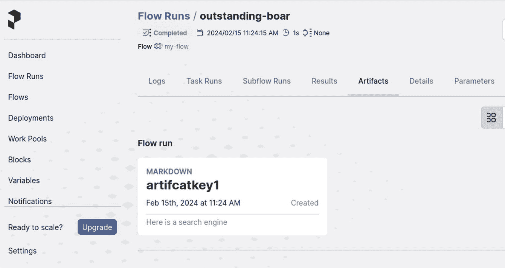

一个 Prefect 仪表板，显示一个流程运行，其类型为 int 的结果已持久化到存储位置，以及在流程运行 outstanding boar 期间创建的一个名为 artifact key 1 的 Markdown 工件。

图 13-12
Prefect 服务器中的工件

当您单击工件时，它可能会像这样呈现链接工件：

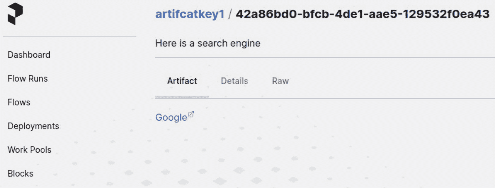

一个 Prefect 仪表板，显示一个工件键 `artifcatkey1`。下方显示文本“Here are the details of the search engine artifact as Google”。

图 13-13
呈现链接工件

Markdown 工件

Markdown 是一种轻量级标记语言，可用于向纯文本文档添加格式元素。需要将 Markdown 语法添加到各种文本中，以指示哪些单词或短语看起来不同以及如何不同。要创建 Markdown 工件，需要使用 `create_markdown_artifact()` 函数：

```
from prefect import flow, task
from prefect.artifacts import create_markdown_artifact
@task(name="Manufacturing Report")
def markdown_task():
markdown_report = f"""


# 制造报告

## 摘要
在菠萝电脑公司，我们在过去一个季度制造了以下产品。

## 各部门数据管道
| 产品         | 数量   |
|:--------------|-------:|
| 便携式电脑   | 60000  |
| 平板电脑     | 70000  |
| 手机         | 80000  |

## 结论
这些数字非常鼓舞人心，体现了我们勤奋且足智多谋的制造团队的实力。

```python
create_markdown_artifact(
key="manufacturing-report-1a",
markdown=markdown_report,
description="季度制造报告",
)
@flow()
def my_flow():
markdown_task()
if __name__ == "__main__":
my_flow()
```

运行上述 Python 代码后，我们可以在同一位置访问该 Markdown 制品。
该制品的外观如下：

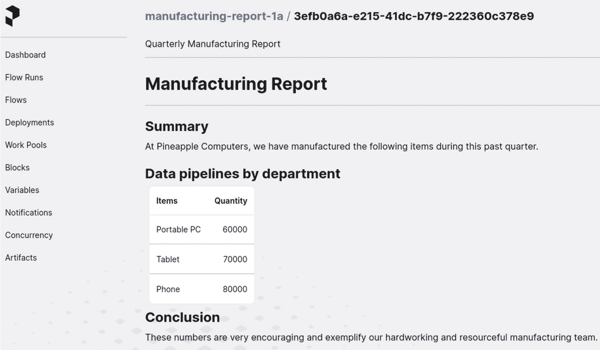

一个完美的仪表盘展示了季度制造报告，包括菠萝电脑公司制造的产品及其数量：便携式电脑 60,000 台、平板电脑 70,000 台、手机 80,000 台。结论部分强调了团队的强劲表现。

图 13-14
Markdown 制品的输出

表格制品

可以通过使用 `create_table_artifact()` 函数来创建表格制品。示例如下：

```python
from prefect.artifacts import create_table_artifact
from prefect import flow
@flow
def my_fn():
highest_churn_possibility = [
{'customer_id':'12345', 'name': 'John Doe', 'churn_probability': 0.85 },
{'customer_id':'56789', 'name': 'Jane Doe', 'churn_probability': 0.65 }
]
create_table_artifact(
key="table-artifact-001",
table=highest_churn_possibility,
description= "## 请今天就联系这些客户！"
)
if __name__ == "__main__":
my_fn()
```

运行此程序后，我们可以在 Prefect 服务器内的类似位置找到该制品。
其外观可能如下：

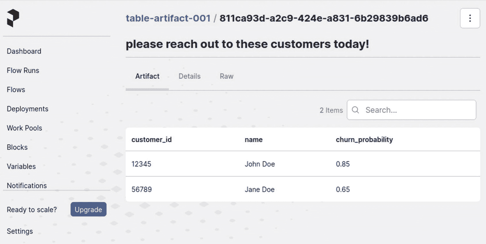

一个完美的仪表盘展示了表格制品 001，显示了客户详情及其流失概率：John Doe 为 0.85，Jane Doe 为 0.65。仪表盘建议今天就联系这些客户。

图 13-15
Prefect 服务器中的制品

此外，你可以在命令行中列出所有制品。通过输入“`prefect artifact ls`”，我们可以列出所有制品，如下所示：

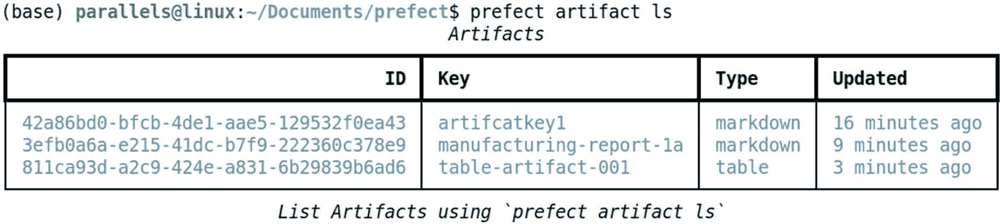

一个终端输出列出了所有制品，包含 ID、键、类型和更新列。ID 为 42a86bd0bfcb4de1aae5129532f0ea43，类型为 markdown。ID 为 3efb0a6ae21541dcb7f9222360c378e9，类型为 markdown。ID 为 811ca93da2c9424ea8316b29839b6ad6，类型为 table。每个制品都显示了各自的最后更新时间。

图 13-16
在终端中列出所有制品

此外，你可以使用终端中的制品键来检查这些制品的内容。命令是 `"prefect artifact inspect <artifact-key>"`。

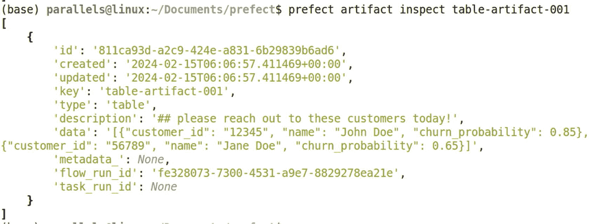

检查表格制品 001，其 ID 为 811ca93da2c9424ea8316b29839b6ad6。详细信息包括创建和更新时间戳、敦促联系客户的描述，以及客户流失概率数据。

图 13-17
使用制品键检查特定制品

Prefect 中的状态
状态基本上是指系统中某个对象在特定时间点的状态或状况。在 Prefect 中，状态包含关于特定任务运行或流程运行状态的信息。提及流程或任务的状态，指的是流程运行或任务运行的状态。例如，如果一个流程旨在成功、完成或正在运行，那么它直接指的是流程运行的状态。Prefect 状态描述了程序在其执行生命周期中的当前位置。Prefect 中有终端状态和非终端状态。

以下是各种状态及其描述：

表 13-1
各种状态及其描述表

| 状态 | 类型 | 描述 |
| --- | --- | --- |
| SCHEDULED | 非终端 | 运行将在未来的特定时间开始。 |
| PENDING | 非终端 | 运行已提交，但正在等待满足必要的先决条件。 |
| RUNNING | 非终端 | 运行代码当前正在执行。 |
| PAUSED | 非终端 | 运行代码已停止执行，直到收到手动批准才能继续。 |
| CANCELING | 非终端 | 代码运行的基础设施正在被清理。 |
| COMPLETED | 终端 | 运行成功完成。 |
| FAILED | 终端 | 由于代码问题，运行未完成，且没有剩余的重新尝试次数。 |
| CRASHED | 终端 | 由于基础设施问题，运行未完成。 |

在 Prefect 中，流程对象的任务可以返回数据对象、Prefect 状态对象或 Prefect futures（数据和状态对象的组合）。让我们看一个关于数据对象的示例：

```python
from prefect import flow, task
@task
def add_one(x):
return x + 1
@flow
def my_flow():
result = add_one(1) # 返回 int
```

状态对象是一个 Prefect 对象，指示给定流程运行或任务运行的状态。你可以通过将“`return_state`”参数设置为 true 来返回一个 Prefect 状态。示例如下：

```python
from prefect import flow, task
@task
def square(x):
return x * x
@flow
def my_flow():
state = square(5, return_state=True)
result = state.result()
return result
my_flow()
```

Prefect future 是一个 Prefect 对象，同时包含数据和状态。你可以通过在函数后添加“`.submit()`”来返回一个 Prefect future：

```python
from prefect import flow, task
@task
def square(x):
return x * x
@flow
def my_flow():
state = square.submit(5)
data = state.result()
pstate = state.wait()
return data, pstate
print(my_flow())
```

返回值决定了流程的最终状态。

状态变更钩子
状态变更钩子是一种工作流控制机制概念。当流程或任务改变其状态或发生状态转换时，状态变更钩子允许你根据给定任务或流程中的状态变更类型来定义响应动作。对于任务，你可以在状态变为完成或失败时定义响应动作。对于流程，你可以在其状态变为完成、取消、崩溃或失败时定义响应动作。

让我们看一个示例：

```python
from prefect import flow, task
def success_hook(task, task_run, state):
print("任务运行成功")
def failure_hook(task, task_run, state):
print("任务运行失败")
def conclusive_hook(task, task_run, state):
print("无论任务运行成功还是失败，此钩子都会运行。")
def flow_cancellation_hook(task, task_run, state):
print(f"流程 {flow.run} 已取消")
def flow_crashed_hook(task, task_run, state):
print("流程已崩溃")
def flow_completion_hook(flow, flow_run, state):
print("流程已完成执行")
@task(
on_completion=[success_hook, conclusive_hook],
on_failure=[failure_hook, conclusive_hook]
)
def my_task():
print("此任务成功")
@flow(
on_completion=[flow_completion_hook],
on_cancellation=[flow_cancellation_hook, conclusive_hook],
on_crashed=[flow_crashed_hook]
)
def my_flow():
my_task()
my_flow()
```

从前面的代码中可以看到，对于给定的状态转换，我们指定了不止一个状态变更钩子（以列表形式）。此外，你可以为多个任务和流程的相同状态转换指定相同的状态钩子。这样，当你拥有多个任务和流程时，你可以轻松地根据任务和流程中的状态变更来控制工作流。


块（Blocks）
块是 Prefect 的重要特性之一。块有助于存储配置和身份验证信息，并提供与其他系统交互的接口。
使用 Prefect 块，可以安全地存储身份验证信息、从环境变量中提取值，以及存储各种源系统、下游系统、通信渠道和其他系统的配置信息。利用块，可以查询数据库中的数据、从 AWS S3 等云数据存储中上传或下载数据、向 Microsoft Teams 频道发送消息，以及访问 GitHub 等源代码管理工具。块在 Prefect Server 和 Prefect Cloud 中均可使用。
需要注意的是，块用于存储在运行时不会更改或修改的配置。在块中定义的内容在流程运行期间不可更改。可以使用 Prefect UI 创建块以及修改现有块。
以下是其在 Prefect UI 上的显示方式：

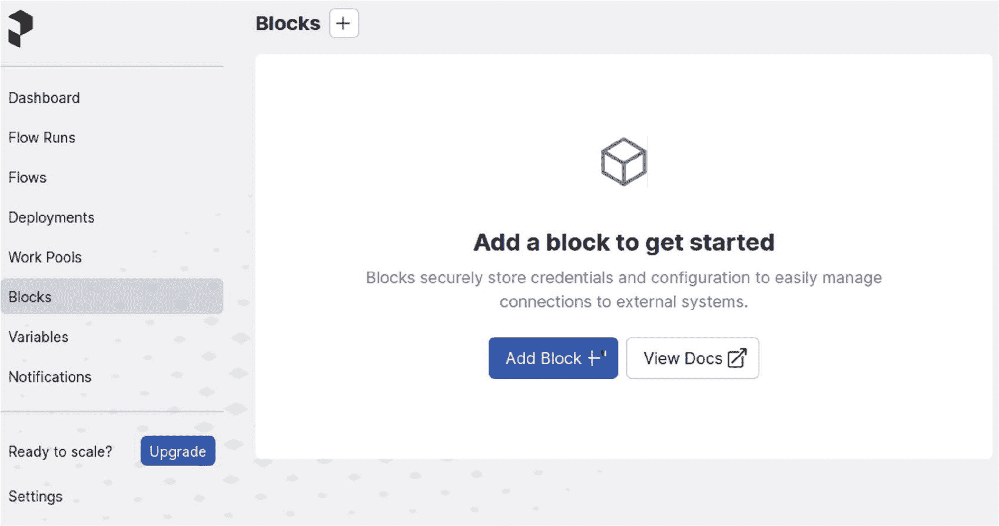

一个 Prefect 仪表盘显示了一些块，并提示添加一个块以开始使用。块安全地存储用于管理与外部系统连接的凭据和配置。“添加块”按钮被高亮显示，其旁边有一个“查看文档”选项。

图 13-18
Prefect 服务器中的块页面

Prefect 为众多云数据存储和其他外部系统提供了块。也可以在 Prefect 中创建自定义块。Prefect 的自定义块基于 Pydantic 库中的 `BaseModel` 类构建。虽然所有块在存储前都会被加密，但也可以使用 Pydantic 的 `SecretStr` 字段类型来混淆字段。
让我们创建一个新块。在此处，点击“添加块”；你将看到一个包含各种块的列表。以下是创建自定义 AWS S3 块的示例。S3 是亚马逊云服务提供的一种对象存储云服务。要创建一个新的 S3 块，只需在搜索栏中输入“s3”，即可获得 S3 块。在块中输入所需详细信息并保存。效果如下所示：

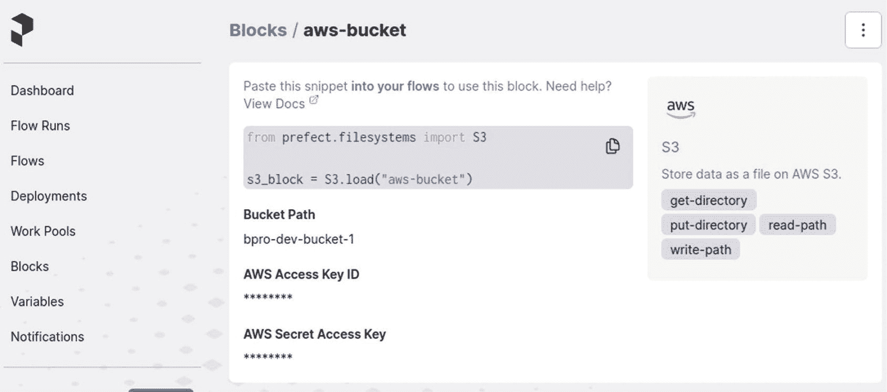

一个 Prefect 仪表盘显示了一个 AWS S3 存储桶块，并带有提示“将此代码片段粘贴到你的流程中以使用此块”、一个用于帮助的问号图标，以及一个“查看文档”选项。存储桶详细信息包括存储桶路径 `b pro dev bucket 1`、AWS 访问密钥 ID 和 AWS 秘密访问密钥。

图 13-19
创建一个新的 AWS 块

也可以使用以下命令注册自定义块，以便在 Prefect UI 中使用它们：

```
prefect block register --file my_minio_block.py
```

Prefect 变量
在 Prefect 中，变量是命名的、可变的字符串值。变量可以随时创建或修改，并且可以被缓存以便更快地检索。变量可用于存储非敏感性质的信息，例如配置信息。
需要注意的是，Prefect 变量未加密。要存储凭据等敏感信息，应使用块，而不是变量。
可以通过 Prefect 用户界面、Prefect API 和命令行界面来创建、读取、写入和删除变量。要使用命令行界面访问 Prefect 变量，你需要执行以下操作：

列出所有 Prefect 变量

```
prefect variable ls
```

检查名为 `prefect_var_1` 的 Prefect 变量

```
prefect variable inspect prefect_var_1
```

删除名为 `prefect_var_1` 的 Prefect 变量

```
prefect variable delete prefect_var_1
```

要通过用户界面创建 Prefect 变量，请转到 Prefect 服务器，选择“变量”，然后点击“新建变量”。
对你来说，效果可能如下所示：

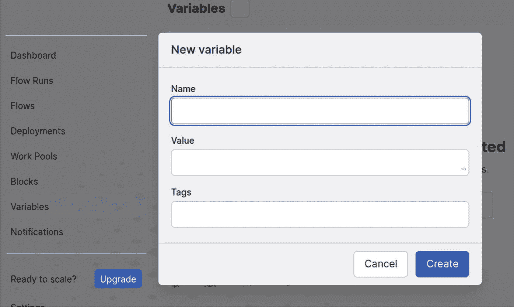

一个 Prefect 仪表盘显示了一个“新建变量”对话框，其中包含名称、值和标签字段，以及“取消”和“创建”按钮。“名称”字段被高亮显示，“创建”按钮也被高亮显示。

图 13-20
在 Prefect 服务器中创建一个新变量

以下是使用 Prefect API 访问 Prefect 变量的方法：

```
from prefect import variables
VariableFromPrefect = variables.get('prefect_var_1')
print(VariableFromPrefect)

