# 这些任务将按顺序执行
future = show(1)
future = show(2)
future = show(3)
if __name__ == "__main__":
my_flow()
```

结论
在本章中，我们了解了 Prefect，这是另一个开源工作流
管理与编排工具。Prefect 提供了一种灵活且
便捷的工作流编排方法，解决了工程团队面临的许多
挑战。Prefect 是 Python 原生的，其流程和
任务的概念，以及仅使用装饰器即可
创建工作流的想法非常便捷。到目前为止，我们了解了
工作流编排器的组件，随后进行了设置和安装。我们
深入理解了流程和流程实例、任务和任务实例。
我们进一步探讨了结果、结果持久化以及各种
产物。我们还讨论了状态、状态变更钩子和变量。
我们了解了用于机密管理的块；此外，还可以与
HashiCorp Vault 集成以进行机密管理。
值得指出的是，工作流编排解决方案的选择可能
取决于多个因素（当前基础设施、团队的专业知识、
项目需求等）。总的来说，通过学习 Airflow 和 Prefect，你已掌握了更高级的技能，能够
构建可扩展且更高效的数据管道。

14. 大数据与云计算入门

引言
过去十年间，整个技术领域以及数据处理的面貌
发生了显著变化。仅在过去十年中，
云计算的演进就彻底改变了在云端构建数据管道的概念。本章将作为使用主流
云技术构建工程数据管道的入门或序言。我们将重点关注云计算的早期采用者，即
亚马逊、谷歌和微软，以及它们的云计算栈。在本章中，我们将讨论云计算是如何打包和交付的，
以及一些技术及其基本原理。尽管
目前其中许多技术已经实现了自动化，但理解这些概念仍然至关重要。

到本章结束时，你将学到

*   云工程的基本网络概念

*   大数据处理与 Hadoop 生态系统的基础

*   Hadoop 和 Spark 的采用以及云计算采用率的增长

*   云计算部署模型

*   云计算的架构与原则

*   云计算服务模型

*   云计算提供的一些服务

云计算的背景

我们所说的远程计算，其最早的形式始于
客户端-服务器计算。客户端-服务器计算
涉及两台个人计算机，其中一台计算机请求服务，
另一台计算机用所请求的信息进行响应。传统上，访问互联网或电子邮件遵循的是
客户端-服务器交互模式。此外还有对等计算，
其中连接网络中的所有计算机都是相同的，并且
相互交互。还有各种协议支持
从一台计算机访问另一台计算机。随着操作系统
和图形界面的发展，访问远程计算机的整个图形用户界面并
执行各种操作成为可能。随着互联网和万维网的兴起
并加速发展，公司开始服务于更广泛的受众群体。
这些公司需要能够扩展的更好基础设施来
服务其客户。从这里开始云计算之旅可能是稳妥的。让我们来看几个术语：

*   资本支出：资本支出
    是指为获取实物设备而产生的费用，这些设备能为公司带来
    利益。这通常被称为 CAPEX。产生资本支出的一个典型例子是
    为公司 IT 基础设施购买刀片服务器。

*   运营支出：运营支出
    是指公司在日常运营中为产生收入而发生的费用。
    这些通常被称为 OPEX。例如，
    租用办公空间、支付电费、各种设备的维护和修理
    费用等。

云计算的网络概念
理解网络在 IT 基础设施中扮演着重要角色至关重要。让我们回顾一些可能对你的学习之旅有所帮助的网络概念和
术语。

IP 地址
IP 地址
代表互联网协议地址。IP 地址
是服务器在互联网上被识别的方式。IP 版本 4 将
IP 地址定义为一个 32 位数字。然而，IP 版本 6 的采用正在增加，
它将地址定义为一个 128 位数字。

DNS
DNS 代表
域名系统。它可以被看作
是一个地址簿，但仅适用于互联网。无需记住
复杂的 IP 地址数字和字符，你可以将其视为一串单词，
一个易于记忆的域名，可用于访问
网站。DNS 是一个数据库，其中 IP 地址与
域名相互映射。

端口
端口是逻辑实体，
充当服务器的门户。要进入服务器，你不仅
需要拥有正确的 IP 地址，还需要正确的端口。
端口号范围从 0 到 65535。可以将其想象成一个拥有
65,535 个登机口的机场。要登机，你必须到达
正确的机场并通过正确的登机口才能登上你的航班。例如，
端口 1521 由 Oracle 数据库使用，端口 22 由 SSH 使用，
等等。

防火墙
防火墙就像一个门禁系统，只允许特定的 IP
地址访问。可以将其更多地想象成一个仅限受邀者参加的发布活动，
只允许白名单中的成员进入。

虚拟私有云
虚拟私有
云是
云计算供应商提供的虚拟化网络环境。
它可以被看作是你自己的公共云环境中的一个小的门控空间，
在这里你可以获得隔离并控制你的云资源。这与
虚拟专用网络不同，后者通过私有网络提供安全加密的连接，
以便你可以从远程位置访问私有服务。

虚拟化
虚拟化是运行
操作系统虚拟实例的过程，其硬件与
操作系统隔离。因此，计算机硬件可能具有特定的
规格。通过采用虚拟化，我们能够
仅配置裸机硬件所拥有的全部能力的一个子集，因此我们能够
在同一台计算机内配置多个操作系统。一个位于
计算机硬件和操作系统之间的虚拟机监控程序软件
管理着为每个系统分配多少硬件资源。虚拟机监控程序
启动的操作系统被称为虚拟机。

大数据简介
组织看到了从数据中获取洞察以做出更好决策的价值。在过去十年中，数据开始大规模增长。
技术系统面临着挑战和需求，以适应这种增长并仍然能够从中获取洞察。
正是在这里，大数据的概念被构想出来。大数据技术
的创建基本上是为了满足大规模可扩展系统的需求，这些系统能够
进行并行处理并提供洞察。


Hadoop
大数据领域最广泛接受的系统是 Hadoop。
Hadoop 是一个由多种工具和技术组成的生态系统，支持利用大数据进行处理并提供洞察。自 21 世纪初首次发布后，Hadoop 便开源，并得到了全球各地开发者的贡献。Hadoop 的根源在于分布式计算。Hadoop 使得构建一个运行在大量消费级机器上的分布式计算平台成为可能。Hadoop 生态系统由一个包含名称节点和一个或多个工作节点的集群组成，其中名称节点负责分配和协调任务，而工作节点则执行分配给它们的任务。

Hadoop 生态系统拥有自己的文件系统，称为 Hadoop 分布式文件系统（HDFS）。HDFS 支持 MapReduce 范式，该范式能够对大数据进行并行计算。Hadoop 允许使用一种名为 Pig Latin 的脚本语言快速简便地编写 MapReduce 作业。Pig Latin 有助于编写复杂的数据转换，并在大数据集的探索性数据分析中非常有用。此外，Hadoop 还支持 Hive，这是一个构建在 Hadoop 文件系统之上的数据仓库解决方案。Hive 工具提供了一种类似 SQL 的接口，用于查询存储在 Hadoop 文件系统中的数据。Hive 会将这种类似 SQL 的语法转换为 MapReduce 作业，并在数据上实现分布式计算。

Spark
大数据系统演进过程中最大的飞跃来自 Apache Spark。Apache Spark 是一个支持大数据处理并具备内存计算能力的分析引擎。执行内存计算的想法使得 Apache Spark 比基于磁盘的 MapReduce 处理快 100 倍。此外，Spark 支持多种编程语言，如 Java、Scala、Python 和 R，提供全面的分析能力，包括 SQL 处理、实时流处理、机器学习流水线开发以及图处理。

Spark 在塑造和演进现代数据平台（如 Delta Lake 架构、数据湖仓等）方面发挥了重要作用。Delta Lake 是一个运行在数据湖之上的开源存储层，它基本上构建在 Spark 之上；Delta Lake 提供了多种能力，例如在数据湖上实现 ACID 事务，以及集成流式处理和批处理数据。

大数据的发展导致对大数据系统及其紧密相关的工具和技术的需求增加，这无疑促进了云计算技术的更广泛采用。随着组织意识到从海量数据中获取分析结果以获得竞争情报和其他洞察，迁移到云端成为一个相对更容易的选择。云计算系统，无论供应商是谁，都能提供大规模的计算、内存和存储。配置和设置一个数据处理集群要快得多；更棒的是，云计算供应商只按你使用其资源的时间收费。这被称为无服务器计算，你将在后续的章节中看到更多相关内容。

云计算简介
云计算是租用和消费位于远程的计算机资源的概念。云计算是一个商业术语，也可以被视为一个流行词。云计算使组织能够摆脱资本支出，专注于运营支出。组织无需购买多台刀片服务器和机架服务器来搭建自己的 IT 基础设施，而是可以在云中配置相同的环境，并根据其消费水平支付运营费用。

其中一个最大且明显的优势是搭建基本基础设施的速度。在传统模式下，需要采购计算机，并配置存储、内存和网络，还需要有合适的办公空间来容纳这些物理基础设施。所有这些可能花费的时间比预期的要长。而使用云计算，配置各种计算、存储、内存以及与 IT 基础设施相关的其他组件所需时间不会超过一小时。这为组织提供了显著的产品上市时间优势。

其次，你可以通过云计算走向全球。你可以轻松扩展你的应用，有时云计算供应商会动态添加计算资源以满足需求，这使你能够进入新的市场。如前所述，你不再需要投资于专用的物理服务器，并花费数周时间进行设置和启动运行。

安全性是云计算的另一个主要优势。据我所知，主要的云供应商确实提供了各种隐私和安全工具及方法，例如访问控制、静态和传输中加密、自带加密密钥（让你掌控安全）以及多因素授权等等。不过，你仍然需要安全专家。然而，你可以获得所有这些与云供应商产品良好集成的服务，而无需单独采购每一项，这是采用云计算的一个优势。

云计算部署模型
根据用例和客户所在行业的性质，云计算可以通过多种方式进行部署。让我们详细了解一下。

公有云
公有云是客户部署云计算最常见的方法。它也被认为是最经济的选择。在公有云中，服务通过互联网连接交付。因此，客户只需要一个安全的工作站和足够强大的互联网带宽，就能无缝地访问云计算供应商提供的服务。它也是最容易设置的，创建一个账户并开始使用云服务可能只需要几分钟时间。

私有云
私有云是指组织客户对其 IT 基础设施拥有专有权利和控制权。这类似于运行传统的 IT 基础设施。你可以让第三方云供应商提供和管理专有的 IT 基础设施，或者也可以是组织自己部署并管理其专有云。你仍然可以利用更新的技术、自动化、虚拟化等，并享受云计算的好处。然而，与公有云产品相比，成本可能更高。

混合云
顾名思义，它是私有云和公有云概念的混合体。在混合云中，一些资源托管在本地，而另一些资源托管在公有云中。这种情况更常见于组织将某些应用保留在本地，而将其他某些应用迁移到云端。因此，组织可以在将数据保留在自己本地的同时，在云中采购和使用某些服务。


社区云
社区云是公有云的一种变体，其区别在于 IT 基础设施由特定社区或行业内的多个组织共享。它可由内部管理，也可由第三方供应商外部管理。社区云是一种协作模式。与公有云相比，它提供了更好的安全性。例如银行客户和医疗客户，他们需要满足各自监管机构制定的特定法规和合规要求。

政府云
政府云专为政府机构和实体打造；它是社区云的一个子变体，区别在于它旨在满足特定的合规与监管要求。这要求云计算供应商提供额外的安全层和策略，以符合政府实体可能拥有的特定要求。

多云
多云是指一个组织利用多个云供应商来托管其应用程序和基础设施。其优势在于你不会被单一云供应商绑定，因此可以轻松地在不同供应商之间迁移。从成本角度来看，这也可能是有利的。一个云供应商的报价可能比另一个云供应商的报价更低。其缺点是运营复杂性较高。

云架构概念
让我们回顾一些可能直接或间接涉及工程和机器学习项目数据管道设计的概念。你可能见过或读过软件架构的七个基本“-ility”或十个“-ility”。在本节中，我们将探讨在设计数据工程或机器学习项目的数据架构时需要牢记的类似概念。过去几年中，数据的体量、真实性和多样性逐渐增长，这正是讨论以下概念的动机。

可扩展性
每个数据管道都旨在处理和/或传输数据。其消耗的计算资源量与被处理的数据量成正比。随着数据管道处理更多数据，整个管道会变得过载。可扩展性是指处理因使用量增加而产生的压力，同时确保数据管道平稳、一致地有效执行其功能的过程。你需要大致了解管道能处理的最大工作负载，以及是否可能遇到内存泄漏或堆栈溢出。可扩展性可通过两种方法实现，即水平扩展和垂直扩展。水平扩展是向集群添加更多计算节点，以处理增加的处理流量。垂直扩展是增加给定计算节点的容量以满足流量需求。

弹性
弹性是指适应给定数据管道工作负载变化的能力。弹性是动态调整底层计算资源以满足数据处理需求，并减少计算资源利用率的概念。这与可扩展性不同，因为可扩展性侧重于在高峰消费期间进行扩展，而弹性则指数据处理系统根据需求动态扩展或收缩以最小化资源利用率的弹性特性。一个很好的例子是云供应商提供的无服务器计算。无服务器意味着你无需为底层计算付费，而只需为执行时间内完成的工作单元付费。此外，弹性还指在运行时添加或动态配置计算和存储的功能。

高可用性
高可用性定义为数据处理系统在无需干预的情况下，在指定时间内持续可用的能力。其理念是消除单点故障，并在需要数据处理时随时可用。高可用性可通过给定时间点内的正常运行时间百分比来衡量。即使在系统维护或底层计算环境发生故障的情况下，使数据处理系统保持可用的能力就是高可用性的理念。

容错性
容错性是指数据处理系统在底层计算环境实际发生故障时仍可用的理念。虽然它们可以说是同一枚硬币的两面，但这与高可用性的概念略有不同。两者都旨在使系统无中断地可用。实现容错性的方法是在不同区域添加运行相同数据处理系统的计算节点。例如，如果你的数据处理管道在一个地理区域提供服务，你可以在另一个地理区域再部署一个执行相同任务的系统实例。这样，如果一个区域发生故障，另一个区域可以继续提供服务，直到主区域恢复服务。许多分布式计算集群都有主节点管理通信、工作节点执行任务的概念。容错性就是拥有随时可用的备用主节点的理念。

灾难恢复
灾难是指宏观层面的灾难，例如导致日常服务中断的地震和洪水，以及其他与人类相关的事件，如疾病、大流行病或流行病，或其他导致服务长时间中断的事件。它们可能是有意的或无意的。灾难恢复是指在灾难事件发生后，恢复数据管理系统、数据处理和机器学习系统，并恢复其功能的概念。其理念是为数据管理、处理和机器学习系统建立一个备用站点。在此背景下，灾难恢复是云计算供应商将其作为一项服务提供的能力，以便企业能够照常运营。

缓存
缓存严格来说并非架构原则，但它是架构设计的一个重要方面。缓存是一种数据存储概念，将计算过程中常用的数据存储在一个地方。其理念是重用先前计算或处理过的数据，这样我们就不必一次又一次地运行相同的计算。缓存数据通常存储在 RAM（随机存取存储器）中。与使用计算和存储再次执行相同操作相比，缓存从 RAM 中获取结果，从而提高了速度。从 CPU 架构的角度来看，可能还有其他几个缓存层，这超出了云数据架构的讨论范围。内存中缓存数据有几种类型；其中一些是 API 响应缓存、内容分发网络缓存等。我们的重点是数据库缓存。当你有一个数据库时，可能会有一些查询代价高昂；即使经过优化，也需要大量的资源消耗。通过从缓存而非源数据库获取查询结果，我们可以最大限度地减少延迟，并提高数据处理系统的整体性能。


云计算供应商
目前行业内有三大云计算供应商：亚马逊、谷歌和微软。亚马逊早在 2006 年就开始提供亚马逊云服务（Amazon Web Services），将云计算带入大众视野。谷歌推出了名为谷歌云平台（Google Cloud Platform）的云计算平台。2010 年，微软推出了名为 Azure 的云计算平台。除了这三大云供应商外，还有几家其他公司提供云计算服务，其中包括甲骨文（Oracle）、DigitalOcean、IBM，以及一些服务于特定国家的区域性供应商。

云服务模型
一旦我们确定了要部署的云计算模型类型，就可以着手选择适当的服务模型。云计算供应商提供其服务的方式大致可分为三大类，我们将对此进行更详细的讨论。

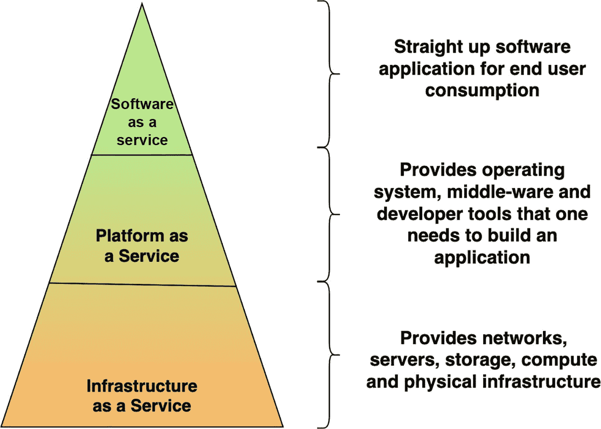

一个三层金字塔。顶层标注为“软件即服务”。中间层标注为“平台即服务”。底层标注为“基础设施即服务”。图中展示了每一层的应用。

图 14-1
描述云服务模型的金字塔

基础设施即服务
这是指云计算供应商将计算基础设施作为服务来提供。其理念是云供应商为你提供服务，你可以用它来运行应用程序、执行计算等。要运行应用程序，你需要基础设施。基础设施包括计算机硬件，如处理器、内存、操作系统、网络、存储等。通常，云供应商会为你提供服务器、存储、网络以及一个带有操作系统的虚拟机。由你决定安装哪些软件来执行所需的任务。此模型适用于希望搭建和管理基础设施的管理员。
基础设施即服务的例子包括微软 Azure、亚马逊云服务和谷歌云平台等。

平台即服务
平台即服务是指云计算供应商为你提供开发应用程序或使用应用程序所需的所有基础设施和环境。想象一下，你可以租用一个配置好内存和存储的多核处理器，一个已安装所有更新和补丁的操作系统，以及已安装并管理好的软件开发工具，这样你就可以直接开始编写代码或部署代码。平台即服务对于希望从头开始开发某些东西而又无需担心管理工作的开发人员来说非常有用。
平台即服务的例子包括 Salesforce CRM、Tableau 仪表板，或基于订阅的数据库即服务（例如 AWS RDS 上的 Postgres 实例）。

软件即服务
软件即服务是你每天随处可见的东西。你通过输入域名地址、用户 ID 和密码来查看谷歌提供的免费电子邮件账户，或者使用 Instagram 或 Facebook 等社交媒体提供商，这些都是免费使用的。基本上，这些公司为你提供了一切，包括硬件、操作系统、内存、存储和软件应用程序（Gmail、Dropbox 等）。作为最终用户，你可以访问他们的服务，尽情使用，或许下次还会再来。
软件即服务的例子可能包括 Zoom 视频会议、Microsoft Office 365（Word、Excel、PowerPoint）、Dropbox 在线存储等。

云计算服务

身份与访问管理
身份与访问管理是一种业务流程，旨在让正确的用户在正确的时间访问正确的数据集。访问管理能够保障数据资产的安全，并控制不同用户对各类数据资产的访问。这是一个持续的过程，确保只有经过授权的用户和服务才能访问数据资产。亚马逊提供 AWS 身份与访问管理（AWS Identity and Access Management）和 AWS Lake Formation 服务，用于管理对其各种资源（包括数据湖环境）的访问（包括细粒度访问控制策略）。微软提供 Azure Active Directory 和基于角色的访问控制服务，以实现对各种服务的访问控制。谷歌提供 Cloud IAM 服务，以对其资源和数据资产进行细粒度的访问控制。

计算
计算指的是计算处理能力（如主板）、内存、存储以及与之连接的网络。这是能提供的最基本的云服务。2006 年，亚马逊启动了其亚马逊云服务，并将 EC2 作为其最早提供的服务之一。你可以选择不同类型的微处理器（可能提供不同数量的核心）、所需的物理内存大小以及所需的网络连接类型。

存储
云存储基本上是将你的数据（文件、备份、图片、视频、音频等）存储在可通过网络访问的第三方存储提供商那里。云存储提供安全且经济高效的存储管理。根据客户的需求和用例，云存储提供多种类型的存储产品。这些存储系统可以在需要时自动扩展，并且可以高可用地通过网络进行访问。

对象存储
对象存储是一种特殊类型的文件系统存储，可用于存储任何类型的文件。对象存储将数据作为对象进行管理，这与将数据作为文件进行管理的文件系统不同。每个数据都是一个对象，并附带元数据和一个与该单一数据关联的唯一标识符。对象存储用于多种应用，包括冷数据存储（数据访问频率低）和数据归档。
对象存储的例子包括 Red Hat Ceph、MinIO、Cloudflare R2、Azure Blob Storage（如果你在微软生态系统中）等。

数据库
最常见的服务之一就是关系型数据库管理系统。云供应商以多种选项提供数据库即服务。你可以选择从云供应商那里租用一个带有高速网络的计算空间，然后自行安装数据库；或者，你也可以通过几次点击，租用一个预装了最新版本数据库的服务。如果你选择完全配置好的方案，供应商可能会提供一些数据库管理和维护任务的支持。使用数据库，你可以进行自动扩展、以编程方式交互、构建数据管道，此外还可以加载、查询和生成 SQL 报表。

NoSQL
除了关系型数据库，云计算供应商还提供 NoSQL 数据库解决方案。NoSQL 代表“不仅仅是 SQL”（Not Only SQL），意味着这些数据库管理系统旨在处理各种数据模型和数据结构。其理念是，NoSQL 数据库系统能够补充并高效存储那些可能不适合千篇一律的关系型数据模型的数据。然而，NoSQL 永远无法取代传统的关系型数据库系统、它们通过多种范式所强加的数据完整性，以及关系型数据库在事务系统中提供的有效性。NoSQL 系统允许在无需预先定义模式的情况下插入数据。


写入时模式 vs. 读取时模式
SQL 与 NoSQL 数据库系统的区别在于，关系型数据库管理系统会对传入的数据强制施加一个模式。如果传入的数据不符合模式标准，SQL 数据库系统将拒绝接收。另一方面，NoSQL 数据库系统是无模式的；数据的结构是在从 NoSQL 数据库中读取数据时才被解释的。这就是为什么传统上，RDBMS 使用“写入时模式”，而 NoSQL 数据库系统使用“读取时模式”。

注意

NoSQL 数据库系统通常是无模式的；然而，一些 NoSQL 数据库系统提供了模式强制选项，这有助于数据一致性。各种类型的 NoSQL 数据系统（文档型、键值型、图型、列型）处理模式的方式往往不同。MongoDB 确实允许进行模式验证（这有点像进入了 SQL 领域）；少数 RDBMS 已经开始提供对 JSON 数据的支持，而 PostgreSQL 甚至允许你对非结构化数据编写复杂查询。至少可以说，SQL 和 NoSQL 之间的界限正变得模糊；然而，理解 NoSQL 对 JSON 数据和非结构化数据有更好的支持和更快的查询引擎，而 RDBMS 在事务性和结构化关系数据方面仍然占据优势，这是很好的。

NoSQL 自 2010 年代初就已存在。如今，各大云厂商似乎都提供了各种 NoSQL 产品。让我们逐一简要了解。

文档数据库
文档
数据库
是专为管理半结构化数据而设计的数据系统。一个很好的例子是 JSON 数据，其中数据被捕获在 JSON 文档中。这些文档
数据库
具有灵活的数据模型，并且在加载之前无需定义。即使 JSON 文档可能具有复杂的结构，并且每个文档内部存在嵌套结构，只要它们来自单一来源，它们将始终保持一致。因此，文档
数据库
会适应这些文档的传入结构。一个著名的文档数据库例子是 MongoDB。它是一个快速、轻量、易于使用的数据库，附带一种查询语言，可用于将 JSON 文档视为关系数据并在其之上编写查询。

列导向数据库
另一种最古老的 NoSQL 数据库系统形式是列导向
数据库。请注意，
列导向数据库与列存储数据库不同。
列存储仍然是用于 OLAP 处理和数据仓库目的的关系型数据库系统。它们在生成复杂分析报告方面极其快速和高效。列导向
数据库是 NoSQL 系统，其模式随传入数据而演变。列存储数据库大多具有在加载数据之前定义好的维度数据模型。例如，Postgres 是一个列存储数据库；Google BigQuery 也是如此。
列导向
数据库
也被称为宽列数据库。在这种数据库中，给定数据集的列可以随时添加。Google Bigtable 和
Apache Cassandra
是宽列数据库的两个优秀服务产品。微软的 Cosmos DB
和亚马逊的
DynamoDB 同样是宽列数据库系统中具有竞争力的服务产品。

键值存储
键值
存储
是 NoSQL 数据库系统的一种类型，其中数据以键值对集合的形式存储（与 Python 中的字典数据类型非常相似）。数据模型非常简单直接，其中键是标识符，可用于检索相应的值。因此，这些系统在检索时速度极快，因为它不需要扫描几个表并匹配某些过滤器和条件。很好的例子包括 Amazon DynamoDB、Redis、Azure Cosmos DB 等。

图数据库
图
数据库
是另一种类型的 NoSQL 数据库，其底层数据模型由节点和边组成。节点是
包含各种信息（如人物、姓名或其他离散对象）的实体。边
是节点之间的连接，描述了连接两个节点之间的关系。
让我们通过一个图形化示例来看两个实体如何共享关系，以及实体之间可能存在哪些类型的关系。

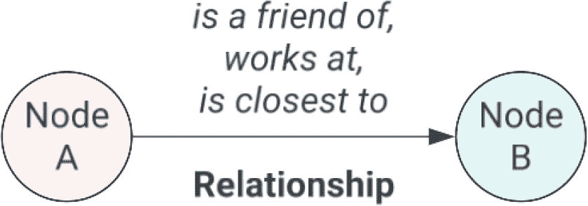

一个关于两个节点（标记为节点 A 和节点 B）之间关系的示意图。节点 A 是节点 B 的朋友，在节点 B 工作，或者与节点 B 关系最密切。

图 14-2
两个节点之间的关系示例

一些优秀的图数据库例子包括 Neo4j、Amazon Neptune、
Azure Cosmos DB 等。

时序数据库
时序
数据库
是 NoSQL 数据库系统的另一种变体，其数据模型基本上是按时间戳索引的数据值。这种类型的数据存在于各种行业中——例如，交易时间内股票的价格，或使用物联网传感器监测温度。这些数据库被设计为写入密集型，同时在检索时间间隔内的聚合指标、基于时间范围的报告等方面非常高效。此类数据库的优秀例子包括 Google Bigtable、Azure
Time Series Insights 和 Amazon Timestream 等。

向量数据库
向量
数据库
是 NoSQL 数据库系统中较新的类型，它们被设计用于存储、索引和快速搜索向量数据。给定一个查询向量，向量数据库会执行快速搜索，以检索与给定向量最相似的向量。这也被称为相似性
搜索，在图像识别和其他人工智能环境中非常有效。在这里，向量只是一个数字数组；根据上下文，这些数组可能带有特定含义。一旦给定一个向量，就可以指定依赖哪种度量方式来获取与之相似的最近邻向量。相似性度量可以是欧几里得距离、Tanimoto 距离或曼哈顿距离。所有这些向量都会被索引，以实现更快的相似性搜索和检索。

数据仓库
数据
仓库是用于分析处理的列式
关系型数据库管理系统。这些数据存储利用维度数据模型和列存储来更快地检索数据并生成分析洞察。各大云厂商提供数据仓库软件、访问控制和一些开箱即用的关键功能，因此你可以轻松地搭建你的数据仓库实例。配置数据仓库并使其上线所需的时间“相对”较快，但并非指数级快。亚马逊的 AWS Redshift、谷歌的 BigQuery
和 Azure 的 Synapse Analytics 是关系型数据仓库环境的优秀例子。

数据湖
数据
湖是用于存储结构化、半结构化和非结构化数据的集中式存储库。数据湖环境支持类似于数据仓库的数据存储，但无需定义预定义的模式。你可以从各种来源摄取多种类型的数据，并可以使用各种分析工具（如 Spark）或分布式计算环境（如 Hadoop）与数据交互和查询。如果你拥有
大数据，或者正在尝试集成关系型和非结构化数据以创建分析数据集，那么数据湖
环境是理想的选择。数据湖是开发机器学习管道时值得考虑的一个好选项。数据湖环境的优秀例子包括亚马逊的 Lake Formation、Azure Data Lake Storage Gen2
和谷歌的 Bigtable。


数据仓库与数据湖
数据仓库存储结构化数据，并按照已定义的架构加载处理后的数据。而数据湖则存储非结构化或半结构化数据，无需强制定义架构。数据科学家和机器学习工程师使用数据湖来运行各种类型的**高级分析**，而数据仓库则面向数据分析师和开发人员。数据仓库继续提供其一直以来所创造的价值。搭建数据仓库环境可能成本略高，并且其价值可能需要通过有效的实践才能随着时间推移显现出来。数据湖相对成本较低，因为现代云服务提供了可用作数据湖的托管对象存储解决方案；然而，数据湖需要根据数据的增长率投入更多的处理能力。
例如，一家医疗保健公司的数据仓库可能被设计用于以结构化格式（如维度模型）检索患者信息。而该公司的数据湖可能包含结构化的患者数据、医学影像、各种检测报告、患者健康检测视频等。

实时/流式处理服务
正如我们所看到的，大多数业务和应用程序每天都会随着用户的使用而产生大量**实时数据**。如果能够快速分析这些数据，以识别给定时间段内的趋势或正在发生的事件，这其中蕴含着巨大机遇。这就是流式 ETL 管道的用武之地。可以利用 Apache Kafka 来设计生产者和消费者，并使用 Apache Flink 来创建流式数据分析管道。Amazon 提供了 AWS MSK（Apache Kafka 的托管流式服务）和 AWS Kinesis（提供 Apache Flink 功能）。Google 也通过 Google Cloud 提供 Kafka 和 Flink，以及 Google Pub/Sub 服务。Microsoft 则以 Azure Stream Analytics 的名义提供这些服务。

无服务器函数
**无服务器**意味着你可以选择按需消费服务，并仅为已使用的资源付费。在主流云平台中，无服务器意味着可以运行与一个或多个组件交互的函数，并设置任务来运行，而无需预置底层计算实例。Amazon 提供名为 AWS Lambda 的无服务器计算服务，Google Cloud Platform 提供 Cloud Functions，Microsoft 提供 Azure Functions——这三者都提供无服务器计算服务。

数据集成服务
数据集成是将来自不同来源的数据汇集起来，为企业提供价值和洞察，以便他们能够做出更快、更好的决策的过程。数据集成可以整合各种类型的数据，并能够生成简单的报告和运行复杂的分析。最常见的数据集成方法是 ETL 管道的概念，它代表提取、转换和加载任务；此外还有 ELT 的概念，即先将数据加载到现代数据平台中，然后再对其进行转换。Google Cloud 提供 Cloud Data Fusion 作为数据集成服务，而 Amazon 提供 AWS Glue，Microsoft 提供 Azure Data Factory。所有这些服务都由各自的云供应商完全托管。

持续集成服务
**持续集成 (CI)** 是一种软件开发策略，它自动化地将来自团队不同成员的代码开发和更改集成到主构建中。当开发人员编写新的更改和开发内容时，CI 过程会将代码运行到自动化测试用例中，在需要时执行代码审查，并将其集成到主构建中。这也被称为**持续开发 (CD)**。术语“CI/CD”与此过程同义。Amazon 提供 AWS CodePipeline，Microsoft 提供 Azure Pipelines，Google 提供 GCP Cloud Build。除了持续集成，这些工具还支持持续部署。持续部署是指软件自动部署到生产环境的过程。

容器化
**容器**模拟虚拟机；它们托管应用程序或服务。与虚拟机不同，它们消耗的资源要少得多。与无服务器的概念相比，容器化使应用程序或服务能够始终保持可用。Docker 是著名的容器软件，它有助于以容器镜像的形式将应用程序容器化。容器镜像是一种可执行软件，包含独立运行应用程序所需的一切，从代码、依赖项、系统工具和库等。**容器注册表**是存储和分发一个或多个容器镜像的地方。Amazon 提供 AWS Elastic Container Registry，Microsoft 提供 Azure Container Registry，Google 提供 Container Registry 作为容器注册表服务。

数据治理
**数据治理**是工具、流程和实践的结合，通过这些，数据在其整个生命周期内得到安全且合规的管理。在每个组织中建立数据治理实践至关重要，因为数据已成为组织拥有的最有价值的资产。像 Amazon、Google 和 Microsoft 这样的主要云供应商都提供各种可用于建立和运行数据治理实践的服务。让我们在这里更详细地了解其中一些服务。

数据目录
**数据目录**是一个集中式存储库，用于存储和管理云中数据的元数据。它也是一个系统，用户可以在其中发现关于各种数据源的数据，并了解如何使用这些数据源。Amazon 提供 AWS Glue Data Catalog，这是一个用于存储和管理数据的集中式存储库。Microsoft 提供 Azure Data Catalog，这是一项完全托管的云数据目录服务，充当 Microsoft Azure 中各种数据资产的知识中心。Google Cloud Platform 提供 Google Cloud Data Catalog，这是一项可扩展的数据目录和元数据管理服务，用于发现云中的所有数据源。

合规性与数据保护
**合规性**是遵守相应机构制定的规则和法规的过程。**数据保护**是识别和保护组织当前可能拥有的个人身份信息的过程。例如，在医疗保健行业，有 HIPAA 合规性要求，以确保个人身份信息免受欺诈和盗窃。Amazon 提供 AWS Artifact，用于生成审计和合规性报告，这些报告对各种监管机构和政策很有帮助。Microsoft 提供 Azure Policy，它提供一份可深入分析的报告，用于评估合规性和强制执行标准。Google 提供 Security Command Center，用于帮助监控合规性及其他安全标准。


数据生命周期管理
数据生命周期
管理是一个建立策略和流程的过程，用于在整个生命周期内管理数据。从新数据生成到数据进入长期归档，数据会根据不同标准被划分为不同阶段。数据会经历根据这些标准定义的各个阶段。微软、谷歌和亚马逊在其对象存储中提供了生命周期管理存储策略，分别是 Azure Blob 存储、Google Cloud Storage 和 AWS S3。这些策略能够根据已定义的条件，自动将对象存储中的数据对象移动到不同的存储类别。你可以定义条件，基于这些条件自动删除这些数据对象。

机器学习
所有主要的云服务商都提供机器学习平台即服务，你可以在其上构建机器学习模型、训练这些模型，并能够与其他云服务连接以进行部署或报告结果。亚马逊提供 AWS SageMaker，微软提供 Azure ML，谷歌提供 Vertex AI。这些服务涵盖了机器学习模型的完整生命周期，并且可以选择自行编写自定义机器学习模型，或使用低代码来构建机器学习模型。

结论
云计算已经彻底改变了技术格局。其提供的灵活性和经济高效的服务采购方式，使工程团队能够交付更多价值。我们已经看到大数据的兴起如何为各种工具和技术的演进铺平了道路。与十年前相比，你现在可以在相对更短的时间内配置一个 Hadoop 集群。然而，了解我们是如何演进的，对于理解我们当前拥有的技术和数据系统的复杂程度至关重要。尽管组织可能出于各种原因选择上云或不选择上云，但显而易见的是，云计算供应商提供了易用性以及最新的技术、工具和流程，以便从数据中获取洞察。

15. 使用 Amazon Web Services 构建工程数据管道

引言
云计算是一种为开发和部署数据及软件服务获取必要 IT 基础设施的概念。通过提供计算能力、内存、存储以及安装在物理机器上的各种软件，组织可以比以前更快地进入状态。这种方式消除了组织购买物理设备的资本支出，因为云计算提供商为其服务提供了按需付费的定价模式。
在本章中，我们将详细探讨 Amazon Web Services。亚马逊是云计算的早期采用者之一，也是最早为商业提供 IT 基础设施服务的少数公司之一，早在 2006 年就已开始。当时云计算被称为 Web 服务。如今，亚马逊提供超过 200 种云计算产品，包括但不限于计算、存储、分析、开发者工具等。
让我们详细看看在开发数据和机器学习管道背景下 AWS 提供的服务。AWS 将其托管数据中心的国家分为三个区域，也称为分区。它们是标准区域、中国区域和美国 GovCloud 区域。AWS 建议选择地理上靠近实际所在地的区域，以最大限度地减少延迟。
当你开始探索 Amazon Web Services 的旅程时，我恳请你注意管理云资源，尤其是在你使用完毕后。在传统基础设施的情况下，你可以在使用完毕后关闭计算机。然而，在云基础设施的情况下，你通常采购的是基于按需付费模式的计划，即使资源未被使用，你也会被计费。注销 AWS 并不意味着关闭你已采购的服务。这对于虚拟机、数据库以及任何其他计算密集型资源尤其重要。请务必养成检查活动资源并关闭这些特定资源的习惯。如果你不再计划使用某项服务，你可能希望将其删除。这样，你只需为你积极使用的服务付费，从而控制成本。我还要感谢 AWS 为新用户提供免费额度，并积极支持新学习者降低他们的成本。

到本章结束时，你将学习到

*   Amazon Web Services 和 AWS 管理控制台的基础知识
*   如何设置 AWS 账户并配置各种参数
*   AWS 的对象存储、数据库和数据仓库解决方案
*   数据处理和分析工具
*   如何使用 AWS SageMaker 构建、训练和部署机器学习模型

AWS 控制台概览
通过使用 AWS 管理控制台，可以访问各种云服务。它是一个简单的图形用户界面，能够以更简单的定价访问托管在 190 多个国家/地区的 200 多种 AWS 服务。

设置 AWS 账户
要注册新账户，请访问 [`​aws.​amazon.​com/​`](https://aws.amazon.com/) 并点击“创建 AWS 账户”。进入以下屏幕后，按照提示输入必要信息以创建账户：

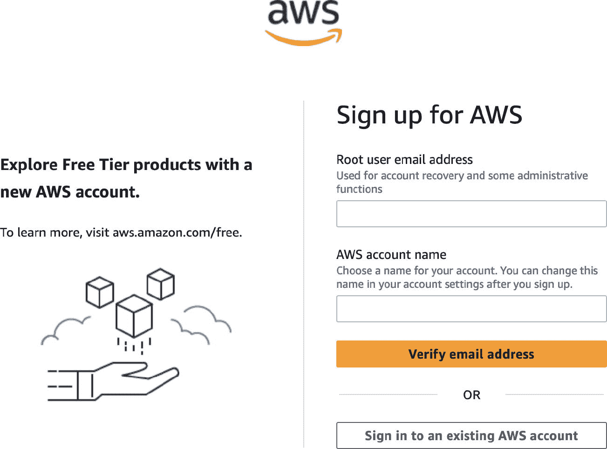

AWS 注册页面截图，显示了探索免费套餐产品以及创建或登录 AWS 账户的选项。

图 15-1
AWS 控制台


虽然可以直接使用根账户来配置和访问服务，但我建议你创建一个管理员账户来配置和访问 AWS 服务。为此，让我们使用 AWS Organizations 服务。AWS Organizations 是一项账户管理服务，可以管理多个账户。其流程是，在你的组织（根账户）内，你需要设置组织单元。组织单元基本上就是组织内的各个部门。接着，你需要创建服务控制策略，并将其分配给各个组织单元中的不同账户。为了便于说明，我们将创建两个组织单元，分别命名为“dev”和“prod”。然后，我们将邀请团队成员加入我们的组织单元。

注意

要模拟团队成员，可以选择创建临时电子邮件地址并将其添加到你的组织单元中。

完成注册并登录后，你将看到 AWS 管理控制台页面。界面如下所示：

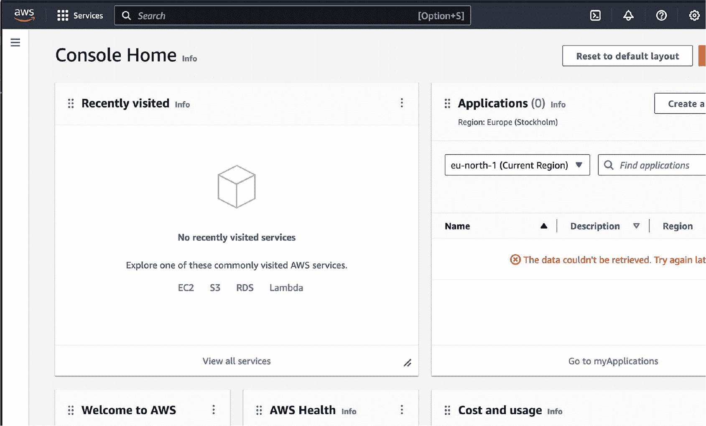

AWS 控制台首页截图。用户位于欧洲区域。没有显示最近访问过的服务。用户可以探索常用服务，如 EC2、S3、RDS 或 Lambda。

图 15-2
AWS 控制台首页

将光标导航到搜索区域，输入“AWS Organizations”，然后点击“创建新组织”。你将看到以下界面：

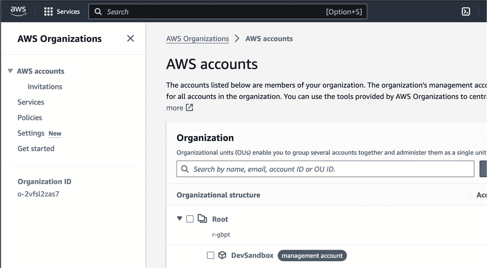

AWS Organizations 界面截图，显示了组织的账户列表，包括根账户和一个名为 Dev sandbox 的组织单元。

图 15-3
在 AWS Organizations 服务下创建新组织

下一步是创建一个组织单元。你会注意到屏幕中央显示的组织结构。请确保选中“Root”，然后点击“操作”，接着选择“创建组织单元”。

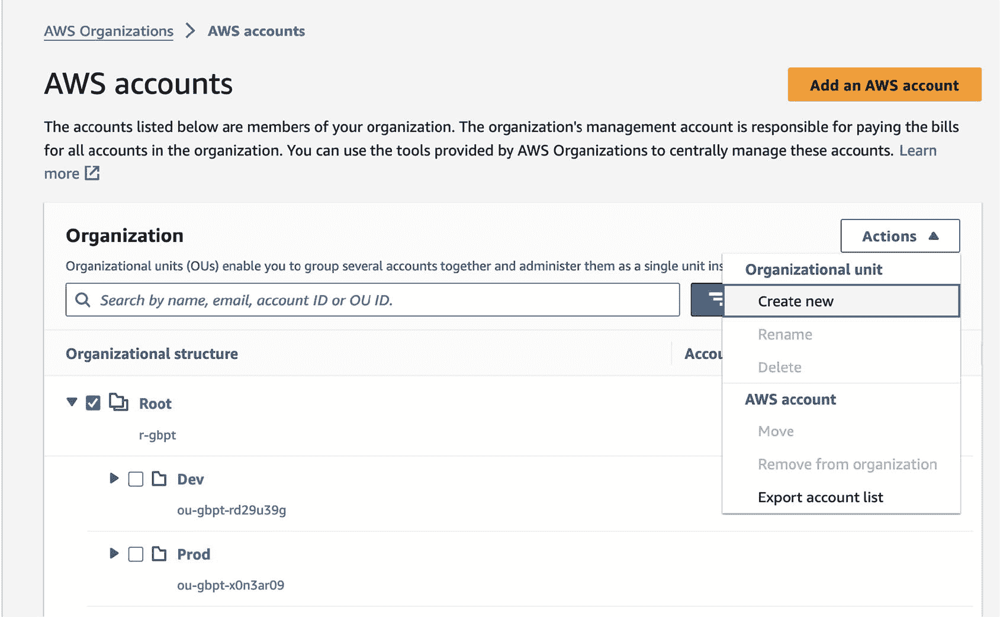

AWS 账户窗口截图。在“组织结构”下，已选中“Root”选项。右侧的组织单元下，“创建新项”选项被高亮显示。

图 15-4
创建新的组织单元

接下来是创建服务控制策略。服务控制策略是一种组织策略，用于管理组织内的权限。这些策略允许对组织内的成员进行受控访问。现在，我们将通过点击相应的按钮来启用服务控制策略，如下所示：

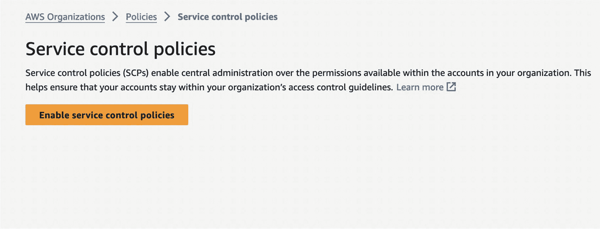

AWS 服务控制策略窗口截图，用于启用对组织内账户权限的集中管理。这有助于确保符合访问控制指南。

图 15-5
启用服务控制策略

现在我们已经启用了服务控制策略，接下来为我们的组织创建一个新策略，点击“创建策略”：

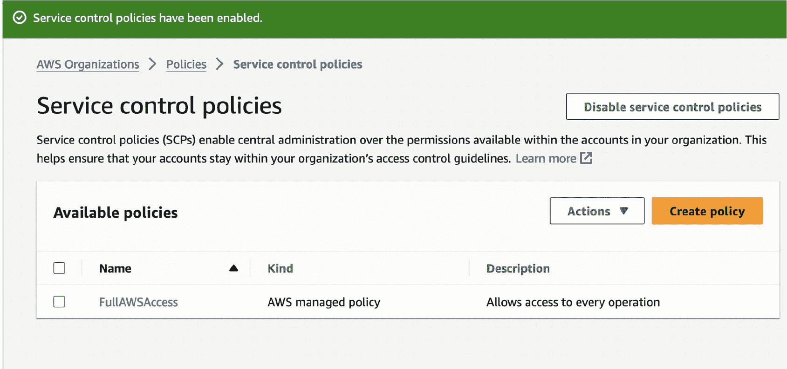

AWS 服务控制策略窗口截图。它显示了用于管理 AWS 账户内权限的服务控制策略的相关信息。该页面包含一个可用策略列表，其中包括一个名为 full AWS access 的策略，该策略允许访问所有操作。

图 15-6
创建新的服务控制策略

你将可以选择众多 AWS 服务中的一项，并为该策略选择适当的权限以及资源。选择好合适的策略后，点击“保存更改”。AWS 将根据我们在此处的选择自动创建一个 JSON 文件。策略创建过程如下所示：

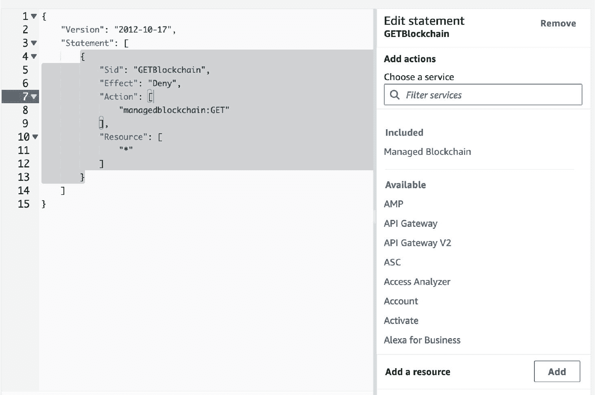

网页截图，左侧显示一个 JSON 代码块，右侧显示一个表单。JSON 代码块定义了一个托管区块链资源的策略文档。右侧的表单允许用户编辑策略语句、添加操作、选择服务以及筛选服务。

图 15-7
配置新的服务控制策略

创建好这些策略后，就可以将策略附加到账户了。为此，请转到主策略页面，选择合适的策略，点击“操作”，然后选择“附加策略”，将策略附加到相应的组织单元。操作如下所示：

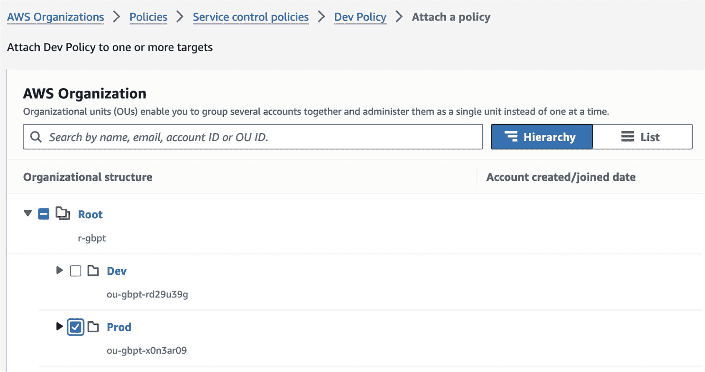

AWS Organizations 界面截图，显示了组织单元和账户的层级结构。用户正在将 Dev 策略附加到组织内的一个或多个目标。组织结构包括一个根、Dev 和 Prod。

图 15-8
将新的服务控制策略附加到 AWS 组织单元

一旦相应的策略被附加，你可以登录用户的账户来检查策略是否已生效。现在访问管理控制台，查找“IAM Identity Center”。请确保你使用的是创建 AWS 组织的账户登录。AWS IAM Identity Center 在 AWS 内提供单点登录（SSO）服务。你需要启用 AWS IAM Identity Center。页面如下所示：

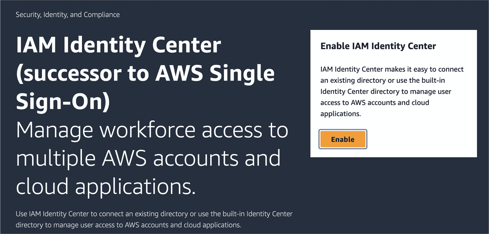

IAM Identity Center 窗口截图。它是一个用于管理员工对多个 AWS 账户和云应用程序访问权限的工具。右侧显示了一个启用它的选项。

图 15-9
启用 IAM Identity Center

注意

单点登录服务允许仅使用一个登录凭据即可集中进行身份验证和授权，以访问和使用众多服务、程序和软件。通常称为 SSO，你只需登录一次，即可获得访问各种服务的权限。

SSO 被认为是安全的，可审计的（因为它们提供日志记录），并且确实有助于组织满足法规遵从性要求。著名的例子包括 SAML、OAuth、Okta 等。
启用身份中心后，你需要创建权限集。权限集是用于创建身份和访问管理策略的模板。权限集允许向组织内的组和用户授予对各种服务的访问权限。操作如下所示：

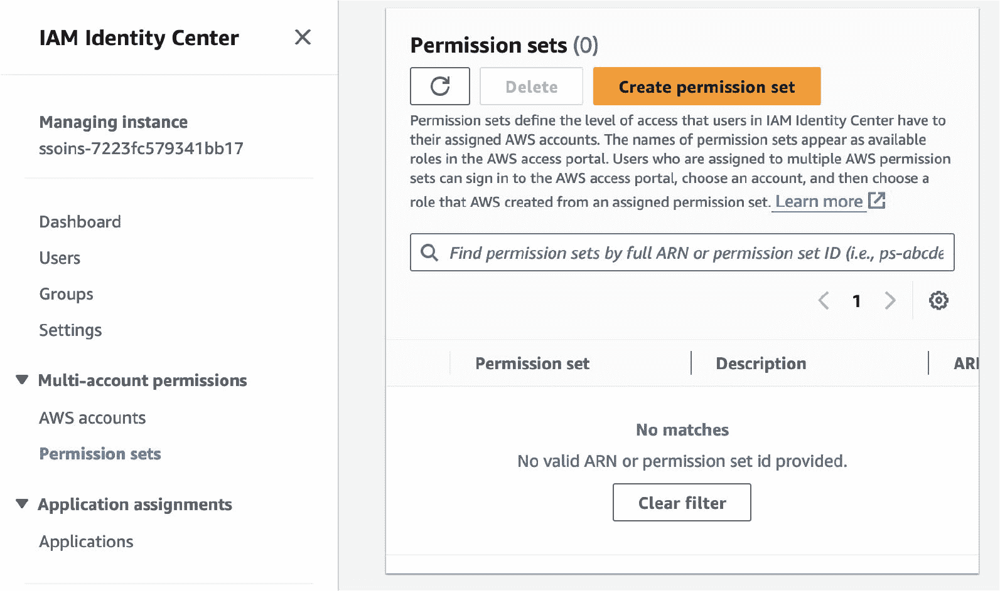

AWS 控制台中的 IAM Identity Center 截图。它显示了一个空的权限集列表。有一个用于创建新权限集的按钮。该界面还包括用于管理实例、用户、组、设置、多账户权限、应用程序分配和应用程序的部分。

图 15-10
IAM Identity Center 首页

现在我们将创建一个新的权限集。让我们尝试使用一个由 Amazon 预定义的权限集。为了便于说明，我们选择了“DatabaseAdministrator”权限集。操作如下所示：

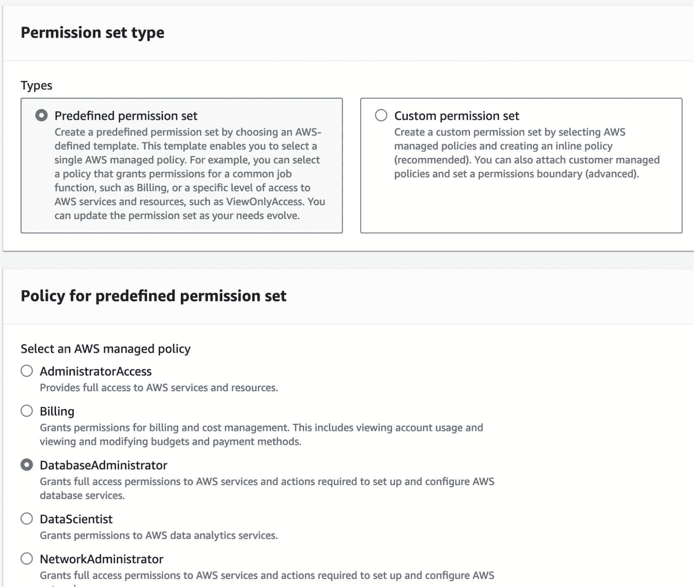

权限集类型窗口截图。在顶部，“类型”下选择了“预定义权限集”选项。在底部，“预定义权限集的策略”下选择了“数据库管理员”选项。

图 15-11
选择预定义的权限集

这将允许你输入关于该权限集的更多详细信息。此步骤成功后，你将看到以下界面：

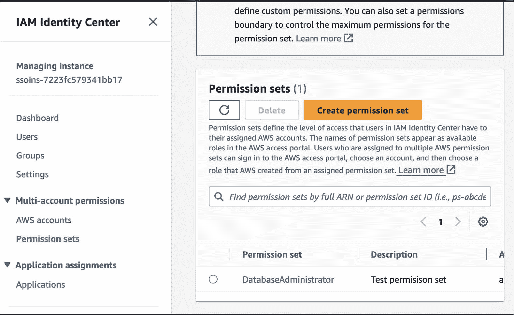


IAM 身份中心页面截图展示了用于管理实例的权限集。页面包含仪表盘、用户、组、设置、AWS 账户、权限集、应用程序等部分。主区域列出了权限集及其名称、描述，以及创建和删除等操作。

图 15-12
创建新的权限集

现在我们将创建一个用户。思路是创建用户，并为不同用户分配不同的权限集。你也可以将用户分配到组，并为组分配权限集。不过这是一个可选步骤。具体操作如下：

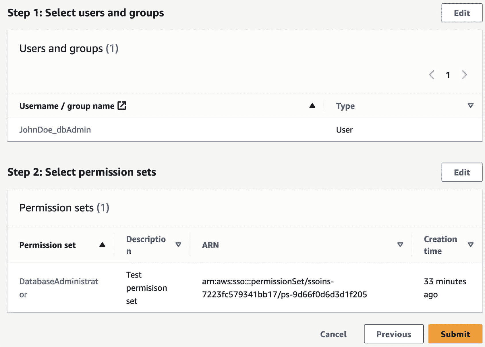

AWS 控制台截图。其中包含一个表单，用于将用户添加到权限集，分为两个步骤：1. 选择用户和组；2. 选择权限集。提交选项位于右下角。

图 15-13
在 IAM 身份中心内创建新用户

现在，我们需要将用户、权限集和组织连接起来；重新访问 AWS Organizations，选择相应的组织，然后选择用户并为该用户分配权限集。AWS Organizations 的界面如下：

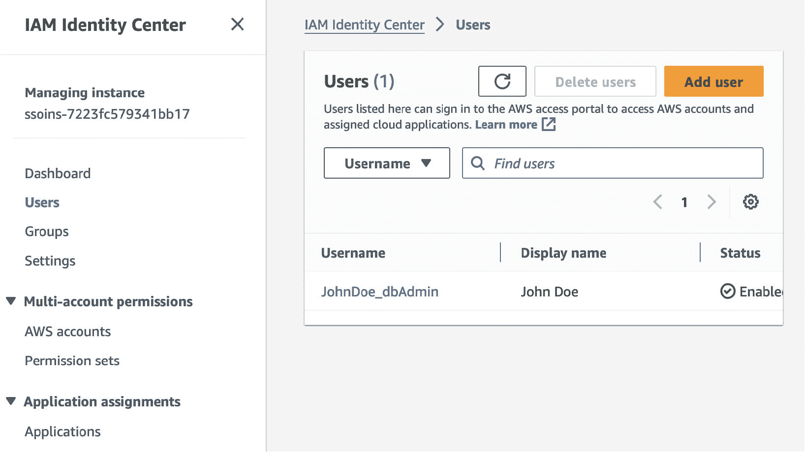

IAM 身份中心用户管理页面截图显示了一个名为 John Doe underscore d b admin 的用户，显示名称为 John Doe，状态为已启用。该用户列在用户部分，并提供了添加或删除用户、查找用户以及管理多账户权限的选项。

图 15-14
连接新用户、权限集和组织

点击“分配用户或组”，然后选择我们创建的用户。点击“下一步”后，为相应组织中的该用户选择权限集。点击“提交”，等待几秒钟，让 AWS 为该组织中的该用户创建权限集。最终界面如下：

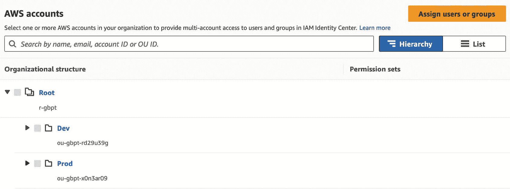

AWS 账户窗口截图。root、Dev 和 Prod 的文件位于组织架构下。右上角是“分配用户或组”的选项。

图 15-15
将用户分配到组织

完成上述步骤后，在 AWS IAM 身份中心点击“仪表盘”，获取该用户的 AWS 访问门户。界面如下：

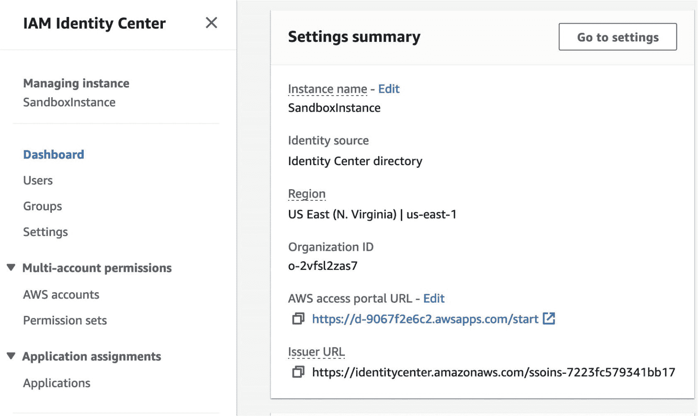

IAM 身份中心设置摘要截图，显示了实例名称、区域、组织 ID、AWS 访问门户 URL 和颁发者 URL。

图 15-16
获取相应用户的访问门户

你可以使用 AWS 访问门户 URL 登录。请使用我们通过 AWS IAM 身份中心设置的用户凭证，而不是 root 凭证。建议将此链接加入书签。

安装 AWS CLI
AWS CLI 是命令行界面，适用于 Windows、Linux 和 MacOS 等主流操作系统。详细说明请参考 AWS 文档网站。
设置好 AWS 组织后，接下来需要配置所谓的“单点登录”解决方案。

要配置命令行界面，使用 AWS SDK 或 REST API 连接到 S3 存储桶，我们需要设置安全凭证以获取访问密钥和秘密密钥。要创建访问密钥和密码，只需访问“身份和访问管理”门户，找到“安全凭证”部分，并按照说明创建访问密钥和秘密密钥。这些密钥将显示为一长串数字和字符。

要配置命令行界面，请输入：

```
aws configure
```

系统会要求你输入以下内容：

```
AWS Access Key ID [None]:
AWS Secret Access Key [None]:
Default region name [None]:
Default output format [None]:
```

并提供所需的凭证以继续。

配置完成后，你可以执行诸如列出存储桶、在存储桶之间移动对象等命令。以下是一个列出 S3 服务中所有存储桶的命令：

```
aws s3 ls
```

以下是一个列出指定存储桶中所有文件的命令：

```
aws s3 ls s3://
```

AWS S3
AWS S3 代表简单安全存储（Simple Secure Storage），是一种对象存储服务。S3 允许保留非结构化数据。S3 被认为针对“多次读取、一次写入”的使用场景进行了优化。与将数据存储为文件的文件系统不同，S3 以对象的形式存储数据。它是存储照片、视频和类似内容的绝佳选择。AWS 提供了编程接口，允许应用程序对存储在 S3 对象存储上的数据执行创建、更新、读取和删除操作。

Amazon 在其 S3 服务中提供了多种存储类型。Amazon S3 Standard 适用于读取量大的数据，是追求高吞吐量和低延迟的应用程序的理想选择。Amazon S3 IA（低频访问）适用于访问和读取频率不高的数据；理想的应用场景包括业务恢复和灾难规划、长期备份等。Amazon S3 Glacier 适用于可能永远不会被访问但需要保留的数据；应用场景包括生命周期结束的数据、为监管和合规目的而保留的备份等。

注意

让我们学习几个术语。在云对象存储的上下文中，我们有两个术语用于描述访问模式和存储需求。这两个术语分别是“热数据”和“冷数据”。
**热数据** 是一个或多个用户同时频繁访问或使用的数据。这些数据需要随时可用，并且需求持续不断。
**冷数据** 很少被访问；数据包括定期备份和历史数据。提供经济高效的存储（而非像热数据那样优化性能）可能是明智之举。

AWS 支持全局存储桶系统。要创建全局存储桶，必须在给定分区内使用唯一的名称。还可以选择创建可供所有人访问的公共存储桶。以下是创建 AWS S3 存储桶的方法：

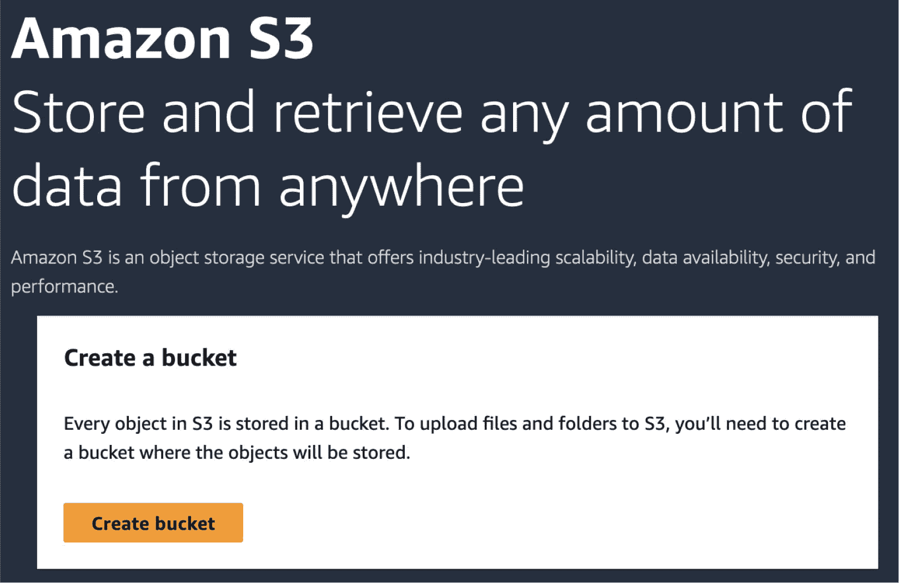

Amazon S3 截图，展示了该服务从任何位置存储和检索任意数量数据的能力。左下角有一个“创建存储桶”按钮。

图 15-17
AWS S3 服务主页

点击“创建存储桶”，你将进入存储桶创建页面。虽然最好保留默认选项，但以下是一些你可以考虑选择以最适合你的选项：

*   AWS 区域：选择地理上靠近你所在位置的区域。
*   存储桶类型：如果你是 AWS 新手，最好选择通用存储桶。
*   存储桶名称：除了遵循 AWS 的存储桶命名指南外，还应采用包含组织代码、部门代码、项目类型以及它是开发沙箱还是生产存储桶的命名约定；当你需要筛选多个存储桶时，这将大有帮助。

界面如下：

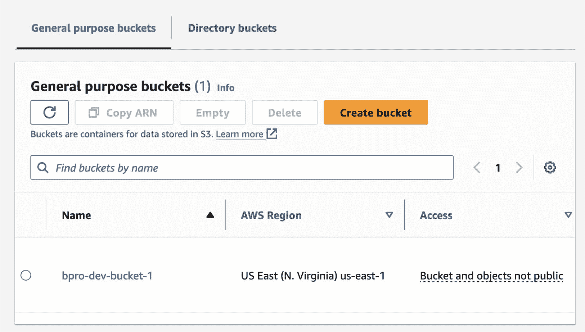

Amazon S3 控制台截图显示了一个通用存储桶列表。用户当前正在查看名为 b p r o d e v bucket 1 的存储桶，位于美国东部区域。该存储桶及其内容均不公开。

图 15-18
创建新存储桶

上传文件

以下是一个使用 AWS 命令行界面在指定存储桶中上传对象（文件）的示例：

```
aws s3api put-object \
--bucket  \
--body /Users/me/ \
--key destination-file-name
```

以下是使用 AWS SDK 上传文件的方法：


```
import boto3
import configparser
config = configparser.ConfigParser()
path = '/Users/pk/Documents/de/aws/s3/.aws/credentials.cfg'
config.read(path)
aws_access_key_id = config.get('aws','access_key')
aws_secret_access_key = config.get('aws','access_secret')
aws_region = 'us-east-1'
session = boto3.Session(
aws_access_key_id=aws_access_key_id,
aws_secret_access_key=aws_secret_access_key,
region_name=aws_region
)

