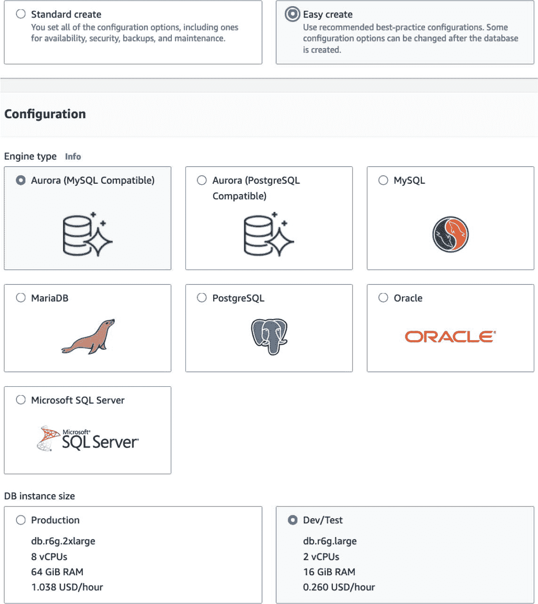
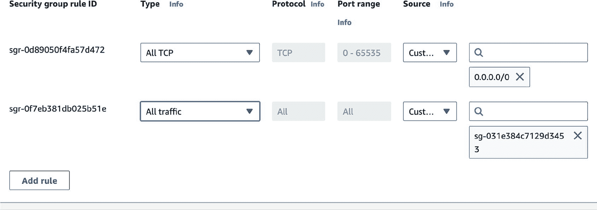

# 忽略敏感或机密信息（例如，凭证）
secretsconfig.json
topsecretpasswords.txt
credentials.cfg
```

不要忘记将 `.gitignore` 文件放在目录的根目录下，并提交该文件，这样其他 fork 该项目的人也能受益。请确保根据 `.gitignore` 忽略某些文件不会以任何方式影响代码。

AWS 数据系统
AWS 为用户提供了多种数据系统选项。在本节中，你将了解最常见或最广泛采用的服务。

Amazon RDS
RDS 代表关系数据库服务。顾名思义，Amazon RDS 提供关系数据库，并支持多种数据库引擎选项。其中一些包括但不限于 MySQL、PostgreSQL、Oracle、MS SQL Server 等。AWS RDS 易于在几分钟内设置，易于操作，并且可以在必要时进行扩展。AWS 将管理常见的数据库管理任务，因此你无需担心维护问题。
对于那些希望将数据库从本地环境迁移到云端的人来说，AWS RDS 是一个主要选择。通过为迁移选择合适的数据库引擎，可以在关系数据库系统传输过程中实现更快的速度和更高的可靠性。

让我们来看看如何创建一个新的数据库实例。你可以通过在 AWS 控制台中搜索“RDS”，打开相应页面，然后选择“创建数据库”来启动该过程。你可以选择通过自定义可用性、安全性、维护等各个选项来创建新数据库，也可以根据你的用例选择 AWS 推荐的配置。
你还可以指定此实例的性质：是需要一个高可用性的生产数据库实例，还是一个性能有限的开发沙箱即可满足需求。以下是可能呈现的样子：



Amazon RDS 配置页面的截图。顶部选择了“简易创建”选项。中间部分，在引擎类型下选择了 Aurora 选项。底部，在数据库实例大小下选择了“开发/测试”选项。

图 15-19
在 AWS RDS 中创建新的数据库实例

此外，请确保在安全配置中添加一条入站网络规则，允许所有传入 IP 通过 TCP/IP 进行通信。你可以在 VPC 选项卡下找到此选项。以下是可能呈现的样子：



安全组规则配置界面的截图。它有一个包含五列两行的表格。列标题如下：安全组规则 ID、类型、协议、端口范围和源。左下角是“添加规则”选项。

图 15-20
允许所有传入 IP 通过 TCP/IP 进行通信（仅用于学习和开发目的）

以下是一个连接到 AWS RDS 并将数据上传到表的 Python 应用程序：

```
import csv
import psycopg2
import configparser

