# Connect to your RDS instance
conn = psycopg2.connect(
dbname=dbname,
user=user,
password=password,
host=host,
port=port
)
cur = conn.cursor()
```


# CSV 文件路径
csv_file_path = "/Users//iris.csv"
try:
    with open(csv_file_path, 'r') as f:
        reader = csv.reader(f)
        next(reader)  # 跳过表头行
        for row in reader:
            cur.execute(
                "INSERT INTO users (id, name, age) VALUES (%s, %s, %s)",
                row
            )
        conn.commit()
        print("数据上传成功")
except:
    print("将数据加载到 AWS RDS 时出错")
finally:
    cur.close()
    conn.close()

Amazon Redshift
Redshift 是一个大规模可扩展的云数据仓库。它允许您加载 PB 级的数据，执行复杂的分析查询以使用 SQL 检索数据，并连接商业智能应用程序以呈现报告和仪表板。当数据仓库环境处于空闲状态时，您无需付费，因为只有在您通过传递查询或加载数据与 Redshift 积极交互时才会产生费用。Amazon Redshift 基于开放标准的 PostgreSQL；但是，它已被定制以支持在线分析处理应用程序和其他读取密集型应用程序。
Amazon Redshift 是一个类似列存储的数据仓库，具有可扩展性，并由 AWS 完全管理。以列存储方式存储数据可减少 Redshift 上的输入输出操作次数，并优化分析查询的性能。此外，您还可以指定 Redshift 中的数据被压缩，从而进一步减少存储需求，甚至优化查询。当您对压缩数据执行查询时，数据会被解压缩并运行。
Amazon Redshift 实例以集群形式创建。一个集群有一个领导节点和多个计算节点。领导节点管理通信，包括与客户端应用程序和计算节点的通信。对于用户提供的分析查询，领导节点会创建一个执行计划，并列出返回结果所需的执行步骤。领导节点编译查询并将一部分执行任务分配给计算节点。领导节点会将查询分配给包含查询中提到的底层表的计算节点。
计算节点本身被划分为多个切片。每个切片在计算节点内分配一部分物理内存和存储空间。因此，当领导节点将工作分配给计算节点时，工作实际上会到达给定计算节点内的给定切片。然后，计算节点会在集群内并行处理任务。一个集群可以包含一个或多个数据库，数据存储在计算节点中。
让我们尝试设置一个新的 Amazon Redshift 集群。首先，我们必须创建一个工作组。Redshift 中的工作组是一组计算资源，还包括 VPC 配置、子网组、安全组和一个端点。让我们访问 AWS 管理控制台并搜索 Redshift。进入主页面后，我们选择创建一个工作组。您将被引导至一个页面，您可以在其中指定工作组的 RPU。RPU 是 Redshift 处理单元，是可用计算资源的度量单位。您还可以选择 VPC 配置和子网组。以下是您可能看到的界面：

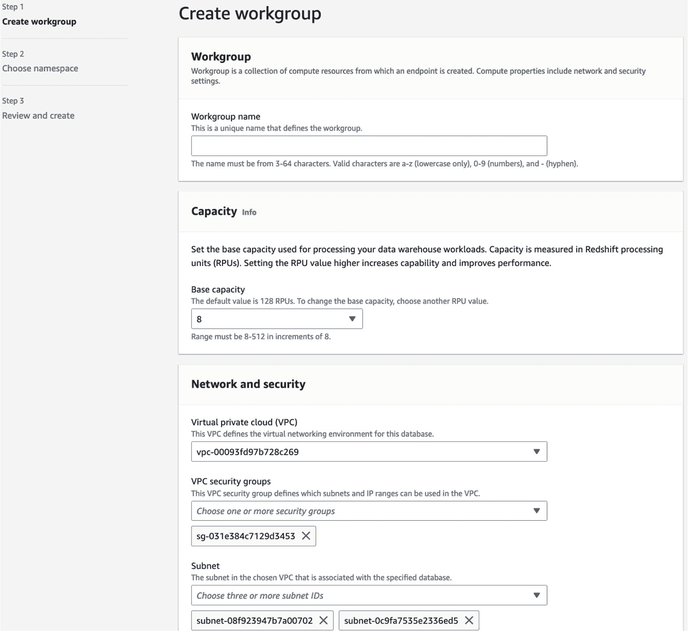

一个用于在 Amazon Redshift 中创建工作组的表单截图，显示了“审核并创建”步骤。该表单包括工作组名称、基础容量、VPC、安全组和子网等字段，部分已填写。之前的步骤涵盖了命名空间选择、基础容量以及网络和安全设置。

图 15-21
在 Amazon Redshift 中创建工作组

指定了各种参数后，您可能希望导航到预置集群仪表板以创建一个新集群。创建新集群时，您可以指定集群的名称、希望在集群上拥有的节点数量，以及希望为数据仓库集群获得的计算类型、RAM 和存储。
以下是您可能看到的界面：

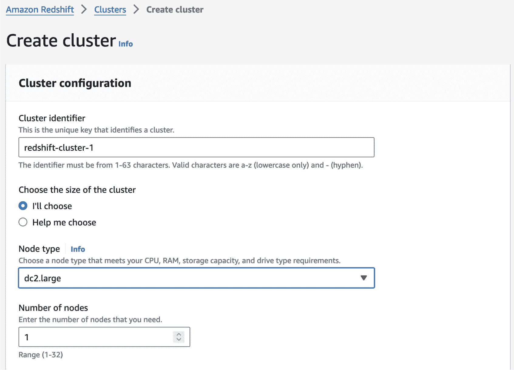

一个 Amazon Redshift 创建集群页面的截图。用户正在配置一个标识符为 Redshift cluster 1 的新集群。节点类型选择为 dc2.large，节点数设置为 1。在“选择集群大小”下选择了“我将选择”选项。

图 15-22
在 Amazon Redshift 中创建新集群

您还可以在创建 Redshift 集群时指定数据库凭据。如果您希望开始使用示例数据查询 Redshift 集群，可以单击“加载示例数据”。此外，您还可以选择创建一个新角色或将现有的 IAM 角色与其集群关联。

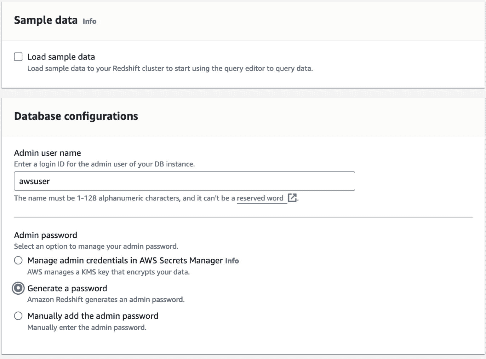

一个用于配置 Redshift 数据库的表单截图。该表单包括管理员用户名和密码字段。用户可以选择让 AWS Secrets Manager 生成密码或手动输入。还有一个选项可以将示例数据加载到 Redshift 集群。

图 15-23
为 Redshift 集群配置数据库凭据

选择其他选项后，您就可以创建新的 Redshift 集群了。单击“创建新集群”后，您可能需要等待几分钟才能创建好集群。集群准备就绪并加载了示例数据后，您可能希望单击集群仪表板页面上的查询编辑器。我们可以选择查询编辑器版本 2，它的界面更简洁。以下是查询编辑器的可能外观：

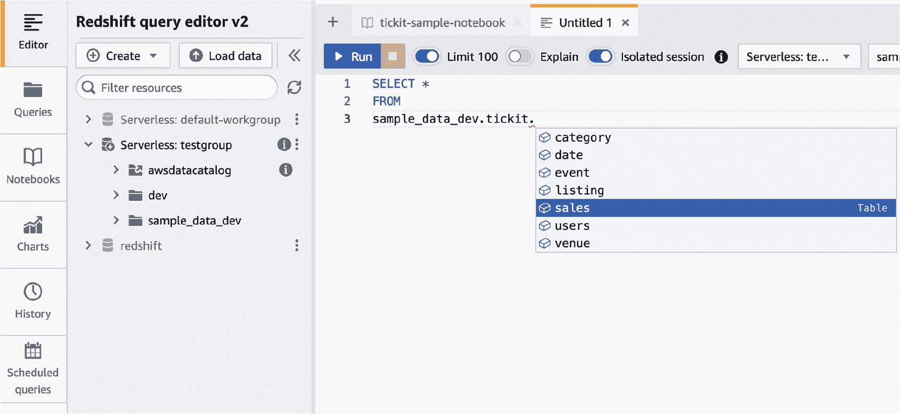

一个 Redshift 查询编辑器界面的截图。编辑器显示了一个 SQL 查询，包含一个 select 语句和一个引用 sample_data_dev.tickit 的 from 子句。在 sample_data_dev.tickit 下选择了 Sales。

图 15-24
具有新界面的 Redshift 查询编辑器 2

您可以从查询编辑器编写查询、访问各种数据库，还可以探索 AWS Glue Data Catalog。此外，您可以在查询编辑器中针对 Redshift 集群中的数据创建视图、存储过程和函数。在左上角，您可以选择使用图形用户界面创建新数据库或表，或直接从您的某个 S3 存储桶加载数据。让我们看看如何使用 Python 将数据从 S3 存储桶加载到 Redshift。以下是一个示例代码，它从 S3 存储桶中获取一个平面文件并将其加载到 Redshift 数据库中：

```
import boto3
import configparser
config = configparser.ConfigParser()
path = '/Users//credentials.cfg'
config.read(path)
aws_access_key_id = config.get('aws','access_key')
aws_secret_access_key = config.get('aws','access_secret')
aws_region = 'us-east-1'
s3_bucket_name = 'your-bucket'
s3_key = 'key'
table_to_be_copied = 'nba_shots.csv'
redshift_cluster_identifier = config.get('redshift','cluster_id')
redshift_database = config.get('redshift','r_dbname')
redshift_user = config.get('redshift','r_username')
redshift_password = config.get('redshift','r_password')
redshift_copy_role_arn = config.get('redshift','redshift_arn')
s3 = boto3.client(
    's3',
    aws_access_key_id=aws_access_key_id,
    aws_secret_access_key=aws_secret_access_key,
    region_name=aws_region
)
redshift = boto3.client(
    'redshift',
    aws_access_key_id=aws_access_key_id,
    aws_secret_access_key=aws_secret_access_key,
    region_name=aws_region
)
copy_query = f"""
COPY {table_to_be_copied}
FROM 's3://{s3_bucket_name}/{s3_key}'
IAM_ROLE '{redshift_copy_role_arn}'
FORMAT AS CSV;
"""
def execute_redshift_query(query):
    try:
        redshift_data = boto3.client(
            'redshift-data',
            aws_access_key_id=aws_access_key_id,
            aws_secret_access_key=aws_secret_access_key,
            region_name=aws_region
        )
        response = redshift_data.execute_statement(
            ClusterIdentifier=redshift_cluster_identifier,
            Database=redshift_database,
            DbUser=redshift_user,
            Sql=query,
            WithEvent=True
        )
        return response
    except Exception as e:
        print(f"执行 Redshift 查询时出错: {e}")
        return None
response = execute_redshift_query(copy_query)
print(response)
```

Amazon Athena
Amazon Athena 是一项交互式查询服务，允许您直接使用标准 SQL 语法分析对象存储 AWS S3 中的数据。使用 Amazon Athena，您还可以选择使用 Apache Spark 直接在 S3 存储桶上运行数据分析。无需设置底层的 Spark 基础设施或数据库连接驱动程序。Amazon 会为您处理所有这些事宜。Amazon Athena 是一项无服务器服务，因此您只需按使用量付费，即按请求数量付费。
由于您能够直接查询对象存储中的存储桶，您现在可以分析存储桶内的非结构化、半结构化和结构化数据。数据可以是任何格式，包括但不限于 CSV、JSON、Parquet 和 Apache ORC。所有这些都可以使用 Athena 进行分析。通过使用 Amazon Athena，您可以查询 S3 中的各种数据；因此，您可以将 S3 用作数据湖，而 Athena 则作为数据湖的查询层。查询将自动并行化并执行，提供原生更快的性能。
要开始使用 Amazon Athena，请在 AWS 管理控制台中搜索 Athena，并选择查询 S3 存储桶数据的选项（SQL 或 Spark）。以下是您可能看到的界面：

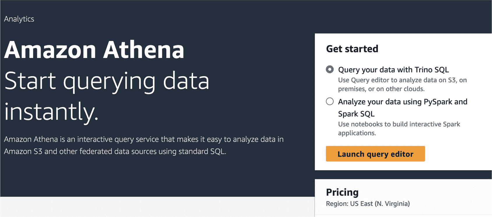

一个 Amazon Athena 的截图。它显示了 Athena 主页，提供了使用 Trino SQL 查询数据或使用 PySpark 和 Spark SQL 分析数据的选项。

图 15-25
AWS Athena 主页

您还可以通过与 Jupyter Notebook 交互，在 S3 存储桶中的对象上使用 Spark SQL。以下是您可能看到的界面：

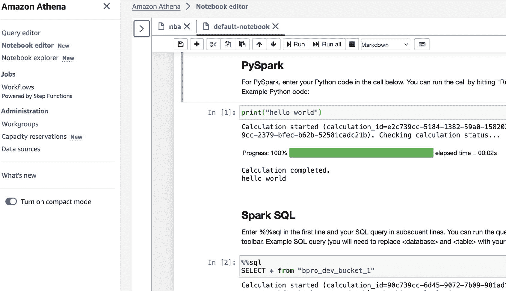

一个 Amazon Athena 界面的截图，显示了一个包含 Python 和 SQL 代码示例的笔记本编辑器。Python 代码打印了 Hello World，SQL 查询从指定的存储桶中选择数据。该界面还包括用于运行代码、创建新笔记本和探索数据源的按钮。

图 15-26
AWS Athena — Jupyter Notebook 工作区

Amazon Glue
Amazon Glue 是一项无服务器数据集成工具。您可以使用 Glue 发现数据源、集成数据，并为数据分析、机器学习和应用程序开发准备数据集。Amazon Glue 拥有 Glue Studio，它允许您以可视化方式准备数据集成作业，您可以将组件拖放到工作区中。设计好作业后，您可以直接从 Glue 环境中运行和监控这些作业。您可以根据计划时间或事件触发作业。

AWS Lake Formation
AWS Lake Formation 是一项数据湖服务。数据湖是结构化和非结构化数据可以共存、查询和分析的地方。它简化了数据湖的构建和管理。与需要多年的项目不同，AWS Lake Formation 可以让您更快地投入生产。AWS Lake Formation 提供了一个数据编目工具，用于捕获各种数据集的元数据，以便您可以有效地搜索和检索给定的数据集。
AWS Lake Formation 将数据存储在 S3 存储桶中，无论其是结构化还是非结构化数据。使用 Lake Formation 创建数据湖的关键方面之一是列出各种数据源，无论其数据类型如何，以及将应用于数据湖的安全和访问策略。让我们看一个将 Lake Formation 与 Athena 和 Glue 结合使用的简单示例。
首先，让我们在对象存储中创建一个新的存储桶：

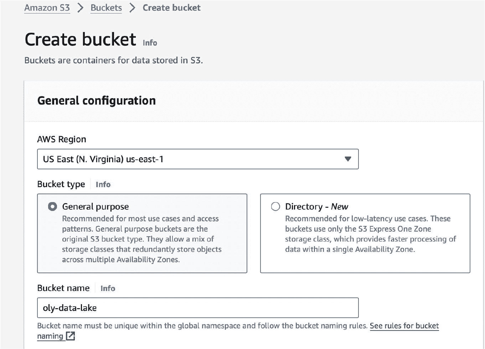

一个 Amazon S3 存储桶创建表单的截图。在存储桶类型下选择了通用选项。

图 15-27
为 Lake Formation 项目创建新的 S3 存储桶

让我们创建两个文件夹，一个用于源数据，另一个用于在数据湖存储桶中运行基于 Glue 的报告。以下是您可能看到的界面：

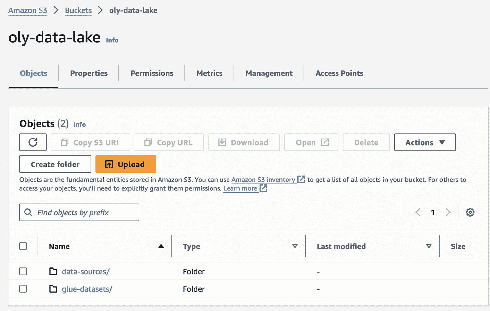

一个 Amazon S3 存储桶 `oly-data-lake` 的截图，显示了一个包含两个对象的列表。它还包括用于创建新文件夹、上传文件、复制 S3 URI、复制 URL、下载、打开、删除以及对对象执行其他操作的选项。

图 15-28
在对象存储中创建文件夹

现在让我们配置数据湖。我们将导航到 AWS 管理控制台并搜索 Lake Formation。我们将在 AWS Lake Formation 中创建一个数据库，并从 S3 存储桶配置我们的数据源文件夹。创建一个数据库，指定一个名称，并为数据库选择数据源位置。以下是您可能看到的界面：

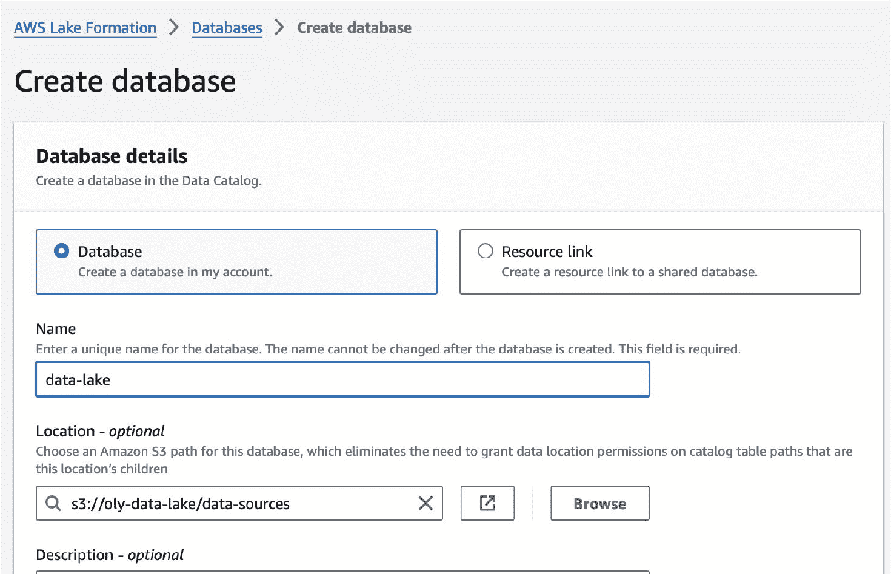

一个 AWS Lake Formation 创建数据库表单的截图。用户正在填写表单，以在其账户中创建一个名为 `data-lake` 的新数据库。该数据库将位于 S3 路径 `s3://oly-data-lake/data-sources`。

图 15-29
在 Lake Formation 中创建新数据库

现在让我们配置 AWS Glue，以便我们可以自动编目数据源存储桶中的表。在此之前，我们需要在 AWS 中创建一个 IAM 角色，AWS Glue 将使用该角色来创建爬网程序。AWS Glue 中的爬网程序是一个可以从多个源抓取或获取数据的程序。首先，让我们在 AWS 管理控制台中查找 IAM，导航到该服务，然后单击“角色”以创建一个角色。以下是您可能看到的界面：

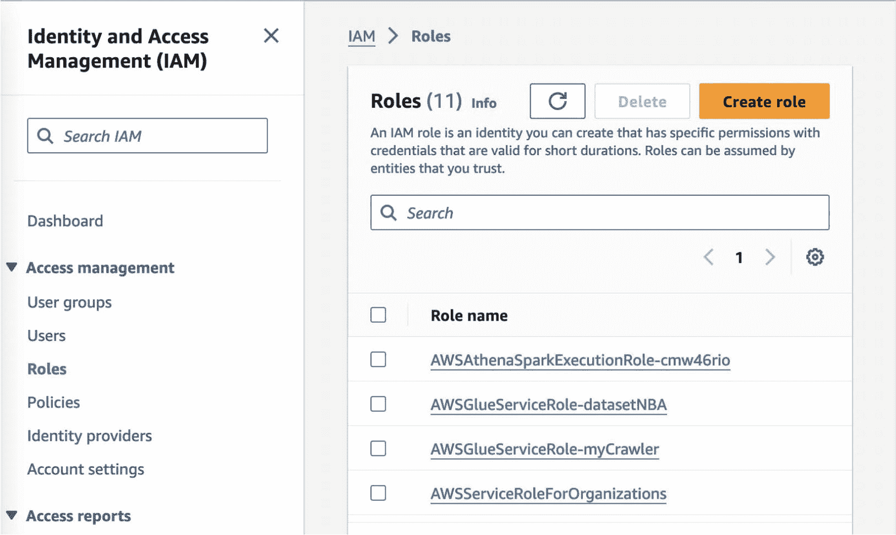

一个 AWS IAM 角色页面的截图。在左侧窗格中，选择了“角色”选项。在右侧，它显示了一个现有角色的列表。有创建新角色、搜索角色以及查看每个角色更多信息的选项。

图 15-30
在 IAM 中创建新角色

对于受信任的实体类型，选择“AWS 服务”，对于用例，单击下拉菜单并选择“Glue”。以下是您可能看到的界面：

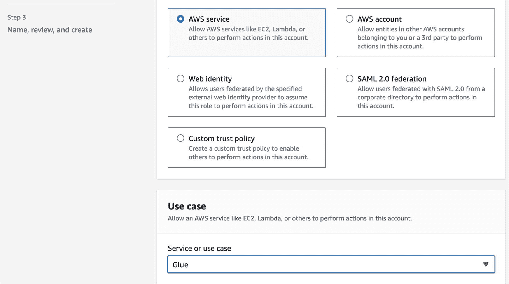

一个 AWS 控制台屏幕的截图，显示了一个流程中的步骤。用户正在选择允许 AWS 服务在 AWS 账户中执行操作的选项。在服务或用例下列出了 glue 选项。

图 15-31
在 IAM 中选择受信任的实体类型

以下是此 IAM 角色所需的权限；选择一个合适的名称并创建 IAM 角色：

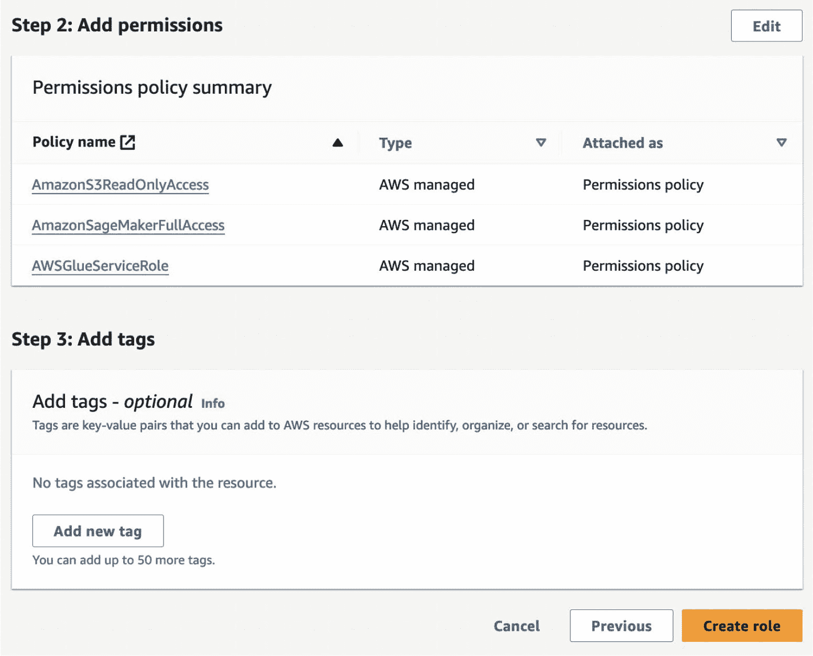

一个 AWS IAM 角色创建向导的截图。顶部是步骤 2，添加权限页面，带有一个表格。它有三列三行。底部显示步骤 3，添加标签。创建角色的选项在右下角。

图 15-32
为新 IAM 角色添加权限

现在，我们将授予这个新创建的角色在我们的 Lake Formation 中创建目录的权限。导航到 AWS Lake Formation，选择我们的数据湖，并从“操作”中授予权限：
以下是您可能看到的界面：

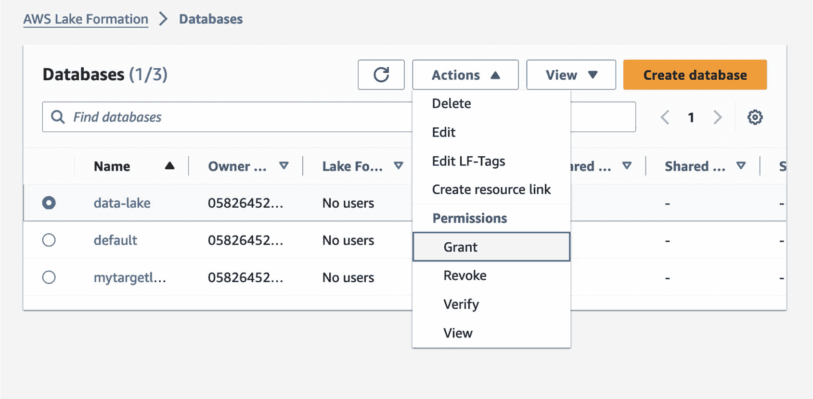

一个 AWS Lake Formation 的截图，显示了一个数据库列表，包含名称、所有者、Lake Formation 标签、共享和操作等列。第一行被选中。在操作下选择了“授予”选项。

图 15-33
在 Lake Formation 中为新创建的角色授予权限

选择新创建的 IAM 角色，并在命名的数据目录资源下选择数据湖。在数据库权限中，也提供创建表访问选项。现在让我们找到 AWS Glue 服务。
您可以在 AWS 管理控制台中搜索 Glue，或者单击 AWS Lake Formation 中的爬网程序选项直接导航到 AWS Glue 服务。

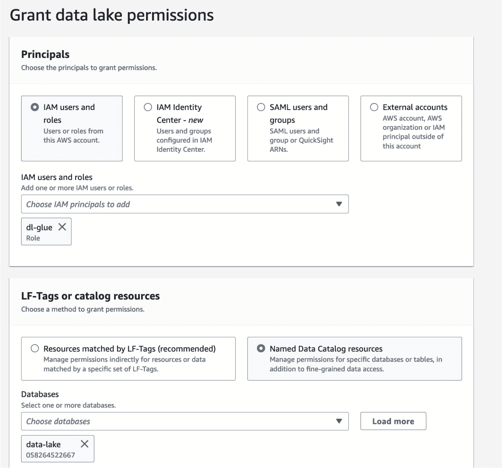

一个“授予数据湖权限”窗口的截图。在顶部，在主体下选择了 IAM 用户和角色选项。在底部，在 LF 标签或目录资源下选择了命名的数据目录资源选项。

图 15-34
在权限页面中选择 IAM 用户

我们将创建一个新的爬网程序，在其中我们将指定数据湖存储桶中的“data-sources”文件夹作为输入，分配新创建的“dl-glue”IAM 角色，并为目标数据库选择“data-lake”存储桶。
以下是创建爬网程序的方法：

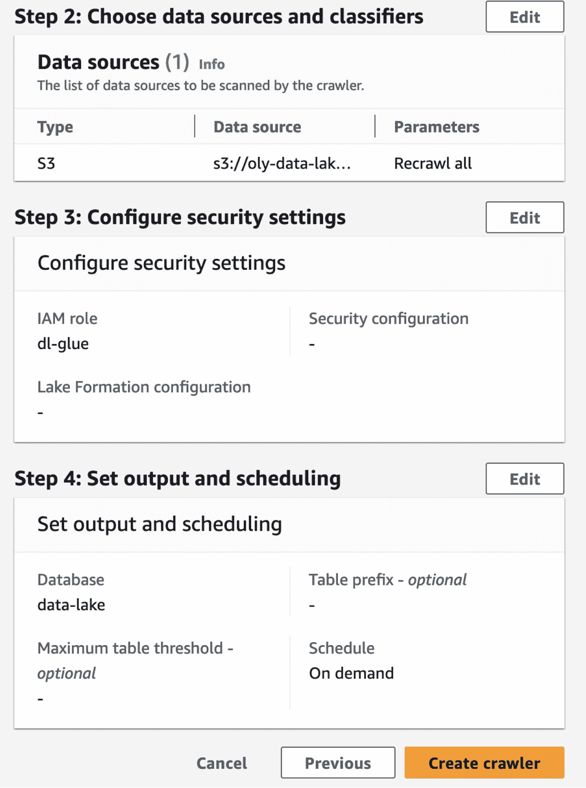

一个用于在 AWS Lake Formation 中创建新爬网程序的截图。步骤标记如下：步骤 2，选择数据源和分类器。步骤 3，配置安全设置。步骤 4，设置输出和调度。创建爬网程序的选项在右下角。

图 15-35
使用指定的源和 IAM 角色创建新爬网程序

创建爬网程序后（可能需要几分钟），您可以在 AWS Glue 中看到您新创建的爬网程序。
选择爬网程序并单击“运行”。您可能需要再等几分钟让爬网程序运行。
在此过程中，AWS Glue 爬网程序将推断来自数据源文件夹的输入数据集的结构，并将元数据存储在数据目录中。
以下是您可能看到的界面：

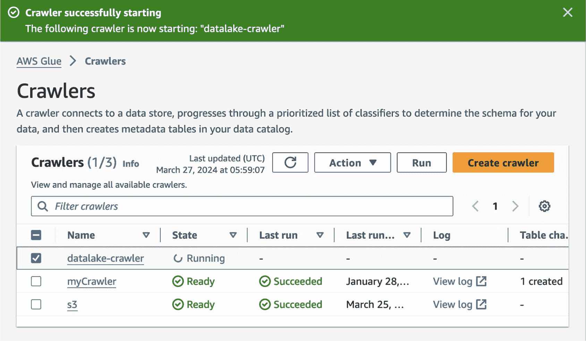

一个爬网程序窗口的截图。它有一个包含六列三行的表格。列标题如下：名称、状态、上次运行、上次运行时间、日志和表。第一行被选中。

图 15-36
在 AWS Glue 中初始化新爬网程序

到目前为止，我们已经成功设置了 AWS Lake Formation，将数据源指向 AWS S3 存储桶，使用 AWS IAM 创建了必要的服务账户，配置并运行了 AWS Glue 爬网程序，并填充了数据目录。我们现在将使用 AWS Athena 查询数据以提取洞察。访问 AWS 管理控制台以导航到 AWS Athena 服务。选择使用 Trino SQL 查询数据的选项，然后单击“启动查询编辑器”。以下是您可能看到的界面：

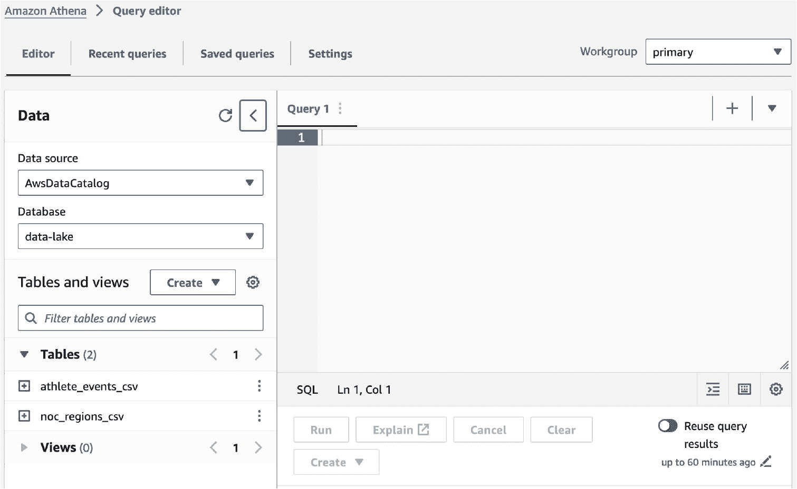

一个 Amazon Athena 查询编辑器的截图，显示了一个空白的查询区域。数据源设置为 AwsDataCatalog，数据库设置为 data-lake。列出了两个表：athlete_events_csv 和 noc_regions_csv。有运行、解释、取消、清除和重用查询的选项。

图 15-37
AWS Athena 查询编辑器

现在让我们设置一个输出文件夹，用于存储查询结果。在顶部，单击“设置”选项，然后单击“管理设置”。单击“浏览 S3”选项，导航到数据湖 S3 存储桶并选择“Output datasets”选项。保存设置。

现在，我们准备好在 AWS Athena 中编写查询并从数据集中提取洞察。让我们编写一个简单的查询：

```
select
distinct year, season, city
from
events_csv
where
year < 2020
order by year desc
```

以下是它在编辑器中的样子：

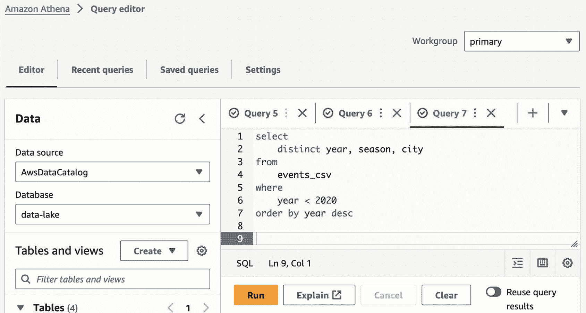

一个 Amazon Athena 查询编辑器的截图，显示了一个 SQL 查询，用于从 data-lake 数据库的 events_csv 表中选择不同的年份、季节和城市，过滤 2020 年之前的年份，并按年份降序排列结果。

图 15-38
使用 AWS Athena 查询数据湖

该查询将产生以下结果：

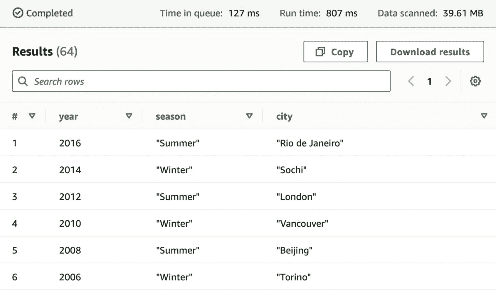

一个结果窗口的截图。它有一个包含四列六行的表格。列标题如下：#、year、season 和 city。复制和下载结果的选项在右上角。

图 15-39
在 AWS Athena 中检索结果

正如我们之前提到的，此查询的结果已存储在我们之前指定的 S3 存储桶下的文件夹中。让我们导航到该文件夹查看查询结果。您将看到一个按日期、月份和年份创建的复杂文件夹结构层次。找到 CSV 文件类型并单击“使用 S3 Select 查询”。您将看到一个已填充的简单查询，因此只需选择运行查询即可获得结果。
以下是您可能看到的界面：

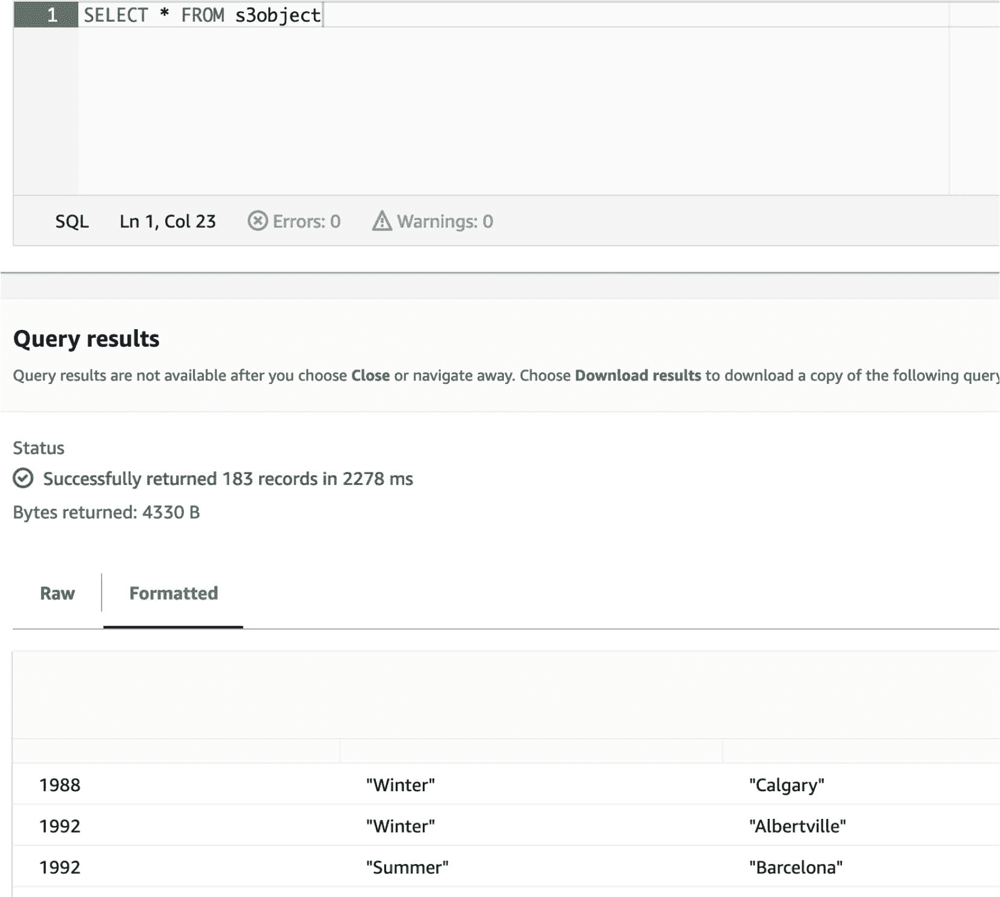

一个 SQL 查询结果的截图，显示了来自 s3 对象表的数据。查询成功返回了 183 条记录，耗时 2278 毫秒。结果格式化为三列：year、season 和 city。

图 15-40
S3 存储桶内文件夹中的查询结果

AWS SageMaker
Amazon SageMaker 是 AWS 提供的一项完全托管的机器学习服务。它使您能够大规模地构建、训练、测试和部署机器学习模型。您还可以选择开发无代码或低代码的机器学习模型。AWS SageMaker 支持行业领先的机器学习工具包，如 scikit-learn、TensorFlow、PyTorch、Hugging Face 等。
AWS SageMaker 有几种变体。AWS SageMaker Studio 带有一个功能齐全的 ML 集成开发环境。它附带一个 Jupyter notebook，让您可以控制模型构建的每一步。AWS SageMaker Studio Lab 是 AWS SageMaker Studio 的一个用户友好、简化版本，但硬件支持有限。您将获得 16 GB 的物理内存和 15 GB 的存储空间，并且无法扩展，而 SageMaker Studio 允许您指定更大的计算能力和内存。还有 SageMaker Canvas，这是一个用于开发预测模型的低代码环境。
要设置 AWS SageMaker Studio，请转到服务页面，并选择“设置 SageMaker 域”选项。以下是您可能看到的界面：

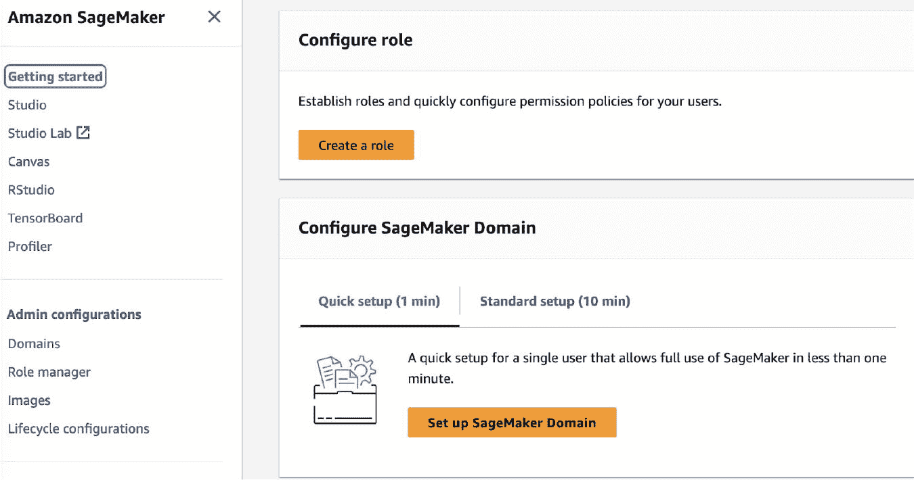

一个 Amazon SageMaker 配置页面的截图。系统提示用户创建一个角色并配置 SageMaker 域。在“配置 SageMaker 域”下选择了“快速设置”选项。

图 15-41
设置 SageMaker 域

一旦为您创建了 SageMaker 域，您就可以从该域启动 SageMaker Studio。以下是您可能看到的界面：

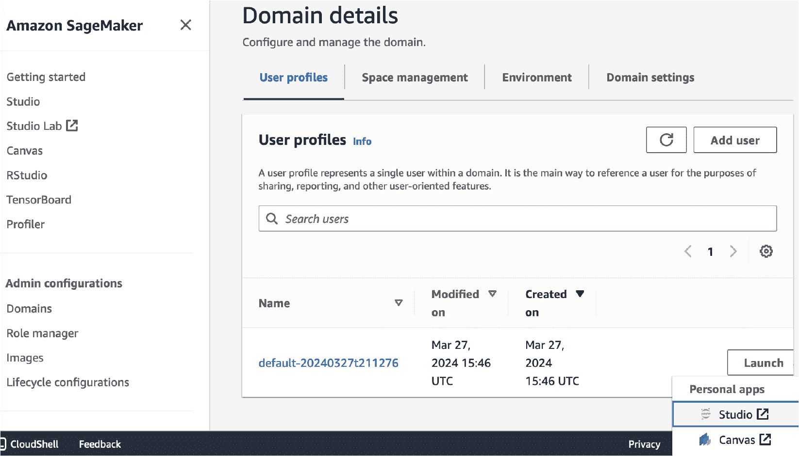

一个 Amazon SageMaker 域详细信息页面的截图，显示了用户配置文件、管理员配置和域设置。用户当前正在查看“用户配置文件”选项卡，该选项卡列出了域的创建和修改日期。

图 15-42
启动 AWS SageMaker Studio

以下是 SageMaker 可能呈现给您的样子：

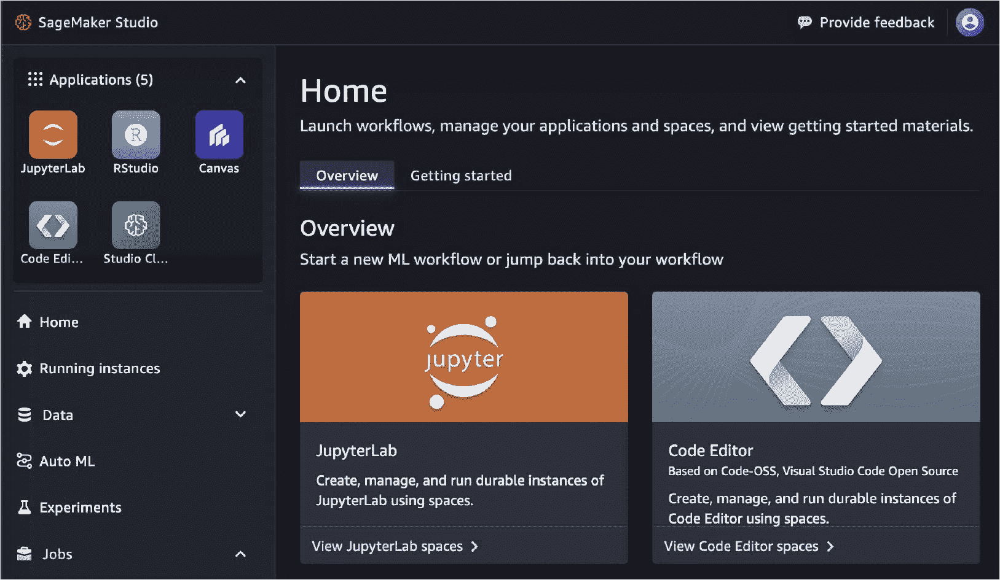

一个 SageMaker Studio 窗口的截图。它显示了主页，其中包含启动工作流、管理应用程序和空间以及查看入门材料的选项。有 Jupyter Lab、R Studio 和 Canvas 部分，以及代码编辑器和 Studio 配置选项。

图 15-43
AWS SageMaker 主页

让我们尝试使用 Amazon SageMaker 构建和部署一个机器学习模型。我们将构建一个简单的机器学习模型，将其托管在一个实例上，创建一个可用于与模型交互的 API，并创建一个可以访问该端点的 Lambda 函数。
首先，让我们打开 JupyterLab 并选择新的 JupyterLab 空间。您将为 JupyterLab 实例提供一个名称，然后继续选择底层硬件。我的建议是使用实例 `ml.t3.medium`，因为当您开始使用 SageMaker 时，可以获得 250 小时的免费计算时间。
“映像”选项基本上是一个为机器学习任务适当配置的 Docker 镜像。
例如，设置可能如下所示：

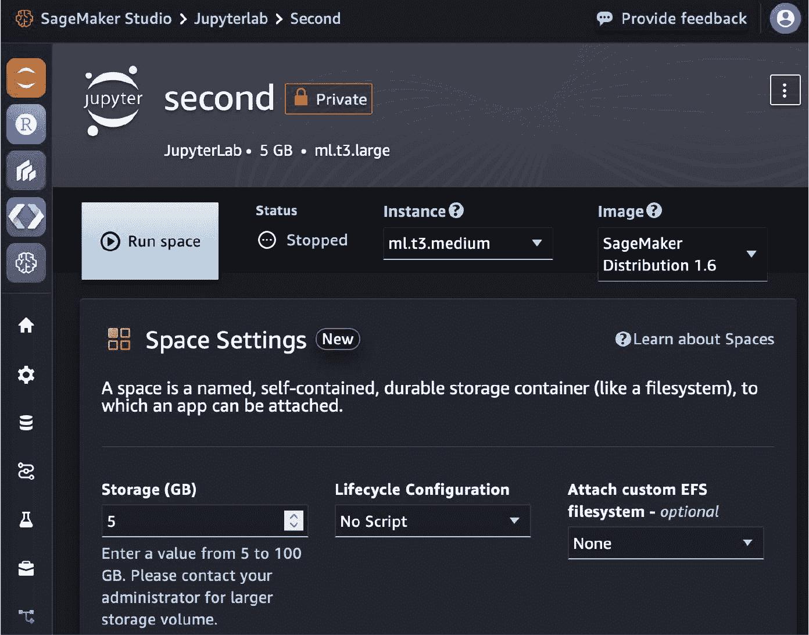

一个 SageMaker Studio 窗口的截图。它显示了一个名为 Second 的 Jupyter Lab 空间。该空间当前已停止，使用 `ml.t3.medium` 实例和 SageMaker Distribution 1.6。有一个空间设置部分，包括存储和生命周期配置选项。

图 15-44
在 AWS SageMaker 上创建和配置新的 Jupyter 空间

对于我们的简单示例，我们将选择泰坦尼克号数据集，其结果是船撞上冰山时乘客幸存的可能性。出于说明目的，我们选择了一个更简单的数据集，并删除了一些列。我们正在导入必要的库，预处理数据集，运行 SageMaker 的线性学习器模型，并创建一个可以托管在另一个实例上的端点。我们使用 Amazon SageMaker 的线性方法来获取模型。

以下是代码：

```
import sagemaker
from sagemaker.sklearn.model import SKLearnModel
from sagemaker import get_execution_role
import numpy as np
import pandas as pd
df = pd.read_csv("titanic.csv")
df = df.dropna(
    subset=["Age"]
)
df = df.drop(
    ['Name','Sex','Ticket','Cabin','Embarked'],
    axis=1
)
df.to_csv("titanic_subset.csv")
rawdata = np.genfromtxt(
    "titanic_subset.csv",
    delimiter=',',
    skip_header=1
)
train = rawdata[:int(len(rawdata) * 0.8)]
test = rawdata[int(len(rawdata) * 0.8):]
Xtr = train[:, :-1]
Ytr = train[:, -1]
Xts = test[:, :-1]
Yts = test[:, -1]
linear = sagemaker.LinearLearner(
    role = get_execution_role(),
    instance_count = 1,
    instance_type = 'ml.m5.large',
    predictor_type='regressor',
    sagemaker_session=sagemaker.Session()
)
train_data_records = linear.record_set(
    Xtr.astype(np.float32),
    labels=Ytr.astype(np.float32),
    channel='train'
)
linear.fit(train_data_records)
predictor = linear.deploy(
    initial_instance_count=1,
    instance_type='ml.t3.medium'
)
```

让我们在 JupyterLab 笔记本上运行此代码，并记下 SageMaker 生成的端点。我们将把这个端点托管在另一个 SageMaker 实例上。然后，我们将有一个 Lambda 函数来调用托管的 API。Lambda 函数通常具有关联的特定 IAM 角色，以便与其他服务协同工作。
让我们创建一个新的 IAM 角色，用于与机器学习模型交互。让我们在 AWS 管理控制台中找到 IAM，在左侧找到“身份和访问管理”选项，单击“角色”；创建一个新角色，并为 Lambda、SageMaker 和 CloudWatch 服务分配完全访问权限。以下是您可能看到的界面：

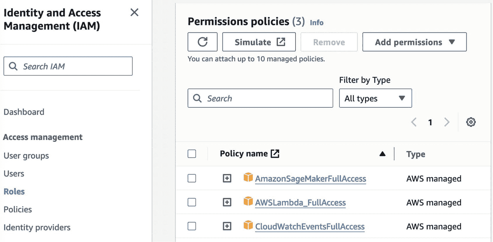

一个选项卡的截图。在左侧窗格中，在“身份和访问管理”下选择了“角色”选项。在右侧，它在“权限策略”下有一个包含两列三行的表格。列标题如下：策略名称和类型。

图 15-45
为 ML 创建新的 IAM 角色

现在让我们创建一个 Lambda 函数。导航到 AWS 管理控制台并搜索“Lambda”服务。选择创建函数，选择“从头开始创作”选项，选择 Python 作为运行时配置，并保持架构选择不变。
以下是 AWS Lambda 中“创建函数”页面的样子：

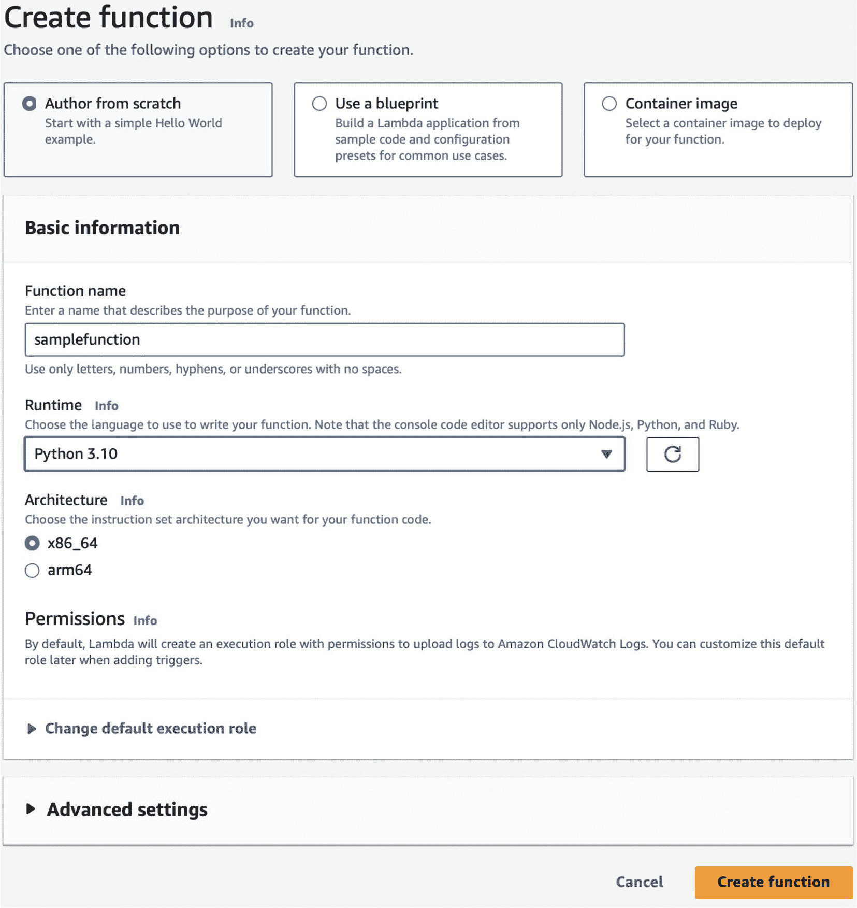

一个 AWS 控制台中 Lambda 函数创建页面的截图。系统提示用户输入函数名称，选择运行时、架构和权限。在运行时和架构下分别选择了 Python 3.10 和 x86_64。

图 15-46
在 AWS Lambda 中创建新的 Lambda 函数

确保通过使用现有角色来更改默认执行角色，并从下拉选项中选择您创建的 IAM 角色。
AWS Lambda 函数附带起始代码，其中 Lambda 函数有两个参数，一个接受触发函数的事件，另一个包含运行时参数。
以下是 AWS Lambda 中仪表板的样子：

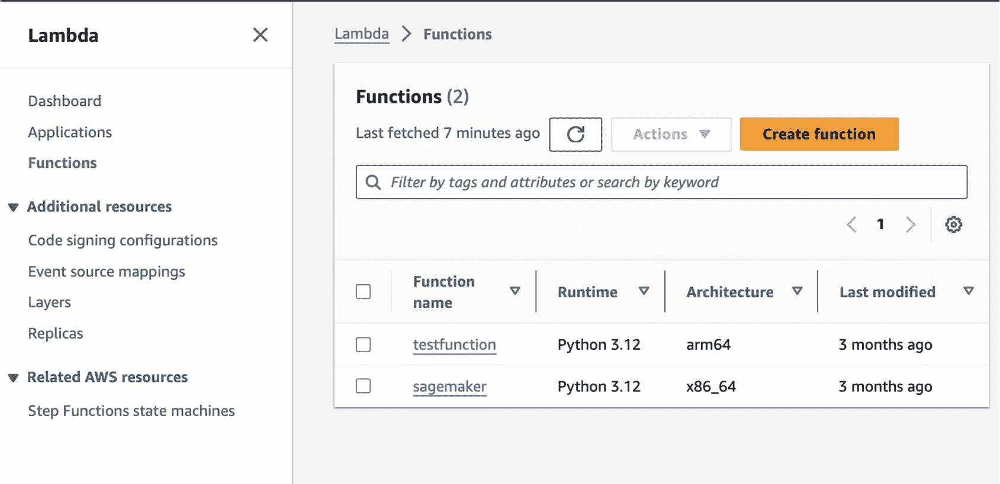

一个 Lambda 窗口的截图。从左侧窗格中选择了“函数”选项。在右侧，它在“函数”下有一个包含四列两行的表格。列标题如下：函数名称、运行时、架构和上次修改时间。

图 15-47
AWS Lambda 仪表板页面

我们解析 JSON 字符串以获取将发送到 SageMaker 进行预测的实际数据。然后，我们请求 SageMaker 端点并返回响应。随后再次对响应进行 JSON 解析并返回预测分数。

以下是 Lambda 函数：

```
import json, os, boto3
endpoint = os.environ['endpoint']
runtime = boto3.client('runtime.sagemaker')
def lambda_handler(event, context):
    event_data = json.loads(
        json.dumps(event)
    )
    testdata = event_data['data']
    response = runtime.invoke_endpoint(
        EndpointName=endpoint,
        ContentType='text/csv',
        Body=testdata
    )
    result = json.loads(
        response['Body'] \
            .read() \
            .decode()
    )
    return int(result['predictions'][0]['score'])
```

此外，您可能希望通过导航到“配置”选项并选择“环境变量”来为此 Lambda 函数设置环境变量。以下是您可能看到的界面：

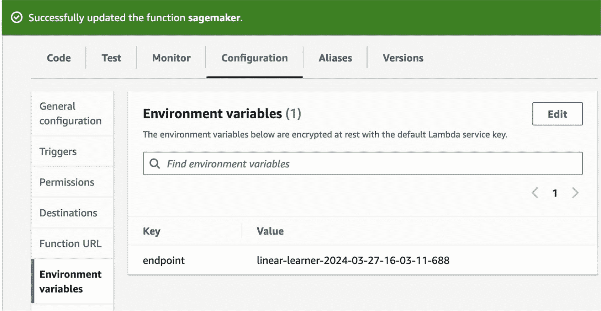

一个选项卡的截图。从选项栏中选择了“配置”选项。从左侧窗格中选择了“环境变量”选项。在右侧，它有一个包含两列一行的表格。列标题是键和值。

图 15-48
为 Lambda 函数设置环境变量

现在让我们部署此函数。从 AWS 管理控制台，导航到 API Gateway 服务并选择创建 API。选择构建一个 REST API，它将为您提供对请求和响应的更多控制。输入新 API 的名称，保持端点类型不变，然后选择创建 API。
以下是您可能看到的界面：

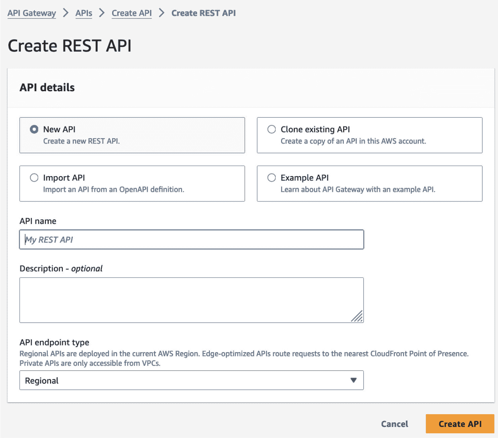

一个 AWS API Gateway 控制台的截图，显示了“创建 REST API”页面。系统提示用户选择是创建新 API、克隆现有 API、从 OpenAPI 定义导入还是使用示例 API。API 名称、描述和端点类型字段也可见。

图 15-49
为我们的模型创建 REST API 端点

由于我们将向 API 发送数据以获取预测分数，我们将创建一个 POST 方法，该方法将数据点发布到机器学习 API 并返回预测分数。因此，选择创建方法，选择 POST 作为方法类型，并选择 Lambda 函数作为集成方法。
请从“方法类型”下拉菜单中选择 POST 方法，而不是 PUT 方法。
以下是您可能看到的界面：

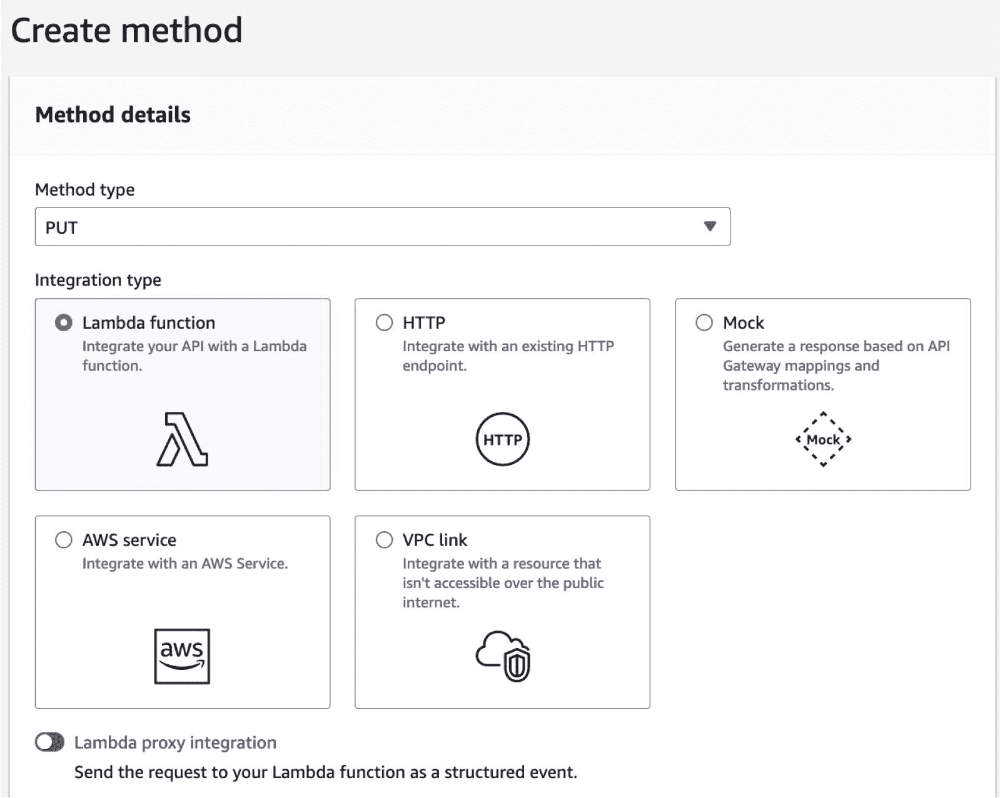

一个“创建方法”窗口的截图。用户正在配置一个 HTTP 方法类型为 PUT 的新方法。集成选项包括 Lambda 函数、HTTP、模拟、AWS 服务和 VPC 链接。选择了 Lambda 函数选项。

图 15-50
创建 POST 方法

创建此 POST 方法后，您可以测试 API 功能以查看其是否按预期工作。在 API Gateway 上，导航到“测试”选项，在“请求正文”部分输入要测试的数据，然后单击“测试”。您将获得响应代码和 API 返回的响应。
一切正常后，我们可以继续部署可公开访问的 API。在右上角，选择“部署 API”选项，为“阶段”下拉菜单选择“新阶段”，并输入阶段名称。您可以提及开发、测试、生产或 Alpha、Beta 等。
以下是您可能看到的界面：

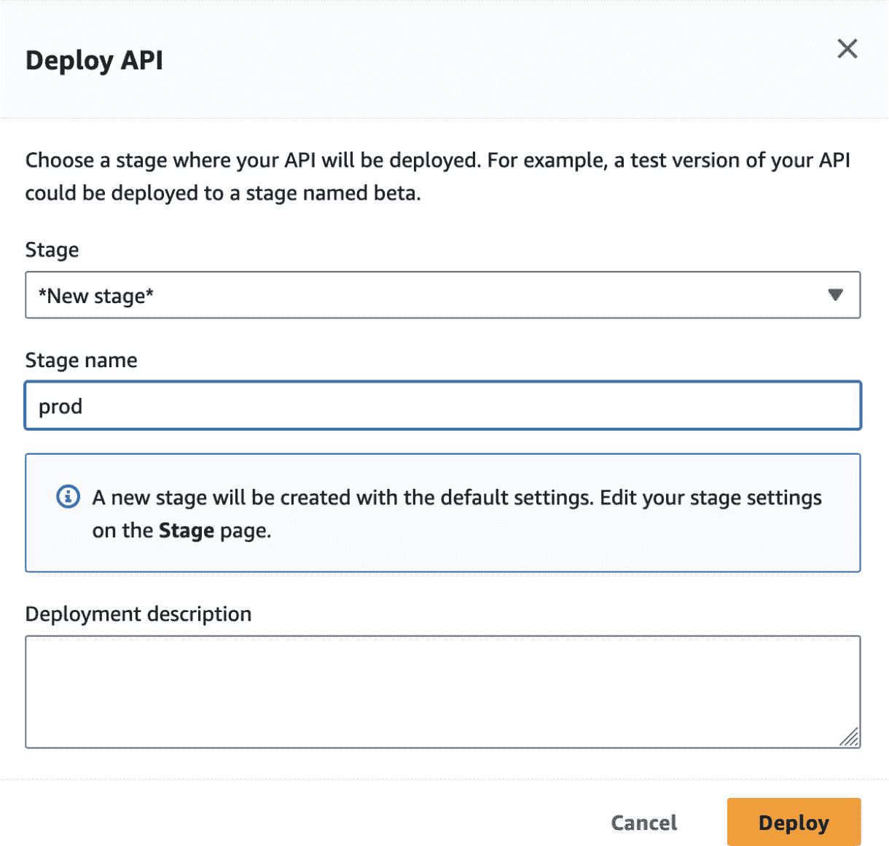

一个用于部署 API 的表单截图。系统要求用户选择部署阶段，输入阶段名称，并可选择添加部署描述。当前选择的阶段是“新阶段”，阶段名称是“prod”。

图 15-51
部署 API 以使其可公开访问

结论
到目前为止，我希望您对 Amazon Web Services 有了全面的了解，重点关注其数据工程和机器学习能力。我们涵盖了广泛的服务，从简单的对象存储到在云上托管您自己的机器学习模型。我们创建了用于安全访问服务的 IAM 角色；使用 RDS 建立了数据库，使用 Amazon Redshift 建立了数据仓库，使用 Lake Formation 建立了数据湖，使用 AWS SageMaker 建立了机器学习模型；并且还获得了使用 AWS Lambda、AWS Athena 和 AWS Glue 的经验。
这里提供的示例可能看起来使用了相对宽松的 IAM 角色权限。这仅用于说明目的。在生产环境中，您应该遵循最小权限原则，仅授予特定任务所需的特定权限。总的来说，我们涵盖的主题可能对您的项目有所帮助。

16. 使用 Google Cloud Platform 构建数据管道

引言
在本章中，我们将研究 Google Cloud Platform，它是云计算的早期采用者之一。我们将探索 GCP 的各种服务，重点关注数据工程和机器学习能力。我们将从理解 Google Cloud Platform 的核心概念和查看关键服务开始。然后详细研究 Google Cloud Platform 提供的各种数据系统服务。最后，我们将研究 Google Vertex AI，这是一个完全托管的机器学习平台，用于在一个服务内构建、训练和部署机器学习模型。

在本章结束时，您将学习

*   Google Cloud Platform 的基础知识

*   如何设置 Google CLI 来管理资源

*   Google 的对象存储和用于虚拟机及数据系统的计算引擎

*   Google 的数据处理工具 Dataproc，用于运行 Spark 和 Hadoop 工作负载

*   使用 Google Vertex AI 开发、训练和部署机器学习模型

当您开始探索 Google Cloud Platform 的旅程时，请您务必注意管理云资源，尤其是在您使用完它们之后。在传统基础设施的情况下，您可以在使用完后关闭计算机。然而，在云基础设施的情况下，您通常购买的是基于按需付费模式的计划，即使资源未被使用，您也需要为其付费。注销 GCP 并不意味着关闭您已购买的服务。这对于虚拟机、数据库和任何其他计算密集型资源尤其重要。请务必养成检查活动资源并关闭这些特定资源的习惯。如果您不再计划使用某项服务，可以将其删除。这样，您只需为积极使用的服务付费，从而控制成本。我还要感谢 GCP 为新用户提供免费额度，并积极支持新学习者降低他们的成本。

Google Cloud Platform
Google Cloud Platform 是 Google 提供的一套云计算服务。Google 早在 2008 年就开始提供云计算，当时他们提供了 App Engine，这是一个用于托管和管理 Web 应用程序的平台，其数据中心完全由 Google 管理。Google 的数据中心遍布全球。它们被指定为区域和可用区。每个区域包含一组可用区。这些可用区彼此隔离。Google Cloud 提供各种服务，这些服务可以是硬件或软件产品或资源。
Google Cloud 有项目的概念。如果您尝试使用 Google Cloud 服务，那么它必须是一个项目的一部分。Google 将项目定义为一个由设置、权限和其他描述您应用程序的元数据组成的实体。每次创建新项目时，Google Cloud 都会为您提供一个项目名称、项目 ID 和项目编号。您可以创建多个项目，并关联到同一个账户进行计费。
在 AWS 中，我们看到了资源层次结构的概念，其中我们有一个根账户，使我们能够通过 AWS Organizations 创建组织单位，并从中创建 AWS 账户，并在这些账户内配置各种服务。在 GCP 中，层次结构始于一个组织资源，它类似于 AWS 根账户。
组织资源控制计费、访问控制列表和管理各种资源。一个组织节点可以有一个或多个文件夹，每个文件夹代表组织内的某种子组织或部门。每个文件夹可以有一个或多个项目。项目代表组织中的最低层次。任何给定的项目都是可以配置虚拟机或存储实例的地方。
出于说明目的，让我们将文件夹设置为 GCP 设置的一部分。您首先需要一个 Google 帐户。我建议您首先创建一个沙箱文件夹，并在其中创建您的项目。当您获得进展后，可以设置一个开发文件夹，并在那里测试您的用例。Google Cloud 可以通过图形用户界面、命令行界面以及提供 API 来管理资源和服务的客户端库进行访问和交互。

设置 GCP 账户
让我们从访问 [`https://cloud.google.com`](https://cloud.google.com) 开始。
单击“登录”并按照屏幕上的说明创建新的 Google 帐户或登录现有的 Google 帐户。根据需要输入详细信息，然后继续开始。我们想要进入 Google Cloud 控制台页面（类似于 AWS 管理控制台）。
以下是 Google 控制台页面的可能样子：

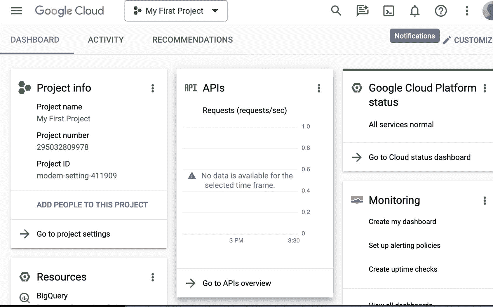

一个 Google Cloud Platform 的截图。仪表板页面左侧有项目信息，中间有与 API 相关的信息，右侧有 Google Cloud Platform 状态和与监控相关的链接。

图 16-1
Google Cloud 控制台页面

Google Cloud Storage
Google 的 Cloud Storage 是一项对象存储服务。Cloud Storage 将数据存储为唯一的对象或 blob。与关系数据库管理系统不同，您无需定义模式即可使用 Cloud Storage。您可以存储数据文件、图像、视频、音频等。这些文件被称为对象。这些对象被放置在称为存储桶的容器中。这些对象可以通过唯一键以 URL 的形式引用。Cloud Storage 有多种数据存储类型和应用；您可以首先存储您网站的内容、以关系表形式收集数据的数据文件、定期存档、您在网站上托管的视频和采访、文档等。这些文件被视为原子性的，这意味着如果您尝试访问一个对象，您访问的是整个对象。
就数据安全而言，您可以利用 Google IAM 和 Cloud Storage 的访问控制列表机制进行身份验证和授权。在 Cloud Storage 中，单个对象也有自己的访问控制列表。对象存储服务的名称必须是唯一的，因为 Cloud Storage 具有全局命名空间。一旦您使用某个名称创建了对象服务，以后就无法修改该名称。但是，您可以重命名存储桶内的对象。
Google 的 Cloud Storage 提供四种不同的存储类别，即：标准存储、近线存储、冷线存储和归档存储。标准存储选项适用于频繁访问且仅存储短时间的数据。近线存储适用于存储访问频率较低、可用性稍低的数据，数据至少存储 30 天。冷线存储的可用性较低，适用于存储不常访问的数据，数据至少存储 90 天。归档存储适用于灾难恢复和长期备份，这些数据访问频率不高，并且服务的可用性可能不如其他三种存储类别。
Cloud Storage 提供对象生命周期管理配置，您可以在其中为给定的存储桶定义和设置条件。例如，您可以根据某个时间阈值更改对象的存储类别。您可以指定某个对象或存储桶应保留的天数。您可以启用对象版本控制，这样同一对象存在多个变体。但是，这会显著增加存储大小和产生的成本，因此建议谨慎使用。

Google Cloud CLI

Google Cloud 有一个命令行界面，可用于创建和管理 Google Cloud 资源。根据操作系统的不同，安装方法可能有所不同。以下是在 Ubuntu/Debian 机器上进行设置的一些说明：

1.  首先，运行更新命令并安装您的系统可能需要的任何依赖项：

    ```
    sudo apt update
    sudo apt-get install apt-transport-https ca-certificates gnupg curl
    ```

2.  导入 Google Cloud CLI 公钥，并将 GCloud CLI 发行版添加为软件包源：

    ```
    curl https://packages.cloud.google.com/apt/doc/apt-key.gpg | sudo gpg --dearmor -o /usr/share/keyrings/cloud.google.gpg
    echo "deb [signed-by=/usr/share/keyrings/cloud.google.gpg] https://packages.cloud.google.com/apt cloud-sdk main" | sudo tee -a /etc/apt/sources.list.d/google-cloud-sdk.list
    ```

3.  再次运行更新命令并安装 GCloud CLI：

    ```
    sudo apt-get update && sudo apt-get install google-cloud-cli
    ```

4.  运行 Google Cloud CLI 开始使用：

    ```
    gcloud init
    ```

您需要在浏览器中进行身份验证，输入您的凭据并允许 Google Cloud SDK 访问您的帐户。
以下是您可能看到的界面：

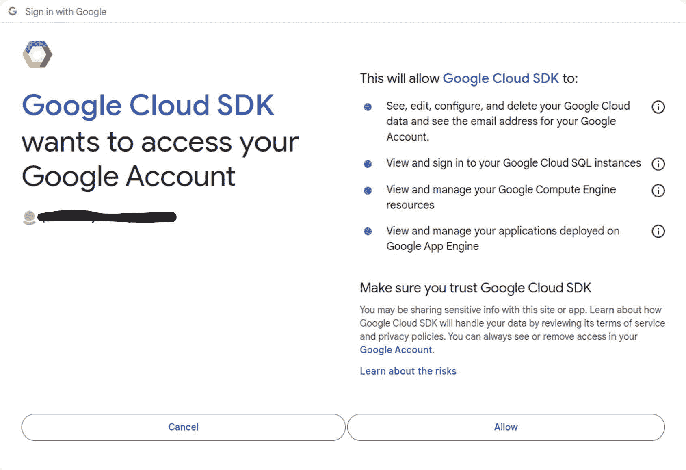

一个 Google Cloud 身份验证页面的截图。左侧显示消息“Google Cloud SDK 想要访问您的 Google 帐户”。右侧显示允许 Google Cloud 的权限。底部有“取消”和“允许”按钮。

图 16-2
Google Cloud SDK 身份验证页面

如果您使用的是 MS Windows 操作系统，请打开 PowerShell 选项卡并输入以下内容：

```
(New-Object Net.WebClient).DownloadFile("https://dl.google.com/dl/cloudsdk/channels/rapid/GoogleCloudSDKInstaller.exe", "$env:Temp\GoogleCloudSDKInstaller.exe")
& $env:Temp\GoogleCloudSDKInstaller.exe
```

按照 Google 安装程序提供的提示进行操作。打开 Google Cloud CLI 并输入以下内容以开始使用 GCP CLI：

```
gcloud init
```

您已准备好从命令行使用 Google Cloud。

Google Compute Engine

Google 提供按需虚拟机以满足各种企业应用程序的需求。您可以使用 Compute Engine 虚拟机来建立数据库服务器、构建应用程序、托管网站以及执行各种其他任务。Google 提供多种类型的计算引擎：

*   通用引擎，适用于日常任务

*   存储优化型，工作负载主要涉及存储且消耗较少计算资源

*   计算优化型，优先考虑性能，具有多核和更高的时钟性能

*   内存优化型，每个核心提供更多内存，适用于内存密集型工作负载

*   加速器优化型，适用于 GPU 密集型工作负载、大规模并行 CUDA 工作负载和高性能计算目的

让我们首先启用 Compute Engine API。导航到 Google Cloud 控制台并查找虚拟机选项或 Google Compute 选项；我们需要启用 API 服务以供使用。
以下是您可能看到的界面：

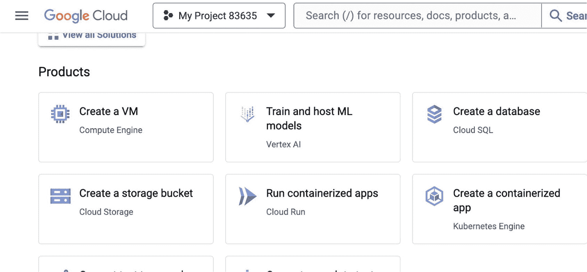

一个裁剪后的 Google Cloud 页面的截图。页面上列出的产品有：创建虚拟机、训练和托管 ML 模型、创建数据库、创建存储桶、运行容器化应用和创建容器化应用。

图 16-3
在 Google Cloud 中创建虚拟机

单击“创建虚拟机”，这将引导我们进入以下页面，您将在其中看到启用 Google Compute Engine API 的选项。
单击“启用”以启用计算 API。

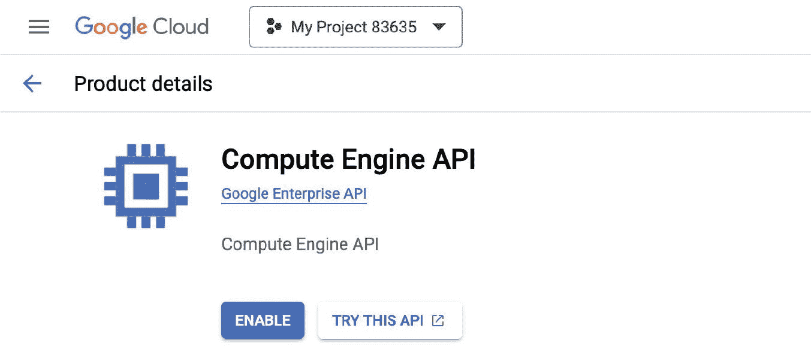

一个裁剪后的 Google Cloud 页面的截图。页面标题为“Compute Engine API”，下方有一个链接“Google Enterprise API”，左侧是其图标。底部是“启用”按钮。

图 16-4
启用 Compute Engine API

启用后，您将能够管理该 API。它看起来像这样：

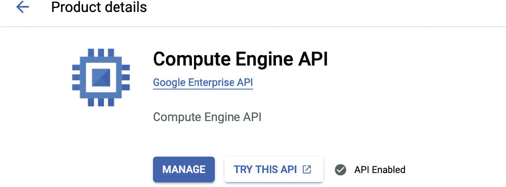

一个裁剪后的 Google Cloud 页面的截图。页面标题为“Compute Engine API”，下方有一个链接“Google Enterprise API”，左侧是其图标。底部是“管理”按钮。右下角指示了一条已勾选的消息“API 已启用”。

图 16-5
Compute Engine API 已启用

启用 Compute Engine API 后，您可以继续创建新的虚拟机。
现在，我们将创建一个 Linux 虚拟机。
我们将首先创建一个新的计算实例，选择合适的 Linux 发行版和版本，并通过允许传入的 HTTP 流量来启用访问。
首先，让我们访问左侧菜单，找到“Compute Engine”选项，单击“VM 实例”并创建一个新实例。您将看到一个页面，您可以在其中指定实例的名称、位置和类型。您还可以选择指定预打包的机器类型（具有特定数量的核心和内存），或者自定义您的配置。
根据您做出的选择，Google 会向您显示每月可能产生的费用。以下是您可能看到的界面：

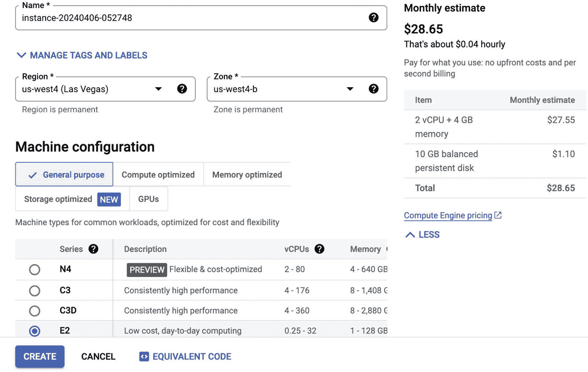

一个 Google Cloud 中 VM 实例页面的截图。名称、区域和可用区文本框已填写，机器配置为通用，机器类型选择了 E2。右侧指示了每月估算费用 $28.65。下方是“创建”按钮。

图 16-6
在 Google Cloud 中配置新的虚拟机

您还可以在同一页面中指定访问控制、防火墙规则和其他安全配置。选择好所需的配置后，您可以单击“创建”。您也可以选择最低配置，只使用最基本的设置。以下是仪表板可能的样子：

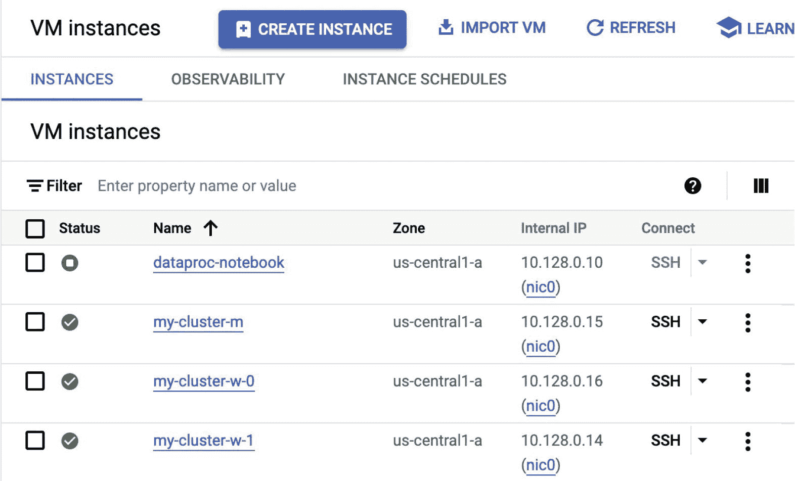

一个 Google Cloud 中 VM 实例页面的截图。“实例”选项卡使用一个包含 5 列 4 行的表格列出了已创建的 VM 实例。列标题是：状态、名称、可用区、内部 IP 和连接。顶部是“创建实例”按钮。

图 16-7
Google Cloud 中所有 VM 实例的列表

请等待几分钟让实例创建完成。创建完成后，Google 将提供一个浏览器内的 SSH 会话。以下是您可能看到的界面：

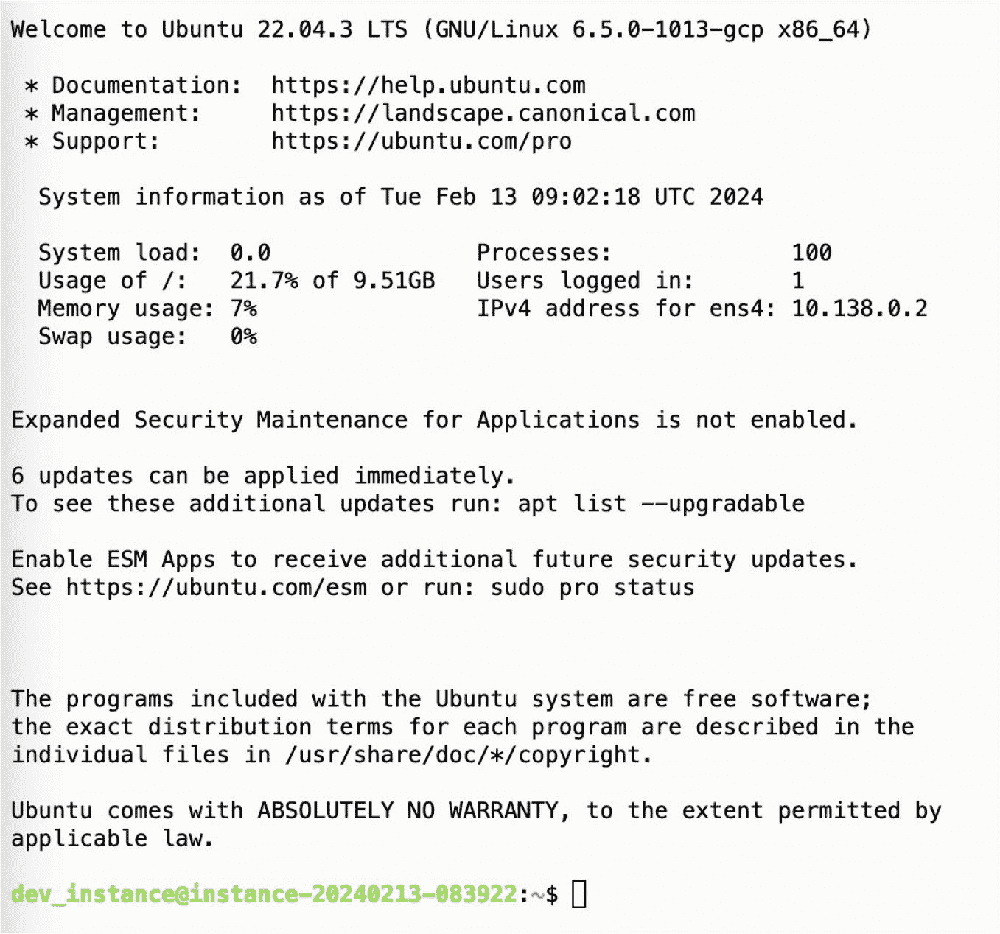

一个 Ubuntu 22.04.3 控制台的截图。它有一条欢迎消息，包含文档、管理和支持的链接，系统信息，可用更新和版权信息。控制台等待用户输入。

图 16-8
通过 SSH 访问您的 VM 实例

Cloud SQL
Cloud SQL 是 Google 提供的一项完全托管的关系数据库服务。Cloud SQL 完全由提供商 Google 管理，这意味着它不需要系统维护、管理和运营支持。以下是您可能看到的界面：

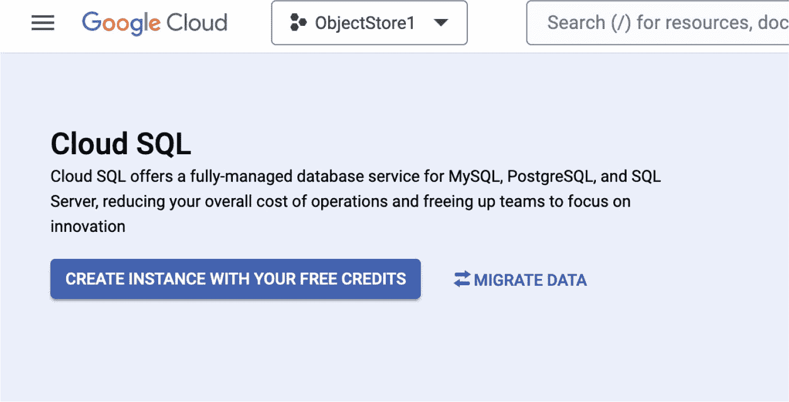

一个 Google Cloud 页面的截图。该页面包含有关 Cloud SQL 的信息。一个标有“使用您的免费额度创建实例”的按钮和一个名为“迁移数据”的可点击选项位于 Cloud SQL 欢迎消息的底部。

图 16-9
Google Cloud SQL 主页

Google 会自动执行备份、将补丁应用于数据库，并根据需要扩展存储容量。不过，需要定义标准和设置等。
Google 提供了为您的数据库实例选择数据库驱动程序的选项。当前选项是 Postgres、MySQL 和 MS SQL Server。当您使用选择的数据库驱动程序创建新的 Cloud SQL 实例时，Google 默认会在单个可用区中配置该实例。让我们访问 Google 控制台，选择 Cloud SQL 服务，并创建一个新数据库。

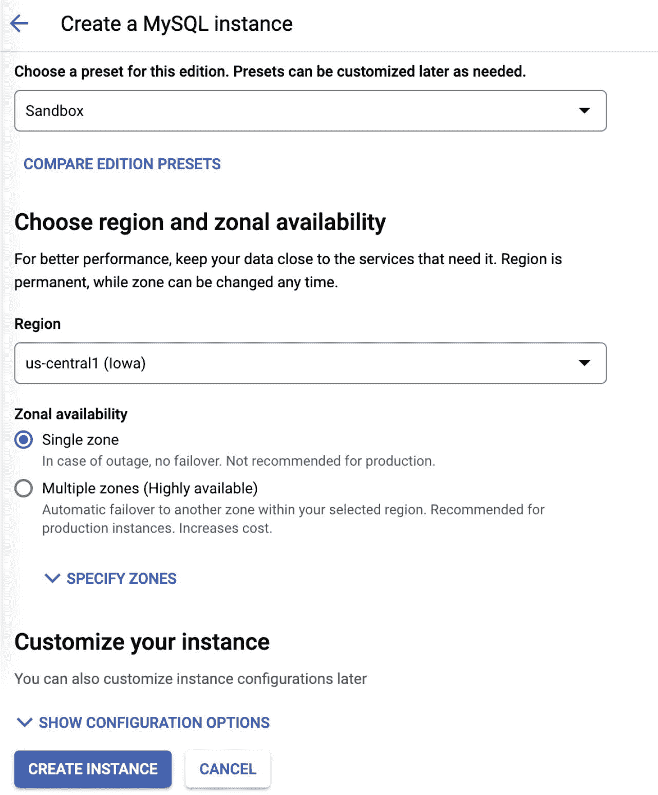

一个“创建 MySQL 实例”页面的截图。选择的预设是 Sandbox，选择的区域是 us-central1 (Iowa)，对于可用区选项，选择了“单可用区”。底部是“创建实例”和“取消”按钮。

图 16-10
在 Google Cloud SQL 中创建新的数据库实例

正如我们之前讨论的，Cloud SQL 将为您提供选择数据库引擎的选项。选择数据库引擎后，继续提供计算实例名称、root 用户密码、预设选择 Sandbox、靠近您位置的区域以及单可用区，然后选择创建实例。
请等待几分钟让实例创建完成。创建完成后，屏幕将如下所示：

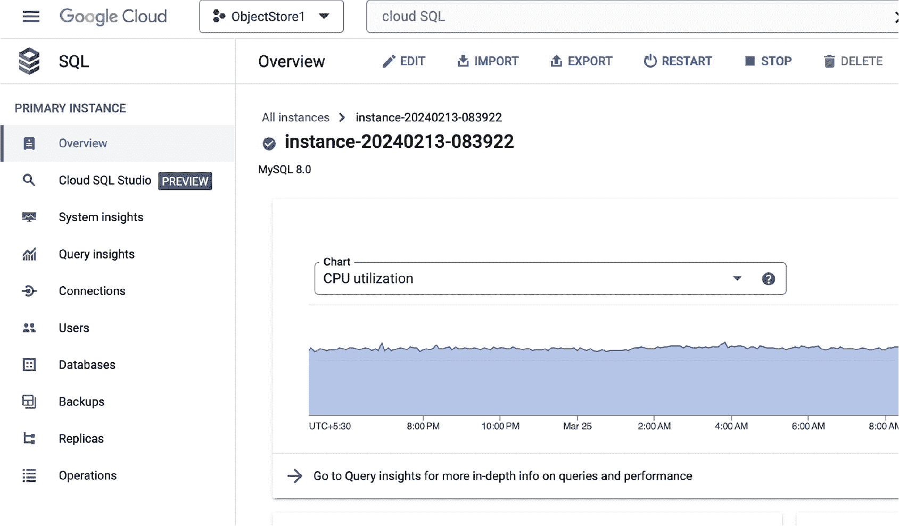

一个 Google Cloud SQL 实例页面的截图。“概览”选项卡有一个实例名称，即 instance-20240213-083922，其下方是 CPU 利用率图表。编辑、导入、导出、重启、停止和删除实例的选项位于页面顶部。

图 16-11
Google Cloud SQL 中的活动数据库实例

配置好 Cloud SQL 服务后，您可以继续创建数据库，并启用对 Cloud SQL 实例的 shell 访问等。让我们在此处创建一个数据库。转到您的实例，在左侧菜单中选择“数据库”，然后单击“创建数据库”。提供数据库名称，将字符集保留为 UTF-8，然后单击“创建”。

以下是一个简单的应用程序，用于以编程方式将数据从您的本地工作站加载到您新创建的 Cloud SQL 数据库：

```
from google.cloud.sql.connector import Connector
import sqlalchemy
import csv
import configparser
config = configparser.ConfigParser()
path = '/Users//credentials.cfg'
config.read(path)
```


# 初始化 Connector 对象
connector = Connector()

# 返回数据库连接的函数
def getconn():
    conn = connector.connect(
        config.get('gcp','instance_connection_name'),
        "pymysql",
        user=config.get('gcp','database_user'),
        password=config.get('gcp','database_password'),
        db=config.get('gcp','database')
    )
    return conn

pool = sqlalchemy.create_engine(
    "mysql+pymysql://",
    creator=getconn,
)

filepath = "/Users//gcp/polars_dataset.csv"
with pool.connect() as db_conn:
    db_conn.execute(' \
        CREATE TABLE onedata( \
            firstname varchar(200), \
            lastname varchar(200), \
            gender varchar(10), \
            birthdate varchar(100), \
            type varchar(20), \
            state varchar(100), \
            occupation varchar(100) \
        ) \
    ')
    with open(filepath, mode='r',encoding='utf-8') as csv_file:
        csv_reader = csv.DictReader(csv_file)
        for row in csv_reader:
            insert_query = 'INSERT INTO onedata ( \
                firstname, \
                lastname, \
                gender, \
                birthdate, \
                type, \
                state, \
                occupation \
            ) \
            VALUES (%s, %s, %s, %s, %s, %s, %s)'

            # 从 CSV 行中提取值的元组
            data_tuple = (row['firstname'],
                          row['lastname'],
                          row['gender'],
                          row['birthdate'],
                          row['type'],
                          row['state'],
                          row['occupation']
                         )

            # 执行查询
            db_conn.execute(insert_query, data_tuple)
    db_conn.commit()
    result = db_conn.execute("SELECT * from onedata").fetchall()
    for row in result:
        print(row)
    #db_conn.execute("DROP TABLE onedata")
```

在上述应用中，我们连接到 Google Cloud SQL，执行一个 DDL 脚本来创建表，然后迭代读取一个平面文件并将行插入到 Cloud SQL 中，最后提交事务。以下是数据在 Cloud SQL Studio 中的显示效果：

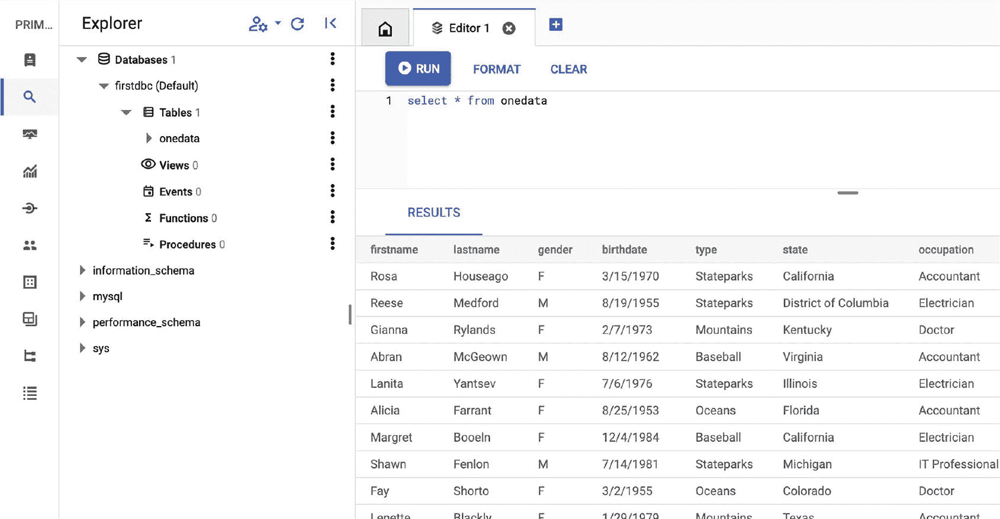

一张裁剪后的 Google Cloud SQL 页面截图。页面上有一条 SQL 查询语句：`select * from onedata`。运行按钮已被选中。结果下方显示了一个包含 7 列（如名字、姓氏、州、职业等）和超过 9 行数据的表格。

**图 16-12** 在 Google Cloud SQL 中创建并加载表

## Google Bigtable

Bigtable 是 Google Cloud 提供的一种 NoSQL 服务。这种 NoSQL 数据存储专为高吞吐量传入数据和低延迟数据库应用而设计。Bigtable 用于需要快速获取数据的应用场景，例如股票交易、实时游戏和流媒体平台。Bigtable 是一种反范式化数据库，不支持表之间的连接操作。

> **注意**  
> 低延迟数据库是一种数据库管理系统，能够提供非常快的响应时间，例如毫秒级别。

Google Bigtable 是一个键值存储，不支持二级索引（键除外），并且列的顺序不必固定。你仍然可以将数据存储在表中，并且在一个给定的 Bigtable 实例中可以包含多个表。在没有模式的情况下，你可以尝试将结构（或模式）相似的数据存储在同一个表中。此外，所有操作在行级别都是原子性的。我认为，当一个操作向 Bigtable 写入多行但失败时，可能会出现某些行已写入而某些行未写入的情况。

在设计 Bigtable 行键时，阐明数据将如何被查询以及如何检索数据非常重要。你可以在行键中嵌入多个由分隔符分隔的标识符。在 Bigtable 中，行按行键的字典序排序，因此设计一个以通用值开头、以最细粒度值结尾的行键可能是有益的。

Google Bigtable 将表定义为由行键索引的值的逻辑组织。让我们创建一个 Bigtable 实例。导航到 GCP 控制台并输入“Bigtable”。找到该服务后，选择创建一个实例。

你也可以在工作站上安装适用于 Python 的 Google Bigtable 客户端。根据文档（[`https://cloud.google.com/python/docs/reference/bigtable/latest`](https://cloud.google.com/python/docs/reference/bigtable/latest)），安装方法如下：

```
pip install google-cloud-bigtable
```

你总是需要创建一个 Bigtable 实例。一个实例通常包含一个或多个位于不同时区的集群。每个集群包含一个或多个计算节点。这些计算节点负责管理你的数据并执行其他任务。要创建实例，你必须指定存储类型，可以选择硬盘或 SSD。

以下是创建实例时的界面示例：

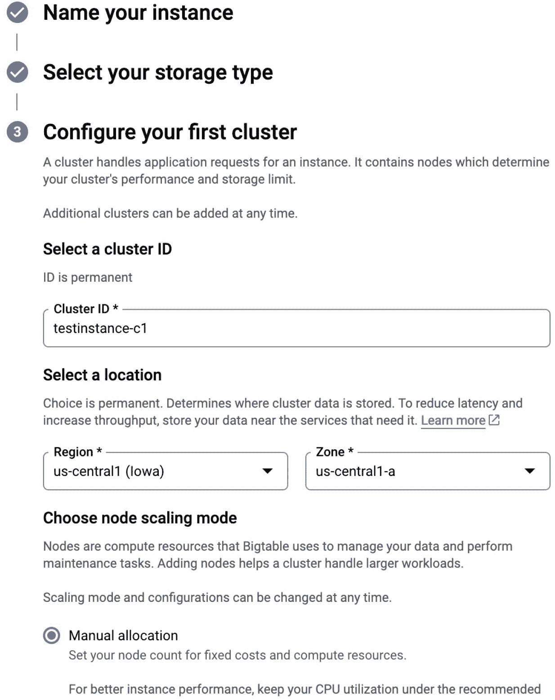

一张截图显示了配置第一个集群的设置。前面的步骤（命名实例和选择存储类型）已完成勾选。在“配置第一个集群”下，集群 ID、区域和可用区字段已填写。节点扩缩模式选择了“手动分配”。

**图 16-13** 创建新的 Google Bigtable 实例

让我们尝试将 JSON 文档上传到 Google Bigtable。

以下是 JSON 文档的结构示例：

```
{
  "id": 2,
  "first_name": "Rube",
  "last_name": "Mackett",
  "email": "rmackett1@japanpost.jp",
  "gender": "Male",
  "ip_address": "153.211.80.48"
}
```

以下是将 JSON 加载到 Google Bigtable 的示例应用：

```
from google.cloud import bigtable
from google.cloud.bigtable import column_family
import json
import configparser

config = configparser.ConfigParser()
path = '/Users/pk/Documents/de/gcp/credentials.cfg'

# 配置信息
project_id = config.get('bigtable','project_id')
instance_id = config.get('bigtable','instance_id')
table_id = config.get('bigtable','table_id')
json_file_path = "/Users/pk/Downloads/randomdata.json"

# 认证并连接到 Bigtable
client = bigtable.Client(project=project_id, admin=True)
instance = client.instance(instance_id)
table = instance.table(table_id)

max_versions_rule = column_family.MaxVersionsGCRule(2)
column_family_id = "cf1"
column_families = {column_family_id: max_versions_rule}

if not table.exists():
    table.create(column_families=column_families)

column_family_id = "cf1"

with open(json_file_path, 'r') as f:
    records = json.load(f)

for record in records:
    row_key = "row-key-{}".format(record["id"]).encode()
    row = table.direct_row(row_key)
    for key, value in record.items():
        row.set_cell(column_family_id,
                     key,
                     str(value).encode(),
                     timestamp=None)
```


