# 提交
row.commit()
print("数据已成功加载到 Bigtable。")
```

您可以通过运行一个简单的查询在 Bigtable Studio 中查看输出。示例如下：

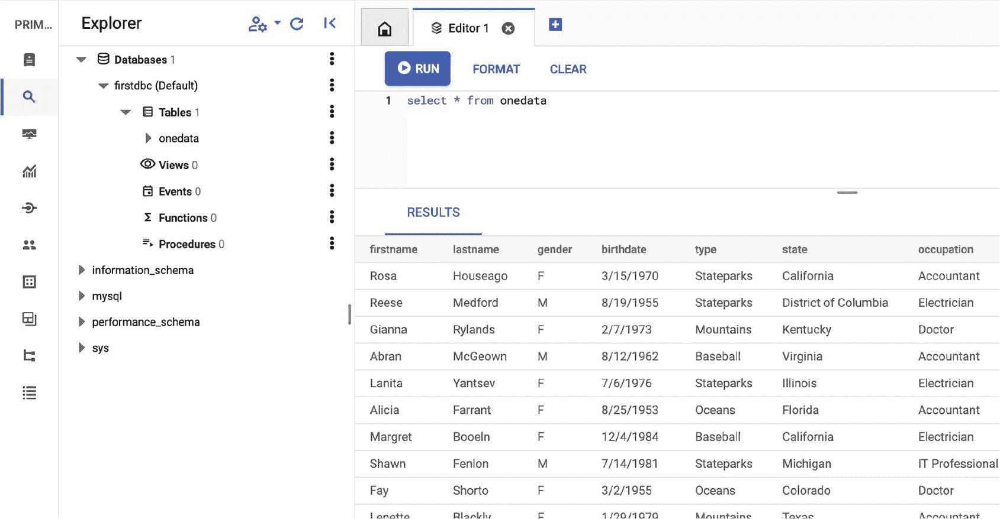

一张裁剪后的 Google Cloud SQL 页面截图。编辑器 1 页面包含一个 SQL 查询 `select star from one data`，并且运行按钮已被选中。在结果下方，显示了一个包含 7 列和超过 9 行数据的表格。

图 16-14
在 Google Bigtable 中加载 JSON 数据集

一个示例凭证文件可能如下所示：

```
[bigtable]
project_id = "在此处填写项目 ID"
instance_id = "在此处填写实例 ID"
table_id = "在此处填写表 ID"
```

Google BigQuery
Google
BigQuery
是 Google 提供的一种全托管分析型数据仓库解决方案。由于它是全托管服务，因此无需设置、配置或维护底层基础设施。BigQuery 的存储空间会自动配置，并在数据量增加时自动扩展。除了支持高吞吐量的读取，BigQuery 还支持高吞吐量的流式数据摄入。在 Google BigQuery 中，存储和计算是分离的。存储和计算都可以按需独立扩展。
Google
BigQuery
是一个列式存储数据库，数据会自动跨多个可用区复制，以防止因机器故障或区域故障导致数据丢失。在 BigQuery 中，数据主要以表格格式存储。表格数据包括标准表、表克隆、物化视图和快照。标准表格数据是一种具有模式（Schema）的表数据，每个列都有指定的数据类型。表克隆是标准表的轻量级副本，仅存储表克隆与基表之间的差异（因此非常轻量）。
表快照是表在特定时间点的副本，您可以选择从特定时间点恢复指定表。最后一种是物化视图，其中查询结果被预先计算、缓存并定期更新。在 Google BigQuery 中，查询的缓存结果存储在临时表中。Google 不会对缓存的查询结果收费。
Google
BigQuery
允许您通过访问控制、数据管理和数据质量模块，在整个数据生命周期内管理数据的安全性和质量。您可以管理和控制 BigQuery 用户的访问权限，以及他们对表、视图、快照等资源的访问级别。此外，还提供了控制和管理对特定行和列访问的条款，从而实现对敏感数据的细粒度访问。您可以选择通过获取审计日志来获取详细的用户配置文件和系统活动信息。
此外，您可以通过对 PII 字段应用数据脱敏来保护 BigQuery 表和视图中的个人身份信息。这将保护数据集免遭意外数据泄露。BigQuery 会自动加密所有数据，无论是传输中还是静态存储的数据。您还可以选择通过在数据集上运行统计指标（平均值、中位数、唯一值等）来检查数据质量。您还可以根据预定义规则验证数据，检查数据质量并排查数据问题。
要开始使用 Google BigQuery，我们需要在 Google Cloud 中找到该服务并启用它。该过程如下所示：

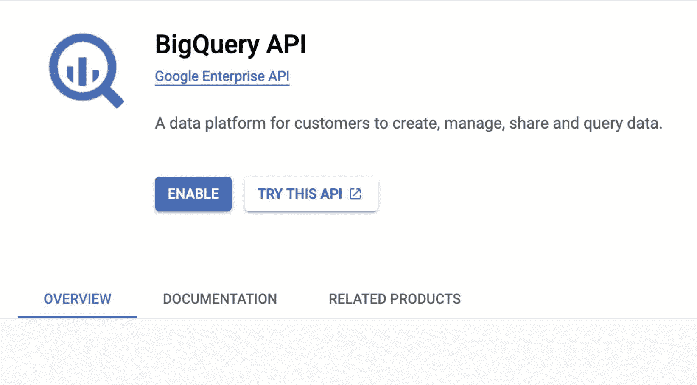

一张截图。页面包含 BigQuery API 的信息，其图标位于左侧。启用按钮位于下方。概览、文档和相关产品等选项卡位于底部。

图 16-15
启用 Google BigQuery API

点击“启用”后，您可能需要等待几分钟，直到系统自动将您重定向到 Google BigQuery。无需配置任何基础设施、计算资源甚至存储空间。当您开始使用 BigQuery 时，将根据您的使用情况，按存储和计算用量计费。
您的界面可能如下所示：

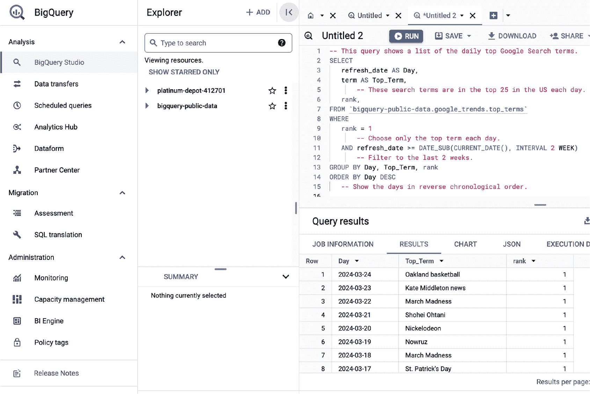

一张 Google BigQuery 控制台的截图。在侧边面板中，选择了 BigQuery Studio 选项。在右侧，资源管理器选项卡显示了资源和摘要。在最右侧，显示了一个未命名的代码面板以及包含 4 列和 8 行数据的查询结果。

图 16-16
Google BigQuery 主控制台

Google Dataproc
Google
Dataproc
是一个全托管服务，为您提供 Hadoop 集群或 Spark 集群，以便您在分布式环境中运行大数据处理，从而利用大数据工具的优势。Dataproc 服务还与 BigQuery 等其他多种 Google Cloud 服务良好集成，使您能够构建完整的数据平台。
要开始使用 Google Dataproc，请从云控制台启用 API：

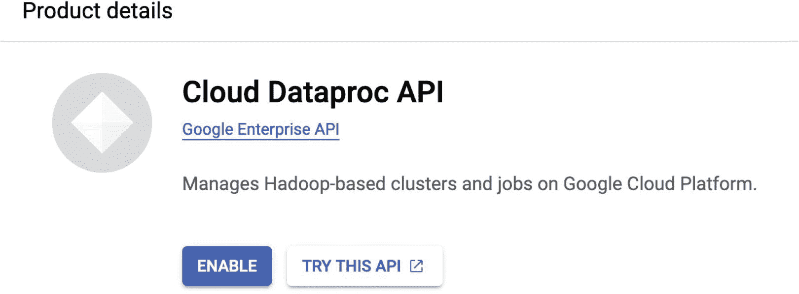

一张裁剪后的截图。它包含 Cloud Dataproc API 的信息，其图标位于左侧。文本内容为“在 Google Cloud 平台上管理基于 Hadoop 的集群和作业”。下方是“启用”和“试用此 API”按钮，以及一个指向外部链接的图标。

图 16-17
启用 Cloud Dataproc API

Google Dataproc 的
Spark 集群采用无服务器模式，这意味着您只需为实际消耗的资源付费。Hadoop 集群的成本也相对较低。
Google
Dataproc
设置新集群所需的时间非常短。它还具备自动缩放功能，可根据内存使用情况自动扩展或缩减。
您可以使用 Google Dataproc 设置三种类型的集群：单节点集群、标准集群和高可用性集群。单节点集群由一个主节点和零个工作节点组成。标准集群由一个主节点和“n”个工作节点组成，而高可用性集群则由三个主节点和“n”个工作节点组成。单节点集群不支持自动缩放功能。
让我们在 Google Dataproc 中使用 Compute Engine 创建一个简单的集群。首先，点击“创建集群”并选择 Compute Engine 选项：

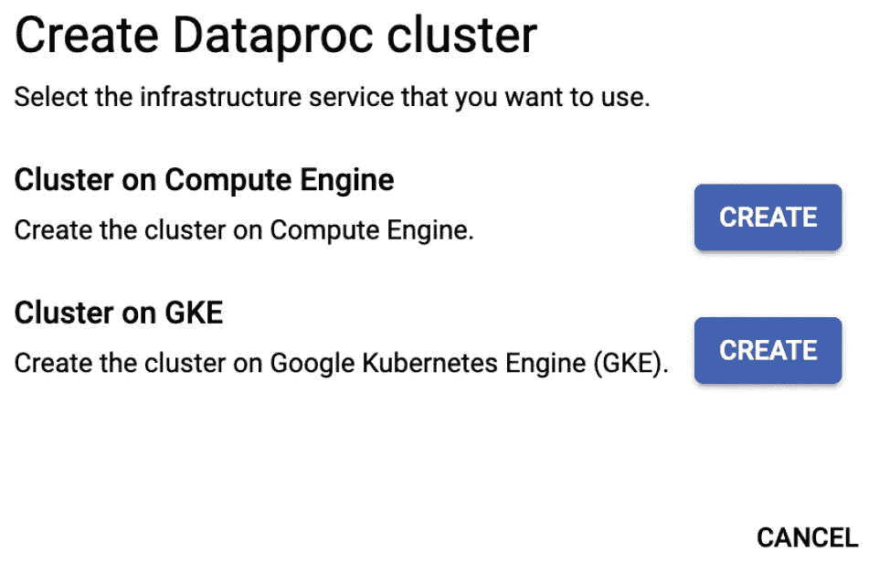

一张裁剪后的截图。标题为“创建 Dataproc 集群”。下方有两个选项：在 Compute Engine 上创建集群和在 GKE 上创建集群，每个选项都附带一个“创建”按钮。“取消”按钮位于右下角。

图 16-18
为 Dataproc 集群选择基础设施

在我们的示例中，我们将创建一个包含 1 个主节点和 0 个工作节点的单节点集群。让我们提供集群名称、区域、集群类型，并为 Compute Engine 选择磁盘映像。界面如下所示：

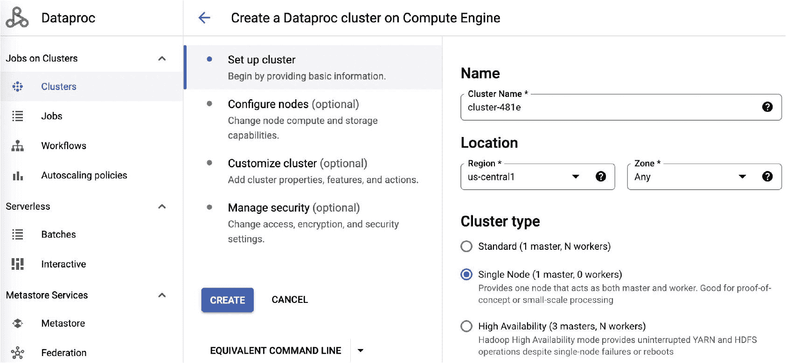

一张 Google Dataproc 的截图。在左侧面板中，选择了“集群”选项。在中央，选择了“设置集群”选项。“创建”按钮位于下方。在右侧，显示了包含值的名称和位置字段。下方是一个用于选择集群类型的面板，其中“单节点”单选按钮已被选中。

图 16-19
创建新的 Dataproc 集群

向下滚动时，请确保勾选“启用组件网关”复选框以及“Jupyter Notebook”选项。您可以根据需要选择其他选项。界面如下所示：

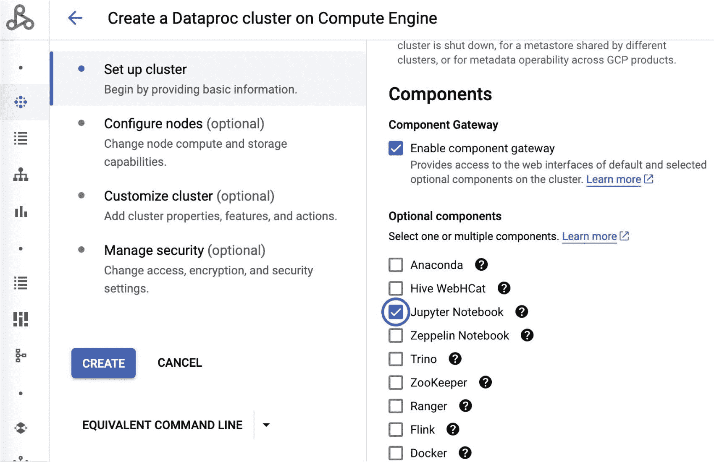

一张 Google Dataproc 在 Compute Engine 上创建集群的截图。在左侧，选择了“设置集群”选项。“创建”按钮位于下方。在右侧，“启用组件网关”复选框已被勾选。下方是一列包含 9 个可选组件的复选框，其中“Jupyter Notebook”组件已被勾选。

图 16-20
为新的 Dataproc 集群指定组件


好的，作为一名高级文档工程师和翻译员，我将严格遵循您提供的注意事项和示例，将给定的英文文本翻译成中文。


现在，点击“配置节点”，您可以在其中指定要使用的计算类型。如果您正在为开发环境创建集群，那么性能稍弱的计算资源可能也能让您舒适地工作。
在这种情况下，您可能希望选择通用计算类型，并在看到“N1 系列”选项时选择它。您也可以为工作节点选择类似的选项。
界面效果如下所示：

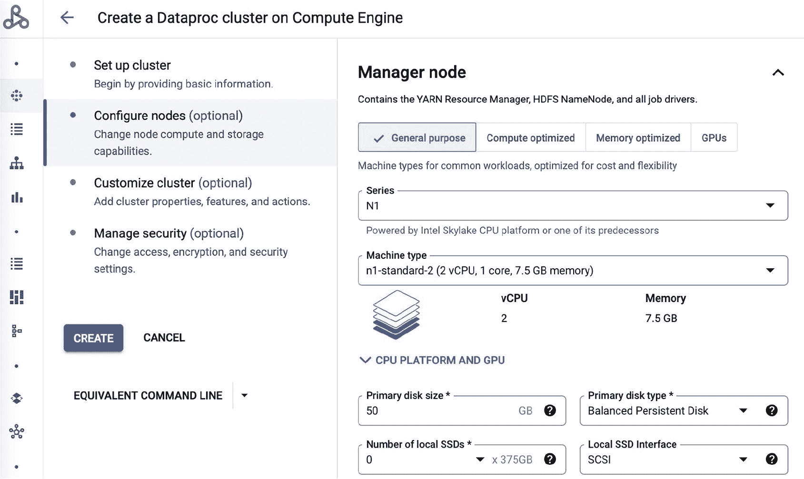

计算引擎上 Google Dataproc 集群页面的截图。左侧，“配置节点”选项已被选中。“创建”按钮在其下方。在右侧的管理节点面板下，“通用目的”选项卡已被勾选，随后是系列“N1”和机器类型，并显示了相应的值。下方是关于 CPU 平台和 GPU 的数据。

**图 16-21**
为 Dataproc 集群配置节点

您也可以通过 Google Cloud 命令行界面创建集群。

相应的命令如下：

```
gcloud dataproc clusters create my-cluster \
-—enable-component-gateway\
--region us-central1\
—no-address\
--master-machine-type n1-standard-2\
--master-boot-disk-type pd-balanced\
--master-boot-disk-size 50\
--num-workers 2\
--worker-machine-type n1-standard-2\
--worker-boot-disk-type pd-balanced\
--worker-boot-disk-size 50\
--image-version 2.2-debian12\
--optional-components JUPYTER\
--project {your-project-id}
```

集群创建完成后，您应该可以在仪表板中看到它。界面效果如下所示：

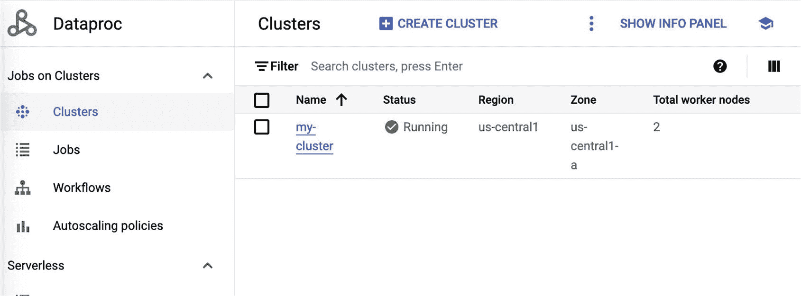

Google Dataproc 的截图。左侧，“集群”选项已被选中。在右侧的“集群”标题下，显示了一个包含 5 列和 1 行数据的表格。列标题分别是：名称、状态、区域、可用区和总工作节点数。该行左侧有一个复选框。

**图 16-22**
Dataproc 中活跃集群的仪表板

让我们创建一个 Spark 数据管道，并使用 Cloud Dataproc 来执行该数据管道。我们将使用 Vertex AI Workbench 服务来创建一个 Jupyter 笔记本。

**Google Vertex AI Workbench**
Google Vertex AI Workbench 服务是一个完全托管的、基于 Jupyter Notebook 的开发环境。Google Vertex AI 还与 GitHub 集成。让我们导航到 GCP 控制台，并分别启用 Vertex AI API 和 Notebook API。然后，导航到 Google Vertex AI Workbench 并创建一个笔记本。您将看到在 Dataproc 集群上创建 PySpark 实例的选项。界面效果如下所示：

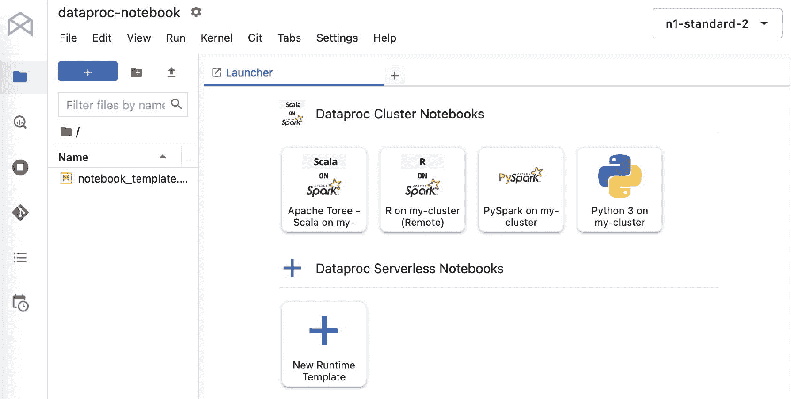

一个标题为“Dataproc notebook”的裁剪截图。左侧面板中选中了“文件夹”选项。旁边是一个搜索栏和笔记本的名称。在右侧的“启动器”选项卡下，显示了“Dataproc 集群笔记本”下的 4 个集群，以及一个“添加新运行时模板”的按钮。

**图 16-23**
Google Vertex AI Workbench 的仪表板

Vertex AI Workbench 与 Cloud Storage 和 BigQuery 服务集成良好。它预装了各种机器学习库，并支持 PyTorch 和 TensorFlow 框架。您可以选择仅使用 CPU 的实例或仅使用 GPU 的实例。

以下是一个示例代码，您可以在 Google Cloud Storage 数据上运行：

```
from pyspark.sql import SparkSession
bucket = "your-bucket"
filepath = "gs://your-bucket/polars_dataset.csv"
spark = SparkSession.builder\
.appName("PySpark-my-cluster")\
.config("spark.jars", "gs://spark-lib/bigquery/spark-bigquery-latest.jar")\
.getOrCreate()
df = spark.read.csv(filepath, header=True, inferSchema=True)
df.show(3)
occ_report = df.crosstab(col1="state",col2="occupation")
occ_report.show(5)
```

> **注意**
>
> “`spark.jars`”文件用于 Spark 与 Google BigQuery 进行读写操作。您可以在 Google Dataproc 服务中获取合适的 Spark jars 文件。访问仪表板，导航到 Dataproc 中的“提交作业”页面。提供适当的信息并点击“提交”以获取 jars 文件。

以下是在 Jupyter 笔记本上执行此代码的效果：

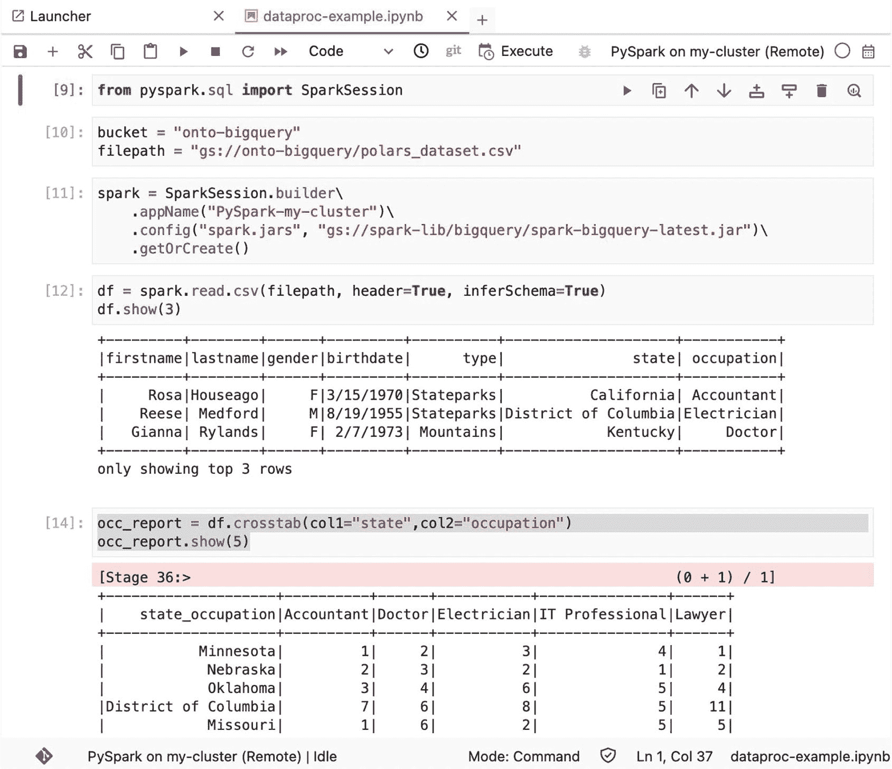

一个标题为“dataproc-example.ipynb”的标签页截图。下方是一个工具栏，接着是从 `pyspark.sql` 导入 SparkSession 的代码行。该标签页显示了 2 个表格。表格 1 有 7 列和 3 行数据。表格 2 有 6 列和 5 行数据。

**图 16-24**
在 Google Vertex AI Workbench 上运行 PySpark 代码

**Google Vertex AI**
Google 的 Vertex AI 是一个完全托管的机器学习平台，可让您训练和部署机器学习模型。
一旦您训练好模型，就可以将其部署在 Vertex 上，使模型使用者能够获得旨在为企业创造价值的实时智能和洞察。这个机器学习平台拥有众多功能，并且与 AWS 和 Microsoft 提供的其他领先机器学习平台高度可比。
让我们从头开始构建一个自定义机器学习模型，这次我们将使用 AutoML 功能。AutoML 代表自动化机器学习，是自动化机器学习模型的过程，包括预处理、特征工程、模型选择和超参数调优。
Google Vertex AI 提供两种用于构建机器学习模型的开发环境：Vertex AI Workbench 和 Colab 笔记本。我们在上一节中已经了解了 Vertex AI Workbench，并利用该笔记本构建了机器学习模型。这些工作台环境通过虚拟机提供，并且可自定义，同时支持 GPU。
Google Colab 笔记本是一种托管笔记本环境，可让您与他人协作，同时 Google 为您管理底层基础设施。您可以选择自定义底层计算和配置运行时。在 Google Colab 中，表格文件的上传大小不能超过 20 兆字节，而在 Vertex AI Workbench 中，您可以处理大小高达 100 兆字节的表格数据集。

让我们来看看如何使用 Google Vertex AI 构建机器学习模型并将模型作为端点托管。我们使用鸢尾花数据集来解决一个多类分类问题。以下是供您参考的机器学习代码。我鼓励您将此代码作为起点，并尝试其他分类器：

```
import pandas as pd
import pandas as pd
from xgboost import XGBClassifier
from sklearn.model_selection import train_test_split
from sklearn.metrics import accuracy_score
from sklearn.preprocessing import LabelEncoder
import pickle
training_dataset = pd.read_csv('iris.csv')
dataset = training_dataset.values

