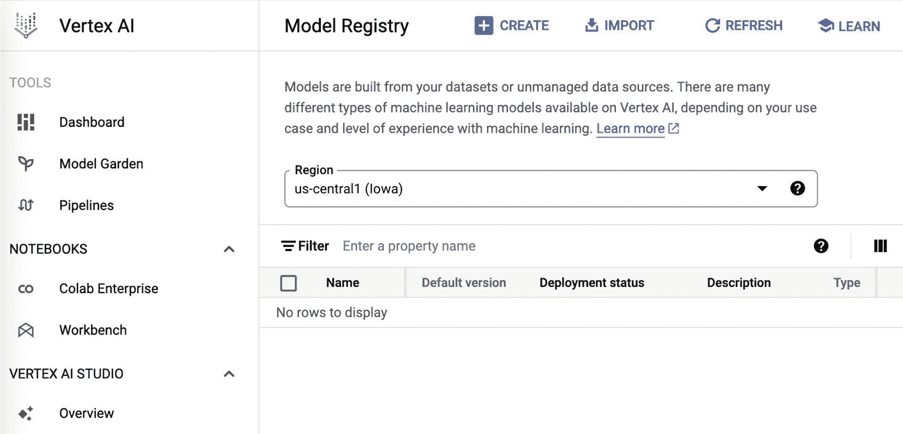
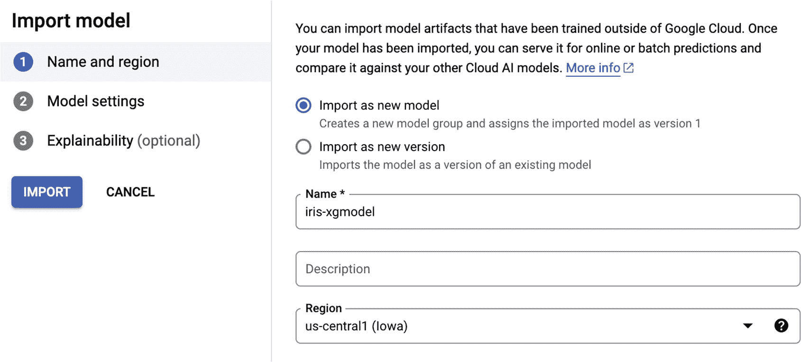
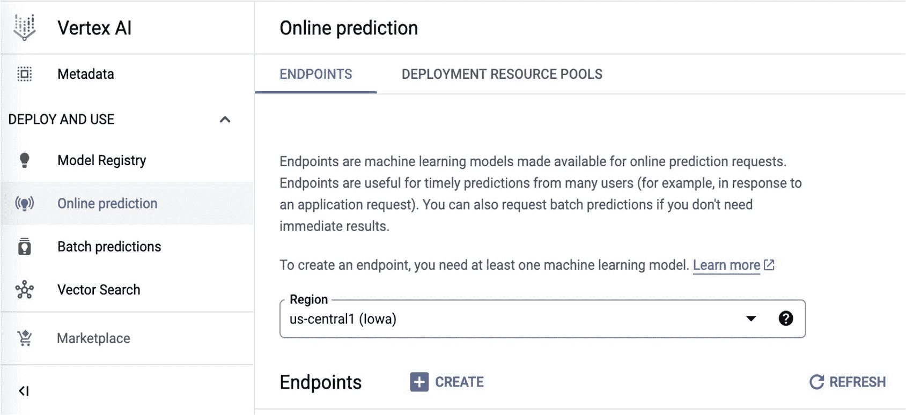
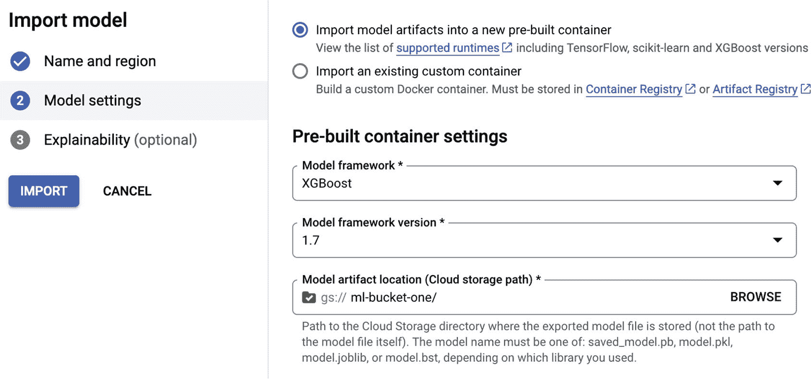
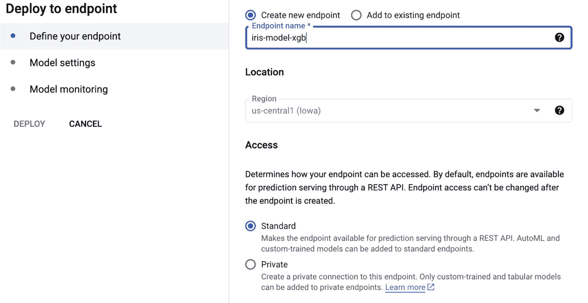
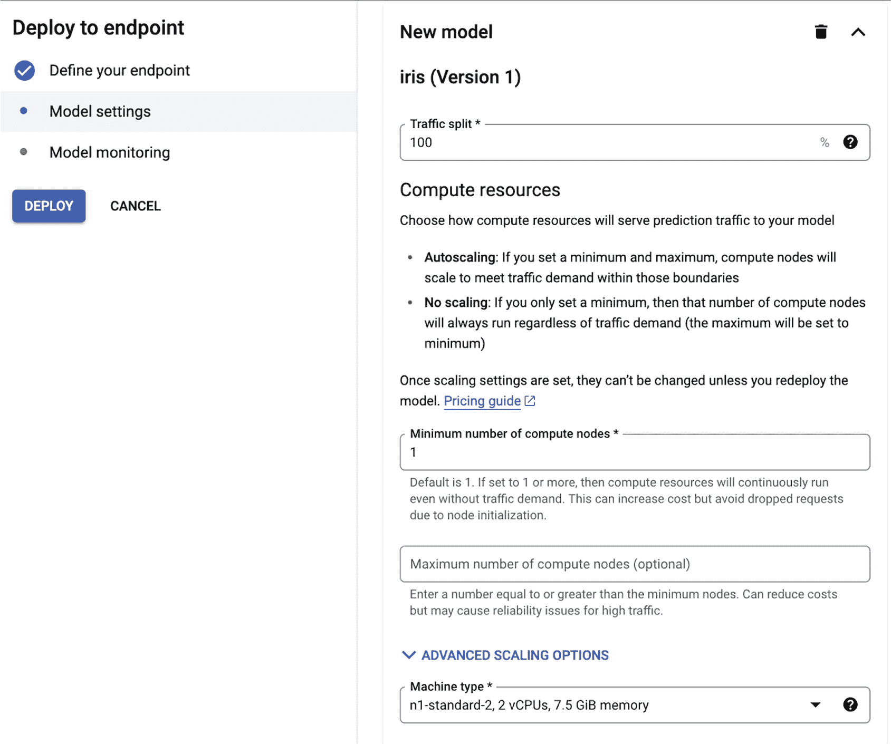
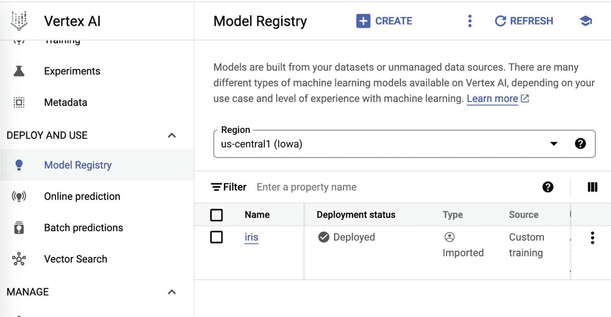
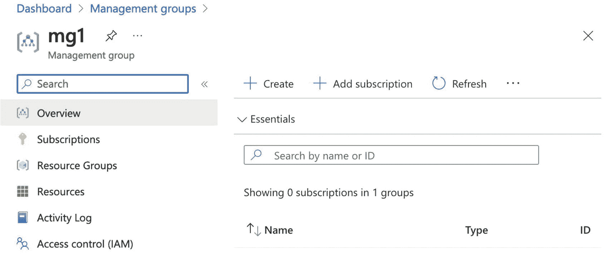
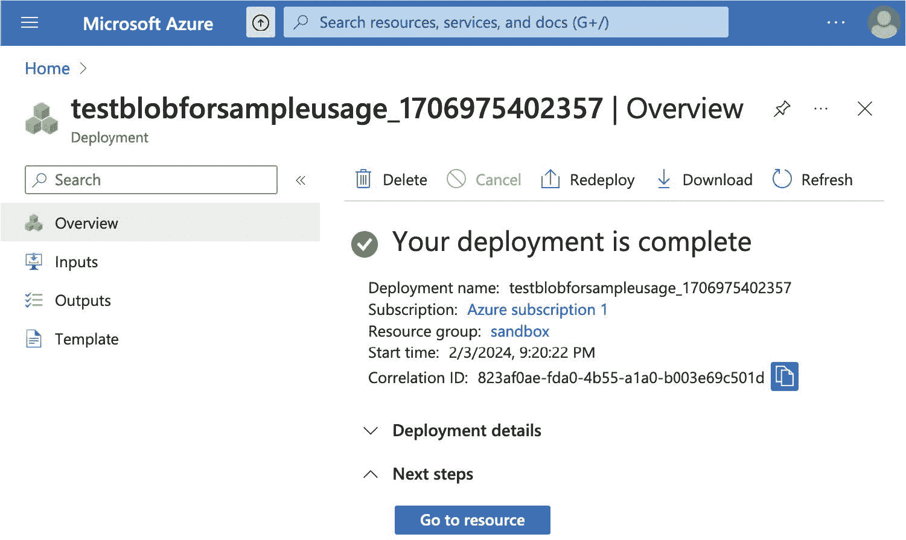
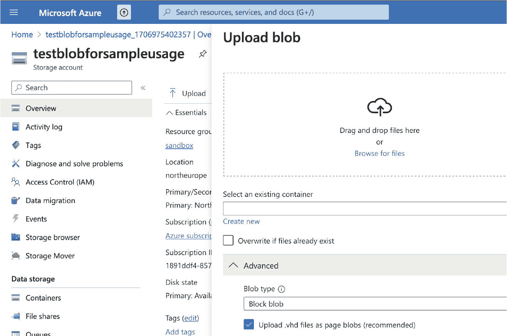

# 评估预测结果
accuracy = accuracy_score(
y_test,
predictions
)
print("准确率: %.2f%%" % (accuracy * 100.0))
filename = "model.pkl"
pickle.dump(xgmodel, open(filename, 'wb'))
```

注意

Pickle 文件
是二进制文件，用于序列化 Python 对象，例如字典、列表等。将 Python 对象转换为字节流的过程称为 pickling 或序列化。反之亦然。你可以反序列化或解封一个 pickle 文件。由于 pickle 文件是 Python 特有的，因此被认为是安全的。在 Python 生态系统中，Pickling 常用于机器学习建模。

一旦我们有了 pickle 文件格式的模型，就可以将此模型添加到 Google Vertex AI 模型注册表中。要开始使用，请从 Google 控制台访问 Vertex AI，导航到部署，然后点击模型注册表。界面可能如下所示：



一张 Google Vertex AI 的截图。左侧面板显示了工具、笔记本和 Vertex AI Studio 选项。右侧的模型注册表选项卡显示了字段、区域，其中包含一个条目 us central 1, Iowa，以及一个包含 5 列 0 行数据的表格。顶部有创建、导入、刷新和学习选项。

图 16-25
Google Vertex AI 的模型注册表页面

你可以交互式地创建一个新的机器学习模型，或者导入你生成的 pickle 文件。在这种情况下，我们将以 pickle 文件的形式导入我们的模型。你可以选择模型的区域。



一张 Google Vertex AI 的截图。左侧面板标题为“导入模型”，列出了 3 个选项。选项 1，名称和区域已被选中。在右侧，选中了“作为新模型导入”的单选按钮。下方是名称、描述和区域的字段。名称和区域已有值。

图 16-26
导入模型、命名并指定区域

你可以为此模型指定名称、描述和区域。你可以选择将其作为新模型导入。如果你碰巧重新训练了同一个模型（使用鸢尾花数据集）并生成了另一个模型 pickle 文件，那么你可以将其作为现有模型的较新版本导入。我们使用 XGBoost 模型框架训练了模型。如果你使用了 scikit-learn 或 TensorFlow 作为模型框架，请从下拉框中选择相应的模型框架和模型框架版本。对于模型工件位置，请提供云存储文件夹位置，可以通过可视化浏览或直接输入 URI。



一张 Google Vertex AI 的截图。从左侧面板选择了“在线预测”选项。在右侧的“在线预测”标题下，选中了“端点”选项卡。区域文本字段中已输入 us central 1, Iowa。底部有创建和刷新按钮。

图 16-27
导入模型的进一步设置

对于模型工件位置，请仅指定文件夹，而不是确切的模型路径。该列会自动填充“gs://”前缀，因此请注意云存储路径。
一旦你在模型注册表中部署了机器学习模型 pickle 文件，就可以创建端点并将其公开以供使用。让我们导航到 Vertex AI 中的“部署和使用”选项卡，然后点击“在线预测”。界面可能如下所示：



一张 Google Vertex AI 的截图。左侧面板标题为“导入模型”，列出了 3 个选项。选项 2，模型设置已被选中。在右侧，选中了“将模型工件导入新的预构建容器”的单选按钮。下方是模型框架、版本和位置字段，并带有值。

图 16-28
为我们的 ML 模型创建端点

在线预测的概念仅在你希望通过向 HTTP 端点提交请求来使用机器学习模型时适用。让我们将鸢尾花机器学习模型部署为端点。你可以选择托管此端点的区域，然后点击“创建新端点”。



一张 Google Vertex AI 的截图。左侧面板标题为“部署到端点”，列出了 3 个选项，其中“定义你的端点”选项被选中。在右侧，选中了“创建新端点”的单选按钮，随后是一个用于输入端点名称的文本框。在“访问”下，选中了“标准”单选按钮。

图 16-29
定义端点并指定区域

点击创建端点后，为端点提供一个名称，并单独记下该名称。要访问端点，我们将在此处选择标准选项。
流量拆分基本上是指定应将多少传入流量路由到此端点。出于说明目的，我们可以保留该值不变。如果我们为机器学习模型托管多个端点，则可以在以后更改此参数。
此外，你可以为此端点指定计算节点的数量。同时，你还可以指定在流量较高时希望拥有的最大计算节点数。你还可以指定具有特定计算能力和物理内存的自定义机器；也可以选择专用机器，例如 CPU 密集型、内存密集型等。
界面可能如下所示：



一张 Google Vertex AI 的截图。左侧面板标题为“部署到端点”，列出了 3 个选项，其中“模型设置”选项被选中。在右侧，在“新模型”标题下，流量拆分的字段输入为 100，最小计算节点数的字段输入为 1。高级缩放选项下有一个机器类型字段。

图 16-30
部署到端点的模型设置

对于其余选项，你可以保留原样并选择部署模型。该过程可能需要几分钟。模型部署后，你应该能够在部署仪表板中看到该条目。
界面可能如下所示：



一张 Google Vertex AI 的截图。从左侧面板选择了“模型注册表”。右侧的模型注册表选项卡有一个组合框，区域为 us central 1, Iowa，以及一个包含 5 列 1 行数据的表格。顶部有创建和刷新选项。

图 16-31
可在 Google Vertex AI 仪表板中看到的已部署模型

你可以通过各种形式测试端点。Postman 客户端是最简单的。以下是使用 Google Cloud 命令行界面的示例：

```
gcloud ai endpoints predict 2954719796345700352 \
--region us-central1 \
--json-request request.json
```

request.json 文件将包含样本数据。

结论
到目前为止，我们能够了解 Google Cloud Platform，重点关注数据工程和机器学习项目。我们探索了从 Cloud Storage 到 BigQuery 的广泛服务。GCP 通过 Compute Engine API 提供灵活的计算选项，以及 Bigtable 和 Cloud SQL 等托管数据库服务。我们了解了用于运行分布式计算工作负载的 Dataproc 和 BigQuery，以及用于开发机器学习模型的 Vertex AI Workbench。随后是 Google Vertex AI，我们了解了如何构建自定义机器学习模型，将其部署到模型注册表，并将其公开为用于实时预测的端点。随着 GCP 的发展并不断添加更多服务，他们持续提供托管服务，以减少数据和机器学习工程师的运营开销，使他们能够构建稳定可靠的数据解决方案。

17. 使用 Microsoft Azure 构建工程数据管道


简介
Azure 云
计算是微软提供的一项完全托管的计算服务。Azure 的概念最早于 2008 年的一次会议上提出，微软于 2010 年推出了 Windows Azure 服务，后更名为 Microsoft Azure。目前，它通过各种部署模式提供一套全面的计算、数据库、分析及其他服务。微软在全球拥有数据中心，服务于各行各业。在本章中，我们将重点介绍 Azure 的一些关键组件和服务，特别是与数据工程和机器学习相关的部分。

学完本章，你将了解：

*   如何设置 Microsoft Azure 账户以及 Azure 的资源层级结构
*   微软名为 Azure Blob Storage 的对象存储及其概念与设置
*   名为 Azure SQL 的关系数据库服务及其概念与安装
*   Cosmos DB（一种 NoSQL 数据库）及其架构与概念
*   完全托管的数据仓库环境
*   无服务器函数与数据集成服务
*   Azure Machine Learning Studio 及其概念

在你开始探索 Microsoft Azure 平台之际，我恳请你务必注意管理云资源，尤其是在使用完毕后。对于传统基础设施，你可以在使用完毕后关闭计算机。然而，对于云基础设施，由于你通常采用按需付费模式，即使资源未被使用，也会产生费用。注销 Azure 并不意味着关闭你已购买的服务。这一点对于虚拟机、数据库以及其他计算密集型资源尤为重要。请务必养成检查活跃资源并关闭这些特定资源的习惯。如果你不再计划使用某项服务，可以将其删除。这样，你只需为实际使用的服务付费，从而控制成本。同时，我也要感谢 Azure 为新用户提供免费额度，并积极支持新学习者降低使用成本。

Azure 简介
Azure 是微软的云计算平台，提供多项与谷歌和亚马逊云服务相媲美的服务。Azure 的服务对于那些重度依赖微软技术的组织尤其具有吸引力。
微软在数据管理领域享有长期声誉。微软是构建 ETL 工具的早期采用者之一，这些工具在促进不同数据源之间的数据移动方面发挥了重要作用。要开始使用 Microsoft Azure，你需要先访问微软网站注册一个 Microsoft 账户，然后才能尝试获取 Azure 的访问权限。拥有 Microsoft 账户后，你可以注册免费的 Azure 服务。与 AWS 和 Google Cloud 类似，你需要向微软提供各种信息才能获得 Azure 服务的访问权限。

让我们熟悉一下 Microsoft Azure 的资源层级结构。这有助于配置和管理特定账户（尤其是组织账户）所提供服务和负载的配置。最高层级称为管理组。管理组负责管理特定账户对各种服务的利用率。管理组使组织能够对管理组内的所有用户应用各种策略，并对一个或多个 Azure 服务产品应用访问控制。从根管理组，你可以创建一个或多个管理组，这些管理组可能对应一个业务组或某种计费模式。只需从 Azure 仪表板中搜索“管理组”一词即可进入该部分，你可以为你的组织创建一个管理组。你可以将管理组命名为你的组织、组织内的部门或特定项目名称。

如果你经常访问某个服务产品页面，那么将该页面固定到仪表板可能会更方便。为此，只需单击管理组标题旁边的图钉状图标即可。效果如下所示：



一个网页截图，标题为仪表板，管理组名称为 mg 1。页面有一个搜索栏，以及一系列选项，包括概述、订阅、资源组、资源、活动日志和访问控制。还有创建、添加订阅和刷新按钮。在“基本信息”下方有一个按名称或 ID 搜索的搜索栏。

图 17-1
Azure 管理组仪表板


在给定的管理组中，你可以拥有一个或多个订阅。你可以在“管理组”部分看到订阅选项。订阅是一种方案，它允许一个或多个用户访问一个或多个 Azure 服务产品。例如，你可以为特定团队在管理组中设置两个订阅，即开发订阅和生产订阅。你可能允许生产订阅拥有更多资源，并对开发订阅施加某些限制。另一个例子是为组织提供的每个产品或服务创建一个订阅，以便能够计算成本。

在任何给定的订阅中，我们有一个称为资源组的概念。这是一个基于项目的资源分组，或一个或多个 Azure 服务的分组。例如，如果你希望建立一个数据仓库项目，并且需要数据库、数据仓库、数据集成服务、机密管理、数据建模工具服务以及日志记录和监控服务，那么你可以创建一个包含这些服务的资源组。这在治理和设置访问策略的背景下非常有益。

最后，最低层的抽象在 Azure 中称为资源。这些是 Azure 提供的各种服务。它可以是一个数据库或一个你需要付费使用的工具。资源是任何由网络、存储或计算实体组成的东西。例如，一个使用计算能力将数据从源移动到目标的无服务器数据集成服务就是资源的一个例子。

从数据产品和服务角度来看，让我们探讨一下存储系统、数据库服务以及数据摄取和集成服务等。

Azure Blob 存储
如前几节所述，对象存储是一种通用的存储系统，并且已成为云供应商成功的产品。Azure Blob 存储是一种对象存储，是与 AWS 提供的 S3 和 Google Cloud 提供的 Bigtable 相媲美的解决方案。Azure Blob 存储是一个高度可扩展且安全的存储平台，可以存储结构化和非结构化数据。Azure Blob 存储提供基于策略和角色的访问控制以及数据生命周期管理。

注意

“Blob”是一个数据库术语，是二进制大对象的缩写。Blob 可以将任何类型的数据存储为二进制对象。它非常适合存储图像、音频、视频或 PDF 内容。不过，这些 blob 数据是不可索引的。还有 clob，它是字符大对象的缩写，用于存储大量文本数据，如文档、大型代码片段等。

要创建新的 blob 存储，请从主仪表板中选择“存储”并创建一个新的存储。提供实例名称并选择一个就近的区域。此外，选择标准性能和经济型复制。你可能会看到其他选项，例如选择客户管理的加密密钥等其他至关重要的选项。微软会花一点时间运行验证来检查你的选择，然后才会启用“创建”按钮。创建完成后，等待几分钟，让资源在你的帐户中部署。部署完成后，界面如下所示：



一张截图显示了 Microsoft Azure 部署页面，标题为“用于示例用法的测试 blob”。它包括一个搜索框和一系列选项。这些选项包括概述、输入、输出、模板，其中“概述”被高亮显示。一条带有勾选标记的消息显示：“你的部署已完成”。底部有一个“转到资源”按钮。

图 17-2 部署一个新的 Azure blob 存储

你现在有了一个配置好供你使用的存储帐户。现在，让我们通过单击“上传”并选择“新建”来创建一个容器。界面如下所示：



一张 Microsoft Azure 门户的截图。页面标题为“上传 blob”。有一个带有向上箭头的云图标。图标下方的文字显示：“将文件拖放到此处或浏览文件”。有一个复选框，标签为“如果文件已存在则覆盖”。在高级选项下，“将 .vhd 文件作为页 blob 上传”已被选中。

图 17-3 在 Azure Blob 存储中上传数据

现在，让我们使用 Python 以编程方式将一个平面文件上传到 Azure Blob 存储。首先，我们需要为 Python 编程语言安装 Azure Blob 存储的软件开发工具包。打开一个终端并启动一个虚拟环境会话或 conda 环境会话：

```
python3 -m venv azure
source azure/bin/activate
```

如果你使用的是 MS Windows，请使用

```
azure/Scripts/activate
pip install azure-storage-blob azure-identity
```

为了让我们能够以编程方式与云存储服务交互，我们分别需要连接字符串、容器名称和本地文件路径。我们将设置需要上传的文件的连接路径，并分别定义容器名称和连接字符串。然后，我们将分别初始化 blob 客户端和容器客户端。容器是 blob 存储服务中对象的逻辑分组。你也可以强制执行容器级别的访问控制。一旦我们初始化了 blob 客户端，我们就可以从那里上传文件了。

以下是整个过程的代码示例：

```
from azure.storage.blob import BlobServiceClient
import os

