# 上传 blob
with open(local_file_path, "rb") as data:
blob_client.upload_blob(data)
```

与 AWS 和 Google Cloud 类似，Microsoft Azure 提供了多种存储层级，你可以根据访问数据的频率将数据组织在特定的层级中。目前，Azure 提供热层、冷层、冷层和存档层用于存储。热层是为最频繁的访问（读取或写入）而设计的存储层级。热层是所有层级中最昂贵的。冷层适用于不常访问的数据；但是，数据至少需要存储 30 天。冷层与冷层的概念类似，只是数据至少需要存储 90 天。存档层的最短存储期限为 180 天，也称为长期备份。

Azure SQL
Azure SQL 是一种托管数据库服务，可以通过三种不同的方式获得。回想一下我们关于基础设施即服务、平台即服务和软件即服务的讨论。
你可以在 Azure 虚拟机上部署 Azure SQL。Azure 为你提供了预装了 SQL Server 的操作系统镜像。你可以选择你喜欢的镜像，但请记住，你将负责操作系统的升级和补丁。你可以选择为虚拟机优化内存或优化存储。该服务名为“SQL 数据库”，这种设置类型属于基础设施即服务。
你也可以使用 Azure 托管数据库实例，其中完全托管的 Azure SQL 数据库服务会自动处理大部分软件更新、安全更新和补丁。在这里，我们只需选择合适的数据库版本，而无需担心底层操作系统。你仍然可以配置底层计算（并可以选择向上或向下扩展当前分配给托管实例的虚拟核心数量）。这被称为平台即服务模型。
另一种选择是使用名为“SQL Server”的服务，它作为 SaaS（软件即服务）运行。在这种选择中，你无需担心底层基础设施。微软将管理应用程序和底层操作系统。你可以选择无服务器模型，只需为你消耗的资源付费。Azure 根据你使用 SQL Server 的秒数向你收费。你可以为底层基础设施选择各种层级，并且可以灵活地向上或向下扩展计算资源。
让我们创建一个 Azure SQL 数据库。在创建新 SQL 数据库的过程中，我们还将创建一个 Azure SQL 逻辑服务器。Azure SQL 逻辑服务器就像是 SQL 数据库的父资源。使用 Azure SQL 逻辑服务器，你可以启用基于角色的访问控制、登录、威胁防护和防火墙等功能。它还提供了访问数据库的端点。
让我们搜索“SQL 数据库”并选择创建一个新的数据库实例。你需要提及订阅和资源组详细信息。你还需要输入数据库的名称并选择一个服务器。服务器选项用于 Azure SQL 逻辑服务器。如果当前没有服务器，你可以创建一个新的。界面如下所示：

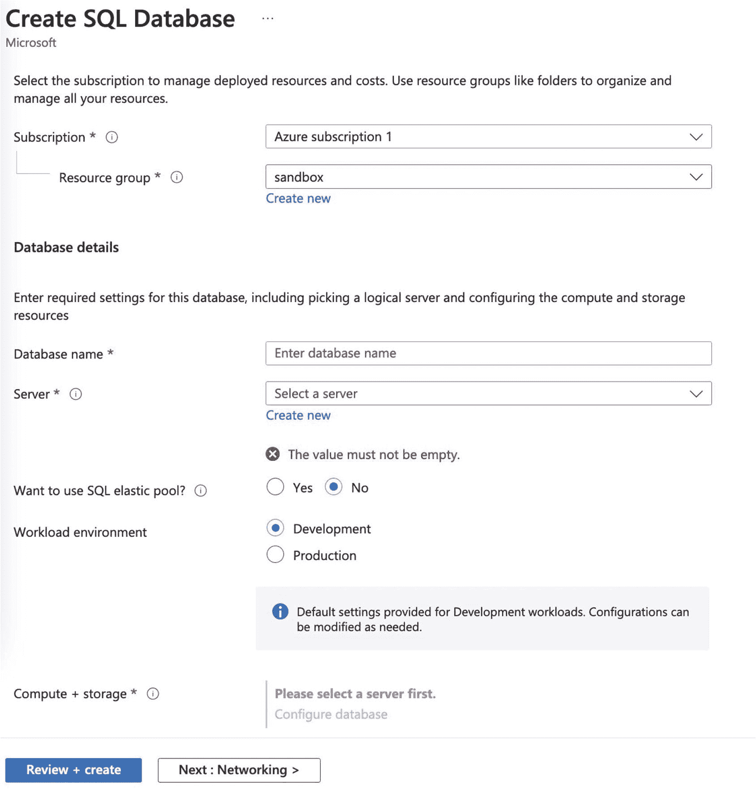

一个标记为“创建 SQL 数据库”的对话框。表单包含订阅、资源组、数据库名称、服务器、是否使用 SQL 弹性池、工作负载环境以及计算和存储等字段。它包含“查看 + 创建”和“下一步：网络”按钮。

图 17-4
创建新的 SQL 数据库

你还可以选择是否使用弹性 SQL 池。弹性 SQL 池基本上是为数据库提供的底层计算、存储和 IO，这些资源也可以与其他数据库实例共享。如果你创建了“n”个单一数据库实例，那么你将拥有“n”个底层计算和其他资源。如果你使用弹性 SQL 池，那么你可以拥有少于“n”个的计算和存储资源，并在“n”个数据库实例之间“共享”它们。
除了 SQL 弹性池选项之外，我们还可以指定我们正在创建的此实例是用于开发还是生产目的。SQL 弹性池按 eDTU 计费。eDTU 是一种货币单位，代表一定数量的计算、存储和 IO 资源。你可能希望预先购买一定数量的 eDTU，并为数据库设置它们在给定时间内可以消耗的此类单位数量的限制。
在创建新的 SQL 数据库之前，我们可能需要创建一个新的 Azure SQL 逻辑服务器。让我们单击“创建 SQL 数据库服务器”，这将提供创建新逻辑服务器的页面。界面如下所示：

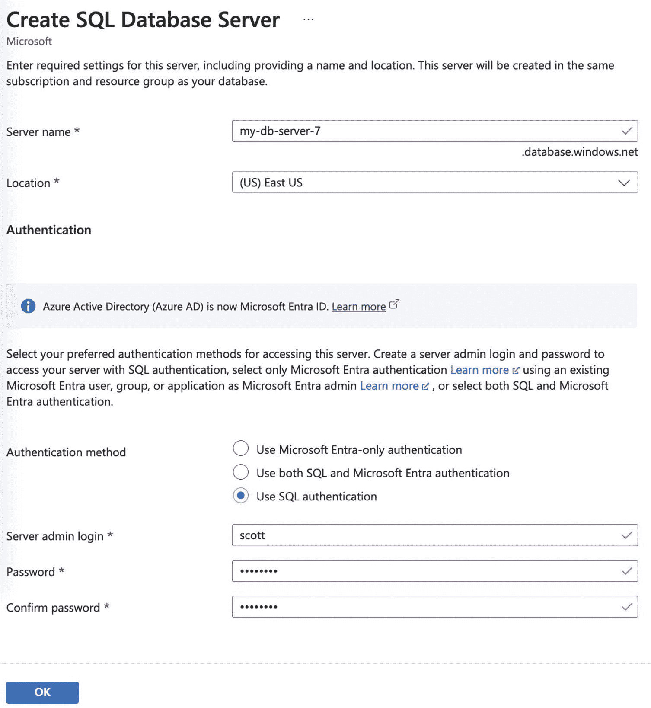

一个标记为“创建 SQL 数据库服务器”的对话框。表单包含服务器名称、位置、身份验证方法、服务器管理员登录名、密码和确认密码等字段。服务器名称为 my-d-b-server-7。位置为美国东部。身份验证方法为 SQL 身份验证。底部有一个“确定”按钮。

图 17-5
在 Azure 中创建 SQL 数据库服务器

你可以为逻辑服务器指定名称和位置；此外，你还可以指定身份验证方法。提供信息后，你可以单击“确定”为你的 SQL 数据库创建一个新的逻辑服务器。对于我们的实例，我们选择创建一个 SQL 数据库的单一实例。因此，我们选择不使用弹性 SQL 池。
逻辑服务器准备就绪后，你可以选择 SQL 数据库的计算和存储。在这里，你可以为你的 SQL 数据库选择底层硬件；你可能希望探索 Azure 提供的各种硬件及其定价，这些信息将立即计算并提供给你。此外，你还可以选择计算层级，是想要预分配的计算资源，还是选择无服务器模式，在这种模式下，你只需为你消耗的资源付费。
界面如下所示：

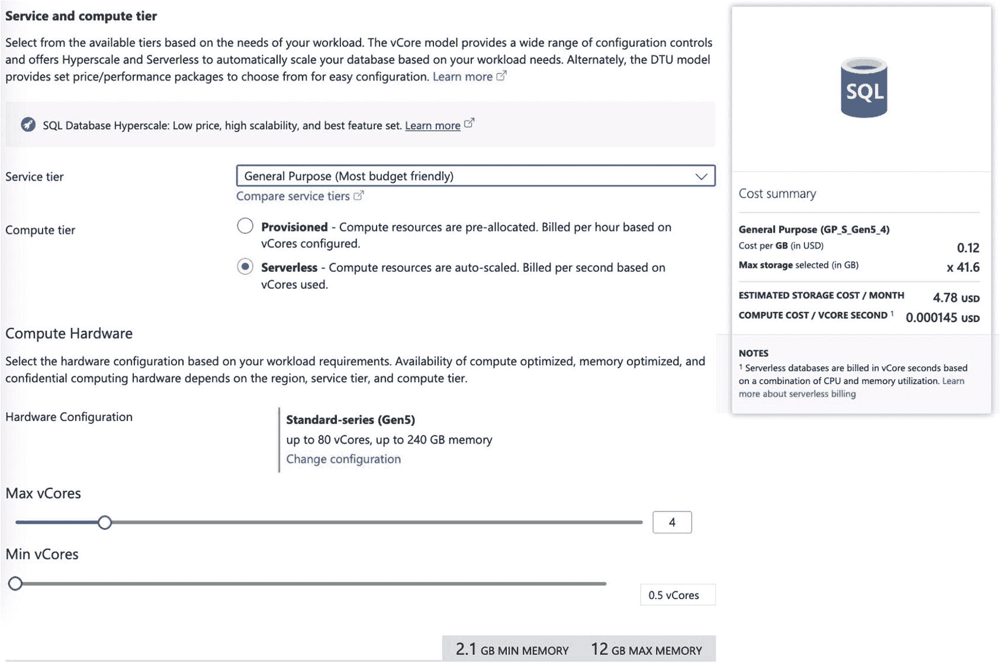

一个标记为“服务和计算层级”的网页截图。服务层级字段输入为“通用”。面板有一个标记为“最大 v 核心数”为 4、“最小 v 核心数”为 0.15 的滑块条。右侧有一个标记为“SQL”的文本框，带有成本摘要。

图 17-6
为我们的数据库服务器分配硬件资源

在选择备份存储冗余时，你可以为开发目的选择本地冗余备份存储或区域冗余选项。你可以保留其他选项不变，然后选择创建数据库。

以下是一个示例 Python 应用程序，它将连接到数据库、创建表并向该表插入行。如果你尚未安装“pyodbc”包，请在终端中执行以下命令：

```
pip install -u pyodbc
import pyodbc
from dotenv import load_dotenv
import os
server = os.getenv("server")
database = os.getenv("database")
username = os.getenv("username")
password = os.getenv("password")
driver = os.getenv("driver")
try:
cnxn = pyodbc.connect('DRIVER=' + driver +
';SERVER=' + server +
';DATABASE=' + database +
';UID=' + username +
';PWD=' + password)
cursor = cnxn.cursor()
print('Connection established')
try:
query1 = "CREATE TABLE SampleTable \
(Id INT PRIMARY KEY, \
Name NVARCHAR(100));"
cursor.execute(query1)
cnxn.commit()
print("Table created")
try:
query2 = "INSERT INTO \
SampleTable (Id, Name) \
VALUES (1, 'John'); \
INSERT INTO \
SampleTable (Id, Name) \
VALUES (2, 'Jane'); \
INSERT INTO \
SampleTable (Id, Name) \
VALUES (3, 'Alice');"
cursor.execute(query2)
cnxn.commit()
print("Rows inserted")
except:
print("unable to insert rows into the table")
cursor.close()
cnxn.close()
except:
print("unable to create the table")
except:
print('Cannot connect to SQL server')
```

环境文件的内容可能如下所示：

```
server = "your-azure-database-server-instance"
database = "your-database"
username = "your-username"
password = "password"
driver = "driver"
```

Azure Cosmos DB
Azure Cosmos DB 是 Microsoft 提供的一种托管 NoSQL 数据库服务。它是一种多功能服务产品，可以提供 SQL 和 NoSQL 数据库开发，包括关系数据模型、文档存储、图形数据库和向量数据库。Cosmos DB 提供多种 API，每种 API 模拟不同的数据库引擎。这些包括关系 SQL、用于文档数据库的 MongoDB、用于列式数据库的 Cassandra DB、用于图形数据库的 Gremlin 以及用于键值数据库的 Table。从某种意义上说，Cosmos DB 是一种多模型数据库服务，你可以根据数据库应用程序的需求使用合适的 API。在数据库迁移的情况下，你可以选择与你打算迁移的当前关系或 NoSQL 数据库相对应的 API。
你可以通过两种方式使用 Cosmos DB，即预配吞吐量和无服务器模型。顾名思义，在预配吞吐量中，你可以预配你期望数据库提供的吞吐量，同时定义你希望为数据库应用程序获得的性能级别。这里的度量单位称为请求单位。另一种使用 Cosmos DB 的方法是通过无服务器模型。
无服务器模型仅根据它接收和处理的请求数量向你收费。就计费而言，预配吞吐量将根据已预配但未消耗的请求单位数量计算账单，而在无服务器的情况下，计费是根据在一小时内通过执行数据库操作消耗的请求单位数量计算的。

注意

请求单位是衡量你如何使用服务的一种方式。你使用 Cosmos DB 执行的每个操作都会消耗一定量的计算、存储和物理内存。请求单位是根据此类消耗计算的。例如，发送到 Cosmos DB 的查询将花费一定数量的请求单位来检索结果。获取结果所需的确切请求单位数量可能取决于表的大小、查询编译时间和行数等参数。

让我们看看如何使用 MongoDB API 创建一个 Cosmos DB 实例。一旦你选择了 API，该实例的 API 将保持不变。如果你希望使用另一个 API，你可能希望使用相应的 API 创建另一个实例。在我们的例子中，我们选择 MongoDB API。如果你熟悉 MongoDB，那么其用法将与 Cosmos DB 非常相似。以下是在 Cosmos DB 中选择 API 的位置：

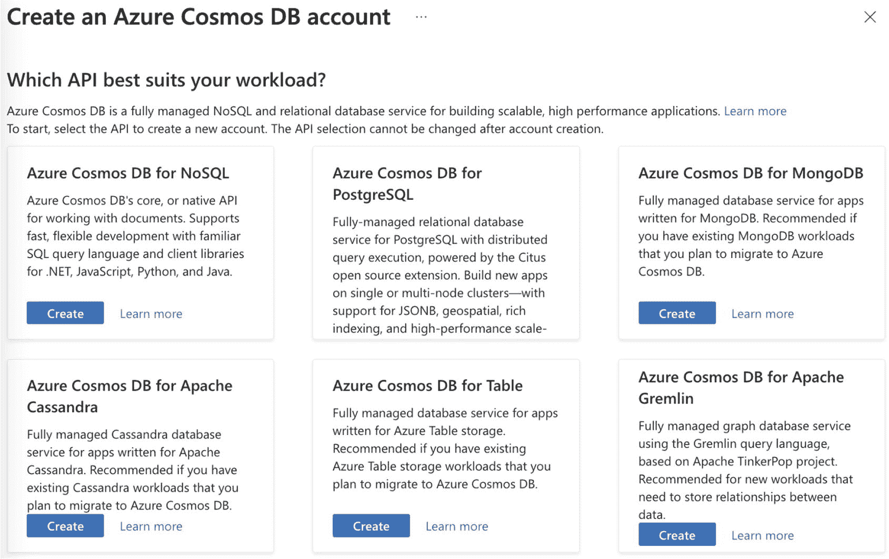

一个标记为“创建 Azure Cosmos DB 帐户”的网页截图。页面标题为“哪个 API 最适合你的工作负载”。它包括 Azure Cosmos DB for NoSQL、Azure Cosmos DB for NoSQL、PostgreSQL、MongoDB、Apache Cassandra、Table 和 Apache Gremlin。每个都包含一个“创建”按钮。

图 17-7
为你的 Azure Cosmos DB 实例选择合适的 API

接下来，系统会提示你为实例选择资源。有两个类别：一个基于请求单位，另一个基于虚拟核心。这两个选项都由 Azure 完全管理，并且随着工作负载的增加而扩展。让我们选择虚拟核心选项，这样我们可以选择底层硬件。
界面如下所示：

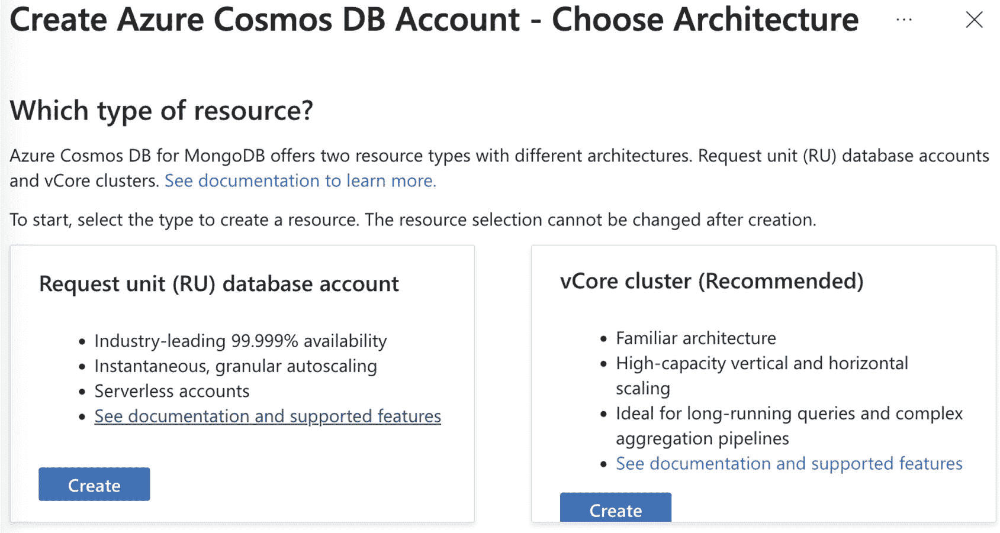

一个标记为“创建 Azure Cosmos DB 帐户 - 选择架构”的网页截图。页面标题为“哪种类型的资源”。它包括 2 个文本框，一个标记为“请求单位数据库帐户”，另一个标记为“vCore 集群”。每个框都有一个标记为“创建”的按钮。

图 17-8
为 Cosmos DB 选择硬件资源

选择虚拟核心选项后，你将进入配置 Cosmos DB 的页面。在这里，你需要指定订阅或计费帐户以及适当的资源组。资源组是共享相似策略和权限的东西。此外，选择管理员用户名和密码、集群的名称和位置以及其他详细信息。

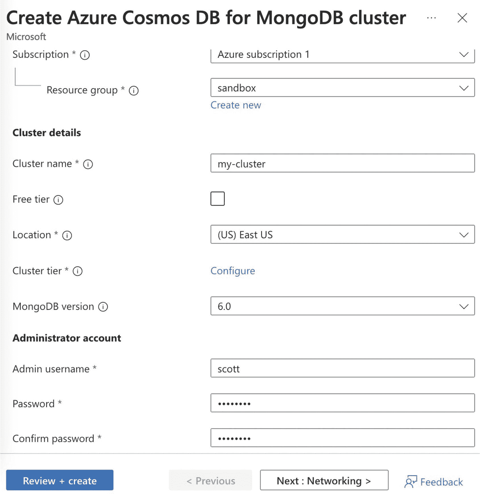

一个标记为“创建 Azure Cosmos DB for MongoDB 集群”的对话框。表单包含订阅、资源组、集群名称、免费层、位置、集群层级、MongoDB 版本、管理员用户名、密码和确认密码等字段。有“查看 + 创建”、“上一步”和“下一步：网络”按钮，以及一个“反馈”链接。

图 17-9
为 MongoDB 集群创建新的 Cosmos DB 实例

你可以选择为底层集群使用免费层。让我们看看为此 Cosmos DB 实例配置底层集群。在配置下，你将拥有各种开发和生产级别的硬件实例，你可以在其中自定义计算、存储和物理内存。此外，你还可以选择高可用性和数据库分片。
MongoDB 中的数据库分片是一种将数据分布在给定集群内的多个工作节点之间的方法。你还可以创建数据的副本，从而在读取/写入操作中获得速度。例如，假设一个包含特定分片的节点每秒可以处理“n”个操作；通过引入包含相同数据的“m”个分片，你可能能够每秒处理“m × n”个操作。

集群配置可能如下所示：

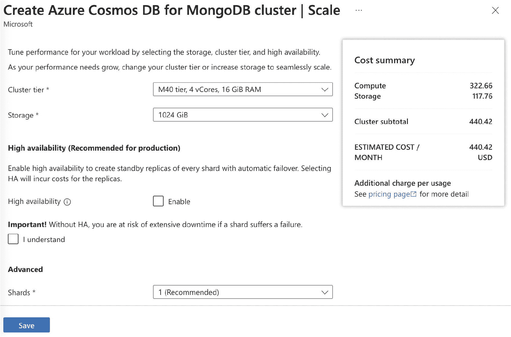

一个标记为“创建 Azure Cosmos DB for MongoDB 集群”的网页截图。页面包含集群层级、存储、高可用性和分片等字段。它包括一个标记为“成本摘要”的文本框，底部有一个“保存”按钮。

图 17-10
为 MongoDB 集群配置 Cosmos DB 的硬件

你还可以在网络选项中指定防火墙规则和连接方法。界面如下所示：

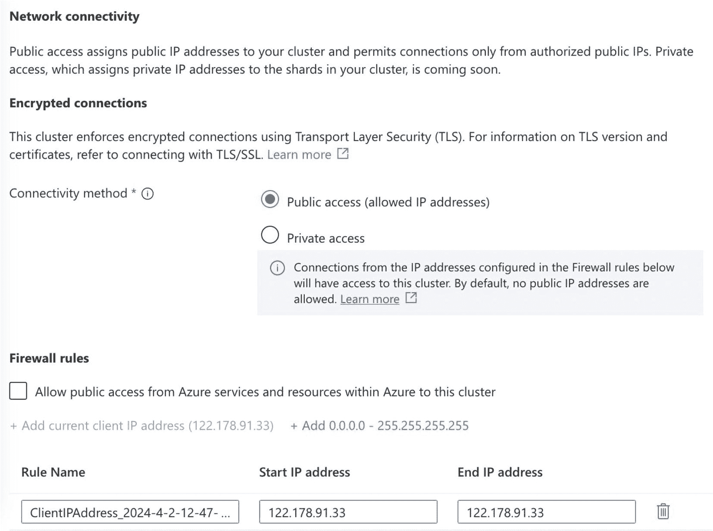

一个包含网络连接设置的网页截图。页面列出了加密连接和防火墙规则。加密连接在连接方法下选择了“公共访问”选项。防火墙规则包括规则名称、起始 IP 地址和结束 IP 地址字段。

图 17-11
Cosmos DB 的防火墙规则规范

你可以保留网络设置和其他设置不变，然后单击“创建”。Azure 可能需要几分钟来预配新集群。让我们看看如何连接并将 JSON 文档上传到 Cosmos DB：

```
from azure.cosmos import CosmosClient
import config
import json
url = config.settings['host']
key = config.settings['master_key']
database_name = config.settings['database_id']
container_name = config.settings['container_id']
path_to_json = "/Users/pk/Documents/mock_data.json"
def connect():
try:
client = CosmosClient(url,credential=key)
print("Established connection with the client")
try:
database = client.get_database_client(database_name)
print("Database obtained")
try:
container = database.get_container_client(container_name)
print("Container obtained")
except:
print(f"unable to select the container {container_name}")
except:
print(f"unable to select the database, {database_name}")
except:
print("Unable to connect to the database")
return container
def upsert(container):
with open(path_to_json, "rb") as file:
json_doc = json.load(file)
for js in json_doc:
upload_json_doc = container.upsert_item(js)
print(f"id uploaded is : {js['id']}")
def primaryfunc():
c_name = connect()
upsert(c_name)
primaryfunc()
```

Azure Synapse Analytics
到目前为止，我们已经研究了对象存储、关系数据库解决方案和 NoSQL 数据库解决方案。Azure Synapse Analytics 是 Microsoft 提供的一种现代存储解决方案，它能够将关系型、非结构化和半结构化数据存储到单个存储解决方案中。一旦数据进入 Synapse Analytics，就可以轻松使用各种计算层（如 Hadoop、Spark 或 Databricks）来查询数据并生成分析见解。此外，Synapse 数据湖提供了将数据以 Parquet 格式保存的选项，从而减少数据占用的空间。
你可以通过两种形式使用 Synapse Analytics，即专用 SQL 池和无服务器 SQL 池。专用 SQL 池以前称为 Azure SQL 数据仓库。专用 SQL 池是在实例创建期间预配的计算资源集合。与 Azure SQL 和 Cosmos DB 类似，这些实例的大小由称为数据仓库单位的单位来衡量。数据仓库单位代表一定数量的计算、内存和 IO 资源。
顾名思义，无服务器 SQL 池是无服务器的。无需配置底层基础设施，也无需进行集群维护。你只需为运行的数据处理付费，因此无需为底层基础设施付费。你可以在几分钟内启动并运行查询数据。此服务在你的数据湖之上创建一个查询层，你可以在数据之上运行 T-SQL 查询。
从架构的角度来看，Synapse Analytics 将计算与存储分离。你可以独立于数据来扩展计算。在内部，Synapse SQL 使用基于节点的架构，该架构由控制节点和计算节点组成。提交的 T-SQL 代码被路由到控制节点。控制节点使用分布式查询引擎来优化查询以进行并行处理，并将任务分配给计算节点以并行执行查询。
让我们创建一个 Azure Synapse Analytics 实例。我们首先导航到 Azure 控制台并搜索 Synapse Analytics。当 Synapse Analytics 服务页面为我们呈现时，我们将选择创建一个新的 Synapse 工作区。我们首先指定订阅组、资源组和托管资源组。托管资源组是 Azure 为 Synapse 工作区创建的补充资源所在的位置。
界面如下所示：

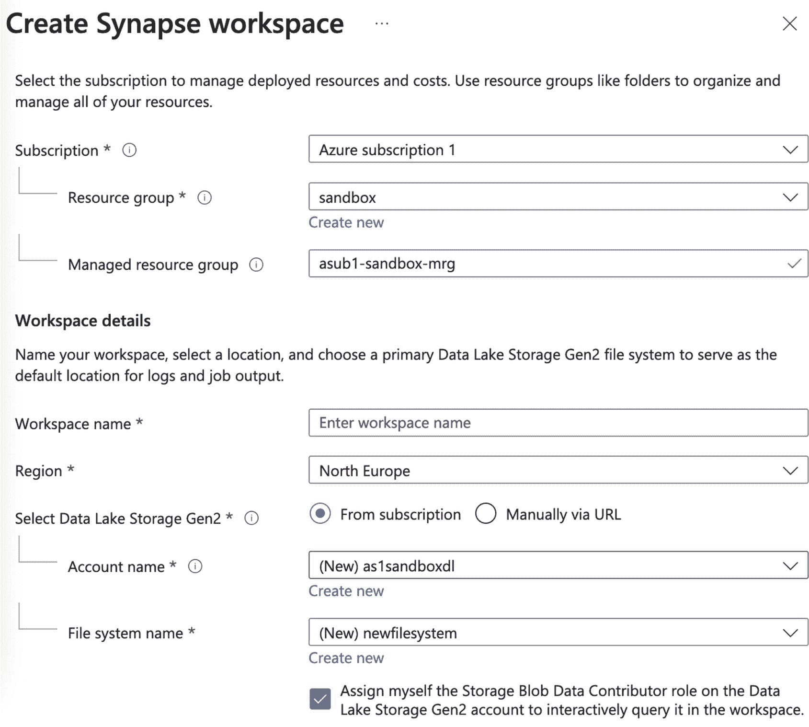

一个标题为“创建 Synapse 工作区”的网页截图。表单包含订阅、资源组、托管资源组等字段。在工作区详细信息下，它列出了工作区名称、区域、Data Lake Storage Gen2、帐户名称和文件系统名称。底部有一个已勾选的“分配我自己”复选框。

图 17-12
创建 Azure Synapse 工作区

我们还必须定义工作区的名称和位置；此外，我们必须指定当前的数据湖或创建一个新的数据湖，这是配置工作区的一部分。输入基本信息后，让我们在安全设置中指定一个本地用户。
一旦 Synapse Analytics 启动并运行，你就可以在仪表板中查看它。界面如下所示：

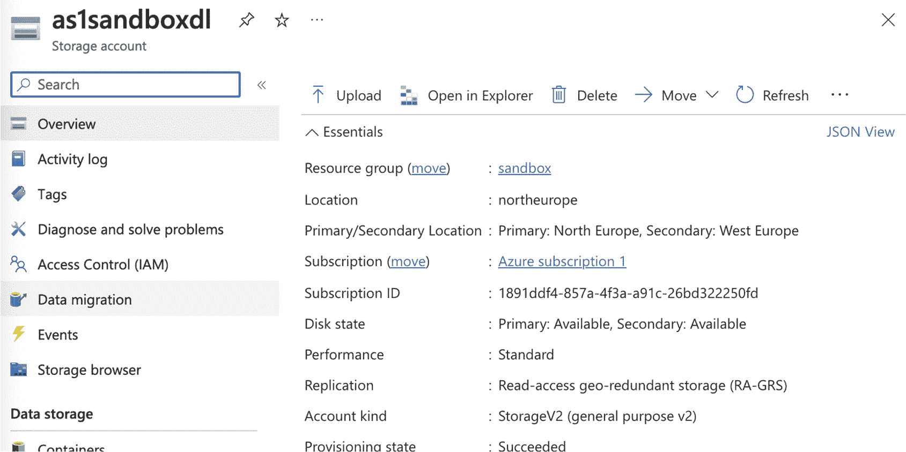

一个包含 s1 sandbox dl storage account 选项的菜单截图。选项包括概述、活动日志、标签、诊断并解决问题、访问控制、数据迁移、事件、存储浏览器和数据存储。在基本信息下，它列出了资源组、位置、订阅、磁盘状态以及更多带有值的项目。

图 17-13
Azure Synapse 工作区的仪表板

Azure Data Factory
Azure Data Factory 是一种完全托管的数据集成服务。该服务以无服务器方式提供，因为你无需为底层硬件付费。你可以通过可视化方式或编程方式设计数据集成管道。它拥有多个内置连接器，可实现更顺畅的集成；它还与 git 良好集成，因此你可以在适用的情况下推送代码更改。Azure Data Factory 允许你创建自定义事件触发器，当触发某个事件时，这些触发器会自动执行某些操作。

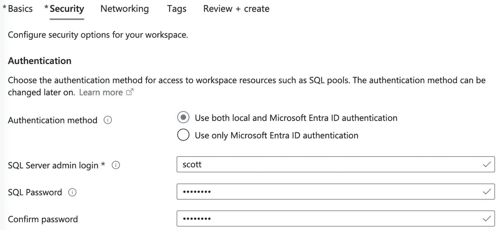

一个包含“基本信息”、“安全性”、“网络”、“标签”、“查看 + 创建”菜单的截图。在“安全性”下，它突出显示了身份验证，并包括身份验证方法、SQL Server 管理员登录名、SQL 密码和确认密码字段。

图 17-14
Azure 身份验证

使用 Azure Data Factory，可以在从一个系统加载数据到另一个系统时压缩数据，从而消耗更少的带宽。要开始使用 Azure Data Factory，请访问链接 [`https://adf.azure.com/en/`](https://adf.azure.com/en/) 或在控制台中搜索 Azure Data Factory 找到相同的链接。将打开一个新选项卡，你可以在其中为新的数据工厂指定名称并关联你的订阅帐户。
界面如下所示：

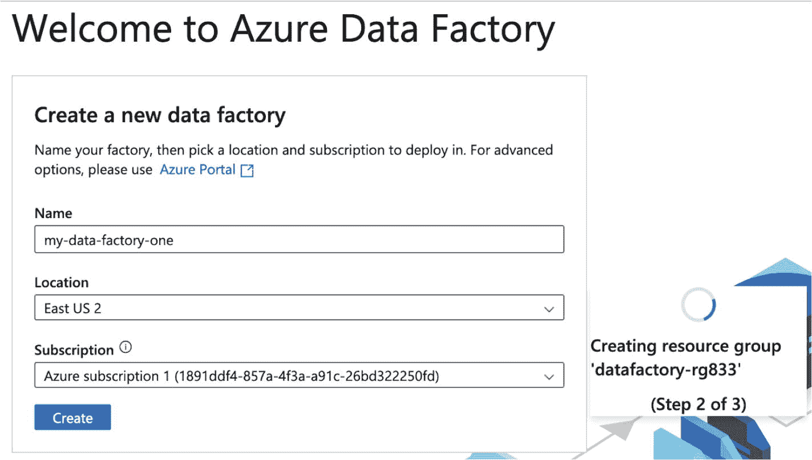

一个标题为“欢迎使用 Azure Data Factory”的对话框截图。页面有一个标题为“创建新数据工厂”的表单。表单包括名称、位置和订阅字段。底部还有一个“创建”按钮。

图 17-15
创建 Azure Data Factory 页面

提交信息后，你可能需要等待几分钟，让 Azure 为你准备 Azure Data Factory 服务。完成后，界面可能如下所示：

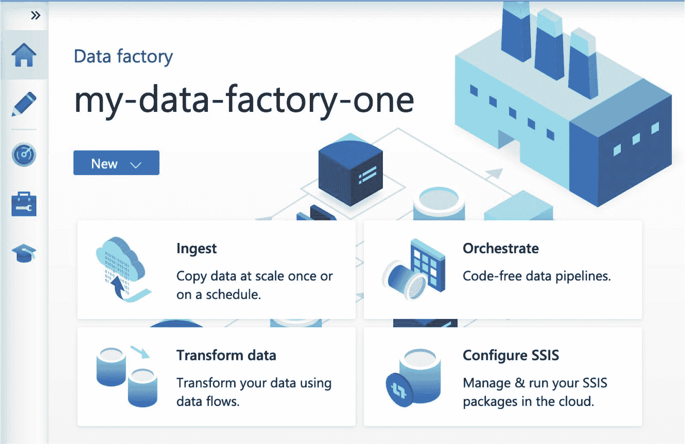

一个标记为“Data Factory”的截图。左侧列出了 4 个带有图标和文本的选项。在“我的数据工厂”下，它列出了 4 个带有描述的图标。它包括“摄取”、“复制数据”、“编排”、“无代码数据管道”、“转换数据”、“使用数据流”、“配置 SIS”、“在云中管理包”。

图 17-16
Azure Data Factory 主页

在左侧，你将看到五个选项，其中“主页”是主页面，“创作”是你的数据集成 IDE，“监视”是你编排和观察作业运行的地方，“管理”是你控制 git 集成和其他设置的地方，“学习中心”是你获取 Azure Data Factory 文档和学习支持的地方。

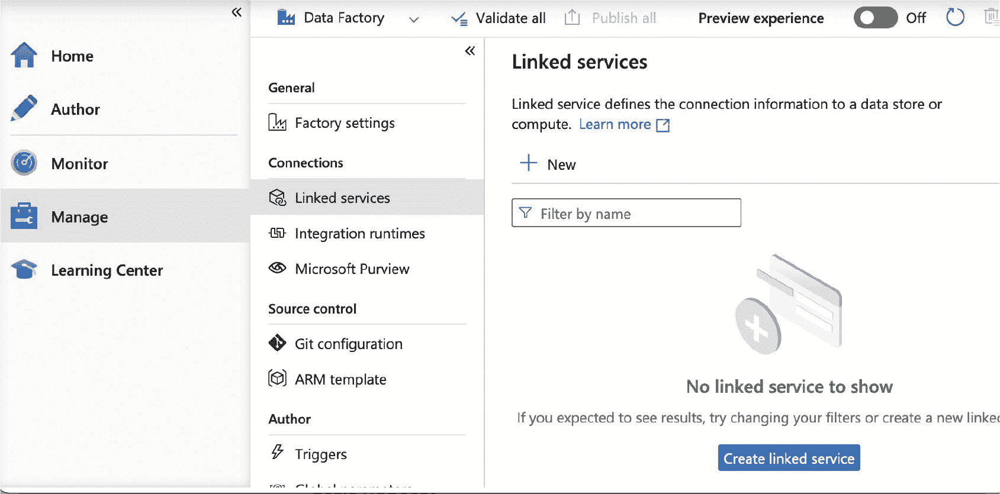

一个计算机屏幕截图，列出了包含“主页”、“创作”、“监视”、“管理”、“学习中心”选项的菜单。在“管理”下，Data Factory 包含“常规”、“连接”、“源代码管理”和“创作”菜单。在“连接”下，“链接服务”被突出显示，底部有一个“创建链接服务”按钮。

图 17-17
Azure Data Factory 控制台

在使用 Azure Data Factory 设计数据集成作业时，你可以创作一个数据集成作业，内部称为管道，它是一组逻辑上排列好要执行的活动。管道内的活动执行单个任务。你可以执行各种活动，这些活动可以连接源和目标数据系统、传输数据以及执行各种转换。
你必须定义一个数据系统连接才能连接到数据系统。要定义数据系统连接信息，请导航到“管理”页面，然后单击“连接”选项卡下的“链接服务”。
让我们尝试在“链接服务”中创建或添加 Azure Blob 存储作为新连接。你可以单击“新建连接”，在数据存储中搜索“Azure Blob”，然后单击“继续”。你可以为连接输入名称和描述，然后在“帐户选择方法”下选择 Azure 订阅；选择你的相应订阅和容器名称。
你可以测试连接，如果返回成功，则说明你已成功将 Azure Blob 存储添加到 Azure Data Factory 中。界面如下所示：

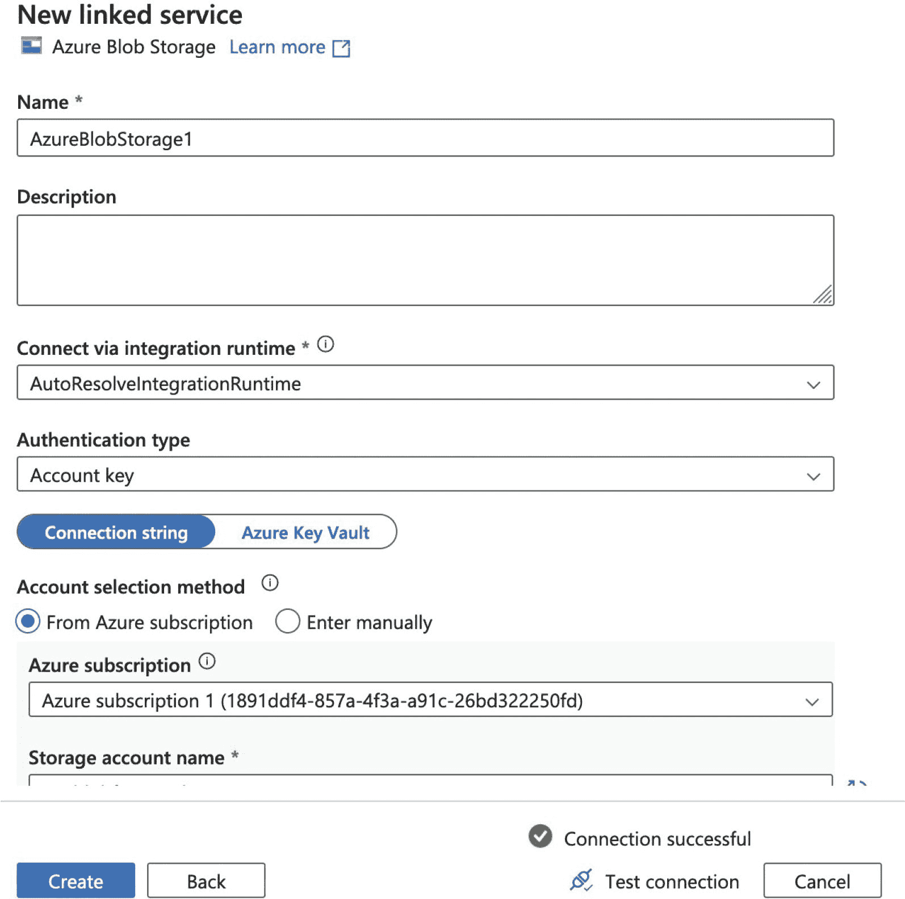

一个标记为“新建链接服务”的对话框，列出了一个表单。表单包含名称、描述、通过集成运行时连接、身份验证类型、帐户选择方法、Azure 订阅和存储帐户名称等字段。表单包含“创建”、“返回”、“测试连接”和“取消”按钮。

图 17-18
在 Azure Data Factory 中创建新的链接服务

为了熟悉 Azure Data Factory，让我们看看如何将数据从 Azure Blob 存储复制到 Azure SQL 数据库。我们将从源获取一个逗号分隔的数据文件，并将其上传到 Azure Blob 存储。然后，我们将使用 Azure Data Factory 启动从 Blob 存储到 Azure SQL 数据库的复制管道。首先，导航到主页，单击“摄取”选项，然后选择“内置复制任务”。
界面如下所示：

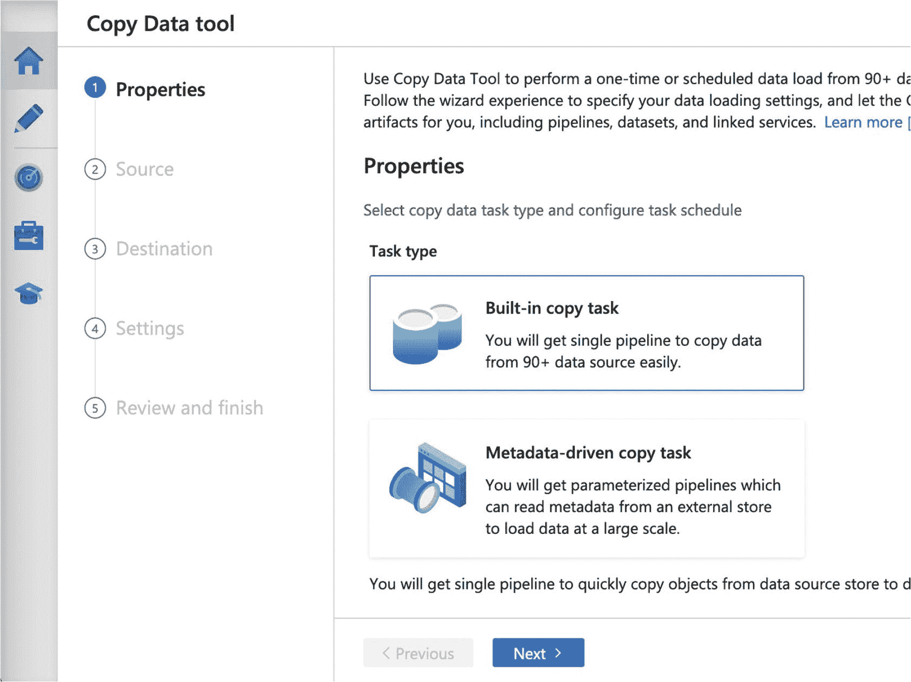

一个标题为“复制数据工具”的网页截图。页面包含一个选项列表，包括“属性”、“源”、“目标”、“设置”和“查看并完成”。在右侧，有“属性”步骤的描述，包括两个选项：“内置复制任务”和“元数据驱动的复制任务”。底部有“下一步”按钮。

图 17-19
Azure Data Factory 的“复制数据”工具

我们将在下一页指定源数据系统，即 Azure Blob 存储。从“源类型”下拉菜单中，选择“Azure Blob 存储”，然后从“连接”下拉菜单中，选择你的 Blob 存储。如果你之前使用了“链接服务”选项，则此选项应该可用。如果没有，过程是相同的。
一旦你的 Blob 存储被链接，你可以浏览对象存储以选择合适的平面文件或包含平面文件的文件夹。如果你计划从一个文件夹上传多个平面文件，请选择“递归”选项。系统将识别所选的平面文件类型，并自动填充文件格式设置。
界面如下所示：

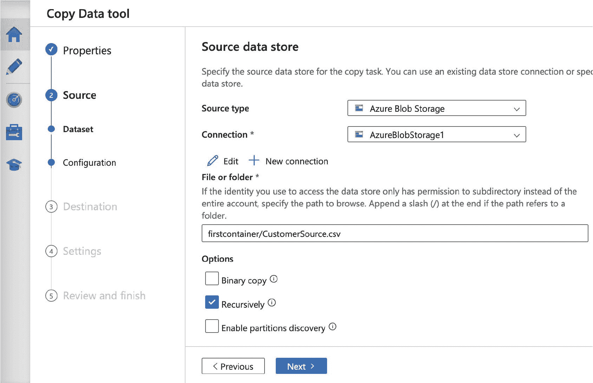

一个标题为“复制数据工具”的页面截图。左侧列出了“属性”、“源”、“数据集”、“配置”、“目标”、“设置”和“查看并完成”。右侧列出了“源数据存储”。源数据存储包括“源类型”、“连接”、“编辑”、“新建连接”、“选项”。底部有“下一步”按钮。

图 17-20
在 Azure Data Factory 中指定源数据存储

现在，让我们指定目标数据系统。你可以选择 Azure SQL 数据库并指定连接，为此你可能希望创建一个新的链接服务，或选择可能已经创建好的链接服务。由于这是一个关系数据库，我们确实可以选择在目标数据库上创建表架构，并将平面文件直接填充到数据库中。如果没有，我们可以选择自动创建数据表并填充此数据表。界面如下所示：

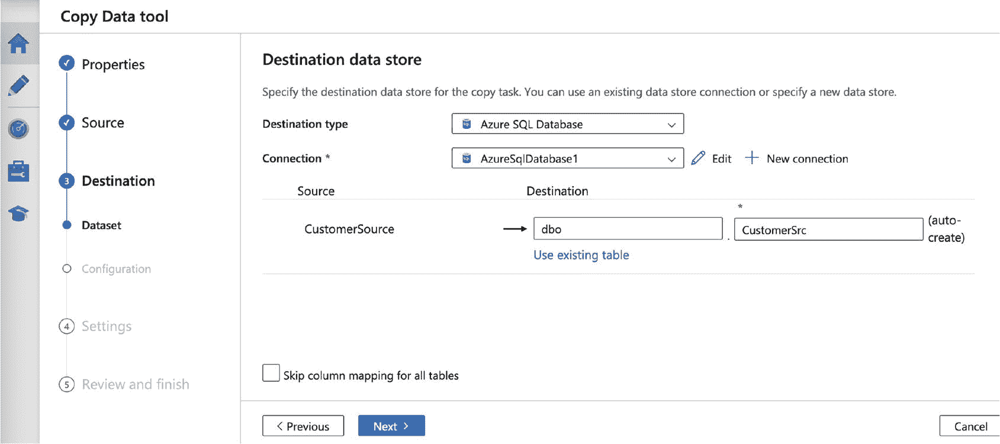

一个标题为“数据复制工具”的页面截图。左侧列出了选项“属性”、“源”、“目标”、“数据集”。屏幕右侧显示“目标数据存储”。它包括“目标类型”、“连接”、“源”和“目标”字段。底部有“下一步”按钮。

图 17-21
在 Azure Data Factory 中指定目标数据存储

完成此步骤后，让我们在“设置”下命名此数据管道。界面如下所示：

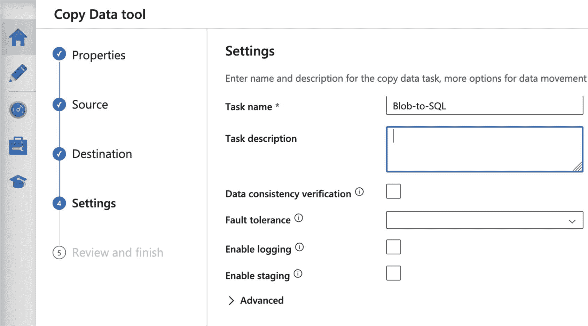

一个标题为“数据复制工具”的页面截图。左侧列出了选项“属性”、“源”、“目标”、“设置”。屏幕右侧显示“设置”。它包括“任务名称”、“任务描述”、“数据一致性验证”和“容错”字段。

图 17-22
添加此数据管道的名称和描述

成功完成所有这些步骤后，你将看到一个查看屏幕，其中列出了此数据管道的所有参数。如果有任何错误，或者你发现需要更改的内容，你可以编辑相应的字段。如果一切看起来正常，那么你可以单击“下一步”。Azure Data Factory 将对此整个数据管道运行验证。一旦验证过程成功完成，你可能会看到以下屏幕：

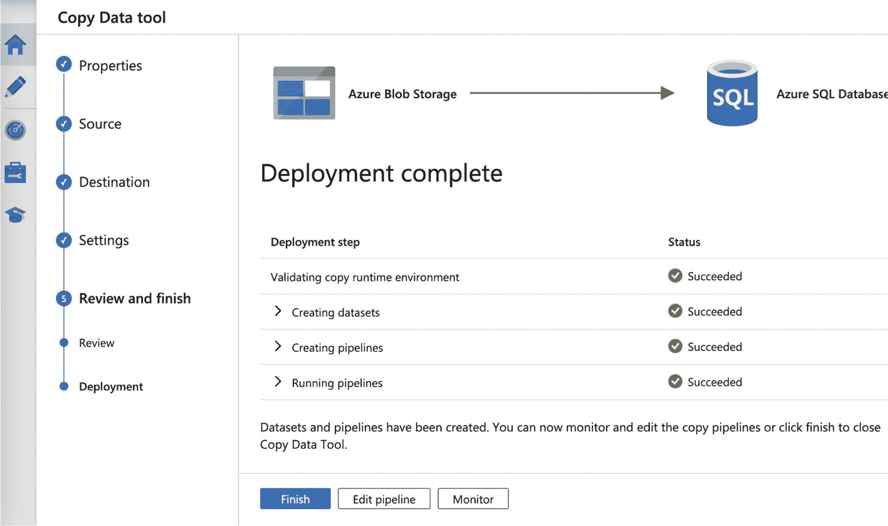

一个标题为“数据复制工具”的页面截图。左侧列出了选项“属性”、“源”、“目标”、“设置”、“查看并完成”、“查看”和“部署”。右侧将 Azure Blob 存储链接到 Azure SQL 数据库。它列出了部署步骤，状态为“成功”。底部有“完成”按钮。

图 17-23
数据管道的验证和执行

你可以选择单击“完成”，这将带你回到主页。在 Azure Data Factory 的仪表板上，单击“监视”页面，该页面将列出你存储库中的当前数据管道。你可以单击“重新运行”来运行数据管道。当作业成功完成时，你可能会看到类似以下内容：

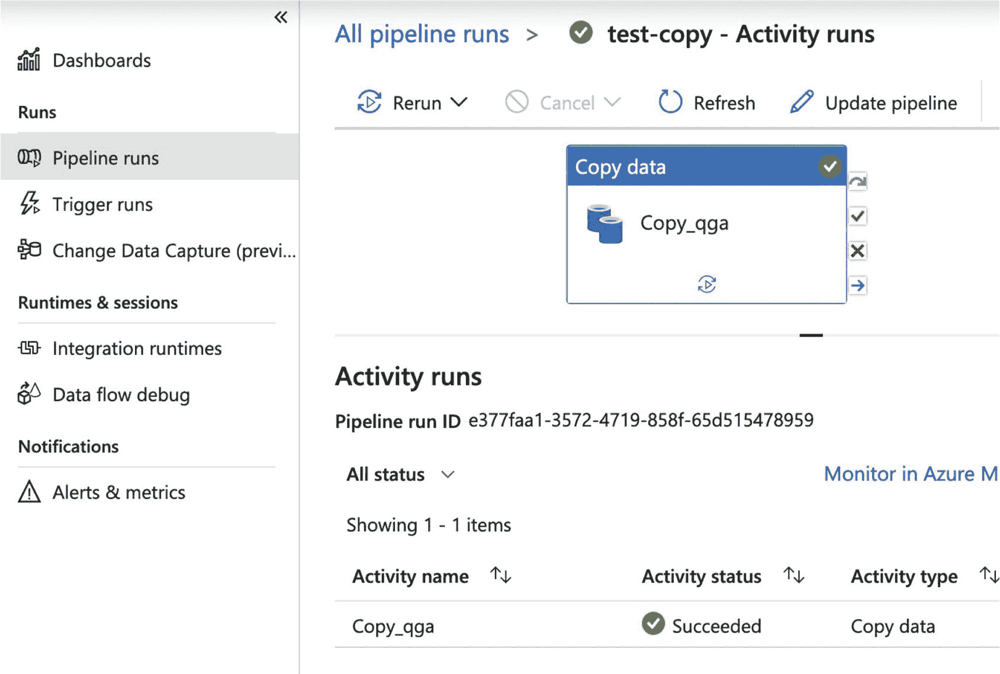

一个页面截图，左侧有一个选项列表。它包括“仪表板”、“运行”和“管道运行”。在“管道运行”下，它包括“所有管道运行”、“测试复制-活动运行”。“活动运行”包括活动名称、活动状态和活动类型。

图 17-24
在 Azure Data Factory 中监视和重新运行数据管道

Azure Functions
Azure Functions 是一种无服务器计算选项，它允许执行执行特定任务的函数，而无需担心底层硬件。Azure 会自动为这些函数提供更新的服务器来执行，并在需要时进行扩展。这些计算资源在运行时动态分配并自动缩放。你只需为你执行的代码（执行持续时间和使用的计算资源）付费。你可以使用 Azure Functions 构建 API、响应另一个服务上发生的事件等。
Azure Functions 的亮点是触发器和绑定的使用。使用触发器和绑定，你可以创建与其他服务交互的函数。触发器基本上是启动函数执行的事件或条件。在 Azure Functions 中，每个函数只能有一个触发器。例如，你可以有一个具有 HTTP 触发器的 Azure 函数，该触发器接收请求并触发函数提供响应；你可以有一个服务触发器，当事件发生时（例如在 Blob 存储中上传了新文件，甚至是一个简单的计时器，按特定计划设置函数执行）激活 Azure 函数。
Azure Functions 中的绑定提供了一种连接到各种数据源的方法；因此，你可以与服务交互（写入和读取数据）。在给定的 Azure 函数中，你可以有多个绑定。Azure Functions 支持两种类型的绑定，即输入和输出绑定。输入绑定可能包括从数据存储系统（如 Blob 存储、数据库、文件系统等）读取数据，输出绑定可能是将数据发送到另一个服务。Azure Functions 实际上支持在给定函数中使用多个输入和输出绑定。
要创建新的 Azure 函数，请导航到 Azure 仪表板，并搜索“Function App”。界面如下所示：

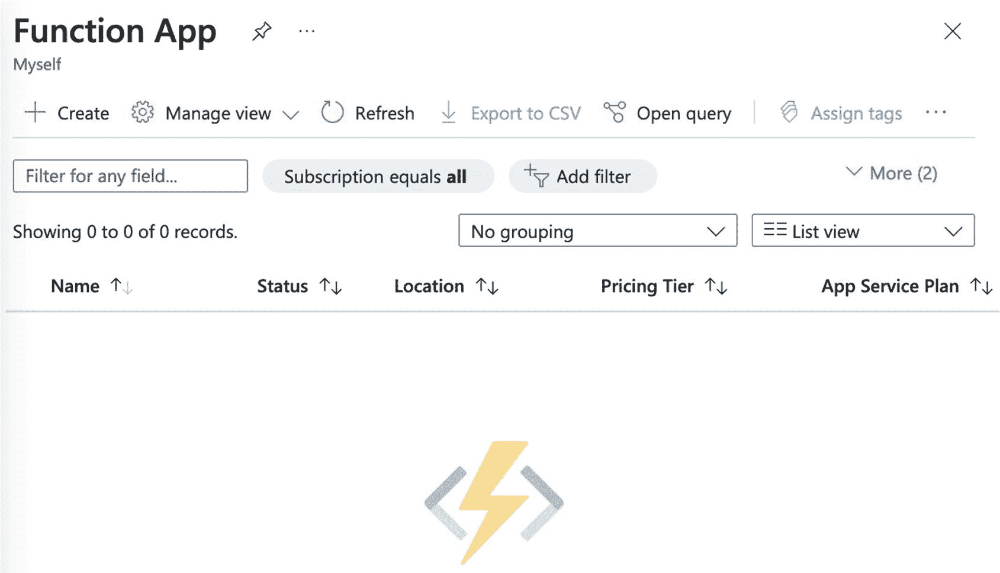

一个标记为“Function App”的网页截图。菜单包括“创建”、“管理视图”、“刷新”、“导出到 CSV”、“打开查询”和“分配标签”选项。下面的表格包括“名称”、“状态”、“位置”、“定价层”和“应用服务计划”列。表格为空。

图 17-25
Function App——Azure Functions

进入 Azure Functions 后，创建一个新的函数应用。你必须输入订阅详细信息；你还将定义实例详细信息，包括函数应用的名称、运行时堆栈、环境和操作系统。
你还可以定义如何选择托管应用。最具成本效益的选项是无服务器；但是，你也可以选择重用来自其他 Azure 服务的计算资源。
界面如下所示：

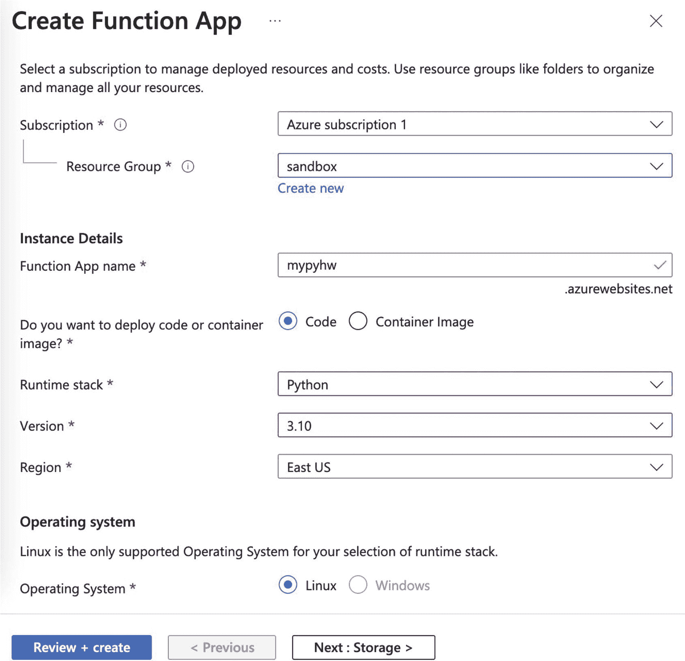

一个标题为“创建函数应用”的对话框截图。表单包含订阅、资源组等字段。在“实例详细信息”下，它列出了函数应用名称、部署类型、运行时堆栈、版本、区域和操作系统。操作系统按钮已选中“Linux”。底部有“查看 + 创建”按钮。

图 17-26
在 Azure Functions 中创建新的函数应用

创建函数应用实例后，你可以在其中创建 Azure 函数。让我们探索如何使用核心工具包在本地开发 Azure 函数。
根据操作系统的不同，你可能希望参考这些说明来安装核心工具。
链接如下： [`https://learn.microsoft.com/en-us/azure/azure-functions/functions-run-local?tabs=macos%2Cisolated-process%2Cnode-v4%2Cpython-v2%2Chttp-trigger%2Ccontainer-apps&pivots=programming-language-python`](https://learn.microsoft.com/en-us/azure/azure-functions/functions-run-local%253Ftabs%253Dmacos%252Cisolated-process%252Cnode-v4%252Cpython-v2%252Chttp-trigger%252Ccontainer-apps%2526pivots%253Dprogramming-language-python)

要检查安装是否完成，你可以打开终端并输入“func”，它将显示与 Azure 函数相关的输出。
要在本地创建新的 Azure 函数，请输入

```
func init myfunction --worker-runtime python --model V2
```

它将使用适当的 JSON 元素设置整个项目结构。界面如下所示：

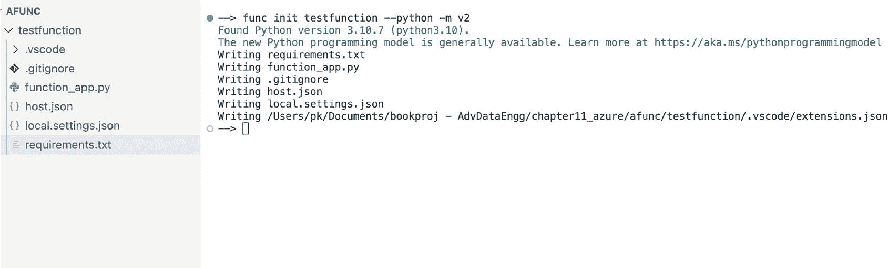

一个页面截图。左侧包括 A F U N C、test function、v s code、gitignore、function app、host j son、local settings 和 requirements。右侧包括 func init test function、python，包含 6 个步骤：Writing requirements、function app、host、local settings users。

图 17-27
测试 Azure Functions 中核心工具的安装

左侧的文件夹结构由 Azure Functions 核心工具实用程序创建。你可以导航到 function_app.py 并继续编写你的 Azure 函数。以下是一个示例 Azure 函数：

```
import azure.functions as func
import datetime
import json
import logging
app = func.FunctionApp()
@app.function_name('helloworld')
@app.route(route="route66")
def helloworld(requests: func.HttpRequest) -> func.HttpResponse:
logging.info('received request for helloworld function')
user = req.params.get('username')
if user:
message = f"Hello, {user}"
else:
message = "welcome to Azure functions"
return func.HttpResponse(
message,
status_code=200
)
```

准备好 Azure 函数后，你可以使用命令行中的“func start”运行该函数。界面如下所示：

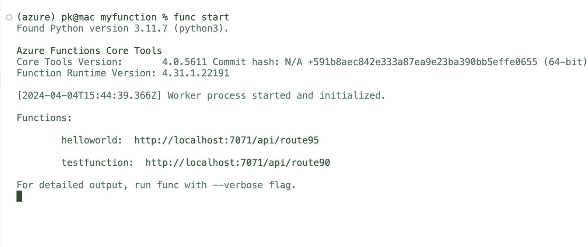

一个 CLI 截图。它包括使用的 Python 版本、Azure Functions 核心工具版本和函数运行时版本。它包括 2 个函数：hello world 和 test function，以及它们对应的 URL。

图 17-28
在 Azure Functions 中执行函数

当你导航到相应的 URL 时，你可以查看函数的输出。如果你希望将代码发布为 Azure 函数（目前，该函数是在本地开发和部署的），那么你可以使用终端中的以下命令：

```
func azure functionapp publish 
```

Azure Machine Learning
Azure Machine Learning 是一种完全托管的机器学习服务，可帮助开发代码、训练机器学习模型、执行、部署和管理已部署的机器学习模型。Azure Machine Learning 服务提供无服务器计算。Azure Machine Learning 提供的主要服务是 Azure ML Studio 和用于机器学习的 Python SDK。使用 Azure ML Studio，你可以使用 Jupyter Notebook 编写自己的代码，并使用 Azure ML 服务执行相同的代码。Azure 还提供了一个低代码选项，使你能够拖放 ML 数据资产和组件来设计、训练和部署机器学习模型。
要开始使用 Azure Machine Learning，请导航到管理控制台并搜索“Azure machine learning”。你将在市场选项中找到 Azure Machine Learning。选择该服务并创建一个新的机器学习工作区。为你的订阅和工作区提供适当的详细信息。
界面如下所示：

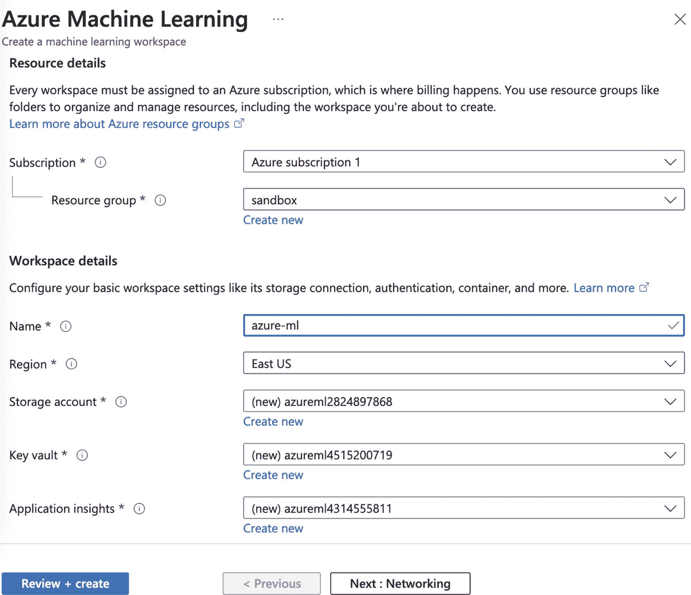

一个标题为“Azure Machine Learning”的对话框截图。表单包含订阅、资源组、名称、区域、存储帐户、密钥保管库和 Application Insights 等字段。每个字段都有一个下拉菜单，其中包含可供选择的选项。它有“查看 + 创建”、“上一步”和“下一步”按钮。

图 17-29
在 Azure Machine Learning 中创建机器学习工作区

工作区选项用于启用 Azure Machine Learning 提供的所有资源的集中视图。当你预配新的 Azure Machine Learning 工作区时，Azure 会自动创建一组专用于 Azure Machine Learning 的服务。这些是存储帐户、密钥保管库、容器注册表和 Insights。
存储帐户是为 Azure Machine Learning 数据资产、日志和报告（如果有）新创建的存储空间。还有一个创建 Blob 的选项。密钥保管库是一种机密管理资源，用于安全存储机器学习工作区中使用的敏感信息。Insights 将在监控机器学习项目期间提供操作见解和诊断信息。容器注册表处理用于机器学习模型、开发环境等的 Docker 容器。
创建并可用服务后，界面如下所示：

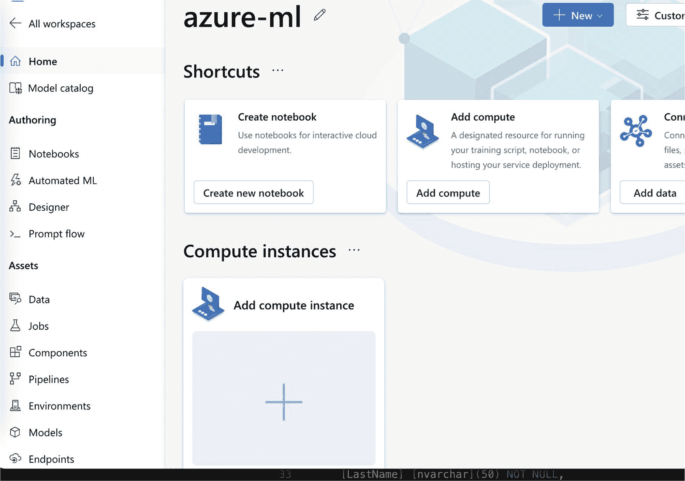

一个页面截图。左侧列出了“所有工作区”、“主页”、“模型目录”、“创作”和“资产”。右侧列出了 3 个快捷方式：“创建笔记本”、“添加计算”。在快捷方式下方，包括“计算实例”。

图 17-30
Azure ML 服务主页

Azure ML 数据资产
以前在 Azure ML Studio 中称为数据集，数据资产就像是 Azure Machine Learning 中的一个存储库，你可以在其中创建对位于其他位置的数据集的引用。你可以从 Azure 数据存储、公共 URL 和 Azure 开放数据集创建数据集引用。由于数据仍保留在其位置，因此你不会产生存储成本。数据资产中的这些数据集是延迟评估的，这有助于高效使用计算。你可以存储在数据资产中的数据集有两种类型，即 FileDataSet 和 TabularDataSet。
FileDataSets 是对位于其他位置的一个或多个数据集的引用。源数据集可以是任何格式，FileDataSets 创建可在机器学习工作流中使用的引用。如果你引用的数据集已经清理完毕并准备好在机器学习管道中使用，那么 FileDataSets 是一个不错的选择。
TabularDataSet 是另一种类型的数据集，它以其原生格式解析源数据集（一个或多个数据集）并将其转换为表格格式。然后可以将此表格格式数据集导入 Jupyter notebook 或 Spark 环境。TabularDataSet 可以解析 JSON 文件、Parquet 文件、SQL 查询的结果以及简单的逗号分隔文件。
以下是如何从 Azure ML Studio 创建这两种数据集类型中的任何一种。你可以单击 Azure ML Studio 中“资产”下的“数据”选项。
界面如下所示：

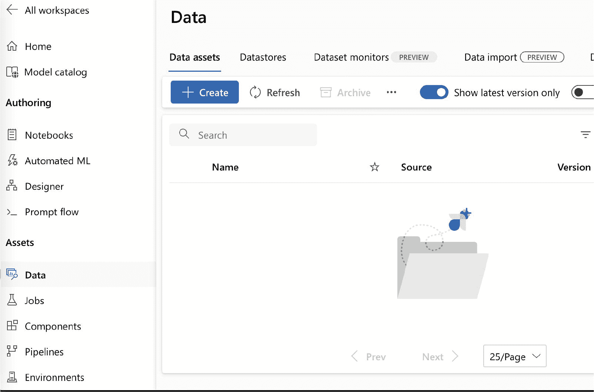

一个页面截图。左侧列出了“所有工作区”、“主页”、“模型目录”、“创作”和“资产”。右侧列出了“数据”。在“数据”下，它列出了“数据资产”、“数据存储”、“数据集监视器”和“数据导入”。它突出显示了“创建”按钮。中央面板中有一个文件夹图标。

图 17-31
Azure ML Studio 中的数据资产

进入此页面后，单击“创建”。你可以指定数据集的名称和描述，并从“类型”下拉菜单中选择“文件”或“表格”。
界面如下所示：

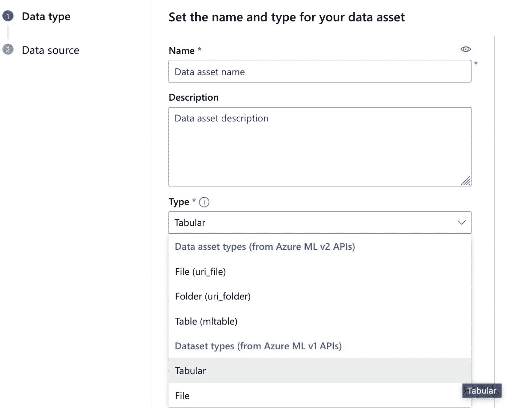

一个包含数据类型和数据源的对话框截图。右侧有名称、描述和类型字段。类型字段有一个下拉菜单，其中包含“表格”、“文件”、“文件夹”和“表”选项。已选择“表格”。

图 17-32
在 Azure ML Studio 中指定数据资产

Azure ML 作业
Azure Machine Learning 基本上是一组在底层集群上运行的机器学习任务。你可以构建一个 ML 训练作业，它可能包含一组训练机器学习模型的任务；你也可以构建一个扫描作业，它可能包含一组使用多个超参数执行机器学习模型的任务，并选择最能最小化成本函数的最佳模型。这些作业还会生成日志条目，Azure ML Studio 可以跟踪每个 ML 作业的指标。
要开始开发机器学习模型，你需要一个机器学习工作区和一个计算实例。在前面的部分中，我们已经创建了一个工作区。要创建新的计算实例，你可以选择“管理”下的“计算”选项，或者只需单击仪表板上的“添加计算实例”。
界面如下所示：

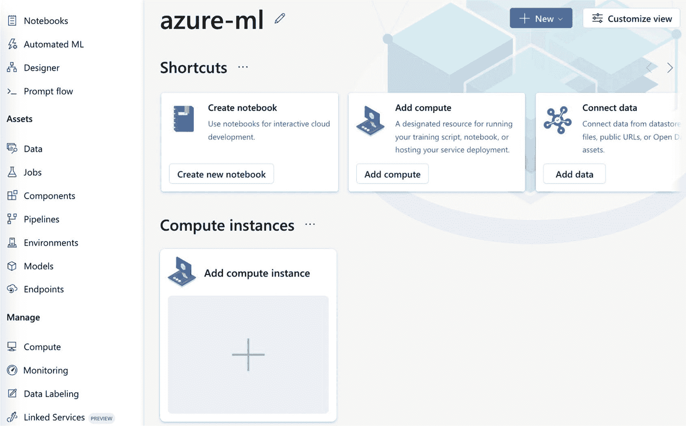

一个页面截图。左侧列出了“数据”和“计算”等选项。右侧列出了 3 个快捷方式：“创建笔记本”、“添加计算”。在快捷方式下方，包括“计算实例”。

图 17-33
在 Azure ML Studio 中添加新的计算实例

你可以为计算实例指定名称，并选择是需要基于 CPU 的实例还是基于 GPU 的实例。实例类型的选择将基于你打算执行的机器学习任务的性质。
GPU 始终与并行性和高性能计算相关联，因此，如果你的机器学习模型利用并行性（通过 Dask 或 Ray），你可以选择此选项。某些应用程序，如训练具有多个层的深度学习模型或计算机视觉任务（图像处理），非常适合使用 GPU。某些机器学习应用程序，如文本建模、大型模型或构建推荐引擎，其底层任务受益于并行性，可以通过 CPU 和 GPU 架构进行训练。对于表格数据，基于 CPU 的计算可能就足够了。
选择虚拟机后，你可以保留其他选项不变，然后继续创建计算实例。界面如下所示：

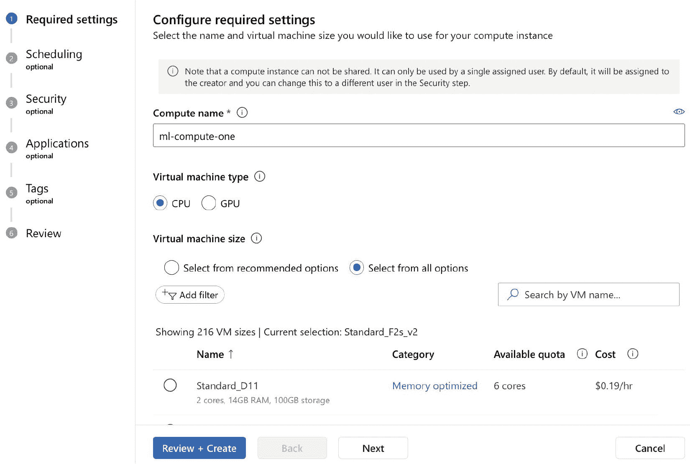

一个页面截图，包括“所需设置”、“计划”、“安全性”、“应用程序”、“标签”和“查看”。在“配置所需设置”下，它有“计算名称”、“虚拟机类型”、“虚拟机大小”以及一个包含“名称”、“类别”、“可用配额”和“成本”的表格。底部有“查看 + 创建”按钮。

图 17-34
在 Azure ML Studio 中创建新的计算实例

创建计算实例后，你可以开始利用该计算资源来开发你的机器学习模型。你可以选择 Jupyter Notebook 选项或基于 Web 的 VS Code 编辑器。
界面如下所示：

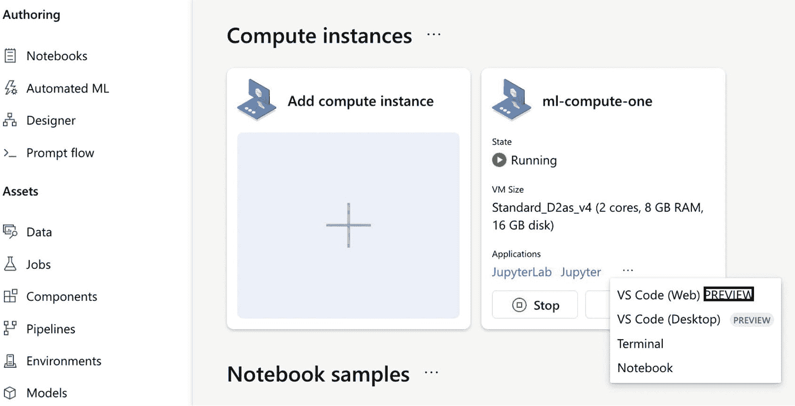

一个页面截图。左侧列出了“创作”和“资产”下的选项。右侧在“计算实例”标题下，包括“添加计算实例”和“ml compute one”，状态为“正在运行”，VM 大小为“标准”，以及“应用程序”。右侧的一个弹出窗口列出了“VS Code Web 预览”、“VS Code 桌面”、“终端”和“Notebook”。

图 17-35
活动 ML 计算实例的图示

让我们构建一个分类器模型，该模型根据给定的观察集来分类一个人是否患有糖尿病。根据你的方便，你可以选择使用 Jupyter notebook 或访问 Visual Studio Code。我们的目标是使用 Azure ML Studio 训练模型，并使用 Azure Functions 部署模型。

以下是模型代码：

```
import pandas as pd
import numpy as np
import pickle
from sklearn.ensemble import RandomForestRegressor
from sklearn.model_selection import train_test_split
df = pd.read_csv("diabetes.tsv",sep="\t")
#print("Top records of the dataset")
#print(df.head())
#print("Analytics on dataset")
#print(df.describe())
df = df.drop_duplicates()
df = df.fillna(0)
```


# 获取与 Y 相关性最小的数据点
eliminate = np.argmin(df.corr()["Y"].values)

# 删除最不重要的特征
final_df = df.drop(columns=df.columns[eliminate])

# 随机森林模型参数
params = {
"max_depth": 4,
"n_estimators": 250,
"min_samples_leaf": 4
}
x = final_df.drop(["Y"], axis=1)
y = final_df["Y"]
X_train, X_test, y_train, y_test = train_test_split(x, y, test_size=0.2)
model = RandomForestRegressor(**params)
trained_model = model.fit(X_train, y_train)
pred = trained_model.predict(X_test)
file = 'model.pkl'
pickle.dump(model, open(file, 'wb'))
```

你可以将此代码作为起点，构建自己的特征，并尝试其他分类器。导出 pickle 文件后，我们可以继续创建新的 Azure 函数来部署模型。如果你之前已经按照“Azure Functions”部分的内容操作过，那么请导航到终端并创建一个名为 diabetes 的新 Azure 函数。

操作示例如下：

```
func init diabetes --worker-runtime python --model v2
```

我们将使用 Azure Functions 将模型部署为无服务器 API，并利用 HTTP 触发器。现在，切换到 diabetes 文件夹并打开 function_app.py 文件。此函数目前仅在本地延迟部署。接下来，我们将此函数部署到 Azure 函数应用中。

以下是部署模型的代码：

```
import azure.functions as func
import pickle
import json
import logging
app = func.FunctionApp()
classifier = ['Diabetic', 'Not-diabetic']
@app.function_name('pima-indian-diabetes-model')
@app.route(route="pidm", auth_level=func.AuthLevel.ANONYMOUS)
def main(requests: func.HttpRequest) -> func.HttpResponse:
filepath = 'model.pkl'
with open(filepath, 'rb') as file:
model = pickle.load(file)
data = requests.get_json()["data"]
y_pred = model.predict(data)[0]
pred_class = classifier[y_pred]
logging.info(f"For the data points: {data}, the prediction is, {pred_class}")
response = {"class": pred_class}
return func.HttpResponse(json.dumps(response))
```

结论
到目前为止，我们已经探索了从对象存储到高级分析、NoSQL 解决方案、使用 Azure 数据工厂进行数据集成、Azure Functions 以及 Azure ML Studio 等一系列广泛的服务。Azure Functions 展示了如何利用无服务器计算来执行代码。从创建对象存储解决方案到部署机器学习模型，我们结合代码详细研究了这些服务。虽然在一章中难以涵盖所有云计算产品，但我希望我们探讨的这些理念、服务和实践实现，能为你踏上云计算之旅奠定坚实的基础。

索引

A

高级数据整理操作，CuDF

apply() 方法

crosstab

cut 函数

factorize 函数

group-by 函数

transform 函数

window 函数

AGSI

参见异步服务器网关接口 (AGSI)

Airflow 用户

Alpha

备择假设

Amazon

Amazon Athena

Amazon Glue

Amazon RDS

Amazon Redshift

Amazon SageMaker

AWS SageMaker Studio

创建并配置新的 Jupyter 空间

仪表盘页面，AWS Lambda

部署 API

主页

IAM 角色

lambda 函数

线性方法

机器学习工具包

POST 方法

REST API 端点

SageMaker 域

设置环境变量

Amazon 的 DynamoDB

Amazon S3 Glacier

Amazon S3 Standard

Amazon Web Services (AWS)

Amazon SageMaker

参见 Amazon SageMaker

数据系统

Amazon Athena

Amazon Glue

Amazon RDS

Amazon Redshift

Lake Formation

参见 AWS Lake Formation

Apache Airflow

架构

配置文件

数据库

示例

执行器

调度器

Web 服务器

后台进程

DAGs

参见有向无环图 (DAGs)

数据存储与处理系统

定义

图形用户界面

主屏幕

初始化

初始化后端数据库

pip 安装

调度器

设置

用户凭据，文本文件

工作流

工作流管理与编排平台

Apache Arrow

Apache Cassandra

Apache Hadoop

Apache Kafka

架构

管理客户端

代理

消费者

事件

Kafka Connect

Kafka Streams

ksqlDB

分区

生产者

复制

模式注册表

主题

最佳实践

回调函数

config.py 文件

consumer.py

消费者

仪表盘

开发环境

发行版

弹性

容错

功能

Kafka Connect

消息代理


消息队列系统架构

消息系统架构

打印

生产方法

producer.py 文件

生产者

Protobuf 序列化器

编译器

消费者/订阅者部分

指南

库

可选

ParseFromString() 方法

pb2.py 文件

生产者脚本

protoc

.proto 文件

Python 文件内容

SerializeToString() 方法

学生数据

学生模型

发布者-订阅者模型

发布者-订阅者程序

发布-订阅消息系统

Python 虚拟环境

可扩展

模式注册表

消费者配置

consumer.py 文件

JSONSerializer

publisher.py

学生数据

安全

服务器和客户端

设置/开发

API 密钥/机密

适当区域

集群仪表盘

集群类型

config.py 文件

Confluent Kafka 环境

主题

用途

Apache Spark

API

参见应用程序编程接口 (API)

应用程序编程接口 (API)

开发过程

端点

GraphQL

内部 API

OpenWeather API

合作伙伴 API

REST

SOAP

典型流程

Webhooks

apply() 方法

工件

工件键

数据质量报告

调试

文档

链接

Markdown

持久化输出

Prefect Cloud

Prefect Server

共享信息

表格

跟踪和监控对象

异步

异步服务器网关接口 (AGSI)

自动化机器学习 (AutoML)

AutoML

参见自动化机器学习 (AutoML)

Avro

AWS

参见亚马逊云服务 (AWS)

AWS Athena

AWS 控制台

相应用户的访问门户

分配用户/组

将用户分配到组织

AWS 组织单元

配置，新服务控制策略

创建新组织

创建组织单元

启用服务控制策略

主页

IAM Identity Center

安装，AWS CLI

组织单元

权限集

预定义权限集

服务控制策略

注册，新账户

AWS Glue

AWS Glue 数据目录

AWS IAM Identity Center

AWS Lake Formation

添加权限，IAM 角色

AWS Athena 查询编辑器

创建数据库

创建 IAM 角色

创建新存储桶

创建新爬虫

数据湖服务

授予权限，新创建的角色

在 AWS Glue 中初始化新爬虫

使用 AWS Athena 查询数据湖

查询结果

检索结果，AWS Athena

S3 存储桶

受信任实体类型

AWS Lambda

AWS Organizations

AWS RDS

AWS S3（简单安全存储）

AWS 区域

存储桶名称

存储桶类型

创建新存储桶

全局存储桶系统

主页

存储数据

上传对象（文件）

AWS SageMaker Studio

Azure Functions

绑定

核心工具

创建

糖尿病

执行

函数应用

示例

触发器

URL

B

大数据

Apache Spark

Hadoop

BigQuery

Bigtable

Blob

块

引导

分支

BranchPythonOperator

C

缓存

cancel() 方法

资本支出

CD

参见持续开发 (CD)

中央处理器 (CPU)

@check_input 装饰器

@check_output 装饰器

检查点

检查

卡方检验

分块

块加载

块

CI

参见持续集成 (CI)

客户端

客户端-服务器计算

客户端-服务器交互

client.submit 函数

云计算

优势

架构概念

缓存

云计算供应商

灾难恢复

弹性

容错

高可用性

可扩展性

部署模型

社区云

政务云

混合云

多云

私有云

公有云

GCP

参见谷歌云平台 (GCP)

网络概念和术语

参见网络概念

安全

作为 Web 服务

云计算服务

CI

云存储

合规性

计算

容器化

数据库

数据目录

数据治理

数据集成服务

数据湖

数据生命周期管理

数据保护

数据仓库

身份和访问管理

机器学习

非关系型数据库 (NoSQL)

参见 NoSQL 数据库系统

对象存储

实时/流处理服务

无服务器函数

云计算供应商

云函数

云基础设施

云服务模型

类别

基础设施即服务

平台即服务

软件即服务

Cloud SQL

云存储

云供应商

Colab 笔记本

列式数据库

组合多个 CuDF 对象

内连接

左反连接

左连接

左半连接

外连接

组合多个 Pandas 对象

交叉连接

交叉连接

全外连接

内连接

左连接

merge() 方法

Pandas 库

右连接

右连接

组合多个 Polars 对象

交叉连接

内连接

左连接

外连接

半连接

逗号分隔值 (CSV)


公用表表达式

社区云

compare() 方法

合规性

计算

compute() 函数

compute() 方法

统一计算设备架构 (CUDA)

并发

并发处理

ConcurrentTaskRunner

Confluent 的 Kafka 网站

约束类型

容器化

容器注册表

内容分发网络

上下文

持续开发 (CD)

持续集成 (CI)

CPU

参见中央处理器 (CPU)

基于 CPU 的数据处理

CPU 环境

CPU *与* GPU

create_link_artifact() 方法

create_markdown_artifact() 函数

Cron 守护进程

cronexample.sh

Cron 作业调度器

应用

Cron 替代方案

数据库备份

数据处理

电子邮件通知

概念

Cron 作业用法

Cron 日志记录

crontab 文件

在 1970 年代

Shell 脚本

Unix 操作系统

Cron 日志记录

crontab

crontab 文件

crontab 脚本

交叉连接

crosstab() 函数

交叉制表

交叉验证

加密签名与验证

CSV

参见逗号分隔值 (CSV)

CUDA

参见统一计算设备架构 (CUDA)

CuDF

高级操作

参见高级数据整理操作，CuDF

基本操作

列过滤

数据集

数据集排序

行过滤

合并多个对象

参见合并多个 CuDF 对象

cudf.pandas

数据格式

描述

文件 IO 操作

CSV

JSON

Parquet

GPU 加速的数据操作库

安装

*与* Pandas 对比

测试安装

cut 函数

D

DaaS

参见数据即服务 (DaaS)

DAG

参见有向无环图 (DAG)

Dask

架构

客户端

核心库

初始化，Dask 客户端

调度器

任务图

工作节点

银行

数据结构

dask 数组

dask 包

Dask 数据框

dask 延迟计算

dask 未来对象

特性

分块

Dask-CuDF

图

惰性求值

分区

Pickling

序列化

任务

GPU

医疗保健

安装

国家实验室与组织

优化 Dask 计算

client.submit 函数

数据局部性

优先级工作

Python 垃圾回收过程

调度器

工作节点

工作窃取

Python 库

设置

支持

Dask-CuDF

Dask 数据框

Dask 分布式计算

Dask-ML

数据预处理技术

交叉验证

MinMaxScaler()

独热编码

RobustScaler()

超参数调优

计算约束

网格搜索

增量搜索

内存约束

随机搜索

安装

机器学习库

Keras

PyTorch

scikit-learn

TensorFlow

XGBoost

设置

SimpleImputer

统计插补

DaskTaskRunner

数据准确性

数据分析

数据即服务 (DaaS)

数据资产

数据库备份

数据库

数据目录

数据清洗

数据强制转换

数据完整性

数据上下文

数据文档

数据工程任务

数据探索

数据提取与加载

Avro

CSV

feather

特性

HDF5

ORC

Parquet

pickle

数据格式

数据框

DataFrameSchema

数据治理

数据集成

数据湖

数据生命周期管理

数据局部性

数据操作

数据整理

数据管道

数据预处理技术

交叉验证

MinMaxScaler()

独热编码

RobustScaler()

数据处理

Dataproc 服务

数据产品

数据项目

数据保护

数据质量报告

数据范围

数据重塑

crosstab()

melt() 方法

pivot() 函数

数据透视表

stack() 方法

unstack()

数据源

数据拆分

数据转换

聚合与分组

基本操作

算术运算

df.select() 方法

df.with_columns() 方法

表达式

with_columns() 方法

上下文

过滤

分组上下文

选择

数据集

机器学习管道

产品集

字符串操作

数据唯一性

数据验证

优势

定义

劣势

机器学习模型

Pandera

参见 Pandera

原则

参见原则，数据验证

Pydantic 库

参见 Pydantic

关系型数据库管理系统

规范与规则

数据验证工作流

copay_paid 值

数据上下文

数据管道

数据源

期望套件

get_context() 方法

JSON 文档

验证器

数据仓库

数据整理

数据结构

数据框

序列

电子表格

索引

Pandas

基于 Debian 的操作系统

调试

装饰器

Delta Lake

部署

df.select() 方法

df.with_columns() 方法

有向无环图 (DAG)

创建变量

DAG 运行

示例

函数

列表

宏

节点

运算符

参数

Python 上下文管理器

传感器

任务流

任务

模板

变量

视图

工作流控制

分支

BranchPythonOperator

ShortCircuitOperator

触发器


典型场景

工作流管理与编排系统

Xcom

字典

有向无环图

灾难恢复

分布式计算

Django

DNS

参见域名系统（DNS）

Docker

文档

文档数据库

域名系统（DNS）

E

急切求值

边

弹性

电子邮件通知

加密

端点

工程数据管道

枚举函数

ETL

参见提取、转换、加载（ETL）

事件处理

执行器

期望

期望存储

表达式

提取、转换、加载（ETL）

F

因子化函数

`factorize()` 方法

FastAPI

优势

`APIRouter` 对象

浏览器

核心概念

创建

Curl 命令

数据库集成

命令

创建数据库

数据库用户

`db1.py`

MySQL

`mysql` 提示符

表

依赖注入

文档链接

执行

过滤器

GET 请求文档

GET 请求图示

`get_student()` 函数

HTTP 错误

中间件

机器学习 API 端点

中间件

pickle 文件模型

POST 请求

Open API 标准文档

传递变量

预测

Pydantic 集成

查询参数

`response_model` 属性

RESTful 数据 API

数据库连接，SQLAlchemy

数据验证类

定义类

新学生/事务

设置/安装

学生与课程数据

容错

特征工程

`Field` 函数

筛选上下文

防火墙

Flask

流程运行

流程

G

GCP

参见谷歌云平台（GCP）

生成器

`get_student()` 函数

GIL

参见全局解释器锁（GIL）

Git

分支

克隆

代码数据库

特性

复刻

GitHub

拉取请求

Python 代码

仓库

与安全外壳

SSH 守护进程

追踪特性

GitHub 账户设置

GitHub 服务器

`.gitignore` 文件

全局解释器锁（GIL）

Google BigQuery

Google Bigtable

Google Cloud

Google Cloud CLI

Google Cloud 控制台页面

谷歌云平台（GCP）

与 AWS

云计算服务

Cloud SQL

Cloud Storage

计算引擎

参见 Google Compute Engine

Google BigQuery

Google Bigtable

Google Dataproc

Google Vertex AI Workbench 服务

新 Google 账户/登录

组织节点

Vertex AI

参见 Google 的 Vertex AI

Google Cloud SDK

Google Cloud SQL

Google Colab

Google Colab 笔记本

Google Compute Engine

加速器优化

通过 SSH 访问虚拟机实例

API 已启用

计算优化

创建虚拟机

启用 Google Compute Engine API

通用引擎

Linux 虚拟机

内存优化

配置新虚拟机

存储优化

类型

虚拟机实例列表

Google Dataproc

Google Dataproc 的 Spark 集群

Google IAM

Google 的 Cloud Storage

流量拆分

Google 的 Vertex AI

AutoML 功能

Colab 笔记本

部署仪表板

部署到端点

端点，模型

导入新模型

机器学习模型

机器学习平台

模型注册表

在线预测

流量拆分

与 Vertex AI Workbench

政府云

GPU 加速环境

GPU 编程

CPU 指令

内核

内存管理

梯度提升树

图数据库

图形用户界面（GUI）

GraphQL

参见图查询语言（GraphQL）

图查询语言（GraphQL）

Great Expectations

检查点

组件

数据文档

数据验证库

定义

期望存储

功能与环境

设置与安装

CLI

数据源

数据源

项目

项目结构创建

Python 包

关系型数据库

SQLAlchemy 包

存储

虚拟环境

编写期望

网格搜索

分组上下文

分组函数

`groupby()` 方法

GUI

参见图形用户界面（GUI）

H

Hadoop

Hadoop 分布式文件系统（HDFS）

Hadoop 生态系统

HDFS

参见 Hadoop 分布式文件系统（HDFS）

分层数据格式

高可用性

Hive 工具

水平扩展

主机

h5py

HTTP

参见超文本传输协议（HTTP）

HTTP 方法

HTTP 状态码

混合云

超参数

超参数调优

网格搜索

增量搜索

随机搜索

超文本传输协议（HTTP）

虚拟机监控程序软件

假设检验

I

IAM 身份中心

身份与访问管理

增量搜索

索引

`loc` 和 `.iloc` 方法

多级索引

在 Pandas 数据框中

参数

查询

行与列

时间增量

基础设施即服务

内连接

互联网

互联网协议（IP）地址

`isna()` 方法

J

JavaScript 对象表示法（JSON）

Jinja

基于“joblib”的算法

JSON

参见 JavaScript 对象表示法（JSON）

JSON 文件格式


JSON 模式

K

Keras

核

键哈希

键值存储

Kubernetes 集群

L

Lambda 表达式

惰性求值

惰性框架

左反连接

左连接

左半连接

链接产物

Linux 发行版

列表推导式

日志记录

M

机器学习

分类器模型

计算实例

添加

创建

图示

命名

数据资产

数据工程任务

糖尿病

function_app.py 文件

GPU

主页

作业

模型代码

模型部署

存储账户

工作区

机器学习数据管道工作流

数据清洗

数据探索

数据集成

数据源

数据拆分

数据整理

部署

特征工程

特征选择

最终测试

超参数调优

模型评估

模型选择

监控

重新训练

训练

宏

Markdown 产物

mean() 函数

melt() 方法

内存管理

Merge() 方法

微软

Microsoft Azure

身份验证

Blob 存储

容器

创建

部署

会话

上传数据

Cosmos DB

API

类别

选择 API

集群配置

配置

数据库分片

防火墙规则

硬件资源

实例

JSON 文档

MongoDB 集群

预配吞吐量

资源组

无服务器模型

请求单位

数据工厂

Blob 存储

控制台

复制数据工具

创建

数据集成

数据管道

数据系统连接

目标数据系统

主页

链接服务

监控/重新运行

源数据系统

验证过程

管理组

ML

参见机器学习

资源组

资源

SQL

备份存储冗余

数据库

数据库服务器

数据仓库

eDTU

弹性池

硬件资源

逻辑服务器

Python 应用程序

SaaS

服务器

无服务器池

存储类别

订阅

Synapse 分析

Microsoft 的 Cosmos DB

MinMaxScaler()

缺失值

数据清洗与转换

数据录入

方法与处理

isna() 方法

notna()

NA

NaN

NaT

None

ML

参见机器学习

多云

多索引

数组

列

数据框

多进程处理

多线程调度器

myVariable

N

NA

参见不可用 (NA)

NAN

参见非数字 (NAN)

NaT

参见非时间 (NaT)

ndJSON

网络概念

DNS

防火墙

IP 地址

端口

虚拟化

虚拟私有云

节点

NoSQL 数据库系统

列式数据库

文档数据库

图数据库

键值存储

写时模式 *对比* 读时模式

时序数据库

向量数据库

NoSQL 数据存储

非数字 (NAN)

非时间 (NaT)

不可用 (NA)

通知

NumPy 数组

NumPy 数据类型对象

NVIDIA 驱动程序

NVIDIA GPU

NVIDIA 产品

O

对象关系映射

Alembic

SQLAlchemy

引擎

查询 API

会话

对象存储

可观测性

独热编码

OpenWeather API

运营支出

优化行列式 (ORC)

ORC

参见优化行列式 (ORC)

组织

ORM

参见对象关系映射

外连接

P

Pandas

与 NumPy

对象

Pandera

检查

数据强制转换

数据框模式

声明式模式定义

定义

安装

惰性验证

统计验证

Pandera 装饰器

@check_input

@check_output

DataFrameSchema

数据验证器

装饰器测试

hello_world() 函数

验证条件

验证参数

并行性

并行处理

概念

核心

GIL

历史

识别 CPU 核心

将大型编程任务分解为若干小任务

多进程库

进程

Python

线程

参数

Parquet

分区

路径参数

对等计算

Pickle 文件

序列化

Pig Latin

Pivot_table() 方法

平台即服务

Polars

高级方法

数据集

缺失值识别

数据透视函数

唯一值识别

合并对象

参见合并多个 Polars 对象

数据提取与加载

CSV 文件

JSON

Parquet

数据结构

数据转换

参见数据转换，Polars

定义

惰性求值与即时求值

惰性 *对比* 即时求值

多线程与并行化

对象

Python 数据分析生态系统

Rust

语法

Polars CLI

SQL 查询

结构

Polars/SQL 交互

copay_paid

数据类型转换

随机数据集

random_health_data

SQL 上下文对象

SQL 查询

端口

Postgres 数据库语法

POST 方法

前置数据框

Prefect

异步

后端 Prefect 数据库

缓存

开发

另请参见 Prefect 开发

未来

安装

日志记录

通知

可观测性

开源工作流编排系统

Prefect Cloud

Prefect Core

Python 函数

重试

调度


第二代

密钥管理系统

服务器

设置

浅层

用户界面，网页浏览器

Prefect 开发

产物

参见 产物

块

流程运行输出

流程运行

流程

接口

日志追踪，Prefect 流程

持久化结果

结果

状态变更钩子

状态

任务运行器

任务

变量

原则，数据验证

数据准确性

数据完整性

数据一致性

数据格式

数据范围

数据唯一性

参照完整性

私有云

协议缓冲区 (Protobuf)

公有云

拉取请求

Pydantic

应用程序

约束类型

数据模式声明

定义

字段函数

安装

JSON 模式

Pydantic 模型

类型注解

验证与序列化逻辑

验证器

Pydantic V2

Python

Python 3

Python 代码

Python 装饰器

Python 库

Python 对象

Python 编程语言

概念

f 字符串

函数参数

args 参数

kwargs

函数

前置代码

Python 脚本

Python 类型注解

PyTorch

Q

查询参数

R

随机模块

choice 函数

getrandbits() 方法

randint()

范围

sample 方法

seed() 方法

shuffle() 方法

实时数据管道

Redshift

参照完整性

关系型数据库服务 (RDS)

参见 Amazon RDS

远程计算

表述性状态转移 (REST)

REST

参见 表述性状态转移 (REST)

RESTful 服务

RobustScaler()

Rust

S

可扩展性

调度器

调度

SchemaError

scikit-learn

选择上下文

半连接

传感器

顺序执行

SequentialTaskRunner

序列化

Series

无服务器计算

ShortCircuitOperator

相似性搜索

SimpleImputer

简单对象访问协议 (SOAP)

单点登录 (SSO)

单线程调度器

Skorch 库

软件即服务 (SaaS)

SOAP

参见 简单对象访问协议 (SOAP)

Spark

“spark.jars” 文件

SQL

参见 结构化查询语言 (SQL)

SQLAlchemy

SQL Server

SSH 连接

SSO

参见 单点登录 (SSO)

堆叠

Stack() 方法

Starlette

状态变更钩子

状态对象

流式数据

流处理

Kafka Streams

kSQL

ksqlDB

API 密钥与密钥

apt 仓库

auto.offset.reset

CLI 指令

命令行界面

Confluent Kafka

Confluent 平台

创建

环境变量与路径

帮助命令

插入数据

Java

命名/大小

前提条件

公钥

查询

有状态处理

无状态处理

主题

创建模式

创建

命名/分区

结构化查询语言 (SQL)

查询

自连接

表

临时表

视图

物化

标准

窗口函数

sum() 方法

Systemd

T

表产物

任务图

任务运行器

任务

T.compute()

模板

TensorFlow

时间增量索引

单个值

子集

时序数据库

“to_hdf5” 方法

transform() 函数

类型注解复习

类型提示

Typing 模块

U

统一资源标识符 (URI)

统一资源定位符 (URL)

unstack() 方法

无监督学习

URI

参见 统一资源标识符 (URI)

URL

参见 统一资源定位符 (URL)

用户自定义函数

V

Validate 方法

验证器

变量

向量数据库

Vertex AI Workbench

垂直扩展

虚拟化

虚拟私有云

虚拟专用网络

W

wait() 函数

Webhook

Web 服务器

窗口函数

工作流配置

示例

组织

参数

产品/解决方案

工作流编排

自动化

流程的集中管理与控制

数据管道

定义工作流

错误处理与路由

ETL 数据管道工作流

示例

与外部系统集成

调度

任务/活动

资源利用

工作流配置

万维网

X, Y, Z

Xcom

XGBoost

```