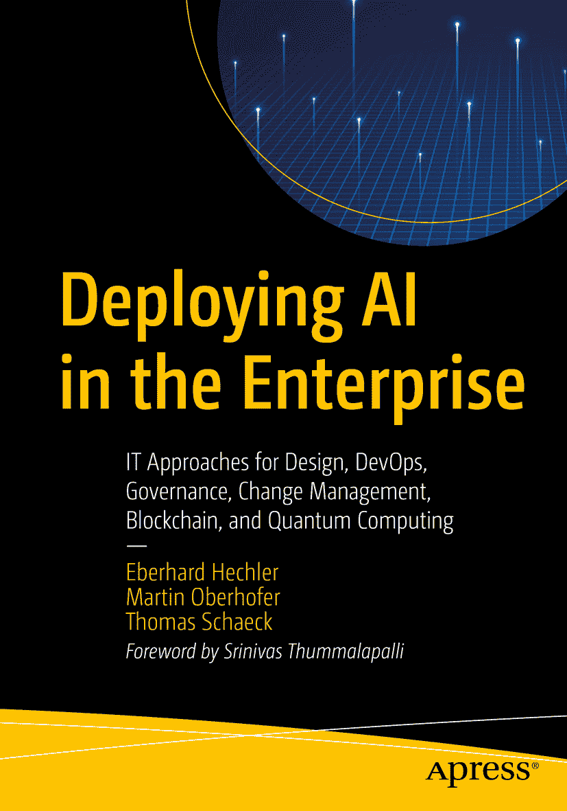

ISBN 978-1-4842-6205-4 e-ISBN 978-1-4842-6206-1 [`doi.org/10.1007/978-1-4842-6206-1`](https://doi.org/10.1007/978-1-4842-6206-1) © Eberhard Hechler, Martin Oberhofer, Thomas Schaeck 2020 本作品受版权保护。出版商保留所有权利，无论是涉及材料的全部或部分，特别是翻译、重印、重用插图、朗诵、广播、以缩微胶卷或任何其他物理方式复制，以及传输或信息存储与检索、电子改编、计算机软件，或采用目前已知或未来开发的类似或不同方法。本出版物中使用的一般描述性名称、注册商标名称、商标、服务标志等，即使未作明确声明，也不意味着这些名称不受相关保护法律和法规的约束，因此可自由用于一般用途。出版商、作者和编辑假定本书中的建议和信息在出版之日是真实准确的。出版商、作者或编辑均不对本书所含材料或可能存在的任何错误或遗漏提供明示或暗示的担保。出版商在已出版地图和机构归属方面的管辖权主张中保持中立。本书通过 Springer Science+Business Media New York 在全球图书贸易中发行，地址：233 Spring Street, 6th Floor, New York, NY 10013。电话：1-800-SPRINGER，传真：(201) 348-4505，电子邮件：orders-ny@springer-sbm.com，或访问 www.springeronline.com。Apress Media, LLC 是加利福尼亚州的有限责任公司，其唯一成员（所有者）是 Springer Science + Business Media Finance Inc (SSBM Finance Inc)。SSBM Finance Inc 是特拉华州的一家公司。

*献给我的妻子伊琳娜以及我们的两个儿子拉尔斯和亚历克斯，感谢他们在我利用漫长的夜晚和周末撰写本书、未能陪伴他们时给予的持续支持与理解。*

*——埃伯哈德·赫克勒*

*献给我的妻子基尔斯滕以及我们的两个儿子达米安和阿德里安，感谢你们每天给予我的爱与灵感。*

*——马丁·奥伯霍费尔*

*献给我的妻子安妮特以及我们的孩子阿梅莉和费利克斯，感谢他们在本书撰写过程中给予的支持与耐心。*

*——托马斯·谢克*

前言

人工智能是一个广泛的概念，吸引了人们的兴趣。直到最近，它仍局限于科学界，作为最先进的研究分支之一，并艰难地寻找进入工业领域的途径。虽然可以列举出许多其迟迟未能进入工业领域的原因，但我坚信，这主要是由于缺乏像您手中这样具有指导性的书籍。正是处理器以巨大规模产出数据的速度不断提升，才使得数据领域的自动化成为必要。人工智能恰恰在处理“理解数据”这一任务的同时产生分析结果。随着数据量的不断增加，各行业都在疯狂寻找分析数据的新工具，而人工智能恰逢其时地提供了解决方案。然而，人工智能足够复杂，以至于主流人群中只有少数人能理解它。本书的作者团队通过提供精彩的示例，在恰当的时刻提供了见解。

人工智能最近在商业领域开始展现出前景，因为许多人已开始将人工智能用于简单的用例，以消除一些可以自动化的日常任务。从我童年早期开始，我就对解决问题的科学方法着迷，这种好奇心随着时间的推移只增不减。当我在寻找解决金融行业试图解决的各种问题的方法时，人工智能引起了我的注意。那时，我有机会作为首席企业架构师设计系统，这使我能够将我的好奇心与工作角色结合起来。从那时起，我一直在关注人工智能，并寻找在工业领域使用它的方法。最近，使用人工智能实现的许多用例已成为现实。我们过去使用的基于提示的电话应答系统现在正被支持语音的系统所取代，使客户能够直接提出他们的需求，而不是让系统（痛苦地）通过提示引导他们。互联网现在已遍布聊天机器人，以接管在线客户服务。金融行业长期以来一直在各种应用中使用机器学习（人工智能的一个分支）进行预测性数据分析和自动化决策。特斯拉和许多其他公司已开始在自动驾驶汽车中使用人工智能。越来越多的公司已开始在其领域内探索人工智能/机器学习的潜在用例。

人工智能/机器学习是一个复杂的主题，需要精通此道的作者才能向广泛的受众介绍。在这本书中，埃伯哈德、马丁和托马斯出色地以通俗易懂的语言介绍了这个主题。他们成功地弥合了人工智能与主流受众之间的鸿沟，并用简单的术语解释了该主题。这本书适合从热情的读者到科学研究人员在内的各类受众。它将帮助担任不同角色的人，如分析师、程序员、架构师、业务经理、高级经理和高管，接触这一主题。这本书将带领读者从对人工智能/机器学习一无所知，到对该领域有良好的理解，同时培养人们在各自领域使用这些工具的能力。

作者引导读者进入围绕人工智能/机器学习创建信息架构（IA）的主题。其目标是为在任何组织中部署人工智能/机器学习创建一个结构，并帮助业务主管在其自身组织中吸收它。即使对于新手读者，这本书也非常清晰地概述了围绕人工智能的架构要点。作者成功地识别了信息架构中目前人工智能领域尚不存在的各种实体。这本书将帮助合适的人员在合适的岗位上实现组织成功。

在介绍了人工智能的信息架构之后，读者将被引导通过将人工智能付诸实践的过程，而不仅仅是停留在对该主题的理解上。理解和实施是两个完全不同的方面，作者对此非常清楚。读者不会留下关于如何将人工智能付诸实践的未解疑问。作者清楚地知道，这比在其他领域更为重要，并已帮助引导读者完成这一过程。为此，他们进一步将人工智能的不同方面细分为子领域，并附有简单的解释。我认为这对于任何级别的人工智能专家将概念付诸实施都至关重要。

作者不仅致力于将 AI/ML 引入主流，还着眼于全局，将 AI/ML 与区块链、量子计算等其他领域相关联。他们清晰展现了广博的学识，同时将 AI/ML 引入治理、变更管理和 DevOps 等 IT 领域。由于 AI 是一个新兴领域，在商业领域仍处于实验阶段，因此对其进行管控并非易事。然而，作者深知治理在 IT 领域的重要性，并未让 AI 脱离治理。在引导读者进入 AI 治理本身之前，他们首先解释了 AI 在 IT 领域的基本需求。作者以通俗易懂的语言涵盖了 AI 的整个范畴。

作者不仅强调了 AI/ML 的优势，还指出了该领域的局限性，并提出了推动其发展所需的新进展。本书将帮助专业人士在组织内部署 AI 的同时，为其所在领域的未来进步做好准备。我个人非常欣赏这种阐述 AI 局限性的方式。这展现了作者在特定领域揭示其局限性的深度。只有该领域全面精通的专家才能指出其局限性，而作者无疑展现了他们的深度。我鼓励所有 IT 和科学领域的人士阅读本书，以全新的视角理解该领域，并形成新的观点。即使是非技术领域的人士，这本书也非常值得一读，因为它用简单的英语写成，普通对 AI 感兴趣的读者也能理解。无论身处哪个行业，这本书都将加深你对 AI 领域的理解，同时提升你将 AI/ML 引入组织的能力。

我祝贺作者完成了这本优秀的著作，并鼓励他们未来继续提供宝贵的桥梁和见解。

> 斯里尼瓦斯·图马拉帕利

> 首席企业架构师

> 五三银行

> 2020 年 7 月

书籍布局

本书面向那些寻求关于如何克服企业中 AI 解决方案部署和运营化挑战的指导和建议的读者，并且他们热切希望全面了解 AI 如何影响其他领域，例如设计思维、信息架构、DevOps、区块链和量子计算等。预期的读者正在寻找如何利用数据获得可操作的见解和预测的示例，并试图理解 AI 当前的风险和局限性，以及这在行业相关背景下意味着什么。我们的目标读者是 IT 和业务领导者、IT 专业人士、数据科学家、软件架构师，以及那些希望全面理解 AI 的普通读者。

本书的章节分为四个主要部分。

**第一部分：入门** 为本书奠定基础，包括一个简短的介绍性章节、一个包含技术进步的 AI 演进视角，以及对最重要的 AI 方面（包括机器学习（ML）和深度学习（DL）概念）的简要描述。

它包含以下三章：

*   **第 1 章：AI 简介** 概述了企业中的 AI，提供了高价值用例的示例，并展示了 AI 如何在实践中应用。它描述了如何使用 AI 提高企业自动化水平，并从企业角度介绍了 AI 生命周期。

*   **第 2 章：AI 历史视角** 描述了为何 20 世纪下半叶的理论 AI 基础导致了过去十年 AI 的显著飞跃。我们还对未来进行了一番展望，简要阐述了我们在不久的将来最有可能观察到的技术进步。

*   **第 3 章：关键 ML、DL 和 DO 概念** 介绍了机器学习和决策优化（DO）的关键概念，并解释了这两个概念之间的差异。我们还讨论了以智能方式标记数据以最小化人工成本和专家标记时间，并介绍了 AI 模型自动创建的概念。

**第二部分：AI 部署** 专注于成功的 AI 部署，倡导为 AI 实施普遍的信息架构，这是每个 AI 部署中至关重要但经常被忽视的组成部分。然后，我们提供了如何将数据转化为可操作的预测和见解的示例，描述了如何利用基于 ML 的匹配来改进和信任核心信息管理，并与读者分享指导方针，以克服企业环境中的运营化挑战，包括 AI 背景下的关键设计思维和 DevOps 方面。

它包含以下四章：

*   **第 4 章：AI 信息架构** 详细阐述了信息架构在提供可信赖的企业级 AI 基础方面的作用。本章对读者理解 AI 对现有信息架构的影响以部署可持续的 AI 解决方案至关重要。

*   **第 5 章：从数据到预测再到最优行动** 解释了如何结合 ML 的预测和决策优化，为企业实现最优结果，包括一系列实际示例。

*   **第 6 章：AI 的运营化** 涉及将 AI 工件部署到通常高度复杂且多样化的企业环境中。这包括实时评分；监控（例如，ML 模型以保持其准确性和精确度）；以及将数据转化为可操作的见解。

*   **第 7 章：AI 背景下的设计思维和 DevOps** 描述了如何应用设计思维和 DevOps 方法来开发 AI 系统与设备、产品与工具以及应用程序。我们还阐述了如何利用 AI 及其相关技术并将其融入设计思维和 DevOps 概念中。

**第三部分：AI 的上下文** 考虑到 AI 并非孤立存在，它存在于一个更大的背景中。这第三部分描述了 AI 在行业其他关键举措（如区块链、量子计算、治理与主数据管理以及变更管理）背景下的情况。

它包含以下五章：

*   **第 8 章：AI 与治理** 描述了 AI 与治理方面，并进一步讨论了可解释性、公平性和可追溯性的需求。由于基于 AI 的决策应当有意义且易于人类理解，AI 带来了治理要求的新维度，旨在确保透明度、信任和问责制。

*   **第 9 章：将 AI 应用于数据治理和 MDM** 深入探讨了将 ML 应用于主数据管理（MDM）和数据治理解决方案。它特别强调了应用 ML 来改进 MDM 所需的匹配算法，并发现核心企业信息中的隐藏关系。

*   **第 10 章：AI 与变更管理** 阐明了 AI 背景下的变更管理，并介绍了 AI 变更管理的关键方面，例如识别和分析情绪，以实现更具针对性、结果更优的变更管理。

*   **第 11 章** **人工智能与区块链**阐述了人工智能在区块链这一本身仍相对较新概念中的适用性，并举例说明，例如如何为 AI 模型版本、训练所用的数据集等增强防篡改审计追踪。

*   **第 12 章** **人工智能与量子计算**探讨了一些可能受益于量子计算的人工智能问题。量子计算在某些计算问题上超越“经典”计算机的潜力，可能对解决 AI 问题产生深远影响，例如用于学习高维人工神经网络（ANN）的复杂反向传播算法。

**第四部分：人工智能的局限性与未来挑战**讨论了当前 AI 的局限性和挑战，其中一些尚在研究之中，而另一些则可能构成无法解决的难题，即使在遥远的未来，也将为人类留下填补这一空白的空间。本书最后一部分将以一些结束语和对 AI 未来的展望作为总结。

本部分包含以下两章：

*   **第 13 章** **人工智能的局限性**探讨了 AI 的承诺及其看似无边无际、令人惊叹的应用范围。然而，正如我们将在本章中了解到的，即使是 AI，也存在许多限制和未来的挑战。

*   **第 14 章** **总结与展望**展望了 AI 及 AI 应用的未来可能发展，并分享了对可能后果的思考。

致谢

撰写一本书比我们想象的要困难得多，但回报也比我们所能想象的更为丰厚。这需要专业知识和洞察力，也需要动力和灵感。保持投入、推动项目前进、改进各章节、使其更具可读性，并在某处找到新的动力，这些并非总是那么容易。但现在，它完成了。

我们永远感激我们在全球范围内合作过的众多 IBM 同事、领域专家和领导者。与大学的合作为我们提供了关于人工智能（AI）研究课题的宝贵且与产品无关的视角。近年来，我们有幸合作的众多企业和组织，为我们阐述将 AI 部署到企业中所面临的一些挑战——并提出想法——提供了灵感和洞见。

特别感谢来自 IBM 德国研发实验室的首席用户体验工程师*Stephane Rodet*，他在将本书的图表制作成吸引人且易于理解的形式方面给予了我们巨大的帮助。

最后但同样重要的是，感谢 Apress 团队中每一位给予我们巨大帮助的人。特别感谢始终耐心的策划编辑*Joan Murray*，以及我们出色的协调编辑*Jill Balzano*，她是我们能想象到的最棒的封面设计师。

关于作者 关于技术审校

