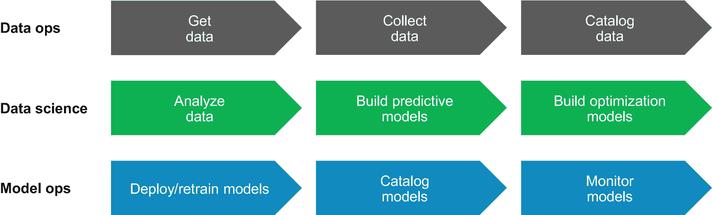
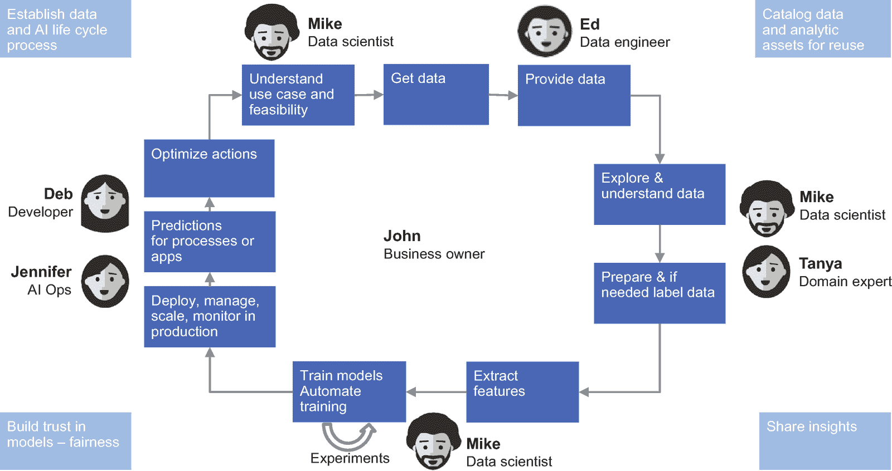
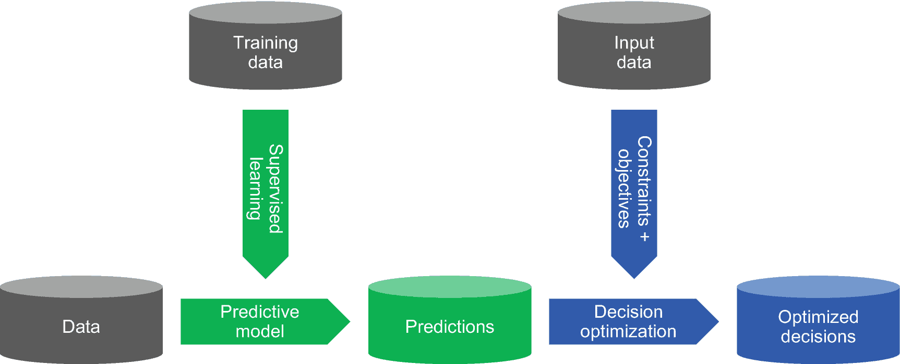
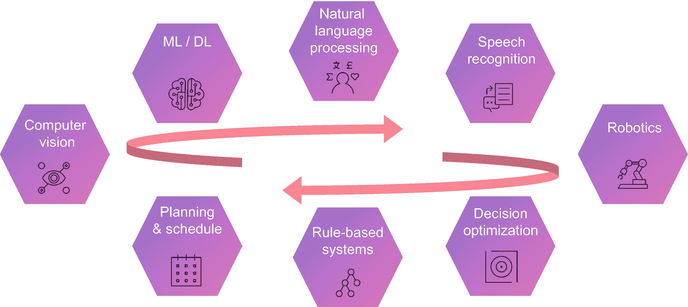

# 1. 人工智能简介

人工智能（AI）长期以来一直是人类的愿景。虚构作品从多个角度探讨了 AI 这一主题。例如，《神经漫游者》、《2001 太空漫游》、《终结者》、《人工智能》、《星际迷航》、《异形》、《母亲》等作品展现了 AI 的多种不同形态：有些像人类，有些则截然不同；有些服务于人类，有些与人类合作，有些甚至与人类对抗。

尽管科幻小说和电影中描绘的通用人工智能（AGI）仍然难以捉摸，但在 AI 的几个实际应用领域已经取得了长足进步，这些领域已从虚构走向现实。

特别是，机器学习（ML）和深度学习（DL）这两个 AI 领域已从研究阶段发展到实践阶段，目前已被大量公司和组织应用于全球范围内令人惊叹的广泛用例中。我们现在正处于这样一个阶段：利用 ML 和 DL 已成为现代企业的先进技术，但更大规模的采用仍在前方。早期采用者将在其 ML 和 DL 应用中走得更深更广，而那些尚未真正起步的企业则需要尽快跟上。

## 面向企业的人工智能

本书为您提供建议和最佳实践，帮助您在企业和组织环境中全面应用 AI。为了帮助您有意义且与业务相关地利用 AI 并实现其承诺，我们为您提供了一个关于 AI 的务实视角，以及如何释放其变革性和颠覆性力量。

企业 AI 不仅涉及利用先进的 ML 和 DL，还包括自然语言处理（NLP）和决策优化（DO），以实现自动化操作、机器人技术及其他领域，从而优化现有业务流程并实施新的用例。企业中的 AI^(¹)旨在发现组织知识，并以尽可能符合人类处理这些任务的方式，将分析洞察交付并注入决策过程，同时将这些过程加速数个数量级。

我们为您提供了一个由挑战和差距——以及随之而来的机遇——驱动的 AI 全景视图，助您获得竞争优势。其中一个特定领域涉及 AI 生命周期和部署，包括 AI 运营化挑战、对全面信息架构（IA）的需求（通过提供驱动 AI 的数据来赋能 AI）、DevOps 方面，以及如何基于从 ML/DL 和 DO 模型得出的洞察做出可操作的决策。我们还探讨了 AI 在特定领域的应用，例如主数据管理（MDM）、治理与变更管理、区块链，以及量子计算等未来方向。

AI 对企业的适用性^(²)提供了一个相当多元的视角。ML、DL 和 DO 是我们在整本书中持续关注的关键领域。在本引言以及第 5 章“*从数据到预测再到最优行动*”中，我们将让您理解 ML/DL 与 DO 之间的互补性质，从而能够从数据出发，经过预测，最终实现优化决策，以促成自动化行动。此外，我们还为您提供了过去几十年 AI 进展和进步的高层描述，这对于理解 AI 的成熟度——或者说缺失的能力——至关重要。

讨论企业中的 AI 需要对 AI 信息架构以及 AI 的挑战性运营化方面（包括 AI 背景下的 DevOps）进行深入探讨。没有稳健的信息架构（IA），包括数据存储与管理、治理与变更管理、主数据管理（MDM）等方面，任何企业都无法维持当今的业务动态和所需的业务敏捷性。

AI 的影响以及 AI 为这些领域带来的机遇，将在第 3 部分“*情境中的 AI*”中进行广泛讨论。

## AI 目标：自动化行动

大多数公司和组织最终希望从应用 AI 中获得的是：通过自动化决策来驱动自动化行动，以加速其业务或其他目标的实现；或者在无法或不宜用机器判断替代人类判断时，通过建议来辅助人类决策。自动化或辅助决策及其产生的行动，能够带来巨大的效率和速度提升，在某些情况下，甚至能催生全新的商业模式——例如现代电子商务、欺诈检测、约会应用等，这些在以往是不可能实现的。

另一方面，如果处理不当，决策与行动的自动化也可能导致损害或损失——比如自动驾驶汽车引发事故，自动交易算法造成财务损失，或者做出法律或道德上错误的决策，导致罚款或品牌受损。

在接下来的章节中，我们将从“自动化决策驱动自动化行动”这一目标出发，逆向推导出实现该目标所需的手段和技术方法。

### 行动需要决策

公司和组织日复一日地做出大量决策^(³)，并基于这些决策采取大量具体行动。

重大的战略决策由领导层和董事会做出，例如：是否收购一家公司以拓展业务，如何塑造企业文化与形象，以及在平衡收入目标的前提下承担多大的整体风险。这些战略决策可能会借助 AI 技术来提供信息支持；然而，最终的判断和决策仍由人类负责——这一点不会发生根本性改变。归根结底，领导层和董事会仍需对这些战略决策及其所有后果负责，但 AI 可以帮助他们做出更优的决策。这类决策的数量通常不多，且非常适合在人类经过深思熟虑和讨论后做出。

然而，企业或组织中数量远为庞大的决策——可能达到数百万甚至数十亿——需要基于数据、指南和约束条件，以一致、快速且高频的方式做出。这类高频决策的例子包括：是否为想要进入的人开门、在情境化营销活动中提供什么内容、优化客服与客户的互动、决定自动驾驶汽车在特定情况下是否应刹车、决定是否批准保险理赔或贷款申请，以及辅助购买决策。

以下是一些典型的大批量、高频决策示例，我们将在后续章节中进一步探讨：

*   **最佳下一步推荐**：决定客户登录网站时应向其推荐哪些产品
*   **准确的旅行信息**：在机场屏幕和网站上显示哪些航班起飞和到达时间
*   **车间生产优化**：是否暂停工厂生产线

这类决策^(⁴) 并非由人类来做出最优选择，因为决策数量过于庞大，且输入参数复杂，依靠人力来处理如此大量的决策是不可行的。

为了自动化这类大批量的数据驱动型决策，过去通常使用僵化的确定性程序，需要开发者制定确定性算法和预定义规则来处理输入参数并确定所需决策。这就要求开发者在需要时（即使只是微小调整）能够修改代码，而随着时间的推移，这种调整可能相当频繁。或者，人类仍会根据为其定义的规则和指南，或基于自身判断来做出这些决策，从而能够适应不断变化的情况，但这需要大量人力，导致成本高昂，且每个决策所需的时间也更长。

### 决策需要预测

为了以自动化方式灵活地做出大批量决策，需要数据驱动的预测。这些预测可以利用最先进的 AI 技术生成，通过相关数据驱动一个流程，该流程将数据接入并馈入预测模型，从而获得预测结果，如图 1-1 所示。

图 1-1

从数据到预测

这些预测性洞察随后成为决策过程的基本输入之一。以下仅列举几个预测性洞察的示例，分别对应上一节中给出的三个决策需求示例：

*   **预测产品兴趣以指导最佳下一步行动**：客户可能对哪些产品感兴趣并准备下一步购买，以及客户购买一个或多个推荐产品的可能性有多大。需要此预测来决定下一步向客户推荐什么产品或服务，以确保最高的接受可能性。
*   **预测航班到达登机口时间以提供准确的旅行信息**：考虑到空中交通、顺风或逆风、滑行时间等多种因素，仍在飞行中的飞机何时会到达登机口。需要此预测来决定为进港航班显示什么到达时间。
*   **预测零件质量以优化车间生产**：根据当前传感器信息，工厂中某台机器生产的下一批零件是合格还是不合格。需要此预测来决定是继续生产还是暂停生产线。

然而，仅靠预测通常不足以做出明智的、理想情况下最优的决策。例如，仅凭对客户产品兴趣的预测，就可能导致有问题的决策，比如推荐缺货商品，然后让客户因长时间等待而失望。要做出*明智*的决策，你需要的不仅仅是预测。

### 明智决策：预测与优化

通常情况下，决策和行动不能仅基于单个预测来做出。回顾之前的例子，除了客户的兴趣之外，向哪个客户提供什么产品才真正合理，还可能取决于仓库库存和交付时间、产品盈利能力、营销预算规模、客户状态、过去报价的接受或拒绝历史，以及许多其他参数。

在需要更全面地做出决策的情况下，不仅要基于预测，还要考虑业务约束和其他因素，仅靠预测无法充分解决问题。需要将一系列预测与基于这些预测以及额外数据、约束和目标进行的优化相结合，才能确定决策和后续行动的最佳组合。

图 1-2 展示了从相关数据出发，经由预测洞察，最终实现优化决策的流程。预测性机器学习和深度学习建模与决策优化相结合，使得这一流程成为可能。

图 1-2

从数据到优化决策的流程

机器学习这一人工智能学科确立了基于*数据*进行预测的方法，而无需为每个不同问题编写确定性代码。机器学习算法基于样本数据构建数学*模型*，这些样本数据用于训练模型。针对不同的问题领域，存在多种由机器学习算法训练的机器学习模型类型。三种主要的机器学习算法类型是监督学习、无监督学习和强化学习算法。

有关机器学习、深度学习和决策优化概念的更多信息，请参阅*第* *3* *章*“*关键机器学习、深度学习和决策优化概念*”。

## 数据驱动人工智能

为了创建和训练*优质*的机器学习和深度学习模型，我们需要优质的数据作为任何基于人工智能的解决方案的基础。数据必须足够相关、准确和完整，才能有效用于训练模型。同时，数据需要具有代表性并能反映现实，避免不期望的偏差^(⁵)。只有使用高质量且相关的数据来训练机器学习和深度学习模型，才能通过训练过程创建出精确且准确的模型。如果数据不合适或不能充分代表特定的业务场景，那么生成的模型通常会表现不佳和/或存在偏差。

### 垃圾进，垃圾出

这听起来可能很简单，但如果使用低质量的数据来训练机器学习和深度学习模型，垃圾进就会导致垃圾出。一个很好的例子来自早期的一个图像识别项目，数据科学家使用包含坦克的图像和不包含坦克的图像来训练一个人工神经网络模型，以识别包含坦克的图像。该模型使用一组带标签的训练图像进行训练，然后使用一组带标签的验证图像进行验证。生成的模型看起来运行良好。后来，它用一组新的图像进行了进一步测试，但表现不佳。在实际项目中，这种现象确实经常发生。

经过一些分析，数据科学家发现，无论初始图像拍摄时是否存在坦克，标签都与晴天或阴天的天气条件高度相关。结果，人工神经网络模型的输出受到照片是在晴天还是阴天拍摄的强烈影响。只有在使用改进且更充分的带标签训练数据集重复训练过程后，人工神经网络模型才能取得更好的结果。

为训练、验证和测试生成一套高质量且具有代表性的带标签数据集，对于数据科学家和数据工程师来说，是一项至关重要且通常非常耗时的任务。

### 偏差

如果使用有偏差的数据来训练模型，生成的模型很可能也会表现出偏差。例如，一家银行可能希望通过获取过去由人类做出的贷款决策样本，并用这些数据训练一个模型来自动化未来的贷款审批决策。如果过去人类决策的数据集没有偏差，那么可以预期该模型是公平的。

然而，如果训练数据集中过去的人类决策对某些人口统计学特征（例如年龄、种族、民族、性别、婚姻状况）存在更倾向于拒绝贷款的偏差，那么训练出的模型也会带有偏差。

即使过去所有的人类决策整体上没有偏差，但如果训练数据集的抽样方式不够具有代表性，生成的模型仍然可能存在偏差^(⁷)。

### 人工智能的信息架构

鉴于数据对人工智能至关重要，建立适当的信息架构来管理用于驱动人工智能的数据以及为构建人工智能而创建的分析资产至关重要。

这涉及到*数据运维*、*数据科学*和*模型运维*这三个可信流程的协同工作，如图 1-3 所示。

图 1-3

数据运维、数据科学和模型运维

以下是这三个流程的简要描述。

*   **数据运维** 涉及从所有相关来源获取数据，将数据收集到现成可用且高性能的数据存储中，并在一定程度的验证下对数据进行编目，确保数据具有代表性且无偏差，如果抽样则确保抽样过程不会导致偏差，并且——最后但同样重要的是——管理数据使其可靠且不可变，以支持可重复性。对于任何基于数据训练的模型，良好的信息架构应确保模型始终可以追溯到不仅用于训练它的代码，还包括用于训练、验证和测试它的实际数据以及该数据的谱系或来源。即使是用于后续再训练过程的新数据以及模型的额外调整，也需要考虑在内。

*   **数据科学** 是从数据到模型所必需的。需要数据科学技能以及通常的领域专业知识，才能从信息架构中数据运维元素提供的数据，过渡到预测性和/或规范性模型，这些模型通过模型运维可供流程和应用程序使用。这通常涉及分析数据以真正充分理解它，从而判断它是否是适合使用的数据，可能还需要对数据进行标注（这可能需要特殊的领域专业知识），构建和验证预测模型，并可能额外构建优化模型以与数据和预测协同工作。

*   **模型运维** 涉及将模型部署到生产环境中使用，如果需要则进行模型再训练，并监控生产中的模型。与处理数据类似，信息架构也应将模型和模型部署视为需要编目的、在系统中广为人知的一等实体。模型运维通常还需要与数据运维连接，以可靠且高性能的方式向生产中的模型提供新数据，例如用于实时评分。

## 整合：AI 生命周期

我们观察到，为了实现为企业或组织提供信息并自动化决策与行动的目标，我们需要预测，并且通常还需要优化。为了进行预测，我们需要训练机器学习模型，而这需要优质、可信的数据。因此，为了收集和管理一批优质、可信的数据，我们需要一个 AI 信息架构。

虽然我们的推理是从实现自动化行动的目标出发，反向推导出实现手段，但为了构建可行的解决方案，我们需要从数据入手，从数据驱动到预测，再到最优行动。

这种实现成果的实用方法已被纳入机器学习生命周期^(⁹)，如图 1-4 所示。我们将在第 4 章“*AI 信息架构*”中，结合信息架构进一步阐述机器学习生命周期的各个方面。

图 1-4

端到端数据科学/机器学习周期

### 理解用例与可行性

机器学习生命周期的第一阶段通常是从理解用例开始，并判断其在实践中是否可行。需要定义和澄清的关键方面包括：项目的确切目标是什么，需要自动化的具体决策和行动是什么，以及使用最先进的 AI 和 ML 方法以及能够获取并在实践中使用的数据来解决该用例的可行性。

这些都不能想当然：许多问题目前还无法用现有的 ML 方法解决。通常，由于法律或政策原因，可能无法或不允许实际获取所需的数据，例如，出于数据隐私原因，或者某些所需的数据可能根本尚未被收集和存储。

在此阶段结束时，应该对要解决的问题、使用什么数据来解决它有一个清晰的认识，并确认所需的数据确实可以在实践中获取和使用，同时结合对现有 ML 技术可以应用的信心。

### 收集数据

机器学习生命周期的下一个阶段是收集原始数据，为后续工作打下坚实基础。通常，在企业或其他组织中，会有多种数据源，有些来自内部，有些来自外部，有些是结构化的，有些是非结构化的，有些已经具备良好的质量和形态，有些则需要改进才能有用。

在此阶段，对数据进行适当的编目非常重要，以便在后续步骤中能够轻松地在数据科学和 ML 项目中查找、访问和使用这些数据。根据数据来源，在数据仓库或数据湖中引用数据、创建数据副本或数据样本可能是有意义的，无论哪种情况，都要对数据进行编目以备进一步使用。

有时，在此阶段，可能需要在将数据提供给数据科学家进行后续步骤之前，省略或匿名化敏感数据，例如姓名、社会安全号码、信用卡号等。

### 探索和理解数据

下一阶段通常是开始探索、分析和理解可用数据，例如，发现相关模式和异常，并了解数据的统计分布及其随时间、地理、人口统计等维度的覆盖情况。

在此阶段，还应检查数据是否存在偏差，例如，如果使用历史信用审批决策来训练信用审批模型，那么在此阶段检查基于性别、年龄、邮政编码或其他不应影响模型后续工作方式的属性的偏差是有意义的。然而，根据用例场景，偏差实际上可能是一个期望的特征。例如，用于发现 ATM 或 POS 网络中借记卡使用欺诈的 ML 模型，可能会充分考虑邮政编码或某些商店，这些地方欺诈可能更频繁地发生或在某些场景下发生。

在进入后续步骤之前，真正理解数据并确保其代表领域是至关重要的。如果对实际可用数据及其能做什么没有充分理解，数据科学和 ML 项目很容易在后期阶段陷入困境。

通常，可能需要重复或扩展数据收集过程，收集更具代表性的数据，获取更多数据的额外权限，甚至根据对可用数据的更好理解来完善用例定义，使其变得可解。

### 准备数据，并在需要时进行标注

下一阶段是准备数据，并在需要时进行标注，以获得能够有效用于训练模型的数据集。数据标注，即标记或注释数据样本，可能是一项非常具有挑战性且耗时的工作。^(¹⁰) 此外，可能还需要，例如，清洗数据以移除无效或错误的数据项，并在编码不一致时对齐数据编码，以达到良好的数据质量水平。同时，可能还需要以具有代表性且无偏差的方式对数据进行采样。

例如，如果人力资源用例中的原始数据集存在偏差，男性数据点过多而女性数据点过少，这很可能导致后续模型出现偏差。为了解决这个问题，可以收集并添加更多关于女性的数据点，或者如果有足够多的数据点，可以减少关于男性的数据点数量以达到平衡。

通常，例如，对于监督式 ML，需要标注数据。如果标注需要高技能，例如，用诊断结果标注 X 光图像或用资格信息标注贷款申请数据，则可能需要让领域专家参与项目；在其他情况下，可能只需要正常的人类认知，例如，标注图像中的汽车或行人。对于后者，可以利用提供标注服务的第三方。数据标注的准确性和质量最终对生成模型的准确性和质量至关重要，这可能需要多位杰出的领域专家标注相同的数据，并根据综合输入确定正确的标签。

### 提取特征

在此阶段，数据科学家从数据中提取特征，即确定输入数据的哪些方面与预测或分类相关，哪些方面应作为模型训练的一部分。这一步可能不仅仅是纯粹的数据驱动，根据公司或组织内部现有的法律、法规和指南，输入数据的某些属性可能不允许或不希望影响 ML 或 DL 模型的决策。

例如，信用审批模型不应基于性别进行歧视；因此，数据中可能包含的性别属性不应成为训练信用审批模型所使用的特征。

### 训练与验证模型

为了训练模型，数据科学家通常首先会探索多种选项并运行一系列实验，以识别出有潜力的候选模型管道，验证最终模型，并确定模型质量与性能指标。根据数据规模以及所使用的机器学习或深度学习算法，这一过程可能非常消耗计算和内存资源。为了在企业中促进数据科学团队的模型训练，通常会采用公有云或私有云方案，从而能够按需从资源池中分配计算和内存容量。

在训练和验证模型之后，最有潜力的模型应使用更多数据进行彻底测试，最终得到一个数据科学团队确信运行良好，且符合项目早期已确定的相关法律和准则的模型。

### 模型审查与批准

对于关键用例，模型通常需要经过模型审查和批准流程。例如，在银行、保险公司和医疗机构中，一个模型可能影响数百万的收入或风险、数千项医疗保健决策，或数千条诊断辅助建议。为了避免因部署新模型或新版本模型而导致的代价高昂或危险的后果，数据科学家可能需要提供详尽的文档，说明模型的工作原理及其决策依据，供其他数据科学家、业务利益相关者、法务部门等众多人员审查，直到获得所有必要的批准，模型才能进入部署和运营阶段，供应用程序或业务流程使用。

模型风险管理解决方案^(¹¹)有助于简化文档和审批流程，并核算和跟踪模型风险。

### 在生产环境中部署与监控模型

在许多项目中，如何跨越数据科学团队进行实验与探索的一侧，与由 IT 部门管理和执行的严格生产部署流程另一侧之间的鸿沟，是一项挑战。为了从数据科学家进行实验并创建初始数据和模型（包括模型管道工件）的工作环境，过渡到严格控制测试和生产部署的 IT 系统，需要数据科学家向运维 IT 人员进行恰当的交接。

在许多情况下，数据科学家使用的工作环境与最终部署模型的 IT 系统是完全分离的。例如，数据科学家的工作环境可能是基于云的软件即服务解决方案，或是私有云中 Kubernetes 集群上的软件解决方案。而需要部署模型的生产系统，可能是汽车中的应用程序、工厂生产车间的服务器，或是由完全不同的组织运营和管理的公有云或私有云上，某个应用程序或业务流程中的模型评分服务。

为了连接这两端，数据科学家通常需要将他们的模型训练代码（或使用可视化工具时的模型训练流程）以及所有必需的源工件交付到代码仓库中，例如企业级 Git 服务。这可以启用一个 IT 流程：在获得任何必要的批准后，可以建立一个持续集成/持续交付（CI/CD）管道，使用仓库中的训练代码或流程来训练生产就绪的模型和模型管道，将这些模型和模型管道存储在模型仓库中，然后从那里部署到测试系统，最终部署到生产系统。

将 AI 模型和工件运营化并融入现有 IT 和应用环境，在开发周期中常常被忽视。由于企业确实在部署和运营化方面面临困难，我们专门用了一整章^(¹²)来讨论这个特定主题。

### 为应用程序或流程提供预测

为了在应用程序或业务流程的上下文中使用模型，模型部署服务需要匹配消费应用程序和流程的服务质量。对于需要高可用性和灾难恢复能力才能运行的生产级应用程序，所使用的模型也需要以匹配的高可用性和灾难恢复特性进行部署。为了实现这一点，机器学习和深度学习模型可能需要部署在不同站点甚至不同区域的多个独立系统上，这样来自应用程序或业务流程的模型评分请求可以在这些部署之间进行负载均衡，并在某个部署不可用时进行故障转移。对于大规模使用复杂模型的情况，需要进行模型扩展，以便模型能够在所需数量的核心和内存上运行。

一旦模型部署到生产环境，就需要持续监控其运行，以确保模型部署满足响应时间约束，并在预期参数范围内运行。在许多用例中，还需要持续监控和分析模型的输入和输出，以检测模型可能存在的任何偏差，或者当输入数据随时间推移与用于训练模型的训练数据差异过大时，模型可能逐渐出现的漂移。

如果检测到问题，在某些用例和情况下，可以在生产系统上执行本地重新训练来调整模型。然而，在许多情况下，结果可能需要数据科学家再次介入，创建一个新的、更稳健的模型，然后再次提交到生产部署流程。

### 优化行动

正如我们之前所观察到的，仅凭机器学习或深度学习模型得出的预测通常不足以推导出良好的行动。基于预测做出什么决策以及采取什么行动，通常取决于上下文：其他预测、额外数据和约束条件。在简单情况下，一些应用程序或流程逻辑可以封装模型的使用，并结合上下文来确定决策和由此产生的行动。然而，这通常不会带来最优结果。

正如我们在开头简要提到的，为了在一系列预测、数据和约束条件的背景下持续优化决策，可以应用决策优化（DO）。例如，一个应用程序或业务流程可以使用已部署的机器学习模型进行批量预测。然后，该应用程序或流程可以调用求解一个决策优化模型，将这些预测与上下文数据和约束条件相结合，以确定最优的决策集，然后将这些决策付诸行动。

图 1-5 展示了这一过程。第 5 章“*从数据到预测再到最优行动*”将详细阐述各种数据输入流、相应预测和优化行动之间的这种连贯性。

图 1-5

迈向优化决策

### 收获自动化行动的益处

如果你能够按照上述概述，为你的企业或业务领域建立并运营端到端的 AI 生命周期，那么将实现前所未有的业务加速和效率提升。那些曾经需要时间的决策，如果完全自动化，可以立即做出；如果由 AI 增强人类决策，则可以显著加快，从而驱动自动化或 AI 增强的行动。其结果是，业务流程的持续时间可以缩短，产出和客户满意度可以得到提升。

### 人工智能与认知计算

人工智能（AI）与认知计算（CC）密切相关。人工智能是指机器所展现出的智能，它模仿人类与其他心智相关联的*认知*功能，例如*学习*、*推理*和*问题解决*。因此，人工智能由众多领域组成，如机器学习和深度学习、决策优化和基于规则的系统等，以提供预测性和规范性洞察。

认知计算则侧重于系统通过经验（包括从零开始学习、基于反馈学习，甚至通过教育或训练）来学习行为和决策的能力。认知计算关注认知能力，并支持多种更自然、更适合人类交互的表达形式，其核心价值在于习得的专业知识。认知计算的重点在于随着新经验、新场景和新响应的出现，持续学习和演进。

图 1-6

人工智能与认知计算领域

从某种意义上说，人工智能和认知计算是一枚硬币的两面。图 1-6 描绘了构成人工智能和认知计算的各种领域。如您所见，人工智能和认知计算的范围相当广泛。在本书中，我们将涉及其中大部分领域，但重点更侧重于企业相关性。例如，我们不打算详细阐述*机器人技术*和*计算机视觉*。

在第 13 章“*人工智能的局限性*”中，我们将特别详细地阐述当今人工智能在认知能力方面的局限性。

## 人工智能、区块链、量子计算

人工智能并非唯一为企业带来商业利益的领域。区块链正取得显著进展，已确立自身作为一种不可或缺的、不可篡改的共享账本应用的地位，可用于记录各种资产的交易。在第 11 章“*人工智能与区块链*”中，我们将与您分享我们对人工智能与区块链交叉领域的看法。尽管量子计算在研发领域已成为现实，但在技术地平线上似乎仍略显遥远——至少就其在当今企业中的部署和使用而言是如此。尽管如此，在第 12 章“*人工智能与* *量子计算*”中，我们将就一些可能受益于量子计算的人工智能问题，提供我们的思考。

## 关键要点

我们以几个关键要点来总结本章，这些要点汇总于表 1-1。

表 1-1

关键要点

| # | 关键要点 | 高层描述 |
| --- | --- | --- |
| 1 | 人工智能目标：自动化行动 | 自动化行动需要自动化决策。基于良好决策，结果可能很棒；但如果决策不佳，则可能造成重大损害 |
| 2 | 良好决策并非易事 | 预测有助于做出自动化决策，但不足以做出良好决策。决策需要结合其他决策和上下文来制定 |
| 3 | 通过预测+优化实现智能决策 | 基于数据+预测+约束条件优化决策，可以做出相互协调的明智决策 |
| 4 | 机器学习用于预测 | 机器学习可以基于数据进行预测，而无需为每个不同问题编写特定代码 |
| 5 | 数据驱动人工智能——垃圾进，垃圾出 | 数据对人工智能，尤其是机器学习至关重要，需要坚实的信息架构来确保可靠的数据质量 |
| 6 | 信息架构 | 人工智能的信息架构涉及与数据科学和模型运维流程相连接的数据运维 |
| 7 | 整合起来：人工智能生命周期 | 人工智能生命周期包括连接和收集数据、理解和清洗数据、使用数据构建预测性和规范性模型，以及在生产环境中部署、运行和监控模型 |

