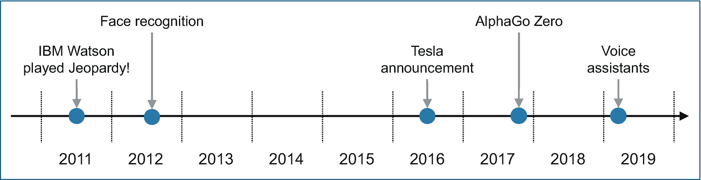

# 2. 人工智能历史视角

尽管我们并未完全意识到并持续赞赏，但人工智能多年来甚至几十年来一直在影响着我们。因此，`人工智能的历史视角`似乎不再是一个至关重要的考量：人工智能已成为生活中不可否认的事实。它对每个个体和整个社会的影响已经显而易见。

那么，是什么发生了变化？为什么我们仍然打算提供一个人工智能的历史视角？人工智能从一个主要是学术和研究领域，转变为一套广泛的商业相关人工智能应用；成千上万个可免费下载的开源库的可用性；以及专用处理器（例如，`GPU`、`FPGA`、`ASIC`）的进步，代表了在过去十年中发生的一些重大变化。

然而，即使在今天，仍然存在一些场景根本不需要人工智能，因为问题或议题过于简单，或者问题对于当今的人工智能能力来说过于复杂。这些方面将在第 13 章“*人工智能的局限性*”中讨论。此外，人们常常对使用人工智能存在一定的犹豫（伦理担忧、监管要求等）；这些方面将在第 8 章“*人工智能与治理*”中讨论。

在这个相对简短的章节中，我们打算提供一个简短的历史视角，一瞥不远的过去，当时人工智能能力仍有些不够成熟，因此人工智能应用也相对有限。因此，这个`历史视角`应该有助于阐明人工智能在 20 世纪 50 年代和 60 年代兴起与近年来人工智能应用爆发之间的差距，以及为什么花了这么长时间——半个世纪——才采用人工智能。

## 引言

技术的进步和采用通常是渐进的；这是一种演进式的方法。因此，确定一个“没有人工智能”的日期可能具有挑战性。“人工智能”这个术语是由约翰·麦卡锡在 1955 年创造的^(¹³)；然而，导致后来被称为人工智能的概念、思想、想法甚至算法，在更早的时候就已经存在了^(¹⁴)。这里仅举几个例子：关于条件概率的贝叶斯定理可以追溯到 18 世纪的英国数学家托马斯·贝叶斯。最小二乘法在 200 多年前就已发展起来；马尔可夫链的随机概念是在 20 世纪初发展起来的。甚至第一个人工神经网络（`ANN`）也是在 20 世纪 50 年代初，基于 20 世纪 40 年代的概念实现的。

这些早期的人工智能发展和进步更多是理论性质的，而非成熟和经过验证的。因此，它们在实践中的应用较少，并且或多或少地停留在学术圈内。

在本章中，我们打算讨论这一差距，并说明为什么 20 世纪下半叶的理论人工智能基础导致了近十年来显著的人工智能爆发。

## 历史视角

尽管包括关键机器学习和深度学习概念在内的人工智能可以追溯到几十年前，但在 20 世纪 60 年代和 70 年代，可用的、在实践中有显著相关性的人工智能能力是有限的。在本节中，我们将讨论人工智能技术的进步如何改变了人工智能的使用方式，以及这对企业、个人和整个社会产生了什么影响。

我们还将通过简要阐述*超越人工智能*，即近期可能发生的变化，来一窥未来。这一点将在第 14 章“*总结与展望*”中再次深入探讨。

### 技术进展

与所有领域一样，人工智能领域也涌现出新颖的方法、创新的技术进步，例如硬件处理器速度和内存容量的提升、新兴专用处理器（如 `GPU`、`FPGA`、`ASIC` 等）的出现——这些进步随着时间的推移，使得人工智能应用能以更丰富、更相关的方式实现。因此，这种`历史视角`试图从演进和动机的角度审视人工智能：理解几年前或几十年前（基于当时的技术现状）人工智能的能力和应用领域是什么，与今天（借助最新的人工智能和技术进步）可能实现什么，以及在不远的将来（基于有前景的研发工作）甚至可能面临什么。

我们定位人工智能的方式，或多或少始终取决于最先进的人工智能技术及其在领域内的适用性。在“人工智能”一词被创造后的最初几十年，以及整个二十世纪下半叶的大部分时间里，人工智能及其相关领域主要与学术和研究活动相关联。因此，组织和个人受人工智能的影响要小得多；人工智能的商业化及其在领域内的可见度相当有限。

在二十世纪的最后十年，我们已经看到了重大的人工智能进展，例如 `IBM` 的“深蓝”^(¹⁵)系统，该系统在六局比赛后击败了国际象棋世界冠军。然而，人工智能增强技术达到足够成熟度并准备好部署到实际领域的显著增长，在二十一世纪才显现出来，尤其是在过去十年中。

表 2-1 列出了过去十年中人工智能的主要里程碑。正如你从这份（不完整的）列表中所见，组织和个人受人工智能的影响日益加深；人工智能的商业化正在顺利进行，而*不采用人工智能*显然已不再是可选之项。

表 2-1

过去十年人工智能的主要里程碑

| # | 里程碑 | 描述 | 影响 |
| --- | --- | --- | --- |
| 1 | `IBM Watson`^(¹⁶) | `IBM Watson` 参加了《危险边缘！》节目并击败了人类对手 | 这清楚地表明，在像《危险边缘！》这样的自然语言相关游戏中，人工智能比人类更胜一筹 |
| 2 | `AlphaGo Zero`^(¹⁷) | 先进搜索树与人工神经网络的结合击败了围棋冠军 | 首次成功证明人工神经网络可以从零开始学习围棋等游戏，无需使用带标签数据进行初始训练 |
| 3 | 人脸识别^(¹⁸) | 成功训练出无需标记图像即可进行人脸检测的人工神经网络（无监督学习） | 人工神经网络首次成功实现无需使用带标签图像数据进行显式训练即可学习人脸识别 |
| 4 | 语音助手^(¹⁹) | `Apple Siri`、`Amazon Alexa`、`Google` 等是第二代语音助手 | 向基于语音的计算机交互（语音控制人工智能）的转变，助手在执行一系列操作后能够理解并回应用自然语言表达的陈述和问题 |
| 5 | `特斯拉`^(²⁰)自动驾驶汽车 | 特斯拉宣布 2016 年 11 月之后生产的汽车配备全自动驾驶硬件 | 对汽车行业、驾驶员及交通运输业产生深远影响 |

这些主要里程碑如图 2-1 所示。

图 2-1

过去十年人工智能的主要里程碑

开源社区通过开源软件许可^(²¹)，以及 `Apple`、`IBM`、`Facebook`、`Google` 等供应商，进一步推动了人工智能的增强，这实际上导致了人工智能应用的爆炸式增长，尤其是在过去十年中。

### 人工智能的演进

到目前为止，我们已经详细阐述了人工智能在 20 世纪 50 年代和 60 年代的出现，包括过去十年中人工智能的最新关键里程碑。人工智能的演进特点在于其在领域内的商业化和存在感不断增强，几乎影响到生活的方方面面。这显然是从人工智能主要局限于学术和研究领域，向成熟且可用的人工智能应用爆炸式增长的转变。在过去的 50 年里，人工智能在实际应用中的局限性显然已转变为快速扩张和商业化的应用。

人工智能的演进和商业化正以前所未有的速度持续进行，主要的人工智能缺陷正由研究人员和供应商共同解决。无需使用带标签数据进行初始训练的强化学习、泛化与多任务学习、自主人工智能，以及——最重要的——为人工智能赋予推理和理解等认知能力，这些仅仅是人工智能未来发展方向中的几个例子。到那时，我们将看到人工智能以无所不包的方式嵌入其中，而我们甚至意识不到它的存在。

在第 13 章“*人工智能的局限性*”中，我们将进一步阐述当前人工智能的局限性，并描述为克服其中一些局限性所做的关键研究工作。在第 14 章“*总结与展望*”中，我们将展望一个由人工智能全面渗透的世界。

## 行业实例

在人工智能方面，大多数企业和个人都已踏上 `AI` 之旅。然而，其中存在差异。例如，在 `O'Reilly` 近期的一项调查^(²²)中，49%的受访者表示其所在组织的机器学习应用阶段处于*探索期*，36%处于*早期采用期*，仅有 15%处于*成熟期*。

无论这种多样化的 `AI` 应用现状未来如何改善，当我们审视各个行业时，今天的情况依然如此：尽管 `AI` 已渗透所有行业，但是否转向 `AI` 的决策在不同行业间仍存在差异。这主要与各行业不同的机遇、特征和商业模式有关。我们通过提供（不完整的）`AI` 应用示例描述，并重点阐述 `AI` 近年来如何改变这些行业，以及——最重要的是——这些行业中的关键 `AI` 趋势，聚焦以下六个行业领域：

*   **金融服务业**：在金融服务领域，欺诈发现与预防仍主要依赖基于规则的模型，机器学习模型才刚刚开始进入领先银行。`AI` 正越来越多地融入信用评分和信贷决策流程。基于 `AI` 的风险管理和合规监管进一步提升了合规性，并缩短了洞察延迟。`AI` 还实现了定制化和精准化的客户互动，以改善个性化银行体验。`AI` 将大幅提升银行交易和客户交互的安全性。我们将看到 `AI` 在发现和预防欺诈活动（如身份盗窃、投资欺诈、信用卡和借记卡欺诈、洗钱、虚假支付等）方面取得重大进展。

*   **汽车行业**：汽车行业的 `AI` 应用情况参差不齐，一些汽车制造商率先积极使用 `AI` 实现全自动驾驶，而另一些则更为谨慎，寻求低风险的切入点，例如使用智能泊车辅助、交通拥堵辅助系统或其他高级驾驶辅助系统^(²³)。尽管用于进一步优化和自主制造的自动驾驶 `AI` 将代表汽车行业的重大转变，但还存在其他颠覆性变革，这些变革代表了我们对交通方式的思维范式转变，例如自动驾驶客运服务或 `AI` 驱动的货物配送服务。`AI` 和自动驾驶汽车将被用作出租车，用于商业和个人交通。

*   **航空航天业**：航空航天业在应用新技术方面（尤其是在驾驶舱内）相对保守。AI 的应用可能在客户服务与票务、营销和乘客识别（人脸识别）方面更为先进，而非在驾驶舱和航空电子控制系统内使用 AI。即使是预测性 MRO（维护、修理和大修）供应，对航空业而言仍是一个新兴领域^(24)。AI 仍需进入驾驶舱，以补充自动驾驶技术并为飞行员提供智能辅助。
*   **医疗保健业**：AI 已在医疗保健行业站稳脚跟。AI 驱动的预测分析和模式识别可以支持临床决策过程，并提高识别有出现特定症状群风险患者的准确性。过去三十年来，机器人已被用于医疗领域协助外科医生。例如，`IBM Watson Health` 通过企业影像和互操作性解决方案推动医疗进步。它还通过`结合相关指南、最佳实践、医学期刊和教科书中的信息`评估患者病历，为肿瘤学家提供协助。^(25) AI 在医疗保健领域的未来，可能被一些人视为与“AI 何时不仅能辅助，还能取代人类医生”这一问题相关。然而，AI 在医疗保健领域的近期未来，更多地与分析和发现海量医疗数据（包括从 DNA 获取的信息；CT 扫描、X 光、MRI 等医学影像）中的模式和关联性有关，以便比现在更早地预测恶性肿瘤、血管疾病等问题。
*   **制造业**：AI 早已进入制造业。一些较新的趋势是基于仅需少量产品缺陷图像的相对较短学习周期的 AI 视觉检测。通过 AI 自动生成程序来优化和缩短机器人编程周期是另一个趋势。虽然制造业中的机器人目前仍主要依靠编程，但未来的机器人能够识别模式、从过往经验中学习，并理解视觉和文本输入。如今制造业中的机器人被编程来执行特定任务（实际上它们远没有看起来那么智能）；未来的机器人可以被训练和学习——它们是可调整的，能够与其他机器人真正协作，并接受人类的新指令，这些指令可能补充机器人的原始编程。
*   **零售业**：AI 和机器学习早已是零售业忠实的长期伙伴。它们有助于理解顾客在购物世界中的旅程、预测消费者购买模式，并个性化消费者互动和营销。零售业中一些新兴的 AI 趋势包括：基于聊天机器人对话提供高度个性化的产品推荐；更好地理解和发现商店内的行为、姿态和移动模式，以检测和预防盗窃，特别是针对未来的无人商店。向消费者交付商品的创新方式——例如通过无人机——是另一项将显著改变零售业的 AI 驱动应用^(26)。

存在许多跨行业领域，二十年前仍普遍存在的对利用 AI 的犹豫，如今已转向明确的 AI 应用：情境化精准营销活动、通用业务领域自动化、人力资源规划、治理、风险与合规——仅举几例。

## 关键要点

我们以几个关键要点来总结本章，这些要点汇总于表 2-2。

### 表 2-2 关键要点

| # | 关键要点 | 高层描述 |
| --- | --- | --- |
| 1 | 技术进步 | 过去十年见证了 AI 技术的重大进步，导致 AI 应用显著增加和商业化 |
| 2 | AI 术语起源 | AI 一词由约翰·麦卡锡于 1955 年创造；然而，促成后来被称为 AI 的概念和算法的发展要早得多 |
| 3 | AI 演进 | 无需初始标记数据训练的强化学习、泛化与多任务学习、自主 AI，以及——最重要的——为 AI 注入认知能力（如推理和理解）是当前一些热门的 AI 演进主题 |
| 4 | 是否采用 AI | 在 20 世纪 60 年代和 70 年代，以及整个 20 世纪下半叶，AI 主要是一个学术和研究领域。关于商业化，在过去二十年中，对应用 AI 的犹豫已转变为`如何以及何时`将 AI 引入用例和应用 |
| 5 | 各行业中的 AI | 如今，AI 已在一些处于领先地位的行业中得到良好确立，而进一步的 AI 进步将增加 AI 在大多数（如果不是全部）其他行业中的无缝利用和集成 |