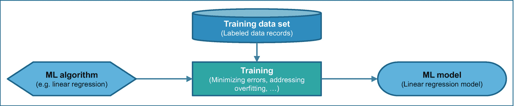
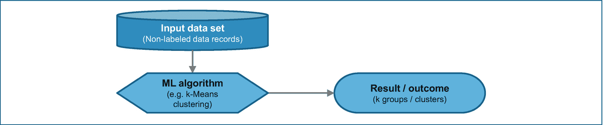
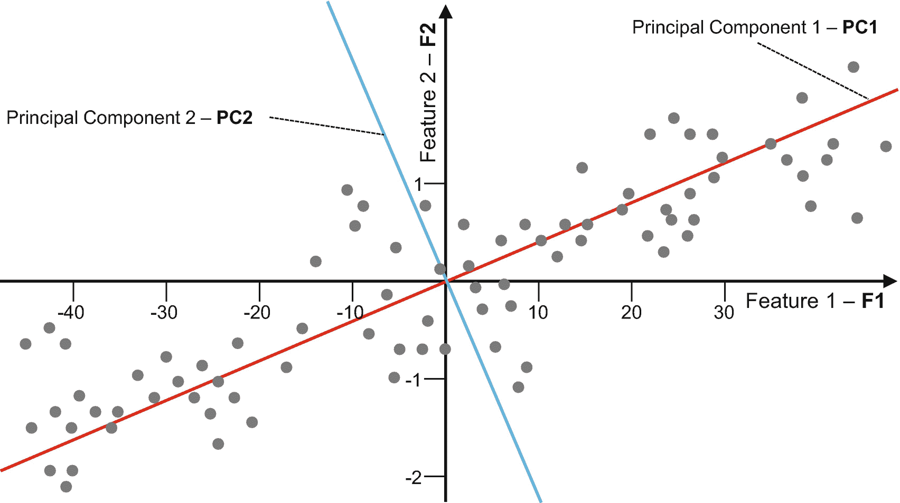
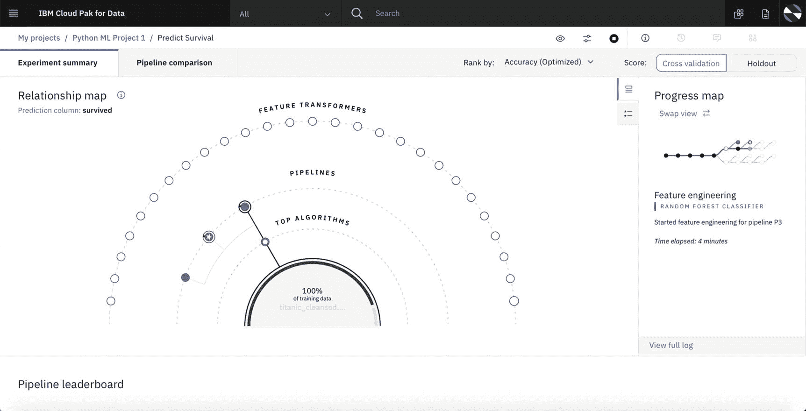
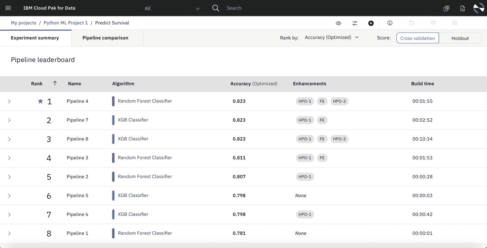
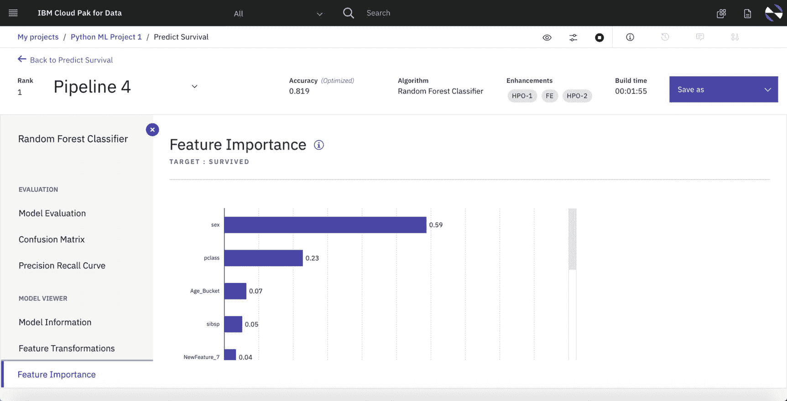
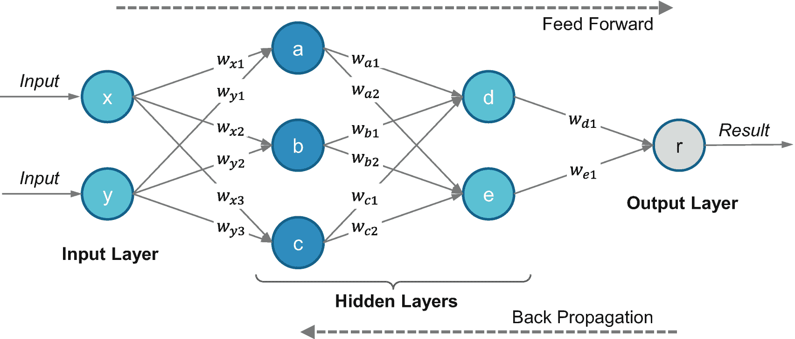

# 3. 机器学习、深度学习与决策优化的关键概念

承接上一章对人工智能演进的探讨，本章将重点介绍机器学习（ML）、深度学习（DL）和决策优化（DO）的关键概念。我们不会深入探讨这些概念的基础知识或背后的数学与统计科学，而是讨论它们在企业或其他组织中实际应用时需要考虑的要点。对于该领域知识有限的读者，本章可作为一份高层级入门介绍。

## 机器学习（ML）

机器学习（ML）这一人工智能学科确立了基于*数据*进行预测的方法，而无需为每个不同问题编写确定性代码。ML 算法基于样本数据构建数学*模型*，这些数据用于训练模型。*机器学习（ML）是研究计算机算法如何通过经验自动改进的学科。它被视为人工智能的一个子集。机器学习算法基于样本数据（称为“**训练数据**”）构建数学模型，以便在无需显式编程的情况下进行预测或决策。*^(²⁷)

该定义中最关键的表述是*无需显式编程*。与传统编程不同，ML 使计算机能够根据提供给 ML 算法的训练数据生成并训练 ML 模型。有时，术语 *ML 算法*、*ML 模型*、*训练*和*训练数据*可能会让人有些混淆。因此，我们提供一个简单的描述来说明这些术语之间的相互关系：使用训练数据训练 ML 算法，会生成一个 ML 模型。换句话说，ML 模型是使用训练数据通过 ML 算法进行训练后得到的结果。

图 3-1 简单说明了这种关系。这种观点尤其适用于预测性 ML 模型，例如回归模型，其训练数据集是带有标签的数据记录。训练意味着使用带标签的训练数据集最小化 ML 模型的误差，同时在此过程中避免过拟合。过拟合是指 ML 算法生成的模型过度适应训练数据集。这会导致模型相对于训练数据集具有非常高的准确率，但通常在使用新数据时效果不佳。本质上，在训练过程之后，只要避免了过拟合，ML 算法就会产生一个 ML 模型，该模型可以应用于新数据以预测结果。

表 3-1

关键要点

| # | 关键要点 | 高层级描述 |
| --- | --- | --- |
| 1 | 机器学习允许无需显式编程即可训练模型 | 机器学习算法基于样本数据（称为“[训练数据](https://en.wikipedia.org/wiki/Training_data)”）构建[数学模型](https://en.wikipedia.org/wiki/Mathematical_model)，以便在无需显式编程的情况下进行预测或决策 |
| 2 | 监督学习旨在进行预测 | 训练数据需要包含被识别为预测目标的期望输出；模型经过训练，能够为新的输入数据预测输出 |
| 3 | 无监督学习在数据中发现结构 | 分析数据以发现相似数据的聚类 |
| 4 | 人工神经网络可用于识别 | 人工神经网络模仿生物神经网络，可用于图像识别、语音识别、语言翻译等 |
| 5 | 决策树可用于预测类别或数值 | 基于输入变量构建决策树，以预测类别（分类决策树）或连续值（回归决策树） |
| 6 | 贝叶斯网络可根据观测数据预测原因 | 例如，可以构建贝叶斯网络模型来预测导致观测到症状的疾病 |
| 7 | DO 用于规范性分析 | 与关注“将会发生什么”的预测性分析不同，决策优化（DO）专注于确定决策/行动 |
| 8 | DO 可以解决所有行业中的复杂问题 | 优化问题通过约束条件、优化目标和输入数据来描述。DO 解决优化问题，从而能够做出最优决策以采取最佳行动 |
| 9 | ML 加 DO 可提供巨大价值 | 通过结合 ML + DO，可以从数据出发，得到预测结果，进而做出最优决策并采取相应行动。与基于预测的蛮力行动相比，这可以带来巨大的成本节约 |

图 3-1

使用带标签数据集训练 ML 算法

然而，对于某些数据准备任务，我们不一定需要生成 ML 模型。例如，为了降低数据空间的维度（从而降低其复杂度），可以使用一种称为*主成分分析*（PCA）的降维算法。在这种情况下，PCA 算法应用于输入数据空间，生成一个复杂度降低、维度减少的输出数据空间。另一个例子是 k-means 聚类算法，它应用于输入数据集（例如，客户交易记录），以生成 k 个客户组或聚类，例如钻石级、黄金级和白银级客户聚类。在这些场景中，没有也不需要带标签的数据。图 3-2 展示了这一概念。

图 3-2

将 ML 算法应用于无标签输入数据集

正如您之前所见，存在不同类型的 ML（或 ML 类别）来解决不同的问题或业务领域。图 3-1 描述了我们称之为监督学习的方法，而图 3-2 则描述了一个无监督学习的例子。除了不同类型的 ML 之外，还有不同的 ML 算法。

在本节的剩余部分，我们将向您介绍关键的 ML 类型和 ML 算法类型。

### 机器学习类型

以下是三种主要的机器学习类型：*监督学习*、*无监督学习*和*强化学习*。

*   **监督学习**侧重于训练模型，这些模型拥有一组输入变量（预测因子）和一个待预测的目标变量，训练过程会持续进行，直到模型在预测训练数据中的目标变量时达到一定的准确度和精确度。这需要带有标签的训练数据集，或者那些碰巧已经填充了目标属性的训练数据集。回归和分类是监督学习的核心领域。监督学习能够实现的预测示例包括：预测客户可能购买什么、机器何时可能发生故障、根据内容对图像或视频进行分类等等。为了使监督学习算法能够工作，训练数据需要包含期望的输出结果。

*   **无监督学习**不涉及任何目标变量，也不需要带标签的训练数据集；其目的是将数据点聚类到不同的组中。聚类以及降维（例如，用于特征缩减、结构发现等）是无监督学习的核心领域。

*   **强化学习（RL）** ^(²⁸) 基于通过试错经验进行学习。强化学习是一个智能体与环境交互，从策略中学习以执行特定任务，并根据其获得的奖励和惩罚，随着时间的推移不断改进和优化其行为。智能体根据获得的奖励来学习改进其行为。RL 旨在优化学习到的策略。可以通过多种 RL 算法来训练智能体，例如无模型 RL（如使用 *Q-learning*）或基于模型的 RL（如使用*马尔可夫决策过程*（MDP））。^(²⁹)

### 机器学习算法类型

存在相当多的机器学习算法，可以根据要实现的用例或要执行的数据科学任务来应用它们。这些机器学习算法可以归为以下几种类型：

*   回归与分类
*   聚类
*   决策树
*   贝叶斯
*   降维
*   人工神经网络（ANN）
*   集成
*   正则化
*   规则系统
*   基于实例

我们不打算描述所有这些类型的机器学习算法；但是，我们将向您介绍其中与本书上下文最相关的一小部分。人工神经网络将在后续关于深度学习的章节中介绍。

#### 回归与分类

当需要预测一个离散值时，会使用回归模型。业务示例包括股票价格预测、批处理作业耗时预测、天气温度预测，或医学诊断分析背景下的预期寿命预测。

*线性回归*是最常见的回归分析形式，它根据诸如普通最小二乘法之类的数学标准，绘制一条最佳拟合数据的直线。其他形式的回归分析包括*逻辑回归*、*多项式回归*、*逐步回归*等。

分类算法^(³⁰) 用于预测一个类别，该类别可以是二分类或多分类。业务示例包括欺诈检测（欺诈与非欺诈）、垃圾邮件检测（垃圾邮件与非垃圾邮件）、客户流失预测（流失与未流失），或客户分类（钻石级、黄金级与白银级）。其他示例还包括药物分类（医学）、物体分类（自动驾驶车辆）、贷款申请分类等。

有相当多的机器学习算法可用于分类应用，例如*逻辑回归*、*K-近邻*、*决策树*、*支持向量机*（SVM）等。

*支持向量机*（SVM）使用标记为属于两个类别之一的示例进行训练，以便生成的模型能够预测新示例属于哪个类别。

#### 决策树

*决策树*可以作为预测模型，其中对分支中表示的项进行观察，从而得出关于叶子节点中表示的目标值的结论。决策树可用于回归和分类任务。

如前所述，当输出是离散类别时使用分类树，当预测结果是实数时使用回归树。诸如*提升树*之类的集成方法会构建多个决策树。构建决策树的算法通常自上而下工作，在每一步选择一个最能分割项目的变量。

*随机森林*是决策树的一个例子，它是一种集成训练方法，可用于分类、回归或其他任务。在训练过程中，会构建许多决策树，并组合输出以确定输出类别或值。当模型对训练数据集过拟合时，随机森林有助于相对于单棵决策树进行改进。

#### 聚类

聚类算法的目标是将数据分组到簇中，以便更好地组织数据。聚类的一个重要方面是可用的数据点没有标签。因此，聚类属于无监督类型的机器学习。评估结果正确性取决于业务上下文，这可能导致重复执行聚类算法，直到找到满意的业务结果（一组簇）。业务示例包括根据客户的购买行为、信用卡使用模式、旅行相关偏好等对客户进行聚类（客户细分）。

存在相当多的聚类算法^(³¹)，例如 *K-均值*、*K-中位数*、*层次聚类*和*期望最大化*。

#### 贝叶斯

*贝叶斯网络*是一种算法，它通过有向无环图表示一组变量及其条件依赖关系。贝叶斯网络非常适合预测已发生事件的原因，例如，根据观察到的症状预测疾病。贝叶斯算法的其他示例包括*朴素贝叶斯分类器*、*高斯朴素贝叶斯*、*贝叶斯信念网络*（BNN）等。

#### 降维

人工智能和机器学习不仅仅关乎开发 AI 模型或聚类数据。在能够开发任何类型的 AI 制品之前，需要理解可用的源数据；需要简化数据的复杂性；需要通过例如省略那些无助于减少误差的特征或预测变量来选择和转换特征；并且由于某些特征之间存在相关性，可能还需要降低特征空间的维度。降维关注的是特征的选择和表示，以优化和简化分类器的开发。

由于其在数据科学中的重要性，降维^(³²) 仍然是一个热门研究领域。如今，已有相当多的算法可供使用，例如*线性判别分析*（LDA）、*偏最小二乘回归*（PLSR）、*混合判别分析*（MDA）、*灵活判别分析*（FDA）和*主成分分析*（PCA），仅举几例。

例如，PCA^(³³) 是一种算法——通常被称为技术或方法——用于将一大组可能相关的成分或维度（预测变量、特征）减少为一组不相关（或相关性较低）的维度，这些维度可能但未必更少，称为主成分。这些维度随后彼此正交（线性独立），并根据数据沿这些维度的方差进行排序。其目标是沿着一组新的主成分从数据点中提取最相关的信息，以便轻松描述数据变异的成因。

图 3-3

主成分分析（PCA）

如图 3-3 所示，两个主成分 PC1 和 PC2 是新的维度，它们彼此正交。它们被推导为原始特征 F1 和 F2 的线性组合。PC1 和 PC2 的确定方式使得沿新维度的方差 *var*(*PC*1) 和 *var*(*PC*2)（分别衡量数据点沿 PC1 和 PC2 偏离均值的程度）最大化，且 *var*(*PC*1) > *var*(*PC*2)。协方差 *cov*(*PC*1, *PC*2) 也被纳入方程，以理解沿新维度的值之间的关系。

以下是另一个例子，其中原始的三维特征空间可以降为二维主成分空间：想象一组分布在三维空间中的数据点，这些数据点大致位于一个二维平面上。如果你应用 PCA 创建代表该平面的两个主成分 PC1 和 PC2（当然，它们彼此正交），那么第三个主成分 PC3 的方差 *var*(*PC*3) 可能非常低，以至于可以忽略不计。随后，你就将原始的三维空间降为了二维空间，这可以简化基于这个“新”特征空间的 AI 模型开发。

PCA 算法的结果可能会降低相关特征的复杂性和数量。然而，这可能会带来一个缺点，即后续开发的 AI 模型的可解释性会降低。

### 自动 AI

机器学习中一个相对较新的概念是自动 AI 或自动 ML，其目标是自动化机器学习管道的创建，并自动对生成的模型进行排名，以帮助数据科学家更快地找到好的模型。

图 3-4

自动 AI 使用多个训练管道训练一组模型

原则上，不具备数据科学技能的用户也可以使用自动 AI 来构建模型。然而，最终需要基于数据科学和领域专家技能的专业判断，来评估自动创建的模型是否满足特定用例的要求，以及在实际业务环境中哪个模型真正最适合使用。

图 3-4 展示了一个自动 AI 的示例，该示例基于 IBM Watson Studio 中的自动 AI 功能，该功能运行在 IBM Cloud Pak for Data 上。该图展示了以下信息的可视化：

*   自动 AI 选择的算法
*   应用这些算法创建的管道
*   特定管道使用的特征变换

图 3-5 中的以下管道排行榜显示了哪些管道基于选定的指标（此处为准确率）产生了最佳模型。

图 3-5

自动 AI 生成的模型训练管道排行榜

然后，可以深入查看生成模型的各种指标，以探索哪个管道具有最佳的整体结果，并了解哪些特征对预测影响最大。例如，在此案例中，模型使用了一个包含泰坦尼克号乘客信息及其是否幸存的数据集进行训练，最重要的特征是乘客的性别，如图 3-6 所示。

图 3-6

自动 AI 进行的特征重要性分析，以帮助理解模型

### 迈向 AI 模型卓越

技术模型评估指标，如准确率、混淆矩阵、精确率-召回率等，是选择使用模型时需要考虑的重要因素。

然而，可能存在一系列业务考虑因素和适用法律，最终可能排除某些方法、某些特征的使用，或者可能要求有意不选择具有最佳技术评估指标的模型。

例如，在贷款决策模型中，使用一个人的性别或与其显著相关的值作为影响贷款是否获批的特征是不可接受的。根据可解释性或性能要求，可能需要选择更简单的模型，而不是那些原则上能给出更好结果但可解释性较差或计算时间过长的模型。根据误报的影响，可能必须选择一个整体准确率较低的模型，以最小化误报预测的数量。例如，在信用卡欺诈检查中，任何误报都会导致客户极大的不满，因为他们想为合法的消费付款，但却无法成功。

## 深度学习（DL）

关于 DL^(³⁴) 已有大量的书籍、文章和博客。尽管如此，你可能仍然想知道 ML、DL 和 RL 之间的区别，以及它们之间如何相互关联。在本书中，我们没有足够的篇幅来广泛涵盖 DL 主题。我们并非要描述其理论和数学基础，而是旨在让你更好地理解 DL 的关键特征，以及 DL 与 ML 和 RL 之间的差异和一致性。

### 什么是深度学习？

一方面，深度学习可被视为机器学习的一个子集，因为它通过专注于人工神经网络（ANN）——正如我们之前所见，这是一种特定类型的机器学习算法——实现了真正的可扩展机器学习。实现*真正可扩展*的机器学习解决方案依赖于专用引擎，例如 GPU、FPGA 或 ASIC。此外，深度学习可以像机器学习一样，分为监督学习、无监督学习和强化学习，这与我们在本章开头讨论的机器学习类型类似。

另一方面，深度学习可被视为机器学习的演进，它专注于允许在真正意义上进行学习的独特算法，这意味着既可以使用*有*标签数据集，也可以同样地使用*无*标签数据集。对于机器学习，我们训练和再训练一个机器学习模型，以确保其在预定义场景下的准确度和精确度保持在特定水平；而对于深度学习，模型可以“自行”学习，随着时间的推移变得更加精确和准确，无需手动或基于工具的再训练。例如，深度学习可以基于监督特征学习，利用监督神经网络或监督字典学习，其中可能执行初始训练。然而，后续在决策过程的相关性和精确性方面的提升，可以由机器学习模型本身基于新数据完成，无需人工或工具干预。因此，深度学习的能力处于不同水平，并且真正模仿了人类行为。

强化学习与深度学习之间的区别有时会令人困惑。正如你在本章开头讨论各种机器学习类型时所看到的，强化学习是通过奖励和惩罚来学习策略。但是，当数据维度相当大时，强化学习可能具有挑战性且繁琐。深度强化学习（DRL）可以有效解决这个问题，它将强化学习算法与人工神经网络或深度学习算法相结合。

现在，让我们来探讨一下人工神经网络和深度学习网络（DLN），并为你阐明为什么我们将它们区分为不同类型的神经网络。

### 人工神经网络（ANN）

人工神经网络是最早出现的、相对简单的神经网络，它松散地模拟了生物大脑中的神经元。人工神经元具有带权重的输入连接和输出连接，并且可能有一个阈值，只有当超过该阈值时才会发送输出信号。人工神经网络通常组织成输入层、隐藏层和输出层。人工神经网络能够学习各种非线性函数。在这个学习过程中，连接上的权重通过减少或最小化所谓的损失函数来调整。损失函数可以被视为使用人工神经网络或深度学习网络算法来训练这些神经网络的一个组成部分。

图 3-7

人工神经网络（ANN）

当我们使用术语 *ANN 或 DLN 算法*时，我们指的是用于训练神经网络的算法。在某种程度上，我们可以将训练好的人工神经网络或深度学习网络称为深度学习模型（以保持我们术语的一致性）。*反向传播*可能是最流行的人工神经网络算法，它实际上由一组用于反向传播的训练算法组成。其他人工神经网络算法包括*径向基函数网络*（RBFN）、*霍普菲尔德网络*、*多层感知器*（MLP）、*随机梯度下降*等。

图 3-7 描绘了一个简单的前馈人工神经网络，包含输入层、两个隐藏层和输出层。隐藏层通常由多个节点组成。在我们的示例中，第一层由节点 a、b 和 c 组成，而第二层由节点 d 和 e 组成。前馈指的是信息仅从输入层向输出层单向流动。可以使用各种反向传播算法（例如随机梯度下降）来训练人工神经网络，即调整你在图 3-7 中看到的各个权重 *w*[*ij*]。

人工神经网络的应用包括计算机视觉、语音识别和机器翻译。*深度学习*采用具有多个隐藏层的人工神经网络。

### 深度学习网络（DLN）

人工神经网络可以被视为原始的、经典类型的神经网络，它们简单直接且相对简单。相应的人工神经网络算法也不那么复杂。正如我们提到的，训练人工神经网络基本上是基于应用各种反向传播算法。对于当今要求苛刻的人工智能应用，需要具有大量潜在隐藏层的更复杂的人工神经网络。然而，为这些复杂的人工神经网络需要调整的权重 *w*[*ij*] 的数量变得难以计算。另一个问题是所谓的*梯度消失和梯度爆炸*，这使得人工神经网络不稳定且学习能力下降。这与损失函数有关，该函数计算出的梯度太大，因此不适合充分调整权重 *w*[*ij*]。这种现象甚至可能变得非常普遍，以至于人工神经网络无法再训练，因此无法使用。

有几种技术可以解决这个问题，例如权重正则化或梯度裁剪。尽管如此，出现了更多最先进的神经网络，它们提供了新颖且更具创新性的方法来应对上述问题，我们称之为深度学习网络（DLN）。深度学习网络和相应的深度学习算法致力于开发和高效训练更大、更复杂的神经网络，这些网络可以处理更大体积的数据，并且适用于当今具有挑战性的人工智能应用。

一些最流行的深度学习网络^(³⁵)包括*循环神经网络*（RNN）、*卷积神经网络*（CNN）、*深度信念网络*（DBN）、深度玻尔兹曼机（DBM）等。循环神经网络具有从单个节点到自身的循环连接，将结果与输入数据联系起来。卷积神经网络^(³⁶)主要用于图像处理，也用于分类和分割。它们利用核和滤波器来训练神经网络。核就像一个 n 维的权重矩阵，重复应用于输入数据。滤波器是多个核的串联，其中每个核被分配给输入数据的一个子集（通道）。

这些深度学习网络的出现、进一步发展和研究，以及它们代表了人工智能中一个独特且与众不同的领域这一事实，使我们认识到深度学习并非完全是机器学习的子集。

## 决策优化 (DO)

决策优化^(³⁷)是数据科学技术的一个子集，用于规范性分析。与旨在预测未来会发生什么的预测性分析不同，规范性分析有助于决定应采取哪些行动。

DO 分析各种可能的选择，并从海量备选方案中提供最佳选项。例如，你无法预知客户是否会取消订阅（客户流失），也无法预知工业资产何时可能发生故障，但你可以决定是否向客户提供特定的促销活动，或者决定是否为你的资产执行维护计划。这些决策都在你的掌控之中。然而，它们会受到业务约束的限制，例如，最大促销预算或维护团队规模。在所有可能的决策中，有些决策是基于你想要优化的目标而被优先考虑的。在这种情况下，DO 会为你规定应采取哪种决策。

在第 5 章“*从数据到预测再到最优行动*”中，我们深入探讨了机器学习与 DO^(³⁸) 的集成，以及结合这两个领域所能实现的整体效益。

DO 几乎适用于所有行业。应用示例包括众所周知的用例，例如供应链优化、生产计划与排程，以及投资组合优化、预测性维护、电力机组组合，甚至还有更令人惊讶的应用，如价格优化或货架空间优化。

## 关键要点

我们以几个关键要点来总结本章，这些要点汇总于表 3-1。

