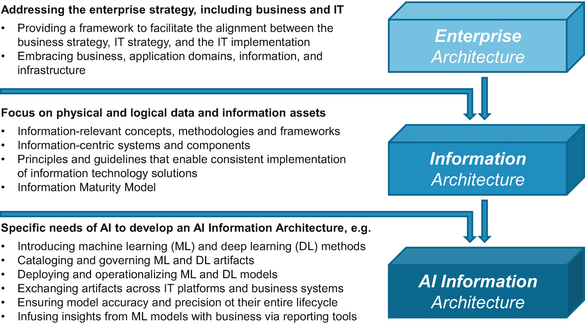
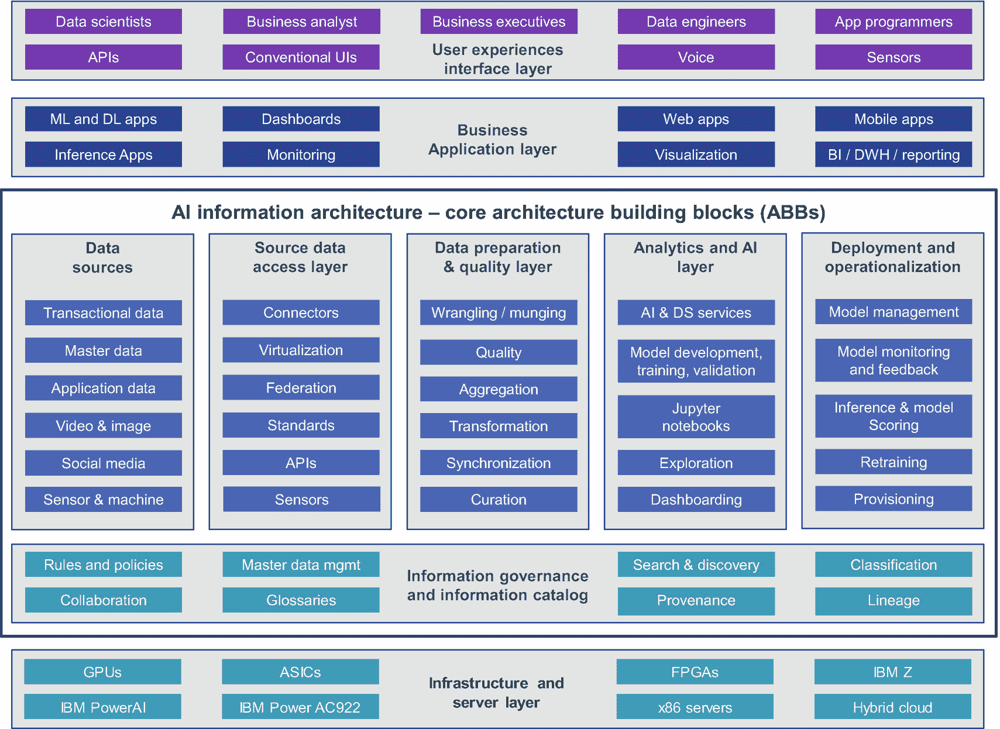
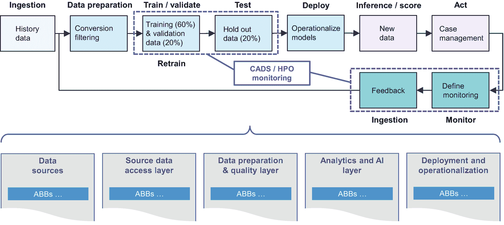
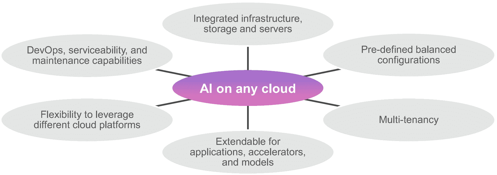
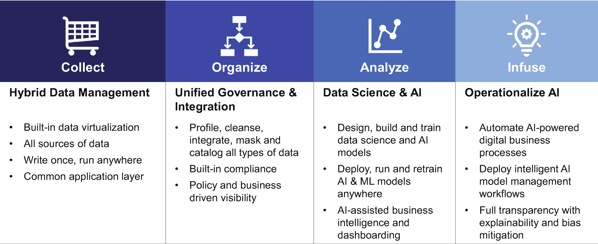
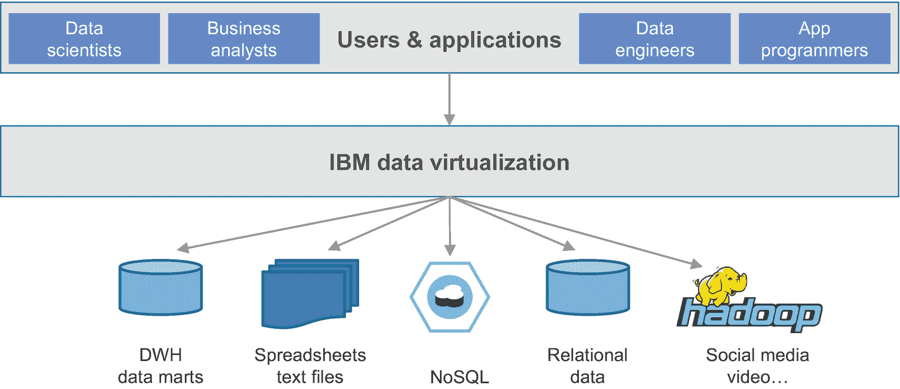
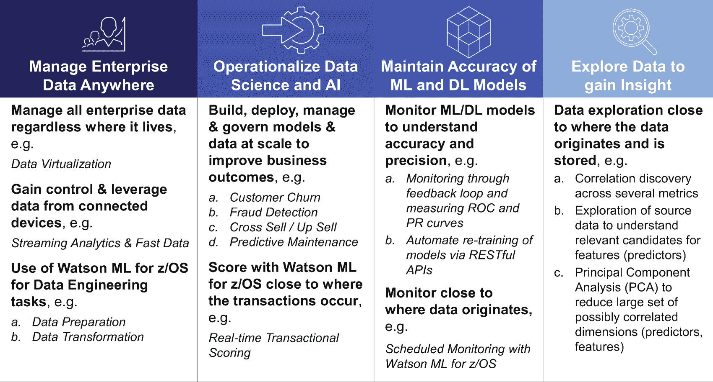

# 4. AI 信息架构

在本章中，你将了解信息架构（IA）在提供可信赖的企业级 AI 基础方面所扮演的特定角色。作为本主题的引言，我们简要回顾了信息架构（IA）的关键方面，并重点介绍了 AI 背景下的逻辑和物理 IA 组件。这些内容对于读者充分理解 AI 对现有信息架构的影响至关重要。任何架构都需要有产品和解决方案作为支撑。我们将学习 AI 信息架构的关键组件及其在企业适用性中的作用。最后，我们将通过一些用例来说明 AI 在信息架构中的应用。

在 IBM，我们曾帮助一些客户开启他们的 AI 之旅，方法仅仅是下载并使用一些免费的开源软件包和库，例如 Apache Spark 库。然而，企业需要有全企业范围的指导方针；否则，这可能导致企业内部不同部门或组织使用不同的开源库。由于这些软件包和库未进行集成且无法互操作，AI 制品（即 ML 或 DL 模型）会具有不同的格式，难以跨组织和不同平台进行轻松交换和部署。任何 AI 尝试都不仅仅是下载几个免费的开源 ML 或 DL 库和运行时引擎那么简单。你应该采取一种全面的、企业级的方法，并为协作、集成、专用引擎、开源、企业级解决方案等做好规划。

此外，每个部门或组织都在努力访问和转换所需的源数据，以便在特定的应用程序或用例上下文中进行适当的消费。对 AI 制品访问和使用的治理（我们将在第 8 章“*AI 与治理*”中讨论）又留给了各个部门和组织。因此，缺乏企业级信息架构常常导致整个企业中出现不一致且笨拙的影子 IT 实施。

其他组织可能会通过部署商业可用的 AI 工具集（即 ML 或 DL 解决方案，例如包含数十甚至数百个库和算法、一些运行时引擎以及用于存储和管理 AI 制品的组件的 IBM Watson Machine Learning (ML) for z/OS）来开启他们的 AI 之旅。然而，以所需的数据质量发现源数据并将其供应到 AI 工具集中仍然是一项具有挑战性的工作。让你的员工接受培训并熟悉这样一个工具栈是另一个挑战。将源数据访问和转换为所需的数据和特征格式的工作常常不完整或完全缺失。后续的数据同步和组织任务以及数据隐私和保护需求通常不在 AI 工具的范围之内。此外，将这些 AI 工具集成到现有的 IT 和业务环境中伴随着不可预见的组织和技术障碍，常常使 AI 项目变成令人沮丧的经历。因此，缺乏企业级信息架构会导致 AI 基础设施碎片化，使得企业级 AI 项目和应用充满挑战和风险。

*没有 IA 就没有 AI*^(³⁹) 听起来可能像是又一个流行语。然而，本章提供了进一步的论据，说明在你攀登 AI 阶梯的过程中，为何需要对你的 IA 进行充分投资。

## 信息架构 – 简要回顾

由于信息密集型业务挑战已经存在了几十年，因此有相当多的与信息架构^(⁴⁰)相关的知识和出版物可供参考。本节对信息架构和企业信息架构（EIA）这两个术语进行了非常简要的回顾，并定义了最重要的方面，例如企业架构层、参考架构（RA）的概念以及 EIA 参考架构工作产品。此外，我们还简要回顾了关键的架构模型和方法，例如信息成熟度模型。这个简短的回顾具有通用性，应能使读者理解我们在本章后续部分将详细阐述的术语和概念。^(⁴¹)

### 术语与定义

我们首先从企业架构的定义开始回顾，因为这为定位 IA 和 EIA 这两个术语提供了基础。开放组架构框架（TOGAF）^(⁴²)是开放组的一项标准，也是最全面的企业架构方法论和框架之一^(⁴³)。根据 TOGAF 标准，企业架构的目标是“*将企业中通常分散的流程（包括手动和自动化）遗产优化整合为一个能够响应变化并支持业务战略交付的集成环境。*”企业架构提供了一个框架，用于促进业务战略、IT 战略与 IT 实施之间的对齐。因此，它涵盖了多个领域，包括企业战略、业务与应用领域的需求、信息（或数据）领域以及基础设施。

以下是 TOGAF 架构的组成部分：

*   业务架构
*   数据架构
*   应用架构
*   技术架构

根据 TOGAF，数据架构“*描述了组织逻辑和物理数据资产以及数据管理资源的结构。*”就本书旨在揭开 AI 神秘面纱的目的和范围而言，信息架构提供了基础性的信息相关概念、方法论和框架，以确保业务从其信息层所需的响应能力和可信信息洞察。信息架构在数据架构的基础上进行扩展和深化，利用 IT 环境中以信息为中心的系统与组件，并定义其与业务目标的关系。

此外，信息架构还描述了支持信息技术解决方案一致实施的原则和指南，数据与信息如何在企业范围内进行治理和共享，以及需要采取哪些措施来获得与业务相关的可信信息洞察。我们将在第 8 章“*AI 与治理*”中再次讨论这一特定方面。

以下是指导信息架构的一些核心原则示例：

*   **信息的访问与流动**：信息服务应确保在正确的时间向正确的用户提供无限制的访问，并提供促进所需信息流动的手段。
*   **服务复用**：促进信息相关服务的发现、选择和复用，并在可能的情况下鼓励使用统一接口。
*   **信息治理**：适当的信息架构及相应的信息技术应支持信息治理策略的有效执行。
*   **标准**：应为数据和技术定义一套连贯的标准，以促进整个信息基础设施的简化。

企业信息架构（EIA）是定义以信息为中心的原则、架构模型、标准、方法和流程的框架，这些构成了企业架构的基础。EIA 处理整个企业及相关业务组织中的信息技术决策。因此，EIA 将业务需求转化为信息策略，并涵盖从可用和所需的数据组件到业务应用所消费的衍生洞察的整个信息供应链。EIA 术语中使用的“*企业*”一词，为本节所述的信息架构定义增添了企业级的业务背景。

在详细阐述 IA 方法和模型之前，我们先介绍参考架构^(⁴⁴)这一术语。参考架构（RA）是一种企业架构，它针对特定领域、行业或主题（如逻辑数据仓库（DWH）、汽车行业或 AI）的特定需求。它基于企业架构框架的原则，但会根据该领域、行业或主题的具体要求进行调整。因此，我们称之为 AI 参考架构（AIRA）或企业信息架构参考架构（EIARA）。理想情况下，任何 RA 都应基于一系列具体的客户参与和解决方案部署，并应以从这些参与和部署中汲取的最佳实践作为支撑。在以下章节中，我们将描述 AI 的 IA 关键方面，可称之为 AI 信息参考架构（AIIRA），或更简单地称为 AI 信息架构（AIIA）。

### 方法与模型

在过去几十年中，已经发展出许多企业架构方法论。在这篇简短的介绍中，我们继续聚焦于 TOGAF。TOGAF 的架构开发方法（ADM）^(⁴⁵)包含多种用于开发架构的方法。其中一种方法是信息系统架构——数据架构 ADM，“*它使业务架构和架构愿景得以实现，同时处理架构工作请求和利益相关者的关注点。*”它详细描述了企业架构开发周期，包括其迭代方法、所需的调整，以及与特定范围和架构资产相关的决策。

目前存在许多企业和信息架构的指南与原则、架构风格与模式、最佳实践及模型，它们要么具有更通用的性质，要么包含在与特定行业（保险、汽车等）或领域（逻辑 DWH、AI 等）相关的参考架构中。在这篇简短的回顾中，我们将简要阐述 IA 信息成熟度模型。在本章的后续部分，我们将把这个信息成熟度模型与特定的 AI 领域联系起来。

信息成熟度模型是一种用于评估 IA 成熟度以及将数据和信息转化为业务相关洞察的成熟度的模型或技术。它可以被视为一种技术或一套准则，用于开发能够解决以下领域的 IA：

1.  **减少访问信息所需的时间**：及时向消费型业务系统和应用提供和配置数据与信息。
2.  **降低信息复杂性**：处理数据的多样性、复杂性以及从结构化（如关系型）到非结构化（如文本、社交媒体、视频）的各种格式。
3.  **通过优化基础设施降低成本**：通过简化、敏捷且可适应不断变化的业务需求和频繁发生的干扰的 IA 来降低成本。
4.  **通过分析与发现获得洞察**：能够发现、分析并加速推理和洞察，是所有业务线组织的关键需求。
5.  **利用信息实现业务转型**：持续注入数据和信息，以促进业务转型并支持新兴业务用例场景的实施。
6.  **获得对主数据的控制**：通过适当的企业 MDM 系统^(⁴⁶)管理主数据（例如客户、业务伙伴、员工、产品和服务）和参考数据。
7.  **通过单一事实来源管理风险与合规**：应对日益增多的业务法规的合规要求，并进一步理解和缓解风险。

如前所述，我们待完成的任务是将上述领域（及类似领域）调整并映射到 AI 的特定需求，以开发一个 AI 信息架构。

## 人工智能的企业适用性

在前面的章节中，我们简要回顾了企业和信息架构的关键概念。本节将描述 IA 在 AI 背景下的适用性和影响。我们将详细阐述推动对全面 AI 信息架构需求的 AI 影响因素。

### 信息架构对 AI 的相关性

随着组织制定其 AI 战略并越来越多地使用 AI、机器学习和深度学习，调整和改进其现有 IA 的需求变得显而易见。正如你在第 1 章“*AI 简介*”中所见，新的数据与信息用例及使用模式正在涌现，并且诸如分析模型之类的新工件将被开发出来。

此外，必须实施跨不同组织中各种角色和职责的创新且高效的协作模式。业务用户、数据科学家、数据工程师和 IT 运维专家必须有效协作，以便交换和管理新型工件；将数据配置并转换为新的消费模式；为 ML 和 DL 模型的开发、学习、部署和管理引入新组件；以及部署和运营，例如，将 ML 和 DL 模型与新型应用程序（如实时交易评分或实时客户分类）结合使用。

表 4-1 概述了信息架构对 AI 的相关性，并列出了推动 AI 信息架构的必要事项和需求。此列表可能既不完整，也未按优先级排序。显然，某些必要事项和需求之间存在一些重叠和关联。

**表 4-1 AI 信息架构的必要事项与需求**

| # | 必要事项 | 高层描述 |
| --- | --- | --- |
| 1 | 新的和新兴的用例 | 如第 1 章“*AI 简介*”所述，众多用例和新兴业务领域，例如驾驶员辅助系统和自动驾驶、管理从现有基于规则的欺诈发现系统到使用 DL 和 ML 的范式转变、集成自然语言处理（NLP）以改善人机交互等，正在推动 AI 信息架构的发展 |
| 2 | 数据和信息的新使用模式 | 对于 AI 相关场景，需要以新的方式处理、配置和管理数据与信息。处理可能需要标记数据或发现数百个数据组件之间的相关性。配置可能需要转换和集成交易数据及其他预测因子，以用于实时或低延迟评分。治理^(⁴⁷)可能需要进行调整，例如，以应对新的 ML 和 DL 相关工件 |
| 3 | 容纳新工件和标准 | AI 需要开发、集成和管理新工件，例如 ML 和 DL 模型、Jupyter Notebooks、元数据等。需要考虑新标准，如开放神经网络交换（ONNX）格式^(⁴⁸)和现有的预测模型标记语言（PMML）标准^(⁴⁹) |
| 4 | 创新且高效的协作需求 | AI 创造了跨不同用户角色和职责（如业务分析师、业务用户和应用程序开发人员、数据科学家、数据工程师以及 DevOps 和 IT 运维专家）进行协作的需求。这涉及到促进需求陈述、资源、新工件和 DevOps 场景交换与管理的创新技术 |
| 5 | 洞察的新消费模式 | AI 方法生成了获取洞察的新途径，这要求 AI 信息架构支持新的洞察消费模式以及推理技术和能力。例如，ML 和 DL 模型并非静态：ML 模型可以重新训练以保持一定的准确度和精确度，DL 模型可以通过学习持续改进和验证洞察的相关性。AI 信息架构需要支持 ML 和 DL 模型的监控、重新训练和持续学习 |
| 6 | 分布式开发和部署模式 | 上述用户角色和职责可能在不同的平台上执行，例如基于开源 Hadoop 的数据湖（如 Hortonworks HDP）、分布式或 IBM Z（大型机系统），以及私有云、公有云或混合云环境。源数据可能源自并驻留在不同的平台上。因此，需要允许在一个平台上进行 ML 和 DL 模型的开发、训练、测试和验证，并促进在另一个平台上进行包括评分在内的部署和运营。AI 信息架构需要支持所有任务在这些平台间的无缝分布 |
| 7 | 部署和运营化方面 | 如今，AI 运营化^(⁵⁰)挑战是许多组织面临的巨大痛点。例如，提供实时决策和评分的需求要求及时完成数据配置和准备，这可能包括访问、汇编和准备驻留在各种源系统中的数据 |
| 8 | 集成专用引擎和加速器 | 专用引擎，如图形处理单元（GPU）、专用集成电路（ASIC）引擎，或针对 AI 使用进行优化的系统（如 IBM PowerAI 系统^(⁵¹)），必须集成到 IT 环境中，这需要对现有 IA 进行调整 |
| 9 | 满足不同的数据访问和转换需求 | 根据用例，可能需要实时捕获和处理来自新来源或设备的新数据（例如，传感器数据、语音数据等）。即使是现有的源数据，如金融交易记录，也必须实时访问并准备用于评分 |
| 10 | 简便的数据搜索和数据探索能力 | 特别是为了识别数据中的新模式或发现不同 KPI 或源数据点（例如，特定客户的呼叫中心语音数据和交易数据）之间的相关性而进行的数据探索，是一项基本任务，例如，为 ML 模型开发识别相关特征或预测因子。AI 信息架构需要提供简便的数据搜索、访问和探索能力 |
| 11 | 将学习和推理引入现有 IT 和业务环境 | 新方面，例如学习、用推理补充理解，或没有初始标记数据集的训练（意味着自主学习^(⁵²)），代表了新的挑战和机遇。其他场景，例如零输入学习（从零开始学习）或在异常情况下的自动驾驶，不仅对 AI 信息架构，而且对整个企业架构都构成了未来的挑战 |
| 12 | 集成语音和其他接口 | 语音接口通过 NLP 改善人机交互。语音接口、视网膜扫描和面部表情识别（用于检测情绪或计算客户的情绪分数，或发现汽车驾驶员的困倦程度）将使系统能够对客户或驾驶员获得更广泛和更深入的理解。在开发 AI 信息架构时，需要考虑这些接口和扫描系统及其相应的数据 |

如前所述，这个列表还可以进一步扩展。例如，在开发人工智能信息架构时，需要考虑像 Python、Scala 和 R 这类常用且占主导地位的语言，并且需要集成诸如 Apache Spark、scikit-learn、TensorFlow 和 Caffe 等开源组件、运行时引擎和库——仅举几例。企业适用性、安全性、可扩展性、云就绪性和可用性是其他关键要求。

对于上表列出的某些方面，我们将在本章后续部分进行更详细的阐述。

### 人工智能背景下的信息架构

图 4-1 描述了企业架构、信息架构和人工智能信息架构之间的一致性。

人工智能信息架构可以被视为一种信息架构，其中应用了表 4-1 中列出的人工智能特定需求和必要条件，以及与人工智能领域相关的参考架构原则。既然我们现在理解了描述人工智能信息架构的驱动因素和动机，我们打算将上述必要条件转化为从概念角度所需的技术能力列表。

图 4-2 通过架构概览图（AOD）从概念上展示了这些能力。可以利用此 AOD 来识别人工智能信息架构构建块的候选者^(⁵³)。

根据人工智能战略和选定的用例，并非所有这些构建块都必须从一开始就实施。然而，人工智能信息架构的设计应考虑到可扩展性、扩展和增强。它应该是敏捷的，以满足未来的需求。^(⁵⁴) 人工智能工具和产品应支撑人工智能信息架构对敏捷性的需求。

图 4-1
人工智能信息架构的上下文

构成普遍人工智能信息架构的某些方面和能力并未被考虑在内，例如特定的数据湖方面以及与传统的企业商业智能和数据仓库系统的集成方面。主数据管理系统在管理核心信息方面的作用将在下一节中简要阐述。

我们将人工智能信息架构的核心架构构建块（ABB）分为以下六个层级或类别，其中信息治理和信息目录^(⁵⁵)的 ABB 为其他五个层级提供服务：

1.  数据源

2.  源数据访问层

3.  数据准备与质量层

4.  分析与人工智能层

5.  部署与运维

图 4-2
人工智能信息架构概览图（AOD）

以下是上述 AOD 中描绘的部分构建块^(⁵⁶)的子集：

*   **源数据访问**：包括数据连接器、虚拟化和联邦
*   **数据准备**：包括数据整理/清洗、聚合和转换
*   **数据质量**：例如，确保下游数据消费的可靠输入
*   **数据探索**：探索性数据分析，包括相关性发现、数据挖掘等
*   **数据供应**：专门用于支持推理和评分的应用程序
*   **模型训练**：包括学习和再训练，例如用于机器学习和深度学习模型
*   **模型验证与测试**：确保机器学习和深度学习模型的最高准确度和精确度
*   **模型管理**：包括不同模型版本的版本控制、可移植性以及使用不同运行时引擎进行评分等
*   **推理与模型评分**：用于批处理和实时事务评分
*   **模型监控与反馈**：关于模型在其整个生命周期内的准确度和精确度
*   **模型再训练**：以维持模型在其整个生命周期内的准确度和精确度
*   **专用引擎与加速器**：例如，GPU、ASIC、IBM PowerAI 等
*   **信息目录**：用于所有人工智能相关资产，包括机器学习和深度学习模型
*   **信息治理**：包括策略、规则、血缘、来源等

图 4-2 中描绘的 AOD 是人工智能信息架构最高层次的抽象。它基于参考架构概念层的范围，在我们的案例中，该层最接近人工智能的业务定义和流程。一个参考架构包含以下三个层级：

1.  **概念层**：描述为概念架构
2.  **逻辑层**：描述为逻辑架构和组件模型
3.  **物理层**：描述为操作模型

除了 AOD 之外，这个也被称为概念架构的概念层，提供了高层次的架构概览，并列出了所需的能力和候选 ABB。

如前所述，参考架构还有两个层级：逻辑层（包含其逻辑架构和概念模型）以及物理层（包含其操作模型）。参考架构逻辑层的某些方面将在下一节中使用，届时我们将在机器学习工作流的背景下描述人工智能信息架构，特别是与组件关系图和机器学习相关数据流相关的部分。

参考架构物理层的某些方面将在第 6 章“*人工智能的运维*”中使用，我们将在其中详细阐述人工智能的运维和部署方面。

为了专注于人工智能信息架构的核心 ABB，我们既不会进一步阐述用户体验和接口层，也不会阐述业务应用层。各种角色，如业务高管和决策者、数据科学家、业务分析师、数据工程师和应用程序程序员，将在下一节关于机器学习工作流的内容中再次被提及。

尽管基础设施和服务器层及其通用系统和专用引擎（如 GPU、ASIC、FPGA、IBM PowerAI 和 IBM Power System AC922^(⁵⁷)）对于整体人工智能解决方案非常重要，但它们也不在本书的讨论范围之内。

### AI 信息架构与机器学习工作流

上一节介绍了相当多的 AI 信息架构能力及相应的 ABB。在本节中，我们将专门在机器学习工作流的背景下，描述其中一些构建块或组件之间的关系和交互。

以下是机器学习工作流相关的一些关键能力：

*   **模型可移植性**：随处开发，随处部署，以实现跨平台的透明性
*   **模型监控**：从推理中获取反馈以了解性能衰退
*   **模型准确性**：重新训练模型以应对变化并保证准确性

图 4-3

AI 信息架构与机器学习工作流

图 4-3 描绘了在 AI 信息架构核心 ABB 背景下的机器学习工作流。在本节中，我们不会详细解释机器学习工作流本身；相反，目标是建立机器学习工作流与 AI 信息架构之间的联系。

机器学习工作流始于对源数据和历史数据的访问与摄取。根据用例和相应的数据源，这将需要各种能力，例如数据连接器（例如，使用 JDBC）、数据虚拟化等。后续步骤（例如开发和训练 ML 或 DL 模型）可能还需要传感器或语音数据。

数据准备和质量改进阶段通常是整个机器学习工作流中最密集、最耗时的步骤；它很可能消耗超过 80% 的工作量和总耗时。数据整理或数据清洗^(⁵⁸)，结合数据转换、聚合、质量改进、过滤和筛选等，将确保包括传感器、语音、文本或图像数据在内的源数据是可信、完整、可消费且为 AI “准备就绪”的。

ML 和 DL 模型的训练、验证和测试^(⁵⁹)是模型开发过程中众所周知的步骤。在本书中，我们不会描述这些步骤的任何细节。

对于大多数业务场景而言，模型的部署和运维，以及 ML 和 DL 模型的推理和评分，是一个真正的挑战。这主要是因为，在 ML 和 DL 模型开发阶段，各种数据源被用作基础来识别合适的预测因子和特征。由此产生的模型可能完美地满足业务需求。

然而，在部署之后，推理和评分应用程序依赖于以“正确”格式及时提供的新数据。然而，这些新数据仍然来自同样多样化的源数据系统，并且可能必须实时或低延迟地组装，以作为推理和评分应用程序的输入。机器学习工作流中的这个过程需要一个全面且灵活的 AI 信息架构，该架构由诸如供应、推理和模型评分 ABB 等组成。

我们将在第 6 章“*AI 的运维化*”中进一步阐述运维化和部署的挑战。一旦分析洞察（例如欺诈交易的评分或针对定向营销活动的客户分类）可用，案件管理应用程序可用于基于此洞察确定相应的行动。我们可以将机器学习工作流中的这个特定步骤与业务应用层联系起来。

随着时间的推移，ML 和 DL 模型可能会变得不那么准确和精确。这是因为欺诈模式、客户行为或业务需求也可能随时间变化。因此，必须监控 ML 回归或 DL 模型的准确性和精确度。如果底层假设或数据点发生变化，即使是聚类和分类也可能需要重做。对于 ML 回归模型，必须根据定义的阈值促进重新训练。在某些情况下，现有的 ML 和 DL 模型必须进行调整，例如添加额外的预测因子或评估可能产生更好准确性或精确度的其他算法。如图 4-3 所示的机器学习工作流说明了这些任务。AI 信息架构需要支持监控和反馈，特别是 ML 回归模型的准确性和精确度，例如通过一组 RESTful API 或便捷的 GUI。部署和运维类别中的大多数 ABB 都解决了这些任务。

一些 IBM 产品包含创新功能，可在模型开发周期中优化性能和参数设置。面向数据科学家的认知助手（CADS）和超参数优化（HPO）^(⁶⁰) 确保了 ML 模型开发的性能优化。CADS 使数据科学家更容易识别正确的算法并开发最佳模型。这个过程通常通过冗长的试错测试来完成。HPO 帮助数据科学家识别和选择最佳参数。此功能反过来帮助他们充分优化其模型的预测能力。在下一节中，我们将讨论与 IBM 产品的映射，届时会再次提到 CADS 和 HPO 功能。

### 适用于任意云的 AI 信息架构

云计算自 20 世纪 60 年代就已存在。使用远程服务器、中间件软件、数据和应用程序，而无需安装和托管基础设施、软件和应用程序的概念，在 20 世纪 70 年代和 80 年代随着互联网的出现得到了极大的推动。当今的领先企业已经在使用云服务，例如在公有云、私有云或混合云部署模型中使用基础设施即服务（IaaS）、平台即服务（PaaS）和软件即服务（SaaS）。

然而，人工智能即服务（AIaaS）在供应商提供的产品、平台和工具方面似乎远未成熟。人工智能即服务需要各种能力，这些能力从与数据和信息相关的服务扩展到任意云上的特定 AI 服务。因此，需要一种能够支持并赋能人工智能即服务的先进信息架构。

如前所述，AI 信息架构应通过基础设施、工具、产品和 AI 服务，作为一组集成且模块化的能力来实现，这些能力支撑着一个面向数据和 AI 的云平台。这个面向数据和 AI 的云平台包括基础设施、服务器层以及 AI 信息架构的核心 ABB，如图 4-2 所示，它既可以作为私有云实现的一个组成部分提供，也可以由公有云服务提供商提供。

IBM Cloud Pak for Data System^(⁶¹) 就是这样一种产品，它满足了一系列广泛的需求，以在任何云环境中赋能数据和 AI。本章后续部分将提供 IBM Cloud Pak for Data 的高级描述。

图 4-4

任意云上 AI 的必要条件

除了已确定的 AI 信息架构能力之外，任意云上的 AI 还需要解决如图 4-4 所示的额外必要条件，这些条件对于提供舒适的体验以及结合信息相关服务快速部署 AI 服务至关重要：

1.  **集成的基础设施、网络、存储和服务器**：特别是对于私有云部署，所有必需的基础设施组件、网络元素、存储、通用服务器以及专用引擎（例如 GPU、FPGA、ASIC、用于深度学习的 IBM PowerAI 或 IBM Power System AC922）都需要预先集成。

2.  **预定义的均衡配置**：根据要执行的工作负载和任务、数据量、用户数量、要训练和管理的 ML 和 DL 模型的数量和处理复杂度（就所需的 GPU 而言）以及特定的用例需求，系统需要以预定义的“T 恤尺寸”配置交付，以便用户可以方便地选择。

3.  **多租户**：使多个应用程序和用户能够在共享环境中安全地运行。

4.  **可扩展以支持应用程序、加速器和模型**：适用于任意云上 AI 的 AI 信息架构应预见到包含特定行业的应用程序、ML 和 DL 模型以及加速器，或者应允许部署和导入来自 ISV 的资产。

5.  **利用不同云平台的灵活性**：AI 应可部署在任何云上，例如 IBM Cloud Pak、Red Hat OpenShift、Amazon Web Services (AWS)、Microsoft Azure、Google Cloud Platform 等。

6.  **DevOps、可服务性和维护能力**：无论部署模型（私有云、公有云或混合云）如何，任意云上的 AI 都需要支持最先进的 DevOps、可服务性和维护场景。

## 可信 AI 基础的信息架构

正如我们在本章中所见，开发 AI 信息架构需要许多核心 ABB。在本节中，我们将详细阐述 AI 信息架构的以下方面，这些方面对于提供可信的 AI 基础至关重要：

*   数据发现与数据的可信度
*   数据转换与同步
*   数据探索以获取相关洞察
*   为相关且及时的推理提供数据
*   主数据管理（MDM）在 AI 中的作用

这些能力已广为人知，并且在许多面向特定领域、行业或主题（例如逻辑数据仓库、特定行业（如汽车行业）或数据湖实现）的信息参考架构中发挥着重要作用。然而，我们将讨论范围限定并聚焦于 AI。

### 数据发现与数据的可信度

数据、信息^(⁶²)和工件通常以不同的格式存储，并分散在整个企业的不同孤岛中，这使得搜索和发现成为一项具有挑战性的工作。对于某些用例，数据和信息甚至可能存在于企业外部，例如天气数据、金融和股票交易数据、黑名单数据（例如信用卡号）、社交媒体数据、第三方数据等。对于所有这些数据源，数据的可信度和可靠性，例如完整性、准确性、质量、时效性（现势性）、来源等，对于所有 AI 场景都至关重要。

ML 和 DL 模型的开发，包括训练和评估/测试阶段，需要为企业级搜索和发现能力提供支持，以便数据科学家能够识别相关数据（企业内部和外部），从而解决特定的业务问题。这些搜索和发现能力需要能够处理各种数据和信息格式。

不仅需要在模型开发阶段保证可信度和可靠性，在推理和评分阶段也同样需要。这代表了一项挑战，尤其是在需要时效性的情况下，例如，用于实时评分以防止欺诈或推荐下一个最佳行动。

我们想指出的是，AI——特别是 ML 方法——可以并且应该被用来提高数据的可信度和可靠性。然而，本书不会进一步阐述这一特定机遇。

### 数据转换与同步

原始数据很少能以可直接用于探索、机器学习或深度学习模型构建、训练及验证/测试的格式提供，也难以满足及时推理的需求。因此，需要进行数据转换、聚合和同步，以确保原始数据在人工智能场景中具备足够的可用性。

尽管我们使用了与构建数据仓库相同的术语，但这些任务在人工智能领域具有以下非常特定的含义和方面：

*   **数据转换与洞察获取相互交织**：业务敏捷性以及持续进行业务调整和优化的需求，要求在开发机器学习与深度学习模型的同时，将数据转换任务关联并交织在一起。随着获得更多、更深入的洞察，数据转换会反复进行，并需要随时间调整。在人工智能的背景下，这是一个迭代过程，而非稳定或静态的过程，不能与构建企业数据仓库等场景中熟知的 ETL 流程相提并论。

*   **学习与监控持续影响数据转换**：由于需要持续监控机器学习与深度学习模型的准确率和精确度，以及深度学习模型的持续学习，数据管道和转换需要不断调整。例如，需要考虑新的特征，以便对机器学习与深度学习模型进行调整和改进。

*   **数据转换本身也受机器学习影响**：与数据仓库系统的传统 ETL 流程相反，数据转换需求融入了机器学习技术，例如，执行基于机器学习的数据探索或预测器（特征）开发。换句话说，数据转换在很大程度上与数据管道的开发是集成在一起的。

上述特性要求人工智能信息架构中相应的架构构建块能够统一集成和同化，例如，在整个机器学习工作流中。

### 数据探索以获取相关洞察

人工智能通常与预测建模和分类相关联。然而，数据探索和非监督学习方法，如数据挖掘任务、主成分分析（PCA）^(⁶³)或聚类，在任何人工智能工作中都占据很大一部分，可能消耗超过 80%的总时间。我们人工智能信息架构中分析与人工智能层内相应的架构构建块“探索”需要支持这些人工智能特有的任务。

数据探索通常作为任何机器学习和深度学习工具集中一套不可或缺的能力提供。在接下来的两节中，我们将介绍 IBM Cloud Pak for Data 作为一个示例产品，并讨论人工智能信息架构与一些示例供应商产品的映射，届时我们将重新审视作为这些产品一部分的数据探索。

### 为相关且及时的推理提供数据

一旦机器学习或深度学习模型被开发和部署，就需要提供新数据以进行相关且及时的推理。这通常是 IT 运营专家和应用程序开发人员的共同责任。应用程序开发人员开发例如评分应用程序，这些程序需要特定格式的预测器作为输入，而 IT 运营专家则需要基于原始交易数据以及可能甚至来自公司外部的其他数据源来提供这些所需的预测器。

这是一项协作任务，其中数据供应与先前的数据准备和质量步骤密切相关，包括相应的数据转换、质量和聚合任务。

与传统 ETL 通常在夜间作为批处理流程完成不同，人工智能的数据供应需要及时推理。这就是为什么人工智能信息架构需要依赖数据供应任务，并以数据流和加速技术为支撑，因此它与基础设施和服务器层相关联，该层由专用引擎组成，例如 GPU、ASIC、FPGA 等。

### 主数据管理在人工智能中的作用

管理核心信息，例如客户、员工、业务伙伴、产品或服务数据等，并在任何业务流程中集成可信的主数据可能是一项具有挑战性的任务，通常通过将主数据管理（MDM）^(⁶⁴)、客户数据集成（CDI）和产品信息管理（PIM）系统集成到业务和 IT 环境中来解决。

人工智能和主数据管理如何相互影响和丰富是一个有趣的话题，我们将在第 9 章“*将人工智能应用于数据治理和主数据管理*”中进一步阐述，该章重点讨论*基于机器学习的 MDM 匹配*。在人工智能信息架构的背景下，我们仅列出与主数据管理相关的几个具体要点：

*   **用于机器学习工作流的主数据管理**：需要将可信的核心信息纳入机器学习工作流，这包括机器学习和深度学习模型训练、验证/测试以及推理。例如，客户数据需要实时可用，用于推理和评分；反之亦然：客户数据集成系统也需要用新的客户洞察进行更新，例如与单个客户的产品和服务偏好相关的洞察。

*   **人工智能增强主数据管理场景**：随着营销活动和下一步最佳行动，以及向客户推荐的产品、服务和优惠对个人客户更具针对性，采用机器学习和深度学习方法的人工智能需要成为主数据管理系统不可或缺的一部分，以增强和改进以主数据管理为中心的场景。人工智能还可以改进主数据管理，例如，通过预测更相关的核心信息组件，或提高匹配核心信息片段的准确性。

## 映射到示例供应商产品

为了充分利用人工智能的优势，大多数领先供应商都提供全面的信息架构平台及相应的服务。在本节中，我们将介绍来自 IBM、亚马逊、微软和谷歌的一些示例。

### IBM Cloud Pak for Data

在本节中，我们将描述——作为一个可能的示例——人工智能信息架构如何与 IBM Cloud Pak for Data^(⁶⁵)相关联。正如我们之前概述的，任何云上的人工智能都应该是一个集成的基础设施、网络、存储和服务器（包括专用服务器）平台，该平台可以以一组预定义的平衡配置部署在各种云平台上，例如 IBM Cloud、Red Hat OpenShift、AWS 等。它甚至应该包括人工智能应用程序、加速器和资产。这正是 IBM Cloud Pak for Data 所解决的问题，如图 4-5 所示。

图 4-5

IBM Cloud Pak for Data 的关键能力

#### 高级概述

IBM Cloud Pak for Data 是一个基于云原生架构构建的数据与分析微服务集成集合，使用户能够在受治理的环境中，以前所未有的简便性和敏捷性收集、组织和分析数据。其软件组件已预配置，无需组装。它帮助组织将 AI 投入运营，并加速推理，将分析洞察注入 AI 应用程序。本质上，IBM Cloud Pak for Data^(⁶⁶) 是一个多云数据与 AI 平台，开箱即用地提供具备 AI 能力的 AI 信息架构。它利用容器和 Kubernetes 作为基础，使其能够在私有云或公有云平台（如 IBM Cloud、Red Hat OpenShift、AWS、Microsoft Azure 和 Google Cloud Platform）上运行。

以下是 IBM Cloud Pak for Data^(⁶⁷) 关键能力的高级描述：

*   **数据虚拟化**：允许用户发现、访问、治理和分析远程数据，而无需物理移动数据。它包含 SQL 查询下推优化。

*   **数据库**：支持集成数据库，例如 IBM Db2 Event Store、作为单一软件包提供的 Db2 Warehouse SMP 和 MPP 部署选项、Mongo DB 等。

*   **多租户支持**：用户和组织可以共享同一个集群，但在各自专用的 Cloud Pak for Data 实例中独立运行。每个实例都有自己隔离的用户、数据、配额、命名空间和端口^(⁶⁸)。

*   **Terraform 支持**：使用 Terraform 在 AWS 或 Microsoft Azure 上自动安装独立版本的 IBM Cloud Pak for Data，绕过手动安装步骤，包括网络、防火墙和注册表。

*   **行业加速器**：三个加速器，包含为财富管理领域预配置的数据属性、数据模型和笔记本——动态细分、客户流失以及生活事件和财务事件预测。

#### IBM 与第三方附加组件

IBM Cloud Pak for Data V2.1 包含以下六个 IBM 附加组件：

1.  **IBM Data Stage Edition for Cloud Pak for Data**：扩展基础集成能力，提供额外的连接器和转换阶段、调度作业的能力，以及用于 ETL 作业版本控制、备份和恢复的 Git 集成。

2.  **IBM Watson Knowledge Catalog Professional**：注入治理能力，并支持自助服务以查找、访问和准备数据，本质上确保数据公民能够获得业务就绪的数据。

3.  **IBM Watson OpenScale for IBM Cloud Pak for Data**：提供 AI 构建和使用方式的可见性，并提供 AI 结果的可见性和可解释性。更多相关内容（概念层面，而非平台层面）将在第 6 章“*AI 的运营化*”和第 8 章“*AI 与治理*”中讨论。例如，它可以检测由新数据源意外相关性导致的 ML 模型中的偏差。

4.  **IBM Watson 应用程序和 API**：
    1.  **Watson Assistant**：提供为任何应用程序、设备或渠道构建对话式界面的能力。
    2.  **Watson Discovery**：使构建 AI 解决方案变得简单，这些解决方案能够快速准确地从复杂、不同的数据中找到相关答案。
    3.  **Watson API Kit**：自然语言理解、Watson Knowledge Studio、语音转文本和文本转语音。

此外，IBM Cloud Pak for Data V2.1 包含来自 PostgreSQL、Knowis、WAND、NetApp、Prolifics 和 Lightbend 的以下六个第三方附加组件。例如，WAND 提供预构建的分类法和本体，以加速构建业务术语表。

#### 数据虚拟化

如前所述，IBM Cloud Pak for Data^(⁶⁹) 的数据虚拟化引擎允许用户发现、访问、治理和分析远程数据，而无需物理移动数据。它将多个数据集中可用的数据整合到一个表中，从而通过连接表来虚拟化数据。无需 ETL 流程和重复的数据存储。数据不会被复制；它仅存在于源端。

图 4-6 是 IBM Cloud Pak for Data 中数据虚拟化的概念性描述。IBM Data Virtualization Manager for z/OS 可以作为 IBM Cloud Pak for Data 中数据虚拟化引擎的数据提供者。例如，这使得 Z 数据可以通过在 IBM Cloud Pak for Data 上运行的 Jupyter Notebook 访问，而来自 IBM Cloud Pak for Data 控制下的任何数据源的非 Z 数据可以通过在 Watson ML for z/OS 上运行的 Jupyter Notebook 访问。

因此，Z 数据和非 Z 数据可以被虚拟化，并且任何在 IBM Cloud Pak for Data 上运行的应用程序都可以轻松访问。

图 4-6

IBM Cloud Pak for Data 中的数据虚拟化

我们的 AI 信息架构主要通过源数据访问层中的以下 ABB 体现在数据虚拟化方法中：连接器、虚拟化、联合和 API。

### Amazon

Amazon Web Services (AWS) 提供了一套全面且集成的服务，能够基于数据湖部署实现包含分析和机器学习的 AI 功能。这些服务包括信息架构服务，用于轻松访问、移动（本地和实时）、存储、治理和转换数据。AWS 倾向于使用数据湖作为集中式存储库，以任意规模存储所有相关的结构化和非结构化数据。^(⁷⁰) 与传统的 DWH 实现不同，数据湖的优势在于能够以原始格式存储数据，而无需预先了解未来的数据消费意图。因此，无需预先实施 ETL 或特定的数据模型（例如，DWH 星型模式）。这为业务应用提供了最大的灵活性。

然而，这通常伴随着移动潜在大量数据所带来的高成本和风险。为了解决数据移动的挑战，AWS 提供了多种将数据从客户端数据存储移动到 AWS 的方法，例如 AWS Direct Connect、AWS Snowball 和 AWS Snowmobile，用于将 PB 级到 EB 级的数据迁移到 AWS。数据也可以实时移动，*来自网站、移动应用和联网设备等新数据源*。可以使用 Amazon Kinesis Data Firehose、Amazon Kinesis Video Streams 或 AWS IoT Core 来捕获流式数据并将其加载到您的 AWS 数据湖中。

AWS 的分析和机器学习产品组合提供了一套丰富的服务，这些服务对应于我们核心 ABB 中的“*分析和 AI 层*”以及“*部署和运营层*”，如图 4-2 AI 信息架构概览图所示。

以下列表是对关键 AWS 分析服务的简要描述：

*   **交互式分析**：Amazon Athena 使用标准 SQL 语言提供交互式分析。

*   **大数据处理**：Amazon Elastic MapReduce (EMR) 是一个基于开源工具的云原生大数据平台。

*   **数据仓库**：Amazon Redshift 是一个基于云的 DWH 平台，用于对大量数据执行复杂的分析查询。

*   **实时分析**：基于 Amazon Kinesis，AWS 使您能够实时摄取、缓冲和处理流式数据。

*   **运营分析**：通过 Amazon Elasticsearch Service，AWS 提供运营分析功能，并支持 Kibana 等工具。

*   **仪表盘与可视化**：通过 Amazon QuickSight，AWS 提供服务来构建可视化和丰富的仪表盘。

以下列表是对关键 AWS 机器学习服务和工具的简要描述：

*   **框架与接口**：AWS 提供多种机器学习和深度学习框架，例如 Apache MXNet、TensorFlow、PyTorch 等。

*   **平台服务**：Amazon SageMaker^(⁷¹) 是一个面向整个机器学习工作流的 ML 平台服务，于 2017 年推出。

*   **应用服务**：AWS 提供面向 AI 解决方案的 API，这些是面向开发者的应用服务。

### Microsoft

Microsoft Azure 云计算平台可用于通过微软管理的数据中心来构建、测试、部署和管理应用程序及服务。它包含与我们 AI 信息架构中部分核心 ABB 相关的服务，如图 4-2 AI 信息架构概览图所示。这包括分析和集成服务，以及 Azure AI 服务的以下三大支柱^(⁷²)：

1.  **机器学习**：ML 服务是一种基于云的服务，可用于构建、训练、部署和管理您的 AI 及 ML 模型。该服务包括自动 ML 和自动缩放功能，能够识别最佳的 ML 算法，并更快速地轻松配置超参数。它支持开源框架、语言和标准，例如 PyTorch、TensorFlow、Python、R、scikit-learn、ONNX 等，并允许用户在部署后管理和跟踪 ML 模型。

2.  **知识挖掘**：此 AI 服务可用于分析数据，并从您所有内容中大规模搜索有价值的见解和趋势。它使用内置功能的 Azure 认知搜索来发现内容中的模式和关系，并理解情感。内容可以是任何格式，例如电子邮件、文本文件、文档、PDF、图像、扫描表单等。

3.  **AI 应用与代理**：这是一组 Azure 认知服务和 Bot 服务，它们是*经过预训练、可直接使用的算法，使应用、机器人和网站能够以自然且人性化的方式查看、聆听、说话、理解和解释用户需求*。您可以使用自己的数据自定义这些模型，并将其部署到任何地方。Azure Bot 服务允许您从现成的模板快速创建机器人、管理它们，并在各种平台上启动它们。Azure 认知服务涉及视觉、语音、语言、决策和搜索领域。

Microsoft Azure 还包括高级安全、治理和控制服务，以保护您的资产、限制访问或应用 Azure 安全策略。

### Google

Google 在谷歌云平台^(⁷³)（GCP）下提供了一套公有云服务和基础设施即服务（IaaS）。谷歌凭借其创新和开源贡献脱颖而出，尤其是在容器技术以及深度学习和机器学习框架方面。例如，Kubernetes 源于谷歌在 2003-2004 年间内部容器编排工作的成果。TensorFlow 是一个流行的深度学习框架，由谷歌发明。最近，谷歌启动了一个名为 Kubeflow 的开源项目，旨在将机器学习和深度学习与 Kubernetes 结合起来，例如，支持在 Kubernetes 容器中训练和部署 TensorFlow 深度学习模型。我们 AI 信息架构中的大部分架构构建块（ABB）都可以映射到 GCP 的服务和产品上，例如计算产品、数据分析产品、用于数据传输的迁移产品等等。

作为 GCP 范围的一部分，谷歌提供了一系列 AI 和机器学习产品，例如 AI Hub 和 AI 构建模块。2019 年，谷歌推出了其谷歌 AI 平台^(⁷⁴)，这是一个用于构建*在 GCP 和本地运行的 AI 应用程序*的综合平台。谷歌 AI 平台是一个端到端的深度学习与机器学习平台即服务（PaaS），面向深度学习与机器学习开发者、数据科学家和 AI 基础设施工程师。

以下列表描述了谷歌 AI 平台的关键组件：

1.  **AI Platform Notebooks**：使开发者能够创建和管理预装了 JupyterLab（最新的基于 Web 的 Jupyter 界面）的虚拟机（VM）实例。
2.  **Deep Learning VM Image**：简化了在 Google Compute Engine 实例上实例化包含最流行深度学习与机器学习框架的虚拟机镜像的过程。
3.  **Deep Learning Containers**（测试版）：通过提供一个可移植且一致的环境来快速构建您的深度学习项目，用于开发、测试和部署您的 AI 应用程序。
4.  **Data Labeling Service**（测试版）：允许您为您计划用于训练自定义机器学习模型的数据集请求人工标注。
5.  **AI Platform Training**：允许您使用多种不同的自定义选项来训练模型。
6.  **AI Platform Predictions**：允许您基于训练好的模型提供预测，无论该模型是否在 AI Platform 上训练。
7.  **Continuous Evaluation**（测试版）：持续比较和评估机器学习模型的预测，为所需的调整提供持续反馈。
8.  **What-If Tool**：用于调查模型在各种特征、优化选项和不同数据点上的性能。
9.  **Cloud TPU**：使用一套由谷歌专门为 TensorFlow 模型处理设计的硬件加速器。
10. **Kubeflow**：使用机器学习工具包在 Kubernetes 上部署机器学习工作流。

## 示例场景

在本节中，我们描述了一些与 AI 信息架构核心架构构建块（ABB）相关的示例场景。*场景*一词通常以相当模糊和含混的方式使用。理想情况下，该术语应与更广泛的主题集相关联使用，例如场景的关键操作、所需的数据源、数据流、所需的技术能力、衍生结果、变现方面和商业价值。

图 4-7

AI 信息架构相关的 AI 场景

由于我们将描述限制在 AI 信息架构的技术方面，我们的视角相当狭窄，专注于所需的技术能力以及这些场景到关键架构构建块（ABB）的映射。

如图 4-7 所示，我们详细阐述了以下四个示例场景。所有这些场景都可以进一步分解为更小的子集。

1.  在任何地方管理企业数据。
2.  将数据科学和 AI 付诸运营。
3.  维护机器学习和深度学习模型的准确性。
4.  探索数据以获取洞察。

### 在任何地方管理企业数据

为避免数据旅游，企业数据最好在其源系统附近或最终存储位置进行管理。在企业内部移动数据，尤其是在使用意图不明确的情况下，并非明智之举。因此，此场景管理所有企业数据，无论其位于何处。这需要例如数据虚拟化和联邦能力。它可能还需要快速、甚至实时地向消费系统提供数据。

由于大型组织的企业数据大部分位于 IBM Z（大型机系统）上，因此数据工程任务，例如数据准备和转换，需要在 IBM Z 平台上完成。

来自我们 AI 信息架构中源数据访问层（例如，连接器、虚拟化、联邦等）和数据准备与质量层（例如，聚合、转换、同步等）的大部分架构构建块（ABB）都与该用例相关。架构构建块（ABB）的具体选择和应用取决于用例的导向。

### 将数据科学和 AI 付诸运营

第 6 章“*AI 的运营化*”更详细地讨论了数据科学和 AI 的运营化和部署方面。因此，我们仅为此能力或需求指定相关的架构构建块（ABB），这些架构构建块（ABB）归类于我们 AI 信息架构的部署和运营化层，即：供应、推理和模型评分，以及模型管理。模型管理还包括模型可移植性，这允许例如在任何地方开发机器学习模型，并在运行不同工具的其他平台上导入和部署该模型。

治理机器学习和深度学习模型需要来自我们信息治理和信息目录层^(⁷⁵)的一些架构构建块（ABB），例如搜索与发现、血缘关系、规则与策略等。

### 维护深度学习和机器学习模型的准确性

正如我们所讨论的，机器学习模型的准确性和精确度会随时间推移而下降。通过反馈循环监控机器学习模型的准确性和精确度，测量 ROC^(⁷⁶) 和 PR^(⁷⁷) 曲线，并通过 RESTful API 启动模型的自动重新训练，是此场景的基本特征。在数据源附近监控准确性和精确度至关重要。如果数据源与用于模型开发、训练和验证/测试的系统或平台不同，则模型可移植性能力至关重要。

以下是与此场景相关的关键架构构建块（ABB）：模型管理、模型监控与反馈、重新训练和供应。

### 探索数据以获取洞察

此场景是一个基本场景，通常在开发回归或分割模型之前迭代执行。除了例如主成分分析（PCA）将大量可能相关的维度（预测变量、特征）减少到一组（可能更小的）不相关维度之外，数据探索旨在更好地理解模型特征（预测变量）的相关候选者，或跨可能数百个指标执行相关性发现。

关于我们的 AI 信息架构，来自分析和 AI 层的探索架构构建块（ABB）是适用的。此外，信息治理和信息目录层包含许多也相关的架构构建块（ABB），例如用于识别相关数据工件的搜索与发现，以及用于例如理解数据源可信度的来源追溯——仅举几例。

## 关键要点

我们以若干关键要点作为本章的总结，这些要点严格源自 AI 信息架构的范畴，汇总于表 4-2。尽管这可能只是整体 AI 需求中的一小部分，但 AI 信息架构作为任何 AI 工作组成部分的重要性和相关性，应当已显而易见，并为读者所认可。

表 4-2

关键要点

| # | 关键要点 | 高层描述 |
| --- | --- | --- |
| 1 | 对 AI 采取整体性方法 | 任何 AI 工作需要的不仅仅是下载几个免费可用的开源 ML 或 DL 库及运行时引擎。应采取涵盖整个企业的整体性方法，并规划协作、集成、专用引擎、开源、企业级产品等方面。 |
| 2 | 纳入信息架构方面 | AI 之旅，无论其选择的切入点、初始需求或用例如何，都应包含 AI 信息架构的关键方面。应预见 AI 信息架构未来的需求和重要性。 |
| 3 | 预见信息治理需求 | 从一开始就应考虑信息治理和信息目录方面。这不仅仅是遵守和符合监管合规要求；还包括主数据管理、规则策略、数据溯源等方面。 |
| 4 | 理解整个 ML 工作流程 | 例如，开发、训练和验证/测试一个 ML 模型，只是整个 ML 工作流程中相对较小的一部分。应理解并考虑 ML 工作流程的其他关键方面，例如监控模型的准确率和精确度、重新训练等。 |
| 5 | 为运营化进行优化 | 成功的 AI 部署需要对 AI 制品（例如 ML 或 DL 模型）的运营化进行仔细规划和优化，包括为推理和可能的实时评分场景高效配置事务数据和其他数据。 |
| 6 | 考虑数据引力方面 | 尽可能通过利用 AI 信息架构中的能力和 ABBs（例如数据虚拟化与联邦，以及在数据源附近进行数据探索和准备）来避免数据旅游。 |
| 7 | 在任何云上实现你的 AI | 重新审视在任何云（例如私有云、公有云或混合云）上部署 AI 的关键要务，例如集成基础设施、存储和服务器的需求（包括专用引擎，如 FPGA、GPU 等），或扩展性以包含 AI 应用、模型和其他 AI 制品。 |

