# 5. 从数据到预测再到最优行动

基于预测并考虑额外数据和约束来优化决策的概念（在第一章“`AI 简介`”中介绍过），对于解决实际业务问题通常至关重要。决策优化（`DO`）将预测洞察向前推进一步，确保能够在相关背景下，基于预测洞察采取一组业务相关的最优组合行动。

在本章中，我们将更深入地探讨这一领域，并给出 `ML` 和 `DO` 如何结合，从而从数据到预测再到最优决策及由此产生的行动的实际示例。

## 用例：一次营销活动

在新年伊始，一家银行希望开展一次有针对性的营销活动，以在其银行产品和客户群中实现收入最大化，同时避免向客户发送过多信息。

该银行拥有全面的客户档案信息、客户的银行存款数据、收入、年龄、家庭规模，以及截至去年客户已拥有的银行投资和产品数据。

银行的数据管理团队负责整理被认为对该营销活动项目必要的数据，并将其连同对以往营销活动的响应数据一起提供给数据科学家团队，以便他们创建用于优化收入和利润的 `ML` 模型。对于这次活动，用最合适的产品和服务瞄准最有潜力的客户至关重要。

### 朴素解决方案：ML 101

数据科学家团队构建了一个 `ML` 模型，用于预测哪些客户可能在新的一年对哪些产品或服务感兴趣。

该预测模型使用输入数据进行训练，输入数据由从客户档案信息、客户现金存款、他们投资组合中已有的产品和服务，以及他们在过去一年购买的产品中提取的相关特征组成。

数据科学家将 `ML` 模型提供给 `IT` 部门，由 `IT` 团队成员部署并运行一个批量评分作业，每天为银行的所有客户计算他们最可能购买哪些产品和服务。

结果是一个数据库表，其中包含该银行数万名客户中每一位客户的一行数据，包括预测的每位客户个人最可能购买的产品。

这些包含购买概率的预测可用于向每位客户发送营销信息，为他们提供最可能购买的产品；然而，这样做，银行可能会遇到困难：

*   **预算限制**：营销活动的预算可能会超支。活动可能没有足够的针对性，这意味着太多客户可能会收到他们直接拒绝的报价。结果，花费了太多资金却没有获得足够的回报。
*   **产品和服务可用性**：银行可能会耗尽某些仅有有限资金支持的产品，或者可能面临只能向少数选定客户提供耗时且资源密集型服务的限制。如果向太多客户提供此类产品的购买机会，银行可能无法按照既定的质量和服务标准履行其承诺。
*   **风险、限制和成本**：带有相关风险、限制和成本的产品与服务报价需要仔细的额外考量，以避免对盈利能力或银行承担的风险产生负面影响。
*   **客户负面情绪风险**：被视为“令人不安”的产品报价，会让客户感觉银行了解并使用了过多关于他们的数据，可能引发愤怒，并导致对银行的负面看法。

在实践中，一种粗暴的方法——即向每位客户发送其最可能购买产品的报价，而不考虑背景和现实世界的约束——将是次优的。如果发出太多银行最终无法全部履行的报价，可能会导致高成本、高风险，并可能引起客户不满。

### 优化方案：机器学习加决策优化

前述的简单方案存在不足，因为它是在不考虑上下文和约束条件的情况下做出决策并采取行动。如果预测数量远小于可用资源，那么针对每个预测采取行动或许合理。但一旦预测导致大量决策及后续行动，就必须在相关数据和约束条件的背景下，考虑所有可能的决策方案。做出最优、最相关且符合上下文感知的决策，正是决策优化（`DO`）所要解决的问题。

借助决策优化，数据科学家或优化专家可以定义一个**优化问题**，该问题包含一组需要遵守的约束条件、需要优化的目标以及解决问题时需要考虑的数据。这样定义的问题随后通过决策优化引擎求解，最终生成一组**优化后的**决策。

将决策优化应用于银行的营销活动项目，可以确保在给定的营销预算和产品数量范围内，基于预测性机器学习模型的预测结果，向正确的客户提供最优的产品组合，从而优化收入，并避免银行可能无法履行的产品要约。

## 示例：机器学习加决策优化

在本节中，我们将通过一个示例，展示如何在 `IBM Watson Studio`^(⁷⁸) 中结合使用机器学习和决策优化：在项目中创建一个预测性机器学习模型和一个规范性决策优化模型，部署这两个工件，并使其可供一个流程调用——该流程先调用预测性机器学习模型，然后求解规范性决策优化模型^(⁷⁹)。

### 创建项目

项目所有者创建一个项目，并可根据需要添加不同角色，例如数据科学家、领域专家和优化专家，让他们以团队形式在项目中协作。只有项目成员才能访问项目提供的安全环境。

如图 5-1 所示，在项目范围内，这些不同角色高效协作，执行各种任务，例如连接数据集并对其进行精炼。此外，还可以使用各种笔记本对数据进行探索、分析和可视化。在定义好的项目框架下，可以开发、训练、验证、部署并最终测试机器学习模型、深度学习模型以及决策优化模型。

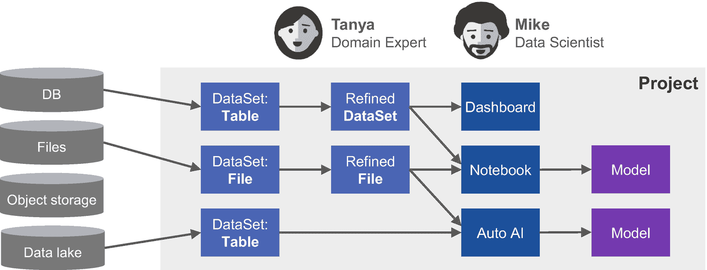

图 5-1

创建数据科学项目

在以下各节中，我们将更详细地描述这些不同任务，并使用 `IBM Watson Studio` 对其中一些步骤进行可视化。

### 连接数据

项目成员可以通过连接器连接到数据库、对象存储或其他数据源中的数据，并将相关数据的子集作为数据资产引用或复制到项目中。如果原始数据包含不打算在项目中使用的敏感信息，则添加数据的人员可以在将数据添加到项目时省略某些列。

在本例中，项目中添加了一位数据管理员，负责提供项目所需的数据。数据管理员选择数据科学家、数据工程师和其他角色允许在项目中使用的数据，并将其作为数据库表或 `CSV` 文件添加到项目中。可以配置来自不同数据源系统的数据。

目标是提供与该特定业务解决方案相关的所有数据。这听起来是一项相当简单的任务，但通常基于一个假设：相关数据是现成且易于访问的。然而，为数据工程师和数据科学家提供相关数据可能是一项具有挑战性的工作。

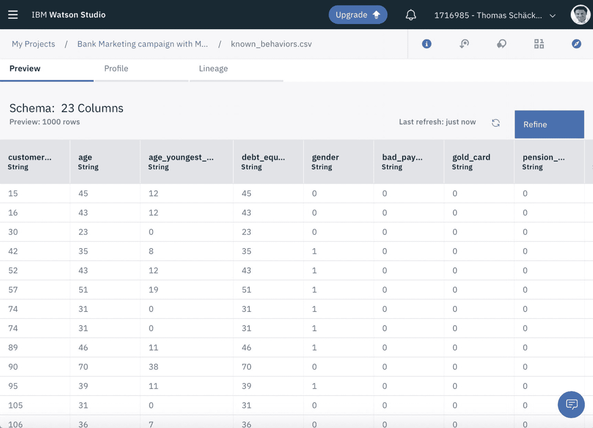

图 5-2

与项目关联的数据集

数据集包含银行客户记录中的相关列，如图 5-2 所示，该图显示了项目数据预览中的数据集。

### 精炼、可视化、分析数据

项目成员可以根据需要探索和精炼数据，以达到所需的数据质量和具有代表性的数据分布。数据工程师通常负责将可用数据准备并转换为适合数据科学家进一步使用的格式。然而，数据探索、精炼和可视化通常是一项协作性工作，数据科学家与数据工程师协同进行。业务领域专家（例如营销活动专家）需要提供指导，以确保达到预期的业务成果。某些数据可能对未来预测没有帮助，但仍应包含在内以支持其他洞察，例如，分行代码和合并前/合并后记录指示符，可以揭示这些维度与绩效之间的相关性。

例如，可以在项目的上下文中使用精炼功能进行数据精炼。也可以通过编码，在笔记本^(⁸⁰)中使用 `Python`、`R` 或许多其他语言来精炼数据。

这些工具可用于交互式地可视化和分析数据，以更好地理解不同数据段之间的相关性和一致性。总体目标是探索和精炼数据，以确定用于创建和训练模型的相关特征。

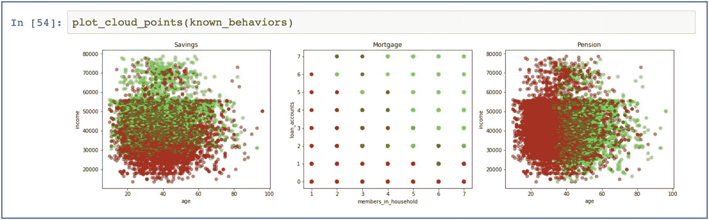

图 5-3

笔记本中的数据可视化

如图 5-3 所示，在本例中，数据科学家直接在笔记本中使用可视化工具，对去年客户购买数据进行了可视化。可以使用多种可视化图形，例如，发现数据列、关键绩效指标或定义度量之间的重要相关性。

这使得数据科学家能够获得对数据段的相关洞察，这些洞察在开发机器学习或深度学习模型时应予以考虑。

以下是从图 5-3 的可视化中可以看出的一些洞察：

*   **客户收入**：客户收入越高，拥有储蓄账户的可能性就越大。正如我们在第 1 章“`人工智能简介`”中已经指出的，这一发现本身可能并不充分。换句话说，它应该与该特定客户的交易记录或其他客户档案信息中的其他洞察相关联。
*   **客户年龄**：客户年龄越大，拥有养老金账户的可能性就越大。这一发现在统计上可能是正确的，并且可以很好地用于机器学习模型的开发；然而，它需要与特定客户的其他洞察相关联。例如，某个特定客户可能已经拥有一个养老金账户。
*   **相关性发现**：^(⁸¹) 客户家庭居民数量、客户持有的贷款账户数量以及客户购买抵押贷款账户的可能性之间存在相关性，如图 5-3 中抵押贷款图表的右上角和左下角所示。

上述示例也很好地强调了应考虑潜在的偏差。例如，洞察可能偏向于某些人口统计指标（如年龄、性别、婚姻状况等），这些指标可能反映也可能不反映现实情况。

### 创建并训练预测模型

当数据格式正确且被充分理解后，数据科学家可以使用集成工具创建并训练预测性机器学习模型，例如使用 `Auto AI`、`Python Notebooks` 或 `SPSS` 流程。

我们提供这些集成工具的更多细节，以便您更好地了解其功能。

#### Auto AI

Auto AI 提供了一种简单的方法来创建一组模型流水线候选方案：只需提供一个数据集，让 `Auto AI`^(⁸²) 为一组候选流水线执行模型选择、特征工程、超参数优化等操作。随后，数据科学家可以探索生成模型的各种指标，挑选出最满意的模型，并将其保存到项目中。

生成的模型可以通过比较 ROC 曲线和 PR 曲线下的面积来评估其准确率和精确度。这允许对所有模型进行一致的比较，并选出最佳模型来使用。

`Auto AI` 是一个很好的例子，展示了如何在不一定是数据科学领域专家、不精通数学和统计方法的情况下，开始 AI 和 ML 项目。它隐藏了通常与数据科学任务相关的一些复杂性。

图 5-4 展示了 `Auto AI` 流水线生成的摘要，其中包含多个步骤，例如选择算法、执行超参数优化和特征工程任务。
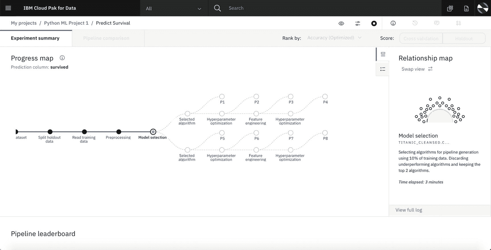
图 5-4 `Auto AI` 实验流水线生成

其中一些步骤可以迭代执行，以提高模型的准确率和精确度。当 `Auto AI` 执行这些步骤时，它会向用户显示进度。当使用较大的数据集时，用户也可以退出，稍后再返回实验。

图 5-5 展示了在 `Auto AI` 实验结束后，所有选定算法的概览、基于这些算法创建的候选训练流水线，以及这些流水线所使用的特征转换器。除了挑选最适合您需求的模型并保存之外，您还可以选择一个模型流水线，并将其保存为 Python Notebook。

这使您可以进一步改进和定制各种任务（例如，数据准备、特征工程、超参数设置），并进一步优化 ML 模型的准确率和精确度。
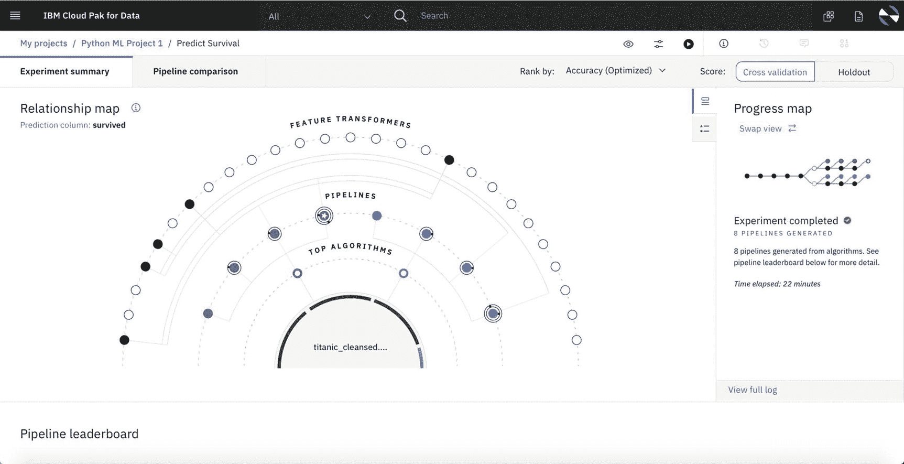
图 5-5 `Auto AI` 实验摘要

您还可以选择与 `Auto AI` 交互，在自动化的 `Auto AI` 过程中指定您自己的偏好。以下是一些示例：
*   数据准备和高级数据精炼任务
*   特征工程，包括特征转换
*   `Auto AI` 流水线优化
*   超参数优化 (`HPO`)^(⁸³)
*   可解释性、去偏和公平性
*   AI 生命周期管理，用于监控部署后的性能

#### SPSS 流程

`SPSS` 流程允许多种角色（包括不具备编码技能的业务领域专家）通过在可视化编辑器中定义模型训练流程，并运行这些流程来创建、训练模型，并将模型保存到项目中。

图 5-6 是一个示例 `SPSS` 流程的图示，无需编程技能即可组装。
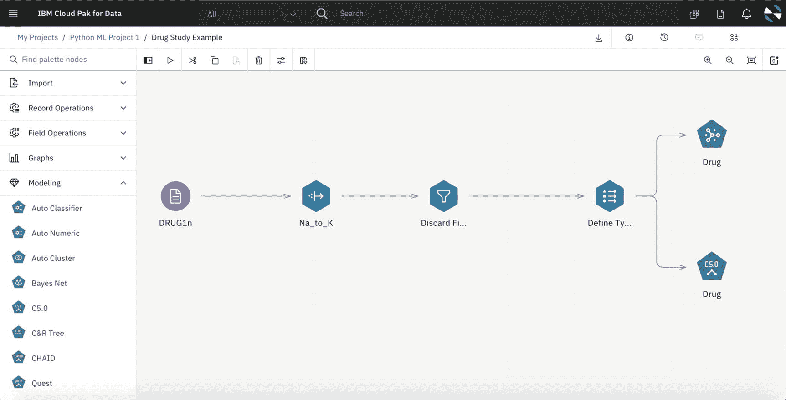
图 5-6 示例 `SPSS` 流程

`SPSS`^(⁸⁴) 是编程技能有限或没有编程技能的人员的另一种选择。

#### Notebooks

正如我们之前提到的，数据科学家也可以选择使用 Notebooks，通过 Python 或许多其他语言（如 R 或 Scala）来训练模型，然后使用 Notebook 代码中的项目 API 将训练好的模型保存到项目中。Notebooks 需要编程技能；然而，它们提供了最大的灵活性，并且应被视为任何数据科学家的最先进技术。

我们观察到 Python 是数据科学家中最流行的编程语言。Python 总体上也是一种非常流行的编程语言。这导致了大量可直接使用的库，可以从 Python 代码中调用，包括大量强大的数据科学、ML、DL、DO 和可视化库，这些库使数据科学家能够高效工作。

图 5-7 是在 JupyterLab 用户界面中打开 Jupyter Notebook 进行项目工作时拍摄的快照。它展示了在 Notebook 文档中显示代码单元和结果输出的典型组合，这实现了文学编程。Notebook 是自文档化的；运行后，它包含代码、得出的见解以及解释这一切的内联文本。如图 5-7 所示，JupyterLab 可以与 Git 仓库集成以进行代码管理，本例中是与项目关联的 Git 仓库。
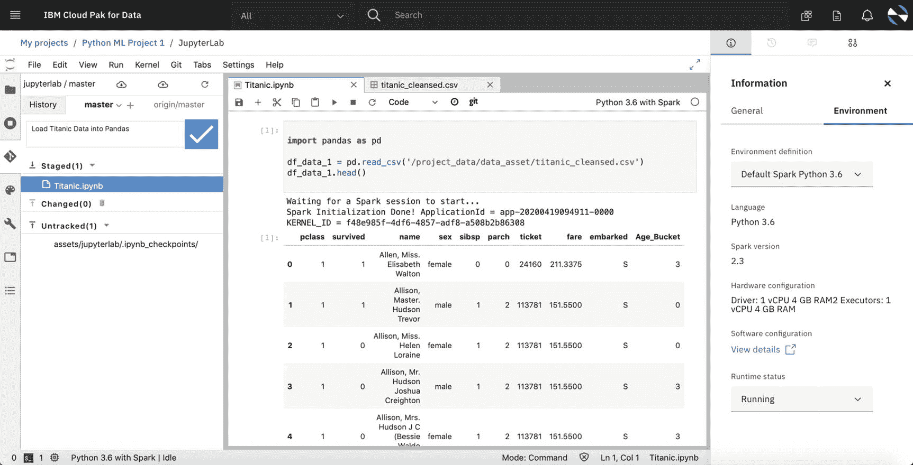
图 5-7 使用 Python 的 Jupyter Notebook

为了运行代码单元，Notebooks 需要一个底层运行时环境，本例中是一个 Python + Spark 环境，允许 Python 代码的单节点执行，以及利用 Apache Spark 框架并行执行 Python 代码。
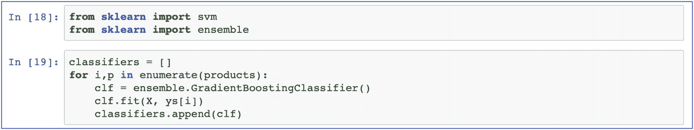
图 5-8 用于训练模型的 Python Notebook

一个展示 ML 和 DO 结合的绝佳示例由 IBM 的 `Alain Chabrier`^(⁸⁵) 创建，他是 DO 领域以及将其与 ML 智能结合方面的思想领袖和专家。作为他在该领域工作的一部分，他以一个银行场景为例创建了一个 Notebook，我们在本章中收录了其中的摘录。为了预测客户对产品的兴趣，第一步是使用过去一年的客户购买数据和客户画像数据来训练一个模型。

如图 5-8 所示，导入了 `scikit-learn svm` 和 `ensemble` 以在 Notebook 中使用，并使用梯度提升分类器作为底层 ML 算法。梯度提升算法在回归和分类问题中非常流行。随后，他们使用该模型来预测哪些客户最有可能在来年购买哪个特定产品。
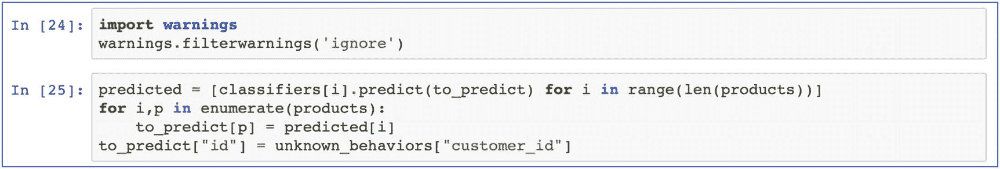
图 5-9 使用模型进行评分

如图 5-9 所示，我们针对每个产品（储蓄、抵押贷款和养老金），将其与选定的客户特征（如年龄、收入、家庭成员数量和账户数量）关联起来。
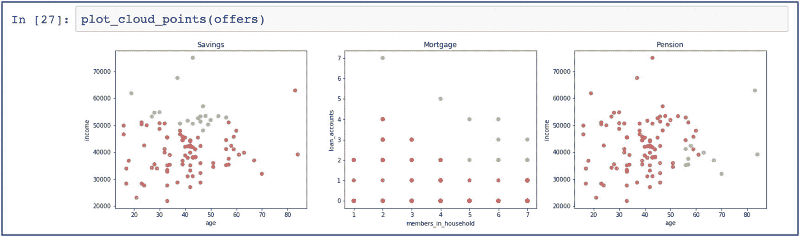
图 5-10 预测产品的可视化

对推荐产品的预测可以像之前展示过去一年的数据一样进行可视化。如图 5-10 所示，我们得到了一个预测结果，针对各个产品提出了以下建议：
*   `储蓄`：年收入超过 50,000 美元的客户更有可能需要储蓄账户。
*   `抵押贷款`：家庭成员数量与贷款账户数量之间存在相关性。拥有超过五名成员且至少有两个贷款账户的家庭更有可能需要抵押贷款。
*   `养老金`：年龄超过 56 岁且收入为 42.00 美元或以下的客户更有可能需要养老金产品。

此示例仅为说明用途；在实际场景中，还需要考虑其他产品和客户特征。

### 部署机器学习模型

模型可以从项目提升到 `空间`，授权用户可以在其中创建 `模型部署`，以服务于在线或批量评分的模型。
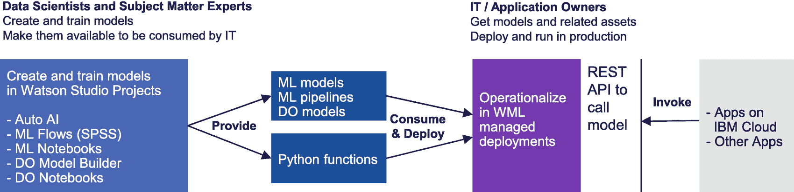
图 5-11 部署机器学习模型

这使得预测性机器学习或深度学习模型可以通过公共 REST API 进行访问。应用程序或业务流程可以通过这些 REST API 调用模型来获取预测结果。图 5-11 描述了机器学习或深度学习模型的部署。一旦模型部署完成，包含模型输入数据和模型预测输出的有效负载输入和输出日志可以记录在数据库表中，并可以持续监控和分析以确保公平性。这允许自动检测模型评分中的性能不佳、漂移或偏差，并在需要时采取纠正措施。

领域专家创建、训练和验证模型，并使其能够在 IT 和业务环境中投入运营。AI 工件可以是机器学习或深度学习模型和管道、DO 模型以及用于组合模型的 Python 函数。IT 和应用程序需要集成这些 AI 工件，以便通过 REST API 调用进行评分。

### 创建决策优化模型

如图 5-12 所示，为了从预测推进到最优行动，团队需要将机器学习与决策优化相结合，以便来自机器学习模型的预测加上其他输入数据可以输入到规范性决策优化模型中，最终根据该输入确定最优行动。

图 5-12 创建决策优化模型

熟悉优化的优化专家或数据科学家在笔记本或决策优化模型构建器中，使用项目中的数据以及预测性机器学习或深度学习模型创建的预测，来创建和测试决策优化模型，以求解最优决策和由此产生的行动。IBM Watson Studio 中的决策优化利用先进的 `docplex` 引擎^(⁸⁶) 来解决优化问题。

## 在此示例中，数据科学团队熟悉 Python，选择创建一个 Python 笔记本，然后在笔记本中使用 Python 代码定义和测试决策优化模型。虽然 `docplex` Python 库已预装在 IBM Watson Studio 的 Python 环境中，但也可以使用 `!pip install docplex` 轻松地将其添加到其他任何地方的 Python 笔记本中，为您提供最大的灵活性。然后，可以使用 Python 笔记本单元格中的以下代码创建决策优化模型：

```
from docplex.mp.model import Model
mdl = Model(name="marketing_campaign")
```

在此步骤之后，需要定义决策变量，然后定义需要考虑的约束条件。在此示例中，以下约束条件是相关的：

*   每位客户仅提供一种产品。
*   计算预算并设置其上限。
*   计算要提供的优惠数量。
*   确保通过每个渠道提供的优惠至少占 10%。

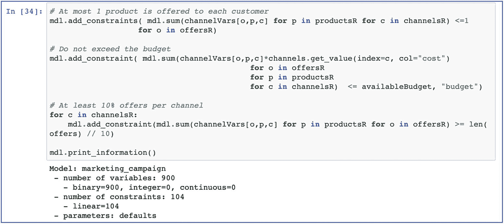
图 5-13 为决策优化模型定义约束条件

这些约束条件使用 `mdl.add_constraint()` 为模型定义，如图 5-13 所示。

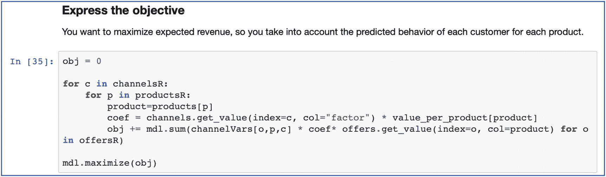
图 5-14 定义目标

然后定义目标，在本例中，使用 `mdl.maximize()` 最大化收入，如图 5-14 所示。最后，运行 `docplex` 引擎^(⁸⁷)，使用 `mdl.solve()` 求解模型，如图 5-15 所示。

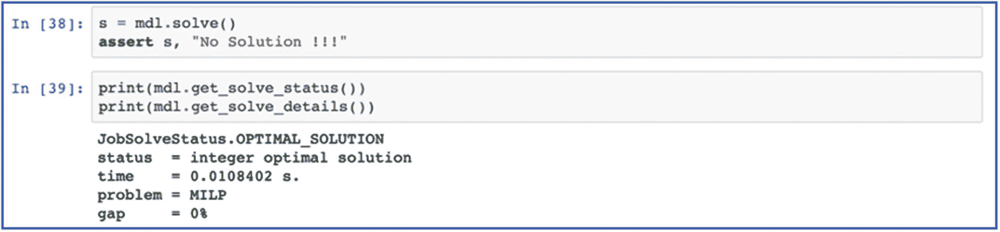
图 5-15 运行 Docplex 引擎

求解模型的输出是一个数据框，其中包含关于通过哪个渠道向哪些客户提供哪些优惠的详细优化决策。

### 部署决策优化模型

与预测性机器学习模型一样，规范性决策优化模型可以部署以解决优化问题。这使得决策优化模型可以通过 Watson ML 公共 REST API 进行访问，供应用程序或业务流程使用。随后，以相关数据和机器学习预测作为输入，`docplex` 引擎将解决问题并生成最优行动。这代表了在流程或业务应用的特定背景下的一种整体解决方案。

通过将机器学习模型和决策优化模型与同一个 Watson ML 服务结合部署，应用程序或流程可以轻松调用机器学习模型，基于相关数据生成预测，然后调用决策优化模型，利用数据预测来确定要采取的最优行动。在此示例中，预测结果和优化决策被持久化到数据库表中，这些表来自机器学习模型和决策优化模型的批量评分部署。

## 将机器学习模型和决策优化模型投入生产

正如我们在第一章中观察到的，为了部署模型用于生产，通常需要将它们添加并部署到完全独立的生产部署系统中。

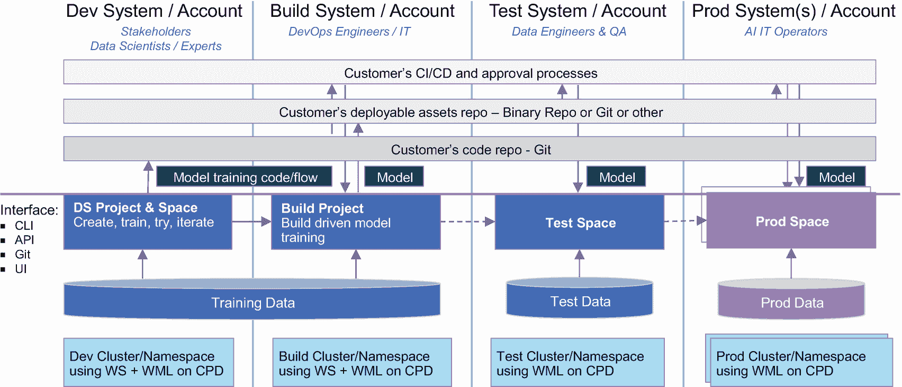
图 5-16 异构开发与生产环境

为了在 Watson Studio 中实现这一点，例如，可以安装一个带有 IBM `Cloud Pak for Data`（包含 Watson Studio 和 Watson Machine Learning）的 `OpenShift` 集群，作为数据科学家的工作环境，并安装额外的带有 Watson Machine Learning 的集群，用于构建、测试和生产环境，如图 5-16 所示。

数据科学家可以将他们的工作成果提交到 `Git` 仓库，或将资产导出为 `ZIP` 文件，以便将机器学习和决策优化模型资产提供给通常由独立 IT 团队创建和运营的 `CI/CD`^(⁸⁸) 管道。然后，`CI/CD` 管道可以将资产传播到构建、测试，最终到生产环境，从而建立一个定义明确的流程，在可重复的训练和测试之后，将机器学习和决策优化模型资产投入生产。

### 将 AI 嵌入应用程序和流程

部署了用于生产使用的机器学习和决策优化模型后，业务流程和应用程序现在可以使用这些模型进行预测并确定最优决策，以驱动最优的自动化或 AI 增强行动。

在我们的示例中，银行的营销流程可以从一个数据库表中获取最终的优化决策，该表包含关于通过哪个渠道向哪些客户提供哪些优惠的最优决策集，以便在可用预算、产品可用性和其他约束条件下实现最优结果。

## 关键要点

我们以表 5-1 中总结的几个关键要点来结束本章。

**表 5-1 关键要点**

| 序号 | 关键要点 | 高层描述 |
| --- | --- | --- |
| 1 | 从数据到预测往往还不够 | 仅靠预测通常无法直接采取行动；关键在于从预测过渡到最优决策，以便指导最佳行动 |
| 2 | 营销活动的简单方法 | 例如，训练一个模型来预测哪些客户可能购买哪些产品——但在实践中，向所有潜在买家进行营销可能并不可行 |
| 3 | 营销活动的更智能方法：考虑约束条件 | 将预算、产品可用性、邮寄限制等约束条件纳入考量，并针对明确定义的目标进行优化 |
| 4 | 用于自动求解优化问题的决策优化 | 通过决策优化，数据科学家或优化专家可以定义一个优化问题，该问题包含一组需要遵守的约束条件、需要优化的目标以及求解问题时要考虑的数据 |
| 5 | IBM Watson Studio 是结合机器学习与决策优化的环境示例 | Watson Studio 允许创建项目、添加成员、连接和添加数据、构建机器学习模型和决策优化模型，并将机器学习与决策优化模型共同部署，供应用程序和流程使用 |
| 6 | 可通过用户界面或 Python 创建决策优化模型 | 决策优化设计器允许以可视化方式定义模型；或者，也可以在 Jupyter 中使用 Python 定义和求解决策优化模型 |
| 7 | 使用带有持续集成/持续部署的 DevOps 将机器学习和决策优化模型投入生产 | 确保所有相关工件都在可信的代码和资产仓库（例如 `Git`）中进行管理，并能够通过自动化的持续集成/持续部署流水线以可重现的方式部署到测试和生产系统 |
| 8 | 实现模型部署的高可用性和灾难恢复 | 将模型部署到至少两个独立站点，实现请求的负载均衡，并在一个站点发生故障时进行故障切换，以服务于关键业务应用程序和流程 |