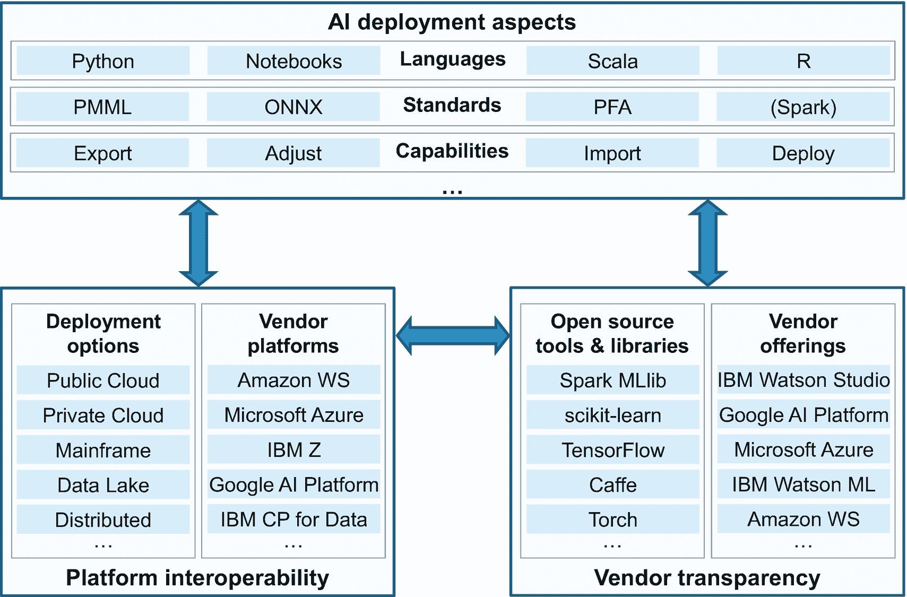
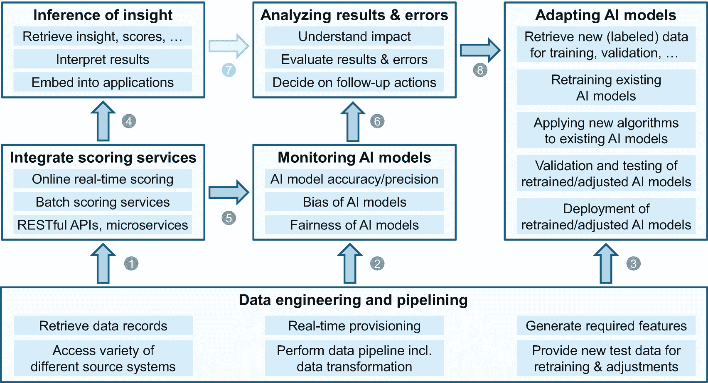
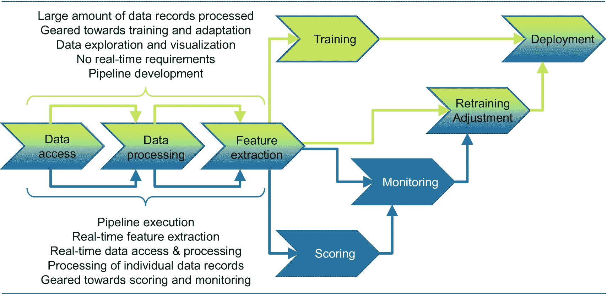
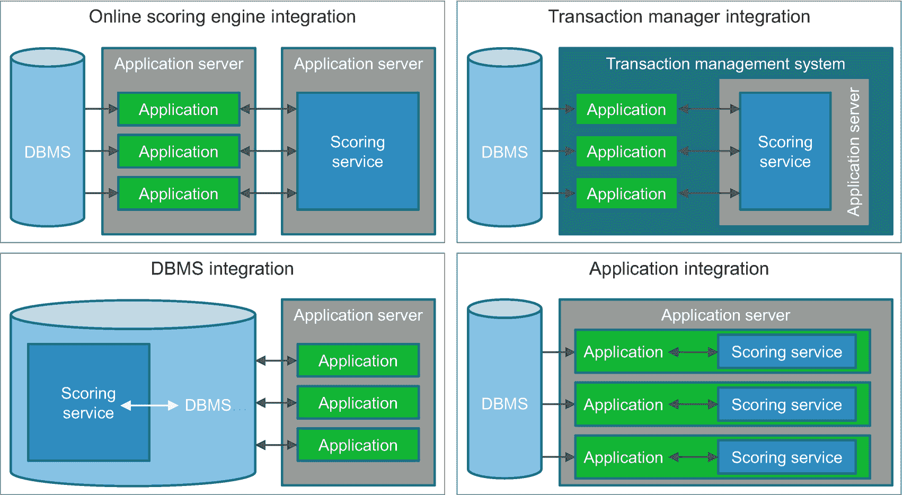
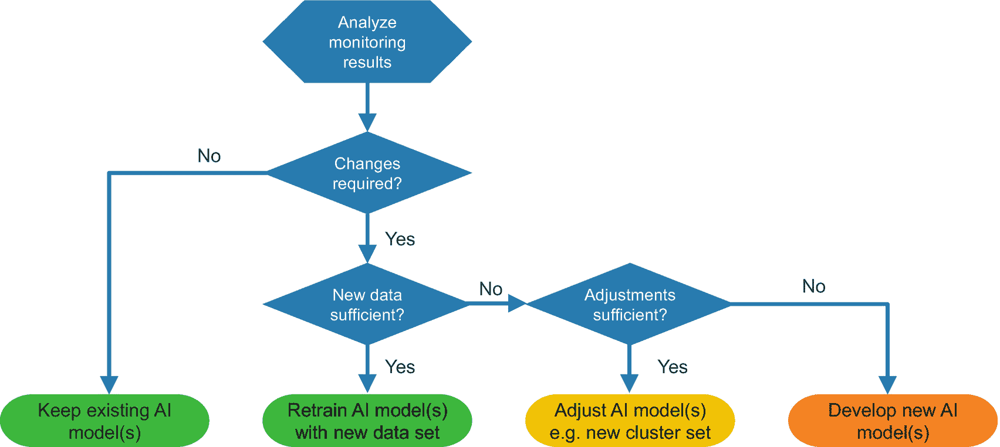

# 6. 人工智能的运营化

开发人工智能解决方案，包括机器学习/深度学习模型的训练和部署，仍然是一项重要且通常需要大量 IT 资源的任务。将人工智能工件（例如机器学习/深度学习模型和数据工程模块）集成到现有的企业 IT 基础设施和应用环境中，则是一项额外的挑战。本章将进一步探讨人工智能的产品化或运营化，以及将基于人工智能的分析洞察推断到消费类应用程序中的过程，我们将重点关注企业环境中人工智能的产品化和运营化。此外，我们还将阐明运营化人工智能的关键挑战^(⁸⁹)，并描述高效且可持续地实现人工智能解决方案（尤其是机器学习、深度学习模型和数据工程工件）产品化的基本目标。

## 引言

尽管人工智能和机器学习并非全新事物，但洞察驱动型组织通过软件和应用程序将机器学习和深度学习嵌入其业务流程和用例的程度却千差万别。特别是，运营化机器学习模型并确保实时评分对大多数组织来说仍然是一个巨大的挑战。这涉及到模型部署、模型流水线和评分、审计以及监控所需的效率。

其中一个特定方面是在事务性应用程序中运营化预测模型，而无需显著增加开销，从而在交互点实现实时洞察。实时事务评分或超低延迟评分是许多用例的关键要求，例如欺诈保护、情境化营销优惠、网络安全等。

人工智能部署需要针对企业环境中机器学习和深度学习的高效运营化进行优化，这需要具备信心、稳健性和足够的性能。提供必要的模型版本管理、审计和监控，以及高可用性、高性能和低延迟，对于企业级的机器学习和深度学习解决方案至关重要。版本管理允许部署不同的模型版本，包括在需要时使用不同的评分服务对不同版本进行评分。模型监控、重新训练和模型调整可确保模型在其生命周期内保持企业相关性。为确保模型的准确性和精度，例如应通过 RESTful API 实现模型的重新训练。

另一个相当重要的方面是机器学习和深度学习模型自动化（我们称之为机器学习和深度学习即服务）。为了实现人工智能运营化^(⁹⁰)，供应商的产品和工具应具备数据工程和流水线能力，这包括为评分引擎读取和提供所需数据；转换数据（例如转换为 Pandas 或 Spark DataFrame）；删除或添加某些列；对列执行一些转换或计算；以及规范化数据。此外，供应商的产品和工具还应提供多种机器学习和深度学习模型的评分选项。例如，选项可以基于在线内存型评分引擎部署，或者对于拥有传统大型机基础设施的企业，可以是与 CICS 集成的在线评分服务。当今的企业可能会使用多种机器学习和深度学习模型类型，例如 Apache Spark 模型、scikit-learn 模型以及 PMML 或 ONNX 模型，这些模型也需要不同的评分引擎。

必要的数据工程任务，包括为模型评分做准备所需的数据访问、数据流水线和转换任务，需要优化的 IT 基础设施和企业就绪性，而大多数企业目前仍在为此努力。

## AI 运营化面临的挑战

AI 的运营化和产品化面临着诸多挑战。以下是我们用来对这些 AI 运营化挑战进行分类的关键领域或范畴^(⁹¹)。这六个领域各有不同，但又相互关联。

1.  **数据工程**：作为评分服务的输入，需要数据工程和管道处理，这包括准备、转换新数据记录、传感器设备输入等，并将其管道化处理为 ML 和 DL 模型可以消费和处理的特征。这是一个巨大的挑战，因为源数据可能需要以超低延迟从异构系统和应用环境中汇集。一定程度的管道处理可能会集成在所谓的 AI 管道模型中。

2.  **基础设施透明性**：ML 和 DL 模型可能是在某个特定的 IT 平台（例如，基于 Hadoop 的数据湖）上，使用特定的 AI 开源或供应商产品进行开发、训练和验证的，而部署和运营化则需要在另一个不同的平台（例如，传统的大型机系统）上，使用其他产品和工具来完成。这要求 IT 基础设施具有透明性，并且开源工具和供应商产品之间具有互操作性。

3.  **模型评分**：在线评分服务必须*集成*到现有的事务或应用环境中，这需要灵活性和高性能，例如，可以通过微服务和 RESTful API，或者将评分服务直接集成到数据库管理系统（DBMS）或现有的事务管理系统中来实现。例如，IBM Watson ML for z/OS 的评分服务可以在 CICS 区域中进行配置^(⁹²)。

4.  **洞察推断**：在对 ML/DL 模型进行评分后，需要对分析洞察进行推断。模型的输出结果，例如分类模型的评分或非监督聚类模型的一组聚类，需要注入到相应的应用程序中。这要求 ML/DL 模型的输出结果清晰且可解释。

5.  **模型监控**：一旦部署和运营化，就需要对 ML/DL 模型进行监控，以检测、理解和衡量，例如，模型相对于原始准确率和精确度^(⁹³)的偏差和漂移。根据用例和应用的要求，这需要持续进行或至少定期进行。

6.  **模型调整**：从 ML/DL 模型监控中获得的洞察，可能会建议对 AI 应用或某些模型进行调整，这可能导致使用新的带标签的训练和验证数据对现有模型进行重新训练，甚至进行模型调整，这意味着可能需要开发一组具有更高准确率和精确度的新样本模型。

我们在第 4 章“*AI 信息架构*”的图 [4-2](https://doi.org/10.1007/978-1-4842-6206-1_4Fig#2) *AI 信息架构概览图*中已经引用了其中一些领域。在图 [4-2](https://doi.org/10.1007/978-1-4842-6206-1_4Fig#2) 中，部署和运营化被归类并描述为一组核心 ABB。此外，AI 信息架构核心 ABB 上下文中的 ML 工作流与其中一些领域相关。运营化 AI 的最大挑战之一与所需的数据工程和管道处理任务有关。这通常是由于 AI 开发（包括训练、验证和测试）环境与 AI 运营环境之间存在鸿沟，这两个环境的情况和约束条件可能大相径庭。

例如，在 AI 开发期间，来自不同源系统的数据可能会被整合、转换和管道化处理；可能会应用各种特征工程技术，最终为特定的 ML 或 DL 模型定义最合适的特征。然而，这些管道处理和特征工程任务可能会导致复杂的管道和数据转换模块，消耗大量的构建时间，通常需要数天。在将这些 ML/DL 模型和数据工程制品运营化时，这些相同的特征必须实时地作为输入提供给在线评分服务。这需要完全不同的技术集成和转换能力，而这往往会给几乎所有企业带来无法预见的、巨大的数据工程和管道挑战。

表 6-1 列出了 AI 运营化和产品化的挑战，以及它们对应的领域^(⁹⁴)。不言而喻，此列表应进一步定制和完善。

表 6-1
AI 运营化面临的挑战

| # | 挑战 | 领域 |
| --- | --- | --- |
| 1 | 确保 ML/DL 模型在整个生命周期内的准确率和精确度 | 模型监控，模型调整 |
| 2 | 为数据工程任务提供所需源数据记录的实时访问和数据供应 | 数据工程 |
| 3 | 为应用程序和事务提供实时（低延迟）评分服务 | 模型评分，洞察推断 |
| 4 | 理解已部署 ML/DL 模型的偏差、公平性等 | 模型监控 |
| 5 | 使用新数据集重新训练模型，以提高模型的相关性、准确率和精确度 | 模型调整 |
| 6 | 消除或减少 AI 模型中的偏差、过拟合、不公平性等，例如通过超参数优化或应用新的 AI 算法 | 模型调整 |
| 7 | 为 AI 模型开发与部署利用不同的平台，例如公有云与本地部署 | 基础设施透明性 |
| 8 | 为 AI 模型开发与部署和运营化利用不同的供应商产品和开源工具 | 基础设施透明性 |
| 9 | 选择不同的 ML/DL 算法以适应变化的用例特征或新的可用数据 | 模型调整 |
| 10 | 集成并利用开源工具和能力进行 ML/DL 模型运营化（和开发） | 基础设施透明性 |
| 11 | 基于较差的源数据质量，应用所需的管道处理和数据工程任务作为评分的准备 | 数据工程 |
| 12 | 为所有管道处理作业提供所需的可扩展性和性能（例如，低延迟、实时） | 数据工程 |
| 13 | 解释和说明结果，例如评分结果，以便在应用程序中恰当地使用洞察 | 洞察推断 |

## AI 运营化的总体方面

在本节中，我们将讨论 AI 运营化以下三个总体方面的关系与一致性：

1.  部署方面

2.  平台互操作性

3.  供应商透明度

我们将 AI 模型部署方面纳入讨论，是因为这涉及到跨各种平台、使用各种开源工具和库以及不同供应商产品进行 AI 制品必要且往往繁琐的交换。正如本章开头所述，这需要高级的部署能力，其中各种任务，例如包括训练、验证、测试、部署和版本控制在内的 AI 模型开发，可能使用在不同平台上安装和配置的不同工具和产品来执行。

图 6-1

AI 运营化的总体方面

图 6-1 展示了这三个方面的关系或一致性。在分别探讨这三个 AI 运营化的总体方面之前，我们想指出它们之间相互影响的特性。AI 部署方面的变化，体现在使用不同的编程语言和标准，以及利用所需的部署能力（例如，使用不同的 AI 环境和框架导出和导入 AI 模型），是由当今企业的现实情况驱动的，这要求平台互操作性和供应商透明度。

在与 IBM 客户的多次合作中，我们注意到不同企业组织使用了大量不同的开源工具、库、框架和供应商产品。这常常导致异构的影子 IT 环境，阻碍了无缝的供应商可互换性和透明度，从而无法实现跨组织的共存。此外，不同的部署选项和供应商平台也决定了需要供应商平台和部署的互操作性。如图 6-1 所示，供应商透明度和平台互操作性相互依赖、相互影响。

在以下各节中，我们将详细阐述部署方面、平台互操作性和供应商透明度。建议的最佳实践是，在启动任何 AI 项目之前，认真考虑 AI 运营化的这三个总体方面及其相互依赖性。

### 部署方面

如您所见，AI 部署^(⁹⁵)的特点在于使用各种编程语言、AI 模型相关标准以及多种能力。我们将 AI 部署特性的集合限定在与平台互操作性和供应商透明度相互关联相关的那些特性上。有相当多或多或少流行的 AI 相关编程语言，例如 Python（最突出的）、Scala、R，以及用于笔记本的其他语言，如 Python、Ruby、Perl、F# 和 C#。

存在几种 AI 模型相关标准^(⁹⁶)，其中预测模型标记语言（PMML）、开放神经网络交换格式（ONNX）和可移植分析格式（PFA）是一些较为突出的例子。尽管 Spark 并非标准，但它仍然受到数据科学家的欢迎，并提供了事实上的标准化，尤其是在 Spark ML 模型交换和可移植性方面。

众多 AI 语言和标准的适用性和选择取决于各个组织、数据科学家和数据工程师的用例、技能和偏好。某些 AI 模型可以使用特定标准进行转换或集成。某些 AI 模型也可以转换为其他标准。例如，Python scikit-learn 模型可以使用 PMML 投入生产。

在平台互操作性和供应商透明度的背景下部署 AI 需要多种能力，例如从一个特定的供应商平台或供应商产品中导出 AI 模型，并将其导入到另一个可能安装在不同平台上的产品中，甚至可能需要对 AI 模型进行一些调整。例如，IBM Watson Studio 可能已被用作 IBM Cloud Pak for Data 的一部分，该产品可能部署在私有云平台上，用于执行包括训练、验证和测试在内的 AI 模型开发，而实时评分的部署和运营化则在 IBM Z 大型机环境中执行。

这种跨平台的互操作性对于企业适应实际的用例和组织偏好，以及优化 IT 资源消耗至关重要。

### 平台互操作性

鉴于当今存在各种不同的部署选项和供应商平台，企业常常难以做出正确的选择。云部署可以以公有云、私有云、混合云或多云（混合多个供应商）的方式进行。如今，企业往往在不同组织之间采用多云部署。

数据湖部署——基于 Apache Hadoop 平台——以及分布式（例如基于 Linux 的平台）增加了可能性。近年来，传统的 IBM Z 大型机系统（仍然是大型企业的 IT 支柱）已经现代化，并通过一组 ML 和分析相关能力得到了显著增强^(⁹⁷)。

正如您在第四章“*AI 信息架构*”中所见，有相当多的供应商平台，例如 AWS、MS Azure、Google AI Platform 和 IBM Cloud Pak for Data，它们提供——除其他能力外——AI 相关服务。这些供应商平台和部署选项需要相互操作；它们至少需要共存并提供有意义的集成选项，以支持角色和职责的协作、AI 制品的交换以及 AI 相关任务的合理拆分。

### 供应商透明度

正如我们开头所述，有丰富的供应商产品以及开源工具、库和框架可供选择。供应商产品^(⁹⁸)，例如 IBM Watson Studio、Google AI Platform、Microsoft Azure、IBM Watson ML 和 Amazon WS，仅举几例。

AI 开源工具、库和框架^(⁹⁹)的列表也是无穷无尽且令人困惑的。Apache SparkML、scikit-learn、TensorFlow、Caffe、Torch、OpenNN、Theano 和 Keras 只是其中一些较为突出的例子。大多数供应商通过将大量开源包集成到其产品中，提供了丰富的选择和灵活性，从而使组织能够根据其特定的用例需求选择合适的库和框架。然而，在集成不同供应商产品方面（例如，跨不同工具和产品拆分 AI 工作流任务，以及跨不同供应商产品部署和运营化 AI 制品）的供应商透明度仍然是一个挑战。

在启动任何 AI 项目之前，组织应仔细评估供应商产品，关注其集成的开源工具、库和框架，以及跨不同供应商产品的集成能力。为了避免被绑定或锁定在某个特定的供应商产品上，应审查透明度和开放性。因此，供应商透明度和开放性与平台互操作性和 AI 部署方面相辅相成，如图 6-1 所示。

## 关键 AI 运营化领域

正如我们所见，开发 AI 模型、工件和任务（包括训练、验证和测试）涉及相当多的挑战。然而，要将 AI 运营化，并将 AI 工件和解决方案集成到现有的应用程序和 IT 环境中，则需要具备企业级就绪性以及强大而全面的 AI 信息架构。企业级就绪性涉及对可靠性、安全性、持续可用性、敏捷性和灵活性、变更管理和生命周期管理等需求的处理，以便将 AI 解决方案运营化到可持续的生产环境中。正如我们在第 4 章“*AI 信息架构*”中所讨论的，有许多 ABB 应共同提供一个全面的基础设施来开发和运营 AI。

在讨论了一些通用方面之后，本节将探讨以下六个关键的 AI 运营化领域：

1.  数据工程与管道化
2.  集成评分服务
3.  洞察推断
4.  AI 模型监控
5.  结果与错误分析
6.  AI 模型适配

图 6-2（*关键 AI 运营化领域*）展示了这六个领域或目标之间的关系或连贯性。

图 6-2

关键 AI 运营化领域

在分别详细探讨这六个关键 AI 运营化领域之前，我们想指出这些领域之间相互影响的特点。

### 影响特点

在 AI 运营化的背景下，*数据工程与管道化*领域扮演着基础性的角色。这是因为数据工程与管道化需要为以下三个领域提供关键服务：*集成评分服务*、*AI 模型监控*和*AI 模型适配*^(¹⁰⁰)。

数据工程与管道化的一些服务，例如访问各种不同的源系统以检索所需的数据记录，在上述三个领域中非常相似。执行数据管道化（包括数据转换任务）主要与*集成评分服务*和*AI 模型监控*这两个领域相关。实时特征供应主要旨在支持集成评分服务，尤其是用于在线事务评分。然而，它也可以用于实时监控 AI 模型的精度和准确度或偏差和公平性。为*AI 模型适配*领域提供用于重新训练和调整的新测试数据是必要的。生成所需特征的服务可能具有不同的特性，这取决于这些特征是为已部署的 AI 模型评分提供，还是需要通过应用新的 ML 算法进行特征工程来执行 AI 模型调整。

如图 6-2 和前述讨论所示，*数据工程与管道化*领域为 AI 运营化提供了关键的基础服务。将评分服务集成到应用程序或事务中（例如，通过 RESTful API、微服务或集成到事务管理系统中），是为了实现洞察推断^(¹⁰¹)。

评分服务的结果需要被检索、嵌入到应用程序中，并转化为可操作的洞察。这些结果需要在业务领域的背景下进行解读。

AI 模型监控旨在理解 AI 模型精度和准确度随时间可能发生的变化，并理解 AI 模型的偏差和公平性。监控 AI 模型依赖于评分服务提供输入，但也需要一些数据工程与管道化服务^(¹⁰²)。监控服务作为*结果与错误分析*领域的输入，在该领域中，需要评估结果和错误，并理解可能进行的适配所带来的影响（例如，工作量与成本、预期改进以及业务相关性），以便决定与业务相关的后续行动。这甚至可能需要来自*洞察推断*领域的一些输入^(¹⁰³)。

一旦结果和错误被分析完毕，*AI 模型适配*就是 AI 运营化的领域，在该领域中，可以使用新的标记数据重新训练 AI 模型，或者通过例如应用新的 ML 模型^(¹⁰⁴) 来调整它们。在某些情况下，甚至可能需要开发一组新的 AI 模型，这意味着需要重新执行 AI 工作流的大部分内容。无论如何，适配 AI 模型都需要来自*数据工程与管道化*领域的服务，例如，为 AI 模型的重新训练和调整提供新的标记数据。如果必须使用新的 ML 算法进行 AI 模型调整，那么也需要数据管道化，包括数据转换、特征工程等。

这六个 AI 运营化领域可以被视为三组相互交织的 AI 运营化工作流。第一个工作流旨在驱动洞察推断，第二个工作流是监控 AI 模型以理解业务影响，第三个工作流是通过适配选定的 AI 模型来对业务影响做出反应。

在阐述了它们之间的关系和连贯性之后，我们将继续分别深入探讨这六个关键目标。

### 数据工程与管道

AI 模型及解决方案开发所需的数据处理和特征工程，面临一系列特定的挑战：需要结合待解决的业务问题来理解源数据，验证数据的相关性，并对数据进行探索和可视化。此外，对于需要训练（可能涉及海量数据）、评估和选择的 AI 模型，数据必须经过处理和标注。然而，在 AI 开发阶段与 AI 运营化阶段，时间关键性、性能特征和数据量存在显著差异。为了进一步探讨这一点，让我们仔细审视图 6-3 所描绘的 AI 数据工程与管道工作流及任务集。

图 6-3 的左侧展示了数据访问、数据处理和特征提取任务。无论输出是面向训练和适配，还是面向包含评分和监控的运营化，这些任务在本质上都非常相似。数据需要被访问和转换（例如，转换为 Spark DataFrame、JSON 格式或简单的 CSV 文件），需要删除列，需要合并来自不同源系统的数据，并且需要执行数据转换和归一化任务。然而，上下文是不同的，任务甚至可能需要在不同的平台上执行：用于 AI 模型训练和再训练的数据处理不需要实时或超低延迟特性，而在线事务评分等场景则恰恰需要这些特性。

图 6-3

AI 数据工程与管道工作流

在开发 AI 模型时，所有数据处理步骤都可以利用现有的数据工程和数据科学平台方便地执行，无需考虑时间关键性。当需要进行评分（以及监控）时，相同的数据转换和管道任务需要被运营化（产品化）并实时执行；这常常会引发巨大问题。从异构源系统实时供应所需数据以进行进一步处理和评分，这些时间敏感方面构成了一个挑战，在数据工程和管道模块的开发过程中，这一点常常被忽视或忽略。即使某些管道是所谓 AI 管道模型的组成部分，在将数据馈送给 AI 管道模型进行评分之前，仍然存在一些数据工程任务。

某些数据处理任务，例如数据探索和数据可视化，是 AI 模型开发阶段独有的；然而，对于 AI 运营化而言，数据不再需要被探索，它需要被实时处理，并且特征需要被实时提取，以便以超低延迟的方式为 AI 模型的评分提供输入。

整个数据处理工作流的这些特定特征在图 6-3 中使用不同颜色进行了描绘：绿色（上半部分）代表 AI 开发，蓝色（下半部分）代表 AI 运营化上下文。

建议在 AI 数据工程与管道周期的开发过程中，预先考虑这些产物的运营化方面；AI 运营化方面^(¹⁰⁵) 必须在任何 AI 项目的一开始就予以考虑。

### 集成评分服务

一旦 AI 模型经过训练、验证和部署，它们就可以被集成评分服务所利用，这是 AI 运营化的关键领域之一。正如我们在本章开头提到的，存在多种 ML 和 DL 模型类型及交换格式，例如 Apache Spark 模型、scikit-learn 模型以及 PMML 或 ONNX 模型，这些模型也需要不同的评分引擎。除了不同的评分引擎之外，评分服务本身也有不同的方式可以集成到 IT 基础设施中或被 AI 应用程序调用。

例如，AI 模型可以以批处理方式或实时方式进行评分；集成可以通过 RESTful API、在事务或应用程序内部完成，或者集成到数据库管理系统（DBMS）中，例如，通过将 Spark 或 scikit-learn 评分引擎集成到 DBMS 中。评分服务被集成和应用程序调用的具体方式取决于用例场景的特征和特定需求（例如性能）。

正如你在图 6-3（*AI 数据工程与管道工作流*）中所见，AI 模型的评分需要执行数据访问、数据处理和特征提取任务。换句话说，在对 AI 模型进行实际评分之前，至少部分数据工程和管道任务被认为已经执行完毕。如前所述，一些开源软件包和供应商产品允许开发 ML 管道模型，这些模型可以在评分模型之前包含一组转换步骤。例如，使用 Apache Spark MLlib 库，你可以开发包含转换器的 ML 管道^(¹⁰⁶)，转换器可以是一个 ML 模型，也可以是一个将 Spark DataFrame 数据集转换为另一个数据集的算法，例如通过添加几列。根据用例的需求和底层源数据系统，可能需要执行额外的数据工程和管道任务。

AI 模型基本上可以以批处理或实时方式进行评分。批处理评分需要处理一组源数据记录，提取相应的特征，并以批量方式提供给 AI 模型进行评分。这样，所需的数据工程和管道任务也以批量方式执行。批处理评分可以生成数百万个评分，供应用程序解读，例如，确定下周要发起的营销活动的目标客户列表。

以下列表描述了实现*实时*集成评分服务的一些选项：

1.  **在线评分引擎集成**：评分服务集成在专用的（独立）应用服务器上。例如，应用程序可以通过 RESTful API 评分调用在线请求评分服务。或者，同一个应用服务器也可以同时用于应用程序和评分服务。集成在专用（独立）应用服务器上的评分服务能提供最佳性能。具体实现主要取决于性能要求和可用资源。

2.  **事务管理器集成**：如果现有的事务管理系统对高吞吐量和每秒大量事务有性能要求，则应将评分服务集成到该事务管理系统中。在事务管理器控制下运行的应用程序随后可以通过接口模块请求评分服务。^(¹⁰⁷)

3.  **数据库管理系统集成**：对于可将 AI 模型评分与事件或应用发起的数据记录更新相关联的用例，评分引擎和服务甚至可以直接集成到数据库管理系统中。若需通过数据转换（例如聚合、过滤、连接等）来生成 AI 模型评分所需的特征，这一点尤为重要。数据库触发器可用于请求评分服务。

4.  **应用集成**：特定的隐私要求和数据敏感性考量，甚至可能建议将评分引擎和服务直接集成到应用程序中。

图 6-4 从概念层面描绘了这四种实时集成评分场景。

图 6-4

实时集成评分服务

此外，还有多种其他选项和变体可用于实时集成评分服务，例如基于事件处理和发布/订阅的实现方式，但这些内容不在本书讨论范围之内。

### 洞察推断

所谓洞察推断，是指将 AI 模型执行的结果（例如评分、聚类等）转化为可操作洞察的过程。这需要检索并嵌入 AI 模型执行的结果到应用程序中，在特定的业务或用例背景下解读结果（例如评分），并通常实时（或以超低延迟）决定后续行动。因此，洞察推断旨在理解可从 AI 模型执行结果中推导出的含义和结论，这与业务问题紧密相关，并且必须尽可能深入地集成到业务应用中。

以下是实现洞察推断的一些关键能力^(¹⁰⁸)。根据业务背景或用例场景，这些能力可能需要实时应用。

*   **可解释性**：机器学习/深度学习模型的结果必须易于验证和解释，即在特定的业务或用例背景下是可理解的。

*   **可信度**：结果应可靠，并得到消费者和应用的信任，无需就其适用性进行进一步审查或质疑。

*   **可消费性**：AI 模型执行的结果需要是可消费的，即易于嵌入到消费端的业务应用中。

*   **可问责性**：根据业务背景和基于 AI 决策的法律影响，应用可能需要考虑问责要求。

### AI 模型监控

AI 模型是在特定的业务背景下开发的。然而，业务和用例的特征或衡量指标可能会随时间推移而变化。数据本身也可能随时间漂移。这些变化的环境可能导致 AI 应用业务相关性的降低，以及 AI 模型准确性和精确度的下降。此外，AI 模型可能无法产生最初预期的结果；它们可能仅在生命周期的后期才显现出某些异常，公平性降低，并表现出强烈的不良偏差。为了理解这种衰退并采取适当行动，需要持续计算和监控相应的 AI 模型指标。

在第 4 章“*AI 信息架构*”中，我们已经强调模型监控是一个基本组件，特别是作为机器学习工作流的一部分，并且是与部署和运维相关的架构构建块之一。在本节中，我们将详细阐述应监控的各个领域及其原因。然而，其范围仅限于监控 AI 模型的结果，而非更广泛的范畴，例如与整个生命周期相关的 AI 资产的可追溯性和可审计性。^(¹⁰⁹)

以下列表描述了 AI 模型监控的一些关键指标。业务需求和特定用例场景的具体需求决定了是应用所有这些指标还是其子集。此外，对于某些用例场景，离线模型监控可能就足够了；但对于时间敏感的用例，其中环境和特征可能频繁漂移，则可能需要在线 AI 模型监控。

1.  **AI 模型性能**：监控机器学习和深度学习模型性能主要涉及测量 AI 回归和分类模型的受试者工作特征曲线下面积和精确率-召回率曲线下面积。ROC 曲线下面积（衡量 AI 模型准确性）和 PR 曲线下面积（衡量 AI 模型精确度）的下降可能表明 AI 模型准确性和精确度恶化，这——取决于用例——意味着业务指标恶化，例如亏损、客户满意度下降等。甚至 ROC 和 PR 曲线的形状——即相应指标的平衡——也可能产生业务影响。例如，对于信用卡欺诈模型，如果 PR 曲线显示较高的召回率（真正率）和较低的精确率（真正例与预测正例的比率），这表明假阴性较少，即未被发现的欺诈案例较少。如果 PR 曲线偏向更高的精确率和更低的召回率，则表明假阳性较少，例如，被保留的信用卡较少——尽管在这两种情况下 PR 曲线下面积是相同的。监控 AI 模型性能需要额外的指标，这些指标取决于特定用例场景的要求和特征。例如，作为 AI 应用（如医疗诊断和治疗、自动驾驶车辆）中决策和行动基础的 AI 模型评分或结果，可能需要进行整体监控。也就是说，对于 AI 模型性能，监控需要提升到决策优化层面，甚至可能需要考虑人工干预。例如，对于自动驾驶车辆，AI 建模和决策优化需要是自主的^(¹¹⁰)，并且能够根据个人驾驶行为和驾驶员偏好——甚至文化背景——进行调整。

2.  **AI 模型的偏差与公平性**：AI 模型可能因表现出过多偏差和缺乏公平性而无法产生理想结果。需要对 AI 模型的结果进行监控，以理解有偏差的输出，即 AI 模型对特定特征或特征子集表现出有利或不利的结果。此外，监控可能引发进一步的分析和可视化，以了解通过调整特征权重来减轻偏差的修正 AI 模型所产生的影响。对于回归或分类模型，一定程度的偏差可能是理想的结果。例如，如果业务问题及其用于训练、验证和测试的标注数据集本身就倾向于某个性别（如女性）、年龄组（如 30≤年龄≤39）或颜色（如蓝色），那么对这些特征的偏差是完全正常甚至是被期望的。然而，环境和新的数据可能随时间变化，这可能导致不利的偏差。这种偏差的转变需要被检测并采取相应措施。供应商已提供检测偏差的产品，包括根本原因分析。^(¹¹¹)

3.  **AI 模型的可解释结果**：AI 模型的结果和 AI 应用的决策需要是可解释的，甚至需要可视化，即用业务术语向业务用户解释和可视化模型决策。关键业务指标或 KPI（例如，欺诈案件数量、损失金额、保留的信用卡数量、因错误保留信用卡而投诉的客户数量）需要与 AI 模型的指标（例如，准确率或精确率指标、ROC 和 PR 曲线的形状）相关联，以便将 AI 模型性能指标的监控置于有意义的业务背景中并采取行动。特别是对于具有自主性（即持续自动化学习）的 AI，其中以有限甚至无人干预的自治过程为主，AI 模型和应用的可解释性正达到一个新的维度。^(¹¹²)

在当今的企业中，AI 模型监控仍以相当初级的方式进行，开源工具和供应商产品对自动化的支持有限。尽管可以实施技术性 AI 模型性能指标（例如 ROC 和 PR 曲线下面积）的测量和监控，但将 AI 模型结果与业务相关的 KPI 相关联仍是一个新兴领域，还有许多工作有待完成。^(¹¹³)

### 分析结果与错误

对于已检测到 AI 模型性能下降、偏差和不公平性或其他不良情况的情况，必须对其进行分析并理解其影响。某些结果和错误可能不会对业务产生重大影响，特别是当与可能的后续活动预期工作量相比较时。可以想象，这些活动需要根据用例场景的具体情况进行定制。在某些情况下，可能需要调整 AI 应用本身及其基于特定指标（例如，带有概率值的分数）的决策，而不一定是调整 AI 模型。

以下是此 AI 运维领域关键任务的简短列表：

*   **评估结果与错误**：需要评估监控结果、事件和现象。

*   **理解影响**：在确定任何可能的后续行动之前，需要理解其对业务的影响。

*   **决定后续行动**：根据工作量，可能建议采取某些后续活动，例如模型重新训练。

图 6-5

后续活动的决策流程

图 6-5 是一个关于可能后续活动的简单决策流程。如图 6-5 所示，很可能存在不应更改现有 AI 模型的情况。相反，可能需要调整 AI 应用，例如，调整应用需要依据的分数概率值水平。在其他情况下，使用新的标注数据集重新训练现有模型就足够了。在数据记录漂移并非导致 AI 模型恶化的根本原因的情况下，建议调整模型甚至开发新模型。

我们将在下一节简要讨论三种可能的 AI 模型适配选项。

### AI 模型适配

一旦决定适配现有 AI 模型，基本上有三种有意义的选择，正如我们在前一节中所见：(1) 使用新的标注训练、验证和测试数据重新训练现有 AI 模型；(2) 调整 AI 模型，这可能意味着进一步优化超参数，或者，例如在分类模型的情况下，调整聚类数量；(3) 通过评估一组新的机器学习/深度学习算法来开发新的 AI 模型。

1.  **重新训练现有 AI 模型**：如果底层业务模型或数据记录发生适度变化，情况可能更直接，只需使用新的标注数据集重新训练现有 AI 模型即可解决。在这种情况下，所涉及的工作量应该是合理的。这项工作包括提供新的标注数据集用于训练、验证和测试，以及部署重新训练的 AI 模型。

2.  **调整现有 AI 模型**：在监控结果显示对业务有更显著影响，且无法通过简单重新训练现有 AI 模型来解决的情况下，必须执行调整聚类数量、决策树模型的层级和节点数量（以增加信息增益）以及进一步优化超参数等操作。这些调整可能已经意味着数据科学家和工程师需要投入更大量的开发工作。

3.  **开发新的 AI 模型**：如果业务情况和用例环境的变化非常严重，以至于如前所述的超参数优化或对现有 AI 应用和 AI 模型的调整可能效果不佳，那么建议开发一组新的 AI 模型。当然，这相当于更全面的开发工作，涵盖了 AI 工作流程的所有步骤，涉及所有角色和利益相关者，例如业务用户、数据科学家和工程师。

## 关键要点

我们以几个关键要点来总结本章，如表 6-2 所示。

表 6-2

关键要点

| # | 关键要点 | 高层描述 |
| --- | --- | --- |
| 1 | 将 AI 投入运营是一项巨大挑战 | 尤其涉及 AI 模型部署的效率、实时模型管道与评分、审计和监控 |
| 2 | 需要平台互操作性和供应商透明度 | 平台互操作性（包括部署选项和供应商平台）以及供应商透明度（包括开源和供应商产品）是实现灵活的 AI 产品化和运营化的必要条件 |
| 3 | AI 运营化领域相互影响 | 这六个领域包括：数据工程与管道、集成评分服务、洞察推断、AI 模型监控、结果与错误分析，以及 AI 模型适配 |
| 4 | AI 数据工程工作流的差异 | 在开发阶段与运营化阶段，AI 数据工程与管道工作流存在关键差异 |
| 5 | 存在多种集成评分服务选项 | 四种关键的评分服务选项包括：在线评分引擎、事务管理器、数据库管理系统和应用程序集成 |
| 6 | 洞察推断需要具备必要能力 | 我们确定了四种能力：可解释性、可信赖性、可消费性和可问责性 |
| 7 | AI 模型需要被监控 | 以确保 AI 模型性能（准确率和精确率）、检测偏差并确保公平性，以及生成可解释的结果 |
| 8 | AI 模型监控结果需要被分析 | 对于所有情况，都需要理解对业务的影响，并执行可能的后续行动 |
| 9 | AI 模型可能需要进行适配 | 适配可能意味着使用新的标记数据集重新训练现有 AI 模型，通过超参数优化等方式调整现有 AI 模型，或开发一组新的 AI 模型 |

