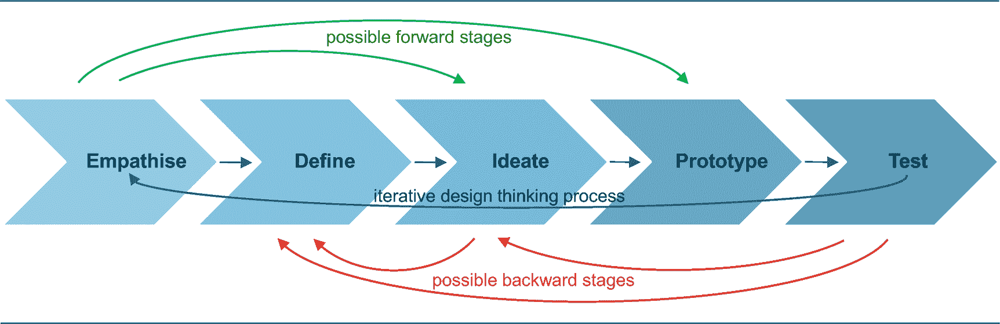
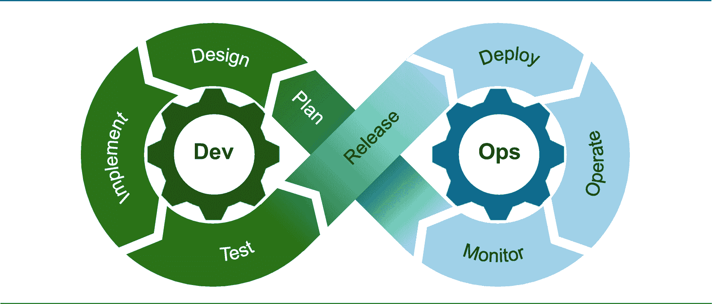
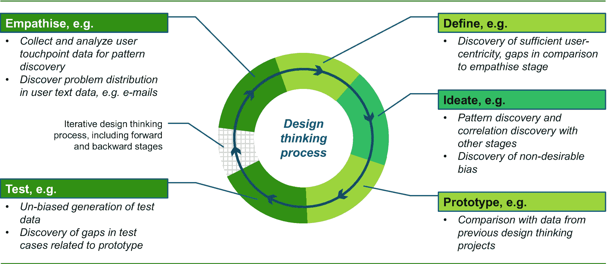
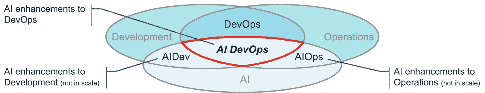
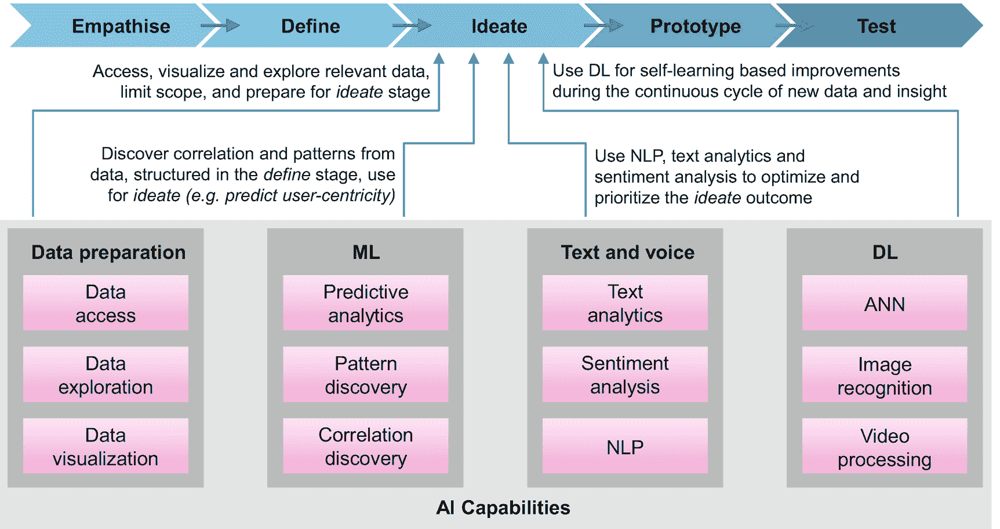
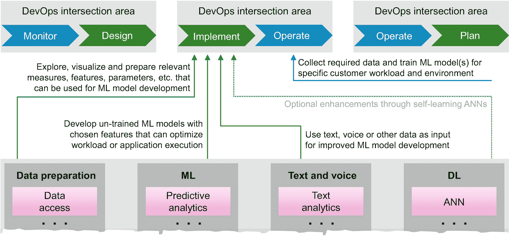

# 7. AI 语境下的设计思维与 DevOps

设计思维和 DevOps 是长期存在的概念，已被大多数领先组织良好建立并加以利用。然而，这些概念在 AI 方面的可持续应用仍然缺乏。但将 AI 应用于设计思维和 DevOps 究竟意味着什么？我们又拥有哪些可能性？设计思维和 DevOps 方法当然可以应用于开发 AI 系统、设备、产品、工具或应用程序。这或许是一个更显而易见的想法。但 AI 及其相关技术能否被利用并注入到设计思维和 DevOps 概念中——以及如何注入？这样做的前提条件、挑战和好处是什么？一个显而易见的前提条件是，在将 AI 和 ML 引入这些概念之前，首先要建立完善的设计思维和 DevOps 基础设施与文化。

本章试图回答上述问题。我们首先重新审视设计思维和 DevOps 的关键概念，并提供一些在 AI 语境下应用设计思维和 DevOps 的思路。此外，我们还描述了 AI 设计思维和 AI DevOps 的关键方面，重点是通过注入 AI 技术和数据科学方法来丰富设计思维和 DevOps。

## 引言

如前所述，设计思维和 DevOps 已融入大多数领先企业的文化中。设计思维方法尤其如此；然而，DevOps 似乎被生硬地应用于所有应用程序、中间件产品、工具和解决方案，无论其是否必要或有意义。例如，DevOps 对于交互系统至关重要，因为用户体验需要不断调整和改进；但对于记录系统甚至洞察系统而言，其意义则较小，因为过于频繁地调用新产品或工具的功能特性，可能会导致繁琐的集成工作，给运营人员带来相当具有破坏性的体验。

当涉及 AI 技术和数据科学方法论时，我们需要理解这种影响的双向性：既将设计思维和 DevOps 方法应用于 AI，也将 AI 应用于这些方法。

一方面，AI 技术（包括 ML 和数据科学方法论）可以且应该被设计思维和 DevOps 方法所利用，以丰富和改进这些概念。例如，AI 和 ML 可用于为设计引入预测特性（例如，预测新用户群或现有用户群的接受程度），或发现用户数据中的模式，从而进行定性和定量的设计评估。AI 赋能 DevOps 可以助力实现自管理系统或 DevOps 中的资源优化。

另一方面，设计方法和 DevOps——假设这些概念已得到良好建立——可以应用于 AI 解决方案和设备的设计、开发、测试、部署和运营。例如，AI 方法可以在设计思维过程中使用，为设计师提供更相关、更以用户为中心的洞察，或在设计思维的构思阶段发现相关性。对于 DevOps，AI 可以发现系统故障的模式和根本原因，从而加速运营团队向开发团队提供更具针对性的反馈。

## 重新审视设计思维与 DevOps

本节重新审视设计思维和 DevOps 的传统方面，并提供设计思维和 DevOps 概念、流程、方法及其好处的定义和高层概述。

### 传统设计思维

设计思维并非一个全新的概念，它已存在数十年。最初，它被用于新产品开发，甚至不限于科学、工程或编程领域。设计本身的跨学科特性和以用户为中心的理念，早在 20 世纪 20 年代就已成为建筑和工业设计领域的新兴主题。由于其悠久的历史以及在商业与工业、建筑与工程、科学（包括计算机科学）中的广泛应用，设计思维并没有一个普遍接受的定义。就我们讨论的目的而言，设计思维^(¹¹⁴)是一种以人为中心的设计方法，包含一系列流程和方法，旨在激发创造性和创新性的*跳出框框*思维，以解决复杂问题。

设计思维的核心概念，即快速原型制作和快速、交互式用户反馈的理念，基于以下原则：

*   **以用户为中心**：在设计和系统开发周期中，重点关注最终用户或客户的需求，确保提高可用性，并推动高用户接受度和愉悦的用户体验——实现用户趋同思维。

*   **多学科性**：跨不同学科和角色（例如，企业家、设计、工程与编程、市场营销、心理学、律师）进行协作，融合不同视角——确保采用全面且普遍的方法。

*   **参与民主化**：环境（例如，房间、设施等）和方法赋予并鼓励团队中*所有参与者*以平等的尊重和不评判的态度做出贡献——促进创造性和丰富的构思。

设计思维还有许多其他原则，例如为中间用户成果设定小规模、有意义且可实现的目标，与赞助用户合作以接收并整合反馈，以及建立一个敏捷且精益的设计思维流程，在新问题出现的背景下持续改进解决方案。

过去已经出现了几种具有不同阶段的设计思维流程。其中一种原始流程早在 1969 年就被提出。^(¹¹⁵) 它包含以下七个阶段（步骤或阶段）：定义 ➤ 研究 ➤ 构思 ➤ 原型 ➤ 选择 ➤ 实施 ➤ 学习。另一种流程仅包含三个阶段及相应的子阶段：^(¹¹⁶) 灵感（理解、观察、观点） ➤ 构思（构思、原型、测试） ➤ 实施（讲故事、试点、商业模式）。我们使用的是如图 7-1 所示的包含五个阶段的设计思维流程。这五个阶段如下：

1.  **共情**：深入了解待解决的问题，并与最终用户或客户产生共情。

2.  **定义**：围绕问题组织收集到的信息，并运用你的洞察和理解。

3.  **构思**：针对解决方案及其能力，开发创新想法和设计要点。

4.  **原型**：创建第一个解决方案作为原型，包含有限的功能和特性，作为测试的输入。

5.  **测试**：对原型进行测试和验证，并整合来自赞助用户测试的反馈。

需要注意的是，这些阶段不一定必须严格按顺序执行：阶段可以跳过（如图 7-1 中所示的前向阶段），也可以并行执行。反向阶段也是可能的，特别是为了将测试结果或赞助用户反馈整合到定义或构思阶段。

### 传统 DevOps

DevOps^(¹¹⁷) 旨在吸收并融合敏捷开发与运维，以加速将新产品交付到运维环境中。它包含方法论、实践（或原则）、流程、工具和服务，使开发和运维团队能够更高效地协作，目标是实现无缝且更频繁的部署。

正如我们在本章引言中提到的，DevOps 不应被误解为对 IT 运维的频繁干扰。例如，迁移到更新的产品版本可能是一个复杂且耗时的过程，涉及无数需要满足的假设和前提条件。记录系统和洞察系统通常集成在相当复杂的 IT 基础设施中，在 DevOps 流程、工具和服务方面存在显著差距，难以保证运维友好的体验——即使在今天也是如此。因此，我们认为 DevOps 的适用性更与交互系统相关。

当我们详细阐述 AI 和 AI for IT operations (AIOps) 背景下的 DevOps 时，会回到这个特定方面。

图 7-2 展示了开发与运维流程的交织，形成了 DevOps 生命周期。该生命周期需要由人员和系统执行，并应得到方法论、原则、流程和工具的支持，这些工具为图 7-2 中所示的所有阶段提供无缝集成和所需的自动化。

DevOps 的核心概念基于以下原则：

*   **持续集成**：实现精益、敏捷且可靠的软件开发、交付、部署和运维流程及工具，并使它们相互对齐。

*   **强化协作**：促进开发和运维团队协作，以打破孤岛式的组织思维，转向整体系统方法。

*   **持续改进**：鼓励整个组织内的持续学习和持续反馈，以基于最佳实践和工具实施改进。

DevOps 有许多成功因素和失败原因，这些也应被考虑在内。Gartner^(¹¹⁸) “*预测，到 2022 年，由于组织学习和变革方面的问题，75%的 DevOps 计划将无法达到预期*。”

### 设计思维与 DevOps 的益处

在将焦点再次转向 AI 之前，我们简要列出传统设计思维和 DevOps 的益处。由于部分益处由这两个概念共同驱动^(¹¹⁹)，我们将其汇总在单个表 7-1 中：

表 7-1：设计思维与 DevOps 的益处

| # | 益处 | 概念 |
| --- | --- | --- |
| 1 | 鼓励跨学科方法，加速创造力和创新 | 设计思维 |
| 2 | 专注于解决问题，而非技术可行性 | 设计思维 |
| 3 | 更快的代码和问题修复交付 | DevOps |
| 4 | 提高软件和应用质量 | DevOps |
| 5 | 改善通常孤立的组织间的协作，缩短上市时间 | DevOps 和设计思维 |
| 6 | 增强*所有*团队成员的参与度 | 设计思维 |
| 7 | 改进以用户为中心和用户体验 | 设计思维 |
| 8 | 优化并更高效地响应市场和用户需求 | DevOps 和设计思维 |
| 9 | 迭代方法支持持续学习、知识积累以及产品和运维改进 | DevOps 和设计思维 |
| 10 | 通过更小的组件降低复杂性 | DevOps |

## 人工智能语境下的设计思维

我们是在考虑为人工智能进行设计思维，还是为设计思维引入人工智能？设计思维方法显然且毋庸置疑地应应用于人工智能解决方案和设备的设计与开发。^(¹²⁰) 这自然会确保人工智能变得更加以人类和用户为中心。然而，本节致力于探讨人工智能技术和数据科学方法论对设计思维本身日益增长的影响。也就是说，我们关注的是设计思维在人工智能影响下如何变化，以及可能存在哪些改进领域？

## 人工智能对设计思维的影响

以下观点的适用范围同样适用于将融合人工智能的设计思维方法应用于解决具有挑战性的问题，以及设计和开发新产品、工具或服务。

目前有大量的终端用户和客户接触点数据可用，例如，在线浏览和 Cookie 数据、电子邮件线程和投诉记录、应用程序问题报告、历史购买数据和客户档案信息、位置数据等等。特别是迭代设计思维过程中的`共情`、`定义`和`构思`阶段，如图 7-3 所示，将基于从这些数据中通过人工智能获得的洞察，获得更精确和更深入的输入。例如，数据科学家可以利用这些基本的消费者和终端用户接触点数据来开发机器学习和深度学习模型，理解客户决策，预测客户行为，并发现产品或服务使用与投诉记录或应用程序问题报告之间的相关性。这种分析洞察对于改进和实现设计思维高度以用户为中心的愿景变得越来越重要，最终提升用户体验。

图 7-3

融合人工智能的设计思维

与设计思维过程的`构思`甚至`原型`阶段相关的数据和信息可以被分析和用于预测想法和设计点的质量、相关性、依赖性以及其他设计度量（关键绩效指标）。结合机器学习和深度学习模型的数据科学方法为设计师和整个跨学科团队提供了更相关、更有针对性的洞察，从而增强了信心并加速了设计思维过程的各个阶段。

设计思维可以通过分析过去项目所有过程阶段的数据来受益，以发现不同阶段数据中的异常、模式和相关性，从而基于当前过程阶段的新数据预测项目执行情况。例如，可以使用数据科学方法分析来自`共情`、`定义`和`构思`阶段的数据，以发现非显而易见的相关性，例如在`构思`阶段指定的某些想法或设计点对来自`共情`或`定义`阶段的特定输入数据或结构的偏向。

人工智能还可以用于发现`测试`阶段（因为它与原型代码相关）的差距或模式。甚至测试数据的生成也可以通过人工智能进行优化，以确保对定义场景的充分覆盖。

### 设计思维面临的挑战

正如我们在前几章中所看到的，采用人工智能面临着众多深远的挑战。表 7-2 严格聚焦于在采用人工智能进行设计思维时相关的那些挑战。

表 7-2

设计思维面临的挑战

| # | 挑战 | 描述 |
| --- | --- | --- |
| 1 | 已具备设计思维方法 | 融合人工智能需要组织内部存在一个健全且成熟的设计思维方法——然而，情况并非总是如此 |
| 2 | 人工智能的复杂性 | 人工智能可能被视为过于复杂和深奥，难以在设计思维方法中采用 |
| 3 | 技能和知识差距 | 团队成员缺乏足够的人工智能和数据科学技能与知识 |
| 4 | 缺乏融合人工智能的工具 | 设计思维工具可能仍缺乏足够的人工智能能力 |
| 5 | 用于学习的充足数据 | 机器学习模型需要充足的数据进行学习（训练）和验证，获取这些数据可能是一个挑战 |
| 6 | 团队内部的怀疑态度 | 多学科团队可能尚未接受人工智能作为改进设计思维的工具 |

## 人工智能语境下的 DevOps

与“人工智能语境下的设计思维”一节的开篇问题类似，我们在此也需要问：我们是在考虑为人工智能进行 DevOps，还是为 DevOps 引入人工智能？当然，DevOps 可以并且将会应用于与人工智能解决方案和设备相关的开发与运维交织的循环中。然而，在本节中，我们重点关注由于人工智能的应用而对 DevOps 栈所需的调整和增强。换句话说，DevOps 需要哪些变化，例如，将人工智能产物（如机器学习和深度学习模型）纳入考量，以及为了利用人工智能和数据科学方法，哪些是有意义且理想的 DevOps 增强？

图 7-4

AI DevOps 与 AIOps 和 AIDev 的关系

在我们阐述人工智能对 DevOps 的影响之前，我们希望先澄清 `AIOps` 和 `AIDev` 这两个术语，如图 7-4 所示。`AIOps` 是人工智能在运维流程中的适配应用。因此，您应将 `AIOps` 视为对传统运维（例如 IT 运维，有时称为 `ITOps`）的增强。同样适用于 `AIDev`，它是人工智能在传统开发流程中的适配应用。因此，`AIDev` 是通过应用人工智能方法和技术对开发过程的增强。`DevOps`——正如我们之前所见——是开发与运维之间的敏捷关系。用于 `DevOps` 的人工智能——我们称之为 `AI DevOps`——可以看作是通过将人工智能方法和技术适配应用于传统 `DevOps` 领域而对 `DevOps` 进行的增强。因此，`AI DevOps` 在那些将人工智能用于运维和开发与 `DevOps` 目的相关的领域与 `AIOps` 和 `AIDev` 相交。图 7-4 是对 `AI DevOps` 与 `AIOps` 和 `AIDev` 关系的高层描述。

### AI 对 DevOps 的影响

`DevOps` 以及更广泛的 IT 运维领域是应用 AI 的理想领域；然而，我们“仅”聚焦于 `DevOps`。AI 为 `DevOps` 带来了新的挑战。例如，机器学习和深度学习模型需要新的部署和运营能力，这对 `DevOps` 产生了影响。^(¹²¹) `AI DevOps` 自然可以被用来分别改进开发和运维方面。例如，在开发方面，AI 可用于测试用例的细分和自动化改进。在运维方面，AI 可用于一个或多个软件子系统（例如数据库或事务管理系统）的基线确定和异常检测。

然而，AI 增强 `DevOps` 的最佳着力点在于瞄准开发与运维的交集，目标是进一步优化 `DevOps` 周期，如图 7-2 所示。例如，来自运维环境的日志数据可用于开发机器学习模型，以发现应用程序故障与子系统配置之间的相关性，开发团队可以利用这些相关性来优化其应用程序功能，或建议改进的子系统配置，以限制未来的应用程序故障。另一方面，开发团队的性能测试数据可以通过数据科学方法进行分析，以推荐部署选项，从而支持运维团队优化新应用程序版本的部署和运维方面。

持续开发、部署、集成和运维需要 AI 来加速和自动化 `DevOps` 周期。以下（不完整的）列表包含了一些额外的 AI 应用机会，用于改进和加速 `DevOps` 周期：^(¹²²)

1.  **异常检测**：机器学习可以检测到异常的应用程序行为，并及时反馈给开发团队，以提供自动修复，从而缩短影响窗口。

2.  **性能问题**：通过性能相关关键绩效指标的相关性来预测性能瓶颈，可以提醒开发团队优化软件，以实现更高效的资源消耗。

3.  **优化建议**：利用 AI，开发团队可以为不同类型的工作负载建议优化的部署、配置以及合适的参数设置。

4.  **测试优化**：持续测试和基于 AI 的测试用例选择可以减少并简化测试，加速开发、交付和部署。

5.  **模块识别**：来自开发和运维的历史数据可用于在出现不良系统或应用程序行为或错误时，确定相关的软件模块。

6.  **打破孤岛**：发现不同 IT 基础设施组件（例如内存利用率）与用户数量之间的相关性，可以帮助开发团队优化产品在资源消耗方面的表现。

还有一些更具前瞻性的想法，例如，使用 AI 将自然语言编写的功能规范翻译成可执行的代码片段，或者使用 AI 自动将不良的运维行为转化为开发的`功能特性请求`。

### DevOps 面临的挑战

尽管上述 AI 在 `DevOps` 中的应用机会列表令人信服，但您可能会面临一些挑战，如表 7-3 所述。考虑到开发和运维团队通常被企业边界所分隔，这些挑战会变得更加严峻。

表 7-3

DevOps 面临的挑战

| # | 挑战 | 描述 |
| --- | --- | --- |
| 1 | 需要具备完善的 DevOps 方法 | 融入 AI 需要您的组织及相应的客户组织中已经实施并接受了一套完善的现有 `DevOps` 方法 |
| 2 | AI 融合工具不够成熟 | `AI DevOps` 需要开发端和运维端都有可用的工具；这些工具需要集成并面向 `DevOps` 周期 |
| 3 | AI 设计思维可能拖慢流程 | 可能存在一种看法，认为 AI 设计思维会显著拖慢流程——至少在初期是这样。AI 设计思维可能确实需要在工具、学习以及调整现有设计思维流程方面进行额外投入 |
| 4 | 缺乏足够的学习数据 | 与设计思维类似，用于 `AI DevOps` 的机器学习模型需要足够的数据进行学习（训练）和验证，获取这些数据可能是一个挑战 |
| 5 | 技能和知识差距 | 团队成员缺乏足够的 AI 和数据科学技能与知识 |
| 6 | AI 复杂性过高 | 仅仅因为 AI 的复杂性，就可能存在严重的怀疑态度，并且需要解决团队对采用 AI 的犹豫不决 |

| 7 | 所需数据不可用 | 为了让 AI 成为 DevOps 的关键要素，必须从分散的、通常处于孤岛状态的系统中收集、转换和探索大量数据，这需要相应的工具以及跨组织共享数据的意愿 |

## AI 设计思维的关键方面

本节专门讨论 AI 设计思维的关键方面及其价值。我们的意图是开发一个简单的 AI 设计思维框架或模型，将最显著的 AI 特性映射到设计思维流程中，如图 7-1 所示。本节最后将对 AI 设计思维的价值进行简短讨论。

### AI 设计思维模型

正如我们在表 7-3 `DevOps` 的挑战中所指出的，人们可能会认为在设计思维过程中引入 AI 很困难，因为需要投入大量时间。实施 AI 设计思维模型确实可能需要投资，以进一步改善设计思维在快速开发、原型设计、测试和改进方面的特性。我们的 AI 设计思维模型^(¹²³) 仅限于 AI 特征映射练习，有意省略了模型的其他方面，例如包含组件交互图的架构概览图、全面的数据流描述等。尽管如此，这种在设计思维过程背景下描绘关键 AI 能力的狭义视角，有助于你更结构化地理解 AI 设计思维，并让你能够体会到 AI 所能带来的价值。

首先，我们需要就本次练习中具有意义的关键 AI 特征达成一致。为了将这些特征限制在可控范围内，一定程度的抽象是至关重要的。我们将讨论范围限定在以下 AI 能力上。

*   **数据准备**：包括数据访问、探索和可视化
*   **机器学习**：包括预测分析、模式和相关性发现
*   **文本与语音**：包括文本分析、情感分析和自然语言处理
*   **深度学习**：包括人工神经网络、图像识别和视频处理

毫无疑问，还有许多其他的 AI 能力，例如机器人技术，以及除自然语言处理之外的认知领域（如推理）、规则管理、规划和调度，我们有意将其排除在外。为了完整性，图像识别和视频处理被列在深度学习之下。

如图 7-5 所示，我们将关键 AI 能力分为四组，并示例性地将这些能力映射到设计思维过程的*构思*阶段。我们还会简要提供关于将 AI 映射到其余四个阶段的其他想法。

*共情*阶段将特别关注大量的最终用户或客户接触点数据。确保以用户为中心无疑是共情阶段的关键目标。因此，数据探索和可视化对于理解数据记录的相关性以及限制后续处理步骤的数据量至关重要。可以使用数据科学技术来发现数据中的模式、执行聚类、理解优先级以及检测相关性，这些都可以作为后续阶段的输入。

由于大部分数据可能是非结构化的，因此也可以引入文本分析。

图 7-5 AI 设计思维模型

来自*共情*阶段的洞察使得在*定义*阶段对数据进行结构化成为可能。预测分析可用于获取关于相关度量指标和可能设计点预测的进一步洞察。换句话说，使用机器学习模型进行预测分析可以增强信心，以推动实现所需的以用户为中心，并能够对输入到*构思*阶段的内容进行优先级排序。

*原型*阶段可以从相关性发现中受益，将前几个阶段的结果映射到原型所需的能力上。这可以通过将当前项目范围与类似的历史项目相关联来增强。甚至使用人工神经网络的深度学习也可以在将来发挥作用，通过增加自我学习来改进和增强原型定义和范围界定的目标性。

*测试*阶段为注入 AI 提供了众多机会：通过相关性算法，将测试结果与在*共情*和*定义*阶段收集并结构化的数据、指标和洞察进行比较，来验证以用户为中心；通过聚类和映射到所需的测试覆盖率来减少测试用例的数量；发现应用程序或系统的功能与特性使用模式，或参数设置及其他度量指标，从而更深入地理解产品使用情况，以影响迭代的构思阶段。

为了让你能够实施这个 AI 设计思维模型，你需要建立一个循序渐进的方法，该方法要符合你特定的 DevOps 成熟度水平，并考虑到具体的项目范围和目标。例如，大多数组织可以从专注于数据准备任务以及基于机器学习的模式和相关性发现开始，来启动 AI 设计思维模型。其他模型组件，如预测分析、文本与语音以及深度学习方面，可以作为后续步骤跟进。

### AI 设计思维的价值

设计思维的价值在业界已得到广泛认可；然而，AI 设计思维的价值虽然在原则上被认可，但仍需在实践中得到证明。^(¹²⁴) 正如我们所看到的，设计思维过程的所有五个阶段都可以从各种 AI 能力中获益，尤其是数据准备和机器学习能力。可以更深入地了解各个过程阶段之间的相关性和相互依赖性。预测分析能够提高对备选设计思路以及测试用例的选择性。

一些更具前瞻性的想法，例如使用图像识别来分析架构概览图，或者使用带人工神经网络的深度学习通过自我学习手段改进组件交互图，我们有意将其排除在讨论之外。

## AI DevOps 的关键方面

在本节中，我们将描述 AI DevOps 的关键方面及其价值。与上一节类似，我们开发了一个简单的 AI DevOps 模型，将最显著的 AI 特征映射到 DevOps 生命周期中，如图 7-2 所示。为保持一致，我们采用与上一节中列出的相同的 AI 能力（数据准备、机器学习、文本与语音以及深度学习）。本节最后将对 AI DevOps 的价值进行简要讨论。

### AI DevOps 模型

正如本章前面所指出的，我们主要关注的是开发与运维的交集，而非各自的独立领域。换言之，我们旨在详细阐述 AI 如何改进开发阶段，并为部分或全部运维阶段带来益处，反之亦然。其目标是通过 AI 来简化、加速并自动化 DevOps 生命周期。与 AI 设计思维模型类似，我们将讨论范围限定在一个示例性的映射练习上，因此略去了更全面框架或模型的其他方面。

着手此项工作意味着我们需要找出最相关的 DevOps 交集领域，并将上一节中的 AI 能力映射到这些领域。以下列表（尽管不完整）列出了我们重点关注的交集领域。在此过程中，我们略去了一些中间阶段：

*   **运维与规划**：对应用程序、系统和网络进行运维，使运维人员和用户能够向规划团队提供反馈。可以探索、分析和聚类待收集的数据（例如，配置和参数设置、功能使用情况、运维模式），并将其作为 ML 建模的输入，以预测用户感知的改进。
*   **监控与设计**：监控应用程序和系统行为，以识别在设计阶段需要解决的优先改进领域。需要收集的相关数据包括日志（例如，应用程序、系统、错误、数据库日志）、网络利用率、内存和 CPU 利用率等。
*   **实施与运维**：可以实施 AI 制品（例如 ML 模型）来优化和简化运维。例如，可以开发未经训练的 ML 模型，这些模型使用客户特定数据（例如，应用程序使用情况、SQL 查询执行）进行训练，以加速工作负载执行并优化应用程序和系统行为。

正如您从上述示例中所见，所需的数据及数据流起着至关重要的作用。这些数据要么需要由运维部门收集（例如，日志或资源利用率数据），并由开发部门分析和使用；要么需要由开发部门准备（例如，未经训练的 ML 模型），并由运维部门利用和集成。

图 7-6 AI DevOps 模型

如图 7-6 所示，AI DevOps 模型是一个简化的抽象，它示例性地描述了 AI 能力到*实施-运维* DevOps 交集领域的映射。并非所有 AI 能力都必须在某个交集领域中被利用；将 AI 应用于 DevOps（以及设计思维）的艺术在于定义有意义且相关的切入点，为组织提供价值，然后随着时间的推移不断发展。例如，`DL` 和 `ANN` 可能在后期阶段才被实施。

对于供应商而言，挑战在于通过工具、`RESTful API` 和 `GUI` 来隐藏 AI 的感知复杂性，从而使运维人员能够轻松部署和集成 AI DevOps 增强功能。

### AI DevOps 价值

DevOps 的价值已被许多领先企业广泛认可；然而，用真正全面帮助弥合供应商与客户之间差距的相应工具和流程来支撑的广泛实施仍在进行中。AI 注入的 DevOps 是一个新兴领域，其价值更多是被观察和注意到，而非完全实现和体验。这种情况很可能还会持续一段时间。正如我们之前所指出的，AI DevOps 是一个旅程，需要识别切入点。

加速 DevOps 生命周期，实现开发与运维团队之间更富有成效的协作，以及提高决策的准确性和速度，显然是 AI 为 DevOps（AI DevOps）带来的首要价值。检测已知的问题特征和运维问题模式，甚至可以触发应用程序或系统环境的自动调整，而无需运维人员或最终用户的手动干预。将 `DL` 与 `ANN` 结合应用，有可能在更大的 IT 基础设施中实现自我学习能力，使其能够适应并从特定客户运维环境中学习。

深入理解客户运维环境，对于开发组织而言，是开发例如 `ML` 或 `DL` 模型的一个明显先决条件，这些模型可以由运维部门利用特定的客户运维数据进行训练和持续改进。

## 关键要点

我们以表 7-4 中总结的设计思维和 DevOps 的几个关键要点来结束本章。

表 7-4 关键要点

| # | 关键要点 | 高层描述 |
| --- | --- | --- |
| --- | --- | --- |

| 1 | 已具备设计思维和 DevOps | 在注入 AI 之前，您的组织应已具备健全且成熟的设计思维和 DevOps 方法 |
| --- | --- | --- |
| 2 | AI 设计思维价值 | 设计思维是一种多学科方法，首要关注以用户为中心和参与民主化；AI 将改进这些原则，使设计思维更具相关性、准确性和可预测性 |
| 3 | AI DevOps 价值 | DevOps 关乎开发与运维流程的交织；AI DevOps 加速了 DevOps，并提高了决策的准确性和速度 |
| 4 | AI DevOps 范围 | AI DevOps 可被视为 DevOps 与 AI 的交集；它是用 AI 对 DevOps 的增强 |
| 5 | AIOps 和 AIDev 范围 | AIOps 关注的是注入 AI 的运维，而不聚焦于开发；AIDev 关注的是注入 AI 的开发，而不聚焦于运维 |
| 6 | 识别相关切入点 | AI 设计思维和 AI DevOps 是一个旅程，需要有意义且可消费的切入点 |
| 7 | 数据可用性 | AI 设计思维和 AI DevOps 需要数据访问、共享和准备，以获取相关洞察，从而显著增强这两个领域 |