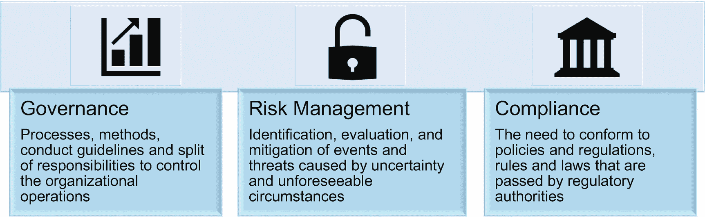
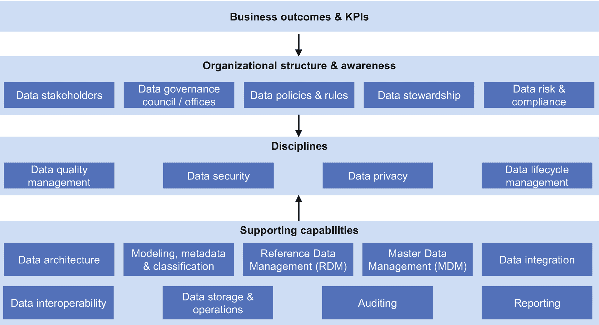
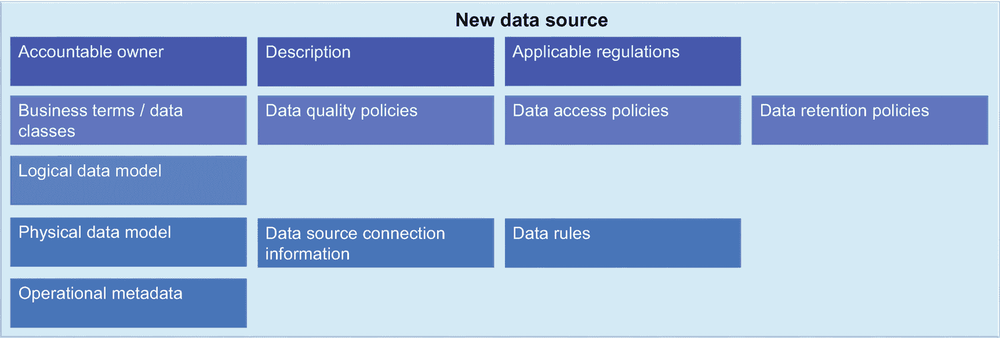
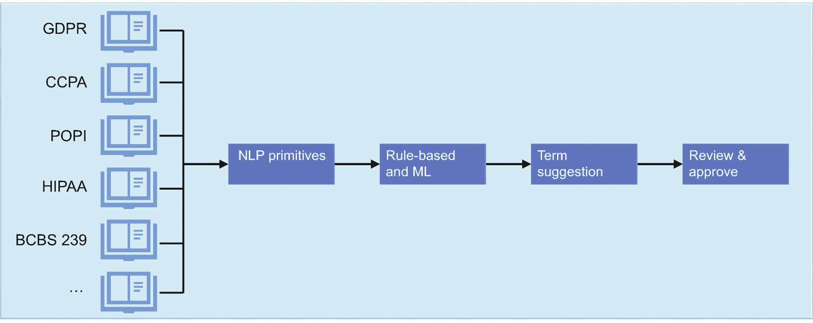
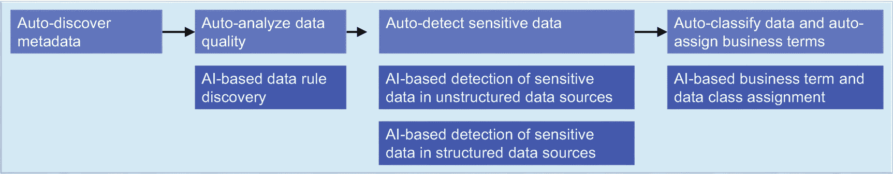
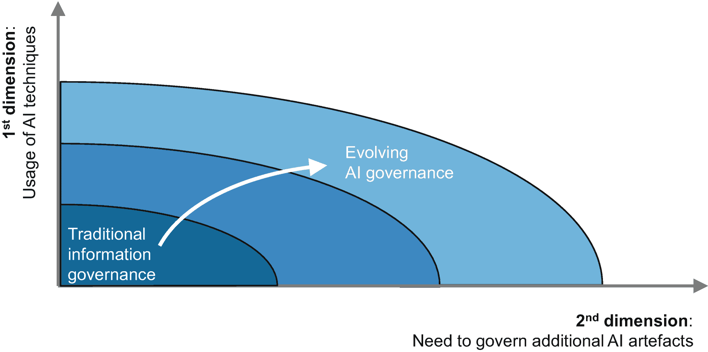
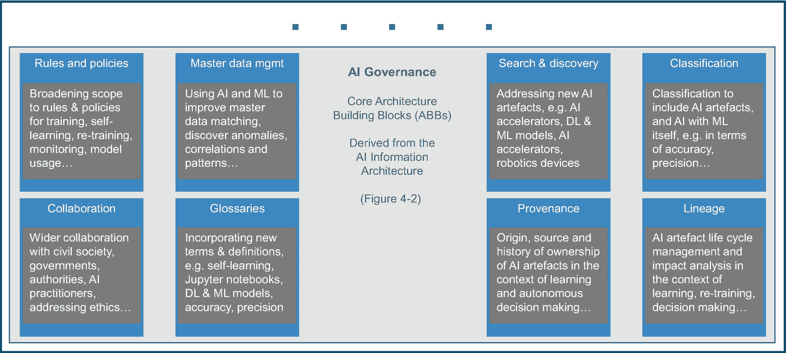
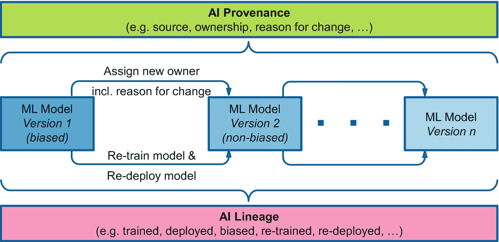

# 8. 人工智能与治理

虽然人工智能已在大量用例中得到广泛应用，但我们将会看到它在所有行业垂直领域变得越来越普遍，并影响着我们的社会。将预测性和机器学习驱动的洞察力推断到业务流程中，其特点在于大量的自主决策，这可能会被一些用户视为难以理解或难以捉摸。由于基于人工智能的决策应当有意义且易于人类理解，因此人工智能带来了一个新的治理维度，旨在确保透明度、信任和问责制，同时兼顾可解释性、公平性和可追溯性。

人工智能背景下的治理需要超越传统现有的数据和信息治理范围。一个例子是前面提到的*公平性*，这是人工智能治理的一个方面，与机器学习和深度学习模型相关，这些模型作为新的人工智能产物，在传统以数据为中心的方案中是不存在的。

本章介绍数据治理，并展示如何嵌入人工智能能力以使数据治理更高效、更准确。在此背景下，我们将人工智能应用于数据治理。然而，第二个甚至更重要的维度是如何治理人工智能，这引出了人工智能治理这一主题。我们将探讨技术层面，并审视人工智能治理的各个方面，包括现有数据和信息治理需要在多大程度上进行扩展、增强和升级，以满足人工智能的需求。我们将讨论人工智能治理的具体挑战、推动人工智能治理需求的关键法规，以及实现可信赖人工智能治理的伦理方面。

我们将探讨人工智能治理的一些关键方面和技术能力，但既不追求全面，也不声称完备。我们将解释人工智能治理的以下关键方面：

*   **规则与策略**：我们展示人工智能相关方法和活动需要对规则和策略进行哪些增强。
*   **术语表**：术语表内容（如术语）需要扩展和补充，以涵盖所有人工智能相关的方面和定义。
*   **搜索与发现**：开发机器学习模型成本高昂。为了促进复用，模型需要可搜索和可发现，这一点变得至关重要。许多其他人工智能产物也是如此。
*   **分类**：需要调整分类法和分类体系，以涵盖并纳入人工智能资产。
*   **来源与谱系**：为了建立对人工智能的信任，必须理解从模型起源（例如基于哪些数据训练、谁训练了模型、模型的版本历史）到人工智能产物所有其他方面的完整生命周期。来源和谱系是这里所需的关键能力。

本章的主要目标之一是找出推动人工智能治理需求的具体且新颖的挑战，以及构成人工智能治理的特征。

本章将介绍一些与人工智能治理相关的供应商产品和原则，例如 IBM Information Governance Catalog、IBM Watson Knowledge Catalog 和 IBM Watson OpenScale。本章将以几个示例用例和关键要点作为结尾。

## 治理范围

在深入探讨人工智能治理之前，我们想先阐述一下治理的一般范围，以及它如何与风险和合规性相关联。在此过程中，我们将对治理进行简要回顾，特别是关于数据和信息治理。

### 治理 – 简要回顾

近年来，治理已演变为一种更全面的方法，也满足了风险和合规性的需求。治理、风险与合规（GRC）致力于在组织层面和企业层面管理技术和业务风险，管理持续存在的法规，并跟上法规和技术加速变化的步伐，这意味着要适当应对并加速考虑日益增多的新的一般性和行业特定法规。

当我们在本章中讨论*治理*时，实际上指的是更广泛的 GRC 范围。

图 8-1 是对这三个术语的描绘^(¹²⁵)。

图 8-1

治理、风险与合规（GRC）

以下是这些术语的高级描述：

*   **治理**：术语治理^(¹²⁶)通常与公司治理相关联，甚至仅限于此，它描述了控制所有组织企业运营的流程、方法、行为准则以及权利和责任的划分。在其悠久的历史中，公司治理已显著演变，例如包含了数据和信息治理。技术的快速发展及其对社会的影响正在为公司治理带来新的挑战。特别是，通过人工智能实现的、以自主决策为特征或由数据科学家驱动和领导的引人入胜的用例场景，例如自动驾驶汽车、具有语音和面部识别能力的认知处理、用于临床判断或诊断的图像识别，将再次对治理提出新的挑战，需要将伦理、法律方面以及整个社会纳入考量。我们将在“*人工智能背景下的治理*”一节中详细阐述这一点。

*   **风险**：与风险相关的事件有许多不同的类别，例如由于内部或外部因素导致计划事件无法达到预期结果的不确定性、金融市场的不确定性、网络风险、项目风险、IT 计划外中断和运营风险，甚至自然灾害等等。风险管理是对这些由不确定性和不可预见情况引起的事件和威胁进行识别、评估和缓解。尽管人工智能和机器学习凭借其预测分析和认知能力将促进各行各业的重大进步，但它也可能引发与错误或有偏见的决策、安全和网络风险，甚至不可预测的负面结果相关的新风险和担忧。另一方面，应用人工智能和机器学习也可以加速并提高风险识别、理解和缓解的准确性。

*   **合规**：法规合规性旨在满足监管机构或政府通过的政策、法规、规则甚至法律的要求。它需要建立方法和流程，以实现运营透明度、保护关键数据（例如，个人健康相关数据），并遵守通常是行业特定的业务标准。一些例子包括欧盟通用数据保护条例（GDPR）^(¹²⁷)，旨在让个人数据所有者拥有更多控制权并赋予他们选择退出的权利；1996 年健康保险可携性和责任法案（HIPAA）^(¹²⁸)，旨在实现医疗信息流动现代化并保护重要的患者数据；以及萨班斯-奥克斯利法案（SOX）^(¹²⁹)，旨在保护公众免受公司和其他商业实体的欺诈或错误行为之害。

GRC 支持在流程、方法论、战略企业和组织目标、相关技术以及组织内外关键利益相关者的角色和职责等所有相关方面，形成一个整体、集成且企业级的视角。

### 数据与信息治理

数据治理^(¹³⁰)在早期对于数据专业人士而言是一个棘手的话题，他们需要说服业务和 IT 领导者，为何这是企业的关键能力并值得投资。幸运的是，对于许多国家的数据专业人士来说，到 2020 年，这个问题已基本消失。如今，数据治理通常有三大驱动力：流程效率、合规遵从以及改善客户体验。通过围绕数据管理制定标准，业务和 IT 流程得以简化，成本得以降低。全球层出不穷的法规迫使企业必须合规管理信息资产，这成为数据治理的另一大动因。法规示例^(¹³¹)包括：

*   欧洲的《通用数据保护条例》（GDPR）
*   美国的《加州消费者隐私法案》（CCPA）
*   南非的《个人信息保护法案》（POPI）
*   巴塞尔银行监管委员会标准 239（BCBS 239）
*   保险业的《偿付能力监管标准 II》
*   金融市场的《金融工具市场指令 II》
*   美国的《健康保险可携性与责任法案》（HIPAA）

行业领先企业常利用数据治理推动数据管理改进，旨在提升客户体验。数据治理是治理、风险与合规（GRC）的关键组成部分，以确保在 GRC 及组织业务环境中使用的相关数据符合所需的数据质量服务水平，并具备可信性、完整性和一致性。

我们仅介绍数据治理的几个关键概念，为后续讨论奠定基础^(¹³²)。数据治理项目包含三个要素：人员（及其组织）、流程和技术。图 8-2 展示了数据治理的概念总览。关于数据治理的定义以及所包含的学科和能力存在多种变体^(¹³³)，这些超出了本介绍中比较与分析的范围。图 8-2 从我们的视角展示了核心部分。让我们从数据治理的业务成果开始。

图 8-2

数据治理总览

要成功运行数据治理项目，必须设定明确的关键绩效指标（KPI）来阐述业务目标，并建立控制机制来衡量这些目标的进展。每个 KPI 还需要有明确的负责人。设定目标并衡量进展需要定义完善的流程。如果这些流程能尽可能利用技术实现自动化，效率将得以提升。以下是通过数据治理在流程效率、合规遵从和改善客户体验方面实现有益业务成果的一些示例：

*   *清晰透明地沟通目标*：通过标准化的数据管理实践和流程，数据治理的目标得以顺畅传达。数据治理委员会或数据治理办公室拥有明确定义的职责、决策权、问责机制和控制机制，有助于定义和执行这些标准化的数据管理实践，并与业务和 IT 部门合作确保其正确实施。

*   *标准化、一致且统一的数据管理实践*：这是企业级数据驱动计划（如主数据管理、数据湖等）的先决条件。

*   *IT 运营的敏捷性和可扩展性*：通过在组织、业务和技术层面制定关于如何定义、更改和实施影响数据的流程的明确规则，显著提升 IT 运营的敏捷性和可扩展性。随着数据量加速增长，管理数据的规模方面变得越来越重要。

*   *受治理的数据管理方法*：允许重用数据流程和信息资产，避免重复和冗余。随着组织内数据治理项目逐步成熟，越来越多的冗余数据孤岛和不一致的数据流程将被识别并整合，从而降低 IT 成本和运营风险（需要保护的系统减少）。

*   *业务决策者受益于可信赖的数据*：因为数据以正确（经认证）的数据质量进行管理，并且通过数据血缘了解其来源。业务决策者随时可以查阅其使用的信息资产相关的完整数据流程文档，从而全面了解所使用数据的各个方面。

*   *有效的数据治理项目建立数据隐私政策并标准化工具集*：以识别与影响数据隐私的法规相关的信息资产。此外，实施一致的流程和工具来满足数据隐私法规（如 GDPR）在同意管理、数据主体访问权（例如，审查权、被遗忘权等）方面的要求。通过数据治理实现此类标准化，可降低合规的 IT 成本，并减轻因不合规而面临罚款的财务风险。

*   *许多法规（如 GDPR）要求使用适当的安全控制措施管理某些数据资产*：例如个人身份信息。针对静态和传输中数据的安全通用标准，以及访问控制，简化了此类必要控制措施的实施并降低了成本。

*   *某些法规和法律还规定了数据的保留期限*：这会影响数据生命周期管理。通过数据治理制定标准有多重好处。首先，它确保数据在法规允许之前不会被删除，从而降低不合规风险。其次，一旦建立数据删除实践，当不再有业务或法规保留要求时，即可删除数据，这降低了存储成本，同时也因数据无法再被泄露而降低了风险。

*   *留住客户比获取新客户或赢回流失客户更容易*。另一个甚至更关键的好处是，整合而非重复的客户记录可以避免激怒客户，例如，避免向同一客户多次发送营销材料。企业已开始利用数据治理项目来分析和改进客户与企业互动业务流程中的数据实践。例如，如果跨多个系统的重复客户记录导致同一客户多次收到相同的营销材料，该客户可能会感到厌烦，并转而选择其他商家。

由于每家公司都根据自身企业情况实施特定范围的数据治理，因此还可能实现其他业务收益和成果。

数据治理项目的实施需要建立组织结构，并配备人员来提升对数据治理项目的认知，并从日常角度推动其运行。从组织角度来看，已有不同术语用于描述数据治理组织结构，例如数据治理委员会、数据治理办公室、首席数据办公室等。根据我们的经验，名称的重要性不如存在负责在企业范围内推动数据治理的组织单元这一事实。本章中我们使用“数据治理办公室”这一术语。数据治理办公室内部或作为其关键利益相关者的典型角色如下（此列表并非详尽无遗）：

*   **数据利益相关者**：负责包含需要治理的数据实体的业务流程的业务主管。例如销售、市场、供应商、人力资源等部门的负责人，因为他们的许多业务流程都涉及受监管的数据，例如个人数据。

*   **首席数据官**（CDO）：首席数据官通常是具有深厚业务背景的高级管理人员。CDO 负责定义支持并增强关键业务计划的数据战略。这通常包括数据架构、人工智能应用以及企业级数据治理的战略。

*   **数据保护官**（DPO）：根据 GDPR 法规第 37 条，如果企业处理欧盟公民的数据并满足某些关键标准，则必须设立此职位。DPO 担任高级安全领导职务，负责监督必要数据保护措施的实施，以确保数据符合 GDPR 要求。他们是公司与 GDPR 监管机构的联络点。GDPR 第 39 条概述了 DPO 的职责，包括对员工进行 GDPR 合规性教育和培训、执行审计以确保合规性，以及维护所有数据处理活动（包括此类处理活动的目的）的完整记录。

*   **首席信息安全官**（CISO）：CISO 的角色必须弥合 IT 安全与业务等学科之间的差距。CISO 必须深刻理解业务目标，制定信息安全战略，以达到适当的数据安全水平，同时不限制现代业务流程的敏捷性。关键领域包括网络风险与情报管理、安全运营、防止数据丢失和欺诈、身份与访问管理（IAM），以及面向整个 IT 安全并对董事会负责的审计流程。

*   **首席合规官**（CCO）：CCO 必须确保公司业务完全符合所有国家和国际法律、法规、专业标准、公认的商业惯例以及内部标准。

*   **数据管家**：数据管家（或数据管家团队）负责一个或多个数据域（例如，员工数据、客户数据等）。数据管家确保数据域的所有属性都得到明确定义，并用业务术语进行描述，以准确捕捉其语义含义。数据管家负责管理数据域相关的元数据、策略和规则，并处理所辖数据域中日常的数据质量问题。

*   **企业信息架构师/信息架构师**：企业信息架构^(¹³⁴)是企业架构^(¹³⁵)中的一个学科。企业信息架构师或信息架构师负责定义支持业务架构的数据架构。数据架构涵盖从元数据管理、参考数据管理、主数据管理、事务数据处理，到所有分析系统的端到端考量等所有架构方面。

某些角色，如数据管家，将始终是数据治理办公室的一部分；而其他角色，如 DPO，则经常是其一部分；还有一些角色则向数据治理办公室提供关键需求。例如，数据保护领域的 CISO 角色。

正如您已经注意到的，数据治理是一个广泛的议题，因此数据治理办公室将数据治理的实施划分为四个核心学科：

*   **数据质量管理**：数据质量管理是在特定业务场景下用于管理数据质量的一组流程和工具。它可以从多个维度进行衡量，例如完整性、格式和域合规性、标准化、与可信来源的验证（例如，邮政地址验证）等。数据质量策略阐明了业务需求，而数据质量规则则定义了与数据质量策略相对应的技术规范。数据质量分析和监控工具用于评估数据资产是否符合数据质量策略。如果发现数据质量异常，则会为数据管家创建任务。借助现代数据治理工具，数据管家可以执行一致且可重复的数据修复流程，以解决数据质量问题。

*   **数据安全**：数据安全^(¹³⁶)涉及保护数据免受外部或内部攻击者未经授权访问的所有方面。数据安全涵盖的主题包括：身份验证标准和单点登录（SSO）、静态和传输中数据的加密、用于开发和测试目的的敏感数据脱敏标准、安全擦除数据的流程和工具、IT 中使用的所有应用程序的安全工程标准，以及部署记录所有系统访问和数据更改的监控工具。

*   **数据隐私**：数据隐私涉及个人对其个人信息得到妥善处理和存储的权利，这意味着个人信息在其被收集的业务流程中严格用于适当用途并受到保护。GDPR 和其他隐私法规规定，如需将个人信息用于其他明确界定的用途，则必须获得个人的同意，这催生了同意管理能力的需求。此类隐私法规还赋予数据主体访问权，例如审查权或被遗忘权。数据安全与数据隐私并不相同：处理数据隐私的某些方面需要数据安全来通过加密保护个人信息。然而，可以在不部署同意管理等数据隐私能力的情况下实施数据安全。

*   **数据生命周期管理**：数据生命周期管理考虑数据从最初创建到最终擦除的整个生命周期。根据法规的保留要求，企业必须将某些数据资产保留一定年限。反之亦然：一旦业务关系结束，数据就必须被删除。随着数据量以越来越快的速度增长，能够在不再需要时删除数据是控制存储成本的关键需求。任何保留时间超过必要期限的数据也是一种负担，因为攻击者可能会危及这些数据。因此，作为数据治理计划的一部分，需要定义适当的数据保留策略，并实施流程来管理数据资产以符合保留策略。数据生命周期管理的另一个方面是数据访问频率。快速存储比速度较慢但更便宜的存储昂贵得多。通常，数据越旧，被访问的频率就越低。可以定义策略，规定何时可以将数据从快速存储卸载到较慢的存储系统，以优化存储成本。这是一种常见的技术，用于在使用 SQL 联邦跨不同存储速度系统运行的数据仓库中控制存储成本。

为了支持这四个主要学科，有许多使能能力，正如您之前在图 8-2 中看到的那样。这些能力通常由专门的技术支持，为特定能力领域提供优化的功能。我们在此对每一项进行简要总结：

*   **数据架构**：企业中的企业信息架构师或信息架构师（如果企业规模较大，可能是一个团队）负责定义支持业务架构的数据架构。由于业务对事务处理系统和分析系统存在各种不同的需求，数据架构并非单一系统。数据架构致力于交付可扩展且经济高效的系统，并尽可能避免数据冗余。一个定义良好的数据架构能够预见未来业务需求所需的变化，并在需要时支持快速变更。来自 Software AG、LeanIX 和 Sparx Systems 的工具，或像 ArchiMate 这样的开源工具，有助于对相关架构工件进行建模。

*   **建模、元数据^(¹³⁸)与分类**：数据建模工具用于对逻辑和物理数据模型的元数据结构进行建模，这些模型描述了企业业务所需的数据实体结构以及它们之间的关系。逻辑和物理数据模型只是技术元数据的两个例子，其他技术元数据工件则用于描述业务报表、数据转换作业等的结构。元数据管理工具（如今更常被称为数据治理目录）不仅用于管理技术元数据，还用于管理业务元数据，例如业务术语、广泛的政策（如数据质量和数据隐私政策、保留或数据访问政策）以及数据规则。本体论用于为业务术语和数据类提供分类法，这些分类法定义了逻辑数据模型中属性的语义含义。在发现新数据源时应用的语义分类算法，会将发现的数据源属性映射到现有的数据类和业务术语。另一种元数据是操作元数据，它有多种不同形式，涉及运行数据质量报告时的操作统计信息，或与目录中信息资产关联的标签和用户评论，这些信息表明特定信息资产是否对特定任务有用。数据治理目录的另一组关键能力是业务血缘和数据血缘功能，用于理解数据的来源和关系。

*   **参考数据管理 (RDM)**：^(¹³⁹) 此能力满足企业管理参考数据的需求。参考数据的例子包括医疗保健领域的疾病代码列表、国家代码列表或不同允许账户类型的列表。不一致的参考数据是一个严重的数据质量问题。例如，如果为数据仓库提供数据的各种事务处理系统使用了不同的国家代码，那么在企业数据仓库中按国家正确报告收入将非常困难。^(¹⁴⁰) 一致地管理参考数据是企业开始实施专用 RDM 解决方案的原因。近年来，出现了一种趋势，即 RDM 能力成为数据治理目录的一部分^(¹⁴¹)。

*   **MDM**：此能力提供高效的主数据管理功能，我们将在本章和第九章“*将人工智能应用于主数据管理*”中进一步介绍。

*   **数据集成**：数据集成有几种不同的技术，包括提取-转换-加载 (ETL)、数据复制、数据虚拟化、数据流和实时 API。ETL 基本上是对大量数据的批处理，通常用于从源系统到新系统的初始加载，或向数据仓库或数据湖的批量馈送。作为批处理复杂过程的一部分，通常会应用数据清洗和数据转换例程。数据复制是一种近乎实时的数据变更移动能力，可将数据从一个系统移动到另一个或多个系统。用例包括向需要更实时数据输入的分析系统进行涓流馈送，或保持备用系统与主系统同步以实现恢复。数据虚拟化（以前称为数据联合）基本上对应用程序开发人员隐藏了多个数据源（可能甚至具有不同的 SQL 方言^(¹⁴²)）的复杂性。使用数据虚拟化，多个数据源对应用程序开发人员来说就像一个单一数据源，开发人员可以专注于应用程序功能，而数据虚拟化层则在后台处理针对多个数据源的 SQL 查询执行。与 ETL 和数据复制相比，数据虚拟化的优点之一是无需创建数据副本，从而节省了存储成本。数据流是实时的数据移动，可能内置了分析功能，这在物联网 (IoT) 场景中尤其有效，因为该场景会实时产生海量数据量。数据流可用于实时分析数据流中是否存在有价值的数据元素，这些元素应被持久化或进一步处理，而许多其他数据元素则被立即丢弃（甚至从未写入磁盘）。实时 API 提供事务性、可扩展且高性能的数据访问，这通常是移动或在线渠道等交互系统应用所必需的。数据集成能力应将描述数据结构的所有元数据以及所有转换（如果适用）暴露给数据治理目录基础设施，从而实现完整的数据血缘。

*   **数据互操作性**：数据互操作性^(¹⁴³) 正变得越来越重要，因为越来越多的企业认识到价值生态系统的益处，即公司通过合作伙伴关系相互协作，为客户提供创新解决方案。另一个驱动因素是混合云策略的采用，其中一部分 IT 能力位于企业数据中心，另一部分则从一个或多个公有云供应商处消费。这两个驱动因素都将数据互操作性的挑战——以前仅存在于企业数据中心内的系统之间——进一步推到了聚光灯下。随着关注度的提高，企业作为其数据治理计划的一部分，会建立数据互操作性标准。这些标准触发了创建和交换数据的系统之间的契约，以确保所交换数据的语义含义和范围得到明确定义。

*   **数据存储与运维**：每 GB 的存储价格持续下降，加之公有云上可用的云对象存储，企业甚至有望获得近乎无限的存储容量。尽管数据存储已不再是重大难题，但近年来数据量的激增及其在近期的预期增长，确实抵消了存储价格的下降。将数据放入公有云的云对象存储或其他持久化服务中，入库成本很低，但许多云厂商在你打算将数据拉取出来，移回自己的数据中心或另一家厂商的云时，会收取非常昂贵的出站费用^(¹⁴⁴)。有些数据被频繁访问，而另一些则很少被访问（例如数据备份），或者仅为了应对审计或合规要求而保留。因此，以成本感知的方式优化数据在不同类型存储系统上的放置，根据使用模式提供不同的速度和吞吐量，是另一个需要考虑的维度。从运维角度来看，确保在更换存储系统时，数据能从磁盘上被安全擦除，避免被专用工具恢复，是防止因丢弃旧存储系统而导致意外数据泄露的另一个关键方面。

*   **审计**：数据治理项目要求在所有关键系统上部署适当的审计功能，以生成审计追踪记录（谁在何时访问和修改了数据）。先进的审计工具^(¹⁴⁵)能够检测出用户异常的数据访问模式，并能实时终止访问，防止潜在的数据泄露。例如，一个异常的数据访问模式可能是数据库管理员请求读取数据库中客户数据表的所有条目。这可能暗示一位心怀不满的数据库管理员想在离职前复制一份客户数据。

*   **报告**：如前所述，数据治理需要交付与 KPI 相关的业务价值。如果没有报告（最好是全自动的），就无法判断数据治理项目的有效性和进展。因此，适当的报告能力是成功的数据治理项目不可或缺的一部分。

如今的企业拥有海量的数据资产。实施覆盖企业所有数据资产中每一个属性的数据治理项目，通常既不切实际也不可能。数据治理项目的目标是治理数据环境中能为企业提供价值的相关方面。例如，一家制药分销公司每天从其配送中心向药房和医院运送数万个包裹，其业务案例强烈要求不仅要标准化，还要根据邮政地址词典实际验证客户记录中的邮政地址。

如果一个包裹被退回配送中心，平均需要一个人 10 分钟来更正地址、贴上新的标签并再次发货。如果你汇总一下人工成本和第二次运输的费用，再乘以每天几百到几千个这样的案例（由于地址数据质量低），你很容易就能看出这累积成了一笔巨大的成本。因此，存在一个合理的业务案例，即尽可能以最高数据质量标准来治理地址信息的数据质量，从而显著降低运营成本并贡献净利润。以此为例，好的数据治理项目并非试图“煮沸大海”；相反，它们会将预算和精力集中在最相关的业务成果上。

### 将 AI 注入数据治理

鉴于数据治理涵盖的主题范围广泛——正如你在上一节中所见——本节将重点介绍 AI 在数据治理两个领域中的应用。首先，我们展示 AI 如何应用于元数据和数据质量管理。其次，我们探讨 AI 在数据安全中的使用。

#### AI 在元数据和数据质量管理中的应用

数据量的爆炸式增长不仅对存储成本构成挑战，还导致数据源数量不断增加，这些数据源需要被编入数据治理目录。类似于图书馆的目录中每本书都有一个描述该书及其位置的参考信息，每个数据源都需要在数据治理目录中有一个条目。一个未注册的数据源无法被有效发现或治理。图 8-3 展示了数据治理目录中数据源条目应包含的一些相关领域。

不幸的是，相当多的数据湖项目因为缺乏治理而失败，这意味着每天加载许多数据源时，并未在数据治理目录中为每个加载的数据源实现清单描述。一段时间后，这些缺乏治理的数据湖项目就缺少了关于哪些特定数据源被加载到数据湖中以及它们在哪里可以找到的必要知识。数据科学家没有关于可用数据源、其包含的信息、数据质量水平、使用权限等方面的权威记录。通常，这种元数据知识的模糊性最终迫使数据湖项目从头再来。然而，只有当治理数据湖的方法变得更加智能，即元数据管理方法必须注入 AI 时，重新开始才有意义。

图 8-3

数据治理目录中的概念性数据资产卡片

想象你有一个数据源，比如一个包含 50 个数据表的关系数据库，每个表平均有 20 个属性，总计 1000 个属性。假设你是数据管理员，负责将所有技术元数据（如逻辑和物理数据模型）导入数据治理目录，手动分配适用的业务术语和数据类别、适用的法规、相关策略等，并在数据治理目录中完成对该数据源的完整描述。

为了能够正确分配业务术语、数据类别和相关数据质量策略，你还需要执行数据剖析和语义分类任务。如果这需要频繁进行，显然会涉及大量人力，导致成本高得令人无法接受。近年来，将数据湖作为分析和开发训练 AI 模型环境的基础，已被许多采用者所接受。

然而，手动且不可扩展的元数据管理并非将 AI 引入元数据管理的唯一驱动力。前面的场景假设业务术语已经在数据治理目录中定义好了。随着法规数量迅速增长，仅仅在数据治理目录中维护相关的业务术语，就已经变成了一项几乎难以管理、劳动密集型的工作。因此，另一个问题是基于 AI 智能地提出与法规相关的业务术语。

暗数据本质上是指企业中任何不受管控的数据源，它会引发诸多业务问题。例如，若暗数据并非必需，则会产生无效益的 IT 成本；若暗数据涉及敏感信息，且被内部或外部攻击者获取，则可能带来重大的声誉及财务风险。在许多隐私法规下，暗数据中的个人身份信息（PII）会引发问题，可能导致不合规风险。尽管许多数据治理项目通过将大量结构化数据源编入数据治理目录，在减少企业暗数据量方面取得了显著进展，但非结构化数据方面实际上仍处于“黑暗”之中。私有云和公有云环境中的非结构化数据源示例包括：内容管理系统、电子邮件系统、Microsoft Sharepoint、Box 等。这背后有多个根本原因。

首先，数据治理目录供应商长期以来未在其元数据管理工具中支持非结构化数据源，这种情况直到最近几年才有所改善。其次，数据剖析和语义分类算法曾一度仅聚焦于结构化数据源。第三，与非结构化数据源相比，在非结构化数据源中识别 PII 要复杂得多。

如果你在关系型数据库中有一个列，且该列中的大部分值看起来像是姓氏，那么不难推断出该列在语义上极有可能是数据类*姓氏*的一个实例，并且相应的业务术语应与此列关联。而在一个自由格式的非结构化文档中，值*Washington*可能是一个姓氏、一个城市名或一个州名。

判断哪个语义概念适用，在非结构化数据源中是一个更复杂的问题。尽管存在这些障碍，GDPR 和 CCPA 仍在推动企业要么删除、要么保护并妥善管理个人数据。面对数 TB 或 PB 级的非结构化数据，企业不知从何入手，而传统针对如此体量非结构化数据的索引方法需要数月甚至数年才能完成。企业还将大量非结构化数据迁移到了公有云。在公有云上通过 API 调用索引大型数据源成本高昂。因此，需要采用适当的统计抽样技术，并结合融入 AI 能力的元数据发现与非结构化数据源分类方法。

利用数据剖析和数据质量监控等技术进行数据质量管理，是学术研究中一个研究成熟的领域^(¹⁴⁶)。如今，商业和开源软件工具中提供了许多有用的数据质量功能。然而，由于数据源数量、规模快速增长以及种类日益多样化（这与传统元数据管理方法如今力不从心的原因非常相似），数据质量管理正触及瓶颈。例如，你的数据剖析工具可能有一条数据规则，通过检查值是否符合格式 XXX-XX-XXXX（其中 X 代表 0 到 9 之间的数字，且有效模式需遵循特定规则）来发现某列是否为美国社会安全号码。

随着数据源种类日益丰富，你所选的数据剖析工具开箱即用就具备所有必要数据质量规则的可能性正在降低。因此，问题随之而来：你是否可以利用 AI 基于机器学习发现新的数据规则，并将其推荐给用户？与非结构化数据上的发现问题类似，如今海量的数据迫使人们越来越多地采用适当的统计抽样技术进行数据剖析和监控，以使此类任务的运行时间保持在可接受范围内（这已经假设在 Apache Spark 等平台上实现了数据剖析和监控的弹性水平扩展）。

通过数据剖析发现数据质量问题只是第一步。之后，你通常需要修复和纠正数据质量问题，这曾是数据管理员手动解决的另一项任务来源。手动修复数据质量问题的问题也已达到仅靠手动方法不再足够的程度。我们将在第 9 章“`将 AI 应用于主数据管理`”中研究利用 AI 技术识别和纠正数据质量问题的示例。比使用 AI 纠正数据质量问题更好的方法是，利用 AI 在数据录入时预防数据质量问题的发生。^(¹⁴⁷)

在了解了元数据和数据质量管理的一些局限性之后，让我们探讨一些已经融入数据治理目录和数据质量管理技术的 AI 能力。我们探讨的第一个融入 AI 的能力是，利用 AI 从新法规中自动提取并提出新的业务术语，作为候选术语纳入数据治理目录。

图 8-4 展示了这一新能力的概念流程。让我们仔细看看这个流程的四个阶段。

图 8-4

利用 AI 从法规中建议新的业务术语

1.  *NLP 原语*，用于句子边界识别、分词、词形还原、词性标注、依存句法分析以及扩展的浅层语义分析，用于处理法规输入文本。

2.  *基于规则和机器学习*技术是下一步处理环节。一个基于规则的提取引擎，使用位于 NLP 原语之上的注释查询语言（AQL），可以为机器学习模型提取相关特征。此步骤可应用多种技术，例如使用条件随机场或人工神经网络进行实体提取，使用最大熵或人工神经网络进行关系提取等。

3.  *术语建议*，可以推导出一个或多个新业务术语的建议。

4.  *审核与批准*，允许数据管理员审核建议的业务术语，可选地进行修正，然后决定每个业务术语是被批准为数据治理目录中业务术语表的新术语，还是被拒绝。

现在来看图 8-5，该图展示了将新数据源注册到数据治理目录的融入 AI 的流程。

图 8-5

数据治理目录中融入 AI 的新数据源注册流程

以往一系列冗长耗时的手动步骤现已自动化，主要变为审核步骤，仅在必要时进行手动修正：

1.  一旦建立源连接，所有元数据将被自动发现并摄取到数据治理目录中。

2.  数据质量评估会在所有已发现的数据属性上自动触发。对于已发现的模式分布表明其值基于 AI 遵循某种一致的整体模式的属性，系统会预测一条新的数据规则并建议给数据管理员（前提是在数据规则库中未找到匹配的规则）。数据管理员还会获知有多少比例的值会符合此规则。如果数据管理员认为建议的规则准确，该数据规则就会被添加到数据规则库中。

3.  鉴于结构化、半结构化和非结构化数据源的差异，需要应用定制化的技术来确定数据源是否包含 PII。用于准确性和推理的随机森林分类器、使用聚类技术的预测性采样，以及使用人工神经网络（ANN）的实体提取，只是 AI 能力在这一步骤中可用于确定数据源是否包含 PII 的几个例子^(¹⁴⁸)。在此步骤中，通过底层利用此类 AI 能力，数据管理员会获得一个评估结果，表明被扫描的数据源是否包含 PII。数据管理员可以审查该评估结果，并通过检查预测置信度或在必要时查看相关条目来决定结果是否准确。如果 PII 检测结果有误，数据管理员可以更正该评估。

4.  在下一步中，代表语义概念和业务术语的数据类会基于 AI 被分配给数据源中已发现的属性。属性元数据、前几步的分析结果以及数据值都被视为输入。例如，如果基于语义分类检测到某一列包含代表城市的值，那么代表*城市*这一语义概念的数据类就会被分配给该列，同时还包括描述*城市*是什么、以及该属性如何及为何被使用的业务术语*城市*。同样，数据管理员可以审查建议的分配是否准确，并批准或覆盖它们。对于基于 AI 的数据类和业务术语分配，数据治理目录需要提供一套不同的 AI 技术来有效处理以下情况：
    1.  在没有标记数据可用的情况下，可以应用无监督学习技术。这种情况适用于尚无任何数据资产且其属性已分配业务术语的场景。

2.  不同的应用程序包（例如 SAP、Salesforce 等）或不同的自定义应用程序可能使用截然不同的命名约定。因此，即使基于 AI 的术语分配会查看描述属性的元数据以及实际的属性值，在一个实例中有效的模型在另一个实例中可能无效。在这种情况下，需要应用具有适当相似性度量的基于实例的学习方法来进行基于 AI 的术语分配。

3.  术语表可能包含数千甚至数万个术语。因此，即使有标记数据，这也可能很快变成一个多类、多标签的分类问题，而每个类别可能只有 5 到 50 个实例。为了克服这一挑战，可以使用最近邻等技术，或者将问题转化为二分类问题。

对于此过程中的第 2 至第 4 步，可以应用主动学习能力来持续改进基于 AI 的能力的结果。这种注入 AI 的自动化流程的价值主张非常显著。例如，在第 4 步中，如果没有基于 AI 的数据类和术语分配建议，数据管理员将需要在目录中搜索合适的数据类和术语，然后才能建立它们与属性之间的关系。输入关键词搜索数据类或术语、审查结果列表、选择适用的条目，然后创建与相关属性的关系，这一过程非常耗时。有了 AI 能力，在绝大多数情况下，数据管理员只需单击鼠标即可批准建议，从而节省大量时间和人力成本。虽然这个话题还有很多可以讨论的内容，但我们希望通过这个介绍，你能基本理解为什么将 AI 技术应用于元数据和数据质量管理非常有价值。现在，让我们进入另一个数据治理领域，该领域近年来也注入了 AI 能力，即下一节将要讨论的数据安全。

#### 人工智能在数据安全中的应用

数据安全是数据治理的关键方面。《2019 年数据泄露成本报告》^(¹⁴⁹)指出，全球数据泄露的平均成本为 390 万美元，而美国每起案件的平均成本高达 819 万美元。这些成本通常分为直接成本（因不合规而支付的罚款、和解费等）和间接成本（声誉损害等）。既然数据泄露成本如此高昂，下一个显而易见的问题便是：数据安全问题是否呈现增长趋势？根据《IBM X-Force 威胁情报指数 2020》^(¹⁵⁰)，2020 年及以后，安全相关事件预计将呈增长趋势。因此，潜在的数据泄露问题短期内不会消失。数据泄露的最大来源（约 50%）是外部攻击者。我们迫切需要安全专业人员来帮助预防事件，或者在事件发生时，尽快识别并修复问题。但企业为其 IT 团队招聘安全专业人员有多容易呢？根据 ISACA 发布的《2020 年网络安全状况报告》^(¹⁵¹)，57%的受访企业表示存在安全职位空缺，其中 30%的空缺职位超过 3 个月仍未招到合适人选，29%的空缺职位则超过 6 个月。

表 8-1

融入人工智能的安全领域

| 安全领域 | 人工智能的关键价值点 |
| --- | --- |
| 数据保护/安全 | 改进数据保护，检测并防止对数据的非法访问 |
| 安全运营中心 | 根据 MITRE 分类对警报进行优先级排序，对事件进行分类，收集相关信息，并自动为安全分析师推荐最佳行动方案 |
| 数字身份与欺诈检测 | 借助人工智能，识别并防止针对数字身份的攻击或欺诈行为 |
| 端点管理 | 利用人工智能更有效地保护端点免受攻击 |
| 用户行为 | 利用人工智能检测用户行为中的异常，这些异常可能预示着潜在威胁，并据此采取行动 |
| 智能事件响应 | 利用人工智能进行智能决策，选择和编排正确的事件响应措施 |

以此为背景，引出了三个关键问题。首先，攻击者是否会利用人工智能发动更复杂的攻击？答案是肯定的。例如，人工神经网络已被用于改进密码破解工具。其次，人工智能模型或其训练数据是否会成为潜在攻击的目标？答案也是肯定的，因为攻击者会窃取 AI 模型，并可能通过模型反转攻击试图窃取包含个人身份信息的训练数据，从而暴露隐私。第三，人工智能能否被用来保护你免受安全威胁，特别是数据安全威胁？答案同样是肯定的，表 8-1 展示了当前一些已应用人工智能解决方案的相关领域。表 8-1 旨在向你展示在安全领域，特别是数据安全领域，哪些地方的新型人工智能解决方案可能能够有效地^(¹⁵²)帮助你。

软件供应商^(¹⁵³)目前已经可以提供针对上述领域的解决方案。作为数据治理计划的一部分，特别是与数据安全相关的部分，你应该审视需要采取哪些措施来适当保护你的数据资产，这可能需要使用安全领域中多种融入人工智能的软件功能。

在对数据治理有了基本了解之后，我们现在可以探讨如何利用数据治理领域的能力来治理人工智能的影响。我们还将展示数据治理领域需要增加哪些额外能力，以便将其扩展，使其也能有效地应用于人工智能领域。

## 人工智能背景下的治理

人工智能背景下的治理可能非常普遍和广泛，远远超出纯粹的技术层面——技术只是实现正确治理的手段；治理的根本在于组织应坚持的政策、标准和合规性要求。

在本节中，我们将展示人工智能治理面临的挑战，以及传统信息治理将如何受到人工智能和机器学习的影响。此外，我们将简要阐述一些推动人工智能治理以实现可信人工智能的法规。

### 超越传统信息治理

在本节中，我们将详细阐述信息治理与人工智能之间的相互影响和作用。在人工智能的影响下，信息治理需要变得更加广泛，包括纳入新的与人工智能相关的工件，以及治理范围内与人工智能相关的挑战和扩展。正如我们在前几节中所见，这给人工智能治理的应用和实施带来了挑战。另一方面，人工智能通过简单地利用人工智能和机器学习算法与技术，例如，正如你将在第 9 章“*将人工智能应用于数据治理和主数据管理*”中看到的，通过提高数据匹配任务的可靠性和准确性，增强了信息治理数据质量维度的信心。

人工智能为代表信息治理的某些方面取得重大进展提供了重要机遇。例如，人工智能加速了洞察，缩短了行动周期；在采取相应行动后，它也缩短了评估影响并决定是否撤销或维持变更的时间。此外，人工智能有助于快速回答问题，而不是让人力去通读整个数据库。

图 8-6

信息治理与人工智能的相互作用

图 8-6 展示了传统信息治理向人工智能治理发展的两个维度特征：

*   **第一维度**：通过利用人工智能和机器学习技术来发展信息治理。在这个维度中，人工智能和机器学习构成了信息治理的改进。正如本章前面所示，机器学习可以显著减少源分析和分类中的人力劳动。另一个例子是应用机器学习方法来识别操作风险模式。

*   **第二维度**：由于需要治理额外的人工智能和机器学习工件、场景、术语和定义、规则及政策，从而推动了信息治理的发展。

在不使图景过于复杂的情况下，我们甚至可以添加第三个维度，以考虑那些在人工智能阶梯上不断攀登、不断发展的组织，它们带来了新的机遇和新的挑战，这些都需要人工智能治理框架来应对和处理。这种不断发展的人工智能治理范围将在“*人工智能治理的关键方面*”一节中进一步阐述，我们将重点讨论人工智能治理的概念性和技术性方面。

### AI 治理面临的挑战

在 AI 治理的挑战中，存在几个不同但相互关联的领域或维度。这些领域自然会相互影响和相互作用。

以下列表描述了一些示例领域^(¹⁵⁴)，我们用它来阐述 AI 治理面临的挑战：

*   **技术领域**：包括 AI 系统与工具、深度学习（DL）与机器学习（ML）模型及算法、AI 应用、专用 AI 引擎与加速器、包含机器人系统在内的 AI 解决方案，以及其他 AI 技术。

*   **伦理与社会领域**：涉及 AI 为获得更大信任^(¹⁵⁵)、保持以人为本、可解释性、对个人公平性，以及提升个人和整个社会接受度所需遵循的伦理原则、指南以及普遍认可的人类与社会价值观。

*   **政治与法律领域**：监管机构和国家政府^(¹⁵⁶)将制定一套由技术驱动、并受伦理和社会原则指导（甚至可能限制）的法律法规、政策与规章。

与以往任何技术进步（如云计算或伴随社交媒体互动的大数据）相比，AI 和机器学习已经开始对治理、风险与合规（GRC）产生影响。AI 治理旨在建立一个框架或模型，以处理伦理与社会、政治与法律以及技术方面的议题，从而确保以安全且以人为本的方式使用 AI。

表 8-2 仅列出了其中部分挑战（不保证完整性），并将其与我们之前讨论的领域相关联。这些领域可以进行调整和进一步细化。例如，技术领域可以细分为机器人系统、应用组件、深度学习与机器学习模型等。根据组织所关注的具体 AI 范围，可能需要增加额外的领域，或对现有领域进行调整。

表 8-2
AI 治理面临的挑战

| # | 挑战 | 领域 |
| --- | --- | --- |
|  1 | AI 算法与方法、自主决策过程、AI 工具和应用缺乏或不足的透明度 | 技术 |
|  2 | 错误决策导致，例如，危及生命的错误医疗诊断和治疗、交通事故等 | 法律 |
|  3 | 缺乏指导和限制 AI 应用范围与部署的标准和原则 | 政治与法律 |
|  4 | 违反机会均等或对人们的性别、年龄产生不利影响的错误决策 | 伦理与社会 |
|  5 | 对 AI 系统、解决方案、应用等缺乏信任——类似于对数据缺乏信任 | 政治与社会 |
|  6 | AI 机器人系统、加速器或 AI 应用在危及生命的情况下发生故障 | 技术与法律 |
|  7 | 将信息治理范围扩大到包含 AI 特定产物（例如，深度学习与机器学习模型、自动驾驶事故责任归属等）所引发的问题 | 技术与法律 |
|  8 | 将学习方面（例如，深度学习模型的学习）纳入 AI 治理范围 | 技术与伦理 |
|  9 | 调整来源（所有权）和数据谱系以适应 AI 产物，例如，深度学习与机器学习模型 | 技术 |
| 10 | AI 系统和应用的自学习带来的额外安全风险 | 技术与社会 |

对于其中一些挑战，将其归入一个或多个领域是相当模糊的，有些挑战甚至与所有领域都相关。

### 推动 AI 治理的法规

除了 AI 对组织的影响之外，法规是推动 AI 治理的关键因素之一。在本节中，我们将简要（尽管相当不完整）概述与 AI 治理相关的法规。大多数国家都存在相关研究、探索性工作以及拟议的监管声明。本节仅简要介绍一些举措，不保证其完整性。

2018 年，25 个欧洲国家签署了 AI 合作宣言^(¹⁵⁷)，该宣言于 2020 年 2 月促成了一项欧盟法规，以补充部分欧盟成员国的国家举措。除了确保欧洲在 AI 研发事务上的竞争力外，其目标还在于解决*社会、经济、伦理和法律问题*。

德国政府于 2018 年通过了一项 AI 战略^(¹⁵⁸)，该战略旨在“*确保负责任地开发和使用服务于社会福祉的 AI，并在广泛的社会对话和积极的政治措施背景下，从伦理、法律、文化和制度层面将 AI 融入社会*”。2017 年，德国联邦交通和数字基础设施部发布了一份关于自动化和网联驾驶的报告^(¹⁵⁹)，其中包含了自动化和网联交通的伦理规则。2017 年，美国证券交易委员会（SEC）发布了关于智能投顾的信息和指南^(¹⁶⁰)，面向投资者和金融服务行业，涉及智能投顾的快速增长应用。2020 年，新加坡联邦政府发布了一个 AI 治理框架^(¹⁶¹)，“*旨在为私营组织提供详细且可立即实施的指导，说明在使用 AI 解决方案时如何处理伦理和治理问题*。”

## AI 治理的关键方面

在本节中，我们将详细阐述信息治理中需要调整和扩展以涵盖 AI 方面的技术细节。为此，我们将以第 4 章“*AI 信息架构*”中信息治理和信息目录层的核心架构构建块（ABB）为基础。我们将重点关注以下 ABB 子集：**规则与策略、术语表、搜索与发现、分类、以及来源与谱系。与主数据管理和协作相关的 ABB 在此不作描述。

图 8-7 描绘了 AI 信息架构中的 AI 治理层。要了解包含其他层 ABB 的完整 AI 信息架构，您应重新查阅第 4 章“*AI 信息架构*”。

图 8-7
AI 治理

在接下来的章节中，重点将放在当您必须在 AI 驱动的组织和基于 AI 的世界中实施信息治理时，信息治理将如何变化。然而，我们也会简要强调利用 AI 改进信息治理的优势。

### 规则与策略

随着人工智能涵盖所有分支与认知领域，包括监督学习、非监督学习、强化学习，以及深度学习与机器学习算法的相应应用，新的基于 AI 的方法将被采用，新的活动也将展开。例如，对机器学习模型进行训练和定期再训练，或深度学习模型的自学习特性，这些特性使 AI 解决方案、应用程序和机器人设备能够随时间以自主方式进行调整和变化。

新的 AI 产物，如深度学习与机器学习模型、特征、数据资产、笔记本以及 RESTful API，必须在 AI 应用程序中使用和部署，并以受监管的方式启用。监控机器学习模型所需的准确度和精确度水平，以确保其持续的商业相关性，构成了一系列新的任务，这些任务同样需要被治理。

其中一些方法和活动需要通过规则和策略进行治理和监管，这倡导使用一种*AI 守护*代理。这些规则和策略可能源于纯技术层面，例如确保机器学习模型的持续准确性和精确度。业务层面，例如不同用户对 AI 产物的使用权限，包括角色和职责的管理，也可能需要纳入考量。伦理问题以及可能规定使用模式和场景限制的各种法规，同样可能发挥作用。规则和策略在很大程度上受到 AI 的影响，并由技术、业务以及更广泛的 GRC（治理、风险与合规）责任所驱动。

也可以利用 AI 方法和技巧来改进规则与策略的管理、实施和治理。例如，机器学习算法可用于发现各种规则与策略之间的有用关联，以简化管理方面。尽管传统的业务规则管理系统在当今组织中的作用正在减弱，但整合它们仍可能——至少暂时如此——提高规则与策略构建块的效率和相关性。

### 术语表

人工智能带来了一系列新的业务和 IT 相关术语及定义。将这些新术语和定义纳入，例如自学习、Jupyter 或 Zeppelin 笔记本、深度学习与机器学习模型、训练与再训练，以及用于衡量模型业务相关性的 AI 特定 KPI^(¹⁶²)，如准确度、精确度、ROC 或 PR 曲线、准确度漂移——仅举几例——需要对现有的业务和 IT 术语表能力进行显著增强。其中一些术语可能已在现有企业术语表中被知晓和定义；然而，它们可能需要调整，并可能用于略有不同的语境。无论你使用何种技术来管理组织内使用的术语，都需要一个中央目录或词典，以便术语在整个组织中含义一致，或者如果含义不同，则需进行适当的关联、附加和引用。

用于术语和定义的业务元数据、IT 元数据和操作元数据（涵盖所有 AI 资产和产物），以指定 AI 技术资产、支持对规则和策略的理解与使用，并启用额外的 AI 治理功能（如来源和谱系），也将需要进行调整。

此外，在 AI 驱动的组织中，不同角色和职责之间的协调也需要重新调整。例如，一些技术性 AI 术语，如 ROC 或 PR 曲线或准确度漂移，需要由业务部门理解、测量、监控甚至调整。一个 AI 术语表^(¹⁶³)需要促进这些需求的实现。

### 搜索与发现

搜索与发现是传统信息治理范围内众所周知的能力，需要针对 AI 治理进行调整。这不仅是由于需要处理新的 AI 产物，例如 AI 加速器、深度学习与机器学习模型或机器人设备。所需的调整也源于新的 AI 解决方案以及深度学习与机器学习模型开发模式。数据科学家需要搜索和发现相关且具有代表性的数据资产，用于深度学习与机器学习模型或产物的开发、训练、验证和调整（再训练）。在很大程度上，这是一项探索性任务，其中上下文搜索与发现辅以可视化探索和后续的数据准备任务。

另一个例子是需要从数十甚至数百个备选模型中搜索和发现最合适的深度学习或机器学习模型，这些模型可以使用不同的超参数、内核、算法和机器学习方法进行开发、优化和训练。这一特定能力可以通过 AI 开发工具或 AI 治理工具提供。IBM 在 IBM Watson Studio 中提供了 Auto AI 图形化工具^(¹⁶⁴)，专门用于解决预测建模问题中的这一任务。

### 分类

信息和数据分类^(¹⁶⁵)是 GRC 中历史悠久、众所周知且不可或缺的方面。AI 治理需要为 AI 资产和 AI 知识资本（例如深度学习与机器学习模型、AI 方法、AI 解决方案等）增加一个新的分类维度。AI 治理背景下的分类立即意味着应用机器学习算法来改进现有资产以及新 AI 产物的分类要求，正如本章前面所述。当然，这需要足够多的候选对象才能使机器学习技术适用于此类任务。根据数据的不同，应用机器学习算法对资产进行分类，可能会提高准确度和业务相关性，并自动发现新的有意义的聚类或类别以改进分类。分类有多种类型，例如基于内容、基于上下文、基于用途、基于安全性、基于位置、基于质量或基于敏感度。

另一个角度是，需要审视如何扩展数据治理领域的分类，以便为 AI 产物提供正确的分类法，这是 AI 治理所需的新能力。要使分类适应并涵盖 AI，不仅需要覆盖 AI 产物本身，还需要应用额外的分类类型，例如与监督模型与非监督模型、回归模型类型、深度学习与机器学习模型的准确度和精确度相关的分类。

在此背景下，分类不仅仅是简单地将 AI 产物标记为*机器学习模型*；它意味着要考虑，例如，回归类型（线性、逐步、多项式）、所使用的训练和验证方法、所使用的剪枝策略、用于减少大量可能相关成分或维度（预测变量、特征）的方法、准确度或精确度及其在机器学习模型生命周期中的变化，等等。

### 来源与谱系

来源与谱系之间存在紧密的关联，甚至有一定程度的重叠。从某种意义上说，这两个术语代表了同一枚硬币的两面。来源主要关注 AI 制品的起源、来源和所有权历史，尤其是在学习、自我改进的深度学习模型、机器学习模型的自动重新训练以及自主决策的背景下。例如，机器学习模型的所有权，包括允许使用或修改该模型的创建组织或个人。

谱系则更关注 AI 制品的生命周期管理方面，包括针对这些制品执行的活动，以及在学习、重新训练和决策背景下的影响分析。例如，使用新数据重新训练机器学习模型，包括为何需要或有意义进行重新训练、使用了哪些新的标记数据集进行重新训练、模型何时重新部署等。

另一个例子是理解机器学习模型中与特定特征或特征集相关的有利或不利结果（偏差）^(¹⁶⁶)，并分析和可视化例如调整特征权重以减轻偏差的影响。来源与谱系已在第 4 章“*AI 信息架构*”中被引用为我们 AI 信息架构中的关键 ABBs。

图 8-8

AI 来源与谱系

图 8-8 是 AI 来源与谱系共存的示例性说明。它也展示了这些 ABBs 在机器学习模型生命周期中的共存及其各自的作用。

## 映射到示例供应商产品

有相当多的供应商产品、方案和原则可以为 AI 治理提供附加价值。在本节中，我们介绍一些关键的产品和原则。然而，我们并非提供全面的综述，而是专注于与 AI 特定治理方面的相关性。对于希望深入了解的读者，我们提供了相关文档的链接。

可以想象，以下列表远非完整：

1.  *亚马逊：提供 Amazon SageMaker 的 Amazon Web Services*

2.  *微软*：微软 AI 原则、微软机器人框架和 Azure 认知服务

3.  *IBM 产品*：Watson 知识目录、Watson OpenScale 和 OpenPages with Watson

### Amazon Web Services (AWS)

近年来，亚马逊进行了重大改进，为其 Amazon Web Services (AWS) 增添了 AI 和机器学习能力。这包括主要通过 Amazon SageMaker^(¹⁶⁷)平台提供的 AI 治理增强功能。Amazon SageMaker 是一个完全托管的机器学习服务，数据科学家和开发人员可以使用它来构建和训练机器学习模型，然后直接将其部署到生产就绪的托管环境中，用于 AWS 公有云中的预测或分析应用程序。

Amazon SageMaker 拥有一套丰富的功能。以下列表包含了与机器学习生命周期管理和 AI 治理需求（广义上）相关的功能：

*   **Amazon SageMaker Model Monitor**：用于监控和分析生产环境中的机器学习模型（端点），以检测数据漂移和模型质量偏差。该服务可检测模型中的概念漂移，并在已部署机器学习模型的性能和准确性开始偏离原始训练模型时向开发人员发出警报。

*   **Amazon SageMaker Debugger**：作为 SageMaker Studio 的一部分，用于在整个训练过程中检查训练参数和数据。自动检测并提醒用户常见的错误，例如参数值变得过大或过小。

亚马逊已迈出机器学习模型可解释性的第一步，通过在 SageMaker Studio 中可视化 SageMaker Debugger 的指标以进行进一步解释。SageMaker Debugger 还可以生成机器学习模型训练阶段可能出现的警告和补救建议。借助 SageMaker Debugger，您可以解释模型的工作方式，这代表了迈向机器学习模型可解释性的早期步骤。

### 微软 AI 原则

微软在将 AI 集成到其部分产品和服务方面处于前沿地位。例如，这在微软的产品中清晰可见，如 Skype、Cortana、Bing 或 Office 365。这涉及嵌入的聊天机器人、翻译服务以及其他可供数百万最终用户使用的 AI 服务。微软不仅利用 AI 技术来增强其自身产品组合；他们还向开发人员提供 AI 技术，以便他们开发自己的 AI 增强型产品。

AI 治理是将 AI 服务融入产品的关键组成部分。通过仔细审视以下微软 AI 原则^(¹⁶⁸)，这一点变得显而易见：

1.  **公平性**：AI 系统应公平对待所有人。

2.  **可靠性与安全性**：AI 系统应可靠且安全地运行。

3.  **隐私与安全**：AI 系统应确保安全并尊重隐私。

4.  **包容性**：AI 系统应赋能每个人并吸引人们参与。

5.  **透明度**：AI 系统应易于理解。

6.  **问责制**：AI 系统应具有算法问责制。

这些微软 AI 原则可以映射到我们之前描述的 AI 治理的关键方面。

作为开发负责任对话式 AI 的补充指南，微软提供了诸如微软机器人框架^(¹⁶⁹)之类的工具，这是一个用于构建企业级对话式 AI 体验的综合框架。Azure 机器人服务不仅使您能够构建智能的企业级机器人，还能将其与其他 Azure 认知服务集成。

### IBM 产品

IBM Watson Knowledge Catalog^(¹⁷⁰) 融入治理功能，支持用户自助查找、访问和准备数据，从根本上使其能够通过深度学习和机器学习应用于人工智能。它包含策略管理功能，用于实现数据、知识资产及其关系的访问、整理、分类和共享。借助信息治理、数据质量和主动策略管理，它可以帮助您的组织保护和治理敏感数据、追踪数据血缘，并大规模管理人工智能。

Watson Knowledge Catalog 可以与 IBM InfoSphere Information Governance Catalog 集成或自动同步，以便直接使用 Information Governance Catalog 的现有资产。用户可以创建全面的业务和 IT 术语表，有助于弥合业务部门与 IT 组织之间的沟通鸿沟。术语表资产包括术语、类别以及治理策略和规则。除了术语表，您还可以管理信息资产的元数据。Watson Knowledge Catalog 是 IBM 更广泛的统一治理与集成（UGI）产品组合的一部分^(¹⁷¹)。

IBM Watson OpenScale^(¹⁷²) 允许您治理和运营 AI 部署，同时在其整个生命周期内跟踪和衡量 AI 的成果。它提供关于 AI 模型性能和准确性的洞察，并确保产生透明、可解释且公平的结果，消除偏见。Watson OpenScale 弥合了数据科学家与应用开发团队（他们需要为业务部门提供融入 AI 的应用）以及 IT 团队（他们需要部署和运营模型及评分应用）之间的鸿沟。

以下是一些关键特性的列表。这些功能解决了本章中确定的一些最重要的 AI 治理方面：

*   **生成可信且可解释的 AI 结果**，以易于理解的业务术语呈现，使业务用户能够解释 AI 模型是如何得出预测的。Watson OpenScale 包含特征权重（以权重形式显示的特征重要性），用于了解最重要和最不重要的特征，并以在预测中起关键作用的前 K 个特征进行解释。

*   **确保 AI 模型公平性**，通过持续监控 AI 如何进行预测。您可以选择 AI 模型的一个或多个特征，以监控已部署模型产生有利或不利（有偏见）结果的倾向。例如，输出结果可能表明模型在某个特征的特定值或范围上存在偏见（例如，性别=女性，年龄>45）。

*   **实现 AI 预测的可追溯性和可审计性**，通过评分模块或应用，覆盖 AI 资产的整个生命周期，从最初的设计、训练、验证和部署，到运营、监控、再训练，直至生命周期结束。例如，对于给定的 ML 模型，它允许识别要分配的团队和所有权、用于训练的数据以及产生的结果。

*   **衡量模型准确性**，以了解模型在生产期间的质量和业务相关性。使用标记数据，Watson OpenScale 除了测量 ROC 或 PR 曲线下的面积外，还能检测无标记数据情况下准确率下降和数据一致性的漂移。

IBM OpenPages with Watson^(¹⁷³) 提供了一个由认知驱动的 GRC 产品组合，该组合由多种产品构成。它提供了一套核心服务和功能组件，用于应对运营风险、法规遵从、IT 风险与安全、内部审计、供应商风险管理以及财务控制管理。

## 关键要点

我们以表 8-3 中总结的几个关键要点来结束本章。正如我们所看到的，AI 不仅对治理产生了深远影响；信息治理与 AI 之间也存在相互影响：需要治理新的 AI 产物，但 AI 治理本身也将受益于 AI。本章指出的 AI 治理关键方面需要根据您企业的特定关注点和需求进行定制。

表 8-3

关键要点

| # | 关键要点 | 高层描述 |
| --- | --- | --- |
| 1 | 需要治理 AI 产物 | AI 产物，如 DL 和 ML 模型、AI 解决方案、机器人设备等，推动了对 AI 治理范围的调整 |
| 2 | AI 治理本身将受益于 AI | 利用 AI 和 ML 算法及方法，例如，通过提高数据匹配任务的可靠性和准确性 |
| 3 | 新法规推动 AI 治理 | 这些是本地和全球性的努力与建议，主要由伦理、文化和法律方面的考量驱动 |
| 4 | 存在若干关键的 AI 挑战 | 这些挑战可归入以下一个或多个领域：技术、伦理与社会、或政治与法律 |
| 5 | 作为数据治理目录工具一部分的元数据管理必须融入 AI 才能高效 | 利用 AI 从快速增长的法规模糊源和非结构化源中创建新的业务术语，可以加速术语表编写，并减少数据管理员的体力劳动。将 AI 融入术语分配，以将新数据源整理为受治理的数据资产，是另一个关键的加速器，有助于将数据管理员的工作量保持在可控范围内 |
| 6 | 作为数据治理工具一部分的数据质量管理必须融入 AI | 利用 AI 学习新的数据规则，可以自动发现新的数据质量规则。利用 AI 建议修复数据质量问题，可以加速甚至自动化解决某些数据质量问题，从而减少手动处理所需的时间 |
| 7 | 利用 AI 在结构化和非结构化数据中发现 PII，是您迈向遵守众多隐私法规的关键一步 | 众多隐私法规要求对 PII 进行适当管理。例如，不遵守 GDPR 会带来重大的财务风险。作为第一步，必须识别 PII 数据，这对于非结构化源尤其具有挑战性。随着更多数据存储在公有云上，使用 API 进行索引的暴力发现方法并不实用。因此，基于 AI 的 PII 发现不仅必须能够处理需要连接器的各种不同数据格式和系统，还必须与高效的采样方法相结合 |
| 8 | 数据安全中的 AI 是确定安全事件优先级并做出正确响应的关键能力 | 在安全运营中心（SOC），安全专业人员被涌入的海量细粒度安全相关信息所淹没。AI 有助于将安全专业人员的注意力集中在真正重要且对数据安全构成威胁的事件上，以便他们能够响应关键事件，确保数据安全 |

