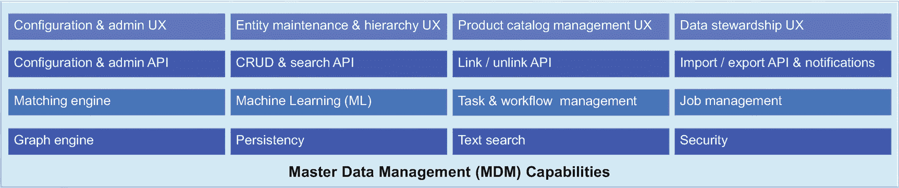
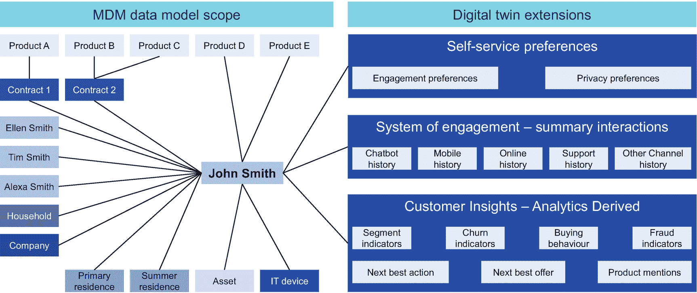
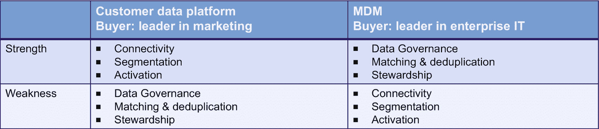
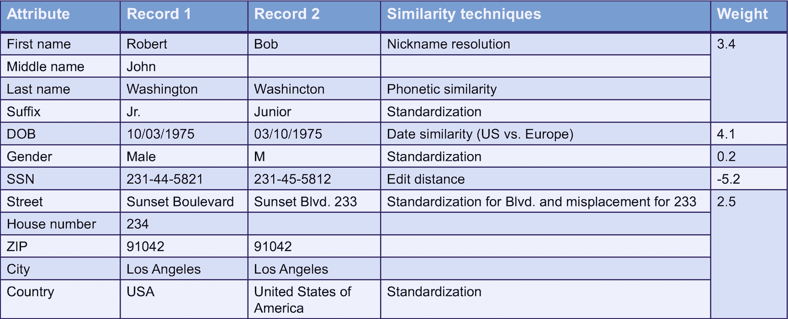
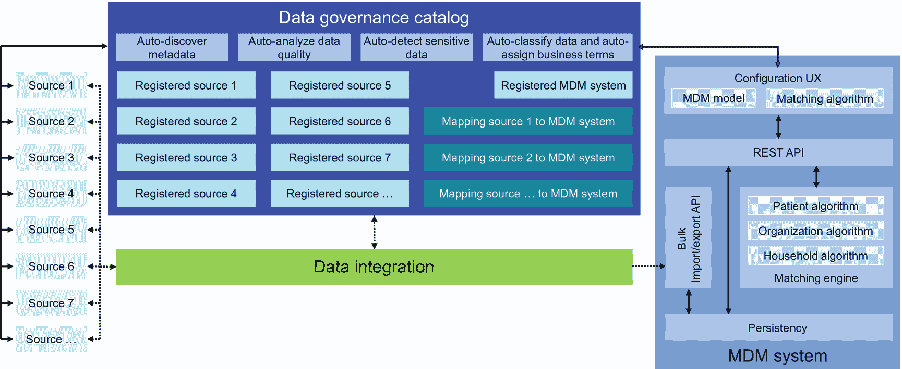
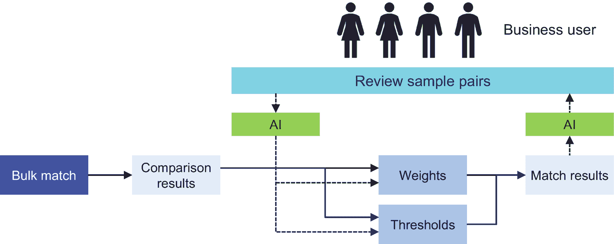
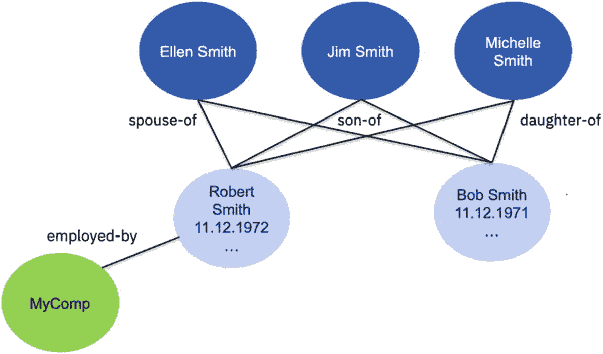
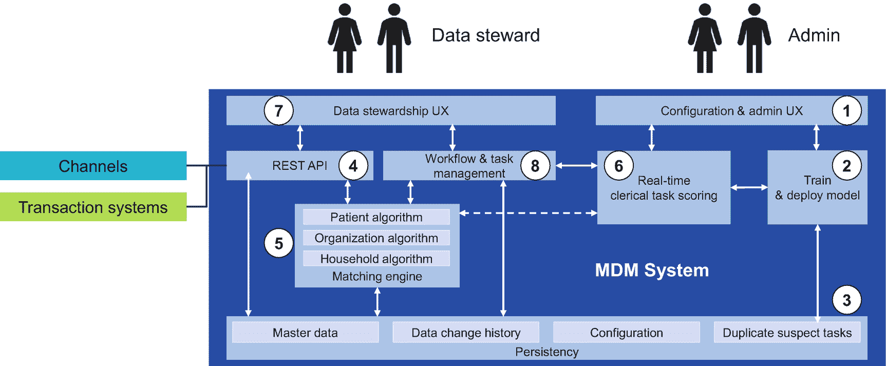
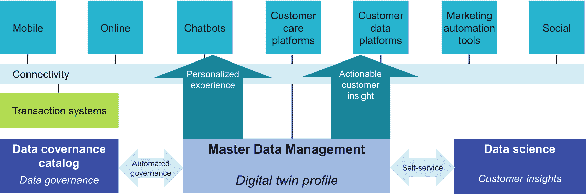
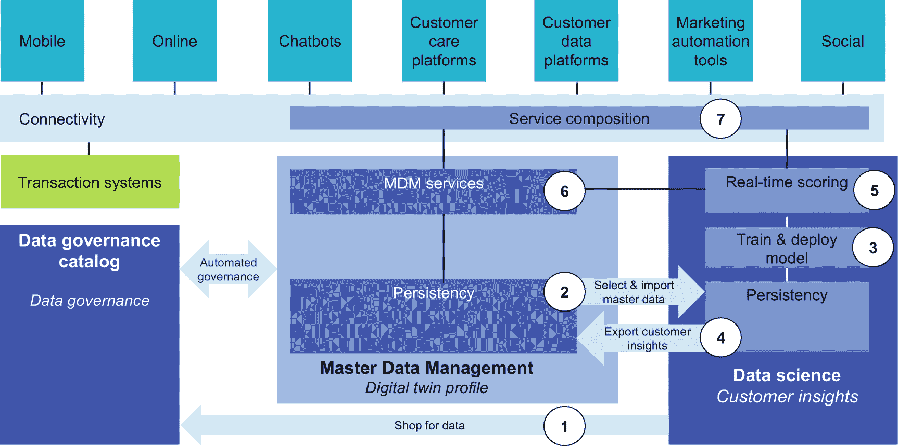

# 9. 将人工智能应用于主数据管理

我们在第 8 章“*人工智能与治理*”中介绍了数据治理以及如何利用人工智能能力使数据治理更智能。许多企业使用的一项相关能力是主数据管理（MDM）。根据行业不同，垂直客户、人员、组织、产品、供应商、患者、员工、公民和资产都是主数据实体的典型示例。MDM 用于提供可信的 360° 主数据视图，这有助于许多关键运营流程，例如客户服务、交叉销售和向上销售、多渠道架构中一致的客户体验，或简化的新产品引入。

来自 MDM 的 360° 视图对于许多分析应用程序也至关重要。它本质上是企业数据仓库中用于报告的可信维度数据，或者是专注于客户洞察（例如最佳下一步报价、最佳下一步行动、客户细分、流失分析或主题与情感检测）的数据科学项目所需的数据源。

如果客户决定采用 MDM，这并非一次性项目。采用 MDM 意味着建立一个项目，通过将 MDM 推广到整个企业来推动持续的业务改进。MDM 项目成功的关键因素之一是有效的数据治理项目。要使 360° 视图可信，必须具有适当的数据质量、数据血缘和访问控制，这些也都是数据治理的方面。许多主数据类型也受到监管，例如，患者数据受 HIPAA 法规约束，人员数据受许多隐私法规（如 GDPR、CCPA 等）影响。简而言之，MDM 和数据治理项目之间存在许多令人信服的交集原因。

在本章中，我们将介绍 MDM 的关键方面，然后展示当今如何将融入人工智能的数据治理能力用于 MDM 解决方案，以及 MDM 本身的哪些领域已融入人工智能。作为本章的第三个主要方面，我们将解释如何利用 MDM 有效地将基于人工智能的客户洞察付诸实践，从而引入数字孪生这一新兴概念。

在下一节中，我们将简要^(¹⁷⁴)介绍主数据管理（MDM）的关键概念。

## 主数据管理简介

MDM 是自 2000 年左右以来数据管理专业人士熟知的一门学科，根据分析公司的不同，MDM 软件和服务市场预计在未来 2-3 年内将增长到总计 70 至 80 亿美元。许多软件供应商，如 Informatica、Tibco、IBM、SAP、Riversand、Semarchy 等，都为 MDM 提供了成熟的软件解决方案。越来越多的 MDM 产品以容器化解决方案的形式在 Kubernetes 平台上提供，用于私有云消费，或作为公共云上的软件即服务（SaaS）解决方案。鉴于 MDM 市场的成熟度，图 9-1 为您总结了当今 MDM 软件解决方案最常见的能力。

图 9-1

主数据管理能力

MDM 软件解决方案的用户体验（UX）通常具有配置和管理 MDM 软件的功能。配置功能通常允许创建和自定义所使用的 MDM 数据模型。管理选项允许，例如，设置用户的访问权限，或根据需要开启用于记录所有数据更改和服务请求的审计跟踪功能。实体维护和层次结构 UX 功能允许搜索、读取、创建、更新和删除主数据记录和实体（实体也称为黄金记录；它们是对主数据记录应用匹配的结果）。

维护组织层次结构、销售区域层次结构、信用风险层次结构或产品类别层次结构只是 UX 中使用层次结构管理功能的几个示例。编写新产品和维护产品目录是另一个需要专门 UX 组件的功能领域。管理 MDM 系统数据质量的数据管理员需要可访问的数据管理 UX 中的全面任务管理和数据质量修复流程。

UX 功能为所有必需的功能使用丰富的 API 层。然而，由渠道应用程序（如在线和移动渠道、CRM 系统、呼叫中心等）使用的实时 CRUD（创建、读取、更新、删除的缩写）和 SEARCH API 承担了大部分工作负载，其中 85-90% 的工作负载来自这些系统的读取请求，10-15% 是写入请求。通知管理会在写入请求修改主数据时通知已订阅的应用程序。用于批量处理的导入和导出 API 用于将主数据初始批量加载到 MDM 系统、增量批处理（例如，来自邓白氏的月度第三方数据源）或批量导出到企业数据仓库或数据科学环境。

匹配引擎用于检测记录是否重复；它以批量、增量批处理和实时模式提供此类功能。我们将在下一节中更详细地探讨匹配问题。当匹配引擎确定两个或多个记录是否重复时，结果可能是非匹配、自动匹配或待定决策，这意味着发现了一些相似性，但不足以进行自动匹配解决。在这种情况下，会为数据管理员创建一个任务，从而产生任务和工作流管理的需求。支持数据质量管理的任务和工作流组件提供了修复已识别数据质量问题所需的人工工作流的所有方面。ML 组件是最近添加到 MDM 系统的组件。我们将在下一节中探讨如何使用 ML 组件将 AI 融入 MDM。有些任务，如初始加载、批量交叉匹配或大型导出，需要作业管理功能来调度这些长时间运行的任务；查看其状态和结果。

基于图数据库引擎的主数据关系图探索、用于存储数据的持久化存储，以及支持易用文本搜索功能的文本搜索后端，也是 MDM 系统中的常见组件。

鉴于主数据被认为是任何企业最有价值的数据资产之一，并且许多主数据域（如人员或患者）受法规影响，因此还需要广泛的安全功能。所需的安全功能通常包括静态主数据加密、支持加密通信（例如 SSL）和可选的消息加密、记录和属性级别的细粒度数据访问控制，以及所有数据更改和读取服务请求的完整审计功能。

### 数字孪生与客户数据平台

在主数据管理（MDM）之后，一个新兴趋势是数字孪生和客户数据平台（CDP）概念的兴起。CDP 是继 MDM 之后的一个新软件细分领域，目前正处于 Gartner 技术成熟度曲线中期望膨胀的顶峰。与 MDM 相比，这是一个规模较小但预计将快速增长的市场。CDP 解决方案的驱动动力源于数字孪生概念，该概念在物联网领域已广为人知，用于创建现实世界物理实体的数字表示。例如，完全配备传感器进行监测的装配线或公用事业网络（燃气、电力、水等）。将数字孪生概念应用于客户主数据，本质上是在扩展客户 360° 视图的基础上，增加更多属性，从而更丰富地了解客户偏好的购买方式、获取支持的方式、收集产品信息的方式，或者客户在社交平台上如何围绕所购产品进行积极互动（或在不满意时发表负面评论）。

这需要将所有交互系统中的所有客户交互链接到客户档案，客户可以通过这些系统直接或间接地与企业互动。图 9-2 展示了传统 MDM 数据模型的范围以及数字孪生概念所要求的扩展。

图 9-2

使用数字孪生属性扩展 MDM 360° 客户视图

请注意，这种观点并非“非黑即白”。例如，一些参与偏好或隐私偏好此前肯定已在 MDM 系统中得到管理。关键在于，这些偏好的深度显著增加了。与客户通过交互系统参与的所有交互触点进行全面链接，是当今变得日益重要的另一个领域。这并不意味着要将呼叫中心的录音推送到 MDM 系统，但你需要知道客户打过电话、通话原因、通话结果、你的哪位员工与客户交谈过等信息。这些摘要交互信息必须链接到客户档案，才能使其成为数字孪生档案。

许多公司已经投资于人工智能以驱动客户洞察。然而，如果没有在能够创造价值的触点上将这些客户洞察付诸实践的策略，它们的作用就不大。在本章最后一节中，我们将展示如何解决这个问题。

在此之前，让我们先比较一下 CDP 和 MDM 平台的优缺点，如图 9-3 所示。

图 9-3

CDP 与 MDM 对比

CDP 供应商众多，以下仅举几例：Blueconic、Segment、CrossEngage、QuanticMind、Scal-e、CustomerLabs CDP、Sprinklr Platform、InsideView 和 Exponea。CDP 供应商通常面向市场营销部门的关键负责人销售，这些负责人尤其看重其在客户细分和激活方面的优势。此外，能够通过大量开箱即用的连接器（例如，Segment 拥有超过 300 个开箱即用的连接器）查看来自所有交互系统的所有客户交互，这对市场营销人员极具吸引力。

MDM 解决方案的购买者通常来自企业 IT 部门，必须解决整个企业的主数据问题。因此，卓越的数据治理、匹配与去重以及管理能力是基本要求，也是许多 MDM 软件供应商的关键优势。

为避免被颠覆，MDM 供应商已开始改进其 MDM 软件解决方案，以更好地满足数字孪生需求，具体措施包括提高灵活性，以便更轻松地向其 MDM 解决方案添加相关的数字孪生属性。他们现在也允许将摘要交互记录纳入 MDM 系统。另一个方向是加强与人工智能生态系统的集成，我们将在本章最后一节讨论这一点。

## 将人工智能融入主数据管理

MDM 解决方案的核心在于其匹配和去重主数据的能力，以及其数据管理能力。目前已知的有确定性匹配技术和模糊概率匹配技术。确定性技术是简单的操作，比如对属性进行精确的字符串比较。然而，主数据通常是在部署 MDM 系统之前就已创建。创建这些记录的应用程序并未针对在适当的数据质量控制下进行优化。

因此，源数据进入 MDM 时，通常带有不同程度的数据质量问题，并且包含大量数据质量问题。图 9-4 仅展示了两个示例记录中数据质量问题的冰山一角。在第四列中，我们列出了一些所需的模糊相似性技术，以评估所显示的两条记录是否匹配。在最后一列中，我们展示了属性的权重。权重可以分配给单个属性（例如，出生日期、性别），也可以分配给一组属性（例如，姓名属性或地址属性）。在判断两条或多条记录是否相同时，并非所有属性都同等重要。

图 9-4

匹配模糊源数据所需的匹配技术

例如，性别列通常具有较少的唯一值。因此，在该属性中找到匹配值的意义不大，其对比较记录整体评估的权重贡献也很小。其他属性，如社会安全号码，则非常重要。在示例中，社会安全号码的编辑距离等于 2（比较值时有两个拼写错误）。在为属性配置权重方案时，您可以分配负值或正值。例如，当模糊相似性被认为相差太大时，该属性实际上应该具有负值，这意味着它会对可能决定不合并记录产生更强的贡献。在所示的示例中，编辑距离为 2 或更大被配置为负权重，编辑距离为 0 将提供较大的正权重，而编辑距离为 1 仍将具有一些正权重。

虽然基于各种模糊比较技术，在姓名和地址属性中发现了一些相似性，但与更相似的值相比，它们贡献的正权重较小。影响权重的另一个方面是匹配的概率。考虑一个德国数据集。姓氏 *Cheng* 与姓氏 *Müller* 相比，在德国数据集中非常罕见，而对于 *Müller*，您可能有很多条目。这意味着，如果您根据姓氏比较记录，比较姓氏为 *Müller* 的记录的概率远高于匹配两条姓氏值均为 *Cheng* 的记录。因此，权重会应用一个缩放因子。对于稀有值，权重会放大；对于常见值，权重会缩小，因为对于频繁出现的值，更容易找到具有相似性的记录。此示例中的总分为 3, 4 + 4, 1 + 0, 2 + 2, 5 - 5, 2 = 5。总分通常与两个阈值进行比较。如果总分低于下限阈值，则为不匹配。如果总分高于上限阈值，则为自动匹配，并且可配置的幸存规则将自动创建一个实体记录，重复项将链接到该记录。如果总分介于下限和上限阈值之间，则表示记录显示出一些相似性，但数据管理员需要做出最终决定，确定这些记录是否关联。在这种情况下，会为数据管理员创建一个任务。

匹配的另一个方面是大规模和高性能地执行匹配。如今，大规模意味着在最大的客户实施中处理数十亿条记录。这给匹配带来了多重挑战。首先，如何对非常大的数据集进行大规模批量匹配，这是 MDM 系统初始加载的要求？这个问题通过数据分区和并行执行来解决。其次，如果向 MDM 添加新记录，或者更新需要重新匹配的现有记录，如何使其以毫秒级的实时性能工作？显然，将一条新记录与包含 20 亿条记录的主数据集中的每一条记录进行暴力比较，是无法在毫秒级范围内完成的。此外，在所有记录中，只有一小部分有可能实际匹配。因此，找到这个执行匹配有意义的潜在候选记录子集是一个有趣的问题。为了解决这个问题，使用了分桶技术，这些技术本质上是将数据聚类，使得具有某些共性（例如，相同的姓氏、相同的邮政编码）的记录彼此靠近。

候选列表是通过比较该记录的相关属性（必须与聚类模式匹配）来确定的，并且候选列表仅包含值对齐的记录。例如，如果要匹配的记录的姓氏为 *Müller*，邮政编码为 *70579*，则只有由 *Müller*、*70759* 给出的聚类中的记录才会出现在匹配的候选列表中。在实践中，通常会使用不同的属性组进行聚类，并且通常会尝试校准它们，使得一个聚类平均包含不超过 200-500 条记录。为了处理数据中的模糊性，您可以设置一个聚类，例如使用姓氏的语音表示和相同的邮政编码，在这种情况下，*Müller* 的语音变体（例如 *Mueller*）也将位于同一聚类中。

在实施 MDM 时，项目计划中通常会有 4-6 周的时间，由一名技术 MDM 专家配置模糊概率匹配引擎，决定使用哪些属性、对单个属性或属性组应用哪些权重、下限和上限阈值应设置为何值等。通过初始配置，所有数据都会被匹配，并与业务用户一起审查结果，以确保匹配结果满足业务需求，然后在结果不够好的地方进行调整。每次迭代通常需要 2 周时间，经过两到三次迭代后，配置通常能满足业务用户的期望。错误的匹配结果是有问题的。例如，如果假阴性过多，您可能会错过洗钱事件。如果您需要遵守反洗钱法规，这可能会产生不合规问题。如果出现假阳性，则可能意味着您合并了两个实际上不同的人的银行账户。因此，尽可能根据您的数据校准 MDM 系统中的匹配引擎，以最大限度地减少假阴性和假阳性，这一点至关重要。

匹配的最后一个挑战是为您的数据管理团队创建的任务数量。假设您向 MDM 系统加载了 2000 万条记录。再假设初始批量匹配的结果中只有 1% 的重复任务。这将为您的数据管理团队产生 20 万个任务。如果您假设一个数据管理员每天处理 50 到 200 个任务，那么很明显，要么需要很长时间才能解决所有这些任务，要么您需要雇佣大量的数据管理员，而这成本高昂。

面对所有这些挑战，一个显而易见的问题是，人工智能如何帮助改进匹配和数据管理？我们将展示人工智能在三个用例中的应用：

1.  利用人工智能简化 MDM 配置

2.  在匹配引擎中运用人工智能能力

3.  利用人工智能能力大幅减少数据管理员的工量

让我们从图 9-5 所示的第一个用例开始。如前所述，初始加载多个数据源，或在后续部署阶段向主数据管理（MDM）系统添加更多数据源，是一个痛苦且繁琐的过程。实际上，这项任务是 MDM 项目中的瓶颈，无法通过增加资源或传统的基于 ETL 的方法来显著缩短。因此，实现价值的时间并不理想。而借助人工智能增强的能力，这一过程变得容易得多。使用 MDM 系统配置界面的数据工程师可以轻松指向一个或多个数据源。同时请注意，MDM 系统已在数据治理目录中注册，并且所有属性都已分配了数据类别和业务术语。

图 9-5
利用人工智能简化 MDM 配置

通过数据治理目录的 REST API，配置界面使用了我们之前在第八章“*人工智能与治理*”中介绍的所有人工智能增强能力，包括：

*   元数据的自动发现
*   数据质量的自动分析
*   自动检测敏感数据（如个人身份信息 PII）
*   自动分类数据并自动分配业务术语

因此，在配置界面中，发现的数据源会自动映射到 MDM 系统的 MDM 数据模型。为了实现这一点，会将源数据的分类结果与分配给 MDM 数据模型的数据类别进行比较。找到匹配项时，映射会被提议为完美匹配；否则，会根据相似度提出建议。数据工程师需要审查提议的 MDM 数据模型映射，并立即批准或在需要时进行调整。每个数据源都会成为数据治理目录中的注册源，如图 9-5 所示，并且每个源到 MDM 数据模型的映射也会被推送到数据治理目录中。

这种自动化水平消除了大量手动步骤，以及在不同数据剖析工具、数据治理目录工具、Microsoft Excel（常用于源到 MDM 的映射）和 MDM 工具之间频繁切换界面的麻烦。最后，基于人工智能，会根据数据源的数据提议一个或多个匹配算法。同样，数据工程师主要需要审查提议的算法，并在必要时进行一些微调。一旦这一步完成，就可以将一个或多个提议的匹配算法部署到 MDM 系统中，并触发初始批量匹配。

图 9-6
人工智能增强的匹配引擎调优

完成这一步后，我们进入下一个用例。如前所述，过去调优一个一流的概率匹配引擎是一项繁琐的任务。借助人工智能，这一情况发生了显著变化，这引出了我们的第二个用例，如图 9-6 所示。当匹配引擎执行匹配算法时，对于每个基于模糊匹配运算符的属性，都会产生比较结果。现在，人工智能的使用使我们能够自动提议一组初始权重来对比较结果进行评分，以及一组初始的下限和上限阈值，从而设定不匹配、待定和自动匹配结果的边界。基于这些权重和初始批量匹配的阈值，就会产生初始匹配结果。

例如，如果你向 MDM 系统加载了 4 亿条主数据记录，在批量匹配过程中，每条记录都会产生一个匹配结果。为了验证匹配配置是否满足业务需求，业务用户可以在样本对审查过程中查看，例如，借助人工智能识别出的 500 到 1500 个相关示例。所谓“相关”，意味着其中一些示例会接近两个阈值的两侧，以便向业务用户展示不匹配与待定、待定与自动匹配的代表性示例。其他示例可能代表相似结果的大聚类。然后，业务用户可以针对每个样本对决定是否同意匹配结果，基本上通过这个标记过程创建一个真实数据集。一旦所有样本对都被标记，就会再次使用人工智能来重新校准权重和阈值。

你不需要重新运行匹配过程，因为对于大数据集上的批量匹配来说，这非常耗时。利用调整后的权重和阈值，你可以立即使用存储的属性值相似度评估比较结果来重新计算匹配结果。如果调整后的权重和阈值产生的匹配结果与上一次迭代相同，则调优过程结束。否则，业务用户需要审查并验证那些因调整权重和阈值而导致匹配结果发生变化的样本对子集。通过这个过程，匹配引擎的调优完成得更快，并且与没有人工智能的手动调优相比，匹配精度也得到了提高。

正如本章前面在图 9-1 的上下文中介绍的，许多 MDM 解决方案将图能力作为解决方案栈的一部分。虽然模糊概率匹配无疑是判断记录是否彼此重复的一种非常强大的技术，但它无法洞察基于主数据图表示的信息。图本质上是一组顶点以及连接顶点的边。主数据可以通过将记录建模为图中的顶点、将记录之间的关系建模为图中的边来表示。现在来看图 9-7。模糊概率匹配能够判断出，对于 Robert Smith 和 Bob Smith 这两个顶点，似乎存在一些相似性（例如，基于昵称解析，名字看起来相似，其中“Bob”是“Robert”的已知昵称；并且出生日期因一个打字错误而存在编辑距离为 1 的差异）。

然而，模糊概率匹配无法看到的是这两个顶点周围的关系网络。如图 9-8 所示，这个关系网络在合理的局部范围内（例如，仅查看距离有限条边^(¹⁷⁵)的相邻顶点）进行比较时，除了与组织顶点“MyComp”的关系之外，几乎完全相同。在这个例子中，为了决定是否应该合并代表 Robert 和 Bob Smith 记录的两个顶点，它们周围的局部子图包含了决策的关键信息。如你所见，这两个顶点都与同一个妻子和同一个孩子有关系。这个关系信息是一个非常强烈的指标，表明这两个顶点所代表的记录应该被合并。

图 9-7
一个图示例

有了这个洞察，就产生了两个问题：

1.  如何利用图表示来改进匹配？
2.  图上的哪些人工智能技术能够改进主数据管理，或驱动其他以主数据为关键来源的分析性有用洞察？

针对第一个问题，已有多种方法被研究^(¹⁷⁶)，用于衡量局部子图相似度。可以将其中一种技术作为附加特征向量，并赋予适当权重，从而将模糊概率匹配与局部子图相似度度量相结合，通过利用图结构来改进匹配结果。

针对第二个问题，一个例子是图神经网络（GNN）^(¹⁷⁷)，它已被应用于诸如链接预测等场景，这基本上意味着要找出图数据中未明确声明的关系。在 MDM 系统中使用 GNN 进行链接预测，例如，可以找到隐藏的关系，这些关系可能是检测欺诈或其他恶意活动的关键线索。用于链接预测的 GNN 可以通过开源 Python 库（如 PyTorch^(¹⁷⁸)）来实现。客户目前正期待 MDM 供应商增强其功能，将此类基于图的 AI 技术引入其 MDM 软件解决方案中。然而，如果将基于 GNN 的链接预测添加到 MDM 中，那么这种预测的可解释性也必须同时具备。虽然对于某些机器学习技术来说，基于 AI 的预测的可解释性更容易实现，但对于使用神经网络方法的预测来说，往往更难。在撰写本文时，研究界正在积极探索基于 GNN 的链接预测的可解释性。我们预计，在未来几年内，一旦可解释性问题得到解决，商业 MDM 软件解决方案中将出现更多基于 GNN 的功能。

下一个用例是融合了 AI 的数据管理用例。^(¹⁷⁹) 像 IBM MDM^(¹⁸⁰) 这样的 MDM 软件提供了 AI 能力，可以显著减少数据管理团队需要处理的文书工作量。

图 9-8 展示了 MDM 系统的概念性概览，其中包含了所涉及的关键组件。其核心思想是，使用机器学习算法从数据管理员处理重复嫌疑任务（即文书工作）的过程中学习他们的决策模式。然后，部署一个训练好的 AI 模型来自动解决大部分未来的任务。在使用 MDM 系统时，数据管理团队需要处理一段时间的重复任务。这会为已处理的文书工作创建一份重复嫌疑任务的解决历史记录。根据所使用的机器学习算法以及是否应用了优化的训练方法，在训练开始之前需要处理的文书工作量会有所不同。

例如，使用随机森林机器学习算法，在训练出的模型产生可靠结果之前，大约需要处理 5000 个已解决的文书任务。采用迭代训练时，在每个训练周期中，会使用聚类技术为数据管理员选择下一个需要解决的文书任务，然后再重新训练随机森林模型，这样所需的已解决文书任务数量可以从 5000 个减少到 250 到 300 个。

图 9-8

基于 AI 的数据管理

这是因为在这种方法中，随机森林算法获得了加速的、有益的训练效果。总的来说，假设您的 MDM 解决方案内置了此功能，其工作方式如下：

1.  一旦处理了足够多的文书任务，管理员用户就可以登录到配置和管理用户界面。
2.  通过配置和管理用户界面，管理员用户可以训练并部署一个机器学习模型。借助这种完全集成的能力，用户界面会显示训练模型的准确率。一旦满意，机器学习模型就会被部署为实时评分服务。
3.  机器学习模型训练所需的数据来自已处理文书任务的解决历史记录，这些记录存储在重复嫌疑任务区域的持久化存储中。
4.  渠道或事务性应用程序调用 MDM 系统的 REST API 来创建或更新主数据记录。
5.  对于创建或更新操作，REST API 会调用 MDM 匹配引擎，该引擎部署了一个或多个算法，并至少调用其中一个来执行匹配操作。
6.  如果发现文书任务，匹配引擎会调用实时文书任务评分服务。基于可配置的预测质量阈值，如果准确率高于配置的阈值，则可以自动应用文书任务评分服务的建议。在这种情况下，不会为数据管理员添加任何任务。如果准确率低于阈值，则不会执行自动解决，并且会为数据管理员添加一个待处理的任务。
7.  数据管理员可以登录到数据管理用户界面。
8.  在数据管理用户界面中，数据管理员可以在收件箱中看到文书任务，并使用重复嫌疑处理工作流来解决它们。一旦从任务列表中选取了一个任务，该任务会再次被评分，因为自任务最初创建以来，底层记录可能已发生变化，并且数据管理员可以看到文书任务评分服务的建议。假设数据管理员同意，可以一键应用所提出的建议。否则，数据管理员可以按照重复嫌疑处理流程逐步解决该文书任务。

其价值主张是巨大的。首先，为数据管理员创建的文书任务数量显著减少，减少幅度可能超过 50%。此外，如果机器学习预测不足以实现自动解决，数据管理员可以看到所提出的建议，并根据自己的判断，部分或全部采纳该解决方案。预测质量阈值最初会配置得很高，直到数据管理员对 MDM 系统中的 AI 感到满意为止。关于 AI 已解决案例的报告，以及显示数据管理员随时间推移同意了多少存疑建议的报告，有助于更准确地设置预测质量阈值。最后，用于检测模型衰退并提醒管理员可能需要重新训练的功能，完善了融合 AI 的数据管理能力的 AI 功能集。

如果您的 MDM 软件没有内置此类功能，您仍然可以通过运行数据科学项目来确定哪种机器学习算法在您的 MDM 软件环境中效果最佳，并将实时评分服务自定义集成到 API 层和数据管理用户界面中，从而获得类似的收益。

## 通过 MDM 实现客户洞察的运营化

如图 9-9 所示，MDM 系统已深度融入运营 IT 架构。根据行业不同，MDM 正在为核心交易系统提供客户数据，例如在银行业中，为信用卡、支票与储蓄账户、抵押贷款及财富管理系统提供数据。

此外，MDM 还向由直接和间接渠道构成的所有交互系统提供客户数据。例如，直接渠道包括移动端或在线渠道。MDM 也为间接渠道提供服务，如客户关怀平台，例如呼叫中心、CDP 或营销自动化工具。

图 9-9
个性化客户体验与可执行的客户洞察

许多数据科学项目专注于在数据科学平台上挖掘更深入的客户洞察。以下是一些客户洞察的示例：

*   客户细分
*   最佳下一步行动与最佳下一步推荐
*   社交媒体渠道上的产品提及
*   话题与情感检测
*   流失指标
*   欺诈风险指标

用于客户洞察的数据科学项目存在两大主要缺陷。首先，数据科学家通常无法通过数据治理目录中的“数据商店”体验找到主数据，因为 MDM 系统与数据治理目录尚未集成，导致 MDM 系统成为未注册的数据源。结果，数据科学家常常花费大量时间从数据质量欠佳的数据源中整理所需的主数据集，即便这些数据可能存在于一个精心管理但无法被发现的 MDM 系统中。

即使 MDM 系统在数据治理目录中已注册为信息资产，它也可能缺乏供数据科学社区自助访问的能力，使其无法搜索、选择并将相关主数据子集导出到数据科学环境中。

图 9-10
通过 MDM 实现客户洞察的运营化

第二个问题是客户洞察如何实现运营化。图 9-10 展示了如何通过将 MDM 系统集成到数据治理目录中并将其注册为受治理的数据资产来实现这一目标。

鉴于 MDM 已连接到许多需要客户数据的关键位置，将 MDM 中的客户 360°视图扩展至 MDM 内的数字孪生档案是合理的，这基于两个关键业务收益。它能够正确地与潜在客户或现有客户互动，因为在 MDM 中拥有所有互动偏好和交互摘要。此外，客户洞察变得可执行^(¹⁸¹)。例如，当最佳下一步行动或最佳下一步推荐显示在屏幕上时，呼叫中心代理、数字销售代表或保险代理人能够以最优方式与客户互动。所有这些方面共同提供了真正个性化的客户体验。

现在，以下步骤成为可能：

1.  **步骤 1**：数据科学家通过“数据商店”体验搜索主数据，并在 MDM 系统中找到主数据。
2.  **步骤 2**：假设数据科学家拥有主数据的访问权限，现在可以使用 MDM 用户界面搜索和探索哪些主数据集最理想地支持数据科学项目。例如，数据科学家可能需要一个特定的客户数据集，其中所有客户处于特定年龄段、特定区域，且均属于银牌客户细分。一旦确定了所需数据集，数据科学家便使用 MDM 批量导出功能将其导出到执行数据科学分析的持久化存储中。
3.  **步骤 3**：使用数据科学工具，数据科学家训练一个新的 AI 模型。
4.  **步骤 4**：如果需要，数据科学家还对客户数据执行批量评分，然后可以利用批量导入功能将结果导回 MDM。
5.  **步骤 5**：训练好的模型作为实时评分服务部署在合适的 AI 运行时上。该实时评分服务可通过易于使用的 REST API 端点进行访问。
6.  **步骤 6**：实时评分服务随后可集成到 MDM 服务层中，这样当新增客户记录或更新现有记录时，评分服务中的 ML 模型能够实时推导出所需洞察，这些洞察与 MDM 系统持久化存储中的其他属性一同保存。
7.  **步骤 7**：或者，通过在连接层使用服务组合，MDM 服务和实时评分服务可以组合成一个单一服务，达到与步骤 6 中所述相同的结果。

通过数据治理目录、MDM 系统和数据科学平台之间的深度集成，更高效的客户洞察项目以及可执行的客户洞察成为现实。

## 关键要点

与往常一样，我们以几个关键要点来总结本章。MDM 已存在二十年，并在过去多年中获得了广泛的市场采用。随着法规数量快速增长以及数据量和种类的爆炸式增长，数据治理流程和工具必须融入 AI 才能保持实用性，我们在本章中展示了这对 MDM 同样有益。同样，MDM 必须通过广泛采用 AI 来演进，以实现更快地集成新数据源，或保持数据管理员工作量的可控性。

表 9-1 总结了本章的一些关键见解。

表 9-1
关键要点

| # | 关键要点 | 高层描述 |
| --- | --- | --- |
| 1 | AI 从根本上简化了最佳概率模糊匹配引擎的配置 | 如果应用基于 AI 的技术自动将新数据源映射到 MDM，并根据 AI 提出匹配引擎配置，则实现价值的时间将大大缩短。使用 AI 进行权重和阈值分配也提高了匹配结果的准确性 |
| 2 | AI 将数据管理员处理 MDM 系统中重复的文书任务的工作量减少了 50%或更多 | 通过学习文书任务的历史解决记录，基于训练好的 ML 模型对新的文书任务进行实时评分，极大地减少了数据管理员的工作量。这是改善数据质量、业务成果和降低成本的重要一步。未解决的文书任务可能代表一个被遗漏的反洗钱案例，导致合规问题及客户流失，因为同一个人仍会收到多份营销材料 |
| 3 | 通过 MDM 实现客户洞察的运营化，使其可执行 | MDM 系统连接到许多交互系统和交易系统。通过将数据科学平台与 MDM 集成，您可以通过 MDM 将 AI 衍生的客户洞察运营化，在客户与您的企业互动时，提供真正的个性化客户体验，并使客户洞察可执行 |

