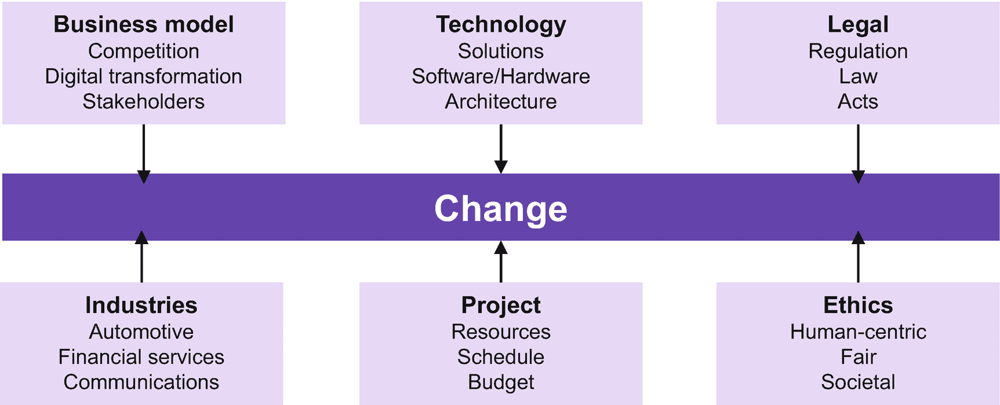
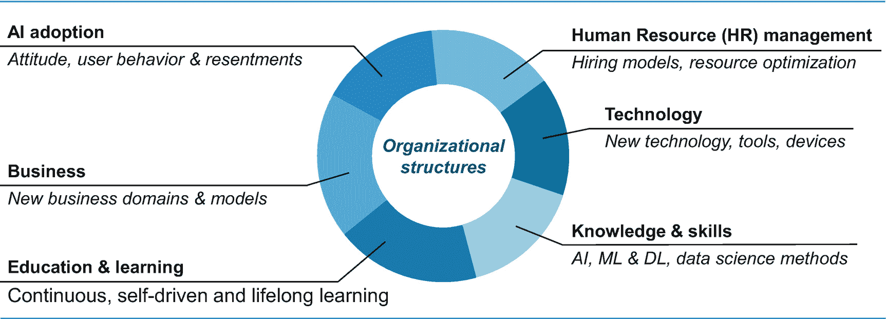
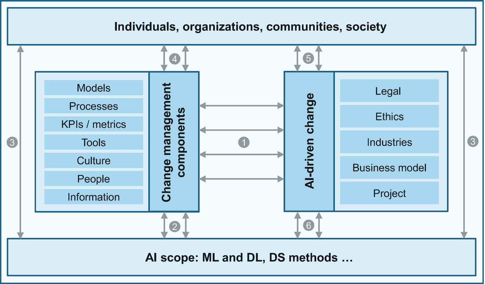
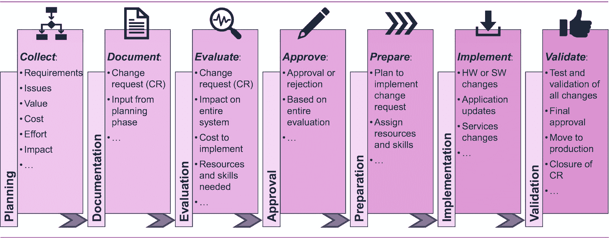

# 10. 人工智能与变革管理

随着人工智能被企业及整个社会日益广泛地采用，现有的变革管理实践亟需进行调整。变革通常被视为一种威胁，会给组织和个人带来不确定性、情绪波动和风险。然而，变革也伴随着新的商业和个人机遇。人工智能有潜力加速并改进变革管理，使其更加精准且以人为本。

本章将阐述人工智能背景下的变革管理，并介绍人工智能变革管理的关键方面，例如识别和分析情绪，以实现更具针对性、成果更优的变革管理。我们还将详细阐述将人工智能融入变革管理所面临的挑战，并强调以数据和信息为驱动的方法的重要性，以便采用人工智能，实现更具洞察力驱动和普遍性的变革管理方法。

## 引言

人工智能将对企业的运营方式、项目的执行方式以及人们的协作方式产生深远影响，例如，通过使用聊天机器人和机器人设备。一方面，人工智能技术为变革管理带来了巨大机遇，可以利用人工智能来改进和增强传统的变革管理方法和工具，例如，应用机器学习算法以更高精度预测项目成果，或发现可能导致项目变更的未知风险。

另一方面，变革管理在适应人工智能方面也面临挑战，这意味着需要牢记人工智能对组织、项目和个人产生的影响，例如，人工智能和机器学习将如何加速组织结构、商业模式和流程的变革，以及人们工作和学习方式的变革。在调整组织内相关变革管理实践时，必须预见并考虑到这一点。人工智能对组织、项目和个人产生的这种影响，要求现有的变革管理学科进行一定程度的调整，其程度是任何先前技术影响所无法比拟的。

在本章中，我们重点关注人工智能驱动的变革管理改进，例如，利用人工智能和机器学习优化 IT 变革管理或推进架构变革管理。这些是更偏技术性的主题。此外，我们还将阐述与项目和人力资源相关的方面，例如，应用机器学习和深度学习方法，将基于社交媒体的情绪分析洞察注入变革管理，以及人工智能和机器学习对广为人知且至关重要的项目管理学科的影响，包括在人力资源管理中运用人工智能和机器学习来简化涉及资源分配的变革管理流程。

## 变革管理的范围

本节将重新审视传统的变革管理，并提供变革管理模型、流程和方法的定义及高层概述。

### 变革管理 – 范围与定义

变革管理通常被视为项目管理的一个学科。然而，以这种方式限制变革管理可能过于狭隘，因为变革不仅仅发生在项目执行过程中。尤其是在人工智能背景下处理变革管理，如果严格局限于项目管理领域，将无法达到预期效果。

图 10-1

引发变革的原因

变革管理需要以明确阐述的业务目标为驱动。很多时候，变革只是为了变革而进行。变革管理工具的可用性加剧了这一趋势，尤其是在客户数据相关项目中，IT 供应商提供的工具常常误导组织在业务目标缺失或不明确的情况下进行变革。

变革的原因更为普遍；变革本身正在加速且影响更为深远，尤其是在人工智能、机器学习以及新的业务场景驱动下。除了与项目相关的变革，我们还需要考虑新的法律和伦理方面、特定行业场景（例如，自动驾驶汽车）和新技术的驱动，以及新兴商业模式带来的变革。图 10-1 展示了一些关键的变革原因，并为组织、个人乃至整个社会实现更恰当的变革管理范围和定义奠定了基础。图 10-1 中引用的行业仅为示例。

在同时考虑这些变革驱动因素的情况下，我们建议将变革管理定义为：一种有组织的、系统性的方法，用于应用知识、工具、流程、模型、技术和资源，从而实现变革的采纳和落地。对于组织而言，这意味着在变革中实现其业务目标和战略。对于个人而言，这意味着简单地接受并采纳新的沟通方式（例如，通过聊天机器人）、通勤方式（例如，通过自动驾驶汽车）或学习方式（例如，通过个性化推荐教育）。对于社会而言，这意味着通过制定例如新的、以人为本的伦理指南来采纳变革。你当然可以看到，人工智能正在为我们审视变革管理的方式设定节奏。

### 传统变革管理

大多数（如果不是全部）变革管理的定义都面向公司、企业、组织和项目。这里仅举两个例子：例如，对于项目管理协会而言，^(¹⁸²) *变革管理是对变革的知识、工具和资源进行有组织的、系统性的应用，为组织提供实现其业务战略的关键流程*。美国人力资源管理协会^(¹⁸³) 将变革管理定义为*管理变革举措的原则和实践，使其更有可能被接受，并获得重塑组织及其人员所需的资源（财务、人力、物力等）*。

不仅是变革管理的定义，变革管理的方法、模型和流程也都围绕组织和项目管理方面展开。^(¹⁸⁴) 传统的变革管理概念不会失去其有效性；然而，我们需要为变革管理方法开发新的思路，以考虑人工智能带来的深远影响。过去，变革管理总是面临与变革的阻力和犹豫、以及倾向于退回熟悉模式和经营方式相关的挑战。随着人工智能渗透到整个社会及其对企业和个人的影响，犹豫和怀疑、拒绝和恐惧，甚至知识和技能上的差距，都促使我们为传统变革管理创造创新理念和范式转变。

由于本章篇幅有限，且变革管理只是本书要讨论的一个特定主题，我们无法详尽地勾勒出一个人工智能变革管理框架。然而，本章的目标至少是介绍开发这样一个框架的关键思想和基石。

## 人工智能背景下的变革管理

在本节中，我们将继续探讨人工智能对变革管理的影响，并列举变革管理将面临的一些重要且关键性的挑战。变革管理始终是（并将继续是）由信息（包括数据）驱动的。借助人工智能，你可以获得新的洞察，这对于使变革管理更加精准和具有针对性至关重要。

因此，在本节中，我们将讨论人工智能通过加速推断新洞察所带来的扩展，这些洞察随后可被变革管理所利用。我们特别强调了人工智能对变革管理的影响，并举例说明了人工智能如何在人力资源、技能与知识以及教育领域，通过新的学习方式推动组织结构的变革。

### 人工智能对变革管理的影响

为了更好地理解人工智能对变革管理的影响，我们首先识别传统变革管理的关键要素或组成部分。我们将审视这些要素或组成部分，看它们需要如何根据人工智能及其相关技术进行必要的调整和扩展。在采用这种方法时，我们应意识到增加新组件的可能性，甚至是必要性。

关于变革管理的模型、方法论、框架、流程、工具及其他方面，有数百本书籍可供参考^(¹⁸⁵)。在本章中，我们需要有所选择并聚焦重点。因此，我们将方法限定在传统变革管理的以下成熟要素和组成部分：

1.  **变革管理模型和方法论**：已有众多变革管理模型和方法论被描述。其中大部分面向组织和项目利益^(¹⁸⁶)；有些则复杂繁琐，且缺乏组织变革方面的考量。人工智能要求对模型和方法论进行增强，以共同包容个人与群体、消费者与用户，乃至整个社会。企业和组织需要将其模型和方法论的范围扩展到项目、组织、团队和员工的直接边界之外，并在远超其舒适区的领域承担领导角色。

2.  **变革管理流程**：变革管理流程包括一系列定义明确的活动或任务，这些活动或任务将变革从其发生转化为根据既定目标成功实施。如果你回想一下图 10-1 中描述的变革原因，就会明显看出，由人工智能驱动的变革管理流程必须包含额外的步骤，特别是要考虑法律方面、伦理道德以及人工智能技术本身。

3.  **变革管理关键绩效指标和度量**：考虑到人工智能，相关的变革管理关键绩效指标和度量可能需要进行调整；可以并且应该增加新的指标。例如，可以利用人工智能和机器学习来自动发现与项目基线的负面偏差，或通过社交媒体分析^(¹⁸⁷)来检测组织外部的关键情绪。

4.  **变革管理工具**：存在相当多的变革管理相关工具，包括治理工具、文档管理和沟通工具、问题和问题管理工具，以及项目管理和调度工具——仅举几例。具备机器学习能力和数据科学方法的人工智能可以并且应该丰富这些工具，以提高精确度和准确性，生成更相关、更具针对性的洞察，并预测、自动发现甚至建议预防性措施。

5.  **变革管理文化**：通过真正拥抱人工智能并引领变革来调整变革管理文化，需要一种开放、敏捷和积极主动的态度。这会影响企业文化和组织文化，以及个人、社区乃至整个社会的文化环境。人工智能将影响变革管理文化。例如，可以利用机器学习和数据科学方法来理解情绪，并提出有针对性和定制化的行动方案。

6.  **人员与人文因素**：人工智能已经对利益相关者、员工、个人和公民、社区以及社会产生了重大影响。变革管理过去是由人领导和推动的。人工智能可能会改变这一范式：人们可能会通过基于人工智能的咨询功能获得帮助；在某些方面，他们甚至可能被掌控主导地位的人工智能驱动的变革管理工具所取代。

7.  **信息**（包括数据）：变革管理强烈依赖于信息驱动。从数据和信息中获得的洞察为变革管理流程（包括建议的行动）提供动力。人工智能强化了这一点，使洞察更具预测性和相关性，并使由此产生的调整行动更具针对性和定制化。

除了上述例子，其他影响变革管理的与人工智能相关的方面，可以从我们在下一节中描述的挑战中推导出来。

### 变革管理面临的挑战

变革管理面临着许多现有的挑战，而人工智能使这些挑战变得更加严峻和普遍；同时，新的挑战也随之出现。表 10-1 列出了最重要的挑战。在某种程度上，这些挑战大多源于我们对变革的理解，如图 10-1 所示。

**表 10-1 变革管理面临的挑战**

| # | 挑战 | 描述 |
| --- | --- | --- |
| 1 | 具有挑战性的法律义务 | 法规只会增加，并引发进一步的变革，影响变革管理，使其变得更加敏捷和响应迅速 |
| 2 | 知识与技能差距 | 对人工智能技术、场景、设备和工具的知识、技能和理解不足，将使变革管理更加困难 |
| 3 | 高度复杂性 | 例如，使用人工智能来改进变革管理工具需要一定程度的易用性和洞察的可消费性，这需要隐藏人工智能的复杂性 |
| 4 | 接受度不足 | 需要在变革管理流程中提出关于沟通和信息宣传的新思路，以解决个人、组织和社会的担忧 |
| 5 | 社会拒绝 | 社会的拒绝可能导致目标设定的变革和调整，也会影响变革管理，使其需要预先考虑拒绝因素 |
| 6 | 伦理关切与不确定性 | 变革管理需要验证和检查伦理关切、以人为本、公平性以及对社会的益处 |

关于伦理关切，实际上有两个相关的方面：一方面，变革管理需要像前面描述的那样进行验证和检查；另一方面，注入人工智能和机器学习的变革管理工具需要遵守既定的伦理准则，例如，它们也需要是公平且为人类所接受的。

这些挑战应作为推导出一套合适的成功标准的基础。例如，针对新人工智能技术的接受度不足或社会拒绝，需要通过适当的信息宣传活动和教育项目、与担忧者进行引导性对话，以及精心规模化的接受度试验来加以解决。

### 推动组织结构变革

组织结构已深受人工智能影响；随着组织在人工智能应用阶梯上不断攀升，这种影响只会愈发强劲且持久。组织需要变得更加敏捷^(¹⁸⁸)和灵活，以便更轻松地接纳和推动变革。这种灵活性与敏捷性体现在人工智能的采用过程中，涉及态度转变、用户行为变化以及时常出现的抵触情绪。在组织内部处理新的人工智能技术、工具、设备、机器人等，将引发组织层面的调整。

图 10-2

对组织结构的影响

随着业务在人工智能影响下发生变化，这意味着组织需要向新的业务领域和模式发展。人力资源管理在工具、招聘模式、资源重新分配和优化流程方面将持续改变。例如，机器学习和数据科学方法将越来越多地被用于改进候选人评估，并将其与现有的职位角色和职责进行匹配。这要求人力资源专业人士具备认知意识并审慎考量，以确保决策的公平性、尊重性和透明度。

过去，组织内部的教育项目已经发生了变化，这主要归功于互联网和在线学习方法。然而，人工智能将再次开启全新的学习方式，例如定制化和推荐式学习、自动发现技能差距或特定领域的优势。组织变革的另一个维度是由人工智能所需的知识和技能所驱动的。虽然并非要求每个人都成为数据科学家或人工智能领域专家，但组织中的大多数成员都需要熟悉人工智能及关键的数据科学方法。

图 10-2 展示了推动组织结构变革的各种因素。

## 人工智能变革管理的关键方面

变革管理应被视为*预见*和*引领*变革，这意味着要主动识别变革机会，这些机会能够提高组织或社区的运营效率，降低项目风险或技术采纳失败的可能性，捕捉并实现新的商业机遇，并优化社会和公共的凝聚力（例如，在通勤、沟通、生活方式等方面）。

利用人工智能和机器学习来提高变革管理学科的效率，涉及多个不同层面。正如我们在上一节所见，用于促进变革管理的现有工具和方法可以通过应用预测分析、关联算法和异常检测机制等方式得到显著改进，从而更精确地预测可能的预算超支，发现事件与风险之间的关联，并在项目周期早期以更高准确率检测项目异常，以降低影响程度。

在本节中，我们仅提供几个示例，用以说明人工智能为变革管理带来的可能丰富性和机遇。例如，可以利用人工智能和机器学习来改进现有的 IT 和架构变革管理流程；也可以运用人工智能方法来改进人力资源管理流程（我们在上一节也已简要提及）。

最后但同样重要的是，我们指出了识别通过众多社交媒体渠道所传达的情绪的重要性，以及其与变革管理的相关性。

### 人工智能变革管理框架

可想而知，开发一个全面的人工智能变革管理框架^(¹⁸⁹)是一项充满挑战且需要精心规划的任务，我们无法仅凭本书的一小部分内容就做到哪怕是最基本的阐述。然而，我们至少打算为这样一个在人工智能背景下的框架提供一些关键思路和设计要点。换句话说，目标是描述在变革管理框架中，*因为*人工智能，哪些内容需要改变以及改变发生在何处。因此，我们描绘的是由人工智能及其相关技术对现有变革管理框架所引发的变革影响：即人工智能对变革管理框架造成的冲击。

图 10-3

人工智能背景下的变革管理框架

这些想法可以作为输入，供感兴趣的读者进一步构建一个更加精细的人工智能变革管理框架。显然，我们是在本章迄今为止所描述的内容背景下进行这项工作，这些内容包括人工智能驱动的变革、关键的变革管理组件或要素、人工智能的影响等等。

变革管理的关联性和依赖性是多方面的。图 10-3 描绘了这些方面之间的相互影响。图 10-3 展示了四个区域或领域：变革管理组件、人工智能驱动的变革、人工智能本身的范围，以及个人、组织、社区和社会。这些不同领域之间存在相互依赖关系——即双向依赖^(¹⁹⁰)。

以下是对这些相互依赖关系的简要描述：

1.  **变革管理组件与人工智能驱动变革的相互影响**：传统的变革管理组件需要调整，例如，由于新兴法规、伦理问题或特定行业需求。伦理和法律方面可能产生特别强烈的影响。反过来，变革管理显然也会影响商业模式和项目。

2.  **变革管理组件与整个人工智能范围的相互依赖**：正如我们已经看到的，人工智能显然会影响变革管理；然而，变革管理甚至可能影响未来人工智能本身的范围。

3.  **个人、组织、社区、社会与人工智能范围的关系**：个人、组织、社区以及整个社会与所有其他领域之间存在相互影响，显然也包括与人工智能本身。

4.  **个人、组织、社区、社会与变革管理组件的相互影响**：这些个人和社区将受到变革管理的影响，并且他们自身也会影响变革管理组件。

5.  **人工智能驱动变革与个人、组织、社区、社会的相互影响**：人工智能驱动的变革将影响社区，反之亦然，社区也会引发变革。

6.  **整个人工智能范围与人工智能驱动变革的关系**：最后但同样重要的是，人工智能技术将创造大部分变革；然而，商业模式和项目需要调整（由于变更请求）可能会识别出人工智能的空白，从而激发对新的、创新性人工智能能力的新想法。

这个提议的变革管理框架可能很直接，甚至很简单；然而，它为进一步的创新想法和完善提供了一个模型。

### 人工智能在 IT 变更管理中的应用

作为人工智能对变更管理影响的一个具体实例，让我们更仔细地审视 IT 变更管理。目前存在众多 IT 变更管理的方法和工具。其中一种方法是 ITIL^(¹⁹¹)，这是一套管理 IT 服务的最佳实践。IT 变更管理被视为 ITIL *服务转换* 阶段中的众多流程之一。最新的 ITIL 第 4 版^(¹⁹²)已纳入数字化转型、精益、敏捷和 DevOps 等新举措和主题。还有其他框架，例如 COBIT^(¹⁹³)；然而，ITIL 包含了相当详细的 IT 变更管理流程描述。

我们打算以图 10-4 中概述的典型 IT 变更管理流程的核心步骤为基础，勾勒出人工智能对 IT 变更管理的影响。变更的范围倾向于 ITIL 最佳实践；变更的影响可能涉及任何 IT 方面，包括软件和硬件、应用和解决方案以及 IT 服务。

上述 IT 变更管理流程是一个通用流程，可以根据具体的 IT 环境进行细化和调整。它也可以根据特定的组织需求进行调整，以实施更敏捷的流程。人工智能对整个 IT 服务管理（ITSM）领域的影响显然远不止于 IT 变更管理。然而，在本节中，我们将讨论严格限制在 IT 变更管理领域。

人工智能对 IT 变更管理的影响将相当深远；它提供了新的范式，其特点是以数据洞察驱动的决策制定和对所有流程步骤的优化。人工智能将通过自动化 IT 变更管理、推荐 IT 环境调整、服务水平改进、新技术能力、架构构建模块和产品等方式，将 IT 变更管理转变为 AIOps 的一个子领域。它能够发现模式，并将变更请求（CR）与以往的 CR 进行匹配，这基于对过往数据的探索，以便复制并学习过去的经验和可用数据。这对于 IT 变更管理流程的评估、准备和实施步骤来说，可能是一个显著的改进。

图 10-4

IT 变更管理流程步骤

人工智能能够对变更请求进行影响分析，以发现由特定请求引起的冲突或问题。用于 IT 变更管理的人工智能不仅可以发现问题，还有潜力制定如何有效响应该请求的策略和建议。正如你在第 8 章“*人工智能与治理*”中所见，人工智能可用于识别与 IT 变更管理相关的各种风险。此外，它还可以自主推荐适当的缓解策略，从而推进变更管理流程的评估步骤。

评估和准备步骤可以更有针对性地执行，例如，通过人工智能的支持，选择所需的产品、服务、工具和解决方案，包括它们之间的依赖关系和先决条件。在所有流程步骤中，基于人工智能对最佳实践、与 IT 环境相关的知识、指南和蓝图以及组织中过往经验记录的分析，可以更专业地处理问题和故障。

人工智能还可用于优化劳动力，即识别管理变更请求所需的技能、主题专家知识和其他资源。在 IT 变更管理流程的初始步骤（规划、文档编制等）中，人工智能就可以用于智能分析项目相关的资料、电子邮件、文档、相关法规、最佳实践论文等。基于人工智能的优化也可应用于流程或工作流本身的优化，将 IT 变更管理转变为一套精益和智能的流程。一般而言，变更管理（同样适用于 IT）可以通过社交媒体分析、理解用户或公众的情绪并加以考虑来得到改进。我们将在下一节进一步探讨这一点。

以上只是关于人工智能如何影响和优化 IT 变更管理流程的一些具体想法。然而，这需要对相应的 IT 变更管理工具进行调整。

### 利用社交媒体分析优化变更

变更管理将受到公众情绪的影响：个人和人工智能应用的用户、组织和社区，甚至公众本身，都将通过论坛和社交媒体积极分享评论。这很可能与表 10-1 中列出的变更管理所面临的全部挑战相关。这些评论、情绪、不满和担忧——尽管很可能被视为负面信息——应被视为变更管理流程中受欢迎的输入。

借助众多的网站、论坛和渠道（例如 Facebook、Twitter、LinkedIn、YouTube、SlideShare、Instagram、Reddit），社交媒体提供了丰富的数据，可用于倾听（监控和质量提升目标）、可视化和分析，从而以全面和普遍的方式理解并应对各种观点和情绪、问题和故障、接受或抵制。

社交媒体分析^(¹⁹⁴)——作为人工智能的一个子领域——可以支持以下业务领域的理想调整（变更）：

*   **竞争洞察**：获取洞察并将您的产品或服务与竞争对手的产品或服务进行比较，可以带来竞争优势。
*   **产品和服务优化**：了解缺陷和差距将推动变更，以优化产品、工具和服务。
*   **接受度提升**：情绪分析有助于发现关键的接受度相关问题，防止组织内外的销售或其他相关指标受到影响，例如伦理问题。
*   **用户体验**：倾听和分析社交媒体可以提供关于用户体验的洞察，例如在使用聊天机器人、自动驾驶汽车、机器人设备等方面。
*   **改进组织结构**：社交媒体分析有助于发现差距（例如知识、技能等），从而建议进行组织调整。
*   **IT 服务管理优化**：可以从社交媒体分析中推导出所需的变更，以进一步优化 IT 服务管理，例如改进服务水平协议。

从上述领域可以看出，社交媒体分析代表了实施变更本身、甚至调整人工智能变更管理流程的机会。

## 关键要点

我们以表 10-2 中总结的几个关键要点来结束本章。

表 10-2

关键要点

| # | 关键要点 | 高层描述 |
| --- | --- | --- |
| 1 | 引发变革的原因众多 | 需考虑引发变革的广泛原因：例如，伦理、法律层面、新兴 AI 技术、新商业模式等 |
| 2 | 理解挑战的全貌 | 变革管理挑战可能发生转变；新的挑战将涌现，例如社会接受或拒绝、高度复杂性、知识与技能差距等 |
| 3 | 组织结构的重大变革 | 组织结构将在人力资源（招聘模式等）、知识与技能、教育与学习等方面经历重大变革 |
| 4 | 需要 AI 变革管理框架 | AI 变革管理框架将更为广泛，并由多重关联和依赖关系决定 |
| 5 | IT 变革管理 | IT 变革管理流程步骤将因 AI 的利用而得到深刻增强 |
| 6 | 社交媒体分析 | 基于 AI 的社交媒体分析得出的情感、评论和不满情绪，应作为变革管理的有用输入 |

