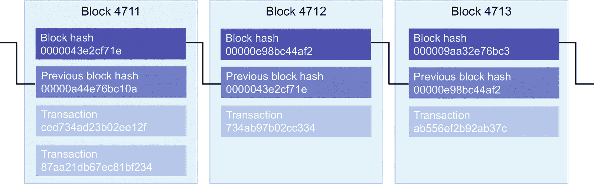
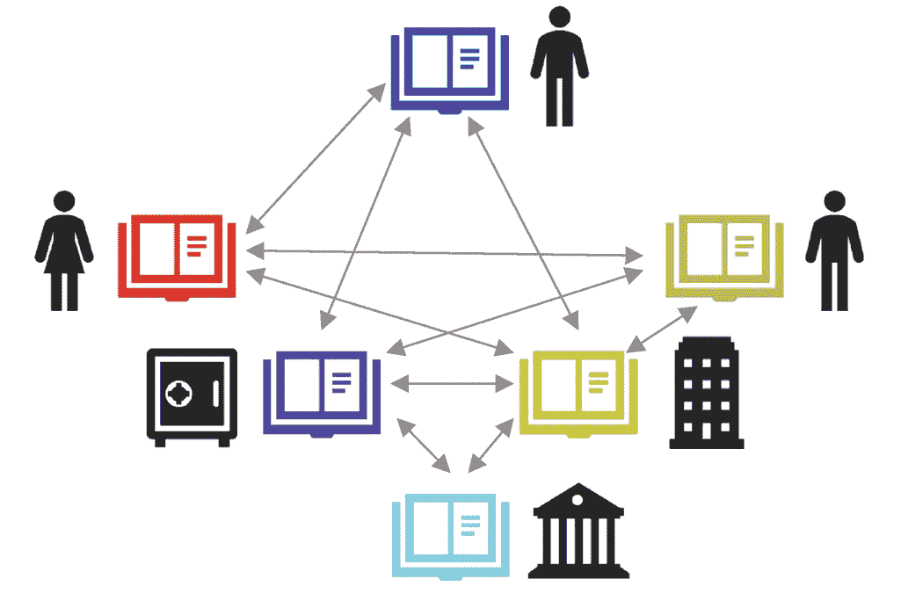
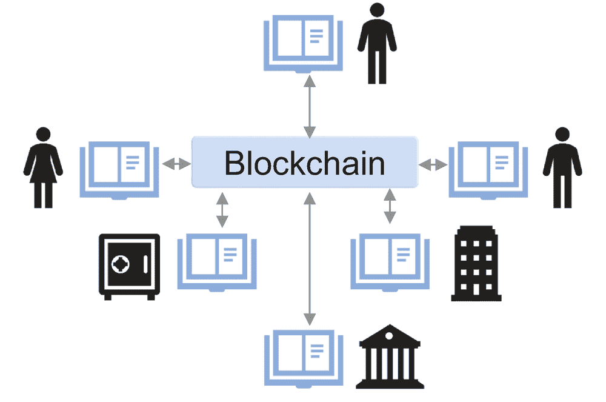
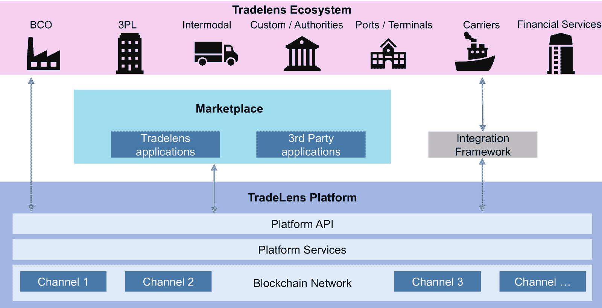
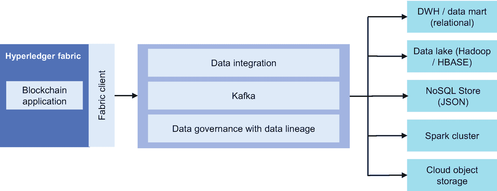
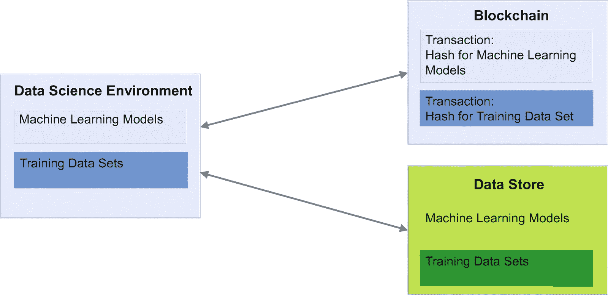

# 11. AI 与区块链

大多数人认为，2008 年由化名中本聪（真实身份至今未知）发表的论文^(¹⁹⁵)引入了区块链的概念。然而，其核心思想实际上要早 17 年。区块链关键概念的首次提及可追溯到 1991 年^(¹⁹⁶)，当时斯图尔特·哈伯和斯科特·斯托内塔首次描述了加密安全链式区块的概念。

区块链的核心是一个不可变的共享账本应用，可用于记录资产交易。资产可以是现实世界中的有形资产，如集装箱、汽车、房屋等，也可以是数字资产，如货币。当今任何区块链技术都采用几个关键概念。首先是智能合约，它是一段代码，封装了在交易中执行的业务条款，这些交易由区块链记录。第二个关键概念是共享账本，它在概念上是一个分布式数据库，保存着已记录交易的记录。这些记录由点对点网络中的多个参与者创建。点对点网络可以是公共的或私有的。每条记录都进入一个区块。该区块通过链表结构与其前驱和后继区块相连——因此得名*区块链*，如图 11-1 所示。

图 11-1

区块链

每个区块都带有时间戳并经过加密保护。区块是不可变的，一旦由区块链对等网络中的参与者创建，便无法更改。区块链技术与众所周知的数据库技术之间的一个关键区别如下：区块链仅支持两种操作——创建新交易和读取已记录的交易。因此，可以将区块链技术视为一种仅可追加的持久化存储。数据库技术则有四种操作：创建记录、更新记录、删除记录和读取记录（统称为 CRUD 操作）。防止单个参与者更改任何内容的机制是通过共识机制实现的。实现共识有多种不同的技术，例如实用拜占庭容错（PBFT）或多重签名。链存储在每个参与者的节点上。实时同步机制使区块链结构始终保持各个对等节点的同步。使用强大的加密算法来确保所有交易都是安全、经过身份验证且可验证的。在许可型区块链中，这些算法还用于确保参与者只能访问账本中他们有权查看的部分。

如今，区块链技术领域大致可分为两大类：

*   **加密货币**：此类中的第一个是比特币；随后出现了许多其他加密货币，如以太坊和瑞波币^(¹⁹⁷)，如今已有数百种不同的加密货币。加密货币是无许可的公共账本。加密货币的核心思想是，它们代表一种没有纸币和硬币的数字货币，你可以在进行在线购物时用它来支付商品。这里^(¹⁹⁸)可以找到关于加密货币的良好介绍。在像比特币这样参与者匿名的公共区块链中，共识是通过工作量证明机制达成的，这种机制计算成本高昂，消耗大量计算资源和巨额电力。剑桥大学^(¹⁹⁹)的研究表明，2019 年 7 月，由于过度使用计算资源，比特币区块链的全球年能耗大约相当于瑞士的年用电量。这一消耗量还在持续增长。

*   **用于共享账本应用的许可型区块链**：此类区块链技术用于企业领域，通常涉及两个或多个企业之间的协作。Hyperledger^(²⁰⁰)区块链是该领域领先的技术范例之一。它是一个由 Linux 基金会托管的开源项目，并得到了埃森哲、IBM 等众多公司的支持。Hyperledger 区块链由多个项目组成。像 Hyperledger 这样参与者身份已知的许可型区块链，可以部署对环境友好得多的共识机制，消耗更少的计算资源和电力。

这两种类型的区块链都用于记录交易。然而，通过在企业领域应用更广泛的许可型区块链创建的交易，从分析角度（AI 在此发挥作用）来看，通常对企业更具吸引力。在本章中，我们将探讨企业领域中许可型区块链的概念，并研究企业实施区块链的原因。之后，我们将展示如何将 AI 技术应用于区块链数据。在科学研究领域，区块链与 AI 交叉领域仍有许多正在进行的研究计划。^(²⁰¹)此外，我们还将介绍一些开始融入区块链概念的技术。这样做的主要原因是，尽管区块链技术备受炒作，但目前很难预测新的区块链技术在企业领域究竟能获得多大程度的采用，以及有多少用例将部署在基于区块链概念进行了增强的现有技术上。在本章的最后一节，我们将讨论区块链技术如何有助于我们在第 8 章“*AI 与治理*”中介绍的 AI 治理。

## 面向企业的区块链

要理解区块链解决方案为企业带来的价值主张，让我们先看看图 11-2。在某些业务场景中，业务流程会跨越多个参与方。每个参与方都有自己的账本。这些账本之间通过定制化的集成接口相连，这些接口可以是批处理、定期、近实时或实时的。因此，其中存储的数据很少能保持同步（这体现在账本的不同灰度上）。此外，这些账本使用的是传统数据库技术，这意味着其安全性依赖于操作它们的管理员。如果其中一名管理员变成心怀不满的员工，或者有技术高超的攻击者窃取了其安全凭证，这些账本中的数据就会面临风险。这些账本中的数据通常包含业务交易，其中许多是敏感的，例如银行账户交易等。简而言之，这种方法效率低下、易受攻击且成本高昂。

图 11-2

传统账本的问题

因此，基于区块链的企业解决方案的承诺是，以更有效、更高效的方式，并配备适当的安全控制措施，建立一个共享的、可信的账本。在下一节中，我们将介绍目前许多企业采用的 Hyperledger 区块链技术。然后，我们将在后续章节中展示一个 Hyperledger 的实现。

### Hyperledger 区块链简介

Hyperledger 是一个由多家公司支持的开源区块链技术。企业采用 Hyperledger 是因为它提供了一个共享、复制且经过许可的账本，并具备共识、溯源、不可篡改和最终性等特性，如图 11-3 所示。每个参与方都运行着 Hyperledger 对等网络中的一个对等节点。这些对等节点通过复制机制保持同步，因此所有六个参与方的所有账本在任何时候都拥有相同的数据。通过 Hyperledger 的通道和私有数据收集功能，您可以控制对交易的访问。您可以使用这些功能，例如，让三个参与方在一个通道上协作，而另一组不同的参与方在另一个通道上参与，并且只能看到他们有权访问的数据子集。是否需要这样做取决于使用 Hyperledger 区块链的业务流程和参与方。

图 11-3

Hyperledger 区块链

Hyperledger 由多个项目组成——以下列表仅为其一小部分：

*   要构建 Hyperledger 解决方案，您需要使用 **Hyperledger Fabric** 账本软件。
*   使用 **Hyperledger Indy**，您可以建立基于区块链的数字身份。
*   **Hyperledger Grid** 通过提供供应链的许多最佳实践（例如编码数据模型等）来加速您的区块链项目。
*   使用 **Hyperledger Caliper**，您可以评估区块链解决方案的性能。
*   **Hyperledger Cello** 可用作区块链解决方案的操作控制台。

Hyperledger 区块链已在许多客户处部署，您可以在前面提到的 Hyperledger 网站上找到案例研究。不过，在下一节中，我们将向您展示另一个示例。

### Tradelens 使用 Hyperledger 区块链

在本节中，我们将介绍一个名为 **Tradelens** ^((202)) 的 Hyperledger 区块链解决方案。Tradelens 由马士基和 IBM 创建，并已拥有数十家来自物流生态系统的其他公司作为合作伙伴。由于边境货物清关是一个政府管控流程，因此多个政府也参与了该解决方案。Tradelens 解决方案的目标是简化物流供应链中所有参与方（如物流公司、政府边境管制机构、运营大型港口或机场航站楼的公司等）之间的数据流。在简化数据交换的同时，它仍需确保安全，以便您能获得证据，例如，当一个集装箱在供应链中从一个保管方转移到另一个保管方时。

图 11-4

Tradelens 解决方案架构

另一个目标是尽可能多地消除基于纸张的手动文档处理。其结果是，供应链中的货物可见性大大提高，港口或航站楼的货物清关可以更快地完成，自动化程度也更高。监管机构能够以更准确的信息全面了解运输链，从而可以将注意力更多地集中在风险分析等方面。

Tradelens 平台的基础是 Hyperledger 区块链，可以为不同的参与方创建多个通道。在 Hyperledger 区块链之上是 Tradelens 平台和 API 服务。通过 API，Tradelens 解决方案生态系统中的参与方（如海关当局、受益货主 (BCO)、远洋承运公司等）可以在收到集装箱或为货物办理清关等操作时，将交易发布到区块链上。解决方案架构^((203))如图 11-4 所示。随着越来越多的参与方转向新的现代化 API，基于新 API 的访问方式可以越来越多地避免以前用作集成框架的 EDI 框架（图 11-4 中的灰色框）带来的诸多痛点。

该解决方案的关键组件运行在 IBM Cloud 上。在撰写本文时，该区块链平台已处理超过 10 亿次事件交易、超过 800 万份文档以及超过 2100 万次集装箱交易。

## 链上分析与链下分析

区块链技术的主要目的是在代表区块链的对等网络中，操作对等节点的参与者之间建立信任的同时，进行分布式交易处理。在 Hyperledger 区块链技术中，持久化基于 LevelDB 或 CouchDB，数据以二进制或 JSON 格式存储。过去几十年构建的许多分析工具（如 IBM Cognos、IBM SPSS、Tableau 等）和数据科学工具（如 IBM Watson Studio 或 AWS SageMaker），都是针对支持 SQL 的关系型数据库等数据存储进行优化的。其中许多数据存储（如列式数据库）已针对支持高级分析进行了优化。另一种主要的分析方法基于数据湖，它使用 Hadoop 平台，并在大量计算节点上进行水平扩展。因此，架构问题在于，你是否可以有效地在**链上**或**链下**运行 AI。链上意味着你将数据保留在区块链系统的数据存储库中。链下意味着你从区块链持久化存储中提取数据，并将其移动到其他地方，在那里你可以应用所有 AI 工具。

让我们首先看看链上分析。在区块链的对等节点上运行分析意味着，分析任务会与对等节点的交易处理竞争相同的、有限的计算资源。因此，与不消耗部分资源的场景相比，如果分析任务消耗了部分资源，对等节点将无法以相同的性能处理相同数量的交易。几乎在任何区块链项目中，都需要满足一些基本的报告需求，例如尝试了多少笔交易、成功了多少笔、失败了多少笔等等。这些是非常基本和简单的仪表盘需求，回答这些问题所需的所有数据都存在于区块链本身。假设你选择的报告工具支持二进制或 JSON 格式，并且能够与区块链的安全功能集成，那么可以通过直接读取对等节点上的数据来生成此类报告。例如，Hyperledger Explorer^(²⁰⁴) 能够报告网络中对等节点的数量、成功交易的数量等。这种方法的好处是区块链交易永远不会离开区块链对等网络，因此保持安全。此外，你无需投资于数据集成和消息传递技术。

然而，这种方法的缺点也很明显：许多需要大量计算资源的高级 AI 功能无法应用，否则会对区块链上的交易处理性能和可扩展性产生重大影响。另一个原因是，区块链数据仍然是二进制或 JSON 格式，并未转换为能以更高性能和规模进行分析的数据格式。此外，许多 AI 场景会使用来自多种来源的数据，而区块链交易数据只是其中一种来源。因此，如果你的 AI 解决方案需要来自多个来源的数据，链上分析在架构上就不是一个合适的解决方案，因为将其他来源的数据移动到区块链上是不切实际的——区块链是为交易处理而非分析设计的。在希望将数据保留在链上，同时又能将其与其他来源的数据结合的场景中，消费区块链交易数据的唯一有效方法是通过联邦。IBM Db2 联邦支持跨多个不同数据源的联邦 SQL 查询，并且在最新版本中，该支持已扩展到 Hyperledger 区块链的对等节点。^(²⁰⁵)

现在我们来看看链下分析。假设保险行业的以下场景。保险公司和保险监管机构使用区块链网络进行协作。保险公司在该区块链网络上发起交易。每笔交易代表一个已结算的、与自然灾害相关的索赔，其中记录了灾害类型和赔付金额。自然灾害可能是野火、洪水等。保险监管机构可以在区块链网络上看到所有这些交易，并且有兴趣预测在何种自然灾害情况下，一家或多家保险公司因无法再结算相关索赔而需要申请破产。为了开发此类预测模型，保险监管机构需要将交易从区块链提取到分析环境中，在这些环境中，这些交易可以与来自其他来源的实时天气数据等相结合，以确定是否存在大规模野火、洪水等风险。当然，这只是众多示例中的一个，说明区块链交易可以成为 AI 的相关数据源。

一般来说，此类场景需要将数据从对等节点移动到应用 AI 技术的分析环境中，如图 11-5 所示。

图 11-5

链下分析

根据具体场景，在区块链网络中运行对等节点的参与者可能希望将其有权查看的部分或全部数据移动到分析环境中。如图 11-5 所示，有许多不同的可能目标，例如数据仓库、数据湖、数据集市等。它们可以位于私有云或公有云环境中。数据传输可以使用来自 Informatica 或 IBM 等供应商的传统数据集成工具，或 Nifi 或 Airflow^(²⁰⁶) 等开源工具，以批处理方式进行。如果你需要将区块链上发布的交易近乎实时地复制到你的分析系统，那么你需要消息传递工具，例如开源 Kafka 消息系统或商业同类产品。

Hyperledger 有一个事件中心机制，你可以在其中为交易事件创建订阅，这些事件可以发布到消息总线，并从那里路由到你的分析系统。无论你是进行批处理或持续数据传输，还是先进行初始批处理然后持续复制所有后续更改，一旦批处理传输完成，你部署的技术都必须支持与区块链系统安全架构的集成。

对于 Hyperledger，这需要身份验证和数字证书集成。在链下分析场景中，你还有一个额外优势，即可以将区块链中的二进制或 JSON 数据转换为更适合 AI 的格式。例如，你可以使用 Kafka 将数据从 Hyperledger 无缝复制到公有云上的 IBM Cloud Object Storage，以便将数据与你可能拥有的其他数据资产放在一起。然后，你可以使用 SQL 查询^(²⁰⁷)服务将 JSON 格式的区块链数据重新格式化为更利于分析的格式，然后在其上运行大规模基于 SQL 的分析或任何其他 AI 算法。这种方法的两个缺点是：

1.  一旦数据离开区块链，它就有可能被篡改，因为它不再受区块链不可篡改特性的保护。
2.  与链上分析方法相反，你需要数据移动工具，这至少会带来运营成本，如果是商业软件，还可能产生许可成本。

总而言之，链下分析方法支持更广泛的用例，具有更好的扩展性和性能特征，并且允许在区块链数据上执行更多种类的 AI 技术。在可预见的未来，这很可能是将 AI 应用于区块链数据的最常见方法。

## 现有采用区块链概念的技术

尽管目前已有大量区块链技术可用，但区块链的采用仍因多种原因面临挑战，以下列表仅是其中一小部分担忧^(²⁰⁸)：

*   **技能**：在企业内部引入区块链技术需要培养新技能，要么对现有 IT 员工进行培训，要么招聘具备相应技能的人才，而这类人才并不容易找到。

*   **缺乏行业标准**：在事务处理和分析处理领域，SQL 已成为标准，并得到当今 IT 行业大多数供应商的支持。对于区块链技术而言，类似的标准及其采用仍悬而未决。

*   **区块链解决方案的引入具有颠覆性**：业务流程和 IT 架构需要重新设计，以采用能从区块链中受益的新业务流程。这对现有 IT 基础设施具有颠覆性，熟悉现有流程的人员需要接受新流程的再培训等。

*   **有限的事务吞吐量**：与（分布式）关系数据库管理系统相比，有限的事务吞吐量也被视为当前区块链技术的一个重大限制。尽管近年来取得了显著改进，但人们仍担忧区块链技术能否达到广泛采用所需的事务吞吐量。

一种不受上述多项问题困扰的技术是（分布式）关系数据库。有大量熟练的领域专家可用，SQL 已标准化且得到良好支持，几乎所有数据科学工具都能出色地支持这些数据源，并且它们能以极高的吞吐率处理事务。毫不意外，供应商已迈出第一步，将关系数据库与区块链技术的优势相结合。因此，像 Oracle^(²⁰⁹)这样的数据库供应商在其现有关系数据库中增加了区块链功能。Oracle 引入了一项名为*区块链表*的功能。其核心思想是允许使用仅追加表，这种表限制了对这类表仅进行创建和读取操作，并具备适当的功能使其防篡改，适用于不可否认性属性。这种方法的好处在于，企业可以在无需跨企业协作的环境中，利用已有的基础设施和技能，发挥类似区块链的能力。

除了成熟的商业数据库供应商在其现有数据库技术中添加部分区块链功能外，一批新供应商也进入了区块链数据库市场，例如 BigchainDB、Fluree、ProvenDB 和 AWS 量子账本数据库（QLDB）^(²¹⁰)。它们的共同特点包括不可变性、透明性、基于密码学的安全性以及通过 SQL 实现的可消费性。

内部欺诈预防、针对恶意数据库管理员或数据库管理员凭证被黑攻击的篡改防护，以及合规用例，只是数据库中添加的类区块链功能能提供显著价值的部分示例。另一个优势是，在已增强区块链功能的数据库技术中处理的数据具有一个显著优点：大量数据集成工具和 AI 工具都能极好地支持它们。数据库中的区块链功能可以解决某些区块链用例，但肯定不是全部，尤其是涉及多个企业的用例。然而，如果你的用例允许仅使用具备区块链功能的数据库，那么你的数据科学团队肯定能更轻松地利用此类数据源进行 AI 应用。

## 利用区块链进行人工智能治理

如第 8 章“*人工智能与治理*”所述，人工智能治理日益受到关注。欧盟于 2020 年 2 月发布了一项人工智能法规^(²¹¹)，以解决以下关键问题：

*   我们如何确保数据集不存在偏见且具有充分的代表性？
*   我们如何提供关于训练、测试、数据选择以及所使用的人工智能算法的强制性文档？
*   我们如何以自动化方式向消费者提供关于所应用的人工智能能力及其局限性的信息？
*   我们如何确保人工智能决策的稳健性、准确性和可重复性？
*   我们如何通过审批和监控将人类监督整合到我们融入人工智能的业务流程中？

为了更好地理解这些问题为何至关重要，请思考以下场景：如果银行使用基于人工智能的预测模型来决定你是否能获得抵押贷款以及贷款条件，或者保险公司使用基于人工智能的模型来决定你的索赔是否被接受以及赔付金额，你可能会想知道这些模型的可靠性如何、由谁训练等等。在机器人群体生态系统中，个体智能体协同工作以实现群体目标。然而，它们的决策是去中心化的，并且可能基于人工智能算法。在此类用例中，机器人做出决策，结果基于多数原则。基于人工智能算法的投票本质上就是一笔交易。同样，在机器人群体生态系统中，当机器人使用基于人工智能的决策时，你如何知道结论是如何以及为何得出的？如第 8 章“*人工智能与治理*”所述，像 IBM Watson OpenScale 这样的工具可以解决上述部分问题，例如训练集是否存在偏见，或者模型是否随时间推移而发生漂移等。

IBM Watson OpenScale 及类似工具并未解决提供完全透明且防篡改的审计追踪的需求，例如谁训练了机器学习模型、模型使用了哪些数据集进行训练、在特定时间点使用了哪个版本等。这正是人工智能和区块链技术能够完美互补之处，如图 11-6 所示。

图 11-6

区块链管理人工智能模型及相关训练数据集

其核心思想基本上是在区块链上建立存在性证明，记录哪个机器学习模型由谁在何时使用哪个数据集训练、部署了哪个版本等信息。将可能用于人工智能项目训练模型的大量数据推送到区块链上可能并不可行。这可能是由于结构化或非结构化数据集中单个项目的数量或大小所致。因此，更实用的方法是将人工智能模型和训练数据集存储在区块链外部的数据存储中，如图 11-6 所示。然而，您可以将加密安全的哈希值（概念上相当于模型和训练数据集的唯一指纹）以及模型训练者、模型版本号等其他关键属性推送到区块链上。如果您之后想要验证数据存储中的某个特定机器学习模型和训练数据集是否确实是被使用过的，您可以轻松检测是否有人篡改过，因为哈希值将与您在区块链上找到的哈希值不一致。因此，区块链的不可篡改性保证了您拥有一种防篡改的方式，来证明在基于人工智能的业务流程做出关键业务决策时，是哪个人工智能模型在运行。

更进一步，通常用于机器学习预测的输入数据相对较小。每次使用人工智能模型进行决策时，您都可以利用区块链创建一笔交易。区块链上的此类交易只需包含两样东西：

*   所用机器学习模型的哈希值，因为关于该模型的所有细节都可以通过查看最初记录该模型哈希值的交易来找到，并可选地从那里访问外部数据存储。
*   如果输入值足够小，则包含输入值本身；否则包含输入值的哈希值。如果输入值过大，它们可以存储到区块链外部的数据存储中，其中记录所有完整值。

例如，这种方法对于机器人群体生态系统（像区块链本身一样的去中心化系统）或前面提到的融入人工智能的业务流程示例非常有用。区块链具有以下特征：不可篡改性、数据完整性、抗攻击性、确定性和去中心化。如果将其与基于一定概率预测置信度、波动性、持续变化（模型需要重新训练以避免模型漂移）以及基于深度分析做出正确模型中心决策的人工智能进行比较，您会发现这两种技术截然不同，但彼此互补：然而，如果将它们结合起来用于人工智能治理，您将实现：

*   增强的数据安全性
*   去中心化智能
*   高效率
*   提高对融入人工智能的业务流程决策或机器人群体决策的信任度

简而言之，通过使用区块链，您可以创建一个包含所有人工智能相关工件以及涉及人工智能的业务决策的分类账，从而提升您的人工智能治理能力。

## 关键要点

我们照例以几个关键要点来总结本章。区块链会产生交易数据，应运用人工智能从中挖掘有价值的洞察。这可以在链上有限范围内实现，也可以在链下全面实现。我们还展示了，区块链能力已被添加到数据库等传统技术中，为企业内的特定用例提供了比运行完整区块链解决方案更可行的替代方案。最后，如果你利用区块链来证明你的 AI 模型是如何开发的、以及在特定时间点使用的是哪个版本，它有助于建立信任。

表 11-1

关键要点

| # | 关键要点 | 高层描述 |
| --- | --- | --- |
| 1 | 许可区块链适用于企业用例 | 像 Hyperledger 这样的许可区块链是私有区块链，参与者的身份是已知的。其共识机制的资源消耗远低于加密货币区块链。交易是不可篡改的 |
| 2 | 区块链应用产生交易数据 | 区块链应用本质上是记录与物理或数字资产相关交易的交易系统。与任何其他交易数据类似，人工智能可用于检测这些交易中隐藏的深层洞察 |
| 3 | 链上分析与链下分析 | 链上分析会与交易争夺对等节点的计算资源，并且区块链技术的持久性相比其他分析环境优化不足且适用性较差。在可预见的短期到中期内，链下分析是更好的选择，因为你可以将区块链交易与其他数据源结合，并受益于能够在为可扩展、高性能 AI 设计的环境中应用所有 AI 能力 |
| 4 | 区块链能力已被添加到现有技术中 | 除非你的区块链用例需要跨企业协作，否则你可以在数据库技术中利用区块链能力，这些技术在你内部拥有技能和现有基础设施，能够提供成本更低的解决方案 |
| 5 | 区块链可用于为你的 AI 驱动应用提供可信溯源 | 区块链的不可篡改特性可用于 AI 治理，你需要证明 AI 模型是在何时、何地、由谁训练，以及基于哪些数据集完成的 |

