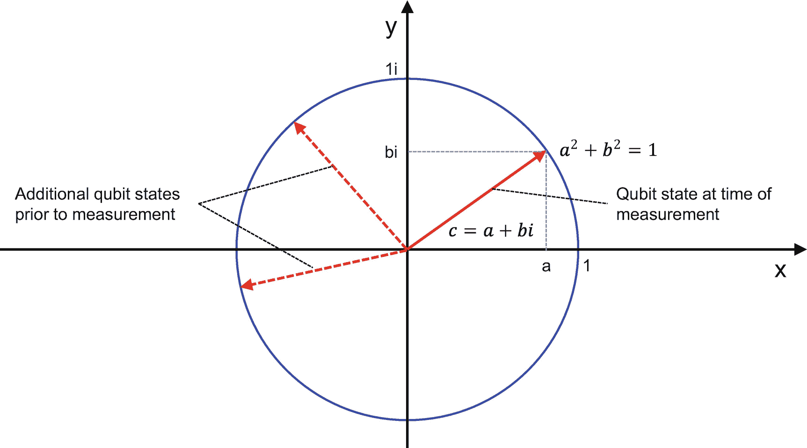
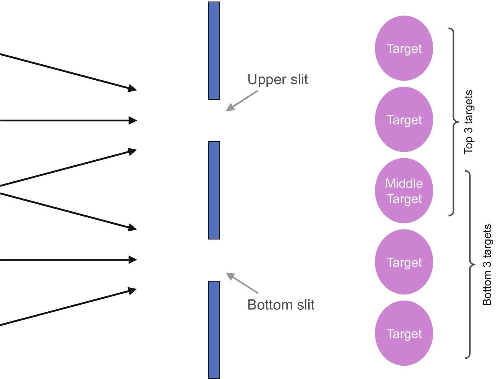
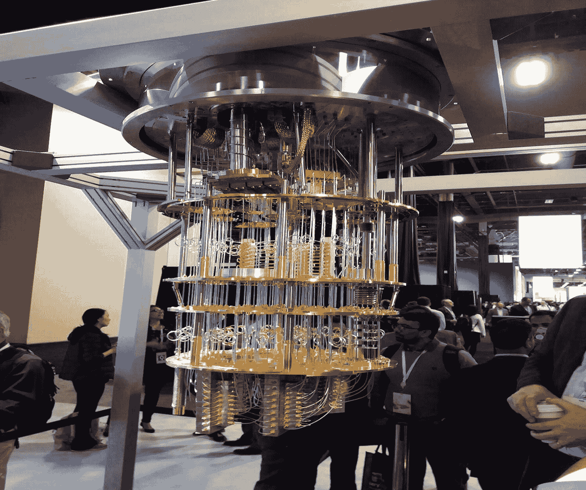
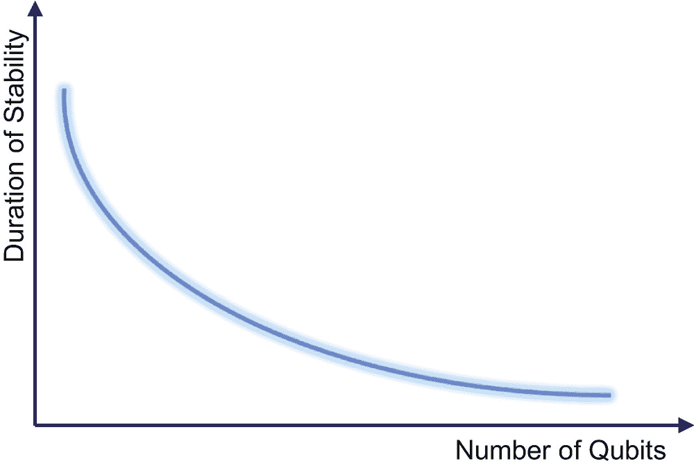
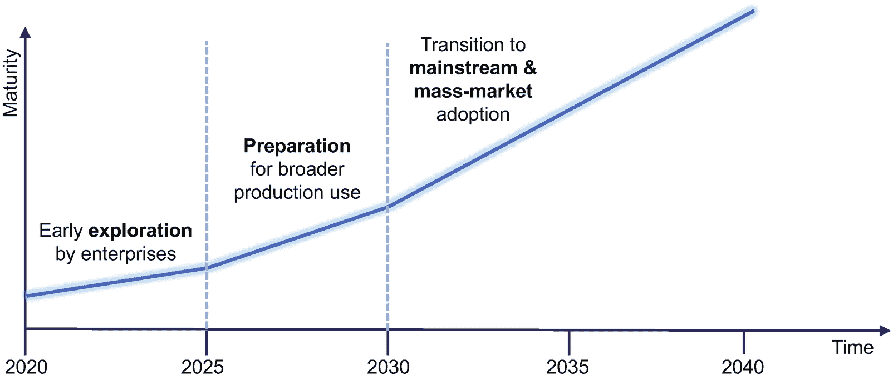
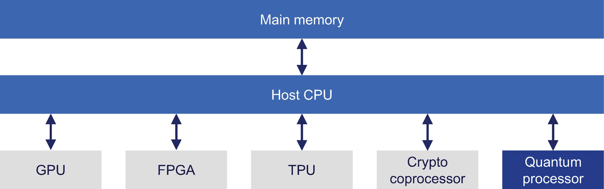

# 12. 人工智能与量子计算

诺贝尔物理学奖得主理查德·P·费曼是量子力学和量子电动力学领域的物理学家思想领袖。1982 年，他发表了一篇题为《用计算机模拟物理学》的研究论文^(²¹²)。在这篇论文中，他提出了一个问题：量子计算机是否能够被建造（他认为可以），或者经典计算机能否模拟真实量子系统的概率行为（他给出了明确的否定答案）。这篇研究论文激发了科学研究界的兴趣，他们开始认真探索量子计算机是否真的能被建造出来。

在本章中，我们将探讨现有处理架构与真正量子计算机之间的区别。然后，我们将研究肖尔算法——一个量子计算机擅长的典型问题示例——以帮助你理解哪些问题最适合用量子计算机解决。之后，我们将审视当今人工智能与量子计算的现状。最后，我们将展望量子计算和人工智能领域在未来几年内预计的发展方向。

## 什么是量子计算机？

如今有许多不同的处理器架构，例如 ASIC、FPGA、GPU、TPU、POWER、ARM 等，如表 12-1 所示。几十年来，这些处理器架构的优化一直遵循摩尔定律，即大约每 18 个月，计算机芯片的性能就会翻一番。

表 12-1

处理器架构

| 架构 | 高层描述 |
| --- | --- |
| 冯·诺依曼 | 这是当今许多台式机或笔记本电脑中使用的通用硬件架构。根据冯·诺依曼规则，在此类设备中无法同时执行取指令和数据操作，这在性能上并非最优。其主要优点是可以运行广泛的软件——但未必针对性能进行优化 |
| ASIC | 专用集成电路：这些芯片经过优化，将解决特定问题的软件逻辑嵌入到具有最佳性能的硬件布局中 |
| FPGA | 现场可编程门阵列：这基本上是冯·诺依曼架构和 ASIC 架构之间的中间地带。它允许你在一定程度上重新配置硬件（因此称为“现场可编程”）以优化性能，而名称中的“门阵列”部分指的是该架构中存在的二维逻辑门阵列 |
| GPU | 图形处理单元：与 CPU 相反，这些芯片并非针对延迟（即尽快完成任务）进行优化，而是针对吞吐量。最初，它们的主要应用是加速计算机游戏的图形处理。如今，它们也被用于高性能计算领域 |
| TPU | 张量处理单元：该架构最初由谷歌开发，用于加速谷歌的机器学习框架 TensorFlow |
| POWER | 该处理器架构最初由 IBM 创建。POWER 是“增强 RISC 性能优化”的缩写，也被日立等其他公司采用。自 2019 年起，OpenPower Foundation 倡议由 Linux 基金会管理。IBM 拥有围绕 POWER 架构的服务器业务 |
| ARM | 该芯片架构由 ARM 有限公司拥有，缩写 ARM 在不同时期有不同的含义（例如，高级 RISC 机器）。该架构的关键设计点是低能耗同时保持高性能。这使其成为嵌入式计算的理想平台，当今大多数智能手机和平板电脑（iPhone、Android）都运行在 ARM 处理器上 |

然而，随着晶体管尺寸已缩小到几个原子的尺度且无法进一步缩小，这一过程现在正触及物理极限。电子是否流过晶体管栅极基本上决定了状态是 0 还是 1。任何进一步缩小晶体管尺寸都会使电子通过一种称为量子隧穿的物理效应，在栅极关闭时到达另一侧，这基本上会使晶体管失效。虽然通过增加更多核心仍有可能提高计算机系统的性能，但缩小晶体管尺寸的过程正在走向终结。

鉴于当今存在所有这些不同类型的处理器架构，并且通过缩小晶体管来获得性能提升的前景不大，你可能会想，为什么还要创造另一种我们称之为基于量子架构的量子计算机呢？

要回答量子计算机的架构为何与传统计算机存在根本性差异，我们需要深入探究传统计算机的功能。尽管前述的处理器架构在某种程度上有所不同，但它们有一个共同的基础：它们使用比特来管理状态，一个比特可以持有 0 或 1 的状态，其中在物理层面上，0 表示电流未通过晶体管栅极，1 表示电流通过。基于这一基本原理，人们构建了专门的逻辑门，例如，非门（NOT gate）输出相反值，与门（AND gate）仅在两个输入都有信号时才返回 1，等等。量子计算机中比特的对应物被称为**量子比特**（qubit，quantum bit 的缩写）。

本质上，量子比特是一个复数 *c* = *a* + *bi*，由实数 *a* 和虚数 *bi* 组成，其中 *a*² + *b*² = 1。一个量子比特可以存储 2 个传统比特的信息；2 个量子比特可以存储 4 个传统比特的信息；3 个量子比特可以存储 8 个比特（即 1 字节）的传统信息；拥有 30 个量子比特，你可以存储 128 MB；31 个量子比特对应 256 MB；以此类推。换句话说，每向量子计算机增加一个量子比特，其能处理的信息量就会翻倍，呈现指数级增长。大约 45 个量子比特，你就能持有与当今最大型超级计算机相当的信息量。大约 50 个量子比特时，你将达到量子霸权，即能够计算当今最大型超级计算机无法解决的问题。

量子比特具有称为**叠加态**和**纠缠态**的特殊属性。我们将在接下来的两个小节中探讨它们。

### 叠加态

与传统比特相反，量子比特基于称为叠加态的效应，同时持有 0 和 1 的组合状态。这意味着一个量子比特可以同时持有多种状态——0 和 1 的任意比例。请注意，量子比特不必处于 0 或 1 这两种状态中的任何一种。在测量之前，一个量子比特（由复数 *a* + *bi* 表示）可以在半径为 1 的圆上取任意值，如图 12-1 中两条虚线箭头所示。这个量子比特的值可以被有意改变。在测量时刻，量子比特需要确定其值是 0 还是 1（这是它与传统比特的相似之处）。例如，可以通过以下非常直接的方式做出决定：如果 *a*² > 0，则量子比特值确定为 1；如果 *a* = 0，则量子比特值确定为 0。

图 12-1

作为复数的量子比特

在量子计算机中，测量时量子比特是处于 0 态还是 1 态，取决于量子概率。量子概率与许多人通常基于生活经验所理解的概率截然不同。

例如，如果你抛一枚完美的硬币，硬币落在任何一面的概率都是 50%。此外，每个结果的概率之和为 1。如果你掷一个六面骰子，每个数字朝上的概率是 1/6，并且如果你将所有结果相加，它们之和也为 1。在这些场景中，有一个特定的条件在起作用。如果我们假设你有概率 *a* 和概率 *b*，那么以下条件始终成立：*a* + *b* ≥ *a*。这是基于这些例子中的概率计算仅使用实数这一事实。在量子计算和量子比特的世界里，概率是基于复数计算的。如前所述，复数由 *c* = *a* + *bi* 给出，其中 *a* 和 *b* 是实数，*i* 是虚数单位。为了理解测量量子比特值时的概率方面，请考虑图 12-2 中展示的双缝实验示例。

图 12-2

双缝实验

首先，我们使用图 12-2 的装置进行传统考量。假设我们有一个从不失手的完美射手。射手有 50%的概率穿过其中任意一条狭缝。双缝实验装置的设置使得通过上方狭缝，射手可以从上方击中三个目标；通过下方狭缝，射手可以从下方击中三个目标。这意味着中间的目标可以通过两条狭缝被击中。如果我们计算任何一个目标被击中的概率，我们会得到上方和下方各两个目标的概率为 1/6，而中间目标的概率为 1/3（1/6 + 1/6）。

现在让我们考虑相同的装置，但不再使用符合经典物理定律的子弹。相反，我们现在使用发射光子的激光，光子遵循量子力学定律。我们再次使用复数进行相同的计算。在这种情况下，我们想知道光子击中中间目标的概率。如果你进行计算（这需要使用复数），你会发现光子击中中间目标的概率为零。这是计算击中中间目标概率所需的计算^(²¹⁸)：

这背后的现象称为干涉。在本节开头，我们提到处于叠加态的量子比特同时拥有代表 0 和 1 比例的所有可能状态。在这里，实际上我们的光子同时处于多个位置——这就是叠加态。它同时穿过两条狭缝。在另一侧，它可以自我抵消。这就是干涉。如果你向水中扔石头，你可以观察到有时波浪会叠加，而有时——由于干涉——会相互抵消。干涉是量子世界中概率计算不满足 *a* + *b* ≥ *a*（对于给定的两个概率 *a* 和 *b*）的原因，因为它们现在是复数。

在经典计算机中，如果你有 8 个字节，你在任何给定时间点只能存储 256 种状态中的***一种***。而拥有一台 8 个量子比特的量子计算机，你可以同时存储***所有***256 种状态。换句话说，通过叠加态，量子计算机可以同时持有许多状态。想象一下，如果你能将一台量子计算机置于经典计算机的许多不同状态中，但都在同一时间点。如果你随后能同时对所有状态执行操作，你就拥有了终极的并行处理能力，这正是量子计算最大的前景所在。

### 纠缠

两个或多个量子粒子可以相互纠缠。激光已被用于创建处于纠缠态的量子粒子。一旦量子粒子发生纠缠，它们就会完美地关联。如果一组纠缠量子粒子中的一个量子粒子改变其状态，另一个粒子也会立即随之改变。有趣的是，无论距离多远，这一特性都成立。纠缠的应用可见于量子通信和量子密码学。在量子通信中，其理念是利用两个通信方之间的纠缠，使得接收方只有在发送方和接收方事先处于纠缠态时，才能处理传输的量子比特。如果有人试图在中间窃听通信，窃听者无法对被截获的量子比特做任何事，因为窃听者缺少用于解码的第二个量子比特。任何通过测量来理解该量子比特的尝试都会提醒发送方和接收方有窃听者存在，因为这会导致纠缠态的坍缩。

### 量子计算机

在理解了叠加和纠缠之后，现在让我们定义什么是量子计算机：量子计算机是一种基于量子力学效应的计算机系统。它利用具有叠加和纠缠特性的量子比特，能够同时表示多种状态。在基于特定量子概率进行测量时，读取操作将产生一个 0 或 1 的测量结果。由于其量子力学核心，这确实是一种全新类别的计算系统。

为了实际构建和实现量子比特，目前有几种不同的物理方法^(²¹⁹)，例如：

*   基于光子的量子计算系统利用激光光束偏振技术来构建量子比特。这种方法的一个优点是光子与周围环境的相互作用非常微弱，使得基于此方法的量子比特更加稳定。

*   离子阱量子计算系统利用悬浮在电磁场中的离子或带电原子粒子来实现量子比特。这些系统需要冷却到极低的温度，通常接近 0 开尔文。

图 12-3 展示了一台量子计算机。量子计算芯片位于所示设备的最底部。众所周知，热空气是向上流动的，因此将量子芯片置于设备最底部，就是将其放在最凉爽的位置。

图 12-3

IBM Think Conference 上展示的量子计算机^(²²⁰)

## 肖尔算法

为了说明量子计算机的潜力及其利用量子比特叠加效应为计算带来的独特能力，我们想向您介绍肖尔算法。彼得·W·肖尔^(²²¹)的算法是一种多项式时间算法，用于在量子计算机上计算给定整数的质因数。上述这句话的潜在影响可能波及全球许多人。为了理解这一点，我们首先对问题的数学背景进行一个相当简短的介绍。其次，我们将展示这些数学知识如今在哪些领域被大量使用，以说明肖尔发现的巨大影响。

如果一个数只能被 1 和它本身整除而没有余数，那么这个数被认为是质数。例如，7 是一个质数，它只能被 1 和它本身整除而没有余数。而 14 不是质数，因为 2 × 7 = 14，这意味着它可以被其他数整除而没有余数。在这个例子中，2 和 7 都是质数，代表了 14 的质因数。因此，将 14 分解为质因数就是 2 和 7。虽然这对 14 来说看起来很简单，但再看看数字 2606663。它的质因数是 1249 和 2087。如果你需要尝试所有质数的各种组合来找出哪一对相乘能得到 2606663，你就会感觉到有很多可能性需要测试，因为你需要探索许多不同的组合。

数论中一个著名的定理指出，对于任何正整数，都存在一个唯一的质因数分解（质因数的顺序无关紧要，这意味着在前面的例子中，写成 14 = 2 × 7 或 14 = 7 × 2 没有区别）。这个定理有许多不同的名称，例如算术基本定理或唯一分解定理。其基本部分由古希腊数学家欧几里得（公元前三世纪）知晓，并发表在他的著名著作《几何原本》中。十八世纪的德国数学家卡尔·弗里德里希·高斯在其著名的《算术研究》中发表了一个更完整的版本。

在称为复杂性理论^(²²²)的领域中，计算机科学家根据解决特定问题的最难实例所需的时间和空间，将算法分为不同的复杂性类别。现在可以证明，从复杂性理论的角度来看，测试一个给定数是否为质数可以高效完成，这意味着可以在多项式时间内完成，这是时间和空间复杂度最低的问题类别。

那么，假设你有两个非常大的质数 *p*[1] 和 *p*[2]。现在考虑一个数 *q* = *p*[1] × *p*[2]。现在假设你只知道 *q*，并且你想知道 *q* 的质因数分解是什么；换句话说，你想使用分解算法计算出 *p*[1] 和 *p*[2]。在经典计算机上，没有已知的分解算法能够高效地（即多项式运行时间内）完成此计算。所有已知的分解算法，如数域筛法、二次筛法、椭圆曲线法^(²²³)等，都无法在多项式时间内运行。这一观察结果是许多相关密码安全特性的基础。像 RSA^(²²⁴)这样用于保护你的隐私（敏感数据、通信渠道等）的流行加密算法，正是依赖于这样一个事实：即使在当今最大的超级计算机上，因式分解在计算上也是一个困难且耗时的问题。如果你选择足够大的质数，破解你的加密密钥可能需要数千年甚至更长时间。

彼得·肖尔的算法本质上表明，利用量子计算机，同样的因式分解问题将变得易于解决，这意味着可以在多项式时间内完成。肖尔算法的作用如下：

1.  **质因数分解**：肖尔展示了如何将质因数分解的一般问题简化为一个因式分解问题。
2.  **因式分解**：接着，他展示了如何将因式分解问题简化为确定一个数的阶的问题。
3.  **确定一个数的阶**：在经典计算机上，这是一个目前尚无多项式算法可以解决的问题。
4.  **计算一个数的阶**：基于量子计算在多项式时间内完成，可以计算出一个数的阶。

由于从步骤 1 到步骤 3 的简化过程在运行时间上是多项式的，并且步骤 4 也是多项式运行时间，因此肖尔的整体算法是一个多项式算法，其中步骤 4 仅在量子计算机上有效。当我们介绍具有叠加特性的量子比特时，我们指出它可以同时容纳 0 和 1 的任何比例，这意味着存在大量不同的组合。因式分解问题在传统计算机上之所以困难，是因为需要测试的质数组合数量极其庞大。

量子计算的一个理想应用领域是需要在极大量可能性中寻找解决方案的问题。肖尔算法基本上是通过利用量子比特的叠加特性来实现计算加速。因此，如果量子计算机足够成熟（这个问题我们将在本章后面讨论），肖尔的发现基本上会摧毁任何依赖利用因式分解来保护敏感数据和通信渠道的加密算法的安全性——这些通信渠道每天被企业和数百万人在有意或无意中使用。当肖尔发表他的研究论文时，由于这种威胁，它成为了头条新闻。密码学专家如今已经在研究能够抵抗量子计算的密码学能力。一种有前景的技术似乎是格密码学^(²²⁵)。其理念是提供一种密码学上安全的方法，即使未来量子计算机成为主流，也能保护我们的数据安全。

## 人工智能与量子计算的现状

如今，许多 IT 公司正在大力投资量子计算，其中包括谷歌、阿里巴巴、微软和 IBM。例如，IBM、德国政府和弗劳恩霍夫研究机构同意通过一项联合倡议将量子计算引入德国，供企业和研究人员探索量子计算的可能性。2020 年 3 月 13 日^(²²⁶)，弗劳恩霍夫研究机构和 IBM 宣布，IBM 将在德国埃宁根（靠近斯图加特）的 IBM 设施中安装一台量子计算机，并通过 IBM 云向企业和研究人员开放访问。IBM 将其量子计算机命名为 IBM Q System One，并于 2019 年发布了首个基于 20 量子比特的商业版本。2019 年底，IBM Q System One 的下一个主要版本已经拥有 53 个量子比特。自 2016 年以来，IBM 通过其公共云提供对其 System Q 的访问，并允许研究人员和企业从那时起远程探索量子计算机的可能性。为了开发量子计算机的算法，有一个名为 Qiskit^(²²⁷)的开源软件包提供了丰富的工具集。围绕 System Q 的生态系统目前似乎最为强大，全球已有数十万研究人员和开发者下载了 Qiskit，并以此探索量子计算的可能性。

量子计算竞赛中的另一位领导者是谷歌。谷歌宣布，其量子计算团队在 2019 年发表的一篇研究论文^(²²⁸)中证明了量子优越性。“量子优越性”这个术语因物理学家约翰·普雷斯基尔在 2012 年的推广而流行起来，它指的是量子计算机执行计算的速度显著快于当今任何超级计算机的那个临界点。在一台名为 *Sycamore* 的 53 量子比特量子计算机上，谷歌的量子计算科学家仅用 200 秒就完成了一项计算，而当今最快的超级计算机完成同样的计算则需要 10000 年。在这篇论文发表后不久，一场关于该计算是否真的需要 10000 年的激烈讨论便开始了。然而，这并非问题的关键。2019 年，谷歌和 IBM 都展示了拥有 50 个及以上量子比特的量子计算机，证明了量子计算确实有望解决当今传统计算机无法解决的问题。从人工智能的角度来看，一个有趣的问题是，目前哪些类型的问题适合用量子计算来解决。表 12-2 简要概述了被认为具有巨大潜力的人工智能相关用例。

表 12-2 量子计算的人工智能用例

| 算法类型 | 用例 | 示例 |
| --- | --- | --- |
| 优化 | 物流路线规划 运营优化 供应链优化 | 优化航班时刻表 优化配送路线 通过优化资源利用提高生产力 |
| 场景/假设模拟 | 市场预测 风险预测 | 交易资产价值评估 经济系统中重大变量变化的经济影响 |
| 分子模拟 | 分子设计 | 为特定用例设计药物或材料 优化现有化学品，例如电动汽车电池 |
| 机器学习/数据挖掘 | 模式发现 预测 分类 | 发现数据中的异常 |

表 12-2 中的物流路径规划示例来自物流行业。如果你需要规划航班、火车、运输卡车等的调度，你面对的是一个具有众多可能性的优化问题，其难点在于找到最优解。例如，达美航空正在探索量子计算，以期在优化问题上取得更好的结果。该领域的一个关键算法是*量子近似优化算法*^(²²⁹)。

模拟分子行为是表 12-2 的另一个用例，这是一个非常棘手且具有挑战性的问题。然而，没有精确的模拟，就无法发现新药物和新材料。对于汽车行业而言，电动汽车被认为是未来的战略要素。电动汽车的关键部件是电池。电池的储电量以及充电速度对于提升电动汽车的市场接受度至关重要。戴姆勒与 IBM 合作，使用 IBM 量子计算机，并于 2020 年 1 月通过量子计算机上的分子模拟首次获得了有前景的结果^(²³⁰)。在材料科学领域，模拟更复杂的分子结构需要消耗大量能源的超级计算基础设施。量子计算的一个前景是，这些模拟不仅可以在量子计算机上更快地完成（请记住，量子计算机能够保持并并行操作的状态数量呈指数级增长），而且更重要的是，其电力成本显著降低。可以用哈密顿算子表示的模拟（也称为*哈密顿模拟*^(²³¹)）可以由量子计算机高效完成，这一结果由塞斯·劳埃德于 1996 年证明。这类模拟是传统超级计算机无法高效完成的。因此，这类人工智能应用是量子计算未来大有可为的领域之一。2014 年发现的变分量子本征求解器^(²³²)是另一种在量子计算机上运行得极其出色的模拟算法。

对于我们在本书中详细阐述的监督式深度学习和深度学习技术，量子计算研究人员正在研究神经量子网络。^(²³³) 2018 年，爱德华·法希和哈特穆德·内文^(²³⁴)首次展示了如何利用神经量子网络在量子计算机上应用这些人工智能技术。

量子计算的另一个重要用例是量子互联网。量子互联网是一个由相互连接的量子计算机组成的互联网。量子计算机之间的通信线路可以使用电信光纤。然而，不能使用标准的光学交换机，因为它们需要保持被传输量子比特的状态以避免退相干，退相干会对量子比特的量子态产生负面影响，可能使其失效。对于长距离传输，由于普通中继器无法工作，因此需要量子中继器。量子互联网中使用的一个关键要素是量子比特之间的纠缠。这听起来像科幻小说，但如今已在探索之中。在荷兰，KPN 和 QuTech 于 2019 年达成协议^(²³⁵)，将建设一个连接荷兰多个城市的量子互联网。日本、中国和瑞士多年来也一直在进行类似的努力。在量子互联网的众多潜在优势中，最突出的一点是其真正的安全性。正如前面纠缠部分所述，如果有人试图窃听量子通信，这不可能不被察觉，任何读取被截获量子比特的尝试都会使其失效。

尽管有这些有趣的用例，并且量子计算在过去几十年取得了巨大进步，但量子计算在今天仍不是主流技术。它仍然需要克服几个非常重大的问题。第一个问题与一种称为**量子退相干**的效应有关。基本上，量子计算机中使用的量子比特对其周围环境的影响非常敏感，必须尽可能地进行屏蔽。然而，它无法被完美屏蔽。因此，量子比特的状态会随时间恶化。要对量子比特进行操作（毕竟，你想用它们进行计算）或测量量子计算的结果，都需要访问量子比特，因此屏蔽永远不可能完美。

如果你的量子计算需要多个量子比特，那么量子退相干的问题会变得更加严重。图 12-4 本质上说明了当前量子计算机的设计者正面临以下挑战：他们在量子计算中使用的量子比特越多，能够用于执行量子计算的时间就越短。这意味着你必须做出选择：你可以处理更大量的数据，但只能处理更短的时间；或者，你可以使用更少量的数据，但拥有更长的计算时间。

图 12-4

量子计算的问题

在经典计算机上，为了通过比特处理来处理错误，一个比特的状态可以被复制到另一个比特上。然而，根据 1982 年发现的*不可克隆定理*，同样的方法不幸地无法应用于量子计算机。因此，研究人员必须为量子计算寻找不同的方法来处理量子纠错。一个有前景的想法是使用多个量子比特作为一个逻辑量子比特。如果其中一个量子比特在物理层面失效，这个量子比特可以由属于同一逻辑量子比特的其他量子比特进行纠正。

量子计算的另一个问题是，每当你执行测量以获取结果时，量子比特的状态就会被破坏，你需要重新初始化。

对于大数据类型的用例，还存在一个挑战，即如何将大量数据加载到量子计算机中，更具体地说，是加载到量子随机存取存储器（QRAM^(²³⁶)）中。不幸的是，QRAM 结构的设计和有效实现也并非易事，并且仍然是量子计算机硬件设计方面的一个挑战。

正如本章前面所述，某些类型的量子计算机还需要冷却到略高于 0 开尔文的温度。将冷却基础设施冷却到如此低的温度，在今天无法在办公室或家中安装。

因此，尽管量子计算在过去几十年取得了所有进步，但它今天仍处于起步阶段，尚未准备好用于主流消费和企业部署。

## 人工智能与量子计算的未来

在本章结尾，我们想为您展望一下人工智能与量子计算的前景。^(²³⁷) 如果您在网上搜索，会发现有些声音认为，为更广泛的商业应用而构建量子计算机的尝试是徒劳的。尽管存在这些负面声音，但也有大量科研人员认为，这方面有望取得重大进展。在本节中，我们将聚焦于更为乐观的前景。根据信息来源的不同，主流和企业采用量子计算机的预测时间大约在 5 到 10 年后，如图 12-5 所示。

现阶段，如图 12-5 所示，量子技术正处于早期探索阶段。目前，量子计算机的产量很低。例如，如前文提到的弗劳恩霍夫研究所和 IBM 的公告所述，IBM 迄今已制造了 15 台拥有 20 个或更多量子比特的量子计算机，这些计算机可通过 IBM 公有云供企业和研究人员探索量子计算。

在硬件方面，在量子计算能够过渡为主流技术之前，未来几年内需要解决许多严峻的挑战。例如，为了进一步增加量子计算机中的量子比特数量，需要减轻退相干问题，以便计算能够长时间运行。

在软件方面，需要创建能够作为高效平台来开发量子计算机软件的软件。从软件角度来看，我们需要在整个技术栈上进行增强：这包括操作系统和系统管理软件组件，以及研究人员和开发者社区能够在此基础上有效构建商业软件解决方案的运行时环境。^(²³⁸)

由于这些挑战，预计大约要到 2030 年，量子计算才能实现普及。

图 12-5

量子计算成为主流技术的前景

尽管量子计算在解决组合型人工智能问题方面具有提供显著性能提升的最大潜力，但目前尚不清楚量子计算机是否会取代所有传统计算系统。类似于当今的台式机或服务器计算机，它们拥有 CPU 以及其他芯片（如用于加速图形处理的 GPU，或用于硬件加速加密功能的加密协处理器），量子计算的未来可能在于混合硬件架构，如图 12-6 所示。

在更广泛的系统架构中，量子芯片将只是针对某些工作负载的另一种加速器，为特定类型的人工智能用例提供专门的加速。对于此类混合架构，仍需解决的问题是新量子芯片与系统其他部分之间的通信和数据传输。

图 12-6

采用量子处理器的混合系统架构

虽然现在断言量子计算能否实现大规模市场采用还为时过早，但对于人工智能应用而言，量子计算作为一种新颖的计算平台，拥有一个尚待探索的、充满希望的未来。

## 关键要点

我们照例以几个关键要点来总结本章，这些要点汇总在表 12-3 中。如您所见，使用量子比特的量子芯片是一种全新的计算范式，而不仅仅是另一种芯片架构。对于某些类型的组合型人工智能问题，量子计算有望比当今所有已知的传统计算系统快得多。目前，量子计算仍处于早期阶段，距离大规模市场准备就绪可能还需要 5 到 10 年。

表 12-3

关键要点

| # | 关键要点 | 高层描述 |
| --- | --- | --- |
| 1 | 量子比特、叠加态与纠缠态 | 量子计算机中的量子比特，相当于传统计算机系统中的比特的量子力学对应物。量子计算机的特殊能力在于量子比特的叠加态和纠缠态特性。 |
| 2 | 肖尔算法 | 彼得·W·肖尔证明，利用量子计算机，可以在多项式时间内高效解决因数分解问题。这对所有依赖因数分解问题在传统计算机上计算极其困难这一特性的加密系统构成了重大威胁。这个例子说明了量子计算机在解决非常困难的组合型人工智能问题方面的能力。 |
| 3 | 量子计算的一些主要用例是分子模拟和优化 | 组合型人工智能问题是量子计算的理想应用领域。这些问题存在于许多行业，如制药、汽车、银行、保险、物流等。 |
| 4 | 量子计算处于早期阶段 | 由于退相干等问题，预计量子计算距离大规模市场准备就绪和企业应用还有 5 到 10 年时间。话虽如此，您现在就应该探索量子计算，以确定哪些用例能为您的企业带来显著价值。 |

