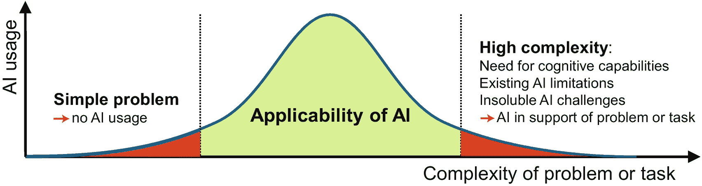
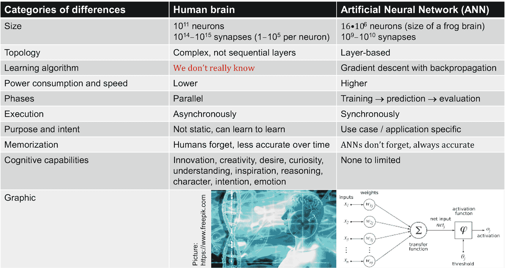
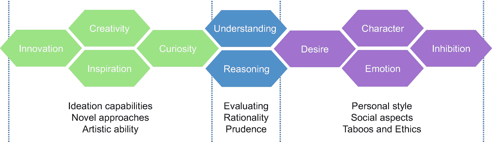

# 13. 人工智能的局限性

人工智能以其令人惊叹的广泛应用前景，似乎没有边界。因此，详细阐述*人工智能的局限性*可能会被我们的一些读者视为一种逆向思维。人工智能与加速创新、洞察和决策紧密相连，以至于我们认为其机遇不可估量。然而，即使是人工智能，也存在局限性和挑战，正如我们将在本章中了解到的。

一个简单直接的业务问题可能需要分析和洞察来做出恰当的决策；然而，使用带有机器学习或深度学习模型的人工智能可能并不合适、没有意义，并且在不提供新洞察的情况下增加了不必要的复杂性。在某些情况下，现实情况和环境可能极易发生变化，在机器学习模型被学习和部署之前，它可能已经变得毫无意义。正如我们在第 8 章“*人工智能与治理*”中关于风险管理和合规性的内容所看到的，也可能存在一些法律原因或合规规定，会阻止或至少限制人工智能在特定场景中的应用。

## 引言

在本章中，我们将重点讨论当前人工智能的局限性与挑战，这些因素要么阻碍我们使用人工智能（例如，当需要泛化学习中的多任务能力时），要么至少限制了人工智能的适用性（例如，由于数据标注和注释成本过高）。自主学习，即自我导向学习，掌控自身学习行为以适应新环境，并将学习与个人偏好、观点、看法等相融合，是另一个人类可能希望保持掌控权的领域。

我们还将讨论一些无法解决的挑战，例如机器学习和深度学习模型缺乏理解与推理能力。我们应对*人工智能局限性*的方式，与那些我们正遭遇人工智能和深度学习当前局限性与无法解决挑战的应用和场景息息相关。尤其是那些无法解决的挑战，可能真的会让我们在极其遥远的未来也不使用人工智能。在此背景下，我们还将与您分享一些人工智能研究课题，例如*学会学习*（元学习），这最终将拓展人工智能的适用范围。

人工智能的局限性与将人工智能和深度学习与人脑进行理解和比较密切相关，^(²³⁹) 尤其是在其认知和学习能力方面。在许多情况下，人类是不可或缺的，可能永远无法被人工智能完全取代——即使在极其遥远的未来也是如此。在我们关于*人工智能局限性*的讨论中，我们旨在让您对*如何正确使用人工智能*以及何时使用*哪种*人工智能能力、何时最好不用保持敏感。

图 13-1

何时不使用人工智能

如图 13-1 所示，对*人工智能局限性*的理解，是结合人脑卓越且无与伦比的能力（尤其是认知能力）、当前人工智能的技术差距或缺陷，以及无法解决的人工智能挑战来讨论的。存在大量场景需要具备认知能力和泛化学习技能的人类发挥其独特能力，或者触及了人工智能的局限性，例如创业直觉、创造力和新颖的创新方法、理解和解释决策、对情境或环境的推理等，仅举几例。

人工智能的适用性很广，如图 13-1 中间区域所示。向左是相对简单的问题，显然无法从人工智能的使用中获益；而向右，您会看到高度复杂的问题和任务，可能需要认知能力，或者当前人工智能的局限性和无法解决的挑战可能会阻碍人工智能的充分使用，或者只允许人工智能“仅仅”作为人类的辅助。

## 人工智能与人脑

要理解当前人工智能的局限性以及一些无法解决的挑战，就需要对人脑与人工神经网络进行基本比较。人工神经网络是一种模拟生物神经网络结构和功能的计算模型。^(²⁴⁰) 图 13-2 包含了我们用来讨论人脑与人工神经网络关键差异的基本类别。

图 13-2

人脑与人工神经网络

人脑大约由 10¹¹ 个神经元和 10¹⁴ 到 10¹⁵ 个突触（每个神经元有 1 到 10⁵ 个突触）组成，而最大的人工神经网络约有 16•10⁶ 个神经元和 10⁹ 到 10¹⁰ 个突触，大约相当于青蛙大脑的大小。^(²⁴¹) 这种比较本身就说明了人脑的优越性——至少在今天是这样。此外，人脑的拓扑结构非常复杂，*充满了在多达 11 个维度上运行的多维几何结构*，^(²⁴²) 不像人工神经网络那样按顺序分层排列。

我们的大脑如何运作仍是研究的课题。^(²⁴³) 关于这一点可能已知很多；然而，我们的学习方式在很大程度上对我们来说仍然是未知的。它是否可以被描述为一组算法，包括最复杂的深度学习模型反向传播算法，这一点非常值得怀疑。人工神经网络的学习主要通过各种反向传播算法实现。我们从机器学习和深度学习模型中了解到的学习阶段，如训练、验证、测试、预测、再训练等，在人类身上是以不同方式进行的。人工神经网络本质上具有同步执行模式，而人脑则以大规模异步、并行的方式工作。例如，大脑的视觉识别是异步工作的；物体的颜色、形状和运动方向被异步处理和整合。

人工神经网络的目标或对象特定于某个应用或场景。任何人工神经网络都有其明确的目的。我们（目前）还没有人工神经网络的灵活多任务学习能力；没有人工神经网络能够针对任意一组不同的环境或目标进行“学会学习”。但人脑可以；它具有适应性。人脑能产生创新想法，甚至改变自身环境以及社会和文化规范，以使人类得以生存。人工神经网络永远不会遗忘任何东西；^(²⁴⁴) 它们在其所学知识体系的背景下始终是准确的。人类会遗忘，并且准确性较低，这在某些情况下可能是一种优势。

普适人工智能需要包含认知能力，例如创新与创造力、欲望与好奇心、理解与推理。此外，它还应包括受到某事物启发的能力，或发展出个性（一种独特的、个性化的行为，由特定的观点和抑制力支撑，并根植于文化背景中），受意图驱动，并且——最后但同样重要的是——它应该发展并应对情绪，而不仅仅是理解社交媒体数据中的情感。需要这些认知能力的情境，无疑向我们揭示了当前*人工智能的局限性*，或*如何利用人工智能*来辅助人类决策。

## 当前人工智能的局限性

人工智能并非无所不能；它存在明显的局限性，这些局限性既引发了怀疑，也推动了研究。本节将专门讨论以下人工智能局限性，这有助于我们回答何时*还*不能使用人工智能，或者何时人工智能更像是一种辅助方法：

*   标注与注释

*   自主机器学习和深度学习

*   多任务学习

*   决策的可解释性

让我们简要了解一下人工智能的这四个局限性。我们为感兴趣的读者提供了链接，以便更深入地研究这些领域。

### 标注与注释

数据标注是机器学习和深度学习中的一项基本任务。作为机器学习或深度学习模型训练输入的未标注*原始*数据，需要被添加上额外的标签，我们可以将这些标签视为元数据。例如，添加分类信息（如欺诈或非欺诈、流失或非流失、是否接受营销方案）可以将*原始*数据转换为*已标注*数据，这些数据将作为机器学习分类模型学习（训练）步骤的输入。注释是对数据进行标注的过程，例如对图像、视频、音频、文本等进行标注，使数据主要用于深度学习模型的训练。

不同行业对标注和注释的需求及挑战可能各不相同。例如，自动驾驶中作为视频或图像注释一部分的汽车、摩托车、交通信号灯等边界框，或安防监控摄像头的人脸检测与识别，这些众多不同的技术和应用场景有一个共同特点：它们可能需要巨大的人力资源、非常专业的工具和服务，并且耗费大量时间。

数据标注确实也是一个关键的研究领域。^(²⁴⁵) 相关问题通常通过应用其他技术来解决，例如强化学习以及在输入有限甚至为零的情况下的深度学习。然而，这些技术本质上基于试错法，无法用于某些场景，比如自动驾驶或复杂医疗数据的模式识别（这些数据可能用于推荐用药）。

### 自主机器学习和深度学习

训练人工神经网络的最大挑战之一是获取足够大的训练数据集，并执行非常耗时且消耗资源的学习过程，这通常需要人工干预。自主机器学习和深度学习旨在通过持续的学习自动化来简化这一过程，其中具有有限甚至无需人工干预的自主过程能够实现人工神经网络的改进和自适应。这是一个新兴的研究领域，有潜力开发出甚至能够应对新情况和场景的人工神经网络方法。

如今，已有一些方法可以提高已训练人工神经网络的适应性，例如调整人工神经网络的深度和结构，甚至*在没有初始网络结构的情况下，通过自构建网络结构从头开始*开发一个人工神经网络。^(²⁴⁶) 强化学习也有类似的目标，即智能体根据获得的奖励来学习改进其行为。自主强化学习的挑战包括学习如何从数据或图像流中选择相关信息，而语义、相关性或意义最初并未提供给智能体。系统也可能*陷入无法恢复的状态，无法进行进一步的学习*，^(²⁴⁷) 这需要创新的方法来重置系统以进行后续的学习周期。自主深度学习包括在零输入的情况下进行学习。AlphaGo Zero^(²⁴⁸) 是一个惊人的成功案例，它结合了先进的搜索树和人工神经网络，击败了世界级的围棋选手。

尽管这些都是有前景的成果和研究领域，但其在现实世界场景中的应用，如自动驾驶汽车、工业机器人、放射学或癌症诊断、手术机器人、靶向治疗等，仍有一定局限性。在这些场景中，人工神经网络或其他模型的学习需要在现场应用之前就完成实施。

### 多任务学习

在人工智能中，学习通常针对一个特定的任务或问题，并使用单一的 KPI 或衡量标准。然而，在现实场景中，学习应该是多方面的。例如，这可能意味着不仅要通过监控摄像头识别人脸，还要解读面部表情所蕴含的情感和情绪。理解语音应辅以识别语调、口音或说话者的性别。为相关但不同的任务训练深度学习模型，这被称为多任务学习，是深度学习的一个新兴领域，^(²⁴⁹) 其目标是让学习的泛化能力能够超越仅适用于一个用例或任务的局限。

人类大脑几乎在所有情况下都能进行多任务学习，无论我们是在博物馆看一幅画、在演讲中听另一个人讲话，还是在开车。例如，作为一名汽车驾驶员，当接近十字路口时，我们不仅要识别交通标志、绿灯或前方的车辆；我们还会观察并解读另一位接近十字路口的驾驶员的面部表情，或者预测接近的车辆是否还能在十字路口正常停下的可能性，或者本不该过马路的人行道上是否有小孩横穿街道的可能性，或者我们前面的骑行者是一位老人，等等。大多数驾驶员都学会了将这些情况考虑在内，这可能导致他们决定进一步减速、准备刹车，甚至在自己有先行权的情况下也选择让行。

这些例子有力地说明了当前*人工智能的局限性*要求我们确定*何时*以及*如何*使用*哪种*人工智能能力，以及我们在多大程度上可以依赖人工智能来支持人类决策。认识到人工智能的局限性，决定了人工智能对某些问题和场景的适用性。

### 决策的可解释性

缺乏可解释性对于人工智能系统来说并非一个新问题。随着人工神经网络或人工智能系统整体复杂程度的提高，解释一个日益独立存在的人工智能系统为何以及如何得出特定决策变得越来越重要。让人能够理解、解释并信任人工智能得出的决策至关重要。我们在第 8 章“*人工智能与治理*”中已经触及了这些主题。

基于人工智能的决策背后的理由需要向人类透明化。例如，IBM Research 开发了一套全面的策略，该策略“*解决了信任的多个维度，以激发信心的方式实现人工智能解决方案*”，^(²⁵⁰) 其中包括一个用于检测、理解和减轻不良算法偏见的人工智能可解释性 360 开源工具包。

## 无法解决的挑战

你一定已经清楚地认识到，人类大脑是且仍然是人工智能无法超越的。当然，在某些领域人工智能明显更胜一筹；然而，人类大脑以其认知能力、对新环境的适应性以及处理怪异和奇特情况的能力而大放异彩。尽管人工智能取得了惊人的进步和令人信服的研究成果，但我们坚信，仍然存在一些无法解决的人工智能挑战，我们将在本节中详细阐述。

### 认知能力

正如我们在“*人工智能与人类大脑*”一节中指出的，认知能力无疑是人类大脑的关键差异化特征，并且一直令人着迷。在我们的讨论中，我们重点关注那些人工智能可能永远无法企及、且会留下显著重大差距的能力。

图 13-3

认知能力

如图 13-3 所示，我们将人类的认知能力分为三类。人类——至少是大多数人——受好奇心和灵感的驱动。我们不仅会理解和执行他人给予的指令，还会发展自己的想法，并寻找新颖的方法。创新和创造力是“人”的代名词。最强大的人工神经网络能否*提出正确的问题*，从而促成爱因斯坦广义或狭义相对论的发展？民主的概念能否由人工智能发明？人工神经网络能否创造出一种全新的音乐风格，不是模仿他人或复制作曲家的风格，而是创造出完全新颖的东西？这正是我们人类闪耀光芒之处——并将永远如此；人工智能可以成为一个有用的伙伴，仅此而已。

决策需要通过审慎的判断来评估和执行。决策过程的合理性往往与决策本身同等重要。理解和推理是应该补充单纯决策的方面。在特定背景和情境下审视决策的意义和合理性，是人工智能系统难以应对的。再次强调，人工智能可以在众多场景和任务中为你提供支持，但理解和推理最终仍要由你完成。

每个人都是独一无二的；我们在处理问题时会形成特定的性格和个人风格。我们有欲望，也会产生情感；我们的决策、活动和商业实践深深植根于社会和文化准则之中，其中禁忌和伦理方面划定了界限，甚至常常抑制我们去做某些事情。

这些认知能力使我们相互关联的工作方式和彼此相处的方式变得丰富多彩且饶有趣味。宽容、体谅持有不同观点和态度的人、情感与幽默，以及克制自己和妥协的能力，都是必需的；这些认知行为技能在许多场景中都是必需的，而人工智能在这些场景中显然不是主导者——并且可能永远不是。

不是从数据和环境中学习，而是学习*如何改变*环境，这似乎是人类智能的一个层面，是人工智能无法超越的。

### 怪异情境

并非所有现实生活中的情境都能被足够准确地预测，也无法确定对这些情境做出恰当的、与人类等同的反应。我们以自动驾驶为例来说明这一点。

思考一下自动驾驶汽车可能不得不应对的情境——尽管这些情境很少发生：一辆卡车或自行车逆行而来，一辆救护车非法转弯，孩子在绿灯亮时横穿马路，或者一位公交车司机打手势警告接近的车辆前方有危险情况。

即使自动驾驶系统能够检测到这些情况，它们也可能无法像人类驾驶员所学到的那样做出充分反应。^(²⁵¹) 配备雷达设备、摄像头和传感器的自动驾驶系统可以检测到其他汽车、自行车、交通标志和街道上的物体；然而，预测其他道路使用者、行人甚至动物的行为，并处理意外情况，对于任何人工智能系统来说可能永远无法令人满意地实现。

### 学习的泛化

可能阻碍你人工智能努力的一个特定方面是人工智能和人工神经网络无法适应全新的环境。学习的泛化，即能够适应和学习任意一组不同学科和场景的能力，在今天是完全不可能的。

这一方面甚至远远超出了我们本章前面讨论的多任务或自主学习概念。通常，机器学习和深度学习模型仍然只适用于一组给定的初始场景或问题。一旦训练完成，这些模型能展现出令人惊叹的性能；然而，底层模型——即使是人工神经网络——也难以适用于另一个具有不同未训练数据集的场景或领域。

人工智能研究在泛化学习方面取得了巨大进展^(²⁵²)。这听起来可能有些奇怪，但人工神经网络泛化学习的一个重要方面是能够忘记过去的经验，例如死锁情况或灾难性事件。

尽管取得了有希望的结果，但这些方法的成熟度及其在现实商业问题中的适用性仍然遥不可及。

## 其他研究课题

可以想象，还有相当多的人工智能研究课题，它们本身就能轻松写满一本书。下表 13-1 包含了一些研究领域的简短描述，进一步说明了当今人工智能能力的局限性。虽然你可能不需要深入研究细节，但我们的读者应该了解这些领域，以便理解*人工智能的局限性*以及*如何正确使用人工智能*。

表 13-1

人工智能研究领域

| # | 研究领域 | 描述 |
| --- | --- | --- |
| 1 | 超参数优化 | 学习是通过算法完成的。优化和调整学习算法是通过超参数优化来实现的，例如，人工神经网络的层数、决策树的数量及其深度、学习率等。人工智能研究关注于自动化和加速超参数优化方法，以消除或至少辅助手动调优 |
| 2 | 反向传播算法 | 本质上，反向传播算法用于通过调整权重来学习和改进人工神经网络。目前有研究致力于加速这些算法（例如，通过片上加速）。此外，研究还聚焦于替代方法，超越基于反向传播的监督式深度学习（例如，自编码器、对抗网络、使用进化算法的神经进化等） |
| 3 | 学会学习 | 人类可以学会如何学习，以便接近并最终解决未来未知的问题。在人工智能领域，这通过尝试开发元学习方法以及自动化机器学习和深度学习模型的设计来解决。这超越了学习的泛化，需要灵活性、常识、人类的学习方法，甚至人类在数百万年间发展出的本能 |

表中未列出的其他人工智能研究领域^(²⁵³) 还包括对抗网络^(²⁵⁴)、强化学习、对话系统、人工智能专用硬件以及语音等，仅举几例。

## 关键要点

我们以表 13-2 中总结的几个关键要点来结束本章。

表 13-2

关键要点

| 编号 | 关键要点 | 高层描述 |
| --- | --- | --- |
| 1 | 人脑与人工神经网络的对比 | 人脑与人工神经网络在规模、拓扑结构、能力、学习方法等方面存在关键差异 |
| 2 | 当前人工智能存在局限性 | 人工智能存在诸多局限性，例如标注与注释、自主人工智能、多任务学习以及决策的可解释性 |
| 3 | 人工神经网络不具备关键认知能力 | 人脑的认知能力（创造力、灵感、好奇心、情感、理解力、推理能力、欲望等）是区别于人工神经网络的关键因素 |
| 4 | 存在无法解决的人工智能挑战 | 人工智能面临一些无法解决的挑战，例如认知能力、应对异常情况以及泛化学习 |
| 5 | 人工智能研究课题 | 目前有相当多的人工智能研究课题致力于自动化和加速机器学习与深度学习模型的开发与学习 |
| 6 | 学会如何学习 | 人类可以学会如何学习，以应对和解决未来未知的问题与挑战；人工智能在这方面仍在挣扎 |

