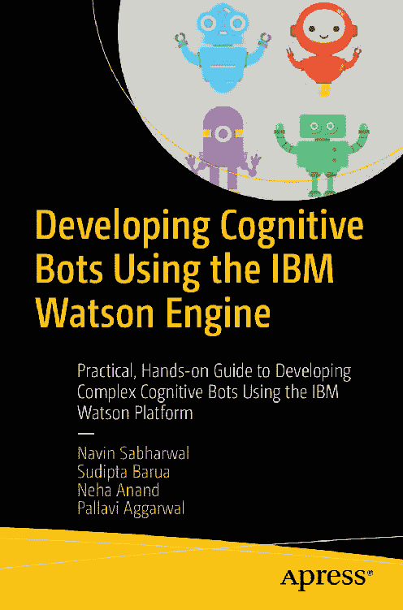

# 使用 IBM Watson 引擎开发认知机器人

纳文·萨巴瓦尔、苏迪普塔·巴鲁阿、尼哈·阿南德、帕拉维·阿加瓦尔

实用指南：基于 IBM Watson 平台开发复杂认知机器人

ISBN-13（平装）：`978-1-4842-5554-4`
ISBN-13（电子版）：`978-1-4842-5555-1`
[`doi.org/10.1007/978-1-4842-5555-1`](https://doi.org/10.1007/978-1-4842-5555-1)

版权所有 © 2020 纳文·萨巴瓦尔、苏迪普塔·巴鲁阿、尼哈·阿南德、帕拉维·阿加瓦尔

本作品受版权保护。出版商保留所有权利，无论涉及全部或部分材料，具体包括翻译、重印、重用插图、朗诵、广播、微缩胶片复制或任何其他物理形式，以及电子改编、计算机软件或现在已知或未来开发的类似或不同方法的传输或信息存储与检索。

本书中可能出现商标名称、标识和图像。我们仅在编辑风格下使用商标名称、标识和图像，以维护商标所有者的利益，并无意侵犯商标权，而非在每次出现时都使用商标符号。

本出版物中使用的商品名称、商标、服务标志及类似术语，即使未明确标识，也不应被视为对其是否受专有权利保护的表达意见。

尽管本书中的建议和信息在出版时被认为是真实准确的，但作者、编辑或出版商均不对可能存在的任何错误或遗漏承担法律责任。出版商对本书所含内容不作任何明示或暗示的保证。

Apress Media LLC 董事总经理：韦尔莫德·斯帕尔
采购编辑：塞莱斯廷·苏雷什·约翰
开发编辑：詹姆斯·马克姆
协调编辑：阿迪蒂·米拉希
封面设计：eStudioCalamar
封面图片设计：Freepik (`www.freepik.com`)

本书通过 `Springer Science+Business Media New York` 在全球图书贸易中发行，地址：`233 Spring Street, 6th Floor, New York, NY 10013`。电话：`1-800-SPRINGER`，传真：`(201) 348-4505`，电子邮件：`orders-ny@springer-sbm.com`，或访问 `www.springeronline.com`。`Apress Media, LLC` 是加利福尼亚州的有限责任公司，其唯一成员（所有者）是 `Springer Science + Business Media Finance Inc (SSBM Finance Inc)`。`SSBM Finance Inc` 是一家**特拉华州**公司。

如需翻译信息，请发送电子邮件至 `rights@apress.com`，或访问 `http://www.apress.com/rights-permissions`。

Apress 图书可批量购买用于学术、企业或促销用途。大多数图书也提供电子版和许可证。更多信息，请参考我们的印刷版和电子版批量销售网页：`http://www.apress.com/bulk-sales`。

作者在本书中引用的任何源代码或其他补充材料，读者可通过 `GitHub` 在图书产品页面获取，网址为 `www.apress.com/978-1-4842-5554-4`。

如需更详细信息，请访问 `http://www.apress.com/source-code`。

印刷于无酸纸上

*谨以此书献给我所爱之人与我所信之神。*
*——纳文·萨巴瓦尔*

*谨以此书献给我的家人和朋友。*
*——尼哈·阿南德*

*谨以此书献给我的导师和家人。*
*——苏迪普塔·巴鲁阿*

## 目录

**关于作者** xii
**关于技术审校者** xiv
**致谢** xvi

### 第 1 章: 认知虚拟机器人简介
1.1 认知虚拟助手的隐私问题 5
1.2 CVA 的开发者平台 6
1.3 机器人 vs. 认知虚拟助手 6
1.4 对企业与生态系统的影响 8
1.5 认知虚拟助手的应用场景 9
1.5.1 IT 服务的自助服务/服务台 9
1.5.2 分诊 10
1.5.3 潜在客户生成 11
1.5.4 电子商务 11
1.5.5 与企业应用的集成 12
1.5.6 任务跟踪与项目管理 12
1.5.7 人力资源 13
1.6 本章小结 13

### 第 2 章: 各类认知平台/引擎
2.1 Watson 15
2.2 产品与服务 17
2.2.1 AI 助手 18
2.2.2 Watson Assistant 18
2.2.3 数据 18
2.2.4 Watson Studio 18
2.2.5 Watson Machine Learning 19
2.2.6 Watson Knowledge Catalog 19
2.2.7 Watson OpenScale 19
2.2.8 知识 19

Watson Discovery
Watson Discovery News
Watson 自然语言理解 (NLU)
Watson 知识工作室
视觉
语音
LUIS
Azure 产品与服务
语言
文本分析
QnA Maker
翻译器文本
语音服务
搜索
Bing 拼写检查
Bing 网页搜索
Bing 实体搜索
决策
视觉
Amazon AI 服务
产品与服务
Amazon Lex
Amazon Polly
Amazon Rekognition
Amazon Translate
Amazon Transcribe
Dialogflow
Google 产品与服务
语音转文本
文本转语音
语言翻译
自然语言
结论

## 第 3 章：机器人框架

微软机器人框架
微软机器人框架特性
微软机器人连接器
机器人 SDK
Botpress
Lucy Bot
结论

## 第 4 章：使用 Watson Assistant 构建你的第一个机器人

创建 IBM Cloud 账户
创建 Watson Assistant 服务
为用例创建技能
为变体集合定义意图

对话配置 75

与内置机器人框架助手集成 84

你的第一个机器人 87

## 目录

## 对话与条件 90

### 对话节点 90

### 单个节点 91

### 多个节点 91

### 带子节点的节点 92

#### 场景 1：带子节点的节点 99

#### 场景 2：同级节点间的跳转 100

### 结论 102

## 第 5 章：Watson Agent 高级概念 103

### 上下文实体 103

### 上下文变量 108

### 槽位 113

### 多响应（多条件响应） 120

### 话题偏离 123

### 消歧义 130

### 处理多意图 135

### 以多种格式展示解决方案 141

#### 文本 141

#### HTML 142

#### 选项 142

### 结论 143

## 第 6 章: 认知虚拟机器人的用例 145

### BFSI 领域的特定用例 145

### `IBM Cloud Functions` 简介 156

### 股票市场的特定用例 161

#### 开源股票 API 161

#### 通过 `Cloud Functions` 将 `Watson` 与股票市场 API 连接 165

#### 在 `Watson` 中调用 `Cloud Function` 169

#### 定义组件 171

#### 调用 API 173

### 与天气 API 集成 179

#### 开源天气 API 179

#### 通过 `Cloud Functions` 将 `Watson Assistant` 与天气 API 连接 183

#### 在 `Watson` 中调用 `Cloud Functions` 186

#### 调用 API 189

### 结论 195

## 第 7 章: 与高级服务集成 197

### `Facebook Messenger` 与 `IBM Watson Assistant` 的集成 197

# 目录

- 在 Facebook 上创建页面
- 使用其他高级 Watson 服务
- Watson Discovery 服务
- 语调分析器
- 语调分析器服务
- 通过云函数将 Watson 与语调分析器服务连接
- 结论
- 第 8 章：认知虚拟助手的未来
- 未来的认知虚拟助手
- 索引

---

## 关于作者

**Navin Sabharwal** 拥有超过 20 年的行业经验，是一位在云计算、人工智能与机器学习、公有云、DevOps、AIOPS、基础设施服务、监控与管理平台、大数据分析以及软件产品开发领域的创新者、思想领袖、专利持有人和作者。Navin 负责 HCL Technologies 的 DevOps、人工智能、云生命周期管理、服务管理、监控与管理、IT 运维分析、AIOPs 和机器学习、自动化、通过精益运营实现规模化交付的运营效率、战略与交付。

您可以通过 `Navinsabharwal@gmail.com` 和 [www.linkedin.com/in/navinsabharwal.](http://www.linkedin.com/in/navinsabharwal) 联系他。

**Sudipta Barua** 在其职业生涯中跨多个行业工作，专注于为最终用户打造体验式界面和平台。她曾担任客户互动与中心化、市场营销、CRM 与分析、PLM 和产品开发等职务。在目前的职位上，Sudipta 在数字营销、创意叙事、基于分析的内容开发以及体验驱动平台的交叉领域进行协调。她因利用不同的技术产品与解决方案提升最终用户体验而多次获奖。

您可以通过 `sudipta.barua.13@gmail.com` 和 [linkedin.com/in/sudipta-barua-022b832/.](https://apc01.safelinks.protection.outlook.com/?url=https://www.linkedin.com/in/sudipta-barua-022b832/&data=02%7C01%7Cneha_an@hcl.com%7C4c5fa09ba3144e780f1308d73b7e8961%7C189de737c93a4f5a8b686f4ca9941912%7C0%7C0%7C637043286963271731&sdata=ceAgoWqysshVjQOVXBi3HATjGeKTTfjYACcV3c08Ito=&reserved=0) 联系她。

**Neha Anand** 是一位认知解决方案架构师。她在管理企业云和认知解决方案的交付生命周期方面经验丰富。她曾使用多种认知引擎（包括 Watson、LUIS、LEX 和 Dialogflow）实施并开发聊天机器人。她拥有利用自然语言处理和机器学习构建对话模型的经验，并曾在开发和集成环境中工作。Neha 致力于探索推动端到端解决方案的途径，并利用认知、人工智能和机器学习解决方案的杠杆。可通过 `NehaAnand0511@gmail.com` 和 [www.linkedin.com/in/neha-anand-05](https://www.linkedin.com/in/neha-anand-05) 联系她。

**Pallavi Aggarwal** 是一名自动化领域的解决方案架构师。她曾参与使用自然语言处理和机器学习技术开发和集成多个自动化项目。她在开发各种认知聊天机器人方面经验丰富。可通过 `pallaviaggarwal123@gmail.com` 和 [www.linkedin.com/in/pallavi-aggarwal-1003](http://www.linkedin.com/in/pallavi-aggarwal-1003) 联系她。

## 关于技术审校

**Amit Agrawal** 是一名首席数据科学家，目前任职于 HCL-DRYiCE。他常驻诺伊达，拥有莫蒂拉尔·尼赫鲁国家技术学院（`MNNIT`）阿拉哈巴德分校的技术与信息安全硕士学位。他在大数据系统（如 `Apache Hadoop` 和 `Apache HBase`）方面经验丰富。他曾使用自然语言处理和机器学习技术架构了 `HCL-DRYiCE` 的人工智能产品。

## 致谢

感谢我的家人，Shweta 和 Soumil，感谢你们一直在我身边，允许我为智力和精神追求牺牲时间，并在我沉浸于写作时照顾好一切。没有你们的爱与支持，我生命中的这一成就和其他成就都不可能实现。感谢我的母亲和姐姐一如既往的爱与支持；没有你们的祝福，一切皆不可能。

感谢我的合著者 Neha、Pallavi 和 Sudipta——感谢你们的辛勤工作和快速周转，得以交付此书。这是一次丰富的经历；期待很快再次与你们合作。

感谢我在 HCL 的团队，你们一直是我灵感的源泉，凭借你们的辛勤工作、引人入胜的技术讨论和技术深度。你们源源不断的想法是每一天快乐和兴奋的源泉。Piyush Pandey、Sarvesh Pandey、Amit Agrawal、Vasand Kumar、Punith Krishnamurthy、Sandeep Sharma、Amit Dwivedi、Gauarv Bhardwaj、Nitin Narotra、Shoyeb、Divjot、Nitin Chand 和 Vivek——感谢你们的陪伴，让技术变得有趣。

感谢 Celestine、Aditee 以及 Apress 的整个团队，将我们的想法变为现实。与你们一起写作是一次奇妙的经历；多年来，决策速度和编辑支持都非常出色。

感谢所有我曾有幸共事的人——我的合著者、同事、经理、导师和引路人。在这个拥有 70 亿人口的世界里，是机缘让我们走到一起。与你们相识并向你们学习，过去是，现在也是一段丰富的经历。所有的想法和路径都是我所参与的对话和所分享的经历的融合。谢谢你们。

感谢萨拉斯瓦蒂女神指引我走向知识与灵性之路，并让我在这条路上坚持到解脱。

असतो मा साद गमय, तमसो मा ज्योतिर् गमय, मृत्योर मा अमृतम् गमय

(Asato Ma Sad Gamaya, Tamaso Ma Jyotir Gamaya, Mrityor Ma Amritam Gamaya)

引领我们从无知走向真理，从黑暗走向光明，从死亡走向永生。

xvi
