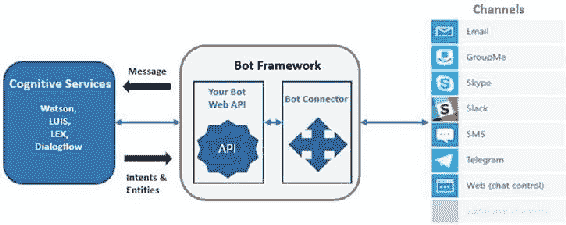

# 第 2 章 各种认知平台/引擎

人工智能（AI）已席卷数字世界。AI 在各类应用和用例中日益重要。它被用于多种个人数字助手，包括 `Siri`、`Cortana`、`Alexa` 和 `Google Assistant`，以解决消费者的日常使用场景。*认知计算*定义了一种试图模拟人类思维方式的系统。这两个术语使用相同的技术，包括机器学习、神经网络、自然语言处理和情感分析。`IBM` 将认知计算定义为“能够大规模学习、有目的地推理、并与人类自然交互的系统”。认知计算通过使用自学习算法来实现决策，并让人类生活更轻松，其核心在于人机交互。

通俗地说，当机器模仿人类与*人类思维*相关的认知功能（如学习、推理和解决问题）时，就应用了*人工智能*这一术语。

## Watson

`Watson` 是 `IBM` 面向企业级 AI 服务、应用和工具的一套产品组合。它是一系列运行在 `IBM` 云平台上的云服务，旨在提供卓越的性能。`Watson` 使用自然语言处理、自然语言理解以及机器学习，将大量非结构化数据转化为具体且有洞察力的信息。

`Watson` 在电视游戏节目《`Jeopardy`》中击败世界冠军 `Ken Jennings` 和 `Brad Rutter` 后获得了广泛认可。由于《`Jeopardy`》涵盖的主题范围极广，这展示了 `Watson` 超越数据库分析（相对于更复杂的算法系统）的能力，包括持续学习模型、假设和决策能力，这些能力使其有资格赢得比赛。`Watson` 被认为是一台能够通过将人类认知过程分为四个不同部分来模拟该过程的超级计算机。

第一部分是*观察*的能力。`Watson` 能在百万分之一秒内从各种网络来源和庞大的数据库存储库中学习信息。

第二部分是*解释*的能力。`Watson` 消化所有接收到的信息，并将其处理成更高效、更易于处理的格式。由于计算机只理解二进制，`Watson` 会将数据（无论是文本、语音还是图像）校准为二进制。

然而，在此步骤中，`Watson` 需要依赖人类来指示它如何解释这些信息。这是通过一个问答模型完成的，在该模型中，`Watson` 被训练去理解数据超越其已接触事实的含义，然后逻辑地构建事实之间的关系。

第三部分是*评估*，`Watson` 可以根据从其收集信息的来源收到的反馈来评估信息的相关性。它可以基于评分系统过滤掉不相关的信息。

第四部分是*决策*。在评估信息的准确性后，`Watson` 可以基于信息的现有模式构建多种模式，其方式类似于人脑的做法。这使得 `Watson` 能够收集信息、智能地处理信息，并解决与其正在处理的主题相关的问题。通过其假设和证据评分，`Watson` 不仅可以基于从外部来源建立的信息提出可能的解决方案，而且可以根据所学内容，调整置信度分数，从而智能地为其正在处理的问题选择最佳解决方案。

## 产品与服务

借助 `Watson Assistant` 服务，我们可以构建能够理解自然语言输入并与最终用户模拟对话（模仿人与人之间的对话）的应用程序和代理。构建支持 AI 的生态系统所需的元素如图 2-1 所示。

AI 助手 | Watson 同理心助手 | 语言数据 | Watson 服务 | 语音知识 | Watson 视觉发现

**图 2-1.** `Watson` 服务

### AI 助手

助手使您能够将最终用户的请求路由到最佳可能的解决方案。此功能整合了专门用于帮助解决最终用户请求的渠道，并使管理请求变得更加容易。

### Watson Assistant

`Watson Assistant` 是一种产品，用于在任何应用程序、设备或渠道中构建对话界面。它知道何时从知识库中搜索答案，何时请求澄清，以及何时将用户引导至人工助手。`Watson Assistant` 运行在 `IBM` 云上，从而使企业能够将 AI、可扩展性和敏捷性结合起来，以增强最终用户的体验。

### 数据

组织最聪明的资源是其数据。然而，从数据中产生价值是一个复杂且耗时的过程。`Watson Data` 服务使用户能够收集、组织和分析数据。它自动化了自学习模型的创建、数据标记、数据偏差减少、数据清理和数据可视化。

### Watson Studio

`Watson Studio` 通过启用协作式数据科学和机器学习环境，帮助您从数据中提取价值和洞察，以在单个集成环境中构建和训练 AI 模型，并准备和分析数据。

### Watson Machine Learning

此服务使您能够利用数据来创建、训练和部署自学习模型。它利用自动化的协作工作流程来构建智能应用程序。

### Watson Knowledge Catalog

`Watson Knowledge Catalog` 是一个协作式资产目录，旨在发现和分类分布在异构来源中的海量数据。

### Watson OpenScale

`Watson OpenScale` 是一个可扩展的平台，为用户提供其 AI 系统的清晰准确视图，有助于在其整个生命周期中跟踪和优化其性能。

### 知识

在人工智能领域，学习和知识收集是一个持续的过程。AI 系统不依赖于从数据存储库或现有运行手册中推导结果，而是像人脑一样，通过每次交互的协作学习来构建更新的知识库。`Watson Knowledge` 服务有助于开发这种整体演化的知识系统。

### Watson Discovery

`Watson Discovery` 是一种 AI 搜索技术，可消除数据孤岛并检索埋藏在企业数据中的信息。`Watson Discovery` 应用了机器学习的最新突破，包括自然语言处理和自然语言理解能力，并且易于针对用户领域进行训练。借助 `IBM` 云的灵活性，用户可以在任何地方操作，提供其规模和敏捷性。用户甚至可以通过使用 `Watson Knowledge Studio` 针对特定领域对其进行训练。

### Watson Discovery News

数据搅拌的结果不仅取决于数据本身，还受到其他环境因素的影响。例如，如果某国遭受病毒袭击且只有特定药物才能治愈的新闻传出，该药物的股价必然上涨。`Watson Discovery News` 是一个强大的工具，能够将这种智能构建到 AI 系统中。它是一个经过预处理的索引数据集，包含以下认知洞察：关键词提取、实体提取、语义角色提取、情感分析、关系提取和类别分类。为了使系统更稳健，系统还提供过去 60 天新闻数据的历史搜索功能。

### Watson 自然语言理解（NLU）

由于社交媒体及其他类似渠道的出现，非结构化数据的数量每时每刻都在成倍增长。这种数据爆炸使得理解人类语言的复杂性变得困难。`Watson 自然语言理解`是一套精炼的自然语言能力，结合了高级文本分析技术，能够从非结构化数据中提取关系、关键词和情感等洞察，并产生有意义的结果。

### Watson 知识工作室

该服务无需编写任何代码，即可教会 `Watson` 从非结构化数据中发现有意义的洞察。这使得任何领域的领域专家能够协同工作，让 `Watson` 理解该领域或行业特有的语言。例如，病毒在医学科学中的定义与在网络安全生态系统中的含义截然不同。该服务还允许 `Watson` 通过使用 `Watson 知识工作室`中的模型，在 `Watson Discovery`、`Watson 自然语言理解`和 `Watson Explorer` 等多个应用中应用其获取的知识。

### 视觉

作为人类，我们所学到的大部分知识都源于所见之物。然而，对于计算机系统来说，理解此类视觉数据非常困难，更不用说对如此复杂的数据集进行分类和分析。`Watson` 内置了 `Watson 视觉识别`服务，该服务能够理解视觉数据，并将大量视觉数据组织成结构化的、带标签的数据集。`Watson` 通过一组相关数据进行训练。例如，你可能想教会 `Watson` 区分汽车和卡车。`Watson 视觉识别`需要接触各种汽车和卡车的图像，这样它才能告诉你，你提供给 `Watson` 的随机图像是汽车还是卡车。这一复杂功能非常重要，它将 `Watson` 的能力提升到了更高的智能水平。

### 语音

与视觉类似，语音是另一个重要的数据生成平台。人类以语音为媒介，无缝地相互交流，以生成、记录和理解数据。`Watson` 的语音转文本和文本转语音服务不仅有助于将数据从一种格式转换为另一种格式，还能让 `Watson` 理解不同的方言、发音和语言，并以类似人类的声音与用户对话。语音转文本服务可自动将语音数据转换为书面文本。同样，`Watson` 引擎生成的文本数据可以以逼真的人类对话形式传递给最终用户，从而提升用户体验和用户旅程。

## LUIS

`LUIS`（语言理解智能服务）是一项微软服务，提供基于云的 `API` 服务，将自定义机器学习智能引入用户对话中，并解码自然语言文本以预测对话的含义。基本上，`LUIS` 的客户端应用是一种对话式应用，它使用自然语言与用户交流以完成任务。`LUIS` 使用机器学习模型，允许开发者构建

能够以自然语言接收用户输入并从中提取含义的应用程序。`LUIS` 经过原型设计，可识别对话中的有价值信息，它能够解读用户意图，并从实体中提取有价值的信息，从而作为语言模型提供高质量的输出。`LUIS` 可与`Azure 机器人服务`轻松同步，便于创建复杂的机器人。

`LUIS` 应用程序包含一个特定领域的自然语言模型。编译 `LUIS` 应用程序有多种方式，包括使用预构建领域模型、自定义模型，或将预构建领域与自定义信息相结合。`LUIS` 拥有许多预构建领域模型，包括意图、表述和实体。它还有助于完成整个设计。`LUIS` 有几种识别自定义意图和实体的方法，包括机器学习实体、特定或字面实体，或机器学习实体与字面实体的组合。

# Azure 产品与服务

借助`Azure 机器人服务`，我们可以构建能够解读自然语言输入并模拟与最终用户对话（模拟人与人之间的对话）的应用程序和代理。构建这样一个由认知服务组成的、支持人工智能的生态系统所需元素如图 2-2 所示。

*图 2-2. Azure 服务*

## 语言

语言是确保应用程序和服务能够充分理解非结构化文本的价值，或能够识别说话者话语背后意图的基本要素。它分为三个部分：`文本分析`、`QnA Maker` 和`翻译文本 API`。

### 文本分析

`文本分析`是一项基于云的服务，可对输入文本提供高级自然语言处理，并处理四大主要功能：情感分析、关键短语提取、语言检测和实体识别。

`情感分析` 通过分析原始文本来发现客户的情绪倾向，判断其是正面还是负面。`关键短语提取` 用于识别短语中的要点。`语言检测` 可解读文本的书写变体，并为请求中提交的每个文档（涵盖多种语言、变体和方言）转换单一语言代码。`实体识别` 识别并分类实体，如人物、地点、组织、日期和时间、数量、百分比以及货币。

1.  [`docs.microsoft.com/en-in/azure/cognitive-services/text-analytics/how-tos/text-analytics-how-to-sentiment-analysis`](https://docs.microsoft.com/en-in/azure/cognitive-services/text-analytics/how-tos/text-analytics-how-to-sentiment-analysis)
2.  [`docs.microsoft.com/en-in/azure/cognitive-services/text-analytics/how-tos/text-analytics-how-to-entity-linking`](https://docs.microsoft.com/en-in/azure/cognitive-services/text-analytics/how-tos/text-analytics-how-to-entity-linking)

### QnA Maker

`QnA Maker` 是一项基于云的服务，可帮助在现有数据之上创建对话式问答平台。它通过从半结构化内容（包括常见问题解答、手册和文档）中提取查询来构建知识库。使用来自 `QnA` 的最佳答案来回答用户问题，从而创建知识库。`QnA Maker` 最棒的一点是，它会不断从用户行为中学习，从而变得越来越智能。

### 翻译器文本

`翻译器文本`是一种机器翻译服务，可轻松集成到应用程序、网站、工具和解决方案中。它允许开发者添加多语言用户体验，支持超过 60 种语言，并可用于文本到文本的语言翻译。

## 语音服务

语音是另一个重要的数据生成平台。人类通过语音作为媒介进行无缝交互，以生成、记录和理解数据。`语音服务`是音频转文本、语音翻译和文本转语音功能的集合。我们也可以说，它能将口语转换为文本，或使用标准语音从文本生成自然的信息语音。它还提供说话人识别服务，可识别单个说话者，或将语音用作身份验证机制，因为每个人的声音都具有独特的特征，就像指纹一样可以识别个人身份。

## 搜索

`LUIS` 中的搜索服务赋予应用程序跨网络搜索海量无广告信息的能力。它有助于从数十亿网页、图像、视频和新闻搜索结果中找到精确需求。

### 必应拼写检查

`必应拼写检查`执行上下文相关的语法和拼写检查。`必应`开发了一种基于网络的拼写检查器，具备机器学习和统计机器翻译能力。它基于大量的网络搜索和文档数据，可帮助用户检查拼写错误和俚语，并识别名称与品牌名称之间的差异等。

### 必应网页搜索

这是一种 RESTful 服务，可为用户查询提供即时解答。搜索结果可轻松配置为包含网页、图像、视频、新闻等内容。`必应网页搜索`根据订阅的搜索相关性提供结果。

### 必应实体搜索

`必应实体搜索`将搜索查询发送至`必应`，并获取相关结果，包括实体和地点。地点包括餐厅和其他本地商业中心。如果查询指定了本地企业名称或询问某类业务（例如，我附近的餐厅），`必应`会返回地点。如果查询指定了知名人物和地点（旅游景点、州、国家、地区），`必应`会返回实体。

## 决策

决策 API 内置了多项服务，如内容审查器、异常检测器和个性化器。`内容审查器`是一项 Azure 认知服务，是一种机器辅助的内容审查 API，可增强图像、文本和视频的审查能力。它能检测攻击性和不良图像、种族歧视和成人视频内容，以及粗俗和不良文本。当发现此类内容时，该服务会添加适当的标签并将其标记给内容审查员。然后，应用程序可以根据定义的规则管理被标记的内容，并为用户维护预期的环境。软件工程师可以使用内容审查器服务的几个例子包括：审核产品目录和其他用户生成内容的在线市场、审核用户生成游戏制品和聊天室的游戏公司，以及审核用户以图像、文本和视频形式生成内容的社交消息平台。

## 视觉

作为人类，我们学到的大部分知识都来自所见之物。然而，对于计算机系统来说，理解此类视觉数据非常困难，更不用说分类和分析如此复杂的数据集了。Azure 的认知服务使得准确识别和分析图像、视频和数字墨迹中的内容成为可能。

`计算机视觉` 服务使用先进的算法处理图像并返回信息。要分析图像，您可以上传图像或通过 URL 指定图像。根据用户感兴趣的视觉特征，图像处理算法可以相应地分析内容，并提供关于其特征的见解。从数千个可识别的物体、生物、场景和动作中，它能识别图像中的视觉特征，并能从包含数千个全球标志的数据库中识别图像或视频中的商业品牌。

`认知服务人脸 API` 提供用于检测、识别和分析图像中人脸的先进算法。人脸信息在许多不同的软件场景中非常有用。当前流行的场景包括安全、自然用户界面、图像内容分析与管理、移动应用和机器人技术。

`墨迹识别器` 是一种 AI 服务，可识别数字手写内容、常见形状以及墨迹文档的布局。它能识别常见的几何形状——例如数字墨迹中的多边形——以及它们的几何热点和布局坐标。`墨迹识别器`有潜力为笔记记录、表单填写、内容搜索和文档注释增加价值。

# 亚马逊 AI 服务

亚马逊网络服务（`AWS`）一直是技术如何影响和增强用户体验的颠覆者。借助 `AWS` 人工智能服务，亚马逊将这种体验变为现实。无论是在亚马逊无人商店的无缝结账，还是让 `Alexa` 在疲惫的一天结束时为你煮咖啡、打开电视、播放音乐，`AWS AI` 服务都在与用户的每一次交互中日益成熟。亚马逊的 AI 服务赋予用户自然语言、视频分析、虚拟助手、个性化推荐和预测等能力，而无需具备深厚的机器学习专业知识。这对企业非常有利，因为它能轻松实现业务与技术的对话与集成，并促成更快、更具价值的结果。

## 产品与服务

亚马逊 AI 的演进始于 20 世纪 90 年代末，当时它有一个发现代理，可以根据订阅者喜爱的作者、类型或其他参数推荐可能喜欢的书籍。自那时起，亚马逊的 AI 不断演进和成熟，现在可以在自然语言理解、物体和人脸识别、聊天机器人、语音对话、自动语音识别等领域运行复杂算法。亚马逊 AI 服务还满足了企业扩展人工智能以驱动业务成果的一个非常重要的需求。其 AI 服务可以独立使用，也可以相互结合使用，为用户提供速度、敏捷性和灵活性，以开展有效的业务运营并增强最终用户体验。

## Amazon Lex

`Amazon Lex` 是亚马逊 AI 旗下的一项服务，您可以使用它构建能够识别、理解并以语音转文本或文本转语音形式进行对话、实现类人对话的聊天机器人。`Amazon Lex` 可用于创建使用语音或文本作为聊天媒介的对话式界面。它利用自然语言理解来理解对话上下文和自动语音识别技术可将语音转换为文本。这使得用户无需掌握复杂技术就能构建高级聊天机器人。`Lex` 使用与 `Amazon Alexa` 相同的深度学习算法，并将其开放给开发者，从而缩短开发周期、简化开发流程，构建出复杂且支持自然语言的对话机器人。可以毫不夸张地说，`Lex` 普及了深度学习技术，并构建出智能且响应迅速的机器人。由于 `Lex` 可根据使用情况轻松扩展或缩减，它为运行服务所需的 IT 基础设施带来了弹性。以下是 `Amazon Lex` 的其他优势。

- **易于使用：** 它提供了一个易于使用的控制台，可快速构建你的聊天机器人。如果你不熟悉 `Amazon Lex` 控制台，它还提供了预定义的机器人。`Lex` 还具有这样的能力：即使只提供几个短语，它也能构建完整的自然语言模型，并智能地将机器人训练到更高水平。
- **无缝部署和扩展：** 使用控制台，开发者可以立即构建、测试和部署机器人。它还提供了轻松集成到各种应用程序的能力，并能轻松地将语音或文本聊天机器人发布到移动设备、`Web` 应用以及 `Facebook Messenger`、`Slack`、`Twilio` 等聊天服务。由于 `Lex` 采用 `SaaS` 模式，其基础设施完全具有弹性，你无需担心随着用户量和对话量的增减而扩展基础设施。
- **成本效益：** `Lex` 采用高性价比的模式。与其他服务不同，`Lex` 不收取任何预付费或最低费用。它还提供 `Amazon Lex` 免费套餐，让用户无需任何初始投资即可试用 `Lex`。`Amazon Lex` 采用按使用量付费的模式，每次请求的成本很低，从而优化了用户的成本支出。
- **与 `AWS` 的内置集成：** `Lex` 拥有许多内置集成——例如 `Lambda`、`MobileHub` 和 `CloudWatch`——允许用户与许多其他 `AWS` 服务集成，如 `Cognito`、`DynamoDB`、`Amazon Polly` 等。此功能使 `Lex` 能够利用 `AWS` 平台进行监控、安全、业务逻辑、用户认证、存储和移动开发。

## Amazon Polly

人类语音是最强大的沟通方式之一。同一个词，根据其语调、语境和音高，可能具有不同的含义。`AWS Polly` 是一项基于云的服务，它使用先进的深度学习技术将文本转换为类人语音。它支持多种语言，并拥有一个强大的逼真语音库，使其能够灵活地用于构建支持语音的应用程序，并根据业务场景和最终用户的情感选择合适的语音。`Polly` 使用多种神经文本转语音（`NTTS`）声音，这些声音每天都在进化和学习。`NTTS` 技术还赋予 `Polly` 合成新闻播音员说话风格的能力，这种风格针对新闻叙述风格进行了个性化定制。`Polly` 可用于增强移动应用、电子学习软件、游戏、面向视障人士的无障碍应用程序、物联网及许多其他领域的人类语音。以下是 `Polly` 的一些优势。

- **丰富的语音和语言库：** 与其他服务不同，`Polly` 提供了大量语言可供选择。它还拥有一个逼真的男性和女性语音库。它同时提供 `NTTS` 和 `TTS` 技术，以合成具有高发音准确性的卓越自然语音。
- **低延迟：** 为了提供逼真的对话和对话体验，服务必须具备低延迟和快速响应时间。当文本发送到 `Polly` 的 `API` 时，它会返回音频以流的形式传输到应用程序，使语音能够立即播放，从而实现低延迟的类人对话与交互。

## Amazon Rekognition

`AWS` 的人脸识别技术称为 `Rekognition`。这项基于网络的服务使开发者能够为应用程序添加图像和视频分析功能。借助 `Rekognition` 服务，应用程序可以检测、记忆并理解画面中面部和物体的情绪。更令人印象深刻的是，利用计算机视觉科学家开发的深度学习技术，`Rekognition` 能够读取、分析并存储每天接触到的数百万张图像，且无需任何机器学习方面的先验知识。

它还能提取任何图像或视频中的文字，例如字幕、产品名称、街道名称等。`Rekognition` 正在学习存储在其存储库中的大量视频、图像及其他视觉数据。它从这些数据中学习，同时`持续地`基于置信度评分算法对数据进行标记。

该服务还具备超越物体识别的活动与场景检测能力。例如，`Rekognition` 能够进行实时和批量视频分析。当 `Rekognition` 捕获视频时，它不仅捕获特定帧，还能智能地捕获并理解该帧前后帧的内容，从而将内容置于上下文中。`Rekognition` 还能识别用户可能不希望出现在应用程序中的不当视觉内容，并提供详细标签，帮助用户根据需要控制不想要的内容。它不仅能够基于已获取的数据存储库识别和标记人脸及视觉内容，还足够成熟，能够识别与人脸识别能力相关的任何情绪。该服务还具备名人识别功能。

另一个独特的 `Rekognition` 功能称为`人物追踪`。它利用一种名为`骨架建模`的技术，追踪画面中是否有人物存在，即使人物被视线遮挡也能识别。

理解 `Rekognition` 服务的优势至关重要。

- **低成本：** 与其他 `AWS` `AI` 服务一样，`Rekognition` 采用按需付费模式，无需前期成本。用户只需为已分析的图像和视频以及存储的人脸元数据付费。
- **与其他 `AWS` 服务集成：** `Rekognition` 可与 `Lambda` 和 `AWS S3` 等其他 `AWS` 服务无缝协作。作为对 `AWS S3` 事件的响应，可直接从 `Lambda` 调用 `Rekognition API`。由于 `AWS Lambda` 和 `AWS S3` 都会根据应用程序的需求自动扩展，因此您可以构建可扩展、经济实惠且可靠的图像分析应用程序。
  还可以直接对存储在 `Amazon S3` 中的图像运行分析，而无需加载或移动数据。
- **完全托管：** 尽管请求数量大幅增加，但应用程序的延迟仍保持一致。此功能可确保无缝且丰富的最终用户体验。

## Amazon Translate

`Amazon Translate` 是一项翻译服务，通过调用 `Translate API`，消除了在应用程序中构建翻译功能的复杂性。这使得开发者能够通过单个 `API` 和几行代码构建多语言应用程序。研究表明，当个人接触到以其母语呈现的对话或信息界面（如网站、客服、博客和帖子）时，用户粘性更高。手动完成这项工作意味着很长的周转时间，更不用说翻译任何组织拥有的所有数字资产所涉及的高昂成本了。

`Amazon Translate` 基于神经机器翻译技术构建。

翻译服务利用深度学习模型，基于本地方言、品牌特定风格、语言特定构成等方面，以高准确度和自然流畅的翻译效果，对数字资产进行语言翻译并实现自动化。它通过机器学习和持续学习来逐步提升准确性和效率。`Amazon Translate` 可以与其他服务集成，例如 `Amazon Comprehend`，用于从社交媒体或其他短文本中提取预定义的实体、情感或关键词。它还可以与 `Amazon Polly` 集成，将翻译后的数据转换为语音并传递给用户。

目前，`Amazon Translate` 支持 25 种语言，并支持近 600 种翻译组合。在未指定内容源语言的情况下，`Translate` 能够高精度地检测源语言。它还具备批量翻译能力，适用于数据量非常大的场景；以及实时翻译能力，用于按需提供内容翻译，例如在机器人界面中。

## Amazon Transcribe

`Amazon Transcribe` 利用一种称为自动语音识别的深度学习过程，使开发者能够将语音转录为文本。通过使用此 `API` 服务，可以分析存储在 `Amazon S3` 中的音频文件，并以转录文本格式返回音频文件的内容。

过去，我们不得不依靠人工来将此类音频转换为文本转录。借助 `Amazon Transcribe`，整个过程实现了自动化、可扩展、成本效益高且周转时间更快。它具备智能能力，可以自动添加标点和格式，从而使转换后的输出更加准确。音频可以批量处理或近乎实时地处理，这意味着可以输入实时音频数据流，并并行获得转录文本形式的输出。

此 `API` 会为每个单词添加时间戳，这在您想要在原始音频中查找特定单词或在视频的特定位置插入字幕时非常有用。`Amazon Transcribe` 足够灵活，可以将新单词添加到基础词汇表中，以生成更准确的转录。这允许添加特定领域的单词和短语，例如产品名称、技术术语或个人姓名、地点等。此外，`Translate` 可以与其他 `Amazon API`（如 `Amazon Translate`）集成，从而实现音频和启用音频的视频内容的本地化。

## Dialogflow

Dialogflow 是谷歌旗下基于自然语言对话的人机交互技术平台。谷歌提供了 Speaktoit，这是一个适用于 `Android` 和 `iOS` 的虚拟伙伴，能够执行任务并以自然语言回答用户查询。Speaktoit 创建了一个自然语言处理引擎，有助于处理对话上下文，如对话历史、位置和用户偏好。它作为一个自然语言理解平台，使得将对话式用户界面设计并整合到移动端、网页和设备等任何平台变得容易。它还有助于为用户提供与产品互动的新颖且引人入胜的方式。

该技术擅长同时分析来自客户的多种输入，包括文本或音频输入（例如来自手机或录音）。它还有助于通过文本或合成语音等多种方式回应用户。这为用户提供了与产品互动的新方式，通过构建由谷歌 AI 技术驱动的、引人入胜的语音和文本对话界面，例如语音应用和聊天机器人。这是一个端到端的工具，由自然语言理解驱动，以促进丰富且自然的对话。

## 谷歌产品与服务

借助谷歌 AI 认知服务，我们可以构建能够解读自然语言输入、模拟与最终用户对话以及模仿人与人对话的应用程序和代理。接下来将介绍可用于构建认知虚拟代理的谷歌服务。

### 语音转文本

`Google Cloud Speech-to-Text` 通过一个易于使用的 API，利用强大的神经网络模型，使开发者能够将音频转换为文本。`Speech-to-Text API` 可识别 120 种语言和版本，以支持您的全球用户群。该服务还具有启用语音命令和控制、转录来自呼叫中心的音频等功能。

利用谷歌机器学习技术，它可以处理实时流式音频或预先录制的音频。

为了执行语音识别，`Cloud Speech-to-Text` 有三种主要方法。

- **同步识别：** 将音频数据发送到 `Speech-to-Text API`，然后对该数据执行识别，并在所有音频处理完毕后返回结果。同步识别请求仅限于持续时间不超过 1 分钟的音频数据。
- **异步识别：** 将音频数据发送到 `Speech-to-Text API`，并以一个长时间运行的操作开始。使用此操作，您可以定期处理以获取识别结果。异步请求可以处理任何持续时间长达 480 分钟的音频数据。
- **流式识别：** 对在 `gRPC` 双向流中提供的音频数据执行识别。对于实时识别场景，流式请求被设计用于从麦克风录制实时音频。流式识别在捕获音频的同时提供阶段性结果，从而允许在用户说话时实时显示结果。

[`www.grpc.io/docs/guides/concepts.html#bidirectional-streaming-rpc`](http://www.grpc.io/docs/guides/concepts.html#bidirectional-streaming-rpc)

### 文本转语音

`Google Cloud Text-to-Speech` 可将文本转换为语音，支持超过 30 种人类语言及其变体中的 180 多种语音。它应用了语音合成方面的创新研究，并利用谷歌强大的神经网络技术来提供高保真音频。此 API 使交互变得简单，并可改变客户服务、设备交互以及更多应用。

文本转语音使开发者能够创建听起来自然、合成的人类语音，作为可播放的音频。它可以轻松地将任意字符串、单词和句子转换为说话人的声音。想象一下，您有一个语音助手应用程序，能够以自然语言的可播放音频形式接收用户反馈。将此 API 集成后，应用程序可以执行操作，然后以人类语音的形式向用户提供反馈。

### 语言翻译

`Language Translation API` 使用谷歌预训练的神经机器翻译来提供快速、强大的结果。在 `Translation API` 和相同的客户端库中，用户现在甚至可以选择使用自定义模型翻译。翻译功能易于集成到应用程序、网站、工具和解决方案中。它支持[超过 100 种语言](https://docs.microsoft.com/en-in/azure/cognitive-services/translator/languages)的多语言用户体验，涵盖从南非荷兰语到祖鲁语的翻译，并允许用户在超过 50 种语言对中构建自定义模型。

### 自然语言

`Natural Language Services` 使用谷歌机器学习从非结构化文本中提取洞察。它利用机器学习来提取结构。[`cloud.google.com/translate/`](https://cloud.google.com/translate/)

文本的含义。通过此服务，用户可以提取关于人物、地点和事件的信息，并更好地理解社交媒体情绪和客户对话。自然语言处理提供了分析文本并将其与 `Google Cloud Storage` 上的文档存储集成的能力。

使用 `AutoML Natural Language`，用户可以上传自己的数据，并在自定义的高质量机器学习模型上进行训练，通过调用 API 来分类、提取和检测情绪，无需任何额外工作即可获得相关洞察。`Natural Language API` 强大的预训练模型通过提供情感分析、实体分析、实体情感分析、内容分类和语法分析等功能，使开发变得简单。

### 结论

本章介绍了认知虚拟助手领域的一些主要参与者。`IBM Watson`、`Microsoft Azure`、`Amazon Web Services` 和 `Google Cloud Platform` 都提供了基于云的服务，我们可以利用这些服务来创建认知虚拟助手。用户可以从单一云服务中评估和利用所有必需的服务，或者通过跨云选择最佳服务来采用多云架构。这个领域正在快速变化，了解哪个提供商提供哪些服务对于架构师和开发人员来说至关重要，以便根据需求选择最佳且最具成本效益的选项。

