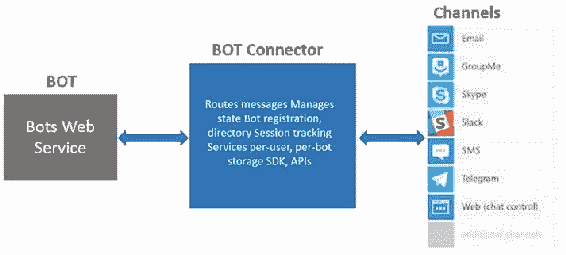
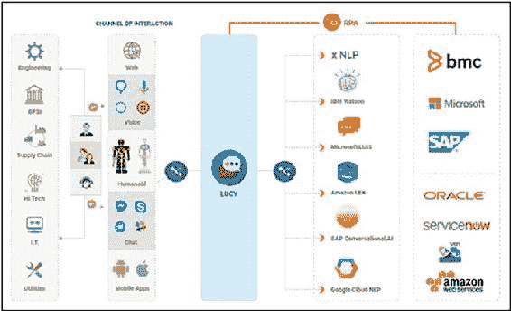

# 第 3 章 **机器人框架**

[机器人框架](https://dev.botframework.com/)为开发人员提供了一个平台，用于构建智能对话代理（机器人），并通过 Skype、Slack、Facebook Messenger、Telegram 等消息渠道连接它们。

机器人框架与 Watson、LUIS、

Lex 和 Dialogflow 等认知服务相结合，为用户提供丰富且有用的交互。

图 3-1 描绘了机器人框架及其与认知服务和渠道的集成。

***图 3-1.** 机器人框架架构*

机器人框架有助于开发和绑定应用程序的各个组件。

它是一个用于构建、连接、测试和部署智能机器人的平台接口。它有助于构建和连接智能机器人，以便与用户交互。

© Navin Sabharwal, Sudipta Barua, Neha Anand, Pallavi Aggarwal 2020

N. Sabharwal 等人，《使用 IBM Watson 引擎开发认知机器人》，

`doi.org/10.1007/978-1-4842-5555-1_3`

连接到多个渠道是机器人框架的特性之一。

它支持 Skype、Slack、Facebook Messenger 以及其他此类消息服务。

Bot Connector 提供以下服务以简化机器人和用户之间的通信。

• 机器人注册

• 连接和消息路由，包含一系列

可触达用户的渠道

• 对话和状态管理

接下来，我们将讨论几个流行的机器人框架及其一些重要特性。用户可以根据功能、定价以及它如何最适合应用程序的需求来选择机器人框架。

**Microsoft Bot Framework**

Microsoft Bot Framework 拥有全面的开源 SDK 和工具，可以轻松地将机器人连接到流行的渠道和设备。它通过原生集成 Azure 认知服务，赋予机器人说话、倾听和理解用户的能力。

Microsoft Bot Framework1 pr 为开发人员提供了快速构建机器人的 SDK。它与 Microsoft AI 服务和 LUIS 框架紧密集成，可快速创建强大的对话能力。

与其他机器人框架一样，Microsoft 提供了连接器，用于连接到各种消息平台，例如 Twitter、Slack 和 Skype。它有一个独特的功能，使您能够搜索和发现现有的机器人及其提供的服务。

1 [`dev.botframework.com`](https://dev.botframework.com/)

开源 Microsoft SDK 提供了与

Azure 认知服务让开发者能够更简单、更快速地创建直观的对话式机器人。微软提供的示例和代码有助于快速启动机器人项目，并缩短完成项目所需的时间。

微软机器人框架提供的实用工具范围包括：

翻译服务集成、对话状态管理、

调试工具以及可嵌入的网页聊天控件。针对不同领域的各种用例和示例的代码示例可供开发者使用。

**微软机器人框架功能**

微软机器人框架集成了语音、语言理解、翻译以及 Azure 认知服务提供的其他服务。来自 Azure 的云服务构成了任何机器人的骨干。有一个庞大的 .NET 开发者社区，他们发现通过使用 SDK 创建认知机器人，可以轻松地将他们在 C# 中的框架和语言技能提升到新的水平。

该 SDK 是开源的，并包含关于如何构建、测试以及将机器人投入生产的生命周期指导。这种生命周期指导是微软机器人框架独有的，使得新的认知机器人开发者更容易学习和实施。

微软的企业解决方案库与机器人框架集成，这省去了在其他机器人框架中可能需要的大量管道工作。这种与微软企业生态系统的开箱即用集成使其成为微软客户的一个不错选择。

许多企业开始将 Cortana、Teams 和 Skype 作为标准协作平台。微软机器人框架提供的深度集成和示例使开发者更容易利用现有的协作工具部署，并将机器人嵌入这些工具中。用户可以继续使用他们选择的渠道，并通过熟悉的企业协作平台用户界面与机器人进行通信。

**微软机器人连接器**

机器人连接器 or2 连接到文本/短信、Office 365 邮件、Skype、Slack 以及其他服务（见图 3-2）。

***图 3-2.** 机器人连接器*

**机器人 SDK**

开源的微软机器人 SDK 拥有构建机器人所需的所有工具，包括生命周期指导和大量以代码和构建块形式提供的示例。

2 [`www.nuget.org/packages/Microsoft.Bot.Connector/`](https://www.nuget.org/packages/Microsoft.Bot.Connector/)

**Botpress**

Botpress3 是一个在开发者中流行的开源平台。它是一个用于快速原型设计和构建对话式机器人的轻量级框架。与微软机器人框架类似，它捆绑了各种功能，使开发者更容易构建能够通过语音和聊天渠道进行对话的机器人。

得益于不断壮大的社区，Botpress 采用 GUI 驱动的方法来创建引人注目的机器人，从而减少了对编码的需求。如果你时间有限，需要一个轻量级引擎来创建你的机器人，或者正在尝试不同的机器人框架，那么 Botpress 可能是你的首选平台。

由于 Botpress 是一个完全独立的框架（与其他框架不同），它灵活、可扩展，并且可以与大多数认知服务产品集成。

它可以在本地部署，因此你不必依赖云提供商。如果你的用例因安全或合规问题需要本地部署，那么 Botpress 可能是你的首选平台。

Botpress 包含以下组件。

• **自然语言理解（NLU）引擎**。它使用自然语言处理算法对文本进行后处理。自然语言理解分析文本以提取信息（概念、实体、关键词、主题、类别、关系等）。结构化数据可供其他组件使用。此模块与 Botpress 框架捆绑在一起。

• **可视化流程编辑器**。与 IBM Watson Assistant 类似，Botpress 拥有自己的可视化界面，可用于快速原型设计和创建对话工作流。其简单直观的工作流设计器可供开发者对对话流程进行建模并测试用例。这意味着更少的代码和更快的开发速度。

• **消息渠道**。Botpress 支持多种通信渠道，包括 Facebook Messenger、短信和电子邮件，这使得开发者更容易与流行的消息应用集成。

• **聊天模拟器**。该模拟器帮助开发者测试他们的机器人，并查看机器人如何响应各种输入。它是使机器人达到生产级质量的重要工具。

**Lucy 机器人**

Lucy4 是一个认知虚拟助手。它模仿人类交互并具备学习能力。通过利用企业级的自然语言处理（NLP）和机器学习（ML），它通过智能对话来适应用户的需求。

Lucy 能够查找跨不同企业系统的相关信息。Lucy 帮助组织提升成熟度曲线，并增强员工和客户的用户体验。通过利用先进的自然语言处理，Lucy 减少了人为错误并提高了生产力。它针对各种场景提供了开箱即用的用例，并且可以轻松扩展以满足现代企业对“认知聊天机器人”的需求。

Lucy 架构的三个关键组件如图 3-3 所示。

4 [`www.dryice.ai/products-and-platforms/lucy`](https://www.dryice.ai/products-and-platforms/lucy)

***图 3-3.** Lucy 架构概览*

• **交互渠道**：以用户选择的媒介进行对话。它支持网页、语音、聊天、移动应用和仿人机器人。

• **自然语言处理（NLP）**：根据企业需求，利用任何现有的 NLP 引擎。它使用 NLP 通过理解含义、确定适当操作并响应用户来解释用户的意图。

• **企业集成**：与多个企业系统和知识源集成，使用户能够将 Lucy 作为来自不同来源的单一信息源。

• **企业级安全**：提供基于端点的安全性和第三方集成的数据区域灵活性。当前版本的 Lucy 支持 SAML 和 SSO。

• **灵活计费**：提供多种计费模板和使用类别的定制化计费模式。

• **上下文切换**：多级上下文切换允许用户返回到未完成的对话或偏离主题的对话。

• **按需扩展**：为满足业务需求而构建的可扩展平台。

• **全渠道**：提供多种开箱即用的渠道，易于配置。

• **开箱即用的第三方集成**：提供与运维管理、机器人流程自动化和 CRM 提供商的开箱即用第三方集成。

• **配置管理**：作为认知虚拟助手，Lucy 可以充当用户与跨领域和业务职能的多个企业应用之间的接口。

• **平台无关性**：跨平台工作，包括 Skype、Facebook Messenger、Microsoft Teams、Slack 等。

**结论**

本章概述了开发者可以选择的多种机器人框架，以便通过集成认知平台快速创建认知机器人应用。

