# 第 4 章 **使用 Watson Assistant**

**构建你的第一个机器人**

Watson Assistant 是 IBM 提供的一项认知云服务，它使开发者能够更轻松地构建对话界面并将其嵌入到任何应用程序中。Watson Assistant 与 IBM Watson 平台提供的多种认知服务集成，通过拼写检查、语气分析器和其他服务来丰富对话内容。

Watson Assistant 可以轻松集成到 Facebook Messenger 和 Slack 等流行的消息平台。开发者还可以选择

创建自定义用户界面应用程序，并通过 API 与配置的工作流进行交互。

接下来，我们将逐步创建一个简单的 CVA。首先，创建一个 IBM Cloud 账户，我们将使用该账户来使用 Watson Assistant 服务。

**创建 IBM Cloud 账户**

导航至 [`cloud.ibm.com/registration`](https://cloud.ibm.com/registration) 注册一个 IBM

Cloud 账户。图 4-1 显示了 IBM Cloud 账户注册页面。

© Navin Sabharwal, Sudipta Barua, Neha Anand, Pallavi Aggarwal 2020

N. Sabharwal 等人著，*《使用 IBM Watson 引擎开发认知机器人》*，

`doi.org/10.1007/978-1-4842-5555-1_4`

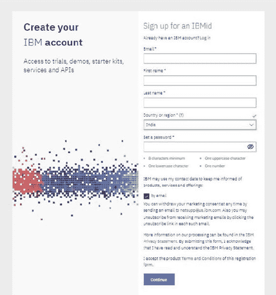

***图 4-1.** IBM Cloud 账户注册*

输入所需信息，如图 4-2 所示，然后点击**继续**。

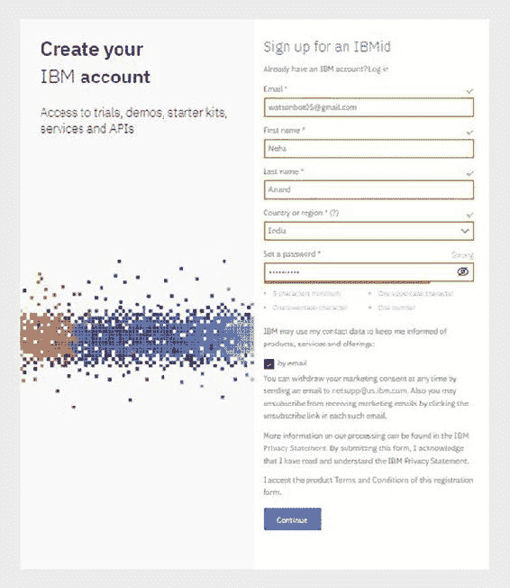

***图 4-2.** 已输入信息的注册页面*

这将带你进入图 4-3 所示的屏幕，这是一个确认页面。它确认了电子邮件地址与 IBM

账户的关联。点击**创建账户**。

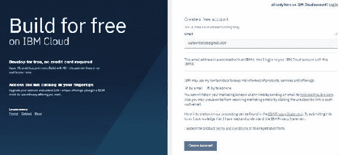

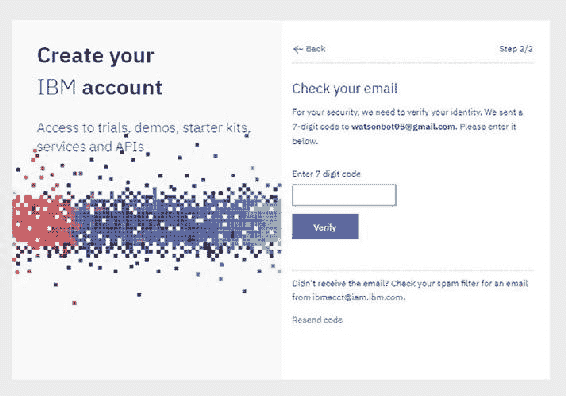

***图 4-3.** 电子邮件地址关联确认页面*

一封验证码会发送到你的邮箱以验证账户。你将被重定向到验证页面，如图 4-4 所示。

***图 4-4.** 账户验证页面*

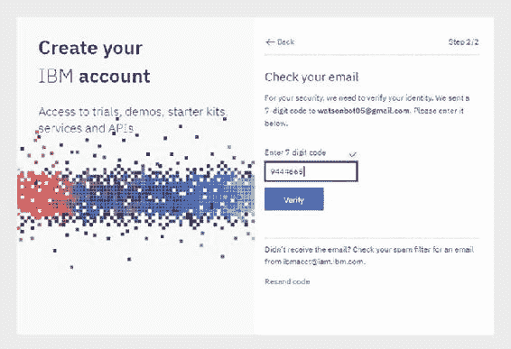

输入你收到的验证码，然后点击**验证**，如图 4-5 所示。

***图 4-5.** 输入验证码的验证页面*

验证后，你将被重定向到 IBM Cloud 账户隐私页面，如图 4-6 所示。

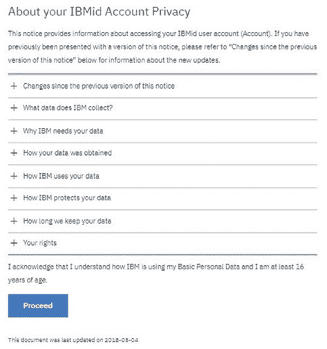

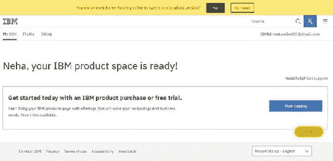

***图 4-6.** IBM 账户隐私页面*

点击**继续**。你将被重定向到 IBM Product Space 页面，如图 4-7 所示。

***图 4-7.** IBM Product Space 页面*

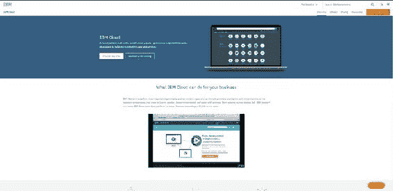

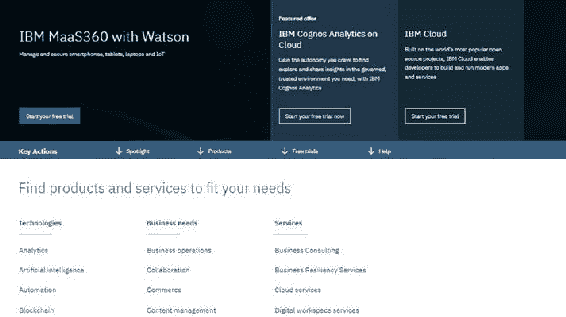

点击**查看目录**。这将带你进入图 4-8 所示的页面，该页面允许你开始 30 天免费试用。点击**免费 30 天试用**。

***图 4-8.** 启用 30 天免费试用*

这将带你进入图 4-9 所示的页面。点击**开始免费试用**。

***图 4-9.** 开始免费试用*

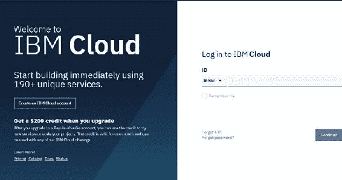

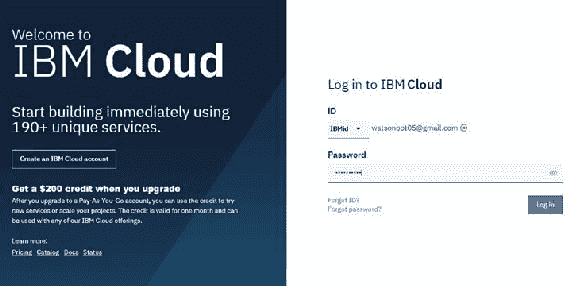

你将被重定向到登录页面，如图 4-10 所示。

***图 4-10.** IBM Cloud 登录页面*

在此处，你需要指定之前注册时使用的电子邮件地址。输入此信息并点击**登录**（参见图 4-11）。

***图 4-11.** 登录信息*

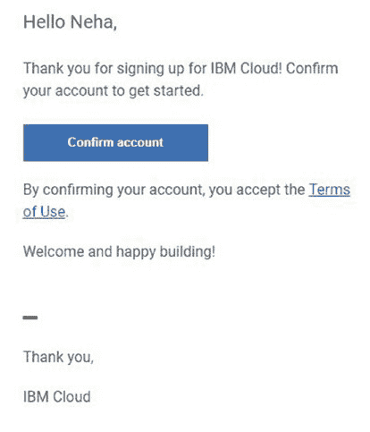

系统会要求你确认账户并接受使用条款，如图 4-12 所示。

***图 4-12.** 确认账户*

点击**确认账户**。确认后，你的账户就设置好了。

再次登录，你将被重定向到 IBM Cloud 仪表板页面，如图 4-13 所示。

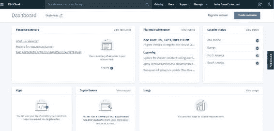

***图 4-13.** IBM Cloud 仪表板页面*

仪表板页面包含重要信息。

• 你正在使用的资源摘要

• 各地区的 IBM Cloud 服务状态  
• 计划维护时间表  
• 资源使用情况  

请在仪表板页面上花些时间熟悉界面。

**创建 Watson Assistant 服务**

要开始创建机器人，您需要在目录中搜索计划使用的服务，即 Watson Assistant 服务。

您可以在目录中搜索 **Watson Assistant** 服务，如图 4-14 所示，或者点击**所有类别**部分中的 **AI**，如图 4-15 所示。

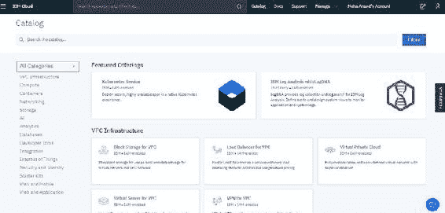

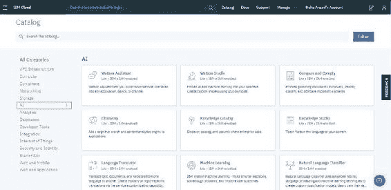

***图 4-14.** IBM Cloud 目录页面*

***图 4-15.** IBM Cloud AI 类别页面*

在此处，您可以选择 **Watson Assistant** 服务。输入创建服务所需的信息。为服务命名，该名称应反映您要创建的认知虚拟助手服务。

在本示例中，我们将其命名为 Watson Assistant-BFSI，如图 4-16 所示，以反映用例场景。

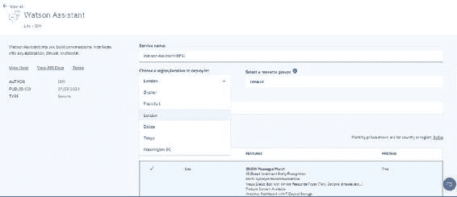

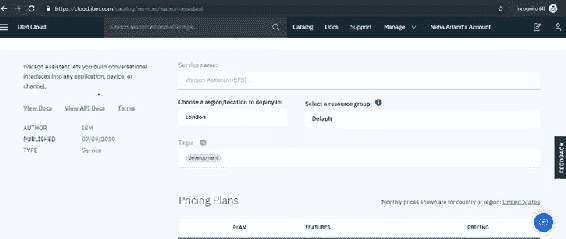

选择您要部署此资源的区域。将资源组保留为默认设置，本示例中为伦敦。

***图 4-16.** Watson Assistant 服务创建页面*

定义区域和资源组，如图 4-17 所示。

***图 4-17.** Watson Assistant 服务区域选择页面*  
向导屏幕会提示您为此服务选择套餐，如图 4-18 所示。由于是试用账户，我们使用 Lite 套餐，该套餐免费但有使用限制。您可以在此页面查看套餐的功能。

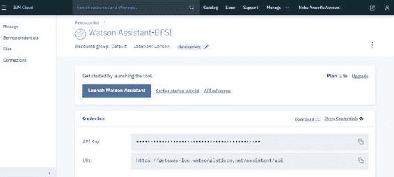

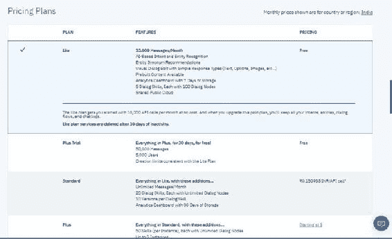

***图 4-18.** IBM Cloud AI 类别页面*

选择套餐后，点击**创建**。

服务创建完成后，资源列表页面会显示相关参数，包括 API 密钥和 URL，如图 4-19 所示。

***图 4-19.** Watson Assistant 服务页面*

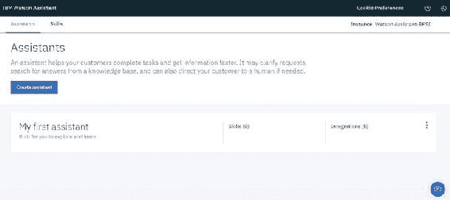

点击**启动 Watson Assistant**。您将被重定向到如图 4-20 所示的页面，在此页面可以创建助手和技能。我们先从创建技能开始。

***图 4-20.** Watson Assistant 页面*

**为用例创建技能**

在开始创建技能之前，让我们深入了解什么是技能，以及如何使用它来创建机器人。

技能是特定类别用例的容器。可以将技能视为属于特定领域的用例存储库。例如，如果您正在为一个计划将机器人用于多个领域（如人力资源、财务、最终消费者和 IT）的组织创建机器人，则需要创建多个技能。机器人能够回答所有这些领域的查询。因此，在此场景中，一个机器人（或 Watson Assistant）可以连接到多个技能。

有两个 IBM Watson 服务可以响应用户的问题。

Watson Assistant 使用工作流或基于对话的方法来配置系统以回答用户的查询。Watson Discovery 服务则使用搜索和提取方法来回答用户查询并返回匹配的文档。我们首先介绍 Watson Assistant 服务来配置我们的机器人，然后提供 Watson Discovery 服务的概述和集成。

对应于这两个服务，您可以在 Watson 中创建两种类型的技能。

• **对话技能：** 对应于 Watson Assistant 服务。它包含对话工作流，这是一个逐步的过程，描述了用户提问与 Watson Assistant 之间的对话流程。

对它们进行响应。它还包含**意图**和**实体**，这是 Watson 认知能力的核心支柱。它们帮助机器人理解用户的意图和对话的对象。我们使用用户可能提出的各种问题来训练系统；这是技能的一部分。

• **搜索技能：** 这对应 Watson Discovery 服务，用于从文档库中搜索和提取相关信息。

让我们从探索“技能”部分开始。我们将创建一个简单的技能并将其附加到 Watson Assistant。点击**技能**，然后点击**创建技能**，如图 4-21 所示。

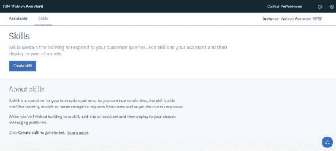

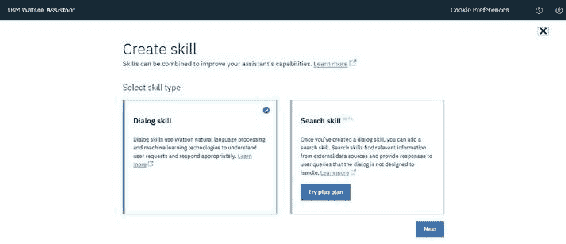

***图 4-21.** Watson Assistant 技能页面*

“创建技能”页面有两个选项：对话技能和搜索技能，如图 4-22 所示。选择**对话技能**并点击**下一步**。

***图 4-22.** Watson Assistant 创建技能页面*

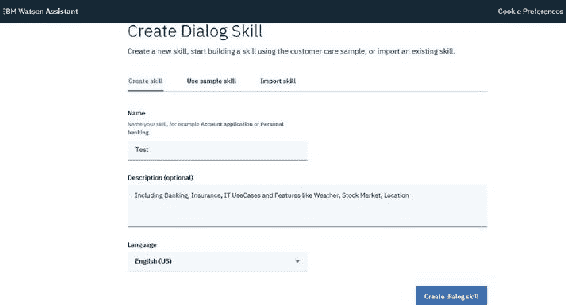

这将带你进入“创建对话技能”页面，如图 4-23 所示。

这里有三个选项。

• **创建技能：** 从头开始创建的自定义技能。
• **使用示例技能：** Watson 提供的示例技能，用于学习或测试目的。
• **导入技能：** 你可以导入先前创建的技能的 JSON 文件。

我们是从头开始创建技能，因此将使用第一个选项并输入所需信息。提供技能的名称和简要描述。选择你的语言并点击**创建对话技能**。

***图 4-23.** 对话技能信息*

“技能工作区”页面如图 4-24 所示。它包含所需的选项：意图、实体和对话。让我们使用它们来创建我们的第一个技能，并将其附加到 Watson Assistant 机器人上。

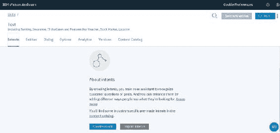

***图 4-24.** 技能工作区页面*

**为变体集合定义意图**

让我们先回顾一些关键术语。

• **用例：** 用例是由用户发起的场景或查询。用例包括对话可能采取的各种路径以及机器人提供的最终响应。用例的一个简单示例是像“今天纽约的天气怎么样？”这样的查询。机器人使用意图、实体和变体来提供此查询的答案。一个复杂的用例场景是 IT 服务台和用户试图解决笔记本电脑问题。

• **意图：** 与用户对话中的动词或动作。认知虚拟助手试图从与用户的对话中理解核心意图或动词。例如，用户查询如“*请告诉我关于保险单的信息？*”的意图将是“*询问*”，因为用户想要询问或收集信息。在此场景中，对象是“*保险单*”。

• **实体：** 实体是与意图结合以识别特定动作的名词。在前面的例子中，实体是“保险单”。这是对实体的简化解释；我们将更深入地探讨实体以及如何在 Watson 中定义和配置它们。

• **系统实体：** Watson 提供的预定义实体称为系统实体；例如，*@sys-currency*、*@sys-date*、*@sys-location*、*@sys-time* 等等。完整列表如图 4-25 所示。要使用这些实体，我们需要启用它们，因此请为你想要使用的特定系统实体勾选“开启”状态。

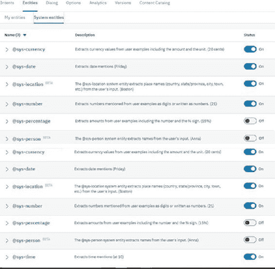

***图 4-25.** 系统实体*

• **模式实体：** Watson 提供了在实体值中定义正则表达式的功能。当我们需要识别已定义的

模式，例如电话号码、信用卡号、票号等。例如，如果你想为标准的美国电话号码定义一个正则表达式，它支持以下格式。

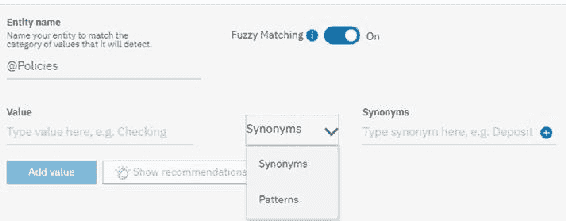

###-###-####

(###) ###-####

### ### ####

###.###.####

我们可以在实体值的“模式”部分将此正则表达式定义为 **^(\+\d{1**, **2}\s)?\(?\d{3}\)?** **[\s**. **-]\d{3}[\s**. **-]\d{4}$**，如图 4-26 所示。

***图 4-26.** 实体的模式选择*

• **变体：** 变体是我们正在定义的用例中，来自一组最终用户的一系列示例话语。这是一种理想情况，我们可以获得关于最终用户如何组织问题的实际数据。来自多个用户的这些样本数据可以训练 IBM Watson 引擎，使其学会将用户的查询映射到意图。

• **在意图变体中引用实体值和同义词：** 由于我们正在定义与变体相关的实体和值，我们可以在变体中添加实体值或同义词，以建立意图和实体之间的关系映射。在前面的第 4 章 使用 Watson Assistant 构建你的第一个机器人示例中，我们想要添加与保险单相关的变体。我们有 *@Policies* 实体，其值包括健康保险和汽车保险，因此我们可以将这些值作为变体的一部分添加。以下是此类变体的示例。

• 告诉我关于健康保险单的信息。
• 什么是汽车保险单？
• 健康保险有哪些好处？

• **直接在意图中引用实体名称：** 我们也可以直接在变体中使用实体名称。我们有 @Policies 实体，它包含健康保险和汽车保险的值，因此我们可以将此实体作为变体的一部分添加。

• 告诉我关于 @Policies
• 有哪些不同的 @Policies
• 帮我提供关于 @Policies 的信息

• **测试意图：** 定义意图和变体后，我们可以在技能页面右侧的 Watson ***试用*** 面板中进行测试，如图 4-27 所示。你可以看到基于添加的变体触发的意图。

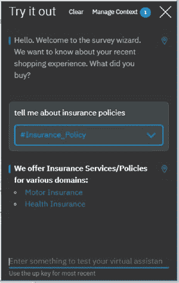

***图 4-27.** 对话页面上的“试用”面板*

这样，你可以检查触发的意图是否正确。如果不正确，我们可以通过从下拉列表中选择正确的意图来重新训练系统。Watson 引擎需要一点时间进行重新训练，并在“试用”面板中显示“Watson 训练中”。训练完成后，你可以再次测试我们的意图，并看到 Watson 返回了正确的响应，如图 4-28 所示。

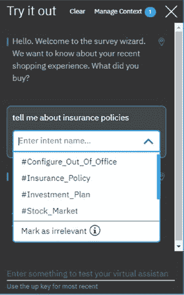

***图 4-28.** 对话页面上的“试用”面板和意图* *下拉列表*

你还可以在列出所有意图的“意图”页面上编辑、重命名、删除、添加或移动任何意图。你还可以导出和导入意图。

• **导出：** 选择意图页面。你可以选择要导出的意图，然后点击**导出**。所选意图会以 CSV 文件形式下载，如果你想在其他技能中重用这些意图，这会很有用。

• **导入：** 如果你想添加意图和变体，可以通过上传一个 CSV 文件来实现，文件格式为 **<示例>** , **<意图>** ，其中示例是特定意图的变体（参见表 4-1）。CSV 文件的结构应如下例所示。

• 告诉我关于健康保险单的信息, Insurance_Policy
• 什么是汽车保险单, Insurance_Policy
• 健康保险有哪些好处, Insurance_Policy

在“意图”页面上有一个导入选项。点击它即可导入。

当您拥有一个可以离线创建然后导入到 Watson 技能中的大型训练集时，这会非常有用。

• **对话：** 对话是一个流程或树状结构，用于定义对话的工作流程。对话是一个逐步的过程，我们通过它来理解用户的意图。对话使用意图、实体和 webhook 来与第三方 API 或系统集成以获取数据。

***表 4-1.** 用例与变体*

**用例**

**变体**

保险政策 告诉我关于保险政策的信息。

保险政策 还有哪些其他保险服务？

保险政策 我想了解各种保险政策。

保险政策 还有哪些其他保险服务？

保险政策 告诉我关于汽车保险的信息。

保险政策 健康保险政策有哪些好处？

保险政策 汽车保险政策有哪些特点？

保险政策 什么是汽车保险？

保险政策 告诉我不同类型的保险政策。

保险政策 告诉我汽车保险的好处。

现在我们已经解释了训练机器人的基础知识，让我们逐步创建一个用例。

第一步是确定用例；在本例中，它来自保险行业。用户想要了解您公司提供的保险政策类型。

在开始修改 IBM Watson 配置之前，最好将一切记录在电子表格中。

• **意图描述：** 提供商提供的政策类型。

• **意图名称：** #Insurance_Policy

• **实体：** 保险政策类型

• **实体值：** 健康保险，汽车保险

接下来，我们需要最终用户可能如何询问此信息的表述或变体。

• 保险服务

• 告诉我关于保险政策的信息

• 还有哪些其他保险服务？

• 我想了解各种保险政策。

现在让我们转到 IBM Watson 控制台来配置我们的第一个用例。

1. 登录 IBM Cloud 后，启动本章前面创建的 AI 服务：Watson Assistant – 虚拟机器人。

2. 点击**技能**，然后选择测试技能。

3. 在顶部菜单栏中，选择**意图**。意图以 # 符号开头，后跟意图名称。我们将我们的意图命名为 #Insurance_Policy。

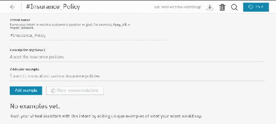

4. 输入您正在创建的意图的简要描述。将出现**添加用户示例**选项。

5. 输入之前定义的变体，如图 4-29 所示。这些是输入到 Watson 引擎进行训练的示例变体。

***图 4-29.** 用于添加变体的意图页面*

至少添加五个示例/变体作为意图示例。更多的变体数量更有利于训练，从而让机器人给出更好的响应。

作为最佳实践，并且为了让引擎拥有足够的数据，每个意图您应该有 20 到 50 个独特的变体。

输入变体后，屏幕显示如图 4-30 所示。

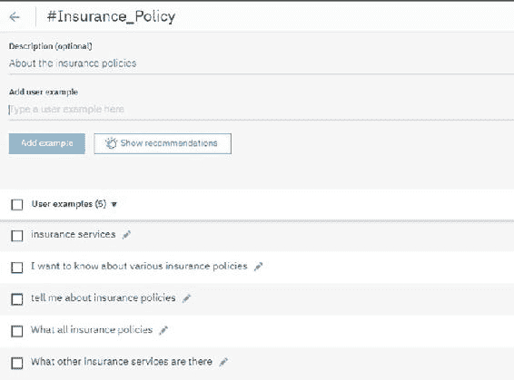

***图 4-30.** 已添加变体的意图页面*

我们已经完成了意图及其变体的配置，但我们还没有配置实体，以便系统能够解读用户想要什么。

1. 点击**返回**按钮返回技能页面。

2. 从顶部菜单中选择**实体**。您将看到一个屏幕，如图 4-31 所示。

3. 在实体名称中输入 ***@*** Policies。对于值，添加 Motor Insurance 并附带 Motor Insurance。添加 Health Insurance 并附带 Health Insurance 作为同义词。

4. 如果您想通过使用 Watson 提供的内置模糊逻辑算法自动发现同义词，请打开**模糊匹配**。这通过依赖内置算法来实现实体值的更好匹配。

引擎内可用的库和数据。

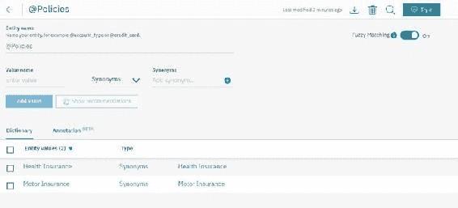

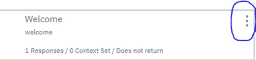

***图 4-31.** 实体页面*

完成实体、意图及其变体的配置后，我们需要通过一个对话将所有内容串联起来。在 Watson Assistant 中，对话以树状结构图形化呈现，你可以在其中创建节点来处理每个意图。

**对话配置**

让我们配置对话流程，然后深入了解它。

1.  点击**返回**按钮，进入对话页面。
2.  在对话页面上，点击欢迎节点（该节点默认创建）上的汉堡菜单，如图 4-32 所示。

***图 4-32.** 节点上的汉堡菜单*

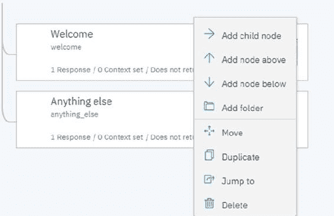

3.  选择**在其下方添加节点**，如图 4-33 所示。

***图 4-33.** 在其下方添加节点*

在欢迎节点下方添加了一个节点，如图 4-34 所示。

***图 4-34.** 已添加节点*

4.  点击新添加的节点，并将其命名为**保险政策**，如图 4-35 所示。

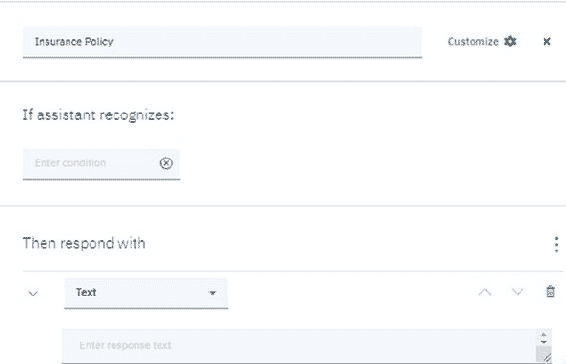

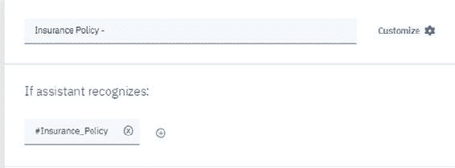

***图 4-35.** 已输入节点名称*

5.  在**输入条件**字段中，提供你已创建的意图（即 **#Insurance_Policy**），如图 4-36 所示。

***图 4-36.** 在条件中定义了意图的对话节点*

6.  在**然后回复**字段中，提供当条件匹配时你想要显示的回复。回复字段显示**输入回复文本** *，因此我们将添加机器人要显示的回复（见图 4-37）。

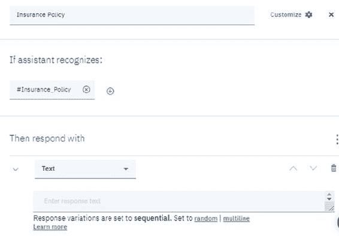

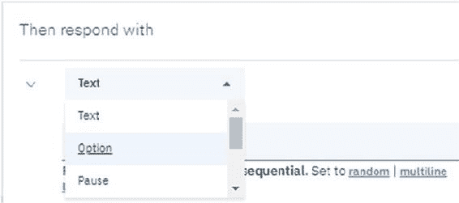

***图 4-37.** 从“然后回复”字段下拉菜单中选中的选项*

7.  有两个选项：健康保险和汽车保险。在**然后回复**下拉菜单中，选择**选项**，如图 4-38 和图 4-39 所示。

***图 4-38.** 已选择选项*

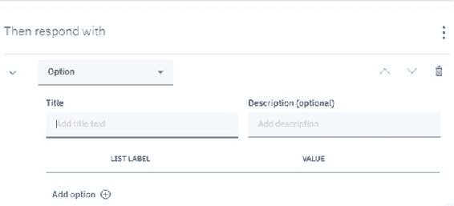

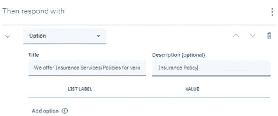

***图 4-39.** 从“然后回复”中选中的选项*

8.  在标题字段中，为选项添加一个陈述和描述，如图 4-40 所示。

***图 4-40.** 标题和描述*

9.  点击**添加选项**来添加不同类型的政策（即汽车保险和健康保险）。将这些添加到带有值的列表标签中，如图 4-41 所示。这些是在 @Policies 实体中定义的值。

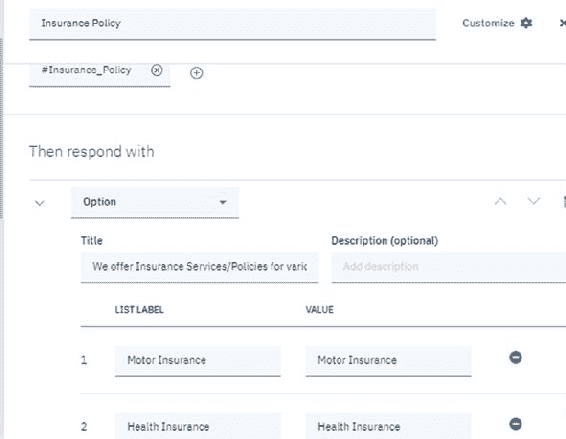

***图 4-41.** 定义回复字段以提供选项的对话节点*

10. 我们将向用户展示的选项将被定义为实体和值。在本例中，@Policies 将是实体，其值定义为汽车保险和健康保险，并带有各自的同义词。

11. 你已在节点中定义了选项，现在返回该节点。点击汉堡菜单并选择**添加子节点**，如图 4-42 所示。由于我们有两个选项，因此添加两个子节点。

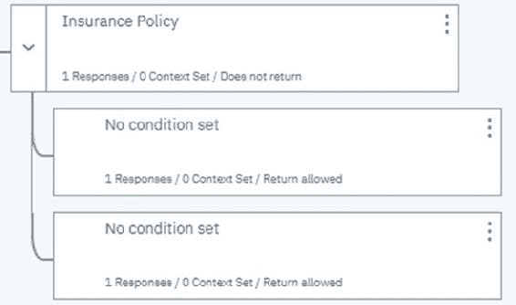

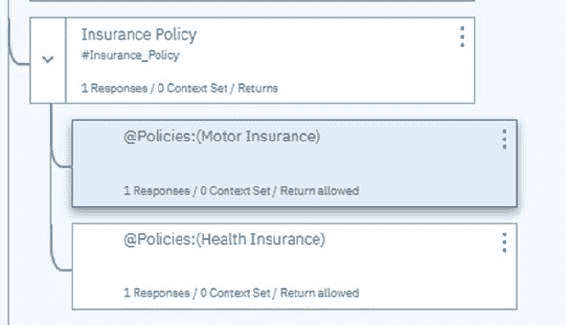

***图 4-42.** 为已定义的选项添加的子节点*

12. 在子节点中，将条件定义为其实体和实体值。例如，@Policies:(Motor Insurance) 和 @Policies:(Health Insurance) 被定义为选项。我们为这两个选项添加两个节点，如图 4-43 所示。

***图 4-43.** 条件定义为其实体值的子节点*

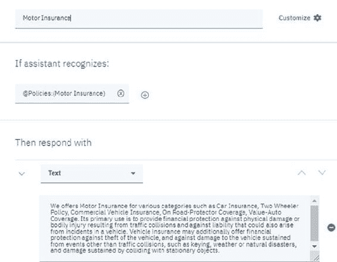

13\. 在任意选项被选中时，将您希望显示的响应添加到

响应字段中，如图 4-44 所示。

***图 4-44.** 带有响应的子节点*

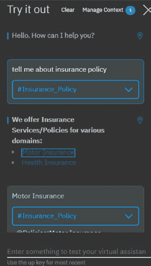

让我们在 Watson 控制台（即“试用”面板）中测试我们的用例。

在“对话”页面中点击**试用**。您会看到一条欢迎消息，并且可以与机器人进行对话。输入一条查询来检查

响应，如图 4-45 和图 4-46 所示。

***图 4-45.** 用于测试用例的“试用”面板*

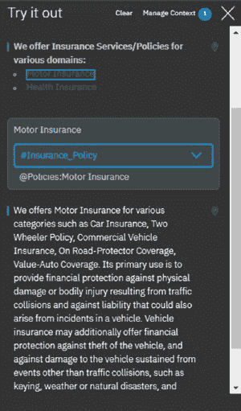

***图 4-46.** 对所选选项的响应*

哇！创建并测试您的第一个认知机器人就是这么简单。

接下来，让我们将该技能与 Watson 内置的机器人框架助手集成，以完成配置。

**与内置机器人框架助手集成**

**助手**

Watson 提供了一个名为*助手*的内置机器人，用于关联我们的技能/对话。

选择**助手**，然后点击**创建助手**，如图 4-47 所示。

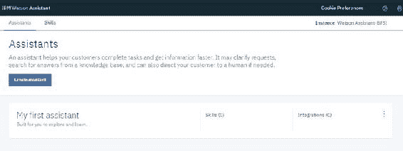

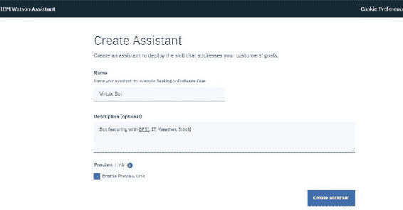

***图 4-47.** 创建助手页面*

为您正在创建的聊天机器人命名，并输入所需

信息。点击**启用预览链接**和**创建助手**，如图 4-48 所示。

***图 4-48.** 命名助手并创建它*

点击**添加对话技能**，如图 4-49 所示。选择并添加您已创建的技能，如图 4-50 所示。

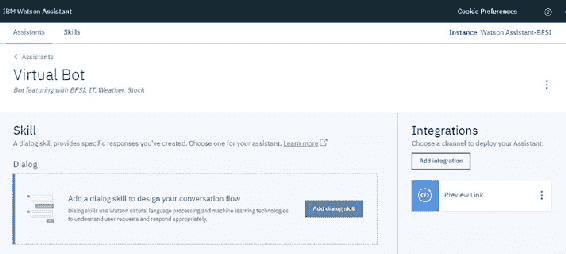

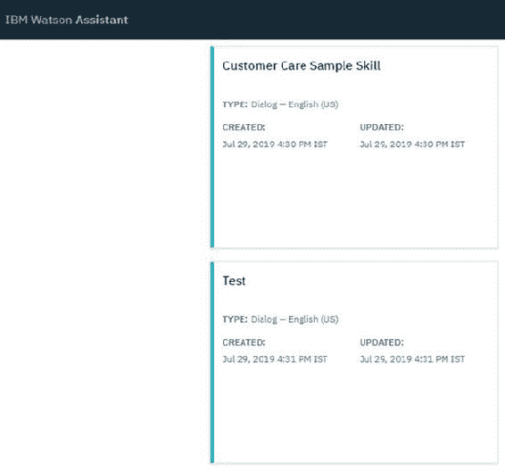

***图 4-49.** 为您的助手添加对话技能*

***图 4-50.** 选择要添加到助手的技能* 86

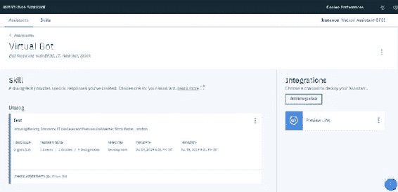

选择通过预览链接关联的技能和助手。点击**测试技能**。您会看到它已被选中，如图 4-51 所示。

***图 4-51.** 在助手页面上创建的预览链接*

**您的第一个机器人**

点击**预览链接**。您的聊天机器人链接会在新标签页中打开，如图 4-52 所示。

***图 4-52.** 选择预览链接以查看机器人*

选择预览链接后，您可以在标签页中看到机器人，如图 4-53 所示。

***图 4-53.** Watson 提供的预览机器人*

现在您可以在机器人上测试用例并查看结果，如图 4-54 所示。

***图 4-54.** 在机器人上进行测试*

**对话与条件**

**对话节点**

一个对话节点包含一个条件和一个响应。

• 条件：触发特定对话节点所需的信息或检查。它可以是一个意图、一个实体、意图和实体的组合、实体值或一个上下文变量。Watson 还提供了一些预定义条件可供使用；例如，true、false、welcome、anything_else、conversation_start 等。

• 响应：节点响应字段中提到的响应；当条件为真时执行。

**单节点**

一个单节点可以处理简单的用户查询（即简单的一问一答）。但实际用例更为复杂；机器人和用户之间需要进行来回沟通。您可以在同一层级中使用多个节点。您也可以使用子节点来创建工作流。

Watson 采用自上而下的方式处理或遍历树中的所有节点。它从第一个节点开始，一直遍历到最后一个节点。

***图 4-55.** 单个节点表示*

**多个节点**

在遍历节点时，如果条件匹配，则会进入/触发该节点并执行工作流。它会执行每个子节点，直到条件满足为止。

***图 4-56.** 多个节点间的遍历*

**带有子节点的节点**

假设用户的查询与节点 2 中的条件匹配。当从节点 1 遍历时，它会触发节点 2，然后评估子节点（子节点 1、子节点 2）。满足条件的子节点将被执行。之后，程序会退出子节点工作流，并继续向下移动，直到父分支中的最后一个节点（即节点 3）。

***图 4-57.** 带有子节点的节点间的遍历*

现在你已经了解了如何使用对话，让我们看看可用的各种选项。在“对话”页面上，单击**创建对话**，如图 4-58 所示。

***图 4-58.** 用于创建对话的对话页面*

默认情况下，对话有两个节点，名为“欢迎”和“其他内容”，如图 4-59 所示。这些名称不是固定的，你可以修改它们。

• **欢迎节点**：机器人的欢迎消息，当用户开始与机器人对话时显示给用户。

• **其他内容节点**：创建对话时随欢迎节点一起出现的一个特殊节点。如果层次结构中的任何节点都没有匹配的条件，则执行此节点。如果工作流匹配了任何其他节点的条件，则不执行此节点。

***图 4-59.** 包含欢迎节点和其他内容节点的对话* 让我们向默认的对话树结构添加另一个节点。单击欢迎节点上的汉堡菜单，如图 4-60 所示。

***图 4-60.** 节点上的汉堡菜单*

单击**在下方添加节点**，如图 4-61 所示。

***图 4-61.** 特定节点的添加节点选项*

弹出菜单上的选项简单明了，但让我们简要描述一下这些选项。**添加子节点** 将节点添加为同一节点的子节点，如图 4-62 所示。在此示例中，我们将使用子节点。

***图 4-62.** 添加子节点*

***在上方添加节点*** 意味着在所选节点的上方添加一个新节点，如图 4-63 所示。

***图 4-63.** 在上方添加节点*

***在下方添加节点*** 意味着在所选节点的下方添加一个新节点，如图 4-64 所示。

***图 4-64.** 在下方添加节点*

***添加文件夹*** 用于添加一个文件夹。文件夹可以帮助你围绕相似的用例组织树的各个部分。首先，将现有的对话节点移入此文件夹，或直接将新节点添加到你的文件夹中，如图 4-65 所示。文件夹名称可以基于你拥有多个对话的领域。

***图 4-65.** 添加文件夹*

***移动*** 意味着可以将节点移动为子节点、移动到另一个节点上方或下方，如图 4-66 所示。

***图 4-66.** 将节点移动到另一个节点的移动选项*

***复制*** 用于创建节点的克隆/副本/拷贝。

与图 4-67 中显示的节点相同

***图 4-67.** 复制节点*

**删除** 用于删除节点。

**跳过用户输入** 用于在希望绕过等待用户输入，直接跳转到当前节点的第一个子节点时使用。当节点有一个或多个子节点时，此选项可用。

**跳转到** 是一个条件语句，提供创建分支的选项，当满足特定条件时，可以从工作流中的一个节点跳转到另一个节点。你需要选择要跳转的源节点，然后选择工作流中要跳转到的目标节点，并配置以下三个选项之一，如图 4-68 所示。

***图 4-68.** 跳转到选项*

**等待用户输入** 会等待用户输入查询，然后将工作流移至下一步。在用户提供更多输入之前，对话不会继续。

**场景 1：带有子节点的节点**

当用户输入查询时，会触发匹配的节点并等待用户输入内容。如果该用户输入与后续子节点（子节点 1、子节点 2）中定义的条件匹配，则会执行该特定子节点。

***图 4-69.** 用户输入及从主节点到子节点的遍历*

**场景 2：同一层级节点间的跳转**

当节点 1 因匹配的查询被触发，并且存在从节点 1 到节点 2 的跳转时，可以选择在跳转到节点 2 之前等待用户输入。

***图 4-70.** 用户输入及同一层级节点间的遍历*

**如果机器人识别条件** 意味着，如果目标节点中指定的条件评估为真，工作流将执行目标节点的响应语句。如果评估不为真，则不执行响应语句。

***图 4-71.** 跳转到（如果机器人识别）——条件为真时在同一层级节点间跳转*

如果条件评估不为真，系统会移动到目标节点，但不执行目标节点的响应语句。它不会评估子节点中的任何条件，而是移动到下一个兄弟节点，以自上而下的方式继续评估条件。

***图 4-72.** 跳转到（如果机器人识别）——条件为真时在同一层级节点间跳转*

**响应** 会执行目标节点上定义的响应，无论条件是否满足。

***图 4-73.** 跳转到（响应）——在同一层级节点间跳转*

**结论**

本章深入探讨了 IBM Cloud 提供的 Watson Assistant 服务。内容涵盖了我们如何使用该服务从零开始构建一个虚拟认知机器人。

我们从设置账户开始，并尝试了内置助手提供的机器人。你学习了基本概念，如意图、实体和用于配置用例的对话。我们详细介绍了 Watson 对话提供的所有功能，以使机器人能够与用户进行无缝对话。

