# 第5章 Watson Agent 的高级概念

你已经学会了如何创建一个简单但有用的聊天机器人。本章涵盖高级主题，例如上下文实体、上下文变量、槽位和离题处理，以及如何处理多个意图。IBM Watson 平台的这些高级功能有助于解决复杂的用例并创建高级工作流。

## 上下文实体

在上一章中，我们使用 `@Policies` 实体来训练 IBM Watson 引擎，以判断对话中提到的保单是健康保险还是汽车保险。

另一种直接标记实体的方式是：在输入意图的变体时，可以将变体的一部分标记为实体值，这被称为*标注*。

被标记为实体值的意图部分被称为*提及*。

以这种方式标记的实体被称为*上下文实体*。

© Navin Sabharwal, Sudipta Barua, Neha Anand, Pallavi Aggarwal 2020
N. Sabharwal 等人著，《使用 IBM Watson 引擎开发认知机器人》，
`doi.org/10.1007/978-1-4842-5555-1_5`

你可以通过一个示例更好地理解这一点。我们以 Outlook 或 Gmail 的“重置密码”用例为例，为其定义各种元素。

- **意图**：`#Reset_Password`
- **实体**：`Mailbox`
- **实体值**：`Outlook`, `Gmail`
- **变体**：
    - Reset Password
    - 帮我重置密码。
    - 我想重置 Outlook 中的密码。
    - 我想重置 Gmail 中的密码。
    - 重置我的 Gmail 密码。
    - 重置我的 Outlook 密码。

在上述意图中，`Gmail` 和 `Outlook` 是可以标记为上下文实体的实体值。它们会被自动添加到实体中，并显示在实体的标注部分。标注选项卡会显示这些实体被标记的意图。

图 5-1 展示了添加到意图中的变体。
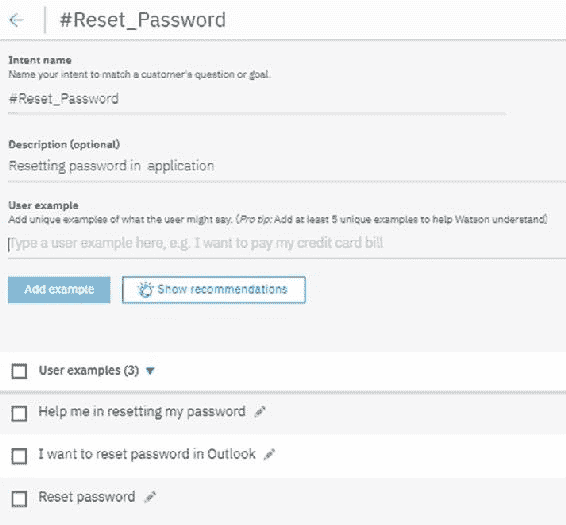
*图 5-1. 已添加的变体*

接下来，我们从这些意图中标记实体。

我们将选择要添加为实体值的部分或术语。选中后，会弹出一个窗口，如图 5-2 所示。

如果该实体尚未定义，你可以在**输入实体名称**字段中添加实体。

这会添加该实体以及我们之前标记的文本部分（即 `Outlook`），如图 5-3 所示。

我们将该实体命名为 `@Mailbox`，`Outlook` 被添加到此实体中。
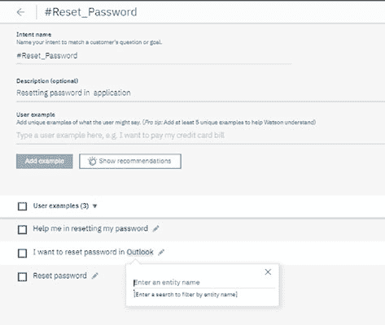
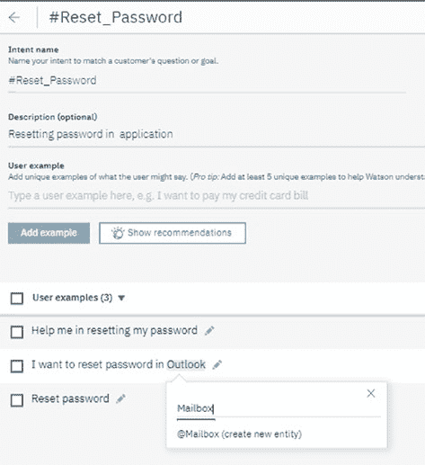
*图 5-2. 向实体添加值（上下文实体）*
*图 5-3. 已向实体添加值（上下文实体）*
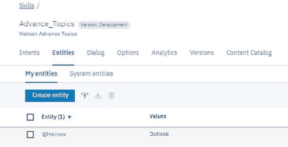
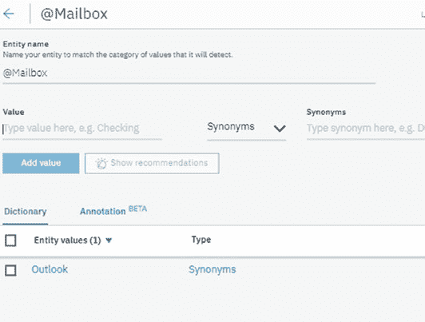

返回技能页面并点击该实体。创建的实体 `@Mailbox` 带有 `Outlook` 值，如图 5-4 和 5-5 所示。
*图 5-4. 实体页面上反映的实体*

点击 `@Mailbox` 实体，然后点击**标注**选项卡。你会看到你在输入变体时标记的标注和实体，如图 5-6 所示。
*图 5-5. 已向实体添加值（上下文实体）*
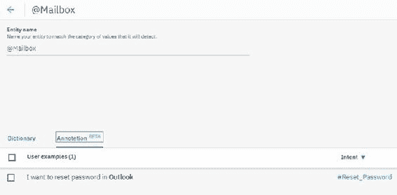
*图 5-6. 已添加的标注*

如果我们选择另一个变体并尝试标记一个实体以添加为值，之前标记的实体（即 `@Mailbox`）会作为一个可选选项出现。

如果实体值属于一种新类型的实体，你可以通过同一个下拉菜单继续添加它们。

如果实体值已经存在，而你标记了同义词，Watson 引擎会智能地将其添加为同义词，而不是新的实体值。你可以通过添加更多变体并标注这些实体来尝试这些选项。IBM Watson 会利用其词典和智能自动完成此操作。

## 上下文变量

上下文变量是在节点内定义的，并带有默认值。它非常有用，因为你可以捕获或存储信息，并使用这些信息来执行进一步的操作，例如以下情况。
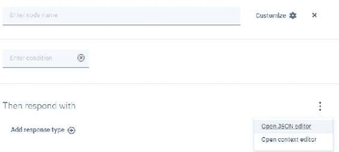

- **从应用程序传递上下文**：通过设置上下文变量并将该上下文变量传递给对话，信息从 API/应用程序传递到对话。
- **在节点之间传递上下文**：你可以将上下文变量的值从一个节点传递到另一个节点。
- **重置上下文**：在另一个节点设置上下文变量有助于重置上下文。
- **在条件集中定义或存储值**：它用于在条件集中定义或存储值。

您可以在节点响应字段的汉堡菜单中启用它。

选择**打开上下文编辑器**，如图 5-7 所示，并保存所需的上下文。
*图 5-7. 打开上下文编辑器*

上下文变量以 `$` 符号显示（见图 5-8）。
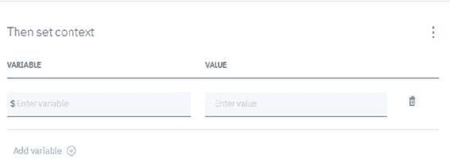
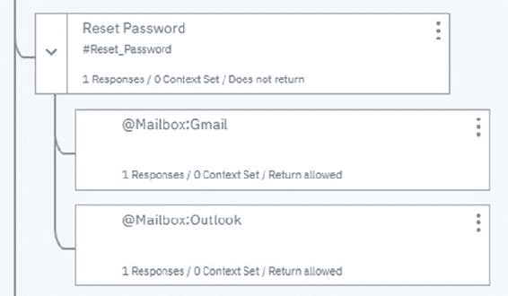
*图 5-8. 上下文变量编辑器*

让我们看看上下文变量如何用于以“重置密码”为用例的节点。

- **意图**：`#Reset_Password`
- `@Mailbox`，其值为 `Outlook` 和 `Gmail`

让我们在对话框中配置该用例，捕获这些值，并将它们传递给上下文变量。您将在后续的工作流步骤中了解如何使用此上下文变量。

在“对话框”页面上，添加一个节点并为其命名。在意图字段中设置条件，并配置对话框流程，如图 5-9 所示。
*图 5-9. 对话框节点*
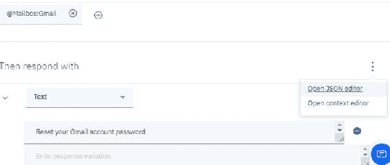
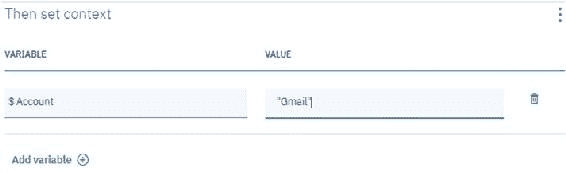

导航到子节点，并通过单击节点页面上的汉堡菜单来启用上下文变量。选择**打开上下文编辑器**，如图 5-10 所示。
*图 5-10. 打开上下文编辑器*

您会看到“**然后设置上下文**”页面。添加变量为 `$Account`，它将捕获账户名称的值（例如“Gmail”），并用于重置密码，如图 5-11 所示。您也可以对 `Outlook` 账户执行此操作。
*图 5-11. 已定义的上下文变量*

当用户选择其中一个选项时，`$Account` 上下文变量的值就会被设置。如果用户选择 `Gmail`，则 `$Account` 被设置为 `Gmail`。如果选择 `Outlook`，则设置为 `Outlook`。您可以通过单击“对话框”页面上的“试用”面板来检查上下文变量的值是否已设置。单击**管理上下文**以查看上下文变量的值，如图 5-12 所示。
*图 5-12. 用户选择了账户选项*

您可以在右上角看到“管理上下文”，其中显示数字 2。

单击**管理上下文**。您会看到 `$Account` 上下文变量，并且由于我们选择了 `Gmail` 选项，其值被设置为 `Gmail`。如图 5-13 所示。
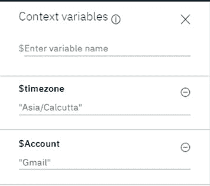
*图 5-13. 显示上下文变量的值*

## 槽位

槽位功能帮助一个对话框节点在同一节点内收集或检查多个条件。

用户预先提供的信息会被保存，助手只会询问完成请求所需的缺失细节。

它会检查槽位中定义的所有条件，并询问提示性问题。只有当所有条件都经过评估并满足时，它才会继续执行。

让我们通过下图来更好地理解这一点。当查询的意图匹配时，它会进入该节点，并询问槽位 1 和槽位 2 中定义的相应问题，如图 5-14 所示。一旦所有槽位的条件都满足，它就会执行下一个操作。但如果任一槽位中的条件未满足，它会继续询问提示性问题。
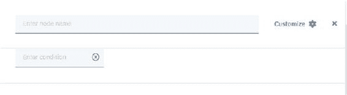
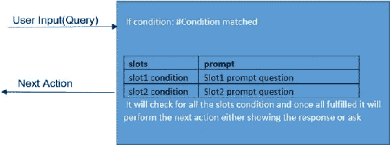
*图 5-14. 槽位功能*

您可以通过节点上的“自定义”按钮启用它，如图 5-15 所示。
*图 5-15. 自定义按钮*

单击**自定义节点**并选择**槽位**。将滑块移动到**开启**位置，并勾选**提示所有内容**。单击**应用**，如图 5-16 所示。
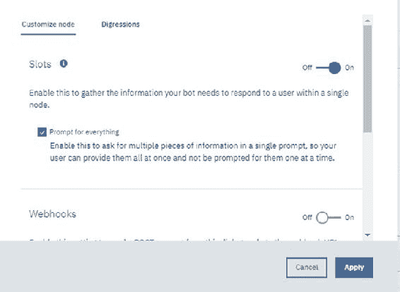
第五章 Watson 助手的高级概念
*图 5-16. 为节点启用插槽*

为节点启用插槽后，节点显示如图 5-17 所示。
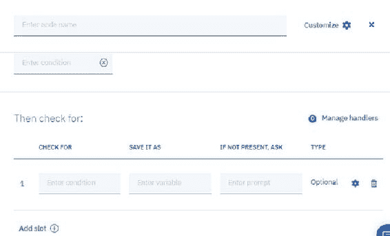
第五章 Watson 助手的高级概念
*图 5-17. 已为节点启用插槽*

启用插槽后，您会看到**然后检查**选项。

您可以按如下方式定义条件：

- **检查**：定义条件。
- **保存为**：将值保存在上下文变量中。
- **如果不存在则询问**：如果条件不匹配，则可以询问提示性问题。

最后，在“响应”字段中输入响应。

让我们通过“重置密码”示例来更好地理解这一点。

我们将在节点中定义插槽，用于检查条件（即，用户想要重置密码的账户是否已定义）。

通过单击**自定义**按钮，然后选择**插槽**来启用节点中的插槽。勾选**提示所有内容**。启用插槽的步骤之前已经介绍过。启用插槽后，节点如图 5-18 所示。
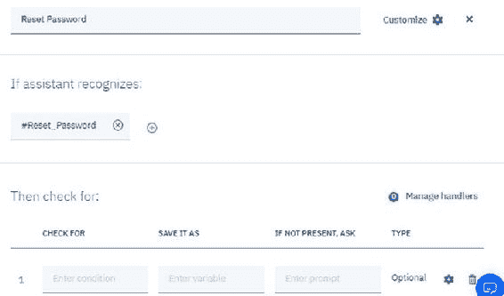
第五章 Watson 助手的高级概念
*图 5-18. 已为节点启用插槽*

1. 删除子节点。您将在同一个节点中处理账户的条件检查并设置上下文变量。
2. 在**检查**中，定义要检查的账户的条件。将其设置为上下文变量，如图 5-19 所示。
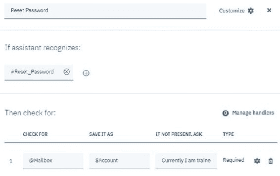

# 第五章 Watson 助手的高级概念

***图 5-19.** 已填写用于检查账户的插槽条件*

3. 我们在`检查`中将条件定义为`@Mailbox`，因此它将检查用户是否输入了其想要重置密码的账户（Gmail 或 Outlook）。

4. 如果条件匹配，则用户已定义账户。`$Account`上下文变量的值被设置为 Gmail 或 Outlook。如果不匹配，则会询问`如果不存在则询问`的问题，如图 5-20 所示。


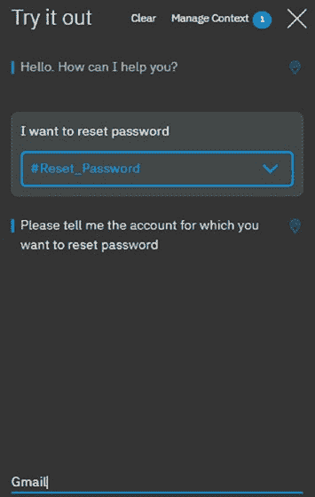

***图 5-20.** 插槽条件未满足并显示提示问题*

5. 在右侧角落，您会找到用于定义插槽的齿轮按钮。点击它会将您带到如图 5-21 所示的页面，您可以在其中设置响应。

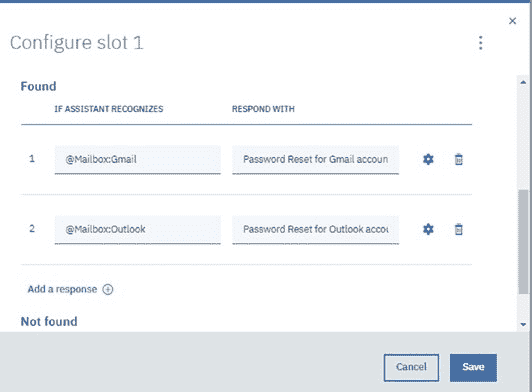

***图 5-21.** 已设置插槽找到/未找到条件*

在本节中，您学习了如何在节点中为不同场景配置插槽。您还学习了如何在插槽内设置上下文变量。

## 多重响应（多重条件响应）

利用此功能，我们可以根据提供的其他条件，对同一输入提供不同的响应。单个节点可以提供多个不同的响应；每个响应由不同的条件触发。这种方法有助于简化对话树结构。

1. 导航到对话中的一个节点，然后单击`自定义`按钮以启用它，如图 5-22 所示。

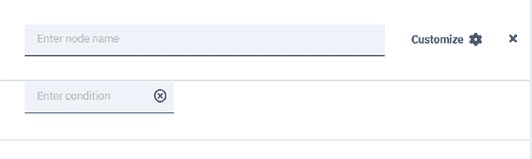

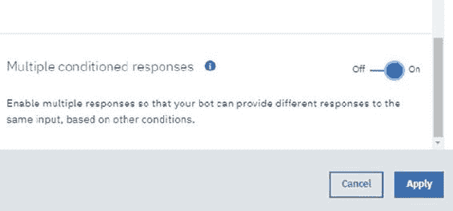

***图 5-22.** 节点上的自定义按钮*

2. 单击自定义节点并向下滚动到`多重条件响应`选项。将滑块打开并单击`应用`，如图 5-23 所示。

***图 5-23.** 启用多重条件响应*

在节点上应用`多重条件响应`后，节点显示如图 5-24 所示。

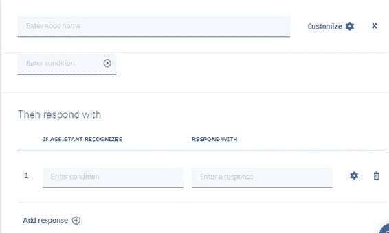

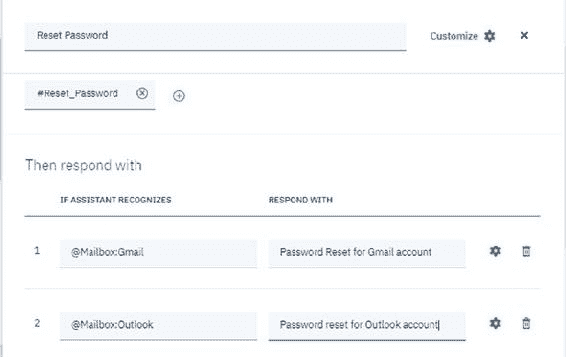

***图 5-24.** 已启用多重条件响应的节点*

让我们通过“重置密码”用例来看看这是如何工作的。删除子节点并导航到我们之前所在的节点。

我们已简单定义了意图条件。这将启用`多重条件响应`选项，并在 `IF ASSISTANT RECOGNIZES` 中设置条件。节点出现，如图 5-25 所示。

***图 5-25.** 同一节点内包含不同条件的多重条件响应*

通过这种方式，我们减少了树形结构，并在同一节点内检查条件，从而显示各自的响应。相同的用例也可以使用上下文变量在槽位中配置多重条件响应。我们可以跳过这一步，直接在一个节点内完成。

槽位与多重条件响应的基本区别在于，槽位强制你遍历所有选项，并提供设置上下文变量的选项。你可以根据这一点为你的用例选择正确的选项。

## 话题转移

话题转移是实现上下文切换的一种方式。你可以处理这样的场景：用户启动一个用例并沿着对话进行，但突然提出一个与不同用例相关的其他查询。

在这种情况下，我们需要完成转移的工作流，然后回到用户最初发起的原始用例。

让我们通过“重置密码”和“配置外出回复”用例来讨论话题转移。该示例将在对话之间进行转移，并在完成转移的工作流后恢复原始工作流。

从[`github.com/`](https://github.com/watson05/Cognitive-Bot) [watson05/Cognitive-Bot](https://github.com/watson05/Cognitive-Bot)下载用于“配置外出回复”和“重置密码”用例的`Advance_Topics-Slots_Digression.json`文件。关于如何将 JSON 文件导入 Watson Agent，请参考第 4 章。

这两个用例已在图 5-26 的对话框中配置完成。

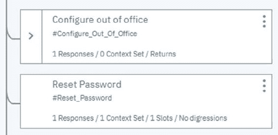

***图 5-26.** 用于演示话题转移的两个用例*

用户输入查询“我想重置密码。”Watson Assistant 提供了选择 Gmail 或 Outlook 的选项。用户没有选择选项，而是输入“我想配置外出回复。”

由于用户询问的内容与当前用例完全不同，工作流会转移到配置了“配置外出回复”用例的节点，然后执行相应步骤。

要实现这一点，请导航到你想要从中转移的节点。启用该节点的话题转移功能。点击`自定义`，然后选择`话题转移`。该节点会弹出一个窗口，用于选择和启用选项，如图 5-27 所示。

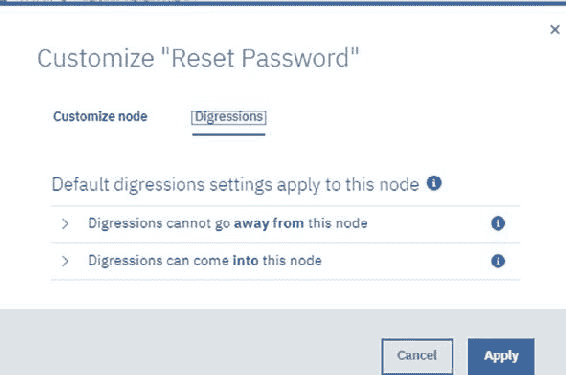

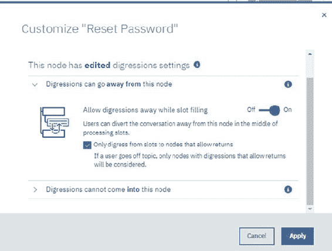

***图 5-27.** 选择话题转移*

选择第一个选项并将其打开。点击`应用`，如图 5-28 所示。

***图 5-28.** 从话题转移中选择选项 1*

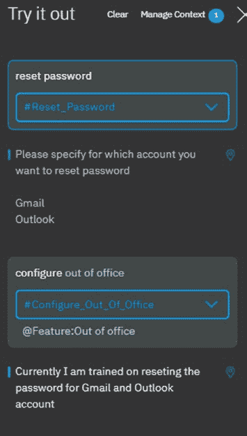

让我们通过导航到“对话”页面并点击`试用`来查看对话框是否处理了此更改，如图 5-29 所示。

***图 5-29.** 试用结果*

对话框找到了新的意图，但并未转移到“配置外出回复”工作流。

要实现正确用例的话题转移，你需要对“配置外出回复”用例对话框进行一些更改。点击该节点并选择`话题转移`。选择第二个选项并点击`应用`，如图 5-30 所示。

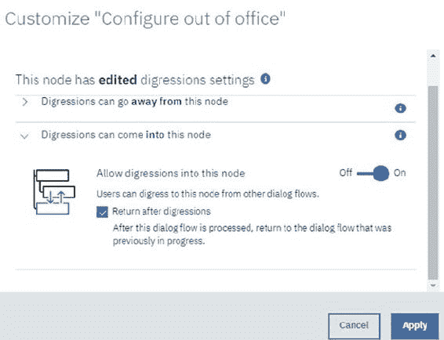

***图 5-30.** 从话题转移中选择选项 2*

我们只是简单配置此节点，以允许从工作流的其他位置转移进入此节点。完成此操作后，使用“试用”面板查看结果，如图 5-31 和 5-32 所示。

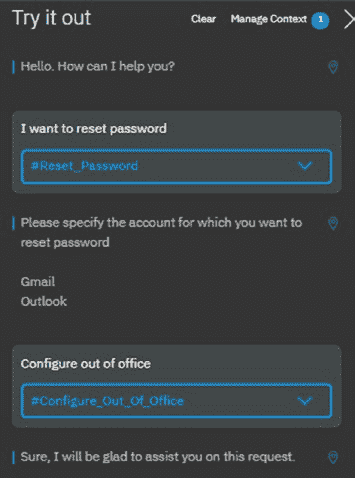

***图 5-31.** 测试用例*

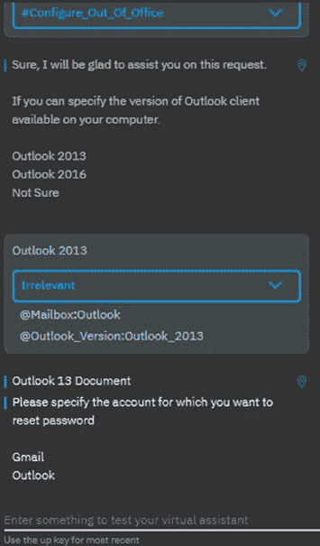

***图 5-32.** 话题偏离完成*

可以看到对话遵循了以下路径。

1. 用户选择了“重置密码”用例。

2. 意图切换到了“配置外出回复”用例。

3. 对话将用户引导至正确的工作流，并完成了“配置外出回复”工作流。

4. 对话返回到原始的“重置密码”工作流。

5. 用户完成了“重置密码”场景。

## 消歧

消歧是指系统处理模糊数据并从中理解含义的能力。

在 Watson 对话中，当用户的表述可能表示多种含义，且 Watson 中配置的两个或多个用例存在冲突时，就会遇到歧义问题。

我们将通过一个示例来更好地理解消歧功能。

我们在此场景中使用“重置密码”用例。用户仅询问“重置我的密码”，而未指定是 Gmail 还是 Outlook。由于用户提供了模糊或不完整的信息，系统应进行探查以消除歧义。我们来配置一下，看看它是如何工作的。

您可以下载已配置好消歧用例的技能 JSON 文件。

前往 GitHub ([https://github.com/watson05/Cognitive-Bot](https://github.com/watson05/Cognitive-Bot)) 下载 `Advance_Topics-Disambiguation.json` 文件。

意图及其变体如下所示，并展示在图 5-33 中。

请注意，此用例的配置方式与之前示例中的不同。

• **意图**: `#Reset_Password_Gmail`

  • 帮我重置我的 Gmail 密码。

  • 如何重置我的 Gmail 密码？

  • 我想重置我的 Gmail 密码。

• **意图**: `#Reset_Password_Outlook`

  • 帮我重置我的 Outlook 密码。

  • 如何重置我的 Outlook 密码？

  • 我想重置我的 Outlook 密码。

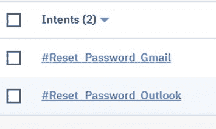

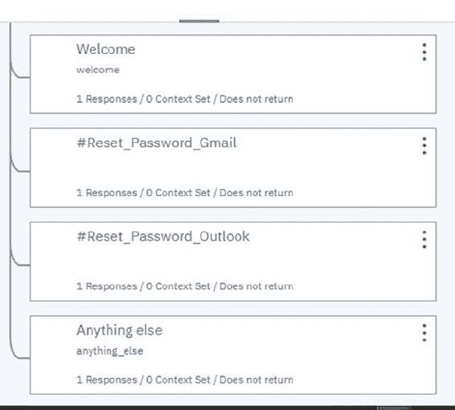

***图 5-33.** 添加的意图*

转到“对话”页面并添加两个节点。使用定义的条件和响应配置这两个用例，如图 5-34 所示。

***图 5-34.** 已配置用例的对话页面*

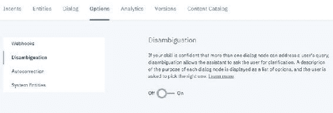

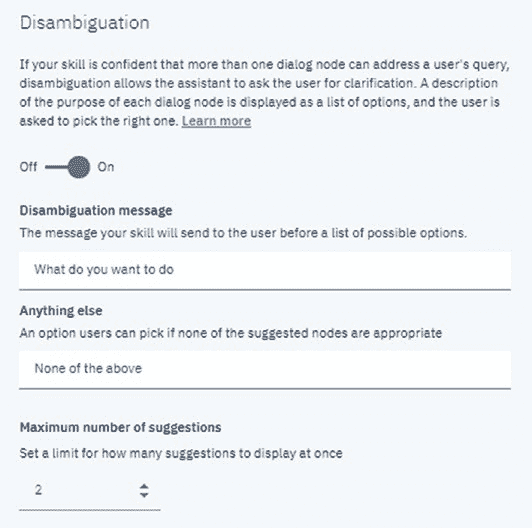

选择`选项`选项卡，然后点击`消歧`，如图 5-35 所示。

***图 5-35.** 选中消歧的选项页面*

将滑块切换为`开启`并输入信息，如图 5-36 所示。

***图 5-36.** 消歧页面*

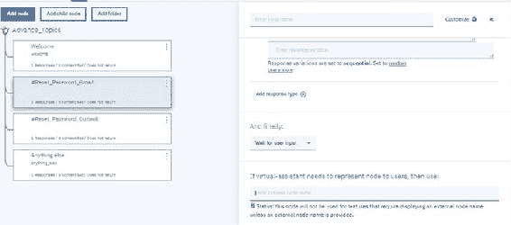

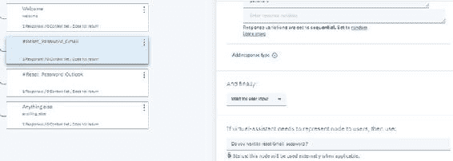

返回“对话”页面并点击用例节点。`如果虚拟助手需要向用户展示节点，则使用`字段如图 5-37 所示。此功能或该字段的状态为锁定（红色），因为尚未添加响应。

***图 5-37.** `如果虚拟助手需要向用户展示节点，则使用`字段*

添加响应选项，以便当用户的查询在两个相似用例之间产生冲突时供用户选择，如图 5-38 所示。

***图 5-38.** `如果虚拟助手需要向用户展示节点，则使用`字段*

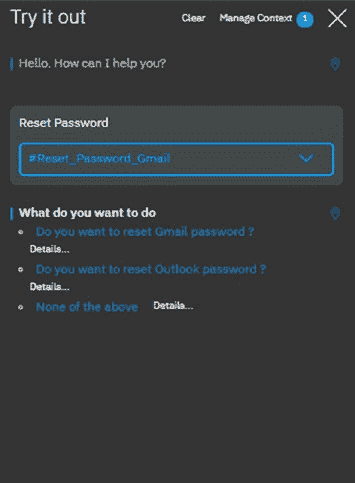

一旦添加了响应，状态就会变为解锁（绿色）。

对“重置 Outlook 密码”用例重复此操作。

为两个节点都配置完成后，在 Watson 的“试用”面板中测试该用例以查看结果，如图 5-39 所示。

***图 5-39.** 显示的选项*

选择任一选项，用例即被执行，如图 5-40 所示。

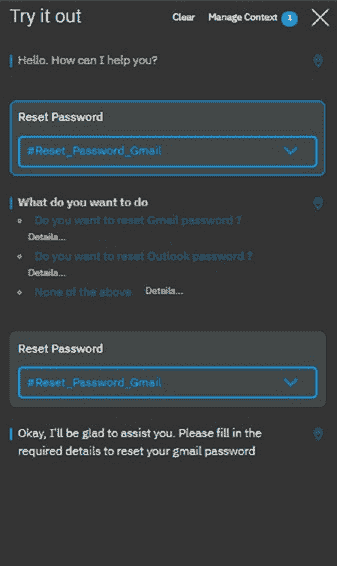

## 第五章 Watson 助手的高级概念

***图 5-40.** 显示选项结果*

消歧提供了一种简单的方法来处理意图冲突或用户提供的信息不完整的情况。因此，它会根据输入查询时返回的置信度分数来触发相关的用例。置信度分数是 Watson 设定的一个阈值，用于识别从返回的意图数组中匹配到的最高意图。

**处理多个意图**

在某些场景下，用户提出的查询包含多个意图，例如：“重置密码并解锁账户。”机器人一次只能执行一个操作。机器人必须理解用户提出的问题包含两个不同的意图，然后逐步执行这两个用例。

## 第五章 Watson 助手的高级概念

为了实现这一点，需要有一个节点来区分不同的意图。

让我们使用 Watson 的一个名为*置信度分数*的功能来解决这个用例。置信度分数是在查询输入系统时分配给意图数组的一个分数。

我们将在节点中使用置信度分数，该节点会检查针对输入查询返回的最高意图的置信度分数。它们的定义如下。

• `Intents[0].confidence` 是最高匹配意图的置信度

• `Intents[1].confidence` 是第二高匹配意图的置信度

`Intents[1].confidence` 检查第二高匹配意图的置信度分数是否大于 20%。`Intents[0].confidence` 检查最高匹配意图的置信度是否大于 95%。用于检查置信度分数的值可以根据用例进行更改。

如果这些条件都满足，机器人会回复一条消息：“您想执行以下哪个选项？”它会呈现映射到这两个意图的两个选项。

让我们看看如何在对话中配置这一点。这些用例已配置好，如图 5-41 所示。

• 在 Outlook 中重置密码

• 在 Gmail 中重置密码

• 解锁账户

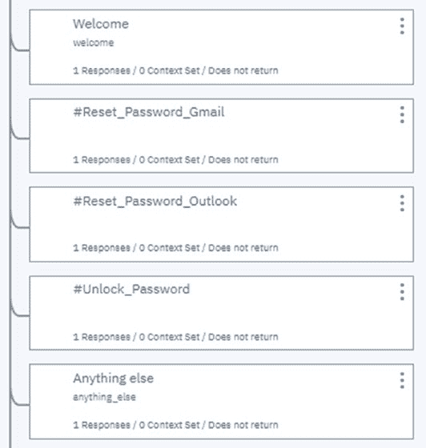

## 第五章 Watson 助手的高级概念

***图 5-41.** 添加的用例节点*

提供问候消息的欢迎节点会等待用户输入。添加一个 `$disambiguated` 上下文变量，并将其值设置为 `null`，如图 5-42 所示。

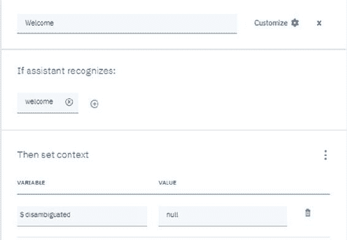

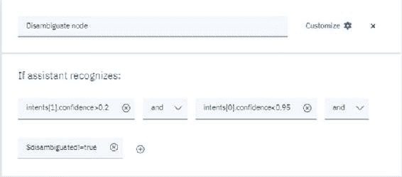

## 第五章 Watson 助手的高级概念

***图 5-42.** 在欢迎节点中添加的消歧上下文变量*

现在，让我们添加一个用于区分意图的节点。在已配置的用例上方添加一个节点，并输入置信度条件为 `(intents[1].confidence>0.2 && intents[0].confidence<0.95)`。这会检查返回的意图的置信度分数。意图数组按降序存储意图的置信度分数。因此，`intents[0]` 具有最高的置信度分数，其次是 `intents[1]`，如图 5-43 所示。

***图 5-43.** 定义的置信度分数条件*

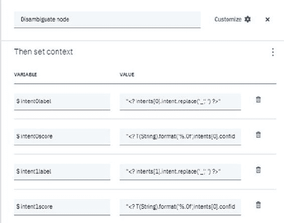

## 第五章 Watson 助手的高级概念

为了将捕获到的意图显示为可供用户选择的选项，我们可以将这些值设置在上下文变量中，并进一步将它们作为选项重用，如图 5-44 所示。

```
"intent0label": "<? intents[0].intent.replace('_',' ') ?>",
"intent0score": "<? T(String).format('%.0f',intents[0].confidence*100) ?>",
"intent1label": "<? intents[1].intent.replace('_',' ') ?>",
"intent1score": "<? T(String).format('%.0f',intents[0].confidence*100) ?>",
"disambiguated": true
```

***图 5-44.** 定义的用于捕获最高匹配意图的上下文变量*

接下来，我们需要显示这些选项。我们可以在**并回复**字段中执行此操作，如图 5-45 所示。

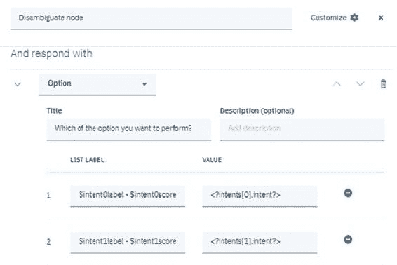

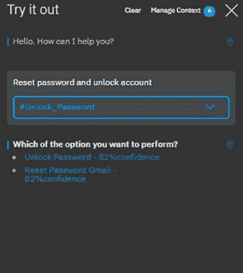

## 第五章 Watson 助手的高级概念

***图 5-45.** 匹配意图的选项*

让我们在 Watson 试用面板中尝试这个用例以查看结果，如图 5-46 和图 5-47 所示。

***图 5-46.** 显示的结果*

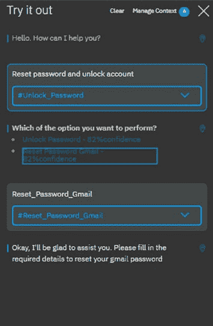

***图 5-47.** 显示的结果*

您可以看到，基于置信度分数识别出了两个意图，因此机器人以提示性响应作为回应，并将这些意图作为选项提供。

**以多种格式展示解决方案**

**文本**

您可以通过在节点字段的响应下拉菜单中选择**文本**，以文本格式提供机器人的响应，如图 5-48 所示。

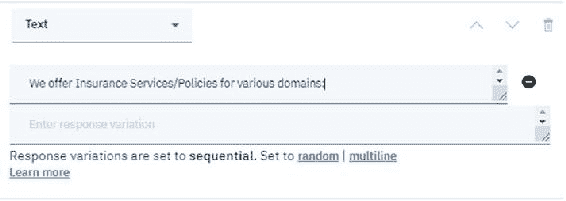

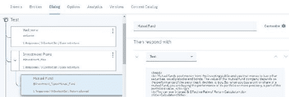

***图 5-48.** 响应*

**HTML**

如果您想以 HTML 的富文本格式（如表格或表单）展示内容，可以在响应部分进行操作。只需将 HTML 内容粘贴到响应部分即可，如图 5-49 所示。

***图 5-49.** 添加的响应*

**选项**

如果您想将选项展示为按钮，请从下拉菜单中选择“选项”，如图 5-50 和 5-51 所示。

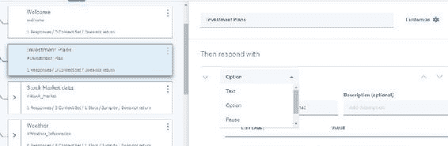

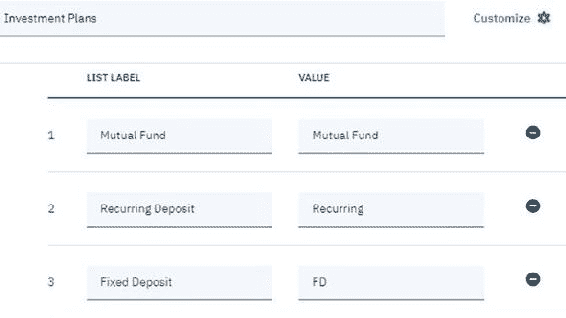

***图 5-50.** “然后响应为”中的下拉菜单*

***图 5-51.** 添加的选项值*

**结论**

本章介绍了多种用于增强机器人对话能力的高级功能。我们通过示例解释了上下文变量、槽位、多响应、话题偏离和消歧等主题，这些功能通过在同一节点中处理多项事务，减少了冲突和节点结构。