# 第6章 认知虚拟机器人的用例

在本章中，我们将描述不同领域的用例配置，并学习如何使用 `IBM Cloud` 实现特定目标，例如将 `Watson Assistant` 与外部 `API` 集成。`IBM Cloud Functions` 是一个无服务器执行环境，用于构建和连接云服务。云函数让您可以专注于编写代码和构建解决方案，而无需构建或维护复杂的基础设施。

## BFSI 领域的特定用例

在 BFSI 领域，我们将以一个最终客户用例为例，消费者可以在此查询各种投资选项。

我们将用例命名为“投资计划”，然后进入下一步，即识别意图、实体及其变体。

*   **意图描述：** 查找提供商提供的投资计划类型。
*   **意图名称：** `#Investment_Plan`
*   **实体：** 投资计划类型
*   **实体值：** 共同基金、定期存款、固定存款、系统投资计划。

© Navin Sabharwal, Sudipta Barua, Neha Anand, Pallavi Aggarwal 2020
N. Sabharwal 等人著，《使用 IBM Watson 引擎开发认知机器人》，`doi.org/10.1007/978-1-4842-5555-1_6`

填充完这些基本数据后，我们需要来自最终用户的表述或变体；也就是说，他们将如何询问这些信息。以下是几个表述示例。您可以通过添加更多表述来丰富列表。

*   我想进行投资。
*   推荐一些投资计划。
*   有哪些不同的投资计划？

现在，让我们进入 `IBM Watson` 控制台并配置该用例。

1.  登录 `IBM Cloud` 后，启动在之前章节中创建的 `AI` 服务：“`Watson Assistant` – 虚拟机器人”。
2.  点击**技能**，然后选择名为 `Test` 的技能。
3.  在顶部菜单栏中，选择**意图**。意图以 `#` 符号开头，后跟意图名称。我们将意图命名为 `#Investment_Plan`。
4.  输入您正在创建的意图的简要描述。此时会出现**添加用户示例**选项。
5.  输入我们之前定义的变体，如下所示：

如图 6-1 所示，这些是输入到 `Watson` 引擎用于训练的样本变体。

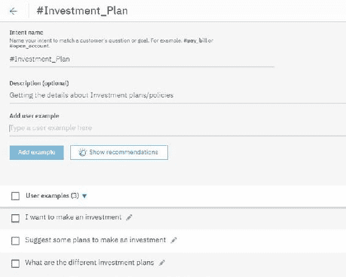

*图 6-1. 用于添加变体的意图页面*

你已经完成了意图及其变体的配置，但我们尚未配置实体，以便系统能够解读用户的需求。

1.  为此，请点击**返回**按钮，返回技能页面。
2.  从顶部菜单中选择**实体**。你将看到一个如图 6-2 所示的屏幕。
3.  在实体名称中输入 `@Investment_Types`。对于值，添加“Mutual Fund”，并将“Mutual Fund”作为同义词；添加“Recurring Deposit”，并将“Recurring Deposit”和“RD”作为同义词；添加“Fixed Deposit”，并将“Fixed Deposit”和“FD”作为同义词；添加“Systematic Investment Plan”，并将“Systematic Investment Plan”和“SIP”作为同义词。

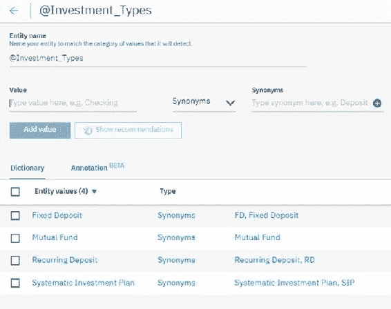

*图 6-2. 实体页面*

完成实体、意图和变体的配置后，我们需要通过对话将它们全部关联起来。

按照上一章的解释，在技能中添加一个节点。

1.  点击该节点并将其命名为“Investment Plans”，如图 6-3 所示。
2.  在**输入条件**字段中，提供意图（即 `#Investment_Plan`），如图 6-3 所示。

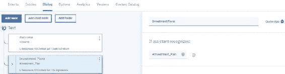
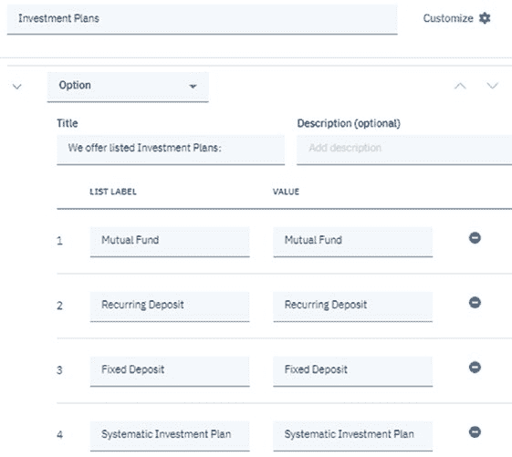

*图 6-3. 在条件中定义了意图的对话节点*

3.  在“然后响应”字段中，提供当条件匹配时你想要显示的响应。
4.  “Investment Plans”用例有四个选项：`Mutual Fund`、`Recurring Deposit`、`Fixed Deposit` 和 `Systematic Investment Plan`。点击该节点，并从**然后响应**下拉菜单中选择“选项”。添加这些选项，如图 6-4 所示。

*图 6-4. 定义响应字段并给出选项的对话节点*

每个选项都需要作为具有实体值的实体添加，正如你已经在实体部分创建的那样。你必须手动确保选项匹配；没有自动检查功能。

5.  返回该节点并点击汉堡菜单。选择**添加子节点**。由于我们有四个选项，请添加四个子节点。
6.  在子节点中定义实体和实体值条件（即 `@Investment_Types:(Mutual Fund)`、`@Investment_Types:(Fixed Deposit)`、`@Investment_Types:(Recurring Deposit)`、`@Investment_Types:(Systematic Investment Plan)`），如图 6-5 所示。
7.  当选择任何选项时，在相应子节点的响应字段中添加你想要显示的响应，如图 6-5 所示。

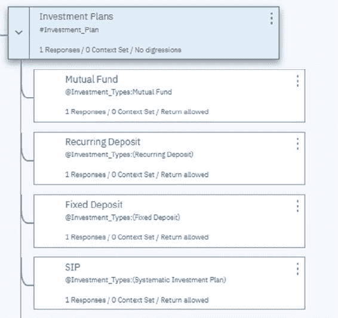

*图 6-5. 在子节点条件中定义了实体的对话节点*

我们将为每个子节点计算投资计划，并通过 `HTML` 代码显示。以下示例 `HTML` 代码用于 `Recurring Deposit` 投资计划。

```html
<html>
<head>
<b> 定期存款是印度银行提供的一种特殊定期存款，它帮助有固定收入的人每月将固定金额存入其定期存款账户，并按照适用于定期存款的利率赚取利息。</b><br>
<b>您可以使用定期存款计算器</b>
<title>计算器</title>
<style>
</style>
<script>
</script>
</head>
<body>
<iframe src=https://widgetscode.com/wc/rdm/all?skin=dblue0 style='width:280px;height:320px;margin:0;'frameborder=0>
</iframe>
</body>
</html>
```

现在，我们将使用在 `Watson Assistant` 中显示计算器的功能。为此，我们在 `Recurring Deposit` 响应字段中添加代码。

在子节点的 **Then respond with** 字段中添加 `HTML` 代码，如图 6-6 所示。

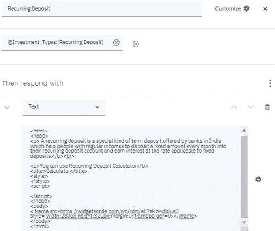

*图 6-6. 在 Then respond with 字段中添加 HTML 代码*

现在，让我们在上一章创建的机器人上测试我们的用例，该机器人已链接到技能，如图 6-7 所示。

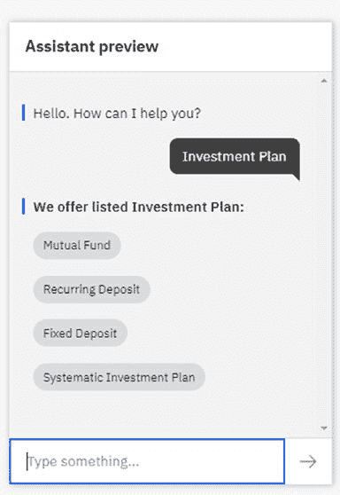

*图 6-7. 测试用例并显示可选项*

选择“定期存款”选项。结果如图 6-8 所示。

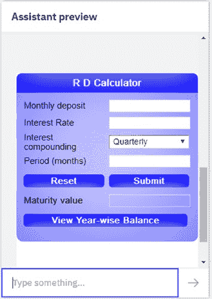

*图 6-8. 显示 RD 计算器的机器人预览*

让我们在字段中添加数值并计算 `RD`。点击**提交**按钮查看结果。我们可以在 `Watson Assistant` `GUI` 中展示包含计算的复杂用例，如图 6-9 所示。

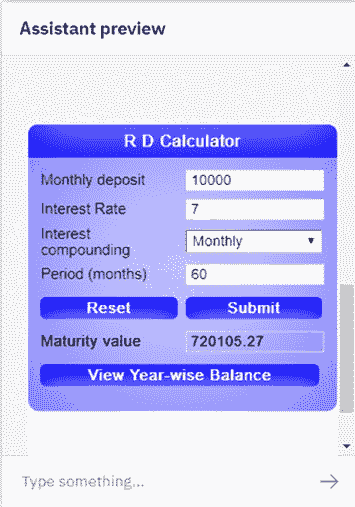

*图 6-9. 计算 RD 的机器人预览*

## IBM Cloud Functions 简介

`IBM Cloud Functions` 基于 `Apache OpenWhisk`，这是一个函数即服务（`FaaS`）平台，可根据传入事件执行函数。`IBM Cloud Functions` 是一个无服务器执行环境，用于构建和连接云服务。它在功能上类似于其他云提供商提供的无服务器选项，例如 `AWS Lambda`、`Google Cloud Functions` 和 `Microsoft Azure Functions`。

让我们先对 `IBM Cloud Functions` 进行基本介绍，然后使用它们与第三方 `API` 集成，以进一步丰富我们的机器人。

`IBM Cloud Functions` 通过从事件触发操作，使服务集成变得简单。

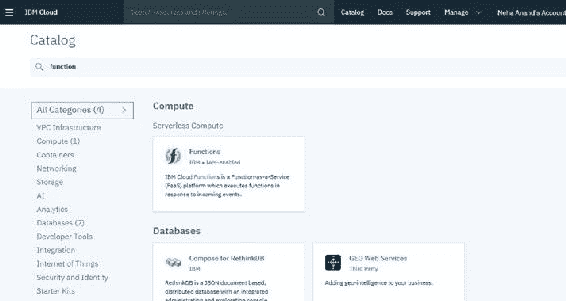
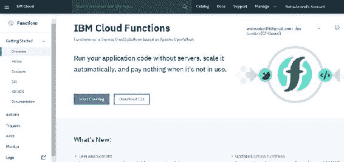

要设置 `IBM Cloud` 函数，请访问 `IBM Cloud Catalog` 菜单，网址为 `cloud.ibm.com/catalog`。

您将被重定向到 `Catalog` 页面，如图 6-10 所示。

*图 6-10. IBM Cloud Catalog 页面*

搜索 **function** 并点击 **Functions** 服务。

点击 **Start Creating**，如图 6-11 所示。

*图 6-11. IBM Cloud Functions 页面*

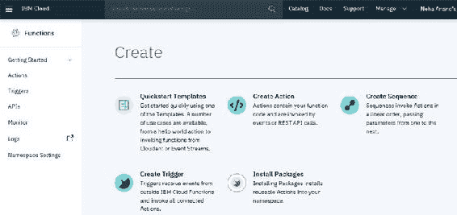

点击 **Create Action** 选项卡，函数代码将通过 `REST API` 调用被调用，如图 6-12 所示。

*图 6-12. IBM Cloud 创建函数页面*

# 股票市场的特定领域用例

本用例描述了如何将 `Watson Assistant` 与作为外部数据源的股票 API（通过 HTTP REST API 服务调用）进行集成。用户可以查询某公司的股价，机器人将回复当前股价、开盘价、收盘价、最低价和最高价。我们将使用 `Cloud Functions` 来实现此功能。

接下来，我们逐步介绍如何将 `Watson` 与开源股票 API 进行集成。

## 开源股票 API

前往 [`iexcloud.io/cloud-login#/register`](https://iexcloud.io/cloud-login#/register) 获取一个开源股票 API。您将被重定向到如图 6-17 所示的页面。

***图 6-17.** 注册页面*
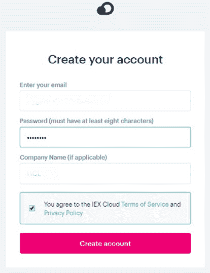

输入所需信息以创建账户，如图 6-18 所示。

***图 6-18.** 填写信息的注册页面*

点击 **创建账户** 后，您将被重定向到套餐选择窗口，如图 6-19 所示。点击 **选择开始** 选项。

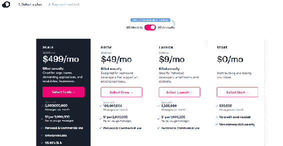
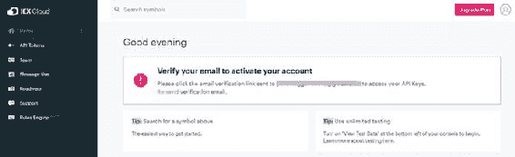

***图 6-19.** 套餐选择窗口*

要激活账户，您需要验证邮箱。您将看到一条验证消息，如图 6-20 所示。

***图 6-20.** 邮箱验证页面*

一封确认邮件将发送到您注册的邮箱地址。要访问您的 API，请前往确认邮件中提到的链接，如图 6-21 所示。

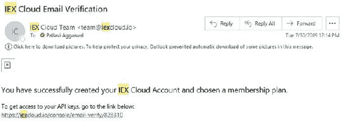
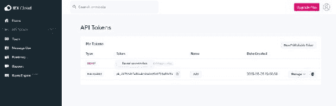

***图 6-21.** 确认邮件截图*

前往 API 令牌选项卡，获取您的密钥令牌以访问 API，如图 6-22 所示。

***图 6-22.** API 令牌页面*

API 的基础 URL 为：
`cloud.iexapis.com/stable/stock/aapl/quote?token=<YOUR_TOKEN_HERE>`

将 `<YOUR_TOKEN_HERE>` 替换为以下密钥令牌，如下所示：
`cloud.iexapis.com/stable/stock/aapl/quote?token=sk_5cfbd2112643432a9311436529774023`

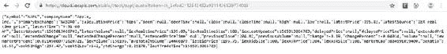

在浏览器中输入该 URL，检查一切是否按预期工作。结果应显示股票信息，如图 6-23 所示。

***图 6-23.** 浏览器中的 API 结果*

## 通过 Cloud Functions 将 Watson 与股票市场 API 连接

我们在前面的主题中描述了创建云函数的逐步过程。现在，我们通过 `IBM Cloud Functions` 创建一个操作来调用该 API。

定义操作，如图 6-24 所示。
1. 输入您的操作名称 `[action_name]`（例如，`Stock-Connection`）。
2. 在 `封装包` 下创建一个包，并指定任意 `[package_name]`（例如，`Assistant-Function`）。
3. 选择 `运行时` 语言。在此示例中，我们将使用 `Node.js`。
4. 点击 `创建` 按钮。

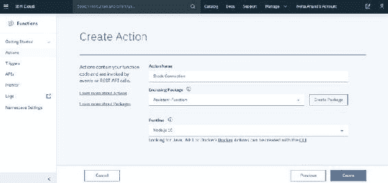

***图 6-24.** IBM Cloud 创建操作页面*

在您的 `Cloud Functions` 操作中，将现有代码替换为提供的示例代码。这是一个示例代码。在 `uri` 字段中，我们使用了之前创建的同一个 API URL。

```javascript
let rp = require('request-promise')

function main(params) {

const options = {

uri: "https://cloud.iexapis.com/stable/stock/" +

encodeURIComponent(params.symbol) + "/quote?token=pk_

1a5fa86b424845149eaddf14426b2d56" ,

json: true

}

return rp(options)

.then(res => {

Stock_Price = "Company Name : " + res.companyName + ", Open Price : " + res.open+ ", Close Price : " + res.

close + ", Current Price : " + res.latestPrice + ",

Low Value : "+ res.low + ", High Value : " + res.high 166

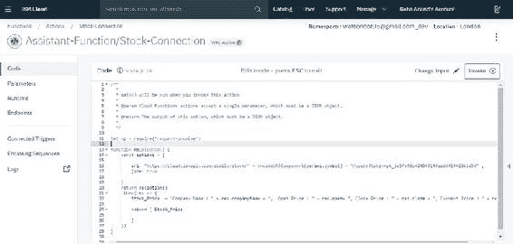

return { Stock_Price

}

})

}
```

现在，我们可以开始编辑 `Stock-Connection` 函数，用上述示例代码替换它，操作在“函数”➤“操作”➤“代码”控制台中进行，如图 6-25 所示。

***图 6-25.** 显示代码片段的 IBM 云函数*

现在，让我们为此 API 调用创建端点。

转到 **端点**。在 `REST API` 下，复制并保存该 URL，如图 6-26 所示。

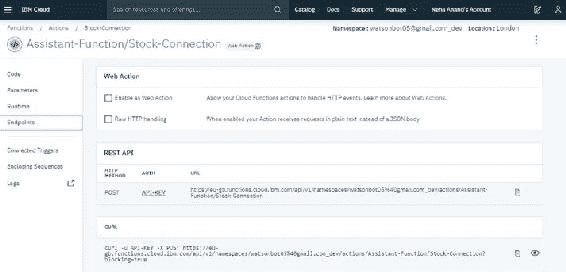
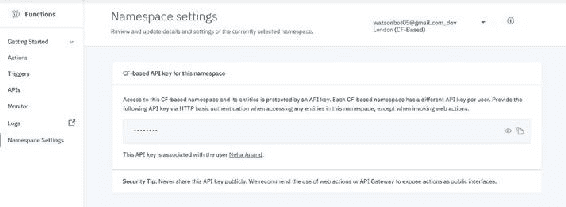

***图 6-26.** 端点页面*

点击 `API-Key`。复制并保存 API 密钥以备后用，如图 6-27 所示。

***图 6-27.** 命名空间设置页面*

现在，让我们在 `Watson Assistant` 服务中创建的技能里调用此函数，以从股票 API 获取结果，并在我们的机器人中显示响应。

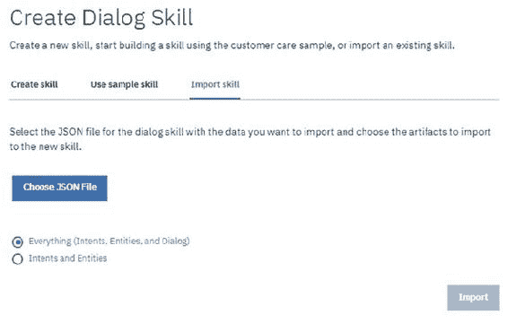

### 在 Watson 中调用云函数

您可以下载已配置好股票市场数据用例的技能 JSON 文件。前往 GitHub (`https://github.com/watson05/Cognitive-Bot`) 下载 `Stock_Market.json` 文件。

将其导入 `Watson Assistant` 服务。我们在第 4 章创建了一个 `Watson Assistant` 虚拟机器人，因此我们将使用同一个来导入下载的技能。让我们看看如何在 `Watson Assistant` 服务中导入技能。

转到您的 `Watson Assistant` 服务的技能页面。
1. 点击 **创建技能**，然后选择 **对话技能**。点击 **创建对话技能**，页面将重定向到“创建对话技能”页面。
2. 在顶部菜单中，选择 **导入技能**，如图 6-28 所示。

***图 6-28.** 导入技能*
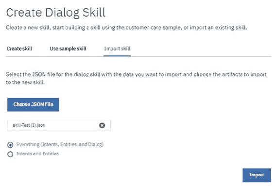

3. 点击 **选择 JSON 文件**，然后浏览。选择您下载的 JSON 文件并点击 **导入**，如图 6-29 所示。

# 认知虚拟机器人的使用案例

## 定义组件

让我们看看我们是如何为“股票市场数据”用例定义以下组件的。

- **意图描述：** 查找股票市场数据
- **意图名称：** `#Stock_Information`
- **实体：** 公司
- **实体值：** 公司代码，例如 `AAPL`、`GOOGL`、`MSFT` 等。我们已添加了 133 家公司的代码。

填充了这些基本数据后，我们需要来自最终用户的表述或变体，以展示他们如何请求此信息。

- 当前股票价格
- 告诉我股票的当前价格。
- 告诉我股票价格。
- 当前股票的价值是多少？
- 当前的股票市场数据是什么？

**实体名称**是 `@Company`，**值名称**是公司股票代码，**同义词**是实际的公司名称，如图 6-31 所示。

***图 6-31.** 实体页面*

导航到“对话”部分并点击**对话**。点击“股票市场数据”节点。您可以看到意图被定义为 `#Stock_Market`。我们定义了槽位，用于检查查询语句中是否提到了公司名称。如果提到了，则进入下一步，即调用 API。如果没有提到，则询问公司名称，如图 6-32 所示。

***图 6-32.** 包含信息的对话节点*

## 调用 API

您已将公司信息保存在 `$symbol` 上下文变量中，该变量将在 API 中传递。我们使用云函数的 URL 和 API 密钥。请参考您之前复制的 API 密钥。

在 `$symbol` 上下文变量中输入公司名称，该变量将作为参数传递给云函数。将复制的 API 密钥粘贴到 `$credentials` 上下文变量中，如图 6-33 所示。JSON 将自动生成，如下面的 JSON 示例所示。

***图 6-33.** 设置上下文变量*

以下是我们用于调用云函数的示例 JSON。

```json
{
  "output": {
    "text": {
      "values": [],
      "selection_policy": "sequential"
    }
  },
  "actions": [
    {
      "name": "/watsonbot05%40gmail.com_dev/Assistant-Function/Stock_Function",
      "type": "cloud_function",
      "parameters": {
        "symbol": "<? $Company ?>"
      },
      "credentials": "$credentials",
      "result_variable": "$response"
    }
  ],
  "context": {
    "symbol": "@Company",
    "credentials": {
      "api_key": "f2a23cdb-5947-4a67-a960-4eef2a9d2a5d:dfXh7zrBUgXqkG51zTGmL3gaXUi57KToRgG7HAOx8qWbgmb0U4E1UcMo7Aul2Hh6"
    }
  }
}
```

我们将通过在 **然后设置上下文** 菜单中点击 **打开 JSON 编辑器** 来在 JSON 编辑器中调用云函数。

替换 JSON 编辑器中的代码，如图 6-34 所示。

***图 6-34.** 打开 JSON 编辑器*

对于 JSON 中的 `actions` 部分，您需要云函数 URL 的一部分，其格式应类似。以下内容可在云函数、端点、API 密钥中以 URL 形式获取：
`eu-gb.functions.cloud.ibm.com/api/v1/namespaces/watsonbot05@gmail.com_dev/actions/Assistant-Function/Stock-Connection`

我们需要根据云函数中的信息编辑两个部分。

“name”: “/watsonbot05%40gmail.com_dev/Assistant-Function/Stock-Connection”，如图 6-34 所示。

使用复制的云函数 API 密钥作为 `api_key` 的值。`"api_key": f2a23cdb-5947-4a67-a960-4eef2a9d2a5d:dfXh7zrBUgXqkG51zTGmL3gaXUi57KToRgG7HAOx8qWbgmb0U4E1UcMo7Aul2Hh6`

我们已经使用公司股票代码参数调用了股票市场 API。现在我们需要显示从 API 获取的结果。为此，我们添加了一个子节点，并跳转到父节点的响应，如图 6-35 和图 6-36 所示。

***图 6-35.** 用于捕获 API 响应的子节点*

***图 6-36.** 跳转到响应*

我们已经将从 API 获取的响应保存在 `$response` 上下文变量中，该变量在 `"result_variable"` 中提及（见图 6-37）。

***图 6-37.** 显示 result_variable 的 JSON*

现在让我们在机器人上测试我们的用例。将技能与机器人关联，就像您在本章前面所做的那样。尝试该用例以查看公司股票市场数据的结果，如图 6-38 和 6-39 所示。

***图 6-38.** 在机器人中测试用例*

***图 6-39.** 显示的结果*

## 与天气 API 集成

本用例描述如何将 Watson Assistant 与一个天气 API 集成。用户可以询问与天气相关的问题。机器人通过确定特定地点的天气状况或温度来回答这些问题。

### 开源天气 API

前往 [`home.openweathermap.org`](https://home.openweathermap.org) 获取一个开源天气 API。

点击 **注册** 按钮完成注册，如图 6-40 所示。

***图 6-40.** 注册页面*

输入所需信息以创建账户，如图 6-41 所示。

***图 6-41.** 填写详细信息的注册页面*

一封包含您的 API 密钥和技术说明的确认邮件将发送到注册的邮箱地址，如图 6-42 所示。请注意，API 密钥激活最多需要两个小时。

***图 6-42.** 邮箱验证页面*

接下来，前往 API 选项卡查看可免费使用的天气 API 文档，如图 6-43 和图 6-44 所示。

***图 6-43.** 天气 API*

***图 6-44.** 天气 API*

您可以通过浏览器检查此 URL。它会显示天气预报，如图 6-45 所示。

在本例中，我们使用 URL 通过城市名称调用 API：`api.openweathermap.org/data/2.5/weather?q=DELHI&units=metric&APPID=19e8588cb3d7d0623e3a5a8ec529232f`

***图 6-45.** 浏览器中的 API 结果*

### 通过 Cloud Functions 将 Watson Assistant 与天气 API 连接

***图 6-29.** 选择已下载的 JSON 文件*

该技能被导入到 Watson Assistant 服务中。您将被重定向到“对话”页面，在那里您可以看到已配置的“股票市场”节点，如图 6-30 所示。

***图 6-30.** 显示股票市场数据节点的对话页面*

我们已经描述了创建云函数的分步过程。现在，让我们通过 IBM Cloud Functions 创建一个操作来调用 API。

定义云函数的创建操作，如图 6-46 所示。

1.  输入您的操作名称 `[action_name]`（例如，`Weather-Connection`）。
2.  使用任意 `[package_name]`（例如，`Assistant-Functions`）创建一个包。
3.  选择 **运行时** 语言。在此示例中，我们将使用 Node.js。
4.  点击 **创建** 按钮。

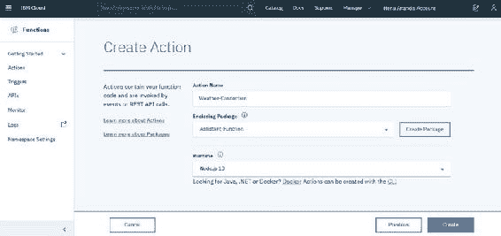

**图 6-46.** IBM Cloud 创建操作页面

在您的 Cloud Functions 操作中，将现有代码替换为提供的示例代码。这是示例代码，在 `uri` 字段中，我们使用了之前创建的相同 API URL。

```javascript
let rp = require('request-promise')

function main(params) {

const options = {

uri: "http://api.openweathermap.org/data/2.5/weather?q="

+ encodeURIComponent(params.object_of_interest)+

"&units=metric&APPID=19e8588cb3d7d0623e3a5a8ec529232f" , json: true

}

return rp(options)

.then(res => {

WeatherReport = "Current Temperature : " +res.main.

temp+ ", Pressure : " + res.main.pressure + ", Humidity

: " + res.main.humidity + ", temp_min : " + res.main.

temp_min + " , temp_max : " + res.main.temp_max

return { WeatherReport

}

})

}
```

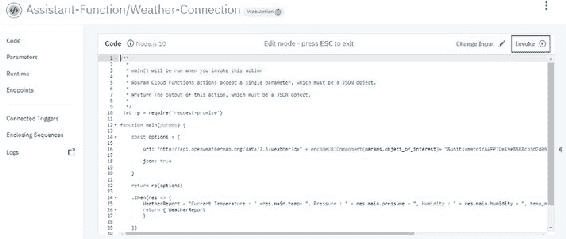

您现在可以开始编辑 `Weather-Connection` 函数，方法是在 `Functions → Actions → Code` 控制台中将上述示例代码替换进去，如图 6-47 所示。

**图 6-47.** IBM 云函数代码片段

您已保存了凭据，以便稍后在 Watson Assistant 中使用它们。前往 **端点**。在 REST API 下，复制并保存 URL，如图 6-48 所示。

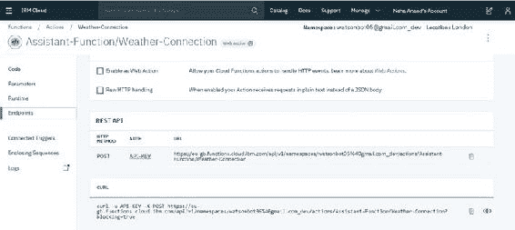
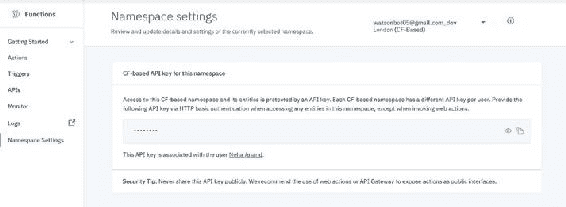

**图 6-48.** 端点页面

复制并保存 API 密钥，如图 6-49 所示。

**图 6-49.** 命名空间设置页面

现在，让我们在 Watson Assistant 服务中创建的技能里调用此函数，以从天气 API 获取结果，并在我们的机器人上显示响应。

### 在 Watson 中调用云函数

你可以下载已配置好天气用例的技能 JSON 文件。

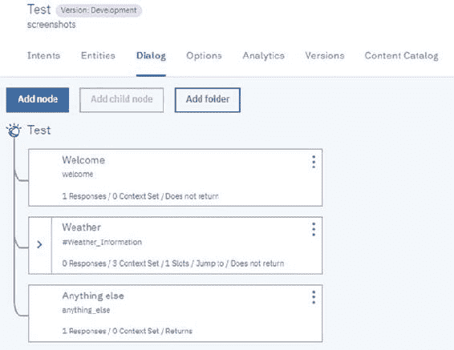

前往 [GitHub](https://github.com/watson05/Cognitive-Bot) 下载 `Weather.json`。按照股票市场数据用例中的说明，将下载的技能导入 Watson Assistant 服务。

导入技能后，你将进入“对话”页面，其中可以看到已配置好的天气用例，如图 6-50 所示。

**图 6-50.** 对话页面

让我们看看我们是如何为此用例定义以下组件的。

• **意图描述：** 查找某个地点的天气
• **意图名称：** `#Weather_Information`
• **实体：** `@sys-location`（系统实体）

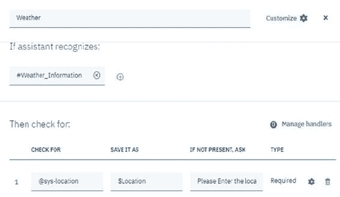

填充完这些基本数据后，我们需要收集最终用户询问此信息时的表述或变体。

• `<地点>`的天气怎么样？
• 今天天气如何？
• 告诉我天气情况。
• `<地点>`的天气预报是什么？

我们将实体定义为 `@sys-location`，因为我们希望从用户输入中提取国家、州和城市名称。

导航到“对话”部分，点击 **对话**。点击“天气”节点。你会看到意图被定义为 `#Weather_Information`。我们已定义了用于检查查询语句中提及地点的天气情况的槽位。如果提到了地点，则进入下一步，即调用 API。如果未提及，则询问地点，如图 6-51 所示。

**图 6-51.** 包含信息的对话节点

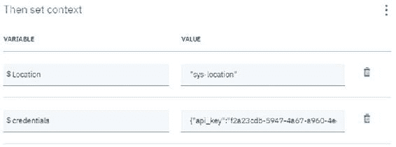

### 调用 API

你已将捕获的地点保存在 `$Location` 上下文变量中，该变量会传递给 API。我们使用的是云函数中的云函数 URL 和 API 密钥。

在 `$location` 上下文变量中输入地点名称，该变量将作为参数传递给云函数。将复制的 API 密钥粘贴到 `$credentials` 上下文变量中，如图 6-52 所示。JSON 会自动生成，如下方示例 JSON 所示。

**图 6-52.** 设置上下文变量

以下是我们用于调用云函数的示例 JSON。

```json
{
  "context": {
    "credentials": {
      "api_key": "f2a23cdb-5947-4a67-a960-4eef2a9d2a5d:dfXh7zrBUgXqkG51zTGmL3gaXUi57KToRgG7HAOx8qWbgmb0U4E1UcMo7Aul2Hh6"
    },
    "object_of_interest": "@object_of_interest"
  },
  "output": {
    "text": {
      "values": [],
      "selection_policy": "sequential"
    }
  },
  "actions": [
    {
      "name": "/watsonbot05%40gmail.com_dev/Assistant-Function/Weather-Connection",
      "type": "cloud_function",
      "parameters": {
        "object_of_interest": "$Location"
      },
      "credentials": "$credentials",
      "result_variable": "$response"
    }
  ]
}
```

我们将通过点击 **然后设置上下文** 汉堡菜单中的 **打开 JSON 编辑器**，在 JSON 编辑器中调用云函数。替换 JSON 编辑器中的代码，如图 6-53 所示。

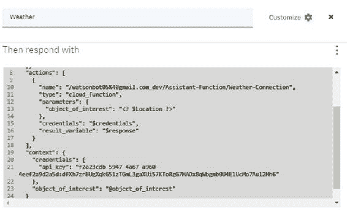

**图 6-53.** 打开 JSON 编辑器

对于 JSON 中的 `actions` 部分，你需要云函数 URL 的一部分，该部分应类似如下所示。以下内容可在云函数、端点、API 密钥中以 URL 形式获取：

`eu-gb.functions.cloud.ibm.com/api/v1/namespaces/`
`watsonbot05%40gmail.com_dev/actions/Assistant-Function/Weather-Connection`

我们需要根据云函数中的信息编辑两个部分。

`"name": "/watsonbot05%40gmail.com_dev/Assistant-Function/Weather-Connection"`，如图 6-53 所示。

要在上下文中传递凭证，请将复制的云函数 API 密钥用于 `api_key` 值。“api_key”: "f2a23cdb-5947-4a67-a960-4eef2a9d2a5d:dfXh7zrBUgXqkG51zTGmL3gaXUi57KToRgG7HAOx8qWbgmb0U4 E1UcMo7Aul2Hh6"。

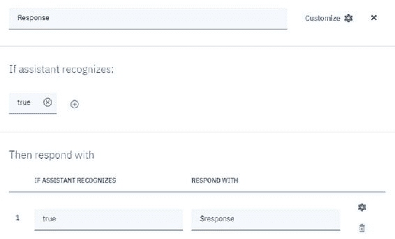

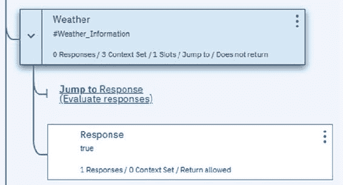

我们使用位置参数调用了天气 API。现在需要展示从 API 获取的结果。为此，我们添加了一个子节点，该节点从父节点跳转到响应，如图 6-54 和图 6-55 所示。

***图 6-54.** 用于捕获 API 响应的子节点*

***图 6-55.** 跳转到响应*

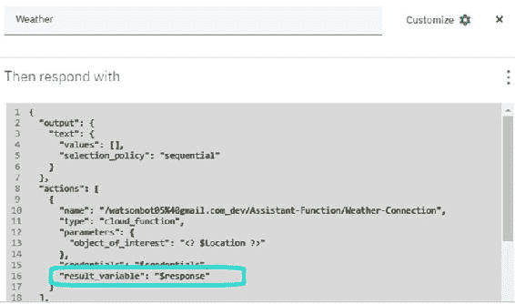

我们在 `result_variable` 中提到的 `$response` 上下文变量中获取了API的响应（参见图 6-56）。

***图 6-56.** 显示 result_variable 的 JSON*

现在，让我们在机器人中测试我们的用例。按照本章前面的方法，将技能与机器人关联起来。尝试该用例以查看天气预报，如图 6-57 和图 6-58 所示。

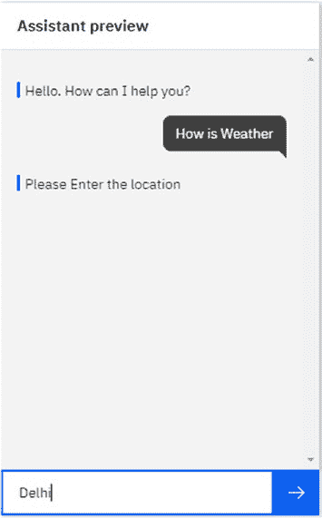

***图 6-57.** 在机器人中测试用例*

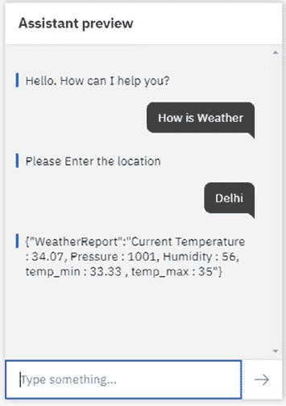

***图 6-58.** 显示的结果*

## 结论

本章到此结束，内容涵盖了我们可以使用 IBM Watson 平台开发的各种用例，这些用例可与第三方 API 集成，并进一步丰富我们机器人的对话质量。我们创建了可直接使用的用例，涵盖投资规划、股票市场信息以及特定位置的天气。