# 第 7 章 与高级服务集成

本章介绍 Watson Assistant 与内置高级 IBM 服务（如 Tone Analyzer 服务和 Watson Discovery 服务）的集成。我们还涵盖了与其他消息平台（如 Facebook Messenger 和 Slack）的集成。

## Facebook Messenger 与 IBM Watson Assistant 的集成

让我们讨论 Watson 对话服务如何与 Facebook Messenger 和 Slack 等聊天平台集成。它提供了设计和运行位于消息平台（如 Slack、Facebook 和 Twilio）内部的机器人的流程。

让我们在一个先前配置的用例中，将 Facebook Messenger 与 IBM Watson 集成。

### 在 Facebook 上创建页面

首先，让我们在 Facebook 上创建一个页面，我们将通过以下步骤将其与 IBM Watson Assistant 集成。

1. 登录你的 Facebook 账户。
© Navin Sabharwal, Sudipta Barua, Neha Anand, Pallavi Aggarwal 2020

N. Sabharwal 等人著，《使用 IBM Watson 引擎开发认知机器人》，`doi.org/10.1007/978-1-4842-5555-1_7`

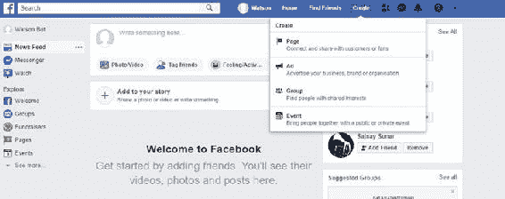
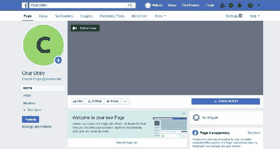

2. 点击`创建`按钮，然后选择`页面`选项，如图 7-1 所示。

**图 7-1.** 欢迎来到 Facebook

3. 在“创建页面”下，选择社区或公共版块，然后点击“开始使用”。

4. 填写所需信息。我们将页面命名为“聊天工具”，如图 7-2 所示。

**图 7-2.** Facebook 聊天工具页面

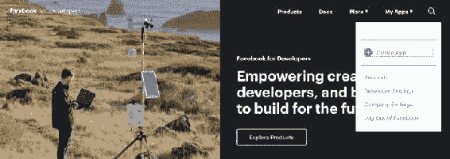

5. 访问 [`developers.facebook.com`](http://developers.facebook.com) 并使用你的 Facebook 凭据登录。页面将重定向至图 7-3 所示的页面。

**图 7-3.** Facebook 开发者页面

6. 在 `My Apps` 下拉菜单下选择 `Create App`。

7. 在 `Display Name` 和 `Contact` 中输入信息来创建新的应用 ID（例如，`Display Name`：`Customer Service app`，`Contact Email`：`xxxxxxxxxx@xxxxx`），如图 7-4 所示。

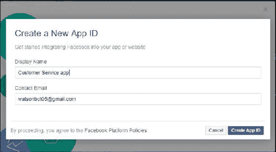
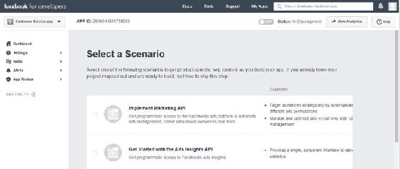

**图 7-4.** 创建新的应用 ID

8. 然后点击 `Create APP ID` 按钮。

9. 新应用 ID 创建完成后，页面将重定向至 Facebook 应用页面，如图 7-5 所示。

**图 7-5.** Facebook 应用页面

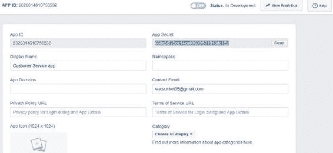

10. 在导航窗格中，选择 `Settings` 选项卡，然后选择 `Basic`。在 `App Secret` 选项下，点击 `Show`。

11. 点击 `App Secret` 代码并复制该应用密钥，该密钥将在 Watson Assistant 中使用，如图 7-6 所示。

**图 7-6.** 应用密钥

12. 导航回 Facebook 应用页面，点击左侧导航窗格中 `Products` 旁边的加号 (+)。

13. 在 `Add a product` 下，找到 `Messenger` 磁贴并点击 `Set Up` 按钮，如图 7-7 所示。页面将重定向至图 7-8 所示的页面。

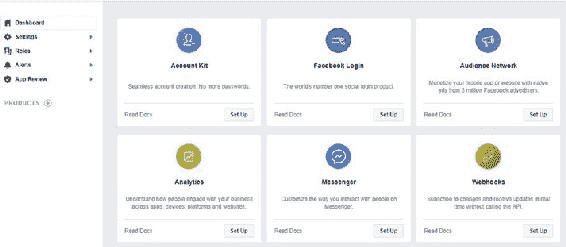
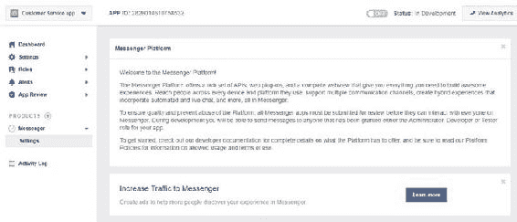

**图 7-7.** 产品页面
**图 7-8.** Messenger 平台页面

14. 在 Messenger 设置中，向下滚动到 `Token Generation`。

15. 从下拉菜单中点击 `Select a Page`，然后选择新创建的 Facebook 页面。

16. 复制 `Page Access Token`，该令牌将在 Watson Assistant 中使用（见图 7-9）。

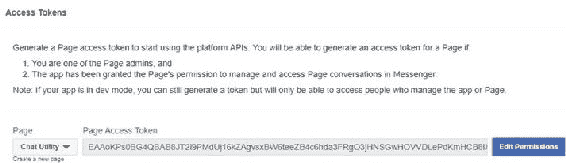
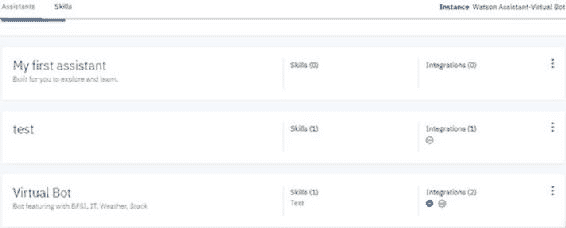

**图 7-9.** 页面访问令牌

现在，让我们转到 IBM Watson 控制台并集成 Watson Assistant。

1. 登录 IBM Cloud 后，启动在第 6 章创建的 AI 服务。

2. 选择你想要与 Facebook Messenger 集成的技能。点击 `Skills` 按钮，然后点击 `test`，如图 7-10 所示。

**图 7-10.** Watson Assistant 技能页面

3. 点击 `Add Integration` 按钮。在 `Third-party integrations` 下选择 `Facebook Messenger`，如图 7-11 所示。

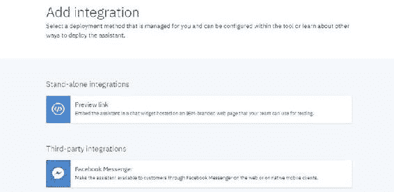
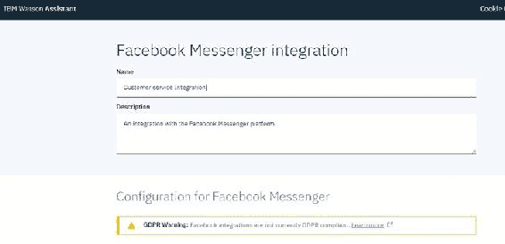

**图 7-11.** 添加集成页面

4. 在 Facebook Messenger 集成页面的 `Name` 和 `Description` 字段中输入所需信息，如图 7-12 所示。

**图 7-12.** Facebook Messenger 的配置

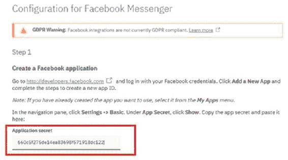

5. 将复制的 `App Secret Key` 粘贴到 `Application secret` 字段中，如图 7-13 所示。

**图 7-13.** Watson Assistant Facebook Messenger 配置页面

6. 将复制的 Page access token 粘贴到 `Page Access token` 下，如图 7-14 所示。

7. 复制 `Generated verify token`，该令牌将用于验证你的 webhook URL。

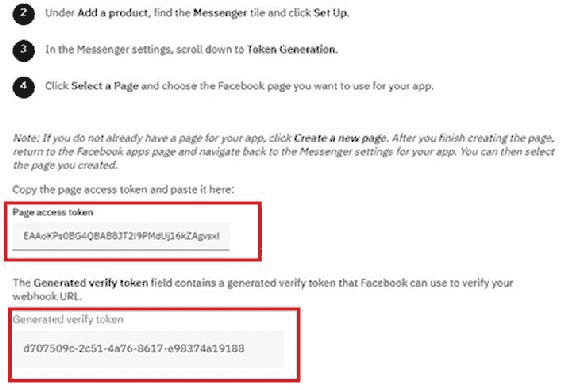
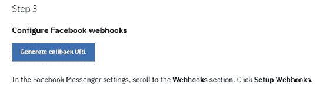

**图 7-14.** 页面访问令牌和生成的验证令牌

8. 在 Facebook Messenger 集成页面的 `Configure Facebook webhooks` 下，点击 `Generate callback URL`，如图 7-15 所示。

**图 7-15.** 生成回调 URL

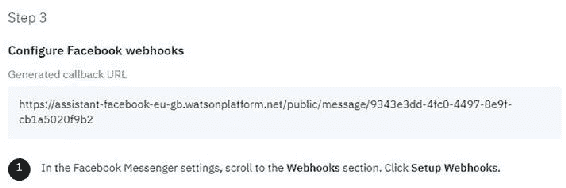

9. 生成回调 URL 后，它会显示在 Facebook Messenger 集成页面的 `生成回调 URL` 下方（参见图 7-16）。

10. 复制 `生成的回调 URL`。

**图 7-16.** 生成的回调 URL

11. 返回 Facebook 应用页面。在 Facebook Messenger 设置中，滚动到 `Webhooks` 部分。

12. 点击 `订阅事件`。

13. 在“新页面订阅”窗口中，将复制的生成回调 URL 插入到 `回调 URL` 字段中。将复制的生成验证令牌插入到 `验证令牌` 字段中。

14. 在“订阅”字段中，选择 `消息` 和 `消息回传`，然后点击 `验证并保存`，如图 7-17 所示。

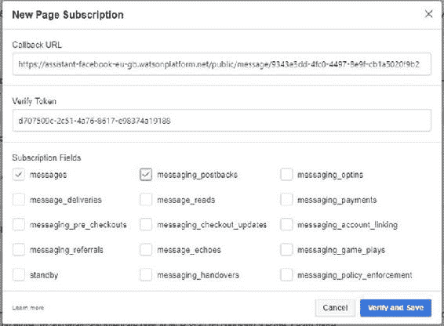

**图 7-17.** 新页面订阅

15. 在 Facebook 应用页面的 Messenger 设置中，转到 `Webhooks` 部分，点击 `选择页面`。选择与上一步相同的 Facebook 页面。

16. 点击 `订阅` 按钮，如图 7-18 所示。

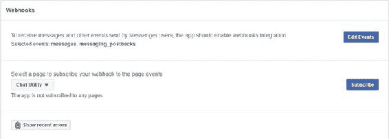
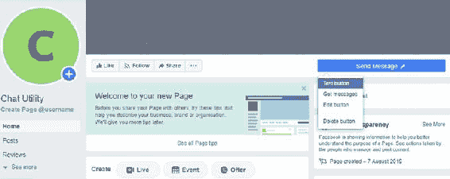

**图 7-18.** Facebook 应用页面上的 Webhooks

至此，您已完成将 Watson Assistant 与 Facebook Messenger 集成的所有必要步骤。现在，让我们测试一下集成场景。

1. 前往 Facebook 页面，点击 `发送消息` 按钮。选择 `测试按钮`，如图 7-19 所示。

**图 7-19.** Facebook 页面

2. 测试我们与 Messenger 集成的技能。查看天气用例场景，如图 7-20 所示。

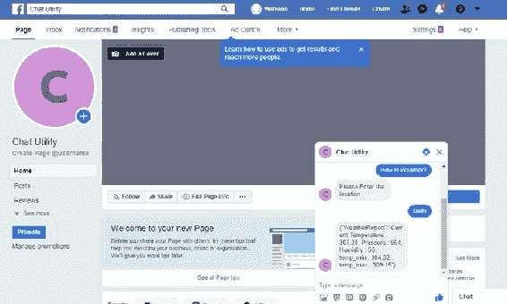
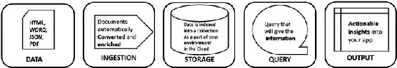

**图 7-20.** 在 Facebook 页面上测试用例

## 使用其他高级 Watson 服务

# Watson Discovery 服务

Watson Discovery 服务使您能够快速摄取、规范化、丰富、索引和搜索非结构化数据。它简化了与丰富和分析大型数据集相关的基础设施、规模和算法挑战。它使您能够生成多种格式的数据，包括 PDF、Word 文档、HTML 和 JSON 类型文件。

图 7-21. Watson Discovery 服务架构

Watson Discovery 只需几个步骤即可分析和总结大型非结构化数据，创建提供所需信息的查询，然后将这些洞察集成到新应用程序或现有解决方案中。

IBM Watson Discovery 汇集了一套功能丰富的集成式自动化 Watson API，可执行以下操作：

• 训练非结构化数据。上传您自己的文档，或从 Box、Salesforce、Microsoft SharePoint Online、IBM Cloud Object Storage 和 Microsoft SharePoint 2016 数据源进行爬取，或使用 Discovery 工具进行网络爬取。Discovery 环境可以容纳多个私有集合。每个集合都与一个配置配对，该配置告诉 Discovery 如何上传和处理文件。我们可以指定如何转换数据集中的不同文件类型，并选择要对每个文档文本应用哪些自然处理增强，以及如何清理和规范化生成的数据。

• 将要摄取、索引、规范化的文档/数据分组，并准备好进行查询。对文档应用增强。通过自然语言理解（NLU），Discovery 会自动对文本字段应用实体提取、情感分析、类别分类和概念标记等增强。

• 数据增强后，构建查询以搜索信息。

让我们深入探讨 Watson Discovery 服务，了解如何根据输入查询从数据集合中获取结果。

## 设置 Watson Discovery 服务

要设置 Watson Discovery 服务，请访问 IBM Cloud 目录页面：`cloud.ibm.com/catalog`。

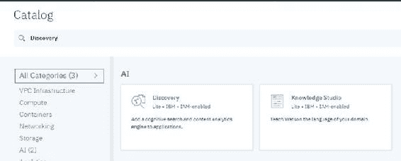

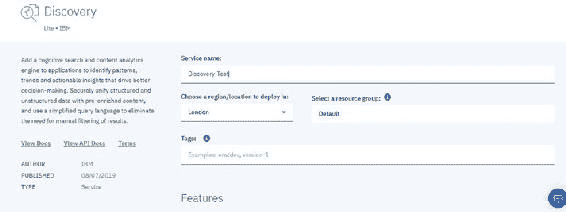

1. 搜索 **Discovery** 并点击 **Discovery** 服务，如图 7-22 所示。

图 7-22. Watson Catalog 页面

2. 在 **服务名称**（`Service_name`，例如 `Discovery-Test`）中输入所需信息以创建服务。选择要部署的区域，如图 7-23 所示。

图 7-23. Watson Discovery 页面

3. 在定价计划页面选择 **Lite** 套餐，然后点击 **创建** 按钮，如图 7-24 所示。

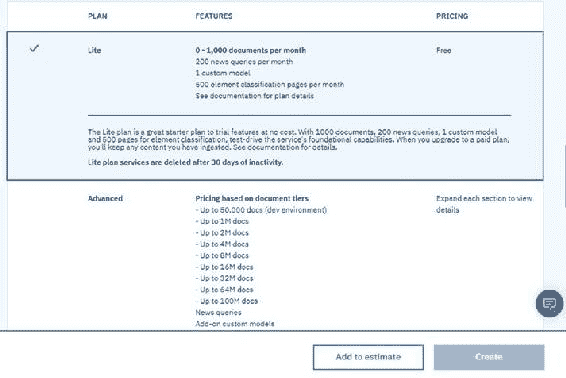

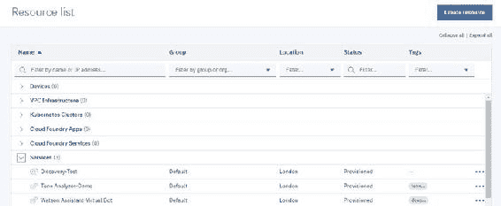

图 7-24. Discovery 服务计划

4. 服务实例创建完成后，会显示在“服务”部分。选择 `Discovery-Test` 服务，如图 7-25 所示。

图 7-25. 资源列表

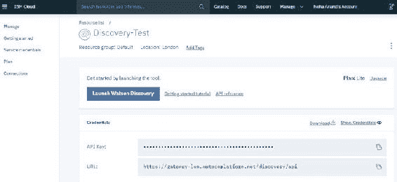

5. 点击 **启动 Watson Discovery** 按钮以启动服务，如图 7-26 所示。您将被重定向到图 7-27 所示的页面。

图 7-26. 启动 Watson Discovery

6. 在“管理数据”屏幕上，创建一个数据集合。点击 **上传您自己的数据** 按钮，并在 Discovery 中创建一个新的私有集合。

7. 输入所需信息。**集合名称**为 `AI Data`。选择您偏好的语言（默认为英语），然后点击 **创建** 按钮，如图 7-28 所示。

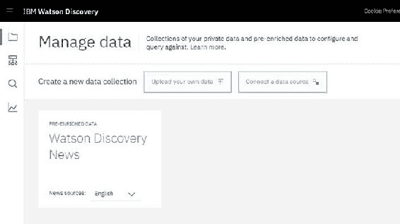

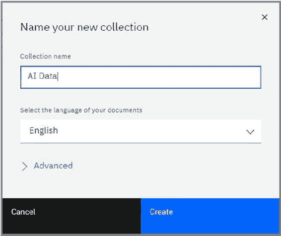

图 7-27. IBM Watson Discovery 页面

图 7-28. 创建集合

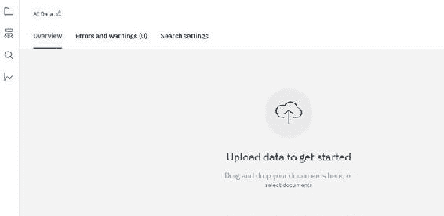

集合创建完成后，您需要在此部分上传数据。您可以将文档拖放到集合中，或浏览计算机以上传文档，如图 7-29 所示。

**注意** 在高级部分，您可以为文档定义具有自定义模式的集合。

图 7-29. 上传数据

我们已将人工智能和机器学习文档添加到 WDS 服务的集合中。名为 `AI.doc` 的文件包含与人工智能相关的数据，而 `AI2.doc` 包含与机器学习相关的数据。

在图 7-30 中，我们在“处理中”部分上传了这两个.doc 文件。

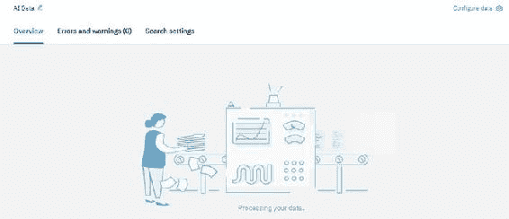

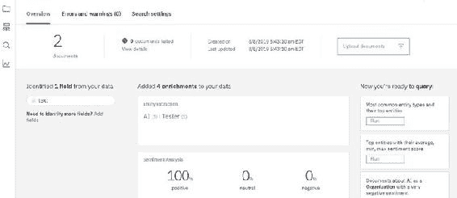

图 7-30. 处理您的数据

处理完成后，会显示以下信息，如图 7-31 所示。

• 文档数量已增至 2 个。

• 从您的文档中识别出的字段。

• 已对您的文档应用了增强功能。Discovery 会自动对文本字段应用实体提取、情感分析、类别分类和概念标记等增强功能。

图 7-31. 应用于文档的增强功能

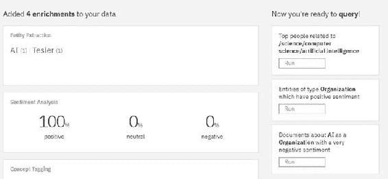

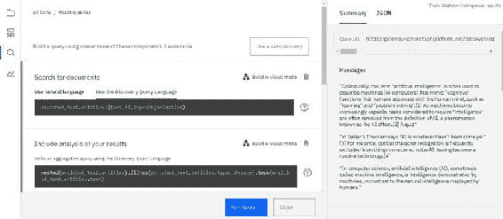

现在，让我们运行预构建的查询，如页面右侧所示。点击“运行”按钮（如图 7-32 所示）将重定向到图 7-33 所示的页面。

图 7-32. 管理数据页面

图 7-33. 构建查询页面

让我们尝试一个快速的自然语言查询。

在 **使用自然语言** 字段下输入您的查询。点击 **运行查询**。

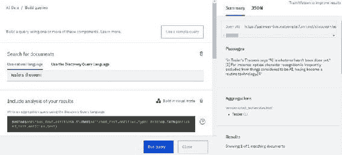

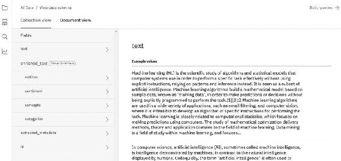

搜索结果将显示在屏幕右侧。它会利用 NLP、NLU 和机器学习，根据相关性从所有匹配关键字的文档中提取数据，如图 7-34 所示。

图 7-34. 构建查询页面

要查看集合的数据模式，请转到 **查看数据模式** 并选择 **集合视图** 选项卡。此时会显示集合的数据模式。它包含文本、富文本、实体、情感等内容，如图 7-35 所示。

图 7-35. 查看数据模式

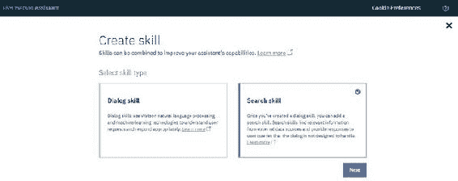

## 将 Watson Discovery 与 Watson Assistant 集成

要将 Watson Discovery 服务与我们的机器人连接，让我们从“技能”页面创建一个搜索技能。

1. 转到 IBM Watson Assistant。

2. 选择搜索技能并单击 **下一步** 按钮，如图 7-36 所示。

图 7-36. Watson Assistant 创建技能页面

3. 填写名称和描述所需的信息。单击“继续”按钮，如图 7-37 所示。

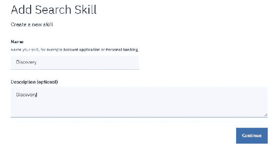

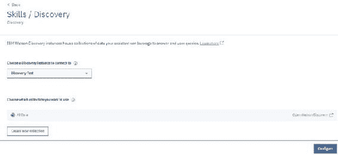

图 7-37. Watson Assistant 添加搜索技能页面

4. 技能创建完成后，您需要选择要与之连接的 Discovery 服务实例，并选择要使用的集合（例如，Discovery 实例：`Discovery-Test` 和集合：`AI Data`），如图 7-38 所示。

5. 单击 **配置** 按钮。

图 7-38. Watson Assistant 搜索技能页面

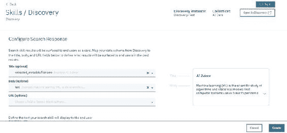

6. 要配置搜索响应，请将您的数据模式从 Discovery 映射到标题、正文和 URL 字段，以定义向最终用户显示哪些结果，如图 7-39 所示。例如，标题映射到 `extracted_metadata_filename`，正文映射到 `text`。

7. 单击 **创建** 按钮。

图 7-39. 配置搜索响应

现在，WDS 与助手的集成已完成，您可以使用 **试用** 面板通过查询（什么是机器学习？）来测试您的助手，如图 7-40 所示。

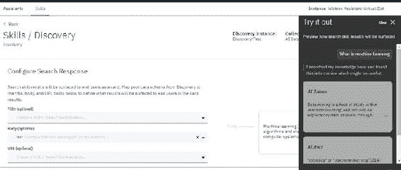

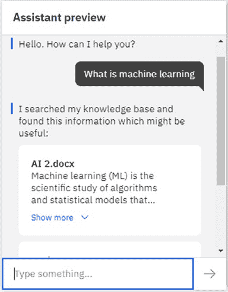

图 7-40. 试用页面

现在让我们在机器人中测试我们的用例。按照本章前面的方法将技能与助手关联，然后尝试该用例以查看来自 WDS 的搜索结果，如图 7-41 和图 7-42 所示。

图 7-41. 测试用例

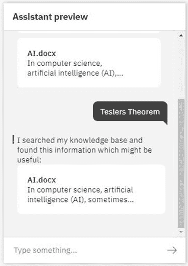

图 7-42. 显示结果

# 语调分析器

IBM Watson 语调分析器服务使用语言分析来检测书面文本中的情感和语言语调。该服务可以在文档和句子级别分析语调。

## 语调分析器服务

要设置语调分析器服务，请访问 IBM Cloud 目录页面：`cloud.ibm.com/catalog`

搜索 **语调分析器**。单击 **语调分析器** 服务，如图 7-43 所示。

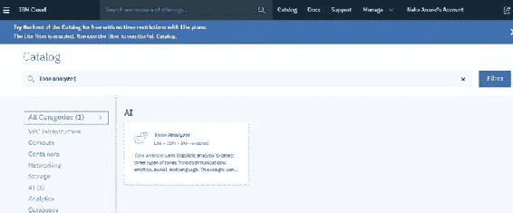

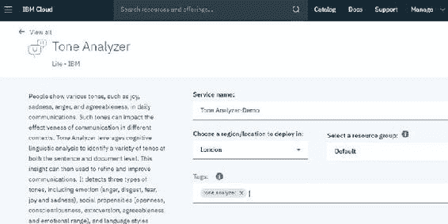

图 7-43. IBM Cloud 目录页面

输入创建服务所需的信息（例如，`Tone_Analyzer-Demo`）。选择要部署的区域并选择相关标签，如图 7-44 所示。

# IBM Cloud Tone Analyzer 设置与集成

## 选择定价计划
从定价计划页面选择“精简”计划，如图 7-45 所示。

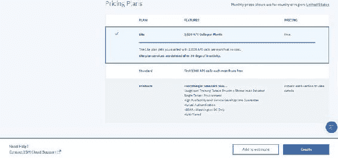

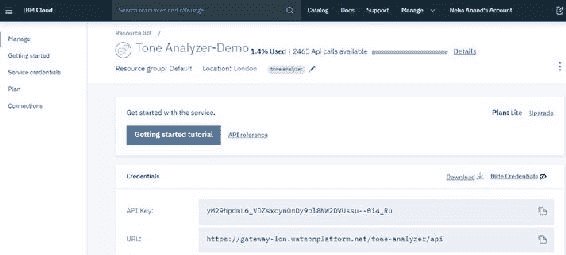

图 7-45. 定价计划

## 获取服务凭据
复制凭据以验证您的服务实例。

在“管理”页面上，单击 `显示` 以查看您的凭据。复制 API 密钥和 URL 值，以便稍后在 IBM Cloud Functions 中使用它们，如图 7-46 所示。

图 7-46. 语调分析器管理页面

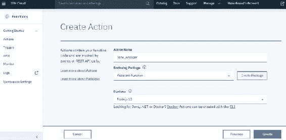

## 通过 Cloud Functions 将 Watson 与语调分析器服务连接
我们已经逐步介绍了创建 Cloud Functions 的流程。接下来，我们将通过 IBM Cloud 中的 Cloud Functions 创建一个操作来调用 API。

### 创建操作
定义 Cloud Functions 操作，如图 7-47 所示。

1. 输入你的操作名称（例如，`[action_name]`，`Tone-Analyzer`）。
2. 在 `封闭包` 下创建一个包，并指定任意 `[package_name]`（例如，`Assistant-Function`）。
3. 选择 `运行时` 语言。在此示例中，我们使用了 Node.js。
4. 点击 `创建` 按钮。

图 7-47. IBM Cloud 创建操作页面

### 配置操作代码
在你的 Cloud Functions 操作中，替换用于调用 IBM Tone Analyzer 服务的现有示例代码，如图 7-48 所示。

在 `url` 字段和 `iam_apikey` 字段中，替换你在创建 Tone Analyzer 服务时复制的相同 URL 和 API 密钥。

```javascript
function main(param) {
    const ToneAnalyzerV3 = require('ibm-watson/tone-analyzer/v3');
    const toneAnalyzer = new ToneAnalyzerV3({
        version: '2017-09-21',
        url: 'https://gateway-lon.watsonplatform.net/tone-analyzer/api',
        iam_apikey: 'yM29hpdmL6_VDZsxcynOnDy9pl8NW2DVUssu--0i4_Ru',
        disable_ssl_verification: true,
    });

    const toneParams = {
        tone_input: { 'text': param.text },
        content_type: 'application/json',
    };

    return toneAnalyzer.tone(toneParams)
        .then(toneAnalysis => {
            return {toneAnalysis}
        });
}
```

现在，你可以开始编辑 `Tone_Analyzer` 函数，方法是在 Functions → Actions → Code 控制台中将上述示例代码替换进去，如图 7-48 所示。

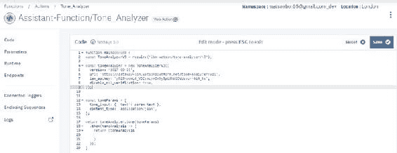

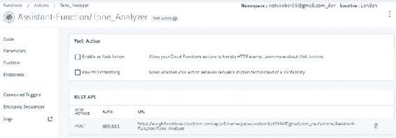

图 7-48. 显示代码片段的 IBM Cloud Functions

## 获取端点与 API 密钥
转到 `端点`。在 `REST API` 下，复制并保存该 URL，如图 7-49 所示。

图 7-49. 端点页面

点击 `API-KEY`。复制并保存 API 密钥，如图 7-50 所示。

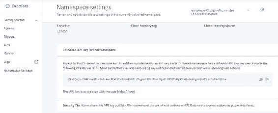

图 7-50. 命名空间设置页面

## 在 Watson Assistant 中调用 Cloud Functions
现在，让我们在 Watson Assistant 服务中创建的技能里调用此函数，以从 Tone Analyzer 服务获取结果，并在我们的机器人中显示响应。

### 准备技能
我们选取了一个分析客户购物体验反馈的用例。当客户输入反馈时，我们将文本捕获到一个变量中，并将此变量传递给调用 Tone Analyzer 服务的云函数。

你可以下载已配置好 Tone Analyzer 用例的技能 JSON 文件。

前往 [GitHub](https://github.com/watson05/Cognitive-Bot) 下载 Tone Analyzer 技能 JSON 文件。

按照股票市场数据用例中的说明，将下载的技能导入 Watson Assistant 服务。

导入技能后，你将进入对话框页面，其中已配置好 `Tone_Analyzer` 用例（参见图 7-51）。


图 7-51. 对话框页面

### 查看用例组件
让我们看看为 Tone Analyzer 用例定义的以下组件。

• **实体：** `@Product`

• **实体值：** 产品名称，例如包、笔记本电脑、手机、耳机等。

我们定义了实体 `@Product`，因为我们想知道客户购买了什么。

我们更改了默认的欢迎消息，如图 7-52 所示。


图 7-52. 欢迎节点

### 配置对话节点
导航到“对话框”部分并点击 `对话框`。点击 `Tone_Analyzer` 节点。你会看到实体被定义为 `@Product`。我们通过一个提示性问题来询问整体的购物体验反馈，如图 7-53 所示。

图 7-53. 已填写信息的对话框节点

我们已捕获客户购物体验反馈，该反馈以输入文本形式存储在 `$text` 上下文变量中，并通过 API 传递，如图 7-54 所示。


图 7-54. 包含信息的对话节点

### 调用云函数的 JSON
以下是用于调用云函数的示例 JSON。

```json
{
  output: {
    text: {
      values: [],
      selection_policy: sequential
    }
  },
  actions: [
    {
      name: /watsonbot05%40gmail.com_dev/Assistant-Function/Tone_Analyzer,
      type: cloud_function,
      parameters: {
        text: <? $text ?>
      },
      credentials: $credentials,
      result_variable: $response
    }
  ],
  context: {
    credentials: {
      api_key: f2a23cdb-5947-4a67-a960-4eef2a9d2a5d:dfXh7zrBUgXqkG51zTGmL3gaXUi57KToRgG7HAOx8qWbgmb0U4E1UcMo7Aul2Hh6
    }
  }
}
```

我们将通过点击 `然后设置上下文` 汉堡菜单中的“打开 JSON 编辑器”，在 JSON 编辑器中调用云函数。

替换打开的 JSON 编辑器中的代码，如图 7-55 所示。

图 7-55. 打开 JSON 编辑器

对于 JSON 中的操作名称，你需要使用云函数 URL 的一部分，该部分应类似于以下内容：

[`eu-gb.functions.cloud.ibm.com/api/v1/namespaces/watsonbot05@gmail.com_dev/actions/Assistant-Function/Tone_Analyzer`](https://eu-gb.functions.cloud.ibm.com/api/v1/namespaces/watsonbot05@gmail.com_dev/actions/Assistant-Function/Tone_Analyzer)

[`watsonbot05%40gmail.com_dev/actions/Assistant-Function/Tone_Analyzer`](https://eu-gb.functions.cloud.ibm.com/api/v1/namespaces/watsonbot05@gmail.com_dev/actions/Assistant-Function/Tone_Analyzer)

[Analyzer](https://eu-gb.functions.cloud.ibm.com/api/v1/namespaces/watsonbot05@gmail.com_dev/actions/Assistant-Function/Tone_Analyzer)

需要在 JSON 编辑器节点中填写 `actions` 部分，如下所示：`name: /watsonbot05%40gmail.com_dev/Assistant-Function/Tone_Analyzer`。

要在上下文中输入凭据，请将 `api_key` 值替换为你的 Cloud Functions API 密钥；例如，`api_key: 1234567890-example`。我们已使用购物体验反馈参数调用了 Tone Analyzer API。现在需要显示从 API 获取的结果。为此，我们添加了一个子节点，并从父节点跳转到 `响应`，如图 7-56 和图 7-57 所示。

**图 7-56.** 用于捕获 API 响应的子节点* 235


**图 7-57.** 跳转到响应*

我们已将 API 的响应获取到 `$response` 上下文变量中，该变量在 `result_variable` 中提及，如图 7-58 所示。

**图 7-58.** 显示 `result_variable` 的 JSON*


现在，让我们在机器人（即助手）上测试我们的用例。按照本章前面的操作，将技能与助手关联。尝试该用例，查看根据客户近期购物体验给出的反馈的情感分析结果，如图 7-59、图 7-60 和图 7-61 所示。

**图 7-59.** 在机器人上测试用例*


**图 7-60.** 显示的结果*


**图 7-61.** 显示的结果*

## 结论

本章到此结束，我们介绍了可以使用内置的 IBM 高级 AI 服务开发的各种用例类型，以进一步提升机器人对话的质量。我们为 Tone Analyzer 和 Watson Discovery 服务创建了可直接使用的示例用例，并实现了 Facebook Messenger 与 IBM Watson 的集成。