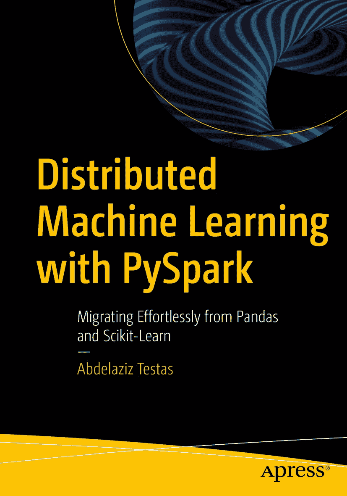

<!--

ISBN `978-1-4842-9750-6` e-ISBN `978-1-4842-9751-3` [`doi.org/10.1007/978-1-4842-9751-3`](https://doi.org/10.1007/978-1-4842-9751-3) © Abdelaziz Testas 2023 Apress Standard 本出版物中使用的通用描述性名称、注册商标名称、商标、服务标志等，即使未作特别声明，也不意味着这些名称不受相关保护性法律和法规的约束，因此可供公众自由使用。出版商、作者和编辑可以合理假定，本书中的建议和信息在出版之日是真实准确的。出版商和作者或编辑均不对本书所含材料或可能存在的任何错误或遗漏提供明示或暗示的担保。出版商对已出版地图中的管辖权主张和机构归属保持中立。

本 Apress 印记由注册公司 `APress Media, LLC`（Springer Nature 旗下）出版。

注册公司地址为：`1 New York Plaza, New York, NY 10004, U.S.A.`

*谨以此书献给我的家人和同事，感谢他们的支持与鼓励。*

-->

# 引言

近年来，公司和组织生成和收集的数据量呈指数级增长。因此，数据科学家被迫处理和分析大量数据，而传统的单节点计算工具（如 `Pandas` 和 `Scikit-Learn`）已变得力不从心。为此，许多数据科学家转向了分布式计算框架，例如 `Apache Spark` 及其基于 `Python` 的接口 `PySpark`。

与单节点计算相比，`PySpark` 具有多项优势，包括能够处理海量数据以及显著缩短数据处理时间的潜力。此外，由于 `PySpark` 构建在广泛使用的分布式计算框架 `Spark` 之上，它还提供了更广泛的数据处理和机器学习工具集。

虽然从 `Pandas` 和 `Scikit-Learn` 过渡到 `PySpark` 看似艰巨，但这一过程实际上可以相对直接。`Pandas`/`Scikit-Learn` 和 `PySpark` 提供了相似的 API，这意味着许多数据科学家可以轻松地从一种工具过渡到另一种。

在此背景下，本书将探讨使用 `PySpark` 相对于传统单节点计算工具的优势，并为考虑过渡到 `PySpark` 的数据科学家提供指导。

在本书中，我们旨在全面概述主要的机器学习算法，特别关注回归和分类。这些是构成许多机器学习实际应用基础的基本技术。我们将涵盖流行的方法，如线性回归和逻辑回归、决策树、随机森林、梯度提升树、支持向量机、朴素贝叶斯和神经网络。我们还将讨论如何将这些算法应用于现实世界的问题，例如预测房价、糖尿病可能性，以及对手写数字或鸢尾花种类进行分类，并预测肿瘤是良性还是恶性。无论您是初学者还是经验丰富的从业者，本书旨在帮助您理解机器学习的核心概念，并培养在实践中应用这些方法所需的技能。

本书共 18 章，涵盖多个主题。前两章探讨了为何从 `Pandas` 和 `Scikit-Learn` 迁移到 `PySpark` 可以是一个无缝的过程，并解决了选择算法的挑战。第 3 章至第 6 章构建、训练和评估了一些流行的回归模型，即多元线性回归、决策树、随机森林和梯度提升树，并使用它们处理一些现实世界的任务，例如预测房价。第 7 章至第 12 章通过构建、训练和评估广泛使用的算法（如逻辑回归、决策树、随机森林、支持向量机、朴素贝叶斯和神经网络）来处理分类问题。在第 13 章至第 15 章中，我们研究了另外三种类型的算法，即推荐系统、自然语言处理和 `K-means` 聚类。在最后三章中，我们处理超参数调优、流水线以及将模型部署到生产环境。

# 关于作者 关于技术审稿人