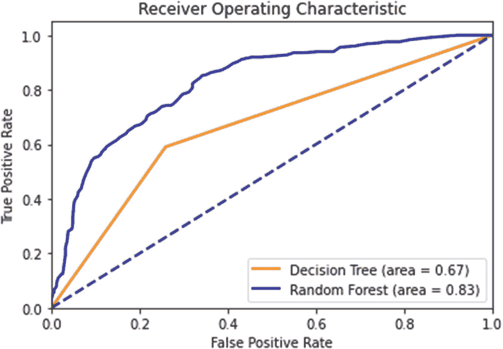

# 2. 选择算法

机器学习提供了多种用于监督学习和非监督学习任务的算法，每种算法都有众多参数需要微调。然而，测试并优化每个类别中的所有模型将极其繁琐，并且需要巨大的计算能力。为了应对这一挑战，本章将介绍 k 折交叉验证，这是一种有助于从一系列不同算法中选出性能最佳模型的技术。通过这种方法，可以将表现最好的模型列入候选名单，进行进一步的评估和测试。

使用交叉验证的另一个原因是它可以防止过拟合（即算法在训练集上表现良好，但在未见过的全新数据上表现不佳）。我们可以使用 k 折交叉验证，而不是单一的训练/测试集划分。我们将数据分成 `k` 个子集（折），并训练模型 `k` 次，每次使用不同的折作为测试集，其余折作为训练集。我们计算所有折的平均性能。如果模型在训练折上的表现始终优于测试折，则可能表明存在过拟合。

为了展示 Scikit-Learn 和 PySpark 机器学习库之间的相似性，我们将它们应用于同一个数据集。我们将使用四种算法进行说明：逻辑回归、决策树分类器、随机森林分类器和支持向量分类器。选择的评估指标将是曲线下面积（AUC），它衡量分类模型区分正类和负类的能力。

在构建模型之前，让我们先使用 Pandas 和 PySpark 探索数据集。这将使我们能够看到这两个库如何使用类似的方法来读取和处理数据。

## 数据集

本项目使用的数据集被称为皮马印第安人糖尿病数据库。皮马指的是一群原居于美国西南部（主要是现在的亚利桑那州）的美洲原住民部落。皮马人拥有独特的文化遗产和历史。

该数据集通常包含 768 条记录或实例。每条记录代表一位皮马印第安女性，并包含各种与健康相关的属性，以及一个指示该女性是否患有糖尿病的目标变量。该数据集常用于机器学习和数据分析中的分类任务，旨在根据提供的属性预测糖尿病结果。

该数据集最初由美国国家糖尿病、消化和肾脏疾病研究所创建。为了本次分析，我们从 Kaggle（一个为数据科学家设计的网站）获取了该数据集。以下是贡献者姓名、大致上传日期、数据集名称、网站名称以及我们下载 CSV 文件副本的 URL：

**标题**：皮马印第安人糖尿病数据库

**来源**：Kaggle

**URL**：[`www.kaggle.com/uciml/pima-indians-diabetes-database`](http://www.kaggle.com/uciml/pima-indians-diabetes-database)

**贡献者**：UCI 机器学习库

**日期**：2016

我们首先定义一个名为 `load_diabetes_data()` 的 Python 函数，用于从 GitHub 仓库中名为 `diabetes.csv` 的 CSV 文件加载糖尿病数据。数据使用 Pandas 的 `read_csv()` 函数加载，该函数将 CSV 文件读入一个 Pandas DataFrame。

```python
import pandas as pd

def load_diabetes_data():
    url = ('https://raw.githubusercontent.com/abdelaziztestas/'
           'spark_book/main/diabetes.csv')
    return pd.read_csv(url)
```

然后，我们通过调用 `load_diabetes_data()` 函数创建一个 Pandas DataFrame：

```python
pandas_df = load_diabetes_data()
```

接下来，我们使用 PySpark 的 `createDataFrame()` 方法，将刚刚创建的 Pandas DataFrame (`pandas_df`) 转换为一个名为 `spark_df` 的 PySpark DataFrame：

```python
from pyspark.sql.session import SparkSession

spark = SparkSession.builder.appName("diabetes_data").getOrCreate()
spark_df = spark.createDataFrame(pandas_df)
```

下一步，我们使用 Pandas 的 `head()` 方法查看前五行数据：

|    | 怀孕次数 | 血糖 | 血压 | 皮肤厚度 | 胰岛素 | BMI  | 糖尿病遗传函数 | 年龄 | 结果 |
|----|----------|------|------|----------|--------|------|----------------|------|------|
| 0  | 6        | 148  | 72   | 35       | 0      | 33.6 | 0.627          | 50   | 1    |
| 1  | 1        | 85   | 66   | 29       | 0      | 26.6 | 0.351          | 31   | 0    |
| 2  | 8        | 183  | 64   | 0        | 0      | 23.3 | 0.672          | 32   | 1    |
| 3  | 1        | 89   | 66   | 23       | 94     | 28.1 | 0.167          | 21   | 0    |
| 4  | 0        | 137  | 40   | 35       | 168    | 43.1 | 2.288          | 33   | 1    |

```python
pandas_df.head()
```

在 PySpark 中，我们使用 `show()` 方法来显示 `spark_df` 的内容：

| 怀孕次数 | 血糖 | 血压 | 皮肤厚度 | 胰岛素 | BMI  | 糖尿病遗传函数 | 年龄 | 结果 |
|----------|------|------|----------|--------|------|----------------|------|------|
| 6        | 148  | 72   | 35       | 0      | 33.6 | 0.627          | 50   | 1    |
| 1        | 85   | 66   | 29       | 0      | 26.6 | 0.351          | 31   | 0    |
| 8        | 183  | 64   | 0        | 0      | 23.3 | 0.672          | 32   | 1    |
| 1        | 89   | 66   | 23       | 94     | 28.1 | 0.167          | 21   | 0    |
| 0        | 137  | 40   | 35       | 168    | 43.1 | 2.288          | 33   | 1    |

```python
spark_df.show(5)
```

从 Pandas 和 PySpark 的输出中，我们可以看到共有九个列（八个属性和一个结果变量）。`Pregnancies` 指的是女性怀孕的次数。`Glucose` 是口服葡萄糖耐量测试两小时后血液中的葡萄糖浓度。`BloodPressure` 表示舒张压，单位为毫米汞柱（mm Hg）。`SkinThickness` 是肱三头肌皮褶厚度，单位为毫米。`Insulin` 代表两小时后的血清胰岛素水平，单位为微国际单位每毫升（mu U/ml）。`BMI`，即身体质量指数，通过体重（公斤）除以身高（米）的平方计算得出，用于反映身体成分。`DiabetesPedigreeFunction` 根据家族史评估患糖尿病的可能性，并给出一个分数。`Age` 表示个人的年龄（岁）。最后，`Outcome` 是一个分类变量，取值为 0 或 1，表示是否存在某种特定状况。

我们可以使用 Pandas 的 `info()` 方法来显示 `pandas_df` 的摘要信息，包括每列的非空值数量和数据类型：

```python
pandas_df.info()

# 输出：
# <class 'pandas.core.frame.DataFrame'>
# RangeIndex: 768 entries, 0 to 767
# Data columns (total 9 columns):
#  #   Column                    Non-Null Count  Dtype  
# ---  ------                    --------------  -----  
#  0   Pregnancies               768 non-null    int64  
#  1   Glucose                   768 non-null    int64  
#  2   BloodPressure             768 non-null    int64  
#  3   SkinThickness             768 non-null    int64  
#  4   Insulin                   768 non-null    int64  
#  5   BMI                       768 non-null    float64
#  6   DiabetesPedigreeFunction  768 non-null    float64
#  7   Age                       768 non-null    int64  
#  8   Outcome                   768 non-null    int64  
# dtypes: float64(2), int64(7)
# memory usage: 54.1 KB
```

Pandas 的输出显示共有 9 列（正如我们所知）和 768 个实例，所有数据均为数值型，且没有空值。数据类型为 `int64`（整数）或 `float64`（小数）。

在 PySpark 中，我们可以使用`printSchema()`方法实现类似功能，其中`long`和`double`数据类型分别对应 Pandas 的`int64`和`float64`：

```
[In]: spark_df.printSchema()
[Out]:
root
|-- Pregnancies: long (nullable = true)
|-- Glucose: long (nullable = true)
|-- BloodPressure: long (nullable = true)
|-- SkinThickness: long (nullable = true)
|-- Insulin: long (nullable = true)
|-- BMI: double (nullable = true)
|-- DiabetesPedigreeFunction: double (nullable = true)
|-- Age: long (nullable = true)
|-- Outcome: long (nullable = true)
```

虽然`printSchema()`方法不显示观测数量，但我们可以使用`count()`方法来完成此任务：

```
[In]: spark_df.count()
[Out]: 768
```

## 描述性统计

我们可以使用 Pandas 的`describe()`方法计算八个属性各自的汇总统计量（计数、均值、标准差、最小值和最大值）。`drop()`方法允许我们排除 Outcome 列，因为它是一个分类变量，取值为 1（女性患有糖尿病）或 0（女性未患糖尿病）。`axis=1`参数指定我们要删除的是列，而不是行：

| | Pregnancies | Glucose | BloodPressure | SkinThickness | Insulin | BMI | DiabetesPedigreeFunction | Age |
|---|---|---|---|---|---|---|---|---|
| count | 768 | 768 | 768 | 768 | 768 | 768 | 768 | 768 |
| mean | 3.85 | 120.89 | 69.11 | 20.54 | 79.80 | 31.99 | 0.47 | 33.24 |
| std | 3.37 | 31.97 | 19.36 | 15.95 | 115.24 | 7.88 | 0.33 | 11.76 |
| min | 0.00 | 0.00 | 0.00 | 0.00 | 0.00 | 0.00 | 0.08 | 21.00 |
| 25% | 1.00 | 99.00 | 62.00 | 0.00 | 0.00 | 27.30 | 0.24 | 24.00 |
| 50% | 3.00 | 117.00 | 72.00 | 23.00 | 30.50 | 32.00 | 0.37 | 29.00 |
| 75% | 6.00 | 140.25 | 80.00 | 32.00 | 127.25 | 36.60 | 0.63 | 41.00 |
| max | 17.00 | 199.00 | 122.00 | 99.00 | 846.00 | 67.10 | 2.42 | 81.00 |

```
[In]: pandas_df.drop('Outcome', axis=1).describe()
[Out]:
```

在 PySpark 中，我们可以使用`summary()`方法获得相同的结果，该方法会给出相同的汇总统计量，包括 25%、50% 和 75% 分位数。虽然我们可以像在 Pandas 中一样使用`describe()`方法，但它不会显示这些分位数：

| summary | Pregnancies | Glucose | BloodPressure | BMI | DiabetesPedigreeFunction | Age |
|---|---|---|---|---|---|---|
| count | 724 | 724 | 724 | 724 | 724 | 724 |
| mean | 3.87 | 121.88 | 72.40 | 32.47 | 0.47 | 33.35 |
| stddev | 3.36 | 30.75 | 12.38 | 6.89 | 0.33 | 11.77 |
| min | 0 | 44 | 24 | 18.2 | 0.078 | 21 |
| 25% | 1 | 99 | 64 | 27.5 | 0.245 | 24 |
| 50% | 3 | 117 | 72 | 32.4 | 0.378 | 29 |
| 75% | 6 | 142 | 80 | 36.6 | 0.627 | 41 |
| max | 17 | 199 | 122 | 67.1 | 2.42 | 81 |

```
[In]: spark_df.drop('Outcome').summary().show()
[Out]:
```

## 分类变量分析

现在来看 Outcome 变量，我们可以使用 Pandas 的`value_counts()`方法找出有多少女性患有糖尿病，多少女性未患糖尿病：

```
[In]: pandas_df["Outcome"].value_counts()
[Out]:
0 500
1 268
Name: Outcome, dtype: int64
```

在 PySpark 中，我们可以使用`groupBy()`和`count()`方法获得相同的结果：

```
[In]: spark_df.groupBy("Outcome").count().show()
[Out]:
+-------+-----+
|Outcome|count|
+-------+-----+
|      0|  500|
|      1|  268|
+-------+-----+
```

Pandas 和 PySpark 都返回类别 1（即女性患有糖尿病）有 268 人，类别 0（即女性未患糖尿病）有 500 人。正如预期，两者相加等于总观测数 768。

## 缺失值检查

下一步，我们将检查是否存在缺失值。这很重要，因为机器学习算法通常需要完整的数据集才能有效训练。这是因为算法使用统计方法在数据中寻找模式，而缺失数据可能会破坏这些模式的准确性。

我们之前使用`info()`和`printSchema()`方法已经看到没有空值。我们可以通过使用 Pandas 的`isnull()`和`sum()`方法计算`pandas_df`每列中空值的数量来验证这一点：

```
[In]: pandas_df.isnull().sum()
[Out]:
Pregnancies                 0
Glucose                     0
BloodPressure               0
SkinThickness               0
Insulin                     0
BMI                         0
DiabetesPedigreeFunction    0
Age                         0
Outcome                     0
dtype: int64
```

在 PySpark 中，我们也可以使用`isNull()`和`sum()`方法，但方式略有不同。更准确地说，我们使用`sum(col(c).isNull().cast("int")).alias(c)`来生成一个 PySpark 表达式，该表达式将计算数据框单个列`c`中的空值数量（`c`是一个变量，在列表推导式中用于生成表达式列表，每个表达式计算对应列的空值数量，并使用相同的列名作为别名）：

| Pregnancies | Glucose | BloodPressure | BMI | DiabetesPedigreeFunction | Age | Outcome |
|---|---|---|---|---|---|---|
| 0 | 0 | 0 | 0 | 0 | 0 | 0 |

```
[In]: from pyspark.sql.functions import sum, col
[In]: spark_df.select([sum(col(c).isNull().cast("int")).alias(c) for c in spark_df.columns]).show()
[Out]:
```

Pandas 和 PySpark 的输出均表明数据集中不存在空值。然而，零空值并不总是意味着数据集中没有缺失值。这是因为在某些情况下，缺失值会被替换为 0。

让我们使用以下 Pandas 代码来计算九个列（包括结果变量）中每个列的 0 值总数：

## 数据清洗：处理零值

```
[In]: print((pandas_df == 0).sum())
[Out]:
Pregnancies                 111
Glucose                       5
BloodPressure                35
SkinThickness               227
Insulin                     374
BMI                          11
DiabetesPedigreeFunction      0
Age                           0
Outcome                     500
dtype: int64
```

在 PySpark 中，我们首先导入 `sum()` 和 `col()` 函数，然后生成计算每列中零值数量的表达式：

```
[In]: from pyspark.sql.functions import sum, col
[In]: exprs = [sum((col(c) == 0).cast("int")).alias(c) for c in spark_df.columns]
```

接下来，我们将这些表达式应用于数据框并显示结果：

| Pregnancies | Glucose | BloodPressure | SkinThickness | Insulin | BMI | DiabetesPedigreeFunction | Age | Outcome |
| --- | --- | --- | --- | --- | --- | --- | --- | --- |
| 111 | 5 | 35 | 227 | 374 | 11 | 0 | 0 | 500 |

```
[In]: spark_df.select(exprs).show()
[Out]:
```

Pandas 和 PySpark 均表明糖尿病遗传函数和年龄列没有 0 值的情况，但其他变量存在大量 0 值。例如，怀孕变量有 111 个 0 值，这说得通，因为样本中有些女性没有孩子。此外，结果变量有 500 个 0 值，表明这些女性没有糖尿病。然而，血糖、血压、皮褶厚度、胰岛素或体重指数出现 0 值是不合逻辑的。

处理无效读数有三种常见方法：排除包含 0 值的列或特征、排除包含 0 值的行、或用均值或平均值填充 0 值。在本章中，我们选择了选项 1 和 2：

*   选项 1：排除皮褶厚度和胰岛素，因为 0 值的数量过多（分别为 227 和 374）。如果排除行而不是列，会使样本过小。

*   选项 2：排除血糖、血压和体重指数为 0 值的行。无效案例的数量不算太多，因此排除行不会显著影响样本量。

以下是在 Pandas 中实现此操作的代码：

```
[In]: pandas_df = pandas_df.loc[(pandas_df['Glucose'] != 0)& (pandas_df['BloodPressure'] != 0)& (pandas_df['BMI'] != 0), ['Pregnancies', 'Glucose', 'BloodPressure', 'BMI', 'DiabetesPedigreeFunction', 'Age', 'Outcome']]
```

在 PySpark 中：

```
[In]: from pyspark.sql.functions import col
[In]: spark_df = spark_df.filter((col('Glucose') != 0)& (col('BloodPressure') != 0)& (col('BMI') != 0)).select(['Pregnancies', 'Glucose', 'BloodPressure', 'BMI', 'DiabetesPedigreeFunction', 'Age', 'Outcome'])
```

我们最终得到 7 列（6 个特征和 1 个类别变量）和 724 行。我们可以通过 Pandas 中的 `shape` 属性来确认这些计数：

```
[In]: print(pandas_df.shape)
[Out]: (724, 7)
```

PySpark 没有 `shape` 属性，但我们可以通过结合 `count()` 和 `len()` 函数来完成相同的任务：

```
[In]: print((spark_df.count(), len(spark_df.columns)))
[Out]: (724, 7)
```

## 使用交叉验证选择算法

交叉验证是一种通过将数据集分割成 k 折来评估机器学习模型性能的方法。然后，模型在 k-1 折上进行训练，并在剩余的一折上进行测试。此过程重复 k 次，每一折都轮流作为测试集。

这种方法优于仅在单个数据集上训练和测试模型，原因如下：

1.  K 折交叉验证通过降低对特定训练集过拟合的风险，可以更好地估计模型性能。通过使用数据的多个折来训练和评估模型，我们可以更好地了解模型在未见数据上的表现。

2.  通过 k 折交叉验证，我们可以获得模型性能的多个估计值，因此可以做出更明智的模型选择决策。这种方法降低了选择在特定训练集上表现良好但在未见数据上表现不佳的模型的可能性。

3.  通过将数据分割成多个折，我们可以使用更多数据来训练模型，这可以带来更好的性能。当数据集规模有限时，这种方法尤其有用。

为了说明 k 折交叉验证的工作原理，我们将比较四个分类器（尽管我们可以使用任意数量的模型）的性能：逻辑回归、决策树分类器、随机森林分类器和支持向量分类器。选择的评估指标将是 ROC 曲线下面积（受试者工作特征曲线），也称为 AUC（曲线下面积）。我们将在评估模型时更详细地解释这个重要指标。

在计算每个分类器的 ROC AUC 之前，我们将首先使用 `StandardScaler` 函数对特征进行标准化。标准缩放，也称为 z-score 归一化或标准化，是一种数据预处理技术，用于将数值特征转换为均值为 0、标准差为 1。它涉及从数据中减去每个特征的均值，然后除以标准差。

特征 x 的标准缩放公式为：

x_scaled = (x - mean(x)) / std(x)

其中 mean(x) 是特征 x 的均值，std(x) 是其标准差。

标准缩放是数据预处理中的一个关键步骤，用于使特征具有可比性，并提高机器学习算法的性能和稳定性。它确保特征具有一致的尺度，这在处理对输入数据尺度敏感的算法或解释模型系数时尤其重要。我们将使用 Scikit-Learn 和 PySpark 对上一节描述的相同糖尿病数据集进行分类。我们将使用相同的分类器列表，并使用十折交叉验证对每个分类器进行评估。

在本章中，我们将使用默认超参数。虽然 Scikit-Learn 和 PySpark 都为其模型提供了默认超参数，但这些默认值并不总是相同的。我们将在第 16 章中演示如何使用网格搜索来微调这些超参数，以改进模型性能。

Scikit-Learn 和 PySpark 之间还有其他差异。首先，Scikit-Learn 将交叉验证与超参数调优分开，而 PySpark 默认将它们结合在一起。其次，PySpark 将特征组合成一个向量，而 Scikit-Learn 则不会。

### Scikit-Learn

在本小节中，我们将演示如何使用 Scikit-Learn 平台进行数据预处理、定义分类模型以及执行 k 折交叉验证来评估模型性能。我们将使用之前通过以下代码生成的同一个 `pandas_df` DataFrame：

```
[In]: url = 'https://raw.githubusercontent.com/abdelaziztestas/spark_book/main/diabetes.csv'
[In]: pandas_df = pd.read_csv(url)
[In]: pandas_df = pandas_df.loc[(pandas_df['Glucose'] != 0)
& (pandas_df['BloodPressure'] != 0)
& (pandas_df['BMI'] != 0),
['Pregnancies',
'Glucose',
'BloodPressure',
'BMI',
'DiabetesPedigreeFunction',
'Age',
'Outcome']]
```

在生成这个过滤掉无效糖尿病读数记录的 DataFrame 之后，k 折交叉验证过程的第一步是导入所需的库：

**步骤 1：导入必要的包**

*   `StandardScaler` 用于预处理

*   `cross_val_score` 用于交叉验证

*   `LogisticRegression`、`DecisionTreeClassifier`、`RandomForestClassifier` 和 `LinearSVC`（线性支持向量分类）用于分类

# 模型评估：交叉验证与ROC曲线

以下是基于Scikit-Learn的模型评估流程。

## 步骤 1：导入必要的库

首先导入用于数据处理、模型选择、线性模型、树模型、集成模型和支持向量机的模块。

```
from sklearn.preprocessing import StandardScaler
from sklearn.model_selection import cross_val_score
from sklearn.linear_model import LogisticRegression
from sklearn.tree import DecisionTreeClassifier
from sklearn.ensemble import RandomForestClassifier
from sklearn.svm import LinearSVC
```

## 步骤 2：定义特征列和目标列

将特征列赋值给变量`x`，将目标列赋值给变量`y`。

```
x_cols = ['Pregnancies', 'Glucose', 'BloodPressure', 'BMI', 'DiabetesPedigreeFunction', 'Age']
x = pandas_df[x_cols]
y = pandas_df["Outcome"]
```

## 步骤 3：使用 `StandardScaler()` 对特征进行标准化

该函数将特征缩放为均值为0、标准差为1的分布。

```
scaler = StandardScaler()
x_scaled = scaler.fit_transform(x)
```

## 步骤 4：定义一个分类器列表

```
classifiers = [LogisticRegression(), DecisionTreeClassifier(), RandomForestClassifier(), LinearSVC(max_iter=1500)]
```

`LinearSVC` 中的 `max_iter` 参数是一个超参数，用于控制算法为达到收敛而运行的最大迭代次数。我们将其设置为1500，因为该算法在默认的最大迭代次数（即1000）内未能收敛。正如我们将在第16章中看到的，尝试不同的迭代次数是超参数调优过程的一部分。

`LinearSVC` 中的“Linear”一词意味着我们使用的是基于SVM（支持向量机）且带有线性核的分类器，该分类器使用线性决策边界来分隔类别。Scikit-Learn中还有另一个分类器 `SVC()`，它可以实现带有多项式核的SVM。当需要非线性决策边界时，这是一个更好的选择。我们没有尝试这个算法，因为它目前在PySpark中不可用，原因是核化SVM的训练难以分布式进行。但请注意，`SVC()` 也可以实现线性核，因此 `SVC(kernel='linear')` 会给出与 `LinearSVC()` 相当相似的结果。

## 步骤 5：使用for循环执行十折交叉验证

这会将数据分成十份，并计算每个折中模型准确率（通过`roc_auc`评分衡量）的平均值。每个分类器的模型名称和平均ROC AUC都会被打印出来。

```
for classifier in classifiers:
    result = cross_val_score(
        classifier,
        x_scaled,
        y,
        cv=10,
        scoring= "roc_auc" )
    print(f"{classifier.__class__.__name__} mean: {result.mean():.2f}")
```

输出结果：

```
LogisticRegression mean: 0.84
DecisionTreeClassifier mean: 0.67
RandomForestClassifier mean: 0.83
LinearSVC mean: 0.84
```

让我们详细解释一下这些数字的含义。在输出中，平均ROC AUC表示十个交叉验证折的平均ROC AUC分数。ROC AUC的取值范围为0到1，数值越高表示性能越好。

ROC曲线是二分类器在不同判别阈值（即分类器用于确定样本属于正类还是负类的不同值）下性能的图形表示。该曲线通过在不同阈值下绘制真正率（TPR）与假正率（FPR）的关系来生成。

以下是ROC曲线关键组成部分的详细说明：

1.  **真正率（TPR）或灵敏度：** TPR是被分类器正确识别为正类的正样本（实际正类）的比例。其计算公式如下：`TPR = 真正例 / (真正例 + 假负例)`。TPR也称为灵敏度或召回率。

2.  **假正率（FPR）或误报率：** FPR是被分类器错误分类为正类的负样本（实际负类）的比例。其计算公式如下：`FPR = 假正例 / (假正例 + 真负例)`。FPR也称为误报率。

ROC曲线通过沿垂直y轴绘制TPR（灵敏度）和沿水平x轴绘制FPR（1-特异度）来生成。该曲线直观地描绘了判别阈值的变化如何影响分类器的效能。在理想情况下，分类器的ROC曲线会从原点（FPR = 0）直接上升，然后水平延伸至右上角（TPR = 1），表示两个类别之间的完美区分。

在现实场景中，大多数分类器生成的曲线会向左上角弯曲。ROC曲线越接近这个角，分类器的性能质量就越高——越接近表示性能越好。ROC曲线下的面积（AUC）是一个单一指标，它概括了分类器在所有可能阈值下的性能。AUC值为1表示完美分类器，而AUC值为0.5则表示分类器的性能不比随机猜测好。

让我们继续绘制决策树和随机森林分类器的ROC曲线，以便更好地理解它们。我们可以使用以下代码实现这一点，使用我们之前生成的同一个`pandas_df` DataFrame来训练和评估模型。

## 步骤 1：导入必要的库

```
import matplotlib.pyplot as plt
from sklearn.model_selection import cross_val_predict
from sklearn.tree import DecisionTreeClassifier
from sklearn.ensemble import RandomForestClassifier
from sklearn.metrics import RocCurveDisplay, roc_curve, auc
```

## 步骤 2：定义决策树和随机森林模型

```
decision_tree_model = DecisionTreeClassifier()
random_forest_model = RandomForestClassifier()
```

## 步骤 3：对模型执行交叉验证预测

```
y_scores_decision_tree = cross_val_predict(
    decision_tree_model,
    x,
    y,
    cv=10,
    method="predict_proba"
)

y_scores_random_forest = cross_val_predict(
    random_forest_model,
    x,
    y,
    cv=10,
    method="predict_proba"
)
```

## 步骤 4：计算模型的ROC曲线和AUC

```
fpr_decision_tree, tpr_decision_tree, _ = roc_curve(y, y_scores_decision_tree[:, 1])
roc_auc_decision_tree = auc(fpr_decision_tree, tpr_decision_tree)

fpr_random_forest, tpr_random_forest, _ = roc_curve(y, y_scores_random_forest[:, 1])
roc_auc_random_forest = auc(fpr_random_forest, tpr_random_forest)
```

## 步骤 5：绘制ROC曲线

使用计算得到的FPR、TPR和AUC值，我们可以绘制并比较两个模型的ROC曲线。

# ROC曲线分析与PySpark实现

## ROC曲线可视化与分析

```
[In]: plt.figure()
[In]: plt.plot(fpr_decision_tree, tpr_decision_tree, color='darkorange', lw=2, label='Decision Tree (area = %0.2f)' % roc_auc_decision_tree)
[In]: plt.plot(fpr_random_forest, tpr_random_forest, color='blue', lw=2, label='Random Forest (area = %0.2f)' % roc_auc_random_forest)
[In]: plt.plot([0, 1], [0, 1], color='navy', lw=2, linestyle='--')
[In]: plt.xlim([0.0, 1.0])
[In]: plt.ylim([0.0, 1.05])
[In]: plt.xlabel('False Positive Rate')
[In]: plt.ylabel('True Positive Rate')
[In]: plt.title('Receiver Operating Characteristic')
[In]: plt.legend(loc="lower right")
[In]: plt.show()
[Out]:
```



一张折线图，比较了真正例率与假正例率。决策树和随机森林的曲线从大约 0.0 开始，逐渐增加到 0.8，然后达到 1.0。

随机森林分类器的 ROC 曲线（ROC AUC 为 0.83）比决策树分类器的曲线更靠近图的左上角。这表明随机森林分类器能够以更适中的假正例率，更准确地对正例和负例实例进行分类。

这并不意外，因为众所周知，随机森林分类器通常比单一决策树分类器表现更好。这是由于随机森林的集成特性及其减少了过拟合。随机森林结合了多个决策树的预测结果，每棵树都在数据的一个子集上进行训练并做出独立预测。最终的预测结果由各棵树的预测结果通过多数投票决定。这种集成方法有助于减少过拟合的影响。

此外，随机森林中的多数投票或平均有助于减少噪声数据点或异常值对最终预测的影响。决策树可能对单个数据点敏感，这可能导致泛化能力较差。

更重要的是，随机森林比单一决策树能更有效地对数据中的复杂关系进行建模。通过结合多棵树的预测，它可以更好地逼近非线性决策边界。回顾一下四个分类器的 k 折交叉验证输出，结果表明逻辑回归和线性 SVC 表现最佳，AUC 均为 0.84，其次是随机森林，AUC 为 0.83。决策树分类器表现不佳，AUC 仅为 0.67。这些发现表明，我们可以考虑将逻辑回归或线性 SVC 作为进一步训练和评估的首选模型。

## PySpark

在本节中，我们将 Scikit-Learn 代码转换为 PySpark，以突出它们的相似之处。我们将使用之前生成的同一个`spark_df` DataFrame，该 DataFrame 是在过滤掉无效读数后得到的。以下是实现此任务的代码提醒：

```
[In]: import pandas as pd
[In]: from pyspark.sql import SparkSession
[In]: url = 'https://raw.githubusercontent.com/abdelaziztestas/spark_book/main/diabetes.csv'
[In]: pandas_df = pd.read_csv(url)
[In]: spark = SparkSession.builder.appName("diabetes_data").getOrCreate()
[In]: spark_df = spark.createDataFrame(pandas_df)
[In]: spark_df = spark_df.filter((col('Glucose') != 0)
& (col('BloodPressure') != 0)
& (col('BMI') != 0)) \
.select(['Pregnancies',
'Glucose',
'BloodPressure',
'BMI',
'DiabetesPedigreeFunction',
'Age',
'Outcome'])
```

简而言之，我们的第一步是将 CSV 文件读入 Pandas DataFrame。然后，我们将此 DataFrame 转换为 PySpark DataFrame，并继续过滤掉无效记录。一旦我们生成了干净的 DataFrame，使用 PySpark 进行 k 折交叉验证过程的初始阶段需要我们导入必要的库：

### 步骤 1：导入所需的库

*   `VectorAssembler` 和 `StandardScaler` 用于特征工程
*   `LogisticRegression`、`DecisionTreeClassifier`、`RandomForestClassifier` 和 `LinearSVC` 用于分类
*   `BinaryClassificationEvaluator` 用于评估模型性能
*   `CrossValidator` 用于交叉验证
*   `col` 函数用于重命名标签列
*   `ParamGridBuilder` 用于超参数

```
[In]: from pyspark.ml.feature import VectorAssembler, StandardScaler
[In]: from pyspark.ml.classification import LogisticRegression, DecisionTreeClassifier, RandomForestClassifier, LinearSVC
[In]: from pyspark.ml.evaluation import BinaryClassificationEvaluator
[In]: from pyspark.ml.tuning import CrossValidator, ParamGridBuilder
[In]: from pyspark.sql.functions import col
```

### 步骤 2：使用 `VectorAssembler` 将特征列组合成一个名为 `features` 的单一向量列：

```
[In]: assembler = VectorAssembler(inputCols=[
'Pregnancies',
'Glucose',
'BloodPressure',
'BMI',
'DiabetesPedigreeFunction',
'Age', ], outputCol="features")
[In]: data = assembler.transform(spark_df)
```

### 步骤 3：使用 `VectorAssembler` 将一组输入特征转换为一个单一的向量特征，然后将其用作下一步的输入

这一步在分布式计算中是必要的，因为数据以分布式方式存储，需要先转换为向量格式才能用于机器学习。另一方面，Scikit-Learn 是为单机使用而设计的，不需要使用`VectorAssembler`。Scikit-Learn 中的输入特征通常存储在 NumPy 数组或 pandas DataFrame 中，可以直接用于训练机器学习模型。

为了了解`VectorAssembler`的作用，让我们打印“data” DataFrame 的前五行（参数`truncate=False`表示我们希望显示每列的完整内容，即使它超过了默认的显示长度，通常是 20 个字符）：

| Pregnancies | Glucose | BloodPressure | BMI | DiabetesPedigreeFunction | Age | Outcome | features |
|---|---|---|---|---|---|---|---|
| 6 | 148 | 72 | 33.6 | 0.627 | 50 | 1 | [6,148,72,33.6,0.627,50] |
| 1 | 85 | 66 | 26.6 | 0.351 | 31 | 0 | [1,85,66,26.6,0.351,31] |
| 8 | 183 | 64 | 23.3 | 0.672 | 32 | 1 | [8,183,64,23.3,0.672,32] |
| 1 | 89 | 66 | 28.1 | 0.167 | 21 | 0 | [1,89,66,28.1,0.167,21] |
| 0 | 137 | 40 | 43.1 | 2.288 | 33 | 1 | [0,137,40,43.1,2.288,33] |

```
[In]: data.show(5, truncate=False)
[Out]:
```

从上述向量组装输出可以看出，特征已被合并为一个名为`features`的单一向量。例如，第一行将怀孕次数、血糖、血压、BMI、糖尿病遗传函数和年龄的各自数值组合成了数值向量 [6,148,72,33.6,0.627,50]。

请注意，标签列（`Outcome`）并未包含在此组装过程中，因为向量组装专门针对特征，排除了目标变量。

**步骤 4：使用 `withColumnRenamed` 将标签列 Outcome 重命名为 label**

这样做是为了方便，因为在机器学习中，包含目标变量的列通常被称为“label”。此外，代码后面使用的 `BinaryClassificationEvaluator` 期望目标变量位于名为 `label` 的列中，因此将 `Outcome` 列重命名为 `label` 可确保评估器能够正确评估训练模型的性能：

```
[In]: data = data.withColumnRenamed("Outcome", "label")
```

**步骤 5：使用 `StandardScaler` 标准化特征列**：

```
[In]: scaler = StandardScaler(inputCol="features", outputCol="scaled_features")
[In]: data = scaler.fit(data).transform(data)
```

特征缩放是分类模型中一项重要的工程/预处理步骤，包括逻辑回归、`LinearSVC`（支持向量分类器）以及基于树的分类器（如决策树和随机森林）。这是为了确保算法能够以最佳状态和一致性运行。

逻辑回归和 `LinearSVC` 模型使用基于梯度的优化算法来寻找特征的最佳系数。缩放通过确保所有特征具有相似的尺度来帮助优化过程，这可以防止某个特征因其较大的量级而主导优化过程。它还可以提高收敛速度。

虽然决策树不受特征缩放的直接影响，但像随机森林这样的集成方法涉及聚合多个决策树。缩放可以通过确保树的构建过程不受不同特征尺度的影响，来帮助提高这些集成方法的稳定性和性能。这可以带来更准确的预测和更好的泛化能力。

**步骤 6：定义要评估的分类模型列表**

```
[In]: classifiers = [
LogisticRegression(),
DecisionTreeClassifier(),
RandomForestClassifier(),
LinearSVC(maxIter=1500)])
]
```

**步骤 7：使用 `ParamGridBuilder` 构建一个空的参数网格**：

```
[In]: paramGrid = ParamGridBuilder().build()
```

这里，使用 `ParamGridBuilder().build()` 构建了一个空的参数网格。`ParamGridBuilder` 类构建了一个超参数网格，在交叉验证期间会搜索该网格以训练模型。`build()` 方法返回一个空的参数网格，然后可以用它来定义每个模型超参数的搜索空间。

这在 PySpark 中是必要的，因为 MLlib 默认集成了 `ParamGridBuilder`。在 Scikit-Learn 中，这不是必需的，因为它将交叉验证与超参数调优过程分离开来。我们将在第 16 章更深入地研究超参数调优。

**步骤 8：定义一个 `BinaryClassificationEvaluator`，根据 ROC 曲线下面积评估模型**：

```
[In]: evaluator = BinaryClassificationEvaluator(labelCol="label",
rawPredictionCol="rawPrediction", metricName="areaUnderROC")
```

**步骤 9：对于分类器列表中的每个分类器**：

*   使用当前分类器、参数网格、评估器和折数（10）定义一个 `CrossValidator`

*   将 `CrossValidator` 拟合到数据并获取模型

*   使用模型转换数据，并使用 `BinaryClassificationEvaluator` 评估性能

*   打印分类器的名称及其由 ROC AUC 衡量的平均准确率。

```
[In]: for classifier in classifiers:
cv = CrossValidator(
estimator=classifier, estimatorParamMaps=paramGrid,
evaluator=evaluator, numFolds=10)
cvModel = cv.fit(data)
results = cvModel.transform(data)
accuracy = evaluator.evaluate(results)
print(f"{classifier.__class__.__name__} mean:
{accuracy:.2f}")
[Out]:
LogisticRegression mean: 0.84
DecisionTreeClassifier mean: 0.78
RandomForestClassifier mean: 0.91
LinearSVC mean: 0.84
```

结果表明，随机森林表现最佳，AUC 为 0.91，其次是逻辑回归和支持向量机，AUC 均为 0.84。决策树分类器表现不佳，AUC 为 0.78。

这些发现与 Scikit-Learn 的结果并不完全相同，因为这两个框架使用不同的默认超参数，这可能导致准确率指标存在差异（我们将在第 16 章详细探讨超参数调优）。此外，k 折采样是随机的，因此每次执行 k 折交叉验证时，都会使用不同的数据集进行训练和验证，从而产生不同的模型和评估指标。

## 整合所有内容

在分别描述完每段代码后，我们将它们全部整合到一个代码块中，分别用于 Scikit-Learn 和 PySpark，以便数据科学家能够看到代码如何作为一个整体工作。

### Scikit-Learn

```python
# 导入必要的包
[In]: from sklearn.preprocessing import StandardScaler
[In]: from sklearn.model_selection import cross_val_score
[In]: from sklearn.linear_model import LogisticRegression
[In]: from sklearn.tree import DecisionTreeClassifier
[In]: from sklearn.ensemble import RandomForestClassifier
[In]: from sklearn.svm import LinearSVC
[In]: import pandas as pd

# 读取 csv 文件并创建 Pandas 数据框
[In]: url = 'https://raw.githubusercontent.com/abdelaziztestas/spark_book/main/diabetes.csv'
[In]: pandas_df = pd.read_csv(url)

# 过滤掉无效记录
[In]: pandas_df = pandas_df.loc[(pandas_df['Glucose'] != 0)
& (pandas_df['BloodPressure'] != 0)
& (pandas_df['BMI'] != 0),
['Pregnancies',
'Glucose',
'BloodPressure',
'BMI',
'DiabetesPedigreeFunction',
'Age',
'Outcome']]

# 定义特征列和目标列
[In]: x_cols = ['Pregnancies',
'Glucose',
'BloodPressure',
'BMI',
'DiabetesPedigreeFunction',
'Age']
[In]: x = pandas_df[x_cols]
[In]: y = pandas_df["Outcome"]

# 使用 StandardScaler 对象标准化特征
[In]: scaler = StandardScaler()
[In]: x_scaled = scaler.fit_transform(x)

# 定义用于交叉验证的模型列表
[In]: classifiers = [
LogisticRegression(),
DecisionTreeClassifier(),
RandomForestClassifier(),
LinearSVC(max_iter=1500)])
]

# 对每个模型执行 10 折交叉验证并打印平均准确率
[In]: for classifier in classifiers:
result = cross_val_score(
classifier,
x_scaled,
y,
cv=10,
scoring= "roc_auc"  #"accuracy"
)

# 打印模型名称、平均准确率和准确率标准差
print(f"{classifier.__class__.__name__} mean:
{result.mean():.2f}")
```

### PySpark

```python
```


```
[In]: from pyspark.sql.session import SparkSession
[In]: from pyspark.ml.feature import VectorAssembler, StandardScaler
[In]: from pyspark.ml.classification import LogisticRegression, DecisionTreeClassifier, RandomForestClassifier, LinearSVC
[In]: from pyspark.ml.evaluation import BinaryClassificationEvaluator
[In]: from pyspark.ml.tuning import CrossValidator, ParamGridBuilder
[In]: from pyspark.sql.functions import col
[In]: import pandas as pd

# 从 CSV 文件读取数据并创建 Pandas 数据框
[In]: url = 'https://raw.githubusercontent.com/abdelaziztestas/spark_book/main/diabetes.csv'
[In]: pandas_df = pd.read_csv(url)
[In]: spark = SparkSession.builder.appName("diabetes_data").getOrCreate()
[In]: spark_df = spark.createDataFrame(pandas_df)

# 过滤无效记录
[In]: spark_df = spark_df.filter((col('Glucose') != 0)
& (col('BloodPressure') != 0)
& (col('BMI') != 0)) \
.select(['Pregnancies',
'Glucose',
'BloodPressure',
'BMI',
'DiabetesPedigreeFunction',
'Age',
'Outcome'])

# 将特征列合并为单个向量列
[In]: assembler = VectorAssembler(inputCols=[
'Pregnancies',
'Glucose',
'BloodPressure',
'BMI',
'DiabetesPedigreeFunction',
'Age'], outputCol="features")
[In]: data = assembler.transform(spark_df)

# 指定标签列的名称
[In]: data = data.withColumnRenamed("Outcome", "label")

# 对特征列进行标准化
[In]: scaler = StandardScaler(inputCol="features", outputCol="scaled_features")
[In]: data = scaler.fit(data).transform(data)

# 定义要评估的分类模型
[In]: classifiers = [
LogisticRegression(),
DecisionTreeClassifier(),
RandomForestClassifier(),
LinearSVC(maxIter=1500)]

# 定义模型的参数网格
[In]: paramGrid = ParamGridBuilder().build()

# 定义评估器
[In]: evaluator = BinaryClassificationEvaluator(labelCol="label", rawPredictionCol="rawPrediction", metricName="areaUnderROC")

# 对每个模型执行交叉验证
[In]: for classifier in classifiers:

# 定义交叉验证器
cv = CrossValidator(estimator=classifier,
estimatorParamMaps=paramGrid,
evaluator=evaluator, numFolds=10)

# 使用交叉验证评估模型
cvModel = cv.fit(data)
results = cvModel.transform(data)
accuracy = evaluator.evaluate(results)

# 打印结果
print(f"{classifier.__class__.__name__} 均值:
{accuracy:.2f}")
```

本章介绍了分类这一机器学习建模技术。演示了如何利用 Scikit-Learn 和 PySpark 对糖尿病数据进行分类，并从四个监督学习分类器（逻辑回归、决策树、随机森林和支持向量机）中选出性能最佳的算法。此外，本章还阐述了交叉验证和超参数调优的过程——这两者都是机器学习流程中的关键步骤。

在下一章中，我们将演示如何构建、训练、评估和使用另一种监督式机器学习：多元线性回归。我们将展示机器学习所涉及的步骤，包括数据拆分、模型训练、模型评估和预测，在 Scikit-Learn 和 PySpark 中都是相同的。此外，我们还将演示 Pandas 和 PySpark 在数据处理方面具有相似的方法，这简化了诸如数据探索之类的任务。
