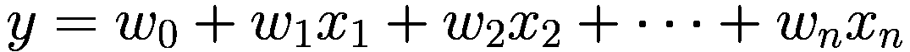

# 3. 使用 Pandas、Scikit-Learn 和 PySpark 进行多元线性回归

本章演示了如何在 Scikit-Learn 和 PySpark 中构建、训练、评估和使用多元线性回归模型。它展示了机器学习所涉及的步骤，包括数据拆分、模型训练、模型评估和预测，在这两个框架中都是相同的。此外，Pandas 和 PySpark 在数据处理方面具有相似的方法，这简化了诸如数据探索之类的任务。

这些相似性有助于数据科学家从 Pandas 和 Scikit-Learn 等内存数据处理工具切换到 PySpark，后者专为跨多台机器进行大数据集的分布式处理而设计。然而，重要的是要注意到，这些通用的相似性并不能覆盖每个工具的独特细微差别。本章的另一个目标是解释这些差异。

在执行 PySpark 时，有多种方法可供选择。代码可以在集群环境中执行，例如 Apache Hadoop YARN、Apache Mesos 或 Kubernetes。此外，它还可以在云环境中运行，例如 Amazon Web Services (AWS)、Google Cloud Platform (GCP) 或 Microsoft Azure。PySpark 代码也可以使用 Docker 等技术进行容器化，并在容器编排平台（如 Kubernetes）上执行。此外，用户可以选择使用 Jupyter notebook 以交互方式编写和运行 PySpark 代码。像 PyCharm、IntelliJ IDEA 和 Visual Studio Code 这样的集成开发环境 (IDE) 也支持 PySpark 开发，使用户能够在这些环境中编写和运行代码。或者，Databricks 提供了一个统一的分析平台，简化了 Spark 和 PySpark 应用程序的部署。该平台提供了一个集成的工作空间，可满足数据工程、数据科学和机器学习的需求。

就本书而言，如前一章所述，测试代码的两种最简单的方法是：注册一个在线 Databricks Community Edition 帐户并创建工作空间，或者通过 Google Colab。这两个平台默认都提供 PySpark。在 Google Colab 上，可以通过 `!pip install pyspark` 命令进行安装。PySpark 代码也可以通过使用相同的命令在本地机器上安装 PySpark 来本地运行。

## 数据集

我们项目的第一步是生成一些数据，以演示如何使用 Pandas 和 PySpark 进行数据探索，接着使用 Scikit-Learn 和 PySpark 进行多元线性回归的机器学习。

以下代码为 Scikit-Learn 生成了这些数据：

```
[In]: import pandas as pd
[In]: from sklearn.datasets import make_regression
[In]: X, y = make_regression(n_samples=100, n_features=2, noise=10, random_state=42)
[In]: pandas_df = pd.DataFrame({'Feature 1': X[:, 0], 'Feature 2': X[:, 1], 'Target': y})
```

这段代码使用 Scikit-Learn 的 `make_regression` 函数生成了包含两个特征和随机噪声的回归数据。`n_samples` 参数指定样本数量，`n_features` 指定特征数量，`noise` 控制添加到数据中的随机噪声量，而 `random_state` 则确保结果可重现。

生成的特征存储在变量 `X` 中，对应的目标变量存储在变量 `y` 中。代码将 NumPy 数组 `X` 和 `y` 转换为名为 `pandas_df` 的 Pandas DataFrame。这是通过一个字典构建的，其中键是列名（Feature 1、Feature 2、Target），值则从 `X` 和 `y` 数组中提取。`X[:, 0]` 代表 `X` 的第一列，`X[:, 1]` 代表第二列，`y` 代表目标值。`X` 中的值被分配到对应的 Feature 1 和 Feature 2 列，而 `y` 中的值则被分配到 Target 列。

让我们用 PySpark 做同样的事情：

```
[In]: from pyspark.sql import SparkSession
[In]: spark = SparkSession.builder.appName("PySparkRegressionData").getOrCreate()
[In]: spark_df = [(float(X[i, 0]), float(X[i, 1]), float(y[i])) for i in range(len(X))]
[In]: spark_df = spark.createDataFrame(spark_df, ["Feature 1", "Feature 2", "Target"])
```

为了在 PySpark 环境中处理数据，代码将之前生成的 NumPy 数组 `X` 和 `y` 转换为 PySpark DataFrame。DataFrame 的每一行都创建为一个元组，其中特征值和目标值被转换为浮点数并包含在元组中。循环遍历 `X` 的长度范围，确保为对应的特征值和目标值创建每一行。名为 `spark_df` 的 PySpark DataFrame 创建时包含相同的三列：Feature 1、Feature 2 和 Target。

以下是对代码的逐行分解。

第一行导入了 `SparkSession` 类，这是在 Spark 中处理结构化数据的入口点，用于创建 DataFrame。第二行初始化了一个名为“PySparkRegressionData”的 SparkSession。`SparkSession.builder` 创建一个构建器对象，`getOrCreate()` 要么检索现有的 SparkSession，要么在不存在时创建一个新的。第三行将 NumPy 数组 `X` 和 `y` 转换为元组列表。每个元组以 (Feature 1, Feature 2, Target) 的形式表示一行数据。这些值使用 `float()` 函数转换为浮点数。最后一行使用 `spark` 对象（SparkSession）的 `createDataFrame()` 方法将元组列表转换为名为 `spark_df` 的 PySpark DataFrame。第一个参数是 `spark_df`，第二个参数是列名列表 [Feature 1, Feature 2, Target]。

现在，让我们开始检查每个 DataFrame 的前五行，作为探索性数据分析的第一步。Pandas 中的 `head(n)` 方法和 PySpark 中的 `show(n)` 方法用于显示 DataFrame 的前 `n` 行。默认情况下，Pandas 中 `n=5`，PySpark 中 `n=20`。我们指定了前五行以覆盖默认值。

在 Pandas 中，使用 `head()` 方法：

|    | Feature 1 | Feature 2 | Target |
|----|-----------|-----------|--------|
| 0  | -1.19     | 0.66      | -49.27 |
| 1  | 0.06      | -1.14     | -85.16 |
| 2  | 0.59      | 2.19      | 211.23 |
| 3  | 0.47      | -0.07     | 29.20  |
| 4  | 0.74      | 0.17      | 84.35  |

```
[In]: pandas_df.head()
[Out]:
```

在 PySpark 中，使用 `show()` 方法显示相同的五行：

| Feature 1 | Feature 2 | Target |
|-----------|-----------|--------|
| -1.19     | 0.66      | -49.27 |
| 0.06      | -1.14     | -85.16 |
| 0.59      | 2.19      | 211.23 |
| 0.47      | -0.07     | 29.20  |
| 0.74      | 0.17      | 84.35  |

```
[In]: spark_df.show(5)
[Out]:
```

我们可以看到每个 DataFrame 都有三列：Feature 1、Feature 2 和 Target。我们可以使用 Pandas 和 PySpark 进一步研究数据，以了解它们的比较情况。我们可以按如下方式检查数据集的形状：

在 Pandas 中，使用 `shape` 属性：

```
[In]: print(pandas_df.shape)
[Out]: (100, 3)
```

PySpark 没有 `shape` 属性，但我们可以通过结合使用 `count()` 和 `len()` 方法来完成相同的任务：

```
[In]: print((spark_df.count(), len(spark_df.columns)))
[Out]: (100, 3)
```

在 Pandas 和 PySpark 中，输出都是一个包含 DataFrame 行数和列数的元组。我们可以看到每个 DataFrame 都有 100 行和 3 列。

# 探索 Pandas 与 PySpark：数据类型、列与摘要统计

我们可以调用 Pandas 和 PySpark 中的 `dtypes` 属性来检查数据集中每列的数据类型。

在 Pandas 中：

```
[In]: print(pandas_df.dtypes)
[Out]:
Feature 1    float64
Feature 2    float64
Target       float64
dtype: object
```

我们可以看到所有列都是十进制类型（`float64`）。在 PySpark 中，等效的数据类型是 `double`，如下代码输出所示：

```
[In]: print(spark_df.dtypes)
[Out]: [('Feature 1', 'double'), ('Feature 2', 'double'), ('Target', 'double')]
```

我们可以调用 `columns` 属性来返回 DataFrame 中每列的名称。

在 Pandas 中：

```
[In]: print(pandas_df.columns)
[Out]: Index(['Feature 1', 'Feature 2', 'Target'], dtype='object')
```

输出是一个 `Index` 对象，包含三个标签或列名，顺序如下：Feature 1、Feature 2 和 Target。`Index` 对象是 Pandas DataFrame 的重要组成部分，因为它允许使用标签作为参考来选择特定的数据行或列。

例如，我们可以通过调用 `pandas_df['Feature 1']` 来选择 Feature 1 列。我们也可以通过向 DataFrame 传递一个标签列表来选择多列：`pandas_df[['Feature 1', 'Feature 2']]`。

在 PySpark 中：

```
[In]: print(spark_df.columns)
[Out]: ['Feature 1', 'Feature 2', 'Target']
```

PySpark 的输出中没有索引，只有三个标签或列的数组。PySpark 不像 Pandas 那样使用索引的概念，因为 PySpark 旨在处理跨多台机器的分布式计算，而 Pandas 则设计用于单台机器上的内存数据处理。在 PySpark 中，数据通常以分布式方式存储在多台机器上，并且计算在这些机器上并行执行。这使得索引概念在 PySpark 中效率较低，因为在处理跨多台机器分布的大型数据集时，索引可能导致瓶颈。

PySpark 不使用索引，而是使用分区概念将数据划分为多个分区，这些分区可以在多台机器上并行处理。分区可以基于各种标准进行，例如范围分区、哈希分区或自定义分区。分区使 PySpark 在处理大型数据集时能够实现高性能和可扩展性，同时最大限度地减少索引开销的影响。

Pandas 中的 `info()` 方法可用于提供 `pandas_df` 的摘要，包括其形状、列数据类型以及每列中非空值的数量：

```
[In]: pandas_df.info()
[Out]:

RangeIndex: 100 entries, 0 to 99
Data columns (total 3 columns):

#   Column     Non-Null Count  Dtype
---  ------     --------------  -----
0   Feature 1  100 non-null    float64
1   Feature 2  100 non-null    float64
2   Target     100 non-null    float64
dtypes: float64(3)
```

共有 3 列和 100 个实例，所有列都是十进制数据类型，并且都不包含空值。

在 PySpark 中，我们可以使用 `printSchema()` 方法实现类似的功能，其中 `double` 数据类型等同于 Pandas 的 `float64`：

```
[In]: spark_df.printSchema()
[Out]:
root
|-- Feature 1: double (nullable = true)
|-- Feature 2: double (nullable = true)
|-- Target: double (nullable = true)
```

我们可以使用 Pandas 中的 `describe()` 函数生成一些汇总统计信息：

|       | Feature 1 | Feature 2 | Target |
|-------|-----------|-----------|--------|
| 计数   | 100.00    | 100.00    | 100.00 |
| 均值   | -0.12     | 0.03      | -7.20  |
| 标准差 | 0.86      | 1.00      | 106.64 |
| 最小值 | -2.62     | -1.99     | -201.72|
| 25%    | -0.78     | -0.71     | -84.39 |
| 50%    | -0.04     | 0.11      | -17.45 |
| 75%    | 0.34      | 0.66      | 70.90  |
| 最大值 | 1.89      | 2.72      | 211.23 |

```
[In]: pandas_df.describe()
[Out]:
```

输出结果包括每个数值列的计数、均值、标准差（衡量数值离散程度的指标）、最小值和最大值。此外，还包含 25%、50% 和 75% 分位数（通常分别称为第一四分位数、中位数和第三四分位数）。每个分位数表示低于该值的观测值所占的百分比。例如，Feature 1 中 75% 的值低于 0.34。

在 PySpark 中，我们可以使用 `summary()` 方法提供类似的功能：

| 汇总统计 | Feature 1 | Feature 2 | Target |
|----------|-----------|-----------|--------|
| 计数     | 100.00    | 100.00    | 100.00 |
| 均值     | -0.12     | 0.03      | -7.20  |
| 标准差   | 0.86      | 1.00      | 106.64 |
| 最小值   | -2.62     | -1.99     | -201.72|
| 25%      | -0.78     | -0.71     | -84.39 |
| 50%      | -0.04     | 0.11      | -17.45 |
| 75%      | 0.34      | 0.66      | 70.90  |
| 最大值   | 1.89      | 2.72      | 211.23 |

```
[In]: spark_df.summary().show()
[Out]:
```

PySpark 也提供了与 Pandas 类似的 `describe()` 方法，但其输出仅包含每个数值列的计数、均值、标准差、最小值和最大值。而 PySpark 的 `summary()` 函数则显示所有汇总统计信息，包括分位数。

## 多元线性回归

现在我们已经生成了一些数据，接下来可以演示如何使用 Scikit-Learn 和 PySpark 执行多元线性回归。我们将使用上一节生成的同一数据集来构建、训练和评估一个多元线性回归模型。目标是通过将线性方程拟合到数据，来建模预测变量（Feature 1、Feature 2）与响应变量（Target）之间的关系。

不过，在重点介绍 Scikit-Learn 和 PySpark 的主要相似之处之前，让我们先简要回顾一些理论知识。

### 理论

线性回归属于监督学习的范畴。在这种学习类型中，算法在带标签的数据集上进行训练。带标签的数据集由输入特征及其对应的输出标签组成。算法学习将输入特征映射到输出标签，然后利用这种映射关系对新的、未见过的数据进行预测。

在多元线性回归中，目标是通过将线性方程拟合到观测数据，来建模两个或多个自变量（预测变量）与一个因变量（响应变量）之间的关系。它是简单线性回归的扩展，简单线性回归涉及对单个自变量与因变量之间的关系进行建模。

多元线性回归线的方程形式如下：



其中，`y` 是因变量，`x[1]`、`x[2]`、...、`x[n]` 是自变量，`w[0]` 是截距，`w[1]`、`w[2]`、...、`w[n]` 是回归系数（或权重），表示在其他自变量保持不变的情况下，对应自变量每变化一个单位时因变量的变化量。

多元线性回归的目标是估计回归系数的值，使得因变量的观测值与基于自变量预测的因变量值之间的平方差之和最小。

# Scikit-Learn/PySpark 相似之处

Scikit-Learn 和 PySpark 都遵循相同的建模步骤：数据准备、训练和评估模型，以及使用新的、未见过的数据预测目标变量。

以下是 Scikit-Learn 中的关键机器学习函数及其在 PySpark 中的对应项。

1.  数据准备：
    - Scikit-Learn：函数包括用于将数据拆分为训练集和测试集的 `train_test_split`、用于特征缩放的 `StandardScaler`、用于对分类变量进行独热编码的 `OneHotEncoder`，以及用于处理缺失值的 `SimpleImputer`。
    - PySpark：对 Spark DataFrame 的操作，例如用于拆分数据的 `randomSplit`、用于特征缩放的 `StandardScaler`、用于对分类变量进行独热编码的 `OneHotEncoder`，以及用于处理缺失值的 `Imputer`。此外，`VectorAssembler` 用于将多个特征列合并为单个向量列。

2.  模型训练：
    - Scikit-Learn：模型具有用于训练的 `fit()` 方法，您需要将特征（`X_train`）和目标变量（`y_train`）作为输入提供。
    - PySpark：模型同样具有 `fit()` 方法，您需要提供一个包含特征和目标变量列的 DataFrame（`train_data`）。在训练模型之前，需要使用 `VectorAssembler` 步骤将特征列合并为单个向量列。

3.  模型评估：
    - Scikit-Learn：提供各种评估指标，例如用于回归的 `mean_squared_error` 和 `r2_score`。这些指标直接应用于预测值和实际目标变量值（`y_pred`、`y_test`）。
    - PySpark：可以使用 `RegressionEvaluator` 计算评估指标，例如回归任务的均方误差。这些评估器需要指定预测值和实际值（`predictions`、`y_test`）以及相应的列。

4.  预测：
    - Scikit-Learn：模型具有用于对新数据生成预测的 `predict()` 方法，您需要提供特征（`X_test`）并获得预测的目标变量值（`y_pred`）。
    - PySpark：模型具有用于对新数据生成预测的 `transform()` 方法，您需要提供一个包含特征的 DataFrame（`test_data`），并在新列（`prediction`）中获得预测值。在进行预测之前，需要使用 `VectorAssembler` 步骤，以确保新数据具有相同的特征向量结构。

现在，让我们编写一些代码，将这些描述性步骤付诸实践，首先从 Scikit-Learn 开始。

## 使用 Scikit-Learn 进行多元线性回归

在 Scikit-Learn 中构建、训练和评估多元线性回归模型的第一步是导入必要的库。

步骤 1：导入必要的库

```
[In]: from sklearn.datasets import make_regression
[In]: from sklearn.model_selection import train_test_split
[In]: from sklearn.linear_model import LinearRegression
[In]: from sklearn.metrics import mean_squared_error, r2_score
```

步骤 2：生成数据

```
[In]: X, y = make_regression(n_samples=100, n_features=2, noise=10, random_state=42)
```

步骤 3：将数据拆分为训练集和测试集

```
[In]: X_train, X_test, y_train, y_test = train_test_split(X, y, test_size=0.2, random_state=42)
```

步骤 4：训练模型

```
[In]: model = LinearRegression()
[In]: model.fit(X_train, y_train)
```

步骤 5：对测试数据进行预测

```
[In]: y_pred = model.predict(X_test)
```

步骤 6：通过计算 MSE 和 r2 来评估模型

```
[In]: mse = mean_squared_error(y_test, y_pred)
[In]: r2 = r2_score(y_test, y_pred)
```

让我们逐行分解代码：

步骤 1：导入必要的库

该代码从 sklearn 库中导入实现机器学习算法所需的特定模块：

- `make_regression`：此函数生成用于测试模型的回归数据。
- `train_test_split`：此函数将数据拆分为训练集和测试集。
- `LinearRegression`：此类是一个线性回归模型。
- `mean_squared_error`，`r2_score`：这些函数用于评估回归模型的性能。

步骤 2：生成数据

此代码使用 `make_regression` 函数为多元线性回归模型生成一个模拟数据集。它创建了一个包含 100 个样本和 2 个特征的数据集，并向数据中添加了一些随机噪声以模拟真实场景。随机状态设置为 42 以确保结果可重现。

步骤 3：数据准备

此步骤涉及将数据拆分为训练集和测试集。该代码将数据集拆分为训练集和测试集，其中 80% 的数据用于训练（`X_train` 和 `y_train`），20% 用于测试（`X_test` 和 `y_test`）。

步骤 4：模型训练

该代码使用训练数据创建并训练一个线性回归模型。它首先创建一个 `LinearRegression` 模型的实例，然后使用 `fit()` 方法使用训练数据训练模型。

我们可以按如下方式打印模型的系数和截距：

```
[In]: print("Coefficients:", model.coef_)
[In]: print("Intercept:", model.intercept_)
[Out]: Coefficients: [86.31 73.67], Intercept: 0.066
```

系数是模型中分配给每个特征的权重。在此示例中，有两个特征 [特征 1, 特征 2]，对应的系数分别为 [86.31, 73.67]。这些系数表示每个特征对目标变量的估计影响或重要性。正系数表示特征值的增加会导致预测输出增加，而负系数则表示反比关系。

截距表示线性回归模型的偏置项。截距是一个额外的常数项，被添加到特征的加权和中。它表示当所有特征为零或没有影响时，目标变量的期望值或平均值。在这种情况下，截距为 0.066，这意味着当所有特征值都为零时，模型预测的输出值约为 0.066。

步骤 5：预测

使用训练好的模型对测试数据进行预测。它使用 `predict()` 方法根据输入（`X_test`）预测输出（`y`）。

我们可以通过打印前五行来并排比较实际值和预测值，如下所示：

| 实际值 | 预测值 |
| --- | --- |
| -49.72 | -56.82 |
| 4.15 | -0.48 |
| 82.05 | 84.59 |
| -34.16 | -20.40 |
| 69.78 | 66.99 |

```
[In]: print("Actual\tPredicted")
[In]: for i in range(5):
print(y_test[i], "\t", y_pred[i])
[Out]:
```

我们可以看到实际值和预测值之间存在差异。例如，第一个观测值表明模型的预测值低于实际值，因为 -56.82 小于 -49.72。然而，仅凭五个数据点的样本并不能全面评估模型的整体性能。为了评估模型的质量，我们需要计算诸如均方误差（MSE）和 R 平方之类的评估指标。

步骤 6：评估

该代码使用均方误差（MSE）和 R 平方来评估模型的性能。它计算预测值（`y_pred`）与真实值（`y_test`）之间的 MSE 以及 R 平方值，后者衡量线性回归模型对数据的拟合程度。

我们可以使用内置的 `print()` 函数打印结果，如下所示：

```
[In]: print("Mean Squared Error (MSE):", mse)
[In]: print("R-squared:", r2)
[Out]: Mean Squared Error (MSE): 154.63, R-squared: 0.98
```

MSE 衡量预测值与目标变量实际值之间的平均平方差。它量化了模型预测的整体准确性，值越低表示性能越好。在我们的案例中，MSE 为 154.63 意味着预测值与实际值之间的平方差平均为 154.63。

R 平方，也称为决定系数，是一个统计度量，表示模型中自变量（特征）可以解释的因变量（目标变量）方差的比例。其取值范围从 0 到 1，值越高表示模型对数据的拟合程度越好。R 平方为 0.98 意味着因变量中大约 98% 的方差可以由模型中的自变量解释。

虽然获得的MSE为154.63和R平方为0.98提供了对模型性能的初步了解，但需要注意的是，这些值是基于随机生成的数据。现实世界的场景通常涉及更复杂和多样化的数据集。因此，微调模型并在真实且有代表性的数据上验证其性能变得至关重要。微调过程可能涉及调整模型超参数（在第16章中详细解释）、优化特征选择以及应用正则化技术。

为了便于说明，假设我们对这个模型的性能感到满意。接下来应该做什么？下一步将是利用训练好的模型对新的、未见过的数据进行预测。

我们可以使用以下代码来演示这一点：

```python
[In]: new_data = [[1.0, 2.0], [3.0, 4.0], [5.0, 6.0]]
[In]: new_predictions = model.predict(new_data)
[In]: print(new_predictions)
[Out]: [233.71 553.67 873.63]
```

`new_data`变量表示我们希望获得预测的输入特征值列表。`new_data`中的每个内部列表对应一组不同的输入特征。在我们的示例中，有三组输入特征：`[1.0, 2.0]`、`[3.0, 4.0]`和`[5.0, 6.0]`。

通过调用`predict()`方法，我们将`new_data`传递给训练好的模型，以获得每组输入特征的预测值。得到的预测值`[233.71, 553.67, 873.63]`存储在`new_predictions`变量中，然后使用`print()`函数打印到屏幕上。

### 使用PySpark进行多元线性回归

现在，我们来演示如何将数据准备、模型训练、模型评估和预测步骤转换为PySpark代码，以利用分布式计算。与Scikit-Learn类似，我们在PySpark中的起点仍然是导入必要的库。

#### 步骤1：导入必要的库

```python
[In]: from sklearn.datasets import make_regression
[In]: from pyspark.ml.regression import LinearRegression
[In]: from pyspark.ml.evaluation import RegressionEvaluator
[In]: from pyspark.ml.feature import VectorAssembler
[In]: from pyspark.sql import SparkSession
```

#### 步骤2：初始化SparkSession

```python
[In]: spark = SparkSession.builder.appName("RegressionExample").getOrCreate()
```

#### 步骤3：生成数据

```python
[In]: X, y = make_regression(n_samples=100, n_features=2, noise=10, random_state=42)
[In]: data = [(float(X[i, 0]), float(X[i, 1]), float(y[i])) for i in range(len(X))]
[In]: data = spark.createDataFrame(data, ["Feature 1", "Feature 2", "Target"])
```

#### 步骤4：将数据拆分为训练集和测试集

```python
[In]: train_data, test_data = data.randomSplit([0.8, 0.2], seed=42)
```

#### 步骤5：将特征合并为单个向量列

```python
[In]: assembler = VectorAssembler(inputCols=["Feature 1", "Feature 2"], outputCol="features")
[In]: train_data = assembler.transform(train_data)
[In]: test_data = assembler.transform(test_data)
```

#### 步骤6：训练模型

```python
[In]: lr = LinearRegression(featuresCol="features", labelCol="Target")
[In]: model = lr.fit(train_data)
```

#### 步骤7：对测试数据进行预测

```python
[In]: predictions = model.transform(test_data)
```

#### 步骤8：使用MSE和r2评估模型

```python
[In]: evaluator = RegressionEvaluator(labelCol="Target", predictionCol="prediction", metricName="mse")
[In]: mse = evaluator.evaluate(predictions)
[In]: r2 = model.summary.r2
```

让我们逐行深入分析代码：

#### 步骤1：导入必要的库

以下是导入的类、函数及其在建模过程中的作用：
- `make_regression`：此函数用于生成用于测试的模拟回归数据。
- `LinearRegression`：此类表示PySpark中的线性回归模型。
- `RegressionEvaluator`：此类用于评估模型的性能。
- `VectorAssembler`：此类用于将输入特征组装成单个向量列。
- `SparkSession`：此类用于创建`SparkSession`，这是在PySpark中使用DataFrame的入口点。

#### 步骤2：初始化SparkSession

此步骤中的代码建立了一个名为“RegressionExample”的`SparkSession`。`SparkSession`对于与Spark交互至关重要，尽管此要求因所使用的平台而异。例如，在使用Databricks笔记本时，`SparkSession`会自动创建和初始化。因此，我们可以直接使用“spark”对象与Spark功能交互、执行查询、生成DataFrame以及使用各种Spark库。

#### 步骤3：生成数据

此步骤已在“数据集”部分详细解释。代码使用`make_regression`函数生成模拟回归数据。它创建了一个二维特征矩阵`X`和一个目标变量`y`。代码通过创建元组列表并指定列名为`[Feature 1, Feature 2, Target]`，将NumPy数组`X`和`y`转换为Spark DataFrame `data`。

#### 步骤4：将数据拆分为训练集和测试集

代码将数据DataFrame按80:20的比例随机拆分为训练DataFrame和测试DataFrame。使用了`randomSplit`方法，并将种子设置为42以确保结果可重现。

#### 步骤5：将特征合并为单个向量列

此步骤中的第一行代码创建了一个`VectorAssembler`对象，指定输入列为`[Feature 1, Feature 2]`，输出列名为`features`。接下来的两行通过应用`assembler`将输入特征合并到名为`features`的单个向量列中，从而转换训练和测试DataFrame。
在PySpark中，需要`VectorAssembler`步骤将单个输入特征转换为单个向量列。这是因为PySpark的机器学习算法期望输入数据采用特定格式，即所有特征都合并到一个向量列中。此`VectorAssembler`步骤有助于简化工作流程，并在PySpark中不同的机器学习任务之间保持数据表示的一致性。
相比之下，Scikit-Learn不需要单独的步骤来合并特征，因为它接受不同格式的输入数据。Scikit-Learn的机器学习算法通常使用NumPy数组或Pandas DataFrame，其中每个特征由单独的列表示。
让我们打印`train_data`的前五行，看看数据的样子：

| Feature 1 | Feature 2 | Target | Features |
| --- | --- | --- | --- |
| -1.92 | -0.03 | -177.39 | [-1.92,-0.03] |
| -1.19 | 0.66 | -49.27 | [-1.19,0.66] |
| -0.89 | -0.82 | -132.59 | [-0.89,-0.82] |
| -0.45 | 0.86 | 27.34 | [-0.45,0.86] |
| 0.06 | -1.14 | -85.16 | [0.06,-1.14] |

```python
[In]: train_data.show(5)
[Out]:
```

从 Features 列可以看出，Feature 1 和 Feature 2 的值（例如，分别为 -1.92 和 -0.03）已使用 `VectorAssembler` 合并到数值向量 [-1.92, -0.03] 中。这种转换允许机器学习模型将输入特征作为一个整体进行解释和处理。

## 步骤 6：训练模型

此步骤中的代码创建了一个 `LinearRegression` 对象，指定输入特征列为 `features`，标签列为 `Target`。它使用 `fit()` 方法在训练数据 (`train_data`) 上拟合线性回归模型。

我们可以使用以下代码打印回归模型的估计系数和截距：

```
[In]: print("Coefficients: ", model.coefficients)
[In]: print("Intercept: ", model.intercept)
[Out]: Coefficients: [86.03,73.24], Intercept: -0.33
```

输出表示训练好的线性回归模型的系数和截距。系数表示回归模型中分配给每个特征的权重，进而表示每个特征对目标变量的影响或重要性。第一个系数 86.03 对应于 Feature 1，第二个系数 73.24 对应于 Feature 2。

截距，也称为偏置项，是添加到回归模型中的一个额外常数项。它表示当所有特征值都为零时，目标变量的期望值。在此示例中，截距为 -0.33。

这些系数和截距是线性回归模型学习到的参数。它们表示特征与目标变量之间的关系，使模型能够根据新的输入数据进行预测。下一步将解释此预测步骤。

## 步骤 7：对测试数据进行预测

此步骤中的代码将训练好的模型应用于测试数据 (`test_data`) 以进行预测。`transform` 方法向 DataFrame `predictions` 添加一个包含预测值的 `prediction` 列。

我们可以按如下方式打印实际值和预测值的前五行：

| Target | prediction |
| --- | --- |
| -192.19 | -183.11 |
| 29.20 | 35.05 |
| -14.49 | -9.28 |
| -62.52 | -57.03 |
| -51.66 | -37.62 |

```
[In]: actual_vs_pred = predictions.select("Target", "prediction")
[In]: actual_vs_pred.show(5)
[Out]:
```

从上述输出中我们可以观察到，实际目标值与预测值之间存在差异，且多数差异相当显著。然而，为了更深入地理解模型性能，我们需要关注诸如 `MSE` 和 `r2` 等指标，这些指标利用了全部样本数据。

## 步骤 8：评估模型

此步骤创建了一个 `RegressionEvaluator` 对象，指定标签列为 `Target`，预测列为 `prediction`，评估指标为 `mse`（均方误差）。该对象计算了预测 DataFrame 中预测值与实际值之间的均方误差（MSE）。代码还从模型摘要中获取了 R 平方值。变量 `r2` 将存储 R 平方值，该值代表了模型的拟合优度。

我们可以按如下方式打印 MSE 和 R 平方值：

```
[In]: print("均方误差 (MSE):", mse)
[In]: print("R 平方:", r2)
[Out]: 均方误差 (MSE): 154.63, R 平方: 0.99
```

输出包含线性回归模型的两个评估指标：

1.  MSE 衡量的是预测值与实际值之间平均平方差的大小。在本例中，MSE 为 154.63，这表明预测值与实际值之间的平均平方差为 154.63。MSE 越低，表示模型性能越好，因为它意味着预测值与实际值之间的平均平方差更小。

2.  R 平方值，也称为决定系数，衡量的是目标变量中能够被线性回归模型解释的方差比例。在本例中，R 平方值为 0.99，表明目标变量中约 99%的方差可由线性回归模型解释。R 平方值越高，表示模型对数据的拟合程度越好。

假设我们对模型感到满意，现在就可以用它来基于新数据预测目标变量：

| 特征 1 | 特征 2 | 特征向量 | 预测值 |
| --- | --- | --- | --- |
| 1 | 2 | [1,2] | 232.18 |
| 3 | 4 | [3,4] | 550.72 |
| 5 | 6 | [5,6] | 869.26 |

```
[In]: new_data = [(1.0, 2.0), (3.0, 4.0), (5.0, 6.0)]
[In]: new_data = spark.createDataFrame(new_data, ["特征 1", "特征 2"])
[In]: new_data = assembler.transform(new_data)
[In]: new_predictions = model.transform(new_data)
[In]: new_predictions.show()
[Out]:
```

将模型应用于新数据的步骤如下：

1.  将表示为 Python 元组列表的新数据点转换为名为 `new_data` 的 PySpark DataFrame。该 DataFrame 包含两列，分别命名为 `特征 1` 和 `特征 2`。

2.  对 `new_data` DataFrame 应用 `VectorAssembler`，将各个特征列转换为名为 `features` 的单一向量列。此步骤使新数据与训练数据具有相同的结构。

3.  使用 `transform()` 方法将训练好的模型应用于 `new_data` DataFrame。该方法基于 `features` 列中的特征生成目标变量的预测值。

4.  使用 `show()` 方法显示 `new_predictions` DataFrame，该 DataFrame 包含新数据点的预测值，以及各个特征和组装后的特征向量。

# 总结

在本章中，我们演示了如何在 Scikit-Learn 和 PySpark 中构建、训练和评估多元线性回归模型，并使用它对新的数据进行预测。我们阐明了机器学习的各个阶段，包括数据准备、模型训练、评估和预测，在这两个框架中是一致的。此外，Pandas 和 PySpark 在数据操作方面表现出类似的方法论，有助于执行数据探索等任务。

这些相似性为希望从 Pandas 和 Scikit-Learn 等内存数据处理工具过渡到 PySpark 的数据科学家提供了帮助，PySpark 是专门为跨多台机器进行大规模数据集的分布式处理而设计的。然而，重要的是要认识到，本章讨论的这些通用相似性并不会削弱每个工具固有的独特细微差别。