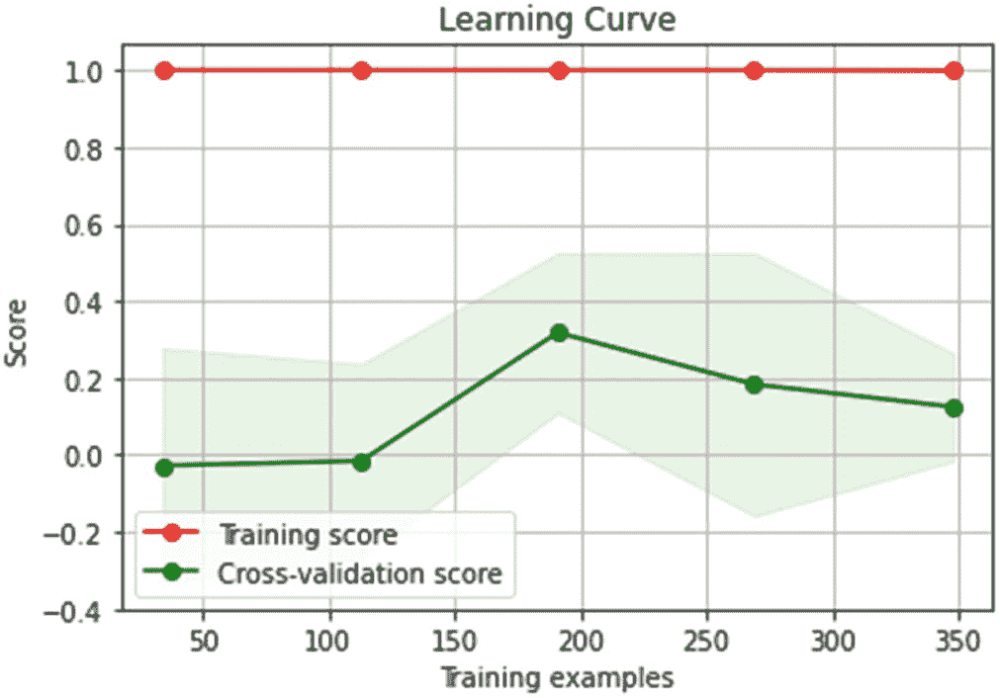

# 4. 使用 Pandas、Scikit-Learn 和 PySpark 进行决策树回归

在本章中，我们将继续探索监督学习，重点关注回归任务。具体来说，我们将使用决策树算法构建一个回归模型——这是上一章中使用的多元线性回归模型的一种替代方案。我们将同时使用 Scikit-Learn 和 PySpark 来训练和评估模型，然后使用它根据房产面积、卧室数量、浴室数量、楼层数等多个特征来预测房屋的销售价格。此外，我们还将比较 Pandas 和 PySpark 在数据加载和探索任务中的性能，以更好地理解它们的异同。

在本章结束时，我们的目标是让读者更深入地理解这些工具固有的细微差别，以及它们如何处理数据处理、模型训练和评估。虽然这些工具有相似之处，但每个工具都有其独特的微妙之处。本章将帮助数据科学家更好地理解和驾驭这些区别。最终目标是促进那些习惯于 Pandas 和 Scikit-Learn 等小数据工具的用户更平滑地过渡到使用 PySpark 进行大数据处理和机器学习，从而受益于分布式计算。

我们将使用一个从 Kaggle 网站获取的开源数据集。正如我们在上一章中所做的那样，我们将首先读取数据集，然后深入研究它，以更好地理解特征和目标变量。

## 数据集

我们在 Scikit-Learn 和 PySpark 中用于训练和评估决策树回归模型的数据集，通常被称为房价数据集。该数据集包含 545 条记录和 12 个特征，每条记录代表一所房屋，目标变量表示其价格。特征代表了房屋的属性，包括其总面积、卧室数量、浴室数量、楼层数和停车位数量，以及房屋是否连接主干道、是否有客房、地下室、热水供暖系统和空调系统，是否位于优选区域，以及是精装修、半装修还是毛坯房。

该数据集可在 Kaggle 上公开获取。此处提供了贡献者姓名、大致上传日期、数据集名称、网站名称以及我们下载 CSV 文件副本的 URL：

标题：房价数据集

网站：Kaggle

URL：`www.kaggle.com/datasets/yasserh/housing-prices-dataset`

贡献者：Yasser H.

日期：2021

与我们在前一章中所做的类似，我们首先定义一个 Python 函数，使用 Pandas 的 `read_csv()` 函数从 CSV 文件加载数据：

```
[In]: import pandas as pd
[In]: def load_housing_data():
         url = ('https://raw.githubusercontent.com/abdelaziztestas/'
                'spark_book/main/housing.csv')
         return pd.read_csv(url)
```

然后，我们通过调用 `load_housing_data()` 函数创建一个 Pandas DataFrame：

```
[In]: pandas_df = load_housing_data()
```

下一步，我们使用 PySpark 的 `createDataFrame()` 方法将 `pandas_df` DataFrame 转换为名为 `spark_df` 的 PySpark DataFrame：

```
[In]: from pyspark.sql import SparkSession
[In]: spark = SparkSession.builder.appName("housing_data").getOrCreate()
[In]: spark_df = spark.createDataFrame(pandas_df)
```

为了查看 `pandas_df` DataFrame 的前五行，我们使用 `head()` 方法。由于表格尺寸较大，为了增强可读性，我们将输出拆分为两个独立的表格。这使我们能够更清晰地呈现数据，而不会让单个页面显得过于拥挤。

|    | basement      | hotwaterheating | airconditioning | parking | prefarea | furnishingstatus |
|---|---|---|---|---|---|---|
| 0 | no            | no              | yes             | 2       | yes      | furnished        |
| 1 | no            | no              | yes             | 3       | no       | furnished        |
| 2 | yes           | no              | no              | 2       | yes      | semi-furnished   |
| 3 | yes           | no              | yes             | 3       | yes      | furnished        |
| 4 | yes           | no              | yes             | 2       | no       | furnished        |

|    | price    | area  | bedrooms | bathrooms | stories | mainroad | guestroom |
|---|---|---|---|---|---|---|---|
| 0 | 13300000 | 7420  | 4        | 2         | 3       | yes      | no        |
| 1 | 12250000 | 8960  | 4        | 4         | 4       | yes      | no        |
| 2 | 12250000 | 9960  | 3        | 2         | 2       | yes      | no        |
| 3 | 12215000 | 7500  | 4        | 2         | 2       | yes      | no        |
| 4 | 11410000 | 7420  | 4        | 1         | 2       | yes      | yes       |

```
[In]: pandas_df.head()
[Out]:
```

我们可以在 PySpark 中使用 `show()` 方法执行相同操作：

| basement      | hotwaterheating | airconditioning | parking | prefarea | furnishingstatus |
|---|---|---|---|---|---|
| no            | no              | yes             | 2       | yes      | furnished        |
| no            | no              | yes             | 3       | no       | furnished        |
| yes           | no              | no              | 2       | yes      | semi-furnished   |
| yes           | no              | yes             | 3       | yes      | furnished        |
| yes           | no              | yes             | 2       | no       | furnished        |

| price    | area  | bedrooms | bathrooms | stories | mainroad | guestroom |
|---|---|---|---|---|---|---|
| 13300000 | 7420  | 4        | 2         | 3       | yes      | no        |
| 12250000 | 8960  | 4        | 4         | 4       | yes      | no        |
| 12250000 | 9960  | 3        | 2         | 2       | yes      | no        |
| 12215000 | 7500  | 4        | 2         | 2       | yes      | no        |
| 11410000 | 7420  | 4        | 1         | 2       | yes      | yes       |

```
[In]: spark_df.show(5)
[Out]:
```

Pandas 和 PySpark 的输出完全相同，只是 PySpark 不显示索引。我们还可以从输出中看到，每个数据集都包含 13 列或属性，它们代表了房屋的不同方面。这些属性包括销售价格和房屋占地面积（平方英尺）。此外，数据集还指定了每栋房屋的卧室和浴室数量，以及房屋的总楼层数。关于房屋与主干道的连接情况、是否有客房以及是否有地下室的信息，在相应的列中用“是”或“否”表示。此外，数据集还指示了房屋是否配备热水供暖系统和空调，以及可用停车位的数量。房屋的优选位置通过“Prefarea”类别下的“是”或“否”响应来表示。最后，房屋的装修状态被分类为“精装修”、“半装修”或“毛坯房”，提供了对房屋内部配置的洞察。

数据集中的价格是目标变量，而其他特征是预测变量。目标是通过遵循在训练阶段学习到的决策树结构来进行预测。

我们可以使用 Pandas 的 `shape` 属性了解更多关于数据的信息：

```
[In]: print(pandas_df.shape)
[Out]: (545, 13)
```

在 PySpark 中，我们可以使用 `count()` 和 `len()` 函数：

```
[In]: print((spark_df.count(), len(spark_df.columns)))
[Out]: (545, 13)
```

Pandas 和 PySpark 的输出都确认我们有 545 行和 13 列。在 Pandas 中，我们可以使用 `isnull()` 和 `sum()` 方法计算每列中空值的数量：

# Pandas 与 PySpark 数据检查与汇总统计

首先，我们使用 Pandas 来检查数据集中的空值数量。

```python
[In]: pandas_null_counts = pandas_df.isnull().sum()
[In]: print(pandas_null_counts)
[Out]:
price               0
area                0
bedrooms            0
bathrooms           0
stories             0
mainroad            0
guestroom           0
basement            0
hotwaterheating     0
airconditioning     0
parking             0
prefarea            0
furnishingstatus    0
dtype: int64
```

在 PySpark 中，我们可以使用 `isNull()` 和 `sum()` 方法，但方式略有不同。由于 PySpark 的输出是水平的，不像 Pandas 那样在页面内垂直排列，我们将其拆分为两个表格以增强可读性。

| basement | hotwaterheating | airconditioning | parking | prefarea | furnishingstatus |
| --- | --- | --- | --- | --- | --- |
| 0 | 0 | 0 | 0 | 0 | 0 |

| price | area | bedrooms | bathrooms | stories | mainroad | guestroom |
| --- | --- | --- | --- | --- | --- | --- |
| 0 | 0 | 0 | 0 | 0 | 0 | 0 |

对应的代码如下：

```python
[In]: from pyspark.sql.functions import sum, col
[In]: spark_df.select([sum(col(c).isNull().cast("int")).alias(c) for c in spark_df.columns]).show()
[Out]:
```

从 Pandas 和 PySpark 的输出中，我们可以看到空值数量为 0。这是个好消息，因为机器学习算法通常不擅长处理缺失数据。

## 数值变量汇总统计

接下来，我们可以使用 Pandas 的 `describe()` 方法和 PySpark 的 `summary()` 方法来生成数值变量的关键汇总统计信息。

我们从 Pandas 开始：

|   | `price` | `area` | `bedrooms` | `bathrooms` | `stories` | `parking` |
| --- | --- | --- | --- | --- | --- | --- |
| `count` | 545 | 545 | 545 | 545 | 545 | 545 |
| `mean` | 4766729 | 5150.54 | 2.97 | 1.29 | 1.81 | 0.69 |
| `std` | 1870440 | 2170.14 | 0.74 | 0.50 | 0.87 | 0.86 |
| `min` | 1750000 | 1650 | 1 | 1 | 1 | 0 |
| `25%` | 3430000 | 3600 | 2 | 1 | 1 | 0 |
| `50%` | 4340000 | 4600 | 3 | 1 | 2 | 0 |
| `75%` | 5740000 | 6360 | 3 | 2 | 2 | 1 |
| `max` | 13300000 | 16200 | 6 | 4 | 4 | 3 |

```python
[In]: pandas_df.describe()
[Out]:
```

PySpark 不会自动从计算中排除分类变量，而是将它们显示为空。我们可以专门选择数值特征，如下所示：

| 统计量 | 价格 | 面积 | 卧室数 | 浴室数 | 楼层数 | 停车位数 |
| --- | --- | --- | --- | --- | --- | --- |
| `计数` | 545 | 545 | 545 | 545 | 545 | 545 |
| `均值` | 4766729 | 5150.54 | 2.97 | 1.29 | 1.81 | 0.69 |
| `标准差` | 1870440 | 2170.14 | 0.74 | 0.50 | 0.87 | 0.86 |
| `最小值` | 1750000 | 1650 | 1 | 1 | 1 | 0 |
| `25%分位数` | 3430000 | 3600 | 2 | 1 | 1 | 0 |
| `50%分位数` | 4340000 | 4600 | 3 | 1 | 2 | 0 |
| `75%分位数` | 5740000 | 6360 | 3 | 2 | 2 | 1 |
| `最大值` | 13300000 | 16200 | 6 | 4 | 4 | 3 |

```python
[In]: spark_df.select("price", "area", "bedrooms", "bathrooms", "stories", "parking").summary().show()
[Out]:
```

Pandas 和 PySpark 输出的差异仅在于外观。PySpark 的展示包含一个摘要标题，用于指示统计列，而标准差指标表示为 `stddev`，而非 Pandas 中的 `std`。两者都显示了每个数值列的计数、均值、标准差、最小值和最大值，以及 25%、50% 和 75% 分位数（分别也称为第一四分位数、中位数和第三四分位数）。

## 检查分类变量

最后，我们可以使用 `for` 循环检查房屋数据集中的分类变量。为了获得 Pandas 输出，我们使用列名列表遍历分类变量的每一列。对于每一列，我们执行以下操作：

*   我们使用 `pandas` `Series` 的 `unique()` 方法来获取唯一值数组。该方法返回 `pandas` `Series` 中所有唯一值的数组。
*   然后，我们打印列名及其唯一值。

```python
[In]: for col in ['mainroad', 'guestroom', 'basement', 'hotwaterheating', 'airconditioning', 'prefarea', 'furnishingstatus']:
unique_values = pandas_df[col].unique()
print(f"Unique values in {col}: {unique_values}")
[Out]:
Unique values in mainroad: ['yes' 'no']
Unique values in guestroom: ['no' 'yes']
Unique values in basement: ['no' 'yes']
Unique values in hotwaterheating: ['no' 'yes']
Unique values in airconditioning: ['yes' 'no']
Unique values in prefarea: ['yes' 'no']
Unique values in furnishingstatus: ['furnished' 'semi-furnished' 'unfurnished']
```

为了从 `spark_df` `DataFrame` 中提取相同的分类列值，我们使用 `pyspark.sql.functions` 模块中提供的 `col()` 函数。在我们的循环中，每个分类列都会被单独处理，遵循以下步骤：

*   我们通过使用 `select()` 方法创建一个新的 `DataFrame`，仅关注所需的列。
*   然后对选定的列应用 `distinct()` 方法来收集唯一值。
*   通过使用 `collect()` 方法，我们将所有记录作为 `Row` 对象的列表检索出来。
*   为了从列表中分离出唯一值，我们利用带有 `lambda` 函数的 `flatMap()`。
*   在打印输出中，将结果列名与其唯一值关联起来。

[In]: from pyspark.sql.functions import col
[In]: for col_name in ['mainroad', 'guestroom', 'basement', 'hotwaterheating', 'airconditioning', 'prefarea', 'furnishingstatus']:
    unique_values = `spark_df.select(col(col_name)).distinct().rdd.flatMap(lambda x: x).collect()`
    `print(f"Unique values in {col_name}: {unique_values}")`
[Out]:
`Unique values in mainroad: ['yes', 'no']`
`Unique values in guestroom: ['no', 'yes']`
`Unique values in basement: ['no', 'yes']`
`Unique values in hotwaterheating: ['no', 'yes']`
`Unique values in airconditioning: ['no', 'yes']`
`Unique values in prefarea: ['no', 'yes']`
`Unique values in furnishingstatus: ['semi-furnished', 'unfurnished', 'furnished']`

Pandas 和 PySpark 的输出都显示，12 个特征中有 7 个是分类变量。这表明我们需要对这些变量执行独热编码，将它们转换为数值，然后再输入到算法中。

## 决策树回归

在本节中，我们将构建、训练并评估一个使用默认超参数的决策树回归器，并用它来预测房屋销售价格。与上一章中的多元线性回归类似，该模型是监督学习的一个示例。这是因为我们将提供目标变量以及特征。

决策树回归器被广泛认为是机器学习中强大且有效的算法，并应用于诸如 Scikit-Learn 和 PySpark 等流行库中。决策树回归器的主要优势之一是其可解释性，因为它有助于更轻松地理解和传达模型的工作原理。此外，决策树回归器能够捕捉数据中的非线性关系，这使得它们在处理复杂数据集时特别有用。它们对缺失值和异常值也具有鲁棒性，并且不需要特征标准化，从而能够有效地处理现实世界的数据集。

然而，决策树回归器也有其自身的局限性。例如，它们容易过拟合是一个已知问题，尤其是在超参数设置不当的情况下。例如，如果树的数量过多，以至于它们可以深入数据并捕捉噪声，这可能导致在新数据上的性能不佳。另一个需要考虑的方面是它们对微小数据波动固有的敏感性，这可能会引发树结构的显著变化，从而降低其弹性和可靠性。因此，决策树在训练数据的不同子集上进行训练时，倾向于生成截然不同的树，这使得模型容易受到数据中噪声的影响。由于过拟合是数据科学中的一个重要主题，本节将对其进行详细讨论。

决策树回归器中的预测过程是通过基于预测变量的值递归地将数据分割成更小的子集来完成的。分割的方式是最大化子集相对于目标变量的同质性。这是通过选择能够提供最大信息增益或最大程度减少不纯度的特征来进行分割来实现的。一旦选择了最佳特征，数据就会根据该特征的值被划分为两个或多个子集，并且该过程对每个子集递归重复，直到满足停止标准。最后，该算法生成一个树状模型，其中叶节点代表输入数据对应子集的目标变量的预测值。

**Scikit-Learn/PySpark 相似之处**

Scikit-Learn 和 PySpark 在机器学习方法上相似，因为它们都遵循类似的步骤来构建、训练和评估决策树回归器。让我们通过检查两个平台中的关键机器学习函数来列出这些相似之处：

1.  数据准备：

    Scikit-Learn：Scikit-Learn 库使用诸如 `train_test_split` 之类的函数来将决策树回归数据分割为训练集和测试集，使用 `StandardScaler` 进行特征缩放，使用 `OneHotEncoder` 对分类变量进行独热编码，以及使用 `SimpleImputer` 处理缺失值。

    PySpark：在 PySpark 中，可以对 `DataFrame` 执行类似的操作。使用 `randomSplit` 进行数据分割，使用 `StandardScaler` 进行特征缩放，使用 `OneHotEncoder` 进行分类编码，以及使用 `Imputer` 管理缺失值。此外，`VectorAssembler` 用于将特征列组合成一个单一的向量列（这是 Scikit-Learn 中不需要的步骤）。

2.  模型训练：

    Scikit-Learn：对于决策树回归，您可以创建一个 `DecisionTreeRegressor` 模型，并通过提供特征矩阵（`X_train`）和目标变量（`y_train`）来使用 `fit` 方法。

    PySpark：使用 `DecisionTreeRegressor` 模型及其 `fit` 方法。提供一个包含特征和目标变量列的 `DataFrame`（`train_data`）。请记住，在训练模型之前，需要应用 `VectorAssembler` 步骤。

3.  **模型评估：**

    Scikit-Learn：使用 `mean_squared_error` 和 `r2_score` 等指标评估决策树回归模型的性能。通过比较预测值（`y_pred`）和实际值（`y_test`）来计算这些指标。

    PySpark：利用 `RegressionEvaluator` 类计算均方误差和 `r2` 等指标。指定预测值列（`predictions`）和实际值列（`y_test`）进行评估。

4.  **预测：**

    Scikit-Learn：要使用训练好的决策树回归器进行预测，请利用 `predict` 方法。提供特征矩阵（`X_test`）以获取预测的目标变量值（`y_pred`）。

    PySpark：使用训练模型的 `transform` 方法对新数据生成预测。提供一个包含特征的 `DataFrame`（`test_data`），并在新列（`prediction`）中检索预测值。确保应用了 `VectorAssembler` 步骤，以维持必要的特征向量结构。

从这一对比可以看出，Scikit-Learn 和 PySpark 中的建模步骤是相似的。然而，实现细节和语法可能有所不同，因为 Scikit-Learn 是一个基于 Python 的库，而 PySpark 是一个基于 Apache Spark 的分布式计算框架。

现在，让我们继续使用 Scikit-Learn 和 PySpark 中的决策树回归来实现这些步骤，首先从 Scikit-Learn 开始。

### 使用 Scikit-Learn 进行决策树回归

在开始建模过程之前，提醒一下我们将要使用的房屋数据框。我们首先定义一个加载数据的函数：

```
def load_housing_data():
    url = ('https://raw.githubusercontent.com/abdelaziztestas/'
           'spark_book/main/housing.csv')
    return pd.read_csv(url)
```

然后通过调用该函数创建一个 Pandas `DataFrame`：

```
pandas_df = load_housing_data()
```

接下来，我们将数据拆分为特征和目标变量：

```
X = pandas_df.drop('price', axis=1)
y = pandas_df['price']
```

#### 建模步骤

我们现在可以继续进行建模步骤：导入必要的库、准备数据、训练模型、对测试数据进行预测以及评估模型。

**步骤 1：导入必要的库**

建模过程的第一步是导入必要的库。与从头开始编写代码来构建、训练和评估模型相比，这一步使我们能够访问大量预构建的函数、类和工具，这些可以极大地简化和加速我们的开发过程。

```
import pandas as pd
from sklearn.tree import DecisionTreeRegressor
from sklearn.model_selection import train_test_split
from sklearn.metrics import r2_score, mean_squared_error
from sklearn.preprocessing import OneHotEncoder
import numpy as np
```

**步骤 2：数据准备**

在此步骤中，我们将数据准备成适合机器学习算法的格式。它包括对分类变量进行独热编码以及将数据拆分为训练集和测试集。

**2.1：对分类变量执行独热编码**

# 机器学习模型训练与评估

## 步骤 1：导入必要的库

在此步骤中，导入了以下库：

*   `Pandas`：该库将帮助我们创建和连接 DataFrames。
*   `DecisionTreeRegressor`：该类是决策树模型。
*   `train_test_split`：该函数将数据拆分为训练集和测试集。
*   `r2_score`, `mean_squared_error`：这些函数用于评估指标。
*   `OneHotEncoder`：该类对分类变量进行编码。
*   `numpy`：该库将帮助我们根据 MSE 计算 RMSE。

## 步骤 2：数据准备

就本项目而言，Scikit-Learn 中的数据准备有两个子步骤。

在第一个子步骤中，使用 `OneHotEncoder` 对 `cat_cols`（`mainroad`、`guestroom`、`basement`、`hotwaterheating`、`airconditioning`、`prefarea` 和 `furnishingstatus`）中指定的分类列进行独热编码。我们首先将 `sparse` 参数设置为 `False` 来初始化该类。这意味着生成的编码矩阵将包含编码类别的所有 1 和 0，而如果我们将参数设置为 `True`，则只会包含 1。

接下来的步骤涉及对特征数据 `X` 中选定的分类列应用编码器的 `fit_transform` 方法。编码后的分类特征存储在 `X_encoded` 这个 DataFrame 中。列中的每个唯一类别都被转换为一个独立的二进制列，其中值为 1 表示该类别存在于特定行中。然后，这个 DataFrame 被转换为 `X_encoded_df`，其中编码后的列使用 `get_feature_names_out` 方法进行标记。Scikit-Learn 的 `OneHotEncoder` 类的这个方法会检索独热编码过程中生成的新二进制列的名称，每个名称对应原始分类特征中的一个唯一类别。

独热编码之后，`X` 中原始的分类列就不再需要了。因此，我们使用 `drop` 方法来移除它们（指定的 `axis = 1` 表示我们删除的是列，而不是行，而参数 `inplace=True` 用于指示该操作应直接修改原始 DataFrame `X`，而不创建新的 DataFrame）。

随后，使用 Pandas 的 `concat` 方法，我们将 `X` 和 `X_encoded_df` 合并，将原始的非分类特征与独热编码后的二进制列组合在一起。这样就生成了一个转换后的 `X`，现在它可以作为输入用于决策树算法了。

```python
cat_cols = ['mainroad', 'guestroom', 'basement', 'hotwaterheating', 'airconditioning', 'prefarea', 'furnishingstatus']
onehot_encoder = OneHotEncoder(sparse=False)
X_encoded = onehot_encoder.fit_transform(X[cat_cols])
X_encoded_df = pd.DataFrame(X_encoded, columns=onehot_encoder.get_feature_names_out(cat_cols))
X.drop(cat_cols, axis=1, inplace=True)
X = pd.concat([X, X_encoded_df], axis=1)
```

### 数据准备示例

为了更清晰地理解 `OneHotEncoder` 对分类特征进行的转换，我们可以查看以下案例。这个示例聚焦于应用独热编码子步骤之前的单条记录：

| mainroad | basement | hotwaterheating | airconditioning | prefarea | furnishingstatus |
| --- | --- | --- | --- | --- | --- |
| yes | no | no | yes | no | furnished |

```python
X[(X['area'] == 6000)
  & (X["bedrooms"] == 3)
  & (X["bathrooms"] == 2)
  & (X["stories"] == 4)
  & (X["parking"] == 1)
  & (X["guestroom"] == 'no')].filter([
      "mainroad",
      "basement",
      "hotwaterheating",
      "airconditioning",
      "prefarea",
      "furnishingstatus"
  ])
```

代码的第一部分使用与（`&`）运算符设定了以下条件：

*   `area` 列的值为 6000。
*   `bedrooms` 列的值为 3。
*   `bathrooms` 列的值为 2。
*   `stories` 列的值为 4。
*   `parking` 列的值为 1。
*   `guestroom` 列的值为 `no`。

之后，代码的后半部分使用 `filter` 方法选定了以下分类列：

*   `mainroad`
*   `basement`
*   `hotwaterheating`
*   `airconditioning`
*   `prefarea`
*   `furnishingstatus`

现在，如果我们在应用了 `OneHotEncoder` 之后查询相同的特征 DataFrame `X`，我们会发现独热编码已将分类变量转换为二进制列，有效地将每个原始分类列扩展为两个独立的列，如下所示：

| prefarea_no | prefarea_yes | furnishingstatus_furnished | furnishingstatus_semi-furnished | furnishingstatus_unfurnished |
| --- | --- | --- | --- | --- |
| 1 | 0 | 1 | 0 | 0 |

| hotwaterheating_no | hotwaterheating_yes | airconditioning_no | airconditioning_yes |
| --- | --- | --- | --- |
| 1 | 0 | 0 | 1 |

| mainroad_no | mainroad_yes | basement_no | basement_yes |
| --- | --- | --- | --- |
| 0 | 1 | 1 | 0 |

让我们以 `mainroad` 分类特征为例。在原始数据集中，每一行对此变量都有一个值，可以是 `yes` 或 `no`，具体取决于房屋是否位于主干道上。独热编码将此特征的每个类别转换为数据集中一个独立的二进制列（0 或 1）。对于 `mainroad` 特征，创建了两个新列：`mainroad_no` 和 `mainroad_yes`。如果某行的原始 `mainroad` 值为 `no`，则该行的 `mainroad_no` 列设为 1，`mainroad_yes` 设为 0。如果某行的原始 `mainroad` 值为 `yes`，则该行的 `mainroad_yes` 列设为 1，`mainroad_no` 列设为 0。

由于我们选定的特定行的原始 `mainroad` 值为 `yes`，因此在应用独热编码后，该行的 `mainroad_yes` 列设为 1，`mainroad_no` 列设为 0。空调的情况也是如此。由于选定记录的原始值为 `yes`，因此新列 `airconditioning_yes` 设为 1，`airconditioning_no` 设为 0。

## 步骤 3：模型训练

这是构建和训练模型的步骤。

```python
scikit_model = DecisionTreeRegressor()
scikit_model.fit(X_train, y_train)
```

## 步骤 4：预测

在此步骤中，我们使用上一步构建和训练的模型对测试集进行预测。

```python
y_pred = scikit_model.predict(X_test)
```

## 步骤 5：模型评估

这是我们建模过程中的最后一步，我们使用之前未见过的（测试）数据来评估模型的性能。我们计算两个关键的性能统计量：均方根误差（RMSE）和决定系数 R 平方。

```python
r2 = r2_score(y_test, y_pred)
rmse = np.sqrt(mean_squared_error(y_test, y_pred))
```

## 步骤 3：模型训练

在此步骤中，使用 `DecisionTreeRegressor()` 创建一个决策树回归模型。该模型使用 `fit()` 方法在训练数据上进行训练。

模型训练完成后，我们可以按如下方式打印其每个特征的重要性：

```
[In]: importances = scikit_model.feature_importances_
[In]: feature_names = X.columns
[In]: indices = np.argsort(importances)[::-1]
[In]: print('特征重要性：')
[In]: for i in indices:
        print(feature_names[i], ':', importances[i])
[Out]:
area : 0.4976
bathrooms : 0.1759
stories : 0.0512
parking : 0.0412
bedrooms : 0.0393
furnishingstatus_unfurnished : 0.0318
airconditioning_no : 0.0242
prefarea_no : 0.0233
airconditioning_yes : 0.0206
hotwaterheating_no : 0.0191
basement_no : 0.0158
guestroom_yes : 0.0134
guestroom_no : 0.0123
prefarea_yes : 0.0099
basement_yes : 0.0085
mainroad_yes : 0.0063
furnishingstatus_semi-furnished : 0.0046
mainroad_no : 0.0023
furnishingstatus_furnished : 0.0017
hotwaterheating_yes : 0.0007
```

这些结果全面展示了模型中特征的重要性。在这些特征中，`area` 的重要性最高，值为 0.4976，表明它对模型的预测结果有显著影响。紧随其后的是 `bathrooms` 特征，重要性为 0.1759。这两个特征似乎是模型结果的主要驱动因素。

另一方面，像 `furnishingstatus_furnished` 和 `hotwaterheating_yes` 这样的特征重要性较低（分别为 0.0017 和 0.0007），表明它们对预测的影响相对较小。理解特征重要性的层级有助于我们聚焦于最具影响力的因素，并可能通过仅考虑最关键的特征来简化模型，从而实现准确预测。

## 步骤 4：预测

在 Scikit-Learn 建模过程的这一步中，使用训练好的模型（`scikit_model`）对测试数据（`X_test`）进行预测。预测结果存储在变量 `y_pred` 中。

现在，我们可以比较实际目标值和预测目标值的前五行，以大致了解模型的预测情况。我们可以通过以下代码实现：

```
[In]: results_df = pd.DataFrame({'价格': y_test, '预测值': y_pred})
[In]: print(results_df.head())
[Out]:
      价格       预测值
0  4060000  5600000
1  6650000  7840000
2  3710000  3850000
3  6440000  4935000
4  2800000  2660000
```

我们可以看到实际值和预测值之间存在差异。例如，第一个观测值显示模型预测的价格高于实际价格，因为 5,600,000 大于 4,060,000。这意味着对于这个特定样本，模型高估了目标变量 1,540,000 美元。相反，最后一个观测值显示模型低估了目标（价格）变量，因为 2,660,000 < 2,800,000。

然而，仅凭五个数据点的样本并不能全面评估模型的整体性能。要评估模型的质量，我们需要计算评估指标，例如均方根误差（RMSE）和 R 平方分数。

## 步骤 5：模型评估

在这一步中，使用预测值 `y_pred` 和实际值 `y_test` 计算评估指标。计算 R 平方分数和均方根误差（RMSE）。可以通过以下代码打印它们：

```
[In]: print('R 平方分数:', r2)
[In]: print('均方根误差:', rmse)
[Out]: R 平方分数: 0.42
       均方根误差: 1715690.65
```

该决策树回归模型的 RMSE 约为 1715691，这意味着该模型预测值与实际值相比的均方根误差值约为 1715691。RMSE 是一个用于衡量预测值与实际值之间差异平均幅度的指标。在此示例中，较高的 RMSE 值表明，平均而言，模型的预测值与实际值相差约 1715691 个单位。较低的 RMSE 值是理想的，因为它表明模型的预测更接近真实值，并且模型具有更好的准确性和精确度。

可接受的均方根误差百分比是小于实际目标变量平均值的 10%。在此特定示例中，样本中所有房屋的平均价格约为 4,766,729：

```
[In]: y.mean()
[Out]: 4766729.25
```

这表明 RMSE 超过了该值的 35%，意味着模型的性能并不像人们期望的那样高。

R 平方（也称为决定系数）是一个统计指标，用于衡量模型预测所能解释的目标变量变异性的比例。它作为衡量模型拟合数据程度的指标。R² 值的范围从 0 到 1，其中 0 表示模型无法解释任何变异性，1 表示模型完美预测目标变量。R² 值越接近 1，表示方差解释程度越高，模型拟合度越强。

此处，R² 值约为 0.42，表明模型解释了目标变量中大约 42% 的变异性。这表明拟合度一般，意味着模型还有很大的改进空间。

那么，是什么原因导致模型性能平平呢？嗯，决策树已知容易过拟合，因为标准模型通常是在单棵树上训练的，并且我们不能像在随机森林或梯度提升等集成方法中那样直接增加树的数量。此外，还存在维度灾难：当前的回归模型最初有 12 个特征，但在应用独热编码后，增加了 8 个新特征，总共产生了 20 列。这种维度的增加可能导致不必要的复杂性，而我们的样本量相对较小（仅包含 545 条记录）这一事实加剧了这种担忧。

# 过拟合

让我们更深入地探讨过拟合的概念，因为它在机器学习领域具有重要意义。在下一小节中，我们将探讨检测此问题的方法以及有效解决该问题的策略。

## 检测过拟合

检测过拟合的一种方法是训练/测试拆分。我们将数据分成两个独立的集合：训练集和测试集。我们在训练集上训练模型，并在测试集上评估其性能。如果模型在训练集上的表现明显优于测试集，则可能存在过拟合。

我们已经完成了大部分工作。我们只需要计算训练集的`R²`并将其与测试子样本的`R²`进行比较。我们可以通过以下方式打印训练样本的`R²`：

```
[In]: y_train_pred = scikit_model.predict(X_train)
[In]: r2_train = r2_score(y_train, y_train_pred)
[In]: print('训练数据上的 R 平方分数:', r2_train)
[Out]: 训练数据上的 R 平方分数: 0.9985
```

训练集上的`R²`超过0.99，意味着模型的预测几乎可以解释目标变量100%的变异性。这远高于测试集上的42%，是过拟合的有力指标。

检测过拟合的另一种方法是学习曲线。该曲线绘制了模型在训练集和测试集上的性能（此处为`R²`）随训练样本数量变化的函数。如果模型在训练集上的性能持续提升，而在测试集上的性能趋于平稳或下降，则表明存在过拟合。相反，如果两个集合上的性能收敛并达到平稳状态，则模型可能达到了最佳的泛化水平。

我们可以使用以下代码绘制当前`DecisionTreeRegressor`的学习曲线：

### 步骤 1：导入必要的库

```
[In]: import numpy as np
[In]: import matplotlib.pyplot as plt
[In]: from sklearn.model_selection import learning_curve
```

### 步骤 2：定义一个函数来绘制学习曲线

```
[In]: def plot_learning_curve(estimator, title, X, y, ylim=None,
                             cv=None,
                             n_jobs=None, train_sizes=np.linspace(0.1, 1.0, 5)):
    plt.figure()
    plt.title(title)
    if ylim is not None:
        plt.ylim(*ylim)
    plt.xlabel("Training examples")
    plt.ylabel("Score")
    train_sizes, train_scores, test_scores = learning_curve(
        estimator, X, y, cv=cv, n_jobs=n_jobs,
        train_sizes=train_sizes)
    train_scores_mean = np.mean(train_scores, axis=1)
    train_scores_std = np.std(train_scores, axis=1)
    test_scores_mean = np.mean(test_scores, axis=1)
    test_scores_std = np.std(test_scores, axis=1)
    plt.grid()
    plt.fill_between(train_sizes, train_scores_mean -
                     train_scores_std,
                     train_scores_mean + train_scores_std, alpha=0.1,
                     color="r")
    plt.fill_between(train_sizes, test_scores_mean -
                     test_scores_std,
                     test_scores_mean + test_scores_std, alpha=0.1, color="g")
    plt.plot(train_sizes, train_scores_mean, 'o-', color="r",
             label="Training score")
    plt.plot(train_sizes, test_scores_mean, 'o-', color="g",
             label="Cross-validation score")
    plt.legend(loc="best")
    return plt
```

### 步骤 3：绘制学习曲线

```
plot_learning_curve(scikit_model, "Learning Curve", X_train, y_train, cv=5)
plt.show()
[Out]:
```



一张展示得分与训练样本数关系的折线图。代表训练得分的线条从大约1.0开始，然后在整个过程中保持水平，而交叉验证得分则从大约0.0开始，然后增加到0.2，之后下降。

该代码演示了如何创建学习曲线图，以评估决策树回归器在房价数据集上的性能。其目标是观察随着训练数据集规模的增加，模型性能如何变化。

代码首先导入必要的库，包括用于数值运算的`NumPy`、用于可视化的`Matplotlib`，以及用于生成学习曲线的`learning_curve`模块。然后定义了一个名为`plot_learning_curve`的自定义函数。该函数接受多个参数，包括评估器（即被评估的决策树回归模型）、图表的标题、特征矩阵X、目标变量y、y轴范围（ylim）、交叉验证配置（cv），以及一个指定用于训练的数据集比例的训练规模数组（`train_sizes`）。在此，我们设置了默认值(0.1, 1.0, 5)，这意味着范围的起始点是0.1，即数据集大小的10%；范围的结束点是1.0，代表数据集大小的100%；而5则代表在指定范围内均匀间隔的数值个数。

在函数内部，创建了一个`Matplotlib`图形，并设置了标题。如果提供了y轴范围，则将其应用于图表。x轴表示用于模型训练的样本数量。x轴的值基于`train_sizes`参数生成，该参数是一个数组，指示用于训练的数据集比例。在此示例中，我们最多使用了约65%的样本（545个中的350个）。

y轴表示`R²`得分，该指标衡量模型能够解释的目标变量方差的比例。其范围通常在0到1之间，因此曲线中的负值只是为了保持适当的图表缩放。

学习曲线是使用`learning_curve`函数生成的。它计算了不同训练集大小下的训练得分和交叉验证得分。然后对训练得分和交叉验证得分进行平均和标准化，以计算均值和标准差。图表被配置为将标准差可视化为均值周围的阴影区域。这个阴影区域被称为置信区间。图表中添加了图例以便更好地理解。

最后，使用指定的参数调用`plot_learning_curve`函数，并通过`plt.show()`方法显示学习曲线图。

该图表提供了关于决策树回归模型性能如何随训练集规模变化的见解。训练得分线和点表示在不同训练集大小下，在训练数据上获得的平均`R²`得分。线的轨迹显示了随着训练集大小的增加，模型预测与训练数据的拟合程度。点则显示了每个单独训练集大小的`R²`得分。

交叉验证得分线和点表示通过交叉验证在不同训练集大小下获得的平均`R²`得分。交叉验证涉及在数据的不同子集上训练模型，并在剩余数据上进行测试。线的轨迹显示了随着训练集大小的增加，模型对新的、未见过的数据的泛化能力。

交叉验证得分线周围的阴影区域代表`R²`得分的标准差。该区域提供了交叉验证过程中得分变异性的概念。阴影区域越宽，表明性能的变异性越高。

从解释的角度来看，学习曲线表明模型在训练集上的性能始终很高，`R²`接近1，这很可能表明存在过拟合。然而，随着我们增加训练集的大小，交叉验证得分最初开始上升，这表明模型随着更多样化数据的加入，其泛化能力有所提高。但是，在某个点（接近200个训练样本）时，交叉验证得分开始下降。这表明模型甚至在交叉验证数据上也开始了过拟合，导致随着使用更多训练样本，其性能下降。

那么，既然我们知道模型过拟合了，有哪些选择呢？有几种策略可以解决过拟合问题：

*   **更多训练数据**：我们的数据集相对较小，只有545条记录。更大的数据集有助于解决过拟合问题。通过纳入更大数量的数据，模型可以接触到更广泛的样本，从而降低记忆较小数据集中可能存在的噪声或异常值的风险。

*   **超参数调优**：微调模型的超参数可以显著影响其性能。我们可以尝试不同的参数值，例如`max_depth`、`min_samples_split`和`max_features`，并结合交叉验证和网格/随机搜索来找到最佳组合。我们将在第16章探讨这个选项。

*   **不同的模型**：我们也可以考虑尝试决策树之外的不同算法，比如随机森林和梯度提升树。不同的算法有不同的优缺点，其中一种可能更适合我们的特定数据。我们将在接下来的两章中探讨这个选项，届时我们将深入研究使用随机森林和梯度提升树进行回归。


## 特征选择

过拟合的一个潜在原因是模型过于复杂。这里很可能就是这种情况，因为我们的模型样本量相对较小（545 个观测值），却有 20 个特征，其中大部分对模型的预测贡献甚微。仔细选择相关特征有助于减少过拟合。在此示例中，一个有效的特征选择方法是利用 `feature_importances_` 属性。正如我们在本节前面所看到的，决策树实现允许我们使用此属性来衡量每个特征的重要性。正如我们所看到的，只有少数特征，如房屋面积和浴室数量，驱动着决策树的预测。消除一些弱特征可以提升模型的性能。

## 异常值

识别并处理数据中的异常值也会影响模型性能。有三种常见的方法来识别和移除异常值：

*   **Z-score（Z 分数）**：该方法计算每个数据点的 Z 分数，并根据指定的阈值识别异常值。Z 分数大于某个特定值（通常为 2 或 3）的数据点被视为异常值。
*   **百分位数/四分位数**：该方法计算数据的上下四分位数（或百分位数），并定义一个数据点被视为正常的范围。超出此范围的数据点被归类为异常值。
*   **四分位距（IQR）**：该方法基于数据的上四分位数（Q3）和下四分位数（Q1）之间的差值来定义一个范围。超出范围 Q1 - 1.5 * IQR 到 Q3 + 1.5 * IQR 的数据点被视为异常值。

## 使用 PySpark 的决策树回归

正如我们使用 Scikit-Learn 所做的那样，在开始建模过程之前，我们需要回顾一下将在 PySpark 中使用的房屋数据集。

我们首先导入 `SparkSession` 类，然后使用它创建一个 Spark Session，以便能够访问 Spark 功能：

```
from pyspark.sql import SparkSession
spark = SparkSession.builder.appName("DecisionTreeRegression").getOrCreate()
```

接下来，我们定义一个函数来读取 CSV 文件，然后通过调用该函数创建一个 Pandas DataFrame：

```
def load_housing_data():
    url = ('https://raw.githubusercontent.com/abdelaziztestas/'
           'spark_book/main/housing.csv')
    return pd.read_csv(url)

pandas_df = load_housing_data()
```

最后，我们使用 `createDataFrame` 方法将 Pandas DataFrame 转换为 PySpark DataFrame：

```
spark_df = spark.createDataFrame(pandas_df)
```

### 建模步骤

PySpark 中的建模步骤与 Scikit-Learn 中的步骤大体相似：导入必要的库、数据准备、模型训练、预测和模型评估。然而，在数据准备中需要两个额外的子步骤：在应用 `OneHotEncoder` 之前使用 `StringIndexer`，以及使用 `VectorAssembler` 将特征组合成一个向量。

#### 步骤 1：导入必要的库

```
from pyspark.ml.feature import StringIndexer, OneHotEncoder, VectorAssembler
from pyspark.ml.regression import DecisionTreeRegressor
from pyspark.ml.evaluation import RegressionEvaluator
```

#### 步骤 2：数据准备

与 Scikit-Learn 中的两个子步骤相比，这里有四个子步骤：

##### 2.1. 使用 `StringIndexer` 对分类列进行标签编码

```
cat_columns = ['mainroad', 'guestroom', 'basement', 'hotwaterheating', 'airconditioning', 'prefarea', 'furnishingstatus']
indexers = [StringIndexer(inputCol=col, outputCol=col+'_label', handleInvalid='keep') for col in cat_columns]
for indexer in indexers:
    spark_df = indexer.fit(spark_df).transform(spark_df)
```

##### 2.2. 对所有分类列进行独热编码

```
encoder = OneHotEncoder(inputCols=[col+'_label' for col in cat_columns], outputCols=[col+'_encoded' for col in cat_columns])
spark_df = encoder.fit(spark_df).transform(spark_df)
```

##### 2.3. 将所有特征组合成一个向量

```
feature_cols = ['area', 'bedrooms', 'bathrooms', 'stories', 'parking'] + [col+'_label' for col in cat_columns]
assembler = VectorAssembler(inputCols=feature_cols, outputCol='features')
spark_df = assembler.transform(spark_df)
```

##### 2.4. 将数据拆分为训练集和测试集

```
(training_data, test_data) = spark_df.randomSplit([0.8, 0.2], seed=42)
```

#### 3. 模型训练

```
dt = DecisionTreeRegressor(featuresCol='features', labelCol='price')
spark_model = dt.fit(training_data)
```

#### 4. 预测

```
predictions = spark_model.transform(test_data)
```

#### 5. 模型评估

```
evaluator_rmse = RegressionEvaluator(labelCol='price', predictionCol='prediction', metricName='rmse')
rmse = evaluator_rmse.evaluate(predictions)
evaluator_r2 = RegressionEvaluator(labelCol='price', predictionCol='prediction', metricName='r2')
r2 = evaluator_r2.evaluate(predictions)
```

让我们逐步分析代码，以模拟我们在 Scikit-Learn 中所做的操作：

**步骤 1：导入必要的库**

在此步骤中，导入了使用 PySpark 机器学习组件所需的库。这些库包括用于以下功能的模块：

*   **特征转换**（`StringIndexer`、`OneHotEncoder`、`VectorAssembler`）
*   **回归**（`DecisionTreeRegressor`）
*   **评估**（`RegressionEvaluator`）

**步骤 2：数据准备**

此步骤涉及准备用于训练和测试模型的数据。它包含四个子步骤：

##### 2.1. 对分类列进行标签编码

数据集中的分类列在 `cat_columns` 列表中指定。为每个分类列创建一个 `StringIndexer`，它将分类值转换为数值索引。`handleInvalid` 参数设置为 `keep`，这意味着如果在训练期间未见过的类别出现在测试集中，它不会抛出错误，而是会得到适当处理。

在 PySpark 中，在应用 `OneHotEncoder` 之前需要使用 `StringIndexer`，而在 Scikit-Learn 中则不需要，这源于这些库处理分类数据和编码方式的差异。在 PySpark 中，我们需要在将数据输入 `OneHotEncoder` 之前，将分类字符串值转换为数值索引。`Indexer` 为列中的每个不同类别分配一个唯一的索引。

以下是使用 `mainroad` 分类列作为示例的索引数据的样子：


## 2.2. 对所有分类列进行独热编码

```
[In]: spark_df.select("mainroad", "mainroad_label").distinct().show()
[Out]:
+--------+--------------+
|mainroad|mainroad_label|
+--------+--------------+
|     yes|           0.0|
|      no|       1.0|
+--------+--------------+
```

从输出中可以看到，`StringIndexer`已成功将原始的`mainroad`值转换为数字标签，其中`yes`对应`0.0`，`no`对应`1.0`。

在数据准备步骤的这个子步骤中，创建了一个`OneHotEncoder`实例。它接收上一步生成的带标签的列，并将其转换为独热编码向量。每个原始分类列现在都由一组二进制列表示，用于指示特定类别的存在情况。

以下是`mainroad`分类变量经过索引和独热编码后的示例：

```
[In]: spark_df.select("mainroad", "mainroad_label", "mainroad_encoded").distinct().show()
[Out]:
+--------+--------------+----------------+
|mainroad|mainroad_label|mainroad_encoded|
+--------+--------------+----------------+
|     yes|           0.0|   (2,[0],[1.0])|
|      no|          1.0|   (2,[1],[1.0])|
+--------+--------------+----------------+
```

首先要注意的是，PySpark的`OneHotEncoder`并没有为每个独热编码特征创建两列。在`Scikit-Learn`中，`OneHotEncoder`为`mainroad`特征创建了两列：`mainroad_yes`和`mainroad_no`，而在PySpark中，只有一列：`mainroad_encoded`。

在输出解释方面，第一行的独热编码`mainroad`表示法`(2,[0],[1.0])`中，数字`2`代表该分类特征中唯一类别的数量（`yes`和`no`）。表示法`[0]`指向第一个类别（从已索引的`mainroad_label`列中索引为`0`）。值`[1.0]`表示第一个类别（索引`0`）被赋值为`1.0`，表明存在`yes`。

在第二行的编码`mainroad`表示法`(2,[1],[1.0])`中，数字`2`仍然代表该分类特征中唯一类别的数量（`yes`和`no`）。表示法`[1]`指向第二个类别（从已索引的`mainroad_label`列中索引为`1`）。值`[1.0]`表示第二个类别（索引`1`）被赋值为`1.0`，表明存在`no`。

## 2.3. 将所有特征合并为一个特征向量

在数据准备步骤的这个子步骤中，创建了一个特征列名列表（`feature_cols`），其中包含数值特征（例如`area`、`bedrooms`）和独热编码的分类特征。然后使用`VectorAssembler`将所有特征合并到一个名为`features`的列中，该列将作为模型的输入。组装器使用`transformation`方法进行转换。

让我们提取`features`列中的一行（该列包含组装后的特征），以查看组装后的向量形式：

```
[In]: spark_df.select("features").show(1, truncate=False)
[Out]:
(20,[0,1,2,3,4,5,7,9,11,14,16,19],[7420.0,4.0,2.0,3.0,2.0,1.0,1.0,1.0,1.0,1.0,1.0,1.0])
```

第一个括号前的数字`20`指的是特征总数，包括原始数值特征（12个）和经过独热编码的特征（8个）：
- 五个原始数值特征（`area`、`bedrooms`、`bathrooms`、`stories`、`parking`）。
- 七个独热编码特征（针对七个各有两个唯一值的分类列）。这些列是`mainroad`、`guestroom`、`basement`、`hot water heating`、`air conditioning`、`preferred area`和`furnishing status`。
- 一个额外的槽位用于`furnishing status`列，该列有三个唯一值：`furnished`、`semi-furnished`和`unfurnished`。

第一个括号和第二个括号中分别有`12`个索引和`12`个对应的值。这些索引和值对应于数据集中的`12`个特征，包括原始数值特征和独热编码特征。

## 2.4. 将数据拆分为训练集和测试集

在数据准备步骤的这个子步骤中，使用`randomSplit`方法将数据拆分为训练集和测试集。这里，`80%`的数据用于训练，`20%`用于测试。提供了种子值`42`以确保结果可重现。

## 步骤 3：模型训练

在此步骤中，使用指定的输入列（`featuresCol`）和目标列（`labelCol`）实例化一个`DecisionTreeRegressor`模型。然后使用`fit`方法将模型拟合到训练数据。

我们可以按如下方式打印模型的特征重要性：

1. 获取特征重要性。
2. 从`feature_cols`中获取列名。

```
[In]: feature_names = feature_cols
```

```
[In]: feature_importances = spark_model.featureImportances
```

3. 创建一个字典来存储带有名称的特征重要性。

```
[In]: feature_importances_dict = {}
[In]: for i in range(len(feature_names)):
    feature_name = feature_names[i]
    importance = feature_importances[i]
    feature_importances_dict[feature_name] = importance
```

4. 按重要性值降序对特征重要性字典进行排序。

```
[In]: sorted_feature_importances = sorted(feature_importances_dict.items(), key=lambda x: x[1], reverse=True)
```

5. 打印排序后的特征重要性及其名称。

```
[In]: print("Sorted Feature Importances:")
[In]: for feature_name, importance in sorted_feature_importances:
    print(f"Feature '{feature_name}': {importance}")
[Out]:
area: 0.5012
bathrooms: 0.1887
stories: 0.0595
parking: 0.0495
basement_encoded: 0.0241
furnishingstatus_encoded: 0.0084
airconditioning_encoded: 0.0079
bedrooms: 0.0044
mainroad_encoded: 0.0
guestroom_encoded: 0.0
hotwaterheating_encoded: 0.0
prefarea_encoded: 0.0
```

从输出中我们观察到，`OneHotEncoder`并没有像`Scikit-Learn`那样创建多个二进制列（每个独热编码变量被扩展为两列：`_yes`和`_no`）。相反，PySpark为编码后的分类列创建了稀疏向量。例如，对于`furnishing status`，只有一个名为`furnishingstatus_encoded`的独热编码列。

## 步骤 4：预测

在PySpark建模过程的这个步骤中，使用`transform`方法将训练好的模型应用于测试数据进行预测。生成的预测结果作为新列添加到`predictions`DataFrame中。

我们可以按如下方式打印实际值与预测值的前五行：


# 步骤 5：模型评估

我们可以看到实际目标变量（`price`）与预测目标变量（`prediction`）之间存在显著差异。例如，第一行表明模型低估了真实价格近 35%（4,566,692 对比 6,930,000）。这表明模型的性能可能一般，就像在 Scikit-Learn 中一样。我们可以通过查看 RMSE 和 `r2` 统计量来确认这一点。

针对模型在测试数据上的表现，计算了两个不同的评估指标。使用 `RegressionEvaluator` 计算均方根误差（RMSE）和 R 平方（`r2`）值，这两个指标都能反映模型预测值与实际目标值的吻合程度。

以下代码打印了这些指标：

```
[In]: print(f"RMSE: {rmse}")
[In]: print(f"R2: {r2}")
[Out]: RMSE: 1463511.73 R2: 0.31
```

从 `r2` 的值我们可以观察到，目标变量（价格）的变异中，仅有约 30% 可由预测变量的变异解释。RMSE（1,463,512）也超过了实际价格变量均值（4,766,729）的 10%，这表明模型的性能相当一般。

根据我们之前的调查（比较测试集和训练集的 `r2`，以及 Scikit-Learn 中的学习曲线），这很可能是由于特征数量相对较多而样本量相对较小，导致模型过拟合。

让我们计算训练集的 `r2`：

```
[In]: train_predictions = spark_model.transform(training_data)
[In]: evaluator_r2 = RegressionEvaluator(labelCol='price', predictionCol='prediction', metricName='r2')
[In]: train_r2 = evaluator_r2.evaluate(train_predictions)
[In]: print(f"R2 score for the training set: {train_r2}")
[Out]: R2 score for the training set: 0.72
```

计算并打印训练集 `r2` 的代码首先使用训练好的 `spark_model` 对训练数据进行预测，得到 `train_predictions` DataFrame。然后，创建一个 `RegressionEvaluator` 对象，指定其应评估 `train_predictions` DataFrame 中“`price`”列（实际目标）和“`prediction`”列（模型预测）之间的 R2 指标。评估器的 `evaluate()` 方法应用于 `train_predictions`，计算训练集的 R2 分数。最后，打印计算出的 R2 分数，显示模型在训练数据上的预测性能达到了 0.72 的 R2 分数。

显然，测试集的 R2 分数（0.30）与训练集的 R2 分数（0.72）之间存在显著差异，这表明存在过拟合。这证实了我们从 Scikit-Learn 结果中已经了解到的情况。

# 整合所有步骤

在本节中，我们将所有建模步骤整合到一个代码块中，以便数据科学家更容易复现本章的结果，并更好地理解所有建模步骤是如何组合在一起的。

## Scikit-Learn

以下代码演示了如何使用开源住房数据集在 Scikit-Learn 中执行决策树回归：

```
# 导入必要的库
[In]: import pandas as pd
[In]: from sklearn.tree import DecisionTreeRegressor
[In]: from sklearn.model_selection import train_test_split
[In]: from sklearn.metrics import r2_score, mean_squared_error
[In]: from sklearn.preprocessing import OneHotEncoder
[In]: import numpy as np

# 定义加载数据的函数
[In]: def load_housing_data():
    url = ('https://raw.githubusercontent.com/abdelaziztestas/'
           'spark_book/main/housing.csv')
    return pd.read_csv(url)

# 通过调用函数创建 Pandas DataFrame：
[In]: pandas_df = load_housing_data()

# 将数据拆分为特征和目标变量
[In]: X = pandas_df.drop('price', axis=1)
[In]: y = pandas_df['price']

# 对分类变量执行独热编码
[In]: cat_cols = ['mainroad', 'guestroom', 'basement', 'hotwaterheating', 'airconditioning', 'prefarea', 'furnishingstatus']
[In]: onehot_encoder = OneHotEncoder(sparse=False)
[In]: X_encoded = onehot_encoder.fit_transform(X[cat_cols])
[In]: X_encoded_df = pd.DataFrame(X_encoded, columns=onehot_encoder.get_feature_names_out(cat_cols))
[In]: X.drop(cat_cols, axis=1, inplace=True)
[In]: X = pd.concat([X, X_encoded_df], axis=1)

# 将数据拆分为训练集和测试集
[In]: X_train, X_test, y_train, y_test = train_test_split(X, y, test_size=0.2, random_state=42)

# 训练模型
[In]: scikit_model = DecisionTreeRegressor()
[In]: scikit_model.fit(X_train, y_train)

# 打印特征重要性
[In]: importances = scikit_model.feature_importances_
[In]: feature_names = X.columns
[In]: indices = np.argsort(importances)[::-1]
[In]: print('Feature importances:')
[In]: for i in indices:
    print(feature_names[i], ':', importances[i])

# 对测试集进行预测
[In]: y_pred = scikit_model.predict(X_test)

# 打印实际值和预测值
[In]: results_df = pd.DataFrame({'Price': y_test, 'Prediction': y_pred})
[In]: print(results_df.head())

# 计算评估指标
[In]: r2 = r2_score(y_test, y_pred)
[In]: rmse = np.sqrt(mean_squared_error(y_test, y_pred))

# 打印评估指标
[In]: print('R-squared score:', r2)
[In]: print('Root mean squared error:', rmse)
```

## PySpark

以下代码展示了如何使用与训练 Scikit-Learn 决策树回归器相同的开源住房数据集，在 PySpark 中执行决策树回归：


# 决策树回归示例（PySpark）

## 导入必要的库

```python
[In]: from pyspark.sql import SparkSession
[In]: from pyspark.ml.feature import StringIndexer, OneHotEncoder, VectorAssembler
[In]: from pyspark.ml.regression import DecisionTreeRegressor
[In]: from pyspark.ml.evaluation import RegressionEvaluator
[In]: import pandas as pd
[In]: import numpy as np
```

## 创建 Spark 会话

```python
[In]: spark = SparkSession.builder.appName("DecisionTreeRegressorExample").getOrCreate()
[In]: def load_housing_data():
    url = ('https://raw.githubusercontent.com/abdelaziztestas/'
           'spark_book/main/housing.csv')
    return pd.read_csv(url)
[In]: pandas_df = load_housing_data()
[In]: spark_df = spark.createDataFrame(pandas_df)
```

## 对分类列进行标签编码

```python
[In]: cat_columns = ['mainroad', 'guestroom', 'basement', 'hotwaterheating', 'airconditioning', 'prefarea', 'furnishingstatus']
[In]: indexers = [StringIndexer(inputCol=col, outputCol=col+'_label', handleInvalid='keep') for col in cat_columns]
[In]: for indexer in indexers:
    spark_df = indexer.fit(spark_df).transform(spark_df)
```

## 对所有分类列进行独热编码

```python
[In]: encoder = OneHotEncoder(inputCols=[col+'_label' for col in cat_columns], outputCols=[col+'_encoded' for col in cat_columns])
[In]: spark_df = encoder.fit(spark_df).transform(spark_df)
```

## 将所有特征组合成一个特征向量

```python
[In]: feature_cols = ['area', 'bedrooms', 'bathrooms', 'stories', 'parking'] + [col+'_encoded' for col in cat_columns]
[In]: assembler = VectorAssembler(inputCols=feature_cols, outputCol='features')
[In]: spark_df = assembler.transform(spark_df)
```

## 将数据拆分为训练集和测试集

```python
[In]: (training_data, test_data) = spark_df.randomSplit([0.8, 0.2], seed=42)
```

## 训练模型

```python
[In]: dt = DecisionTreeRegressor(featuresCol='features', labelCol='price')
[In]: spark_model = dt.fit(training_data)
```

## 打印特征重要性

```python
# i. 获取特征重要性
[In]: feature_importances = spark_model.featureImportances

# ii. 从 feature_cols 获取列名
[In]: feature_names = feature_cols

# iii. 创建一个字典，将特征重要性与其名称对应存储
[In]: feature_importances_dict = {}
[In]: for i in range(len(feature_names)):
    feature_name = feature_names[i]
    importance = feature_importances[i]
    feature_importances_dict[feature_name] = importance

# iv. 按重要性值降序对特征重要性字典进行排序
[In]: sorted_feature_importances = sorted(feature_importances_dict.items(), key=lambda x: x[1], reverse=True)

# v. 打印排序后的特征重要性及其名称
[In]: print("Sorted Feature Importances:")
[In]: for feature_name, importance in sorted_feature_importances:
    print(f"Feature '{feature_name}': {importance}")
```

## 对测试数据进行预测

```python
[In]: predictions = spark_model.transform(test_data)
```

## 打印实际值和预测值

```python
[In]: predictions.select('price', 'prediction').show(5)
```

## 使用 RMSE 和 R2 评估模型

```python
[In]: evaluator_rmse = RegressionEvaluator(labelCol='price', predictionCol='prediction', metricName='rmse')
[In]: rmse = evaluator_rmse.evaluate(predictions)
[In]: evaluator_r2 = RegressionEvaluator(labelCol='price', predictionCol='prediction', metricName='r2')
[In]: r2 = evaluator_r2.evaluate(predictions)
```

## 打印 RMSE 和 R2 值

```python
[In]: print(f"RMSE: {rmse}")
[In]: print(f"R2: {r2}")
```

# 总结

在本章中，我们介绍了`决策树回归`，并演示了使用决策树算法构建回归模型的过程。我们分别在`Scikit-Learn`和`PySpark`中完成了这一操作。我们还展示了如何转换数据、对分类变量进行编码、应用特征缩放，以及构建、训练和评估模型。

此外，我们深入探讨了过拟合问题——当将`决策树回归器`应用于特征数量相对较多的小型数据集时，这是一个潜在问题。我们研究了检测过拟合的方法（包括训练/测试集`r²`比较和学习曲线），并提供了一系列缓解该问题的策略。其中一种策略是使用`随机森林模型`，我们将在下一章介绍这一主题。