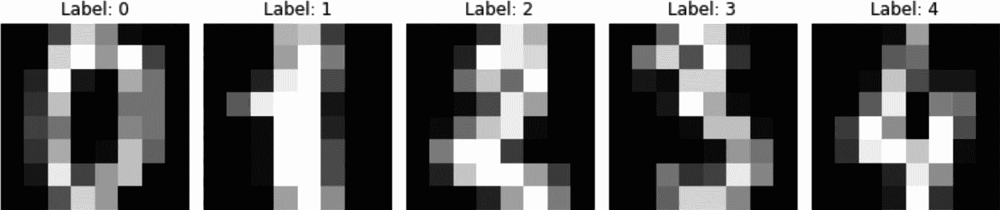

# 12. 使用 Pandas、Scikit-Learn 和 PySpark 进行神经网络分类

在本章中，我们将探索多层感知器（MLP）分类器的世界，这是一种强大的监督式机器学习方法。MLP 具有若干优势，使其能够灵活地处理从回归到分类的广泛任务，涵盖图像识别、自然语言处理和语音识别等多个领域。

一个关键优势在于，只要有足够的隐藏神经元和训练数据，MLP 就能逼近任何连续函数。非线性是另一个优势。通过使用 `ReLU`、`sigmoid` 或 `tanh` 等激活函数，MLP 可以对输入和输出变量之间复杂的非线性关系进行建模，并捕捉数据中的复杂模式。此外，MLP 能够从原始数据中自动学习相关特征，减少了手动特征工程的需求。这在处理高维数据时尤其有用。而且，MLP 的训练可以在多个 GPU 或 CPU 上并行化，这能显著加快大型数据集的训练速度。另外，通过适当的正则化技术（如 `dropout` 和权重衰减），MLP 可以很好地泛化到未见过的数据，从而减少过拟合。

然而，MLP 并非没有缺点。首先，MLP 需要大量的数据进行训练，尤其是在处理深层架构时。数据不足可能导致过拟合。即使有大型数据集，如果没有适当的正则化和超参数调优，MLP 也容易对训练数据过拟合，导致泛化能力差。此外，MLP 有多个超参数，包括层数、每层神经元数量和学习率。找到正确的超参数组合可能既困难又计算成本高昂。还有另一个缺点。MLP 通常被视为黑盒模型，因为解释它们所学到的关系可能具有挑战性，尤其是在具有许多层的深层架构中。这意味着当可解释性很重要时，MLP 不是合适的选择。

另一个重要的限制是，深层 MLP 会遭受梯度消失和梯度爆炸问题。在深层 MLP 中，训练过程中，梯度（指示应如何调整模型参数以最小化误差）在通过网络反向传播时可能会变得极小（梯度消失）或极大（梯度爆炸），这使得训练变得困难。此外，训练深层 MLP 可能需要专门的硬件（如 GPU）才能达到合理的训练时间。

为了说明 MLP 分类器的用法，我们将使用手写数字数据集，这是一个著名的数字识别基准数据。该数据集包含代表手写数字（0–9）的图像及其对应的标签。通过在此数据集上训练 MLP 分类器，我们的目标是基于像素表示准确地对这些手写数字进行分类。我们将使用 `Scikit-Learn` 和 `PySpark` 库实现分类器，并利用 `Pandas` 和 `PySpark` 进行数据处理和探索。

## 数据集

`load_digits` 是 `Scikit-Learn` 中的一个内置数据集。它是一个多类别分类数据集，包含手写数字（0–9）的图像。每个数字图像表示为一个 8×8 的像素值矩阵，数据集中包含相应的标签，指示每个图像的真实数字。每个像素被视为一个特征，总共 64 个像素，对应数据集中的 64 个特征。目标变量包含一个标签数组，对应于数据集中的每个图像，每个标签代表从 0 到 9 的数字值。

我们可以通过以下几个步骤加载数据集：

**步骤 1：导入 pandas 和 load_digits**

```python
[In]: import pandas as pd
[In]: from sklearn.datasets import load_digits
```

通过导入 `load_digits`，我们就能使用加载手写数字数据集的函数。

**步骤 2：加载数据集**

```python
[In]: dataset = load_digits()
```

这行代码调用了 `load_digits()` 函数，并将返回的数据集赋值给名为 `dataset` 的变量。

**步骤 3：从特征数据开始创建 Pandas DataFrame**

```python
[In]: pandas_df = pd.DataFrame(data=dataset.data, columns=dataset.feature_names)
```

**步骤 4：添加目标列**

```python
[In]: pandas_df['target'] = dataset.target
```

现在我们可以开始了解这个数据集了，首先从 Pandas 入手。`shape` 属性显示该数据集有 1,797 行和 65 列（64 个特征加上目标变量）：

```python
[In]: print(pandas_df.shape)
[Out]: (1797, 65)
```

我们可以按如下方式打印标签或列名：

```python
[In]: print(pandas_df.columns)
[Out]:
Index(['pixel_0_0', 'pixel_0_1', 'pixel_0_2', 'pixel_0_3', 'pixel_0_4', 'pixel_0_5', 'pixel_0_6', 'pixel_0_7', 'pixel_1_0', 'pixel_1_1', 'pixel_1_2', 'pixel_1_3', 'pixel_1_4', 'pixel_1_5', 'pixel_1_6', 'pixel_1_7', 'pixel_2_0', 'pixel_2_1', 'pixel_2_2', 'pixel_2_3', 'pixel_2_4', 'pixel_2_5', 'pixel_2_6', 'pixel_2_7', 'pixel_3_0', 'pixel_3_1', 'pixel_3_2', 'pixel_3_3', 'pixel_3_4', 'pixel_3_5', 'pixel_3_6', 'pixel_3_7', 'pixel_4_0', 'pixel_4_1', 'pixel_4_2', 'pixel_4_3', 'pixel_4_4', 'pixel_4_5', 'pixel_4_6', 'pixel_4_7', 'pixel_5_0', 'pixel_5_1', 'pixel_5_2', 'pixel_5_3', 'pixel_5_4', 'pixel_5_5', 'pixel_5_6', 'pixel_5_7', 'pixel_6_0', 'pixel_6_1', 'pixel_6_2', 'pixel_6_3', 'pixel_6_4', 'pixel_6_5', 'pixel_6_6', 'pixel_6_7', 'pixel_7_0', 'pixel_7_1', 'pixel_7_2', 'pixel_7_3', 'pixel_7_4', 'pixel_7_5', 'pixel_7_6', 'pixel_7_7', 'target'], dtype='object')
```

这个输出代表了特征（像素）和目标变量的列名或标签。`pixel_0_0`、`pixel_0_1`、...、`pixel_7_7` 是数据集特征（像素）的列名。每一列代表手写数字图像中的一个特定像素。格式 `pixel_x_y` 表示像素在图像中的位置。这里，`x` 代表像素的行（0 到 7），`y` 代表像素的列（0 到 7）。换句话说，对于数据集中的每一行，我们都会有与这些列相关联的值，这些值对应于数字图像中给定 (x, y) 位置的像素强度。

`target` 列用于存储与数据集中每个图像相关联的目标标签或数字标签。在我们的手写数字识别任务中，该列包含相应图像所代表的实际数字（0 到 9）。例如，如果我们有一个数字 3 的图像，那么该行 `target` 列的值就是 3。

我们可以按如下方式打印 `pandas_df` 的前五行和前五列：

```python
[In]: print(pandas_df.iloc[:5, :5])
[Out]:
   pixel_0_0  pixel_0_1  pixel_0_2  pixel_0_3  pixel_0_4
0        0.0        0.0        5.0       13.0        9.0
1        0.0        0.0        0.0       12.0       13.0
2        0.0        0.0        0.0        4.0       15.0
3        0.0        0.0        7.0       15.0       13.0
4        0.0        0.0        0.0        1.0       11.0
```

在这个输出中，每个列值代表图像中相应位置像素的灰度强度或暗度。强度值的范围从 0（完全白色）到 16（完全黑色）。我们可以按如下方式确认最小值和最大值：

```python
[In]: (pandas_df.values.min(), pandas_df.values.max())
[Out]: (0.0, 16.0)
```

我们可以按如下方式打印目标列的不同值：

```python
[In]: print(pandas_df.iloc[:, -1].unique())
[Out]: [0 1 2 3 4 5 6 7 8 9]
```

这个输出显示有从 0 到 9 的十个数字。

我们可以使用 `Matplotlib` 和 `Scikit-Learn`，按照以下步骤显示 `load_digits` 数据集中的前五个图像：

**步骤 1：导入必要的库**

```python
[In]: import matplotlib.pyplot as plt
[In]: from sklearn.datasets import load_digits
```

**步骤 2：加载数据集**

```python
dataset = load_digits()
```

**步骤 3：显示前五个图像**

## MLP 分类

```
[In]: fig, axes = plt.subplots(nrows=1, ncols=5, figsize=(10, 3))
[In]: for i, ax in enumerate(axes):
ax.imshow(dataset.images[i], cmap='gray')
ax.set_title(f"标签: {dataset.target[i]}")
ax.axis('off')
[In]: plt.tight_layout()
[In]: plt.show()
[Out]:
```



标签 0 到 4 的五幅插图。这些插图以像素化形式描绘了数字 0、1、2、3 和 4。

要获得上述输出，我们首先导入 `Matplotlib` 库，特别是其子模块 `pyplot`，并将其别名设为 `plt`。这使我们能够使用 Matplotlib 的绘图函数。然后我们从 Scikit-Learn 的数据集模块中导入 `load_digits` 函数。该函数用于加载 `load_digits` 数据集，该数据集包含手写数字图像及其标签。

接下来，我们设置 `dataset = load_digits()`，加载 `load_digits` 数据集并将其赋值给变量 `dataset`。通过设置 `fig, axes = plt.subplots(nrows=1, ncols=5, figsize=(10, 3))`，我们使用 `subplots()` 函数创建了一个包含一行五个子图的图形。`nrows` 参数指定行数，`ncols` 指定列数，`figsize` 设置图形的大小。

最后，下面的 `for` 循环遍历五个子图，将每个子图赋值给变量 `ax`：

*   `ax.imshow(dataset.images[i], cmap='gray')` 使用 `imshow()` 函数显示 `dataset.images` 数组中索引为 `i` 的图像。`cmap='gray'` 参数将颜色映射设置为灰度。
*   `ax.set_title(f"标签: {dataset.target[i]}")` 设置子图的标题，使其包含 `dataset.target` 数组中索引为 `i` 的图像对应的标签。
*   `ax.axis('off')` 关闭子图的坐标轴刻度和标签。
*   `plt.tight_layout()` 调整子图的布局以防止重叠。
*   `plt.show()` 显示包含子图的图形。

要使用 PySpark 探索手写数字数据集，我们需要首先使用以下代码行将 `pandas_df` 转换为 PySpark DataFrame：

```
[In]: from pyspark.sql import SparkSession
[In]: spark = SparkSession.builder.getOrCreate()
[In]: spark_df = spark.createDataFrame(pandas_df)
```

该代码首先导入 `SparkSession`，这是使用 Apache Spark 功能的入口点。然后创建一个名为 `spark` 的 `SparkSession` 对象。`builder` 方法用于配置和创建 Spark Session。调用 `getOrCreate()` 确保如果 Spark Session 已经存在，则重用该会话；如果不存在，则创建一个新的。最后一步，代码使用 `SparkSession` 提供的 `createDataFrame()` 方法将 Pandas DataFrame (`pandas_df`) 转换为 PySpark DataFrame (`spark_df`)。

将 Pandas DataFrame 转换为 PySpark DataFrame 后，我们现在可以在 `spark_df` 上执行与 Pandas 相同的操作。

让我们先显示 DataFrame 的形状：

```
[In]: print((spark_df.count(), len(spark_df.columns)))
[Out]: (1797, 65)
```

这表明该数据集包含 1,797 行和 65 列（64 个特征，即 8`×`8 像素，以及一个目标变量，即取值范围为 0 到 9 的手写数字）。

接下来，我们将打印列名：

```
[In]: print(spark_df.columns)
[Out]:
['pixel_0_0', 'pixel_0_1', 'pixel_0_2', 'pixel_0_3', 'pixel_0_4', 'pixel_0_5', 'pixel_0_6', 'pixel_0_7', 'pixel_1_0', 'pixel_1_1', 'pixel_1_2', 'pixel_1_3', 'pixel_1_4', 'pixel_1_5', 'pixel_1_6', 'pixel_1_7', 'pixel_2_0', 'pixel_2_1', 'pixel_2_2', 'pixel_2_3', 'pixel_2_4', 'pixel_2_5', 'pixel_2_6', 'pixel_2_7', 'pixel_3_0', 'pixel_3_1', 'pixel_3_2', 'pixel_3_3', 'pixel_3_4', 'pixel_3_5', 'pixel_3_6', 'pixel_3_7', 'pixel_4_0', 'pixel_4_1', 'pixel_4_2', 'pixel_4_3', 'pixel_4_4', 'pixel_4_5', 'pixel_4_6', 'pixel_4_7', 'pixel_5_0', 'pixel_5_1', 'pixel_5_2', 'pixel_5_3', 'pixel_5_4', 'pixel_5_5', 'pixel_5_6', 'pixel_5_7', 'pixel_6_0', 'pixel_6_1', 'pixel_6_2', 'pixel_6_3', 'pixel_6_4', 'pixel_6_5', 'pixel_6_6', 'pixel_6_7', 'pixel_7_0', 'pixel_7_1', 'pixel_7_2', 'pixel_7_3', 'pixel_7_4', 'pixel_7_5', 'pixel_7_6', 'pixel_7_7', 'label']
```

现在，让我们像使用 Pandas 时那样，打印 PySpark DataFrame 的前五行和前五列：

```
[In]: spark_df.select(spark_df.columns[:5]).show(5)
[Out]:
+---------+---------+---------+---------+---------+
|pixel_0_0|pixel_0_1|pixel_0_2|pixel_0_3|pixel_0_4|
+---------+---------+---------+---------+---------+
|      0.0|      0.0|      5.0|     13.0|      9.0|
|      0.0|      0.0|      0.0|     12.0|     13.0|
|      0.0|      0.0|      0.0|      4.0|     15.0|
|      0.0|      0.0|      7.0|     15.0|     13.0|
|      0.0|      0.0|      0.0|      1.0|     11.0|
+---------+---------+---------+---------+---------+
only showing top 5 rows
```

在接下来的步骤中，我们展示目标变量的不同取值：

```
[In]: distinct_values = spark_df.select(spark_df.columns[-1]).distinct().orderBy(spark_df.columns[-1])
[In]: distinct_values.show()
[Out]:
+-----+
|label|
+-----+
|    0|
|    1|
|    2|
|    3|
|    4|
|    5|
|    6|
|    7|
|    8|
|    9|
+-----+
```

如上方所示，为了从目标列中获取不同的取值，我们首先使用 `spark_df.columns[-1]` 选择了 DataFrame 的最后一列。然后，我们应用了 `distinct()` 方法来获取一个仅包含所选列中唯一值的新 DataFrame。我们使用 `orderBy()` 方法根据最后一列按升序对这些不同取值进行排序。包含升序排列的不同取值的 DataFrame 存储在变量 `distinct_values` 中。最后，在 `distinct_values` DataFrame 上调用了 `show()` 方法。

在本节中，我们将构建、训练并评估一个多层感知器（MLP）模型，并使用它来预测十个手写数字（0-9）。MLP 模型利用神经网络的架构进行预测。MLP 由多层相互连接的人工神经元（也称为节点或单元）组成。每个神经元对其输入的加权和施加一个非线性激活函数，以将非线性引入模型的决策过程。

当使用 MLP 模型对手写数字分类任务进行预测时，会发生以下步骤：

*   **输入层**：数字图像的 8×8 像素表示被展平为一维向量，并作为 MLP 模型的输入。每个像素值都成为一个有助于预测的特征。

*   **前向传播**：输入特征以正向方式逐层通过网络进行传播。每一层由多个神经元组成，前一层的输出作为后续层的输入。

*   **加权和与激活**：在每个神经元处，输入与相关权重相乘，然后将这些加权输入求和。求和结果随后通过一个激活函数以引入非线性。激活函数根据加权和决定神经元是否触发或激活。

*   **隐藏层**：MLP 通常包含一个或多个隐藏层，位于输入层和输出层之间。隐藏层允许模型通过从输入数据中提取更高级别的特征来学习复杂的关系和表示。

*   **输出层**：最后一个隐藏层连接到输出层，输出层为每个数字类别生成预测。输出层中的神经元数量对应于可能的类别数量（在我们的例子中，是数字 0-9）。每个输出神经元代表输入属于特定类别的概率或置信度分数。

*   **输出层中的激活函数**：对于多类分类，通常使用 softmax 激活函数将输出值转换为总和为 1 的概率。

*   **预测**：输出层中具有最高概率或置信度分数的数字类别被选为输入数字的预测类别。

在训练过程中，MLP 模型使用反向传播和优化算法（如梯度下降）来调整神经元之间连接的权重。这个迭代过程旨在最小化训练数据中预测输出与真实标签之间的差异，从而提高模型做出准确预测的能力。通过学习大量带标签的示例，MLP 模型能够理解区分不同手写数字的底层模式和特征。这使其能够泛化，并以合理的准确度对未见过的数字图像进行预测。

我们同时使用 Scikit-Learn 和 PySpark 库来构建、训练和评估 MLP 模型。使用这两个库中的 `load_digits` 数据集预测手写数字的步骤是相同的：

*   **加载数据集**：我们首先从 Scikit-Learn 加载 `load_digits` 数据集。该数据集包含手写数字的灰度图像及其对应的标签。

*   **拆分数据**：将数据集拆分为训练集和测试集。这种划分使我们能够在部分数据上训练 MLP 分类器，并在未见过的数据上评估其性能。通常，大约 80% 的数据用于训练，其余 20% 用于测试。

*   **创建并训练 MLP 分类器**：初始化一个 MLP 分类器，并配置所需的隐藏层数量以及每层中的神经元数量。使用训练数据训练 MLP 分类器，在此过程中模型学习识别输入特征与其对应目标标签之间的模式和关联。

*   **预测数字**：将训练好的 MLP 分类器应用于测试集进行预测。模型将接收输入特征（手写数字的像素值），并为每个样本分配一个预测标签。

*   **评估性能**：将预测标签与测试集的真实标签进行比较，以评估 MLP 分类器的性能。常见的评估指标包括准确率、精确率、召回率、F1 分数和混淆矩阵。

Scikit-Learn 和 PySpark 在深度学习实现上遵循相似的指导原则，这一事实将有助于那些旨在从 Scikit-Learn 迁移到 PySpark 的数据科学家。此次迁移将使深度学习从业者能够以重要方式利用 PySpark 强大的分布式计算 API。虽然 TensorFlow、Keras 和 PyTorch 等深度学习框架常用于训练深度神经网络，但 Spark 可以在以下几个关键领域对这些框架进行补充：

*   **数据预处理**：Spark 可以高效处理大规模数据预处理任务。我们可以在将数据输入深度学习模型之前，使用 Spark 进行数据清洗、转换和预处理。这在处理无法装入内存的海量数据集时尤其有用。

*   **数据加载**：Spark 可用于将数据加载并分发到多个工作节点，从而实现高效的数据分发和并行处理。这对于处理需要由深度学习模型处理的大型数据集至关重要。

*   **分布式训练**：虽然 TensorFlow 和 PyTorch 等深度学习框架拥有自己的分布式训练能力，但可以集成 Spark，将深度学习训练分布到 Spark 集群中的多个节点上。这在分布式计算资源上训练大型模型时非常有益。

*   **模型服务**：训练完深度学习模型后，我们可以使用 Spark 的流处理能力来部署这些模型。这使我们能够对传入数据提供预测或执行实时推理，使其适用于推荐系统或欺诈检测等应用。

*   **与大数据生态系统集成**：Spark 可以与大数据生态系统的其他组件无缝集成，例如 Hadoop 分布式文件系统（HDFS）、Hive 和 HBase。这种集成使数据科学家在处理深度学习项目时能够利用现有的数据管道和基础设施。

### 使用 Scikit-Learn 进行 MLP 分类

我们首先演示如何使用 Scikit-Learn 库在手写数字数据集上训练和评估一个神经网络分类器。我们将遵循以下步骤：

**步骤 1：导入必要的库**

```
[In]: from sklearn.datasets import load_digits
[In]: from sklearn.model_selection import train_test_split
[In]: from sklearn.neural_network import MLPClassifier
[In]: from sklearn.metrics import accuracy_score, precision_score, recall_score, f1_score, confusion_matrix
```

在此步骤中，我们导入了必要的库。其中包括用于加载手写数字数据集的 `load_digits`、用于将数据拆分为训练集和测试集的 `train_test_split`、用于创建和训练神经网络分类器的 `MLPClassifier`，以及用于评估分类器性能的 `accuracy_score`、`precision_score`、`recall_score`、`f1_score` 和 `confusion_matrix`。

**步骤 2：加载数据集**

```
[In]: dataset = load_digits()
```

在此步骤中，使用 `load_digits()` 加载手写数字数据集，并将数据赋值给变量 `dataset`。

**步骤 3：将数据拆分为训练集和测试集**

```
[In]: X_train, X_test, y_train, y_test = train_test_split(dataset.data, dataset.target, test_size=0.2, random_state=42)
```

使用 `train_test_split()` 将数据拆分为训练集和测试集。输入特征存储在 `X_train` 和 `X_test` 中，而对应的目标值存储在 `y_train` 和 `y_test` 中。`test_size` 参数指定用于测试的数据比例（20%），`random_state` 为 42 确保拆分结果可重现。

**步骤 4：创建神经网络**

```
[In]: classifier = MLPClassifier(hidden_layer_sizes=(64, 64))
[In]: classifier.fit(X_train, y_train)
```

在此步骤中，使用 `MLPClassifier()` 创建一个神经网络分类器，其中 `hidden_layer_sizes` 参数指定了神经网络的架构。这里有两个隐藏层，每层有 64 个神经元。然后，使用 `fit()` 方法在训练数据上训练分类器，其中 `X_train` 作为输入特征，`y_train` 作为目标值。

**步骤 5：进行预测**

```
[In]: y_pred = classifier.predict(X_test)
```

使用 `predict()` 对测试集进行预测，预测值存储在 `y_pred` 中。

**步骤 6：评估模型性能**

## 使用 PySpark 进行 MLP 分类

在本小节中，我们将使用 PySpark 构建、训练和评估一个 MLP 分类器，并使用相同的手写数字数据集。此方法与之前的 Scikit-Learn 代码并行，让读者了解如何使用这两个框架执行机器学习任务的相似之处。与 Scikit-Learn 一样，我们首先导入必要的库：

### 第 1 步：导入必要的库

```
[In]: from pyspark.sql import SparkSession
[In]: from pyspark.ml.feature import VectorAssembler
[In]: from pyspark.ml.classification import MultilayerPerceptronClassifier
[In]: from pyspark.ml.evaluation import MulticlassClassificationEvaluator
import pandas as pd
from sklearn.datasets import load_digits
```

在第一步中，每个导入的库都有其特定的功能：`SparkSession` 用于创建 Spark 会话，`VectorAssembler` 用于将输入特征组装成一个向量列，`MultilayerPerceptronClassifier` 是用于分类的 MLP 分类器，`MulticlassClassificationEvaluator` 用于评估分类器的性能，`pd` 用于创建 Pandas DataFrame，`load_digits` 用于加载手写数字数据集。

### 第 2 步：创建 Spark 会话

在这一步中，我们创建一个 Spark 会话，并将其命名为 DigitClassification：

```
[In]: spark = SparkSession.builder.appName("DigitClassification").getOrCreate()
```

### 第 3 步：加载数字数据集

```
[In]: dataset = load_digits()
```

`load_digits()` 函数是 Scikit-Learn 内置数据集模块的一部分，专门用于加载手写数字数据集。加载数据集后，我们将结果赋值给变量 dataset。

### 第 4 步：创建 DataFrame

```
[In]: df = pd.DataFrame(data=dataset.data, columns=dataset.feature_names)
[In]: df['label'] = dataset.target
```

### 第 5 步：评估 Scikit-Learn MLP 分类器

为了评估 Scikit-Learn MLP 分类器的性能，首先使用 `accuracy_score()` 通过比较预测值 `y_pred` 与实际目标值 `y_test` 来获取准确率指标。准确率值通过 `print()` 方法打印输出。

然后，分别使用 `precision_score()`、`recall_score()` 和 `f1_score()` 计算更多评估指标（精确率、召回率和 F1 分数）。这些指标通过比较预测值与真实值计算得出。精确率、召回率和 F1 分数的值通过 `print()` 方法打印输出。

最后，使用 `confusion_matrix()` 通过比较预测值与真实值来计算混淆矩阵。混淆矩阵以表格形式呈现分类器在不同类别上的性能。混淆矩阵通过 `print()` 打印输出，以便可视化结果。

执行代码后，我们得到以下结果：

```
[Out]:
Accuracy: 0.98
Precision: 0.98
Recall: 0.98
F1 Score: 0.98
Confusion Matrix:
[[32  0  0  0  1  0  0  0  0  0]
[ 0 27  1  0  0  0  0  0  0  0]
[ 0  0 32  0  0  0  0  1  0  0]
[ 0  0  0 33  0  1  0  0  0  0]
[ 0  0  0  0 46  0  0  0  0  0]
[ 0  0  0  0  0 46  1  0  0  0]
[ 1  0  0  0  0  0 34  0  0  0]
[ 0  0  0  0  0  0  0 33  0  1]
[ 0  1  0  0  0  0  0  0 29  0]
[ 0  0  0  0  0  0  0  1  0 39]]
```

该输出的解释如下：

*   **准确率（0.98）**：这是衡量分类器正确预测目标值频率的指标。准确率为 0.98，意味着分类器达到了 98% 的准确率。这表明分类器对测试集中约 98% 的实例做出了正确预测。

*   **精确率（0.98）**：这是衡量分类器在其标记为阳性的所有实例（真正例 + 假正例）中，正确识别阳性实例（真正例）能力的指标。精确率针对每个类别计算，然后取平均值。精确率得分为 0.98，表明平均而言，分类器在所有类别上达到了约 98% 的精确率。

*   **召回率（0.98）**：该指标也称为灵敏度或真正例率，衡量分类器在所有实际阳性实例（真正例 + 假负例）中正确识别阳性实例的能力。与精确率类似，召回率针对每个类别计算，然后取平均值。这里的召回率得分为 0.98，表明平均而言，分类器在所有类别上达到了约 98% 的召回率。

*   **F1 分数（0.98）**：这是精确率和召回率的加权平均值。它提供了一个同时考虑精确率和召回率的平衡度量。F1 分数为 0.98，表明精确率和召回率之间表现均衡。

*   **混淆矩阵**：该矩阵通过显示每个类别被正确或错误分类的实例数量来评估分类器的性能：
    *   第 1 行对应类别 0。第一列中的值 32 表示有 32 个类别 0 的实例被正确预测为类别 0。第五列中的值 1 表示有一个类别 0 的实例被错误分类为其他类别。
    *   第 2 行对应类别 1。第二列中的值 27 表示有 27 个类别 1 的实例被正确预测为类别 1。第三列中的值 1 表示有一个类别 1 的实例被错误分类为其他类别。
    *   第 3 行对应类别 2。第三列中的值 32 表示有 32 个类别 2 的实例被正确预测为类别 2。第八列中的值 1 表示有一个类别 2 的实例被错误分类为其他类别。
    *   第 4 行对应类别 3。第四列中的值 33 表示有 33 个类别 3 的实例被正确预测为类别 3。第六列中的值 1 表示有一个类别 3 的实例被错误分类为其他类别。
    *   第 5 行对应类别 4。第五列中的值 46 表示有 46 个类别 4 的实例被正确预测为类别 4。其他列中的零表示没有错误分类到其他类别。
    *   第 6 行对应类别 5。第六列中的值 46 表示有 46 个类别 5 的实例被正确预测为类别 5。第七列中的值 1 表示有一个类别 5 的实例被错误分类为其他类别。
    *   第 7 行对应类别 6。第七列中的值 34 表示有 34 个类别 6 的实例被正确预测为类别 6。第一列中的值 1 表示有一个类别 6 的实例被错误分类为其他类别。
    *   第 8 行对应类别 7。第八列中的值 33 表示有 33 个类别 7 的实例被正确预测为类别 7。第十列中的值 1 表示有一个类别 7 的实例被错误分类为其他类别。
    *   第 9 行对应类别 8。第九列中的值 29 表示有 29 个类别 8 的实例被正确预测为类别 8。第二列中的值 1 表示有一个类别 8 的实例被错误分类为其他类别。
    *   第 10 行对应类别 9。第十列中的值 39 表示有 39 个类别 9 的实例被正确预测为类别 9。第八列中的值 1 表示有一个类别 9 的实例被错误分类为其他类别。

## 使用PySpark构建MLP分类器

### 第 5 步：将 Pandas DataFrame 转换为 PySpark

在这段代码中，第一行使用 Pandas 库的 `DataFrame()` 函数创建了一个名为 `df` 的 `DataFrame`。参数 `data=dataset.data` 指定了 `DataFrame` 的数据，对应于数字图像的像素值。参数 `columns=dataset.feature_names` 将 `DataFrame` 的列名设置为 `dataset` 对象中提供的特征名称。这些特征名称代表了图像中的像素位置。

第二行 `df['label'] = dataset.target` 向 `DataFrame` `df` 添加了一个名为 `label` 的新列。`dataset.target` 代表目标变量或与每个数字图像关联的真实标签。每个标签对应图像中数字的数值。

在这一步中，我们将 Pandas `df` 转换为 PySpark `DataFrame`：

```python
[In]: spark_df = spark.createDataFrame(df)
```

这行代码使用 `createDataFrame()` 方法从现有的 Pandas `DataFrame` `df` 创建了一个名为 `spark_df` 的 PySpark `DataFrame`。通过将 Pandas `DataFrame` 转换为 PySpark `DataFrame`，我们可以利用 Spark 的分布式计算能力，并使用 Spark 的内置函数和机器学习算法对数据执行可扩展的操作。这在处理可能无法放入单台机器内存的大型数据集时特别有用。

### 第 6 步：将数据拆分为训练集和测试集

在这一步中，我们将数据拆分为训练集和测试集：

```python
[In]: train, test = spark_df.randomSplit([0.8, 0.2], seed=42)
```

这行代码将 PySpark `DataFrame` `spark_df` 拆分为两个独立的 `DataFrame`，即 `train` 和 `test`，分别用于训练和测试 MLP 分类器。`randomSplit()` 方法允许我们根据给定的权重将 `DataFrame` 随机分成多个部分。权重 `[0.8, 0.2]` 表示大约 80% 的数据将被分配到 `train` `DataFrame`，其余 20% 将被分配到 `test` `DataFrame`。参数 `seed=42` 设置了随机种子以确保可重复性。通过提供相同的种子值，我们可以确保数据拆分在代码的多次运行中保持一致，这对于比较和调试非常有用。

### 第 7 步：创建向量组装器

在这一步中，我们创建一个向量组装器：

```python
[In]: input_features = spark_df.columns[:-1]
[In]: assembler = VectorAssembler(inputCols=input_features, outputCol="features")
[In]: train_transformed = assembler.transform(train)
[In]: test_transformed = assembler.transform(test)
```

这段代码分三步创建了一个向量组装器：

1.  定义了输入特征列名。

2.  使用 `VectorAssembler` 将特征组合成一个单一的向量列。

3.  使用 `VectorAssembler` 转换训练和测试数据。

让我们进一步分解：

1.  定义输入特征列名：

    `input_features = spark_df.columns[:-1]` 将 `spark_df` `DataFrame` 的列名（最后一列除外，即目标列）赋值给 `input_features` 变量。此步骤提取代表 MLP 模型输入特征的列名。

2.  创建向量组装器：

    `assembler = VectorAssembler(inputCols=input_features, outputCol="features")` 创建了一个名为 `assembler` 的 `VectorAssembler` 对象。`inputCols=input_features` 指定要组装成向量的输入列（输入特征），而 `outputCol="features"` 设置了将包含组装后特征的输出向量列的名称。

3.  转换训练和测试数据：

    `train_transformed = assembler.transform(train)` 将 `VectorAssembler` 转换应用于 `train` `DataFrame`。它从指定的列中获取输入特征，并创建一个名为 `features` 的新列，其中包含组装后特征的向量表示。类似地，`test_transformed = assembler.transform(test)` 将 `VectorAssembler` 转换应用于 `test` `DataFrame`。

### 第 8 步：创建 MLP 分类器

在这一步中，我们创建一个神经网络：

```python
[In]: layers = [len(input_features), 64, 64, len(dataset.target_names)]
[In]: classifier = MultilayerPerceptronClassifier(layers=layers, seed=42, labelCol="label")
```

这段代码分两步创建了一个 MLP 分类器：

1.  定义了神经网络模型的层。

2.  基于这些层创建了一个 `MultilayerPerceptronClassifier`。

让我们进一步解释这两个步骤：

1.  定义神经网络的层：

    `layers=[len(input_features), 64, 64, len(dataset.target_names)]` 定义了一个名为 `layers` 的列表，该列表指定了神经网络每一层中的节点或单元数量。列表的第一个元素对应于输入特征的数量，等于 `input_features` 列表的长度。后续元素代表神经网络每个隐藏层中的节点数。最后一个元素对应于输出类别的数量，等于 `dataset.target_names` 的长度。

2.  创建多层感知器分类器：

    `classifier = MultilayerPerceptronClassifier(layers=layers, seed=42, labelCol="label")` 创建了一个 `MultilayerPerceptronClassifier` 的实例，这是 PySpark 的 ML 库提供的多层感知器（MLP）神经网络模型。`layers=layers` 指定了之前定义的 MLP 模型的层配置。`seed=42` 设置了随机种子以确保模型的可重复性，而 `labelCol="label"` 指示 `DataFrame` 中标签列的名称，该列代表数字的真实标签。

### 第 9 步：训练 MLP 分类器

在这一步中，我们训练神经网络：

```python
[In]: model = classifier.fit(train_transformed)
```

在这行代码中，对 `classifier` 对象调用 `fit()` 方法，使用训练数据训练神经网络模型。`train_transformed` 是在对原始训练数据应用 `VectorAssembler` 转换后获得的训练数据。`fit()` 方法使用这个预处理后的训练数据，通过一个称为反向传播的迭代过程来优化 MLP 的权重和偏置。在训练过程中，模型通过调整其内部参数来学习将输入特征映射到目标标签。

训练过程完成后，`fit()` 方法返回一个训练好的模型对象，该对象被赋值给 `model` 变量。然后，这个训练好的模型可以用于对新的、未见过的数据进行预测。

### 第 10 步：进行预测

在这一步中，我们对测试数据进行预测：

```python
[In]: predictions = model.transform(test_transformed)
```

在这行代码中，对训练好的模型对象调用 `transform()` 方法，并将 `test_transformed` `DataFrame` 作为输入传递。该代码使用训练好的神经网络模型生成测试数据的预测结果。

### 第 11 步：评估模型

在这一步中，我们使用各种指标评估模型：

# 模型评估

在最后一步中，基于训练好的 MLP 模型生成的预测结果，计算了几个评估指标和一个混淆矩阵。以下是创建评估器、计算评估指标和打印评估指标的三步过程：

## 创建评估器

*   `evaluator = MulticlassClassificationEvaluator(metricName="accuracy")` 创建了一个使用准确率指标的 `MulticlassClassificationEvaluator` 实例。该评估器将用于评估模型预测的准确率。
*   `evaluator_precision = MulticlassClassificationEvaluator(metricName="weightedPrecision")` 创建了一个使用加权精确率指标的评估器。它将用于计算模型预测的精确率。
*   `evaluator_recall = MulticlassClassificationEvaluator(metricName="weightedRecall")` 创建了一个使用加权召回率指标的评估器。它将用于计算模型预测的召回率。
*   `evaluator_f1 = MulticlassClassificationEvaluator(metricName="f1")` 创建了一个使用 F1 指标的评估器。它将用于计算模型预测的 F1 分数。

## 计算评估指标

*   `accuracy = evaluator.evaluate(predictions)` 通过将评估器应用于 `predictions` DataFrame 来计算模型预测的准确率。评估器将预测标签与真实标签进行比较，并计算准确率得分。
*   `precision = evaluator_precision.evaluate(predictions)` 使用 `evaluator_precision` 计算模型预测的精确率。
*   `recall = evaluator_recall.evaluate(predictions)` 使用 `evaluator_recall` 计算模型预测的召回率。
*   `f1 = evaluator_f1.evaluate(predictions)` 使用 `evaluator_f1` 计算模型预测的 F1 分数。
*   `confusion_matrix = predictions.groupBy("label").pivot("prediction").count().fillna(0).orderBy("label")` 基于 `predictions` DataFrame 计算混淆矩阵。DataFrame 按真实标签（"label"）分组，并针对预测标签（"prediction"）进行透视以统计出现次数。生成的 DataFrame 代表混淆矩阵。

## 打印评估指标

*   `print("Accuracy:", accuracy)` 显示准确率指标。
*   `print("Precision:", precision)` 显示精确率指标。
*   `print("Recall:", recall)` 显示召回率指标。
*   `print("F1 Score:", f1)` 显示 F1 指标。
*   `confusion_matrix.show(truncate=False)` 显示混淆矩阵，其中每个真实标签（"label"）作为行，预测标签（"prediction"）作为列。矩阵的每个单元格包含具有该特定真实标签和预测标签组合的样本数量。

执行此步骤中的代码后，将显示评估指标：
```python
[In]: evaluator = MulticlassClassificationEvaluator(metricName="accuracy")
[In]: accuracy = evaluator.evaluate(predictions)
[In]: evaluator_precision = MulticlassClassificationEvaluator(metricName="weightedPrecision")
[In]: precision = evaluator_precision.evaluate(predictions)
[In]: evaluator_recall = MulticlassClassificationEvaluator(metricName="weightedRecall")
[In]: recall = evaluator_recall.evaluate(predictions)
[In]: evaluator_f1 = MulticlassClassificationEvaluator(metricName="f1")
[In]: f1 = evaluator_f1.evaluate(predictions)
[In]: print("Accuracy:", accuracy)
[In]: print("Precision:", precision)
[In]: print("Recall:", recall)
[In]: print("F1 Score:", f1)
[In]: confusion_matrix = predictions.groupBy("label").pivot("prediction").count().fillna(0).orderBy("label")
[In]: confusion_matrix.show(truncate=False)
[Out]:
Accuracy: 0.95
Precision: 0.96
Recall: 0.95
F1 Score: 0.95
+-----+---+---+---+---+---+---+---+---+---+---+
|label|0.0|1.0|2.0|3.0|4.0|5.0|6.0|7.0|8.0|9.0|
+-----+---+---+---+---+---+---+---+---+---+---+
|0    |32 |0  |0  |0  |1  |0  |0  |0  |0  |0  |
|1    |0  |30 |0  |0  |0  |0  |0  |0  |1  |0  |
|2    |0  |1  |40 |0  |0  |0  |0  |0  |0  |0  |
|3    |0  |0  |0  |36 |0  |0  |0  |0  |1  |1  |
|4    |0  |1  |0  |0  |36 |0  |0  |0  |0  |0  |
|5    |0  |0  |0  |0  |0  |35 |0  |0  |0  |0  |
|6    |1  |0  |0  |0  |2  |0  |37 |0  |1  |0  |
|7    |0  |0  |0  |0  |0  |0  |0  |33 |2  |1  |
|8    |0  |0  |0  |1  |0  |0  |0  |0  |28 |0  |
|9    |0  |0  |0  |1  |0  |0  |0  |1  |0  |30 |
+-----+---+---+---+---+---+---+---+---+---+---+
```

前面的输出可以解释如下：

*   `准确率`是衡量模型预测整体正确性的指标。它计算正确预测的样本数与总样本数的比率。该模型达到了约 0.95 的准确率，表明它正确预测了约 95% 的样本标签。
*   `精确率`是衡量模型做出的所有阳性预测中真正阳性预测比例的指标。它评估模型最小化假阳性的能力。约 0.96 的精确率得分表明，与做出的总阳性预测相比，该模型具有很高比例的正确阳性预测。
*   `召回率`，也称为灵敏度或真正率，衡量数据集中所有实际阳性样本中真正阳性预测的比例。它评估模型捕获阳性实例的能力。召回率得分约为 0.95，表明该模型能有效识别数据集中的大多数阳性样本。
*   `F1 分数`是精确率和召回率的加权平均值。它提供了一个单一的指标，平衡了精确率和召回率之间的权衡。约 0.95 的 F1 分数表明该模型在精确率和召回率之间取得了良好的平衡，整体性能相对较高。
*   `混淆矩阵`显示了每个类别的真正例、真负例、假正例和假负例的计数。MLP 的混淆矩阵是一个 10`×`10 的矩阵，代表了数字 0 到 9 的分类结果。行标题代表真实标签，而列标题代表预测标签。矩阵中的每个单元格代表真实标签和预测标签一致的实例数量。以下是混淆矩阵的详细说明：
    *   第 0 行：在真实标签为 0 的实例中，有 32 个被正确预测为 0，而有 1 个实例被错误地预测为 4。
    *   第 1 行：在真实标签为 1 的实例中，有 30 个被正确预测为 1，而有 1 个实例被错误地预测为 8。
    *   第 2 行：在真实标签为 2 的实例中，有 40 个被正确预测为 2，而有 1 个被错误分类为 1。
    *   第 3 行：在真实标签为 3 的实例中，有 36 个被正确预测为 3，而有 2 个实例分别被错误地预测为 8 和 9。
    *   第 4 行：在真实标签为 4 的实例中，有 36 个被正确预测为 4，而有 1 个被错误地预测为 1。
    *   第 5 行：在真实标签为 5 的实例中，有 35 个被正确预测为 5，没有实例被错误分类。

混淆矩阵分析显示了模型在测试集上的详细分类表现。具体而言，在真实标签为 6 的 41 个实例中，37 个被正确预测为 6，同时有 1 个实例被错误预测为 0，2 个被预测为 4，以及 1 个被预测为 8。对于真实标签为 7 的 36 个实例，33 个被正确预测为 7，2 个被错误预测为 8，1 个被预测为 9。真实标签为 8 的 29 个实例中，28 个被正确预测为 8，1 个实例被错误预测为 3。最后，在真实标签为 9 的 32 个实例中，30 个被正确预测为 9，1 个被错误预测为 3，另外 1 个被错误分类为 7。

## 整合所有代码

在本节中，我们将前面步骤中所有相关代码整合到一个代码块中。这样读者就可以将代码作为一个整体来执行。

### Scikit-Learn

步骤 1：导入所需库

```
[In]: from sklearn.datasets import load_digits
[In]: from sklearn.model_selection import train_test_split
[In]: from sklearn.neural_network import MLPClassifier
[In]: from sklearn.metrics import accuracy_score, precision_score, recall_score, f1_score, confusion_matrix
```

步骤 2：加载数据集

```
[In]: dataset = load_digits()
```

步骤 3：将数据拆分为训练集和测试集

```
[In]: X_train, X_test, y_train, y_test = train_test_split(dataset.data, dataset.target, test_size=0.2, random_state=42)
```

步骤 4：训练神经网络分类器

```
[In]: classifier = MLPClassifier(hidden_layer_sizes=(64, 64))  # 指定隐藏层大小
[In]: classifier.fit(X_train, y_train)
```

步骤 5：对测试集进行预测

```
[In]: y_pred = classifier.predict(X_test)
```

步骤 6：计算并打印评估指标

```
# 计算并打印准确率
[In]: accuracy = accuracy_score(y_test, y_pred)
[In]: print("Accuracy:", accuracy)

# 计算并打印精确率、召回率和 F1 分数：
[In]: precision = precision_score(y_test, y_pred, average='weighted')
[In]: recall = recall_score(y_test, y_pred, average='weighted')
[In]: f1 = f1_score(y_test, y_pred, average='weighted')
[In]: print("Precision:", precision)
[In]: print("Recall:", recall)
[In]: print("F1 Score:", f1)

# 计算并打印混淆矩阵
[In]: confusion_mat = confusion_matrix(y_test, y_pred)
[In]: print("Confusion Matrix:")
[In]: print(confusion_mat)
```

### PySpark

步骤 1：导入所需库

```
[In]: from pyspark.sql import SparkSession
[In]: from pyspark.ml.feature import VectorAssembler
[In]: from pyspark.ml.classification import MultilayerPerceptronClassifier
[In]: from pyspark.ml.evaluation import MulticlassClassificationEvaluator
[In]: import pandas as pd
[In]: from sklearn.datasets import load_digits
```

步骤 2：创建 `SparkSession`

```
[In]: spark = SparkSession.builder.appName("DigitClassification").getOrCreate()
```

步骤 3：使用 Scikit-Learn 加载数据集

```
[In]: dataset = load_digits()
```

步骤 4：使用 Pandas 从数据创建 DataFrame

```
# 创建特征
[In]: df = pd.DataFrame(data=dataset.data, columns=dataset.feature_names)

# 添加目标列
[In]: df['label'] = dataset.target
```

步骤 5：将 Pandas DataFrame 转换为 PySpark DataFrame

```
[In]: spark_df = spark.createDataFrame(df)
```

步骤 6：将数据拆分为训练集和测试集

```
[In]: train, test = spark_df.randomSplit([0.8, 0.2], seed=42)
```

步骤 7：将特征组合成一个向量列

```
# 定义输入特征列名
[In]: input_features = spark_df.columns[:-1]

# 创建一个 VectorAssembler 将特征组合成一个向量列
[In]: assembler = VectorAssembler(inputCols=input_features, outputCol="features")

# 使用 VectorAssembler 转换训练和测试数据
[In]: train_transformed = assembler.transform(train)
[In]: test_transformed = assembler.transform(test)
```

步骤 8：创建神经网络

```
# 定义神经网络的层
[In]: layers = [len(input_features), 64, 64, len(dataset.target_names)]

# 创建 MultilayerPerceptronClassifier
[In]: classifier = MultilayerPerceptronClassifier(layers=layers, seed=42, labelCol="label")
```

步骤 9：训练分类器

```
[In]: model = classifier.fit(train_transformed)
```

步骤 10：对测试数据进行预测

```
[In]: predictions = model.transform(test_transformed)
```

步骤 11：评估模型的准确率

# 计算准确率

```python
# 计算准确率
[In]: evaluator = MulticlassClassificationEvaluator(metricName="accuracy")
[In]: accuracy = evaluator.evaluate(predictions)
[In]: print("Accuracy:", accuracy)

# 计算并打印精确率、召回率和 F1 分数
[In]: evaluator_precision = MulticlassClassificationEvaluator(metricName="weightedPrecision")
[In]: precision = evaluator_precision.evaluate(predictions)
[In]: evaluator_recall = MulticlassClassificationEvaluator(metricName="weightedRecall")
[In]: recall = evaluator_recall.evaluate(predictions)
[In]: evaluator_f1 = MulticlassClassificationEvaluator(metricName="f1")
[In]: f1 = evaluator_f1.evaluate(predictions)
[In]: print("Precision:", precision)
[In]: print("Recall:", recall)
[In]: print("F1 Score:", f1)

# 计算并打印混淆矩阵
[In]: confusion_matrix = predictions.groupBy("label").pivot("prediction").count().fillna(0).orderBy("label")
[In]: confusion_matrix.show(truncate=False)
```

## 总结

在本章中，我们探索了多层感知器（`MLP`）分类器的世界，这是一种强大的监督式机器学习方法。我们审视了 `MLP` 的优缺点，并得出结论：深度学习仍然是适用于回归和分类任务的通用技术。

本章通过手写数字数据集，演示了 `MLP` 分类器的使用方法。我们使用 `Scikit-Learn` 和 `PySpark` 库实现了分类器，并利用 `Pandas` 和 `PySpark` 进行数据处理和探索。训练后的模型达到了非常高的准确率，从而能够准确预测手写数字。我们强调，由于 `Scikit-Learn` 和 `PySpark` 遵循相同的深度学习指导原则，因此转向 `PySpark` 以利用其分布式计算能力是值得的。我们还解释了 `PySpark` 可以补充 `TensorFlow`、`Keras` 和 `PyTorch` 等深度学习框架的重要方式。

本章结束了我们的分类之旅。在下一章中，我们将转向另一种机器学习技术：推荐系统。这些算法在当今的数字环境中至关重要，因为它们能够提升用户体验并推动业务成功。通过分析用户偏好和行为，推荐系统可以提供个性化推荐，改善内容发现，提高用户参与度，并促进销售和客户满意度。它们在电子商务、内容流媒体和各种在线平台中扮演着关键角色，帮助用户在信息丰富的数字世界中找到相关的产品、服务或内容。