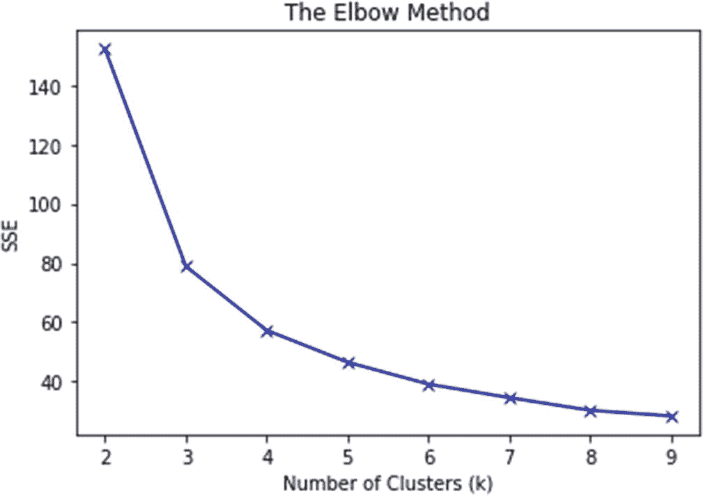
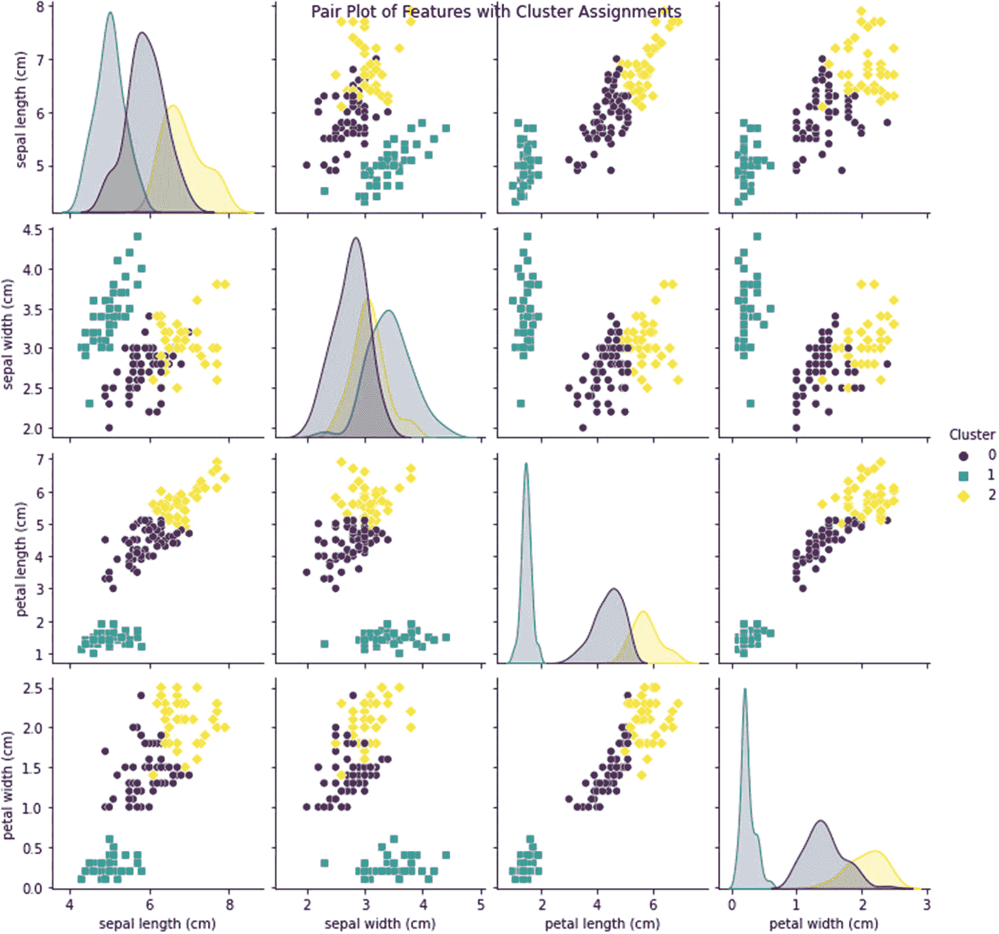

# 15. 使用 Pandas、Scikit-Learn 和 PySpark 进行 K-Means 聚类

在本章中，我们将深入探讨构建、训练和评估 k-means 聚类算法的过程，以实现有效的数据分割。聚类是分割分析中常用的一种技术，它根据观测值的特征或在特征空间中的邻近程度，将相似的观测值分组在一起。其结果是得到一组簇，每个观测值都被分配到一个特定的簇中。通过将数据组织成簇，我们可以更深入地理解复杂的数据集，并识别出关键的子群。

构建 k-means 算法涉及定义簇的数量（`k`），并迭代优化簇中心，以最小化簇内平方和。训练算法涉及将数据拟合到 k-means 模型，并将每个数据点分配到其对应的簇中。评估算法是评估聚类结果质量的关键步骤。

聚类在至少两个关键方面与监督学习不同。首先，聚类算法的输入是未标记的。在监督学习中，例如回归和分类，我们预测标签。然而，在聚类分析中，没有需要预测的标签。相反，我们根据观测值固有的特征或模式，将相似的观测值分组在一起。

其次，典型的监督学习算法评估指标不能用于评估聚类算法的性能。这是因为这些指标依赖于比较实际标签和预测标签，而在无监督学习中，这些标签并不总是可用的。相反，聚类算法采用专为无监督学习设计的特定评估指标。本章将使用一种常用的评估指标——轮廓系数。其取值范围在 -1 到 1 之间，得分接近 1 表示簇分离良好且紧凑，而得分接近 -1 则表示聚类效果差。得分为 0 表示簇重叠或模糊。

在本章的后续部分，我们将使用著名的开源鸢尾花数据集来构建、训练和评估一个 k-means 算法。此练习的目的是根据鸢尾花的特征将其品种分组到簇中。

我们将利用三种不同工具的强大功能：Pandas、Scikit-Learn 和 PySpark。这种方法的主要目标是服务于那些精通 Pandas 和 Scikit-Learn，并希望过渡到 PySpark 的数据科学家。通过探索 Pandas/Scikit-Learn 与 PySpark 在步骤上的相似性，我们旨在为这些数据科学家提供无缝过渡到 PySpark 的途径，并使他们能够利用其分布式计算能力来增强可扩展性和性能。

## 数据集

在本章中，我们使用开源的鸢尾花数据集来实现 k-means 聚类算法。我们已经在第 8 章中探索过这个数据集。该数据集包含三种不同鸢尾花（山鸢尾、变色鸢尾和维吉尼亚鸢尾）的四个特征（花萼长度、花萼宽度、花瓣长度和花瓣宽度）的测量值。

我们可以按照以下步骤访问鸢尾花数据集：

### 步骤 1：导入必要的库

```
[In]: from sklearn.datasets import load_iris
[In]: import pandas as pd
```

### 步骤 2：加载鸢尾花数据集

```
[In]: iris = load_iris()
```

### 步骤 3：访问特征数据 (`X`) 和目标标签 (`y`)

```
[In]: X = iris.data
[In]: y = iris.target
```

### 步骤 4：定义列名

```
[In]: feature_names = iris.feature_names
[In]: target_names = iris.target_names
```

### 步骤 5：创建包含列名的 DataFrame

```
[In]: pandas_df = pd.DataFrame(X, columns=feature_names)
[In]: pandas_df['target'] = y
[In]: pandas_df['target_names'] = pandas_df['target'].map(
dict(zip(range(len(target_names)), target_names)))
```

### 步骤 6：打印 DataFrame

|   | 花萼长度 (cm) | 花萼宽度 (cm) | 花瓣长度 (cm) | 花瓣宽度 (cm) |
|---|---|---|---|---|
| 0 | 5.1 | 3.5 | 1.4 | 0.2 |
| 1 | 4.9 | 3 | 1.4 | 0.2 |
| 2 | 4.7 | 3.2 | 1.3 | 0.2 |
| 3 | 4.6 | 3.1 | 1.5 | 0.2 |
| 4 | 5 | 3.6 | 1.4 | 0.2 |

```
[In]: print(pandas_df.head())
[Out]:
```

为了得到输出，我们将鸢尾花数据集加载到了一个 Pandas DataFrame 中。首先，我们导入必要的库，包括来自 Scikit-Learn 的 `load_iris`（用于加载鸢尾花数据集）和 Pandas（用于 DataFrame 处理）。然后，我们使用 `load_iris()` 方法加载鸢尾花数据集，该方法返回一个包含特征数据 (`X`) 和目标标签 (`y`) 的对象。我们使用 `feature_names` 和 `target_names` 属性为 DataFrame 定义列名。接下来，我们使用特征数据创建一个 Pandas DataFrame（`pd.DataFrame()`），并使用 `map()` 方法和一个字典添加 `target` 和 `target_names` 列。最后，我们使用 `head()` 方法打印 DataFrame 的前几行，以检查加载数据的结构和内容。

该数据集的一个重要特点是所有特征（花萼长度、花萼宽度、花瓣长度和花瓣宽度）都采用相同的尺度（厘米）。这表明在将 k-means 模型应用于鸢尾花数据集时，不需要进行缩放。

为了使用 PySpark 代码获得相同的结果，我们首先将 `pandas_df` DataFrame 转换为 PySpark DataFrame，然后显示前五行，如下所示：

### 步骤 1：导入 `SparkSession`

```
[In]: from pyspark.sql import SparkSession
```

### 步骤 2：创建一个名为 `spark` 的 Spark 对象

```
[In]: spark = SparkSession.builder.getOrCreate()
```

### 步骤 3：将 `pandas_df` DataFrame 转换为 PySpark DataFrame

```
[In]: spark_df = spark.createDataFrame(pandas_df)
```

### 步骤 4：显示 Spark DataFrame 的前五行

| 花萼长度 (cm) | 花萼宽度 (cm) | 花瓣长度 (cm) | 花瓣宽度 (cm) |
|---|---|---|---|
| 5.1 | 3.5 | 1.4 | 0.2 |
| 4.9 | 3 | 1.4 | 0.2 |
| 4.7 | 3.2 | 1.3 | 0.2 |
| 4.6 | 3.1 | 1.5 | 0.2 |
| 5 | 3.6 | 1.4 | 0.2 |

```
[In]: spark_df.show(5)
[Out]:
```

为了得到这个输出，我们遵循了一系列步骤。

在第一步中，我们导入 `SparkSession` 类，这是创建 Spark 应用程序所必需的。在第二步中，我们使用 `SparkSession.builder.getOrCreate()` 方法创建一个名为 `spark` 的 Spark 对象。这使我们能够访问 Spark 功能。在第三步中，我们利用 `createDataFrame()` 方法将 `pandas_df` DataFrame 转换为 `spark_df` DataFrame。这种转换使我们能够利用 Spark 的分布式计算能力进行大规模数据分析。在最后一步中，我们使用 `show()` 方法显示新创建的 PySpark DataFrame 的前五行。

让我们进一步探索 `pandas_df` 和 `spark_df`。我们可以使用 Pandas 的 `shape` 属性打印 `pandas_df` 的形状（行数，列数），如下所示：

```
[In]: print(pandas_df.shape)
[Out]: (150, 6)
```

我们可以使用以下 PySpark 代码实现相同的结果：

```
[In]: print((spark_df.count(), len(spark_df.columns)))
[Out]: (150, 6)
```

在这段 PySpark 代码中，我们通过使用 `count()` 方法获取行数，并使用 `len()` 函数确定列数，从而打印 Spark DataFrame 的形状。

让我们使用 Pandas 的 `value_counts()` 方法统计每个目标变量中的物种数量：

```
[In]: species_count = pandas_df['target_names'].value_counts()
[In]: print(species_count)
[Out]:
setosa        50
versicolor    50
virginica     50
Name: target_names, dtype: int64
```

我们可以使用以下 PySpark 代码实现类似的结果：

## 使用 k-Means 进行机器学习

在本节中，我们将使用 Scikit-Learn 和 PySpark 构建、训练和评估一个 k-means 聚类算法，并将其用于将鸢尾花数据分组或聚类。从数据集部分的数据分析中，我们知道有三个簇（`setosa`、`versicolor` 和 `virginica`），因此，如果我们的聚类算法达到 100% 的准确率，它应该将数据分成这些簇，每个簇包含 50 个样本。

### 使用 Scikit-Learn 进行 k-Means 聚类

我们首先使用 Scikit-Learn 库构建一个 k-means 聚类模型。需要遵循以下步骤：

**步骤 1：导入必要的库**

```python
[In]: from sklearn.datasets import load_iris
[In]: from sklearn.cluster import KMeans
[In]: from sklearn.metrics import silhouette_score
[In]: import matplotlib.pyplot as plt
```

这段代码从 Scikit-Learn 和 Matplotlib 库中导入了几个模块。第一行导入了 `load_iris` 函数，用于加载鸢尾花数据集。第二行导入了 `KMeans` 类，它是 k-means 聚类算法的一种实现，用于根据数据点的相似性将其划分到不同的簇中。第三行导入了 `silhouette_score` 函数，用于计算轮廓系数，该指标衡量数据点被划分到不同簇中的效果。最后一行导入了 `pyplot` 模块，它将用于绘制 SSE（误差平方和）分数与 `k` 值的关系图，以便使用肘部法则确定最佳簇数。

**步骤 2：加载鸢尾花数据集**

```python
[In]: iris = load_iris()
[In]: X = iris.data
[In]: feature_names = iris.feature_names
[In]: pandas_df = pd.DataFrame(X, columns=feature_names)
```

这段代码加载鸢尾花数据集并将其赋值给变量 `iris`。然后，将数据集赋值给变量 `X`，用于存储数据集的特征数据。代码接着为鸢尾花数据集的特征数据定义了列名，并使用 Pandas 库创建了一个 DataFrame。

**步骤 3：选择 k 的值**

```python
[In]: k_values = range(2, 10)
[In]: sse_values = []
[In]: for k in k_values:
[In]:     kmeans = KMeans(n_clusters=k, random_state=42)
[In]:     kmeans.fit(X)
[In]:     sse_values.append(kmeans.inertia_)
```

算法需要一个特定的 `k` 值作为起始点。我们知道正确的值是 3，因为已知有三个类别（`setosa`、`versicolor`、`virginica`），但在许多实际应用中，我们并不知道有效的组或簇的数量。因此，我们需要一种方法来选择簇的数量 `k`。

肘部法则是一种广泛使用的技术，用于确定数据集中的最佳簇数。它涉及选择不同的 `k` 值并训练相应的聚类模型。对于每个模型，计算误差平方和（SSE）或簇内质心距离之和，并将其与 `k` 值绘制成图。最佳 `k` 值在 SSE 出现显著下降的点处确定，该点形状类似于手肘。这表明超过该点后，增加额外的簇对提高聚类质量没有显著贡献。

前面提供的代码使用 k-means 聚类算法计算了不同 `k` 值对应的 SSE 值。以下是代码逐行的解释：

*   `k_values = range(2, 10)` 定义了 `k`（簇的数量）的取值范围，从 2 到 9（包含）。

*   `sse_values = []` 初始化了一个名为 `sse_values` 的空列表。该列表将用于存储每个 `k` 值对应的 SSE 值。

*   `for k in k_values` 开始一个循环，遍历 `k_values` 范围内的每个 `k` 值。

*   `kmeans = KMeans(n_clusters=k, random_state=42)` 创建了一个 `KMeans` 类的实例。`n_clusters` 参数设置为当前的 `k` 值，表示要创建的簇的数量。`random_state` 参数设置为 42，以确保结果的可重复性。

*   `kmeans.fit(X)` 使用 `fit()` 方法将 k-means 模型拟合到特征数据（`X`）上。k-means 算法将根据数据点的相似性将其划分为 `k` 个簇。

*   `sse_values.append(kmeans.inertia_)` 将 k-means 模型的 SSE 值追加到 `sse_values` 列表中。SSE 值衡量每个簇内的样本与该簇质心之间的距离。较低的 SSE 值表示更好的聚类效果。

执行这些代码行后，`sse_values` 列表将包含 `k_values` 范围内每个 `k` 值对应的 SSE 值。这些值可用于生成图表，通过识别肘点来确定最佳聚类数。

**步骤 4：绘制 SSE 值以识别肘点**

```python
[In]: plt.plot(k_values, inertia_values, 'bx-')
[In]: plt.xlabel('Number of Clusters (k)')
[In]: plt.ylabel('Inertia')
[In]: plt.title('The Elbow Method')
[In]: plt.show()
[Out]:
```



一条 SSE 值与聚类数的关系曲线。曲线从大约 140 开始，然后呈凹形下降。

我们先解释代码，再解释图表。该代码用于绘制 SSE 值与聚类数 (`k`) 的关系图，以便识别肘点，这有助于确定数据集的最佳聚类数。以下是代码的详细说明：

*   `plt.plot(k_values, sse_values, 'bx-')` 使用 Matplotlib 库 (`plt`) 的 `plot()` 函数创建折线图。它将 `k` 值 (`k_values`) 绘制在 x 轴上，将对应的 SSE 值 (`sse_values`) 绘制在 y 轴上。参数 `'bx-'` 指定了线条样式和标记样式。在此例中，`'bx-'` 表示蓝色标记 (`'b'`) 由实线 (`'-'`) 连接。

*   `plt.xlabel('Number of Clusters (k)')` 使用 `xlabel()` 函数将 x 轴的标签设置为“Number of Clusters (k)”。

*   `plt.ylabel('SSE')` 使用 `ylabel()` 函数将 y 轴的标签设置为“SSE”。

*   `plt.title('The Elbow Method')` 使用 `title()` 函数将图表的标题设置为“The Elbow Method”。

*   `plt.show()` 使用 `show()` 函数在屏幕上显示图表。

该图表表明，肘点（即最佳聚类数）位于 `k=3` 处，因为该点位于曲线的弯曲处。

**步骤 5：构建并训练 k-means 聚类模型**

```python
[In]: kmeans = KMeans(n_clusters=3, random_state=42)
[In]: kmeans.fit(X)
```

此代码用于在数据集 `X` 上构建并训练一个聚类数为 `k=3` 的 k-means 聚类模型。第一行创建了 Scikit-Learn 库中 `KMeans` 类的一个实例。`n_clusters` 参数设置为所需的聚类数 `k`，表示 k-means 算法应尝试创建的聚类数量（本例中为 3）。`random_state` 参数设置为 42，以确保结果的可重复性。

这段 PySpark 代码使用 `target_names` 列对 `spark_df` 执行了 `groupBy` 操作。通过应用 `groupBy()` 方法，数据根据 `target_names` 列中的唯一值进行分组。然后，对分组后的 DataFrame 应用 `count()` 方法，以计算每种花卉出现的次数。

```python
[In]: species_count = spark_df.groupBy('target_names').count()
[In]: species_count.show()
[Out]:
+------------+-----+
|target_names|count|
+------------+-----+
|      setosa|   50|
|  versicolor|   50|
|   virginica|   50|
+------------+-----+
```

从 Pandas 和 PySpark 的输出中，我们可以看到每个目标变量都有 50 个样本。这表明一个准确的 k-means 算法应该将鸢尾花数据集分成三个簇，每个簇包含 50 个观测值。我们将在下一节中验证是否如此。

# 第二行使用 `fit()` 方法将 k-means 模型拟合到数据 `X`。该算法将根据数据点的相似性将每个数据点分配到 k 个聚类之一，并迭代调整聚类中心，以最小化簇内平方和。

执行这些代码行后，`kmeans` 对象将包含训练好的 k-means 聚类模型，该模型已学习到指定聚类数的聚类分配和最终中心点。

## 步骤 6：评估聚类模型

```
[In]: labels = kmeans.labels_
[In]: silhouette = silhouette_score(X, labels)
[In]: print("Silhouette Score:", silhouette)
[Out]: Silhouette Score: 0.55
```

在最后一步中，我们通过计算轮廓系数来评估聚类模型。第一行检索 k-means 聚类模型分配给每个数据点的聚类标签。`kmeans` 对象的 `labels_` 属性包含一个类似数组的对象，其中每个元素代表分配给相应数据点的聚类标签。

第二行使用 `silhouette_score()` 函数计算轮廓系数。该函数接受两个参数：`X`（用于聚类的特征数据）和 `labels`（聚类模型分配给每个数据点的聚类标签）。该函数返回一个单一值，代表所有数据点的平均轮廓系数。最后一行打印该分数，约为 0.55。

轮廓系数的取值范围为 -1 到 1。值接近 1 表示数据点聚类良好，每个点与其自身簇内的数据点比与其他簇内的点更接近。如果轮廓系数接近 0，则表明数据点位于或非常接近两个相邻聚类的决策边界。如果分数为负（接近 -1），则表明该数据点可能被分配到了错误的聚类，因为它与其他簇中的点比与自身簇中的点更接近。

轮廓系数 0.55 是正值，且相对更接近 1。这表明聚类结果相当不错。然而，要确定实际质量，我们需要将预测的计数与真实情况进行比较。

以下代码计算并打印预测的聚类计数：

```
[In]: cluster_counts = {}
[In]: for label in labels:
       if label in cluster_counts:
           cluster_counts[label] += 1
       else:
           cluster_counts[label] = 1
[In]: for cluster, count in cluster_counts.items():
       print("Cluster {}: {}".format(cluster, count))
[Out]: Cluster Counts: Cluster 0: 62 Cluster 1: 50 Cluster 2: 38
```

从该输出中我们观察到，聚类 1 的计数为 50，符合预期，而其他两个聚类的计数则偏离了 50，要么更高（聚类 0：62），要么更低（聚类 2：38）。

Seaborn 配对散点图可以增强我们对这些结果的理解：

```
[In]: import seaborn as sns
[In]: pandas_df['Cluster'] = kmeans.labels_
[In]: sns.pairplot(pandas_df, hue='Cluster', palette='viridis', diag_kind='kde', markers=['o', 's', 'D'])
[In]: plt.suptitle('Pair Plot of Features with Cluster Assignments')
[In]: plt.show()
```

在这段代码中，我们使用 seaborn 库创建配对图，以可视化鸢尾花数据集中特征对之间的关系，重点关注数据点如何根据先前拟合的 k-means 聚类模型 (`kmeans`) 进行聚类。

第一行导入 seaborn 库并将其命名为 `sns`。下一步将聚类标签添加到 `pandas_df` DataFrame 中。这是通过将从 k-means 模型获得的聚类标签分配给 DataFrame 中一个名为 `Cluster` 的新列来实现的。

下一行使用 seaborn 创建配对图。`pairplot` 函数为 DataFrame 中的每对特征生成一个散点图网格，并根据其聚类分配对点进行颜色编码。以下是所用参数的详细说明：

*   `pandas_df`：包含数据和聚类标签的 DataFrame。

*   `hue='Cluster'`：此参数指定我们希望根据 `Cluster` 列对数据点进行颜色编码，以便在视觉上区分不同的聚类。

*   `palette='viridis'`：这将调色板设置为 viridis 配色方案。

*   `diag_kind='kde'`：`diag_kind` 参数指定我们希望在对角线单元格上显示核密度估计 (KDE) 图，以显示每个特征的分布。

*   `markers=['o', 's', 'D']`：此参数定义了每个聚类中数据点使用的标记。这里，`'o'`、`'s'` 和 `'D'` 代表不同的标记形状，以便清晰区分。

*   `plt.suptitle('Pair Plot of Features with Cluster Assignments')`：此行设置配对图的超级标题，为可视化提供描述性标题。

*   `plt.show()`：最后，此命令显示具有所有指定可视化效果的配对图。



一张带有聚类分配的特征配对图。花萼长度和花萼长度在聚类 0、1 和 2 的 4 到 6 之间有一个峰值。其他配对则垂直和水平移动。

配对图显示，与另外两个聚类相比，聚类 1 的特征对之间的关系存在显著差异。换句话说，聚类 1 可以很容易地与另外两个聚类（0 和 2）区分开来。这种分离表明，聚类 1 代表了鸢尾花数据集中的一个独特子群。相比之下，另外两组之间存在重叠，这解释了为什么聚类 0 和 2 的计数偏离了各自预期的 50 个数据点。更具体地说，聚类 0 和 2 有 24 个数据点（62-38）因重叠而被错误分类。

## 使用 PySpark 进行 k-Means 聚类

现在是时候使用 PySpark ML 库构建一个 k-means 聚类算法了。以下是使用鸢尾花数据集构建、训练和评估该算法的步骤：

### 步骤 1：导入必要的库：

```
[In]: from sklearn.datasets import load_iris
[In]: from pyspark.sql import SparkSession
[In]: from pyspark.ml.clustering import KMeans
[In]: from pyspark.ml.evaluation import ClusteringEvaluator
[In]: from pyspark.ml.feature import VectorAssembler
[In]: import pandas as pd
```

这段代码导入了使用 PySpark 对鸢尾花数据集执行 k-means 聚类所需的各种库和模块：

*   `load_iris`：此函数用于加载鸢尾花数据集。

*   `SparkSession`：此类允许与 PySpark 功能进行交互。

*   `KMeans`：此类是 PySpark 中 k-means 聚类算法的实现。

*   `ClusteringEvaluator`：此类用于通过提供轮廓系数等指标来评估聚类算法的性能。

*   `VectorAssembler`：此类是一个特征转换器，用于在 PySpark 中将多个列合并为一个向量列。

### 步骤 2：加载鸢尾花数据集（与 Scikit-Learn 中的步骤 2 相同）

```
[In]: iris = load_iris()
[In]: X = iris.data
[In]: feature_names = iris.feature_names
[In]: pandas_df = pd.DataFrame(X, columns=feature_names)
```

这段代码与 Scikit-Learn 中的步骤 2 相同：它加载鸢尾花数据集并将其赋值给变量 `iris`。然后，数据集被赋值给变量 `X`，该变量存储数据集的特征数据。接着，代码为鸢尾花数据集的特征数据定义了列名，并使用 Pandas 库创建了一个 DataFrame。

### 步骤 3：将 Pandas DataFrame 转换为 PySpark DataFrame

```
[In]: spark = SparkSession.builder.getOrCreate()
[In]: spark_df = spark.createDataFrame(pandas_df)
```

这段代码首先创建一个 `SparkSession` 作为 Spark 功能的入口点，然后使用 spark 对象的 `createDataFrame()` 方法将 `pandas_df` DataFrame 转换为 `spark_df`。

### 步骤 4：将输入特征组装成一个向量列

以下代码定义了输入特征，创建了一个向量列，并转换了一个 Spark DataFrame。

## 整合所有步骤

在此，我们将前面步骤中的所有相关代码整合到一个代码块中。这样，读者可以在 Scikit-Learn 和 PySpark 中一次性执行这些代码。

### Scikit-Learn

#### 步骤 1：导入必要的库

#### 步骤 2：加载鸢尾花数据集

#### 步骤 3：定义列名

#### 步骤 4：创建带有列名的 DataFrame

#### 步骤 5：为对应的簇数量生成多个 SSE 值

#### 步骤 6：绘制 SSE 值以识别肘点

#### 步骤 7：根据肘点选择最优的 k 值

#### 步骤 8：构建并训练 k-means 聚类模型

```
from sklearn.datasets import load_iris
from sklearn.cluster import KMeans
from sklearn.metrics import silhouette_score
import matplotlib.pyplot as plt
import pandas as pd

iris = load_iris()
X = iris.data

feature_names = iris.feature_names

pandas_df = pd.DataFrame(X, columns=feature_names)

k_values = range(2, 10)
sse_values = []
for k in k_values:
    kmeans = KMeans(n_clusters=k, random_state=42)
    kmeans.fit(X)
    sse_values.append(kmeans.inertia_)

plt.plot(k_values, sse_values, 'bx-')
plt.xlabel('Number of Clusters (k)')
plt.ylabel('SSE')
plt.title('The Elbow Method')
plt.show()

k = 3
```

### PySpark

#### 步骤 1：导入必要的库

#### 步骤 2：加载鸢尾花数据集

#### 步骤 3：定义列名

#### 步骤 4：创建带有列名的 DataFrame

```
from pyspark.sql import SparkSession
from pyspark.ml.feature import VectorAssembler
from pyspark.ml.clustering import KMeans
from pyspark.ml.evaluation import ClusteringEvaluator

spark = SparkSession.builder.appName("KMeansClustering").getOrCreate()

iris = spark.read.csv("path/to/iris.csv", header=True, inferSchema=True)

feature_names = iris.columns[:-1]

assembler = VectorAssembler(inputCols=feature_names, outputCol="features")
spark_df = assembler.transform(iris)
```

#### 步骤 5：选择最佳的 k 值

在此步骤中，所需的聚类数为 3，这是之前通过肘部法则确定的。

```
k = 3
```

#### 步骤 6：构建并训练 k-means 聚类模型

```
kmeans = KMeans().setK(k).setSeed(42)
model = kmeans.fit(spark_df)
```

这段代码创建了一个 k-means 聚类模型，并将其拟合到 Spark DataFrame 上。第一行创建了一个`KMeans`对象，并将其赋值给变量`kmeans`。在`kmeans`上调用了`setK()`方法，并将聚类数设置为`k`。`k`的值代表了 k-means 模型中所需的聚类数。调用`setSeed()`方法是为了设置随机种子以确保结果可复现。

第二行将 k-means 模型拟合到`spark_df` DataFrame 上。在`kmeans`对象上调用了`fit()`方法，并将`spark_df`作为参数传入。这将在提供的 DataFrame 上训练 k-means 模型。训练好的模型被赋值给变量`model`。

#### 步骤 7：进行预测

```
predictions = model.transform(spark_df)
```

这段代码使用训练好的 k-means 聚类模型对 Spark DataFrame 进行预测。在训练好的 k-means 模型（`model`）上调用了`transform()`方法，并将`spark_df` DataFrame 作为参数传入。这将训练好的模型应用于`spark_df` DataFrame，并根据输入数据生成预测。生成的预测结果，连同 DataFrame 的原始列，一起存储在一个名为`predictions`的新 DataFrame 中。

#### 步骤 8：评估聚类模型

```
evaluator = ClusteringEvaluator()
silhouette = evaluator.evaluate(predictions)
print("Silhouette Score:", silhouette)
```

这段代码计算并打印了从 k-means 模型获得的聚类结果的轮廓系数。第一行创建了一个`ClusteringEvaluator`实例，这是 `PySpark` 中一个提供评估聚类结果质量方法的类。创建的对象被赋值给变量`evaluator`。

在第二行，调用了`evaluator`对象的`evaluate()`方法，并将`predictions` DataFrame 作为参数传入。这将计算存储在`predictions` DataFrame 中的聚类结果的轮廓系数。计算出的分数被赋值给变量`silhouette`。最后，代码使用`print()`函数打印了轮廓系数。

轮廓系数约为 0.74，明显高于 `Scikit-Learn` 的分数（0.55）。这种差异可以归因于每个库使用的距离度量选择：`PySpark` 使用平方欧氏距离作为计算轮廓系数的默认距离度量，而 `Scikit-Learn` 使用普通（非平方）欧氏距离作为默认距离度量。距离度量的选择会影响轮廓系数的计算方式，并可能导致相同数据和聚类结果的分数出现差异。

`PySpark` 选择平方欧氏距离主要是出于效率和并行性的考虑。对欧氏距离进行平方运算允许预先计算方程中的某些部分，从而降低处理大型数据集和并行计算时的计算复杂度。这种设计在 `PySpark` 擅长的分布式计算环境中具有优势。

虽然平方欧氏距离和普通欧氏距离都是衡量不相似性的指标，但它们可能会产生不同的结果，尤其是在比较数据点到聚类中心的距离时。对距离进行平方运算会更多地强调较大的差异，这可能会影响数据点分配到聚类的方式，并进而影响轮廓系数。

#### 步骤 9：统计并打印每个预测聚类的出现次数

```
cluster_counts = predictions.groupBy("prediction").count()
cluster_counts.show()
```

这段代码计算并显示从 k-means 模型获得的聚类预测中，每个簇的数据点数量。在第一行中，对预测 DataFrame 调用了 `groupBy()` 方法，并将 `prediction` 列指定为分组依据。接着对分组后的 DataFrame 应用 `count()` 方法，以计算 `prediction` 列中每个唯一值的出现次数。生成的 DataFrame `cluster_counts` 包含两列：`prediction`（代表簇标签）和 `count`（代表该簇中的数据点数量）。最后一行调用了 `cluster_counts` DataFrame 的 `show()` 方法来显示其内容。

尽管轮廓系数为 0.74 相对较高（正值且接近 1），但从簇计数中我们可以观察到，只有簇 0 具有预期的 50 个计数，而其他两个簇的计数则偏离了 50，要么更高（簇 2：62），要么更低（簇 1：38）。换句话说，模型的准确率并没有人们期望的那么高。

## Python

**步骤 9：评估聚类模型**

```python
# a) 获取每个数据点的簇标签
labels = kmeans.labels_

# b) 计算轮廓系数
silhouette = silhouette_score(X, labels)

# c) 打印轮廓系数
print("Silhouette Score:", silhouette)
```

**步骤 10：计算簇计数**

```python
# a) 统计每个预测簇的出现次数
cluster_counts = {}
for label in labels:
    if label in cluster_counts:
        cluster_counts[label] += 1
    else:
        cluster_counts[label] = 1

# b) 打印簇计数
print("Cluster Counts:")
for cluster, count in cluster_counts.items():
    print("Cluster {}: {}".format(cluster, count))
```

## PySpark

**步骤 1：导入必要的库**

```python
from sklearn.datasets import load_iris
from pyspark.sql import SparkSession
from pyspark.ml.clustering import KMeans
from pyspark.ml.evaluation import ClusteringEvaluator
from pyspark.ml.feature import VectorAssembler
import pandas as pd
```

**步骤 2：加载鸢尾花数据集**

```python
iris = load_iris()
X = iris.data
```

**步骤 3：定义列名**

```python
feature_names = iris.feature_names
```

**步骤 4：创建带有列名的 DataFrame**

```python
pandas_df = pd.DataFrame(X, columns=feature_names)
```

**步骤 5：创建 SparkSession**

```python
spark = SparkSession.builder.getOrCreate()
```

**步骤 6：将 Pandas DataFrame 转换为 PySpark DataFrame**

```python
spark_df = spark.createDataFrame(pandas_df)
```

**步骤 7：定义输入特征**

```python
input_features = feature_names
```

**步骤 8：将输入特征组装成一个向量列**

```python
assembler = VectorAssembler(inputCols=input_features, outputCol="features")
spark_df = assembler.transform(spark_df)
```

**步骤 9：选择最优的 k 值**

```python
k = 3
```

**步骤 10：构建并训练 k-means 聚类模型**

```python
kmeans = KMeans().setK(k).setSeed(42)
model = kmeans.fit(spark_df)
```

**步骤 11：进行预测**

```python
predictions = model.transform(spark_df)
```

**步骤 12：评估聚类模型**

```python
evaluator = ClusteringEvaluator()
silhouette = evaluator.evaluate(predictions)
print("Silhouette Score:", silhouette)
```

**步骤 13：统计每个预测簇的出现次数**

```python
cluster_counts = predictions.groupBy("prediction").count()
```

**步骤 14：打印簇计数**

```python
print("Cluster Counts:")
cluster_counts.show()
```

## 总结

在本章中，我们深入探讨了使用 k-means 聚类的无监督学习领域。我们演示了如何使用开源的鸢尾花数据集构建、训练和评估 k-means 算法。此练习的目的是根据鸢尾花的特征将其品种分组到不同的簇中。

我们利用了 Pandas、Scikit-Learn 和 PySpark 的强大功能。这种方法的主要目标是帮助熟悉 Pandas 和 Scikit-Learn 的数据科学家顺利过渡到 PySpark。通过探索这些平台在步骤上的相似性，我们的目标是为这些机器学习从业者提供无缝过渡到 PySpark 的途径，使他们能够利用其分布式计算能力来增强可扩展性和性能。

在下一章中，我们将深入探讨机器学习的一个新领域：超参数调优。到目前为止，我们一直使用默认参数构建算法。下一章将演示如何微调这些参数以自定义默认值。