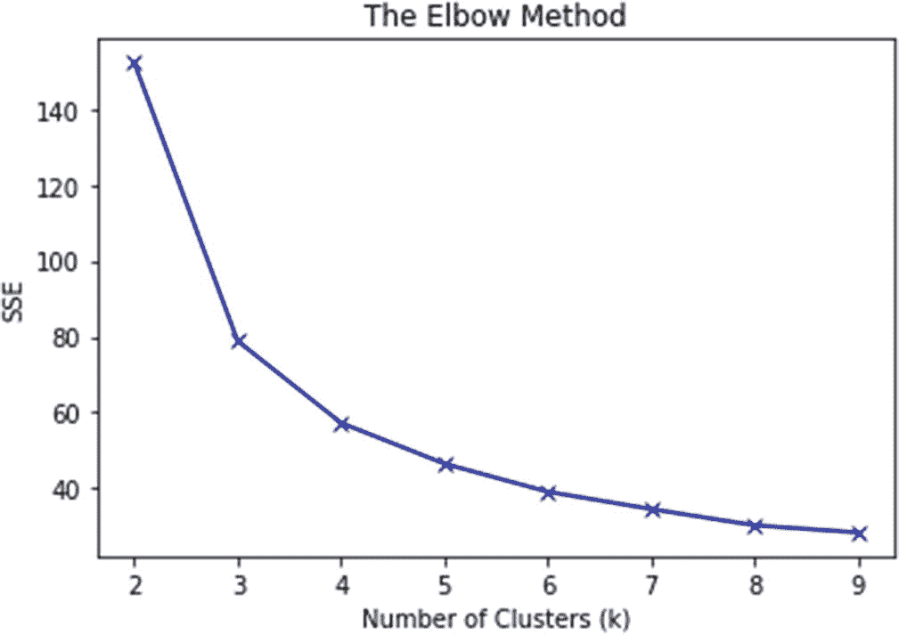
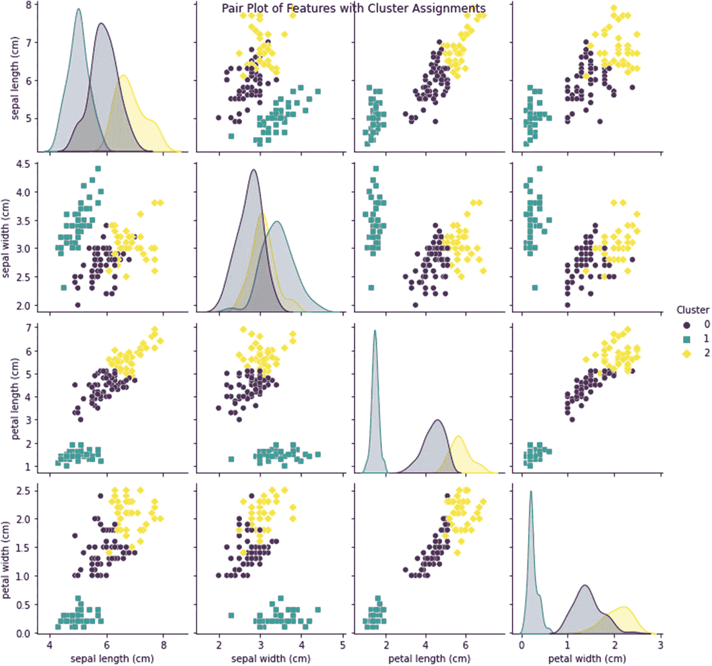

# 14. 使用 Pandas、Scikit-Learn 和 PySpark 进行自然语言处理

在本章中，我们将进入机器学习的一个新领域，即处理文本数据并对其应用算法。机器学习的这一领域被称为自然语言处理（NLP），它在许多商业应用中都有用途，包括语音识别、聊天机器人、语言翻译和电子邮件垃圾邮件检测（正常邮件或垃圾邮件）。

本章的项目是研究使用一个名为 20 Newsgroups 的开源数据集处理文本数据所涉及的关键步骤。这是一个新闻组文档的集合，被划分为 20 个不同的主题。我们将构建、训练和评估一个多项式朴素贝叶斯算法，并使用它来预测该数据集中的主题类别。尽管可以使用前几章中介绍的任何其他监督学习分类模型，但朴素贝叶斯通常是 NLP 任务（如主题建模，即当前任务）的首选模型。

在训练模型之前，我们需要确保输入模型的文本数据格式正确。这需要清洗、分词和向量化。在 NLP 的背景下，清洗是通过移除不增加太多含义的无关或噪声信息（如标点符号和停用词）来预处理文本数据的行为。分词涉及将文本分解为称为标记的较小单元，这些单元可以是单词、短语甚至字符，这有助于组织文本并实现进一步分析。向量化包括将文本数据转换为机器学习算法可以理解的数值表示。我们探讨了两种常用的方法：词袋模型（BoW）和词频-逆文档频率（TF-IDF）。

为了演示朴素贝叶斯与 NLP 的结合使用，我们使用了三个库：Pandas、Scikit-Learn 和 PySpark。目标是帮助熟悉小数据库工具（Pandas 和 Scikit-Learn）的数据科学家过渡到 PySpark，使他们能够利用分布式编程和并行计算的优势来处理 NLP 任务。

## 数据集

20 Newsgroups 数据集随 Scikit-Learn 一起安装。它包含近 20,000 个新闻组文档的集合，每个文档代表来自其中一个新闻组的单个帖子。这些文档分布在 20 个不同的类别或主题中，涵盖了诸如体育、政治、宗教和科学等各种主题。

为了能够探索这个数据集，我们首先需要通过以下步骤创建一个 Pandas DataFrame：

步骤 1：导入必要的库

```
[In]: import pandas as pd
[In]: from sklearn.datasets import fetch_20newsgroups
```

这段代码导入了 Pandas 库以及 `fetch_20newsgroups` 函数，该函数允许我们下载并加载 20 Newsgroups 数据集。

步骤 2：使用 Scikit-Learn 获取 20 Newsgroups 数据集

```
[In]: categories = ['alt.atheism', 'comp.graphics', 'comp.os.ms-
windows.misc', 'comp.sys.ibm.pc.hardware',
'comp.sys.mac.hardware', 'comp.windows.x',
'misc.forsale', 'rec.autos', 'rec.motorcycles',
'rec.sport.baseball', 'rec.sport.hockey',
'sci.crypt', 'sci.electronics', 'sci.med',
'sci.space', 'soc.religion.christian',
'talk.politics.guns', 'talk.politics.mideast',
'talk.politics.misc', 'talk.religion.misc']
[In]: newsgroups_all = fetch_20newsgroups(subset='all',
categories=categories, shuffle=True, random_state=42)
```

第一行定义了一个名为 categories 的列表，其中包含 20 个新闻组类别的名称。每个类别代表新闻组中讨论的不同主题或话题。例如，alt.atheism 代表与无神论相关的讨论，而 comp.graphics 代表与计算机图形学相关的讨论。

第二行使用 `fetch_20newsgroups` 函数加载 20 Newsgroups 数据集。通过指定 subset=‘all’，我们表示要加载整个数据集（指定 subset=‘train’ 将加载训练集，而指定 subset=‘test’ 将加载测试集）。categories=categories 参数告诉函数获取属于我们之前定义的 categories 列表中列出的类别的文档。shuffle=True 参数确保文档被随机打乱，而 random_state=42 设置了一个特定的随机种子以确保可重复性。

步骤 3：从 Scikit-Learn 的数据和目标数组创建一个 Pandas DataFrame

```
[In]: newsgroups_df = pd.DataFrame({'text': newsgroups_all.data, 'label': newsgroups_all.target})
```

这一行使用 `DataFrame()` 构造函数创建了一个名为 newsgroups_df 的 Pandas DataFrame。它结合了来自 `newsgroups_all` 对象的文本数据和标签信息。

现在我们已经成功创建了一个包含 20 个新闻组数据的 Pandas DataFrame，我们通过打印 DataFrame 的形状来开始探索：

```
[In]: newsgroups_df.shape
[Out]: (18846, 2)
```

这个输出表明 DataFrame 有 18,846 行和 2 列（文本和标签）。

接下来，我们使用 Pandas 的 `head()` 方法显示 DataFrame 的前五行：

```
[In]: print(newsgroups_df.head())
[Out]:
text  label
0  From: Mamatha Devineni Ratnam <mr47+@andrew.cm...     10
1  From: mblawson@midway.ecn.uoknor.edu (Matthew ...      3
2  From: hilmi-er@dsv.su.se (Hilmi Eren)\nSubject...     17
3  From: guyd@austin.ibm.com (Guy Dawson)\nSubjec...      3
4  From: Alexander Samuel McDiarmid <am2o+@andrew...      4

从前面的输出中，我们可以确认 DataFrame 有两列：text 和 label。标签对应于主题类别，应该有 20 个。我们可以通过使用 Pandas 的 `nunique()` 方法来验证这个数字：

```
[In]: newsgroups_df.label.nunique()
[Out]: 20
```

text 列被截断了，没有告诉我们太多关于其内容的信息。要打印整个第一行，我们可以运行以下代码，该代码提取 Pandas DataFrame 中第一行（索引 0）的 text 列的值：


```
[In]: print(newsgroups_df.iloc[0]['text'])
[Out]:
我确信一些企鹅队（Pens）的批评者对于最近企鹅队大胜魔鬼队（Devils）后却没有任何相关帖子感到相当困惑。实际上，我也有些困惑，同时也松了一口气。不过，我打算用对企鹅队的一些赞扬来终结非匹兹堡人的这种轻松心态。天哪，他们痛击魔鬼队的程度比我预想的还要惨。雅格尔（Jagr）刚刚向你展示了他为何比常规赛数据所体现的要优秀得多。他在季后赛中也非常有观赏性。鲍曼（Bowman）应该让雅格尔在接下来的几场比赛中尽情发挥，反正企鹅队无论如何都会把泽西队（Jersey）打得落花流水。我非常失望没能看到岛人队（Islanders）输掉常规赛的最后一场比赛。企鹅队万岁！！！
```

输出内容涉及匹兹堡企鹅队（简称“Pens”）在一场冰球比赛中战胜新泽西魔鬼队（New Jersey Devils）的相关文本。示例文档的内容包含对企鹅队表现的观点和反应，表达了对球队的惊讶、宽慰和赞扬。文中提到了雅格尔（Jagr）等特定球员，并讨论了对后续比赛的预期。此外，还提到了对岛人队（Islanders）常规赛最后一场比赛结果的失望。

为了使用 PySpark 复现 Pandas 的结果，我们首先需要将 Pandas 的 newsgroups_df 转换为 PySpark DataFrame。

让我们逐步进行：

步骤 1：导入必要的库

```
[In]: from pyspark.sql import SparkSession
```

我们导入 `SparkSession` 类来管理与 Spark 的连接，并为处理结构化数据提供接口。

步骤 2：创建 Spark 会话

```
[In]: spark = SparkSession.builder.getOrCreate()
```

这行代码创建了一个 `SparkSession` 实例，并将其赋值给变量 spark。`builder` 方法返回一个 `SparkSession.Builder` 对象，然后对该对象调用 `getOrCreate()` 方法来创建一个新的 SparkSession 或获取一个现有的。通过将结果赋值给变量 spark，我们可以在整个代码中使用 spark 对象来访问 SparkSession 提供的功能，例如读取数据并对其应用转换。其中一种转换是使用 `createDataFrame()` 方法将 newsgroups_df 从 Pandas 转换为 PySpark，如下所示。

步骤 3：将 Pandas DataFrame 转换为 PySpark：

```
[In]: spark_df = spark.createDataFrame(newsgroups_df)
```

现在我们已经成功创建了一个 Spark DataFrame，可以执行与之前使用 Pandas 时类似的探索操作。

让我们首先使用 `count()` 和 `len()` 方法显示 spark_df 的形状：

```
[In]: row_count = spark_df.count()
[In]: column_count = len(spark_df.columns)
[In]: shape = (row_count, column_count)
[In]: print(shape)
[Out]: (18846, 2)
```

此输出使用 `shape` 属性确认了 Pandas 的输出（18,846 行和 2 列）。由于 PySpark 没有内置的 `shape` 属性，我们结合使用了 `count()` 和 `len()` 方法来分别计算行数和列数。

接下来，我们使用 PySpark 的 `show()` 方法显示 PySpark DataFrame 的前五行：

```
[In]: spark_df.show(5)
[Out]:
+--------------------+-----+
|                text|label|
+--------------------+-----+
|From: Mamatha Dev...|   10|
|From: mblawson@mi...|    3|
|From: hilmi-er@ds...|   17|
|From: guyd@austin...|    3|
|From: Alexander S...|    4|
+--------------------+-----+
only showing top 5 rows
```

输出被截断了。我们可以在 `show()` 方法中为 truncate 参数指定一个更大的值来增加截断限制。例如，以下代码会将截断设置为最大长度，从而有效显示每列的完整内容：

```
[In]: spark_df.show(5, truncate=False)
[Out]:
From: Mamatha Devineni Ratnam \nSubject: Pens fans reactions\nOrganization: Post Office, Carnegie Mellon, Pittsburgh, PA\nLines: 12\nNNTP-Posting-Host: po4.andrew.cmu.edu\n\n\n\n
I am sure some bashers of Pens fans are pretty confused about the lack\nof any kind of posts about the recent Pens massacre of the Devils. Actually,\nI am  bit puzzled too and a bit relieved. However, I am going to put an end\nto non-PIttsburghers' relief with a bit of praise for the Pens. Man, they\nare killing those Devils worse than I thought. Jagr just showed you why\nhe is much better than his regular season stats. He is also a lot\nfo fun to watch in the playoffs. Bowman should let JAgr have a lot of\nfun in the next couple of games since the Pens are going to beat the pulp out of Jersey anyway. I was very disappointed not to see the Islanders lose the final\nregular season game.          PENS RULE!!!\n\n|10
```

或者，我们可以使用以下代码打印样本内容：

```
[In]: text_value = spark_df.select('text').first()['text']
[In]: print(text_value)
[Out]:
From: Mamatha Devineni Ratnam 
Subject: Pens fans reactions
Organization: Post Office, Carnegie Mellon, Pittsburgh, PA
Lines: 12
NNTP-Posting-Host: po4.andrew.cmu.edu
I am sure some bashers of Pens fans are pretty confused about the lack of any kind of posts about the recent Pens massacre of the Devils. Actually, I am  bit puzzled too and a bit relieved. However, I am going to put an end to non-PIttsburghers' relief with a bit of praise for the Pens. Man, they are killing those Devils worse than I thought. Jagr just showed you why he is much better than his regular season stats. He is also a lot fo fun to watch in the playoffs. Bowman should let JAgr have a lot of fun in the next couple of games since the Pens are going to beat the pulp out of Jersey anyway. I was very disappointed not to see the Islanders lose the final
regular season game.          PENS RULE!!!
```

第一行代码从 spark_df 中选择 text 列，并将第一行作为 Row 对象检索出来。`select()` 方法用于仅从 DataFrame 中选择 text 列，而 `first()` 则将第一行作为 Row 对象检索出来。第二行打印存储在 text_value 中的值，该值表示 DataFrame 第一行 text 列中的文本内容。

最后，我们可以使用 PySpark 中的 `distinct()` 和 `count()` 方法计算新闻组数据集中唯一类别的数量：

```
[In]: spark_df.select("label").distinct().count()
[Out]: 20
```

这确认了由 Pandas 计算出的类别数量（即 20 个类别）。


## 清洗、分词与向量化

如本章引言所述，在构建、训练和评估一个用于将主题分类到 20 个新闻组类别之一的多项式朴素贝叶斯模型之前，必须确保文本数据的格式与该算法兼容。这需要三个基本步骤：

1.  **清洗**：第一步涉及预处理文本数据，以消除对其含义贡献不大的无关或噪声元素。这些元素包括标点符号（如句号、逗号和问号）以及停用词（如“and”、“the”和“is”）。

2.  **分词**：清洗之后，文本被分解成称为“词元”的更小单元。这些词元可以包含单词、短语，甚至单个字符。分词的目的是结构化文本，便于后续分析。

3.  **向量化**：最后，文本数据必须转换为机器学习算法能够理解的数值表示。这种转换使算法能够有效地处理和学习文本信息。

最后一步（向量化）主要有两种方法：词袋模型（BoW）和词频-逆文档频率（TF-IDF）。

让我们解释一下这些方法：

在 BoW 方法中，每个文档被表示为一个向量，其中每个维度或特征对应于整个语料库中的一个唯一单词。每个维度中的值代表该单词在文档中出现的频率。

让我们用几个关于参观巴黎埃菲尔铁塔的句子作为例子来创建 BoW 表示。在这个例子中，我们将对文本进行分词，移除标点符号和常见的停用词，并创建一个简单的 BoW 向量：

句子：

“去年夏天我参观了巴黎的埃菲尔铁塔。”

“埃菲尔铁塔是法国的一个标志性建筑。”

“巴黎是一个拥有众多景点的美丽城市。”

创建 BoW 的步骤：

1.  **分词**：将句子分解成单个单词。

    句子 1：[“我”, “参观了”, “的”, “埃菲尔”, “铁塔”, “在”, “巴黎”, “去年”, “夏天”]

    句子 2：[“埃菲尔”, “铁塔”, “是”, “一个”, “标志性”, “建筑”, “在”, “法国”]

    句子 3：[“巴黎”, “是”, “一个”, “美丽”, “城市”, “拥有”, “众多”, “景点”]

2.  **移除停用词**：移除不携带太多含义的常见停用词。

    句子 1：[“参观了”, “埃菲尔”, “铁塔”, “巴黎”, “夏天”]

    句子 2：[“埃菲尔”, “铁塔”, “标志性”, “建筑”, “法国”]

    句子 3：[“巴黎”, “美丽”, “城市”, “景点”]

3.  **创建 BoW 向量**：这里，我们将文本数据表示为数值形式，以便机器学习算法可以使用。我们首先创建一个出现在所有三个句子中的唯一单词列表（词汇表）：

    [参观了 埃菲尔 铁塔 巴黎 夏天 标志性 建筑 法国 美丽 城市 景点]

    词汇表包含 11 个不同的单词。接下来，我们用布尔值 0 或 1 表示每个单词：

    句子 1：[“参观了”, “埃菲尔”, “铁塔”, “巴黎”, “夏天”]

    [参观了 1, 埃菲尔 1, 铁塔 1, 巴黎 1, 夏天 1, 标志性 0, 建筑 0, 法国 0, 美丽 0, 城市 0, 景点 0]

    句子 1 的二进制向量：[1, 1, 1, 1, 1, 0, 0, 0, 0, 0, 0]

    句子 2：[“埃菲尔”, “铁塔”, “标志性”, “建筑”, “法国”]

    [参观了 0, 埃菲尔 1, 铁塔 1, 巴黎 0, 夏天 0, 标志性 1, 建筑 1, 法国 1, 美丽 0, 城市 0, 景点 0]

    句子 2 的二进制向量：[0, 1, 1, 0, 0, 1, 1, 1, 0, 0, 0]

    句子 3：[“巴黎”, “美丽”, “城市”, “景点”]

    [参观了 0, 埃菲尔 0, 铁塔 0, 巴黎 1, 夏天 0, 标志性 0, 建筑 0, 法国 0, 美丽 1, 城市 1, 景点 1]

    句子 3 的二进制向量：[0, 0, 0, 1, 0, 0, 0, 0, 1, 1, 1]

    将三个句子组合起来，我们得到以下 BoW 矩阵：

```
[
[1, 1, 1, 1, 1, 0, 0, 0, 0, 0, 0],
[0, 1, 1, 0, 0, 1, 1, 1, 0, 0, 0],
[0, 0, 0, 1, 0, 0, 0, 0, 1, 1, 1]
]
```

这个矩阵表示每个句子中单词的频率，其中 1 表示单词存在，0 表示单词不存在。然后，该矩阵可以作为机器学习算法的数值输入。

然而，虽然 BoW 方法是一种直接的文本向量化方法，但它有其局限性，尤其是在处理更大、更复杂的文本数据时。BoW 使用二进制值表示文本，指示单词的存在与否，这在捕捉语言的细微差别方面可能过于简单。换句话说，BoW 将文本视为单个单词的集合，忽略了单词顺序和上下文。这种方法简单高效，但缺乏关于单词重要性的信息。

一种更复杂的向量化技术是词频-逆文档频率（TF-IDF）。这是一种更先进的向量化技术，超越了简单的词频。它根据单词在文档中的频率（词频）以及在整个语料库中的稀有程度（逆文档频率）来分配权重。在特定文档中频繁出现但在整个语料库中罕见的单词会获得更高的 TF-IDF 分数，这使得它们在文档上下文中更具信息量和重要性。TF-IDF 通过降低常见单词（如停用词）的权重并强调罕见、重要的术语，有效地解决了 BoW 的局限性。

词频（TF）和逆文档频率（IDF）的公式如下：

词频（TF）：

TF(t, d) = (术语 t 在文档 d 中出现的次数) / (文档 d 中的术语总数)

逆文档频率（IDF）：

IDF(t, D) = log_e (语料库 D 中的文档总数 / 包含术语 t 的文档数)

然后，TF-IDF 计算为 TF 和 IDF 的乘积：

TF-IDF(t, d, D) = TF(t, d) * IDF(t, D)

TF-IDF 是一种在文本分析中广泛使用的技术，具有多个优点。首先，TF-IDF 通过为在文档中频繁出现且在整个语料库中罕见的术语分配更高的权重，有效地捕捉了单词在文档中的重要性。这有助于突出特定文档或上下文中最相关和最独特的单词，使其适用于信息检索、搜索引擎和文本分类等任务。此外，TF-IDF 相对易于实现且计算效率高，使其成为各种自然语言处理应用的实用选择。

尽管有这些优势，TF-IDF 也存在一定的局限性。一个缺点是它独立处理每个术语，未能捕捉文档中单词或短语之间的语义关系。此外，TF-IDF 依赖于词频，这在更复杂的语言结构中可能并不总能准确反映术语的重要性。此外，TF-IDF 可能对文档长度敏感，可能会对自然包含更多术语的较长文档产生偏差。最后，TF-IDF 不考虑单词顺序或上下文，这在情感分析或理解短语含义等任务中可能至关重要。因此，虽然 TF-IDF 是一个有价值的工具，但它可能并非适用于所有文本分析场景的最佳选择，尤其是那些需要更深入理解语言语义的场景。

我们现在可以编写一些 Python 代码，将预处理步骤应用于 20 个新闻组数据集。为此，我们使用自然语言工具包（NLTK）库。NLTK 提供了超过 50 个语料库和词汇资源（如 WordNet）的易用接口。它还包括广泛的文本处理库，用于分词、词干提取、词性标注、解析和语义推理等任务。NLTK 广泛应用于自然语言处理（NLP）和文本分析任务，包括情感分析、文本分类和语言建模。

可以使用以下命令安装 NLTK：

```
[In]: pip install nltk
```


我们还需要从 NLTK 库中下载 punkt 和 stopwords 资源：

```
[In]: nltk.download('punkt')
[In]: nltk.download('stopwords')
```

第一条命令下载 `punkt` 资源，这是一个包含预训练分词模型（将文本拆分为单个词元，如单词和标点符号的过程）的数据包。第二条命令下载 `stopwords` 资源，其中包含英语中常用的停用词预定义列表，例如“the”、“is”和“and”。这些词在自然语言处理任务中通常会被移除，因为它们在语言分析的上下文中几乎没有或完全没有显著意义。

下一步，我们导入必要的库：

步骤 1：导入必要的库

```
[In]: import nltk
[In]: from sklearn.datasets import fetch_20newsgroups
[In]: from sklearn.feature_extraction.text import TfidfVectorizer
[In]: import string
```

第一行代码导入 NLTK。第二行导入 `fetch_20newsgroups` 函数，用于下载和检索 20 个新闻组数据集。第三行导入 `TfidfVectorizer`，这是一个在文本分析中常用的特征提取类。它将原始文档集合转换为 TF-IDF 特征矩阵，可作为机器学习算法的输入。最后一行导入 string 模块，该模块提供了 Python 中常见字符串操作的集合。在标点移除步骤中，它用于访问诸如 `string.punctuation` 之类的常量，该常量表示所有 ASCII 标点字符的字符串。

步骤 2：加载 20 个新闻组数据集

```
[In]: newsgroups_data = fetch_20newsgroups(subset='all',                remove=('headers', 'footers', 'quotes'))
```

这行代码用于获取 20 个新闻组数据集，并通过 `fetch_20newsgroups` 函数将其存储在变量 newsgroups_data 中。参数 subset='all' 指定要获取数据集的哪个子集（训练集、测试集或全部）。在此例中，'all' 表示将获取 20 个新闻组数据集中的所有数据。

参数 remove=('headers', 'footers', 'quotes') 指定应从每个文档中移除哪些部分，在此例中，分别移除页眉、签名块和引用块。这些元数据作为数据清洗过程的一部分被移除，因为它们与主题分类关系不大。

需要注意的是，`remove` 参数是 20 个新闻组数据集特有的。Python 中的 `re`（正则表达式）是一个通用模块，用于处理正则表达式以移除特定模式，包括引用、页眉和页脚。这是一种更手动的方法，让我们对清洗过程有更多控制，但它需要定义模式并将其应用于文档文本。

以下是如何使用 `re` 模块清洗数据的示例：

```
[In]: import re
[In]: text = "Check out this website: https://www.example.com. It has
great content."
[In]: pattern = r"http[s]?://\S+"
[In]: clean_text = re.sub(pattern, "", text)
[In]: print(clean_text)
[Out]: Check out this website: It has great content.
```

在前面的示例中，我们希望从给定文本中移除所有 URL，因为它们不会提高算法输入的质量（相反，不必要的模式会在数据中产生噪声并增加处理时间）。我们定义了一个正则表达式模式 http[s]?://\S+，该模式匹配以“http://”或“https://”开头的 URL。\S+ 部分匹配一个或多个非空白字符，确保完整捕获 URL。然后我们使用 `re.sub()` 函数将模式的所有匹配项替换为空字符串，从而将其从文本中移除。最终显示清洗后的文本，其中不包含任何 URL。

步骤 3：从数据集中选择单个文档

```
[In]: document_index = 0
[In]: document = newsgroups_data.data[document_index]
```


在第一行代码中，`document_index` 被赋值为 0。该变量用作索引，用于指示 `newsgroups_data` 数据集中特定单个文档的位置。为了便于说明，我们选择只处理一个文档。然而，在实际应用中，会使用整个语料库。

第二行代码根据 `document_index` 的值从 `newsgroups_data` 数据集中检索该文档。

在接下来的步骤中，我们进入分词处理流程。首先，我们定义一个名为 `tokenize` 的函数：

**步骤 4：定义 tokenize 函数**

```
[In]: def tokenize(text):
tokens = nltk.word_tokenize(text)
stop_words = set(nltk.corpus.stopwords.words('english'))
punctuations = set(string.punctuation)
filtered_tokens = [token for token in tokens if
token.lower() not in stop_words and token not in
punctuations]
return filtered_tokens
```

该函数接收一个文本参数作为输入。此函数负责将给定的文本分词为单个单词，并过滤掉停用词和标点符号。

在函数内部，我们有以下内容：

*   `nltk.word_tokenize(text)` 使用 NLTK 库的单词分词器将输入文本分词为一个单词列表。
*   `nltk.corpus.stopwords.words('english')` 从 NLTK 语料库中检索一组常见的英文停用词。
*   `string.punctuation` 包含一个包含所有 ASCII 标点符号的字符串。

然后，使用列表推导式对 tokens 进行过滤。检查每个 token 是否不在停用词集合中（转换为小写后）且不在标点符号集合中。过滤后的 tokens 存储在 `filtered_tokens` 列表中，并由 `tokenize` 函数返回。

**步骤 5：对文档进行分词**

```
[In]: tokens = tokenize(document)
```

这行代码调用了 `tokenize` 函数，并将 `document` 作为输入文本传递。`document` 变量包含文档的文本。生成的 tokens 存储在 `tokens` 变量中。

**步骤 6：打印 tokens**

```
[In]: print("Tokens:")
[In]: print(tokens)
```

第一行打印字符串 “Tokens:”，作为标题，第二行打印 `tokens` 变量的内容。

在进入向量化处理之前，让我们先看一下清洗和分词后的输出：

```
[Out]:
Tokens:
['sure', 'bashers', 'Pens', 'fans', 'pretty', 'confused', 'lack', 'kind', 'posts', 'recent', 'Pens', 'massacre', 'Devils', 'Actually', 'bit', 'puzzled', 'bit', 'relieved', 'However', 'going', 'put', 'end', 'non-PIttsburghers', 'relief', 'bit', 'praise', 'Pens', 'Man', 'killing', 'Devils', 'worse', 'thought', 'Jagr', 'showed', 'much', 'better', 'regular', 'season', 'stats', 'also', 'lot', 'fo', 'fun', 'watch', 'playoffs', 'Bowman', 'let', 'JAgr', 'lot', 'fun', 'next', 'couple', 'games', 'since', 'Pens', 'going', 'beat', 'pulp', 'Jersey', 'anyway', 'disappointed', 'see', 'Islanders', 'lose', 'final', 'regular', 'season', 'game', 'PENS', 'RULE']
```

以下是原始文本：

I am sure some bashers of Pens fans are pretty confused about the lack of any kind of posts about the recent Pens massacre of the Devils. Actually, I am bit puzzled too and a bit relieved. However, I am going to put an end to non-PIttsburghers’ relief with a bit of praise for the Pens. Man, they are killing those Devils worse than I thought. Jagr just showed you why he is much better than his regular season stats. He is also a lot fo fun to watch in the playoffs. Bowman should let JAgr have a lot of fun in the next couple of games since the Pens are going to beat the pulp out of Jersey anyway. I was very disappointed not to see the Islanders lose the final regular season game. PENS RULE!!!

通过比较原始文本和生成的 tokens，我们可以看到分词过程已将文本拆分为单个单词，并移除了标点符号和停用词。

进入向量化处理，我们首先创建一个向量化器，将分词后的文本转换为 TF-IDF 特征矩阵：

**步骤 7：创建向量化器**

```
[In]: vectorizer = TfidfVectorizer()
```

这行代码创建了 Scikit-Learn 库中 `TfidfVectorizer` 类的一个实例。它用于将原始文档集合转换为 TF-IDF（词频-逆文档频率）特征矩阵。TF-IDF 是一种数值统计量，反映了某个词项在一个文档中相对于更大文档集合的重要性。

**步骤 8：对文档应用向量化**

```
[In]: tfidf_matrix = vectorizer.fit_transform([document])
```

这行代码使用先前创建的向量化器实例，将单个文档转换为 TF-IDF 矩阵。首先，将一个文档作为参数传递给向量化器对象的 `fit_transform()` 方法。该方法结合了两个步骤：拟合和转换。

*   **拟合**：`fit_transform()` 方法使向量化器适应给定的文档或语料库。这意味着它从文档中学习词汇表，并根据文档中观察到的词频计算 IDF 值。在这种情况下，由于我们只有一个文档，词汇表和 IDF 值将从该文档中学习得到。

*   **转换**：一旦向量化器拟合完成，`transform()` 步骤将文档转换为 TF-IDF 矩阵表示。生成的 `tfidf_matrix` 是一个稀疏矩阵，其中每一行对应一个文档，每一列代表词汇表中的一个唯一词项。该矩阵包含文档中每个词项的 TF-IDF 值。

**步骤 9：打印 TF-IDF 矩阵**

```
[In]: print("\nTF-IDF Matrix:")
[In]: print(tfidf_matrix.toarray())
[Out]:
TF-IDF Matrix:
[[0.10585122 0.05292561 0.05292561 0.15877684 0.05292561 0.05292561
0.05292561 0.05292561 0.15877684 0.05292561 0.05292561 0.05292561
0.15877684 0.05292561 0.05292561 0.05292561 0.10585122 0.05292561
0.05292561 0.05292561 0.05292561 0.05292561 0.05292561 0.10585122
0.05292561 0.05292561 0.10585122 0.05292561 0.10585122 0.05292561
0.05292561 0.10585122 0.10585122 0.05292561 0.10585122 0.05292561
0.05292561 0.05292561 0.05292561 0.05292561 0.05292561 0.05292561
0.10585122 0.05292561 0.05292561 0.05292561 0.05292561 0.05292561
0.05292561 0.4234049  0.05292561 0.26462806 0.05292561 0.05292561
0.05292561 0.05292561 0.05292561 0.05292561 0.05292561 0.05292561
0.05292561 0.10585122 0.05292561 0.05292561 0.05292561 0.10585122
0.05292561 0.05292561 0.05292561 0.05292561 0.05292561 0.05292561
0.05292561 0.10585122 0.52925612 0.05292561 0.05292561 0.05292561
0.26462806 0.05292561 0.05292561 0.05292561 0.05292561 0.05292561
0.05292561 0.05292561 0.05292561]]
```

这个 TF-IDF 矩阵代表了文档中词项的 TF-IDF 值。矩阵中的每个值代表文档中对应词项的 TF-IDF 分数。TF-IDF 结合了两个度量：词频（TF）和逆文档频率（IDF）。TF 衡量一个词项在文档中出现的频率，而 IDF 衡量该词项在整个数据集文档中的稀有程度。

在这个特定的矩阵中，值的范围从 0.05292561 到 0.52925612。较高的值表示该词项在文档中相对于其他词项更重要或更显著。该矩阵是稀疏的，意味着大多数值接近于零，因为一个文档通常只包含整个词汇表的一个有限子集。通过将文档表示为 TF-IDF 矩阵，就可以根据词项在文档集合上下文中的重要性来分析和比较不同文档。


### 朴素贝叶斯分类

在通过单个文档演示了 Scikit-Learn 中数据清洗、分词和向量化的工作原理后，我们可以继续使用整个 20 Newsgroups 数据集，在 Scikit-Learn 和 PySpark 中构建、训练和评估一个多项式朴素贝叶斯算法。

这两个库在整体结构上相似，因为它们都使用朴素贝叶斯进行文本分类，并处理数据清洗、分词和向量化等预处理步骤。一个关键区别在于，Scikit-Learn 直接使用 `TfidfVectorizer` 在一个步骤中执行分词、停用词移除和 TF-IDF 特征提取，而 PySpark 则使用 `Tokenizer`、`StopWordsRemover`、`HashingTF` 和 `IDF` 等独立的转换器来实现类似功能。

以下是使用 20 Newsgroups 数据集在 Scikit-Learn 和 PySpark 中进行主题分类的步骤总结：

在 Scikit-Learn 中：

1.  加载 20 Newsgroups 数据集，指定所需的类别。
2.  将数据集拆分为训练集和测试集。
3.  使用 `TfidfVectorizer` 从文本数据创建 TF-IDF 向量。在此过程中移除停用词。
4.  使用 `MultinomialNB` 算法训练一个朴素贝叶斯分类器。
5.  预测测试集的标签。
6.  通过使用 `accuracy_score` 将预测标签与真实标签进行比较来评估模型的准确率。

在 PySpark 中：

1.  创建一个 SparkSession。
2.  使用 Scikit-Learn 获取 20 Newsgroups 数据集，并将其转换为 Pandas DataFrame。
3.  将 Pandas DataFrame 转换为 PySpark DataFrame。
4.  对 PySpark DataFrame 执行 NLP 任务：
    *   使用 `Tokenizer` 对文本列进行分词并移除标点符号。
    *   使用 `StopWordsRemover` 移除停用词。
    *   使用 `HashingTF` 和 `IDF` 执行 TF-IDF 特征提取。
5.  将数据集拆分为训练集和测试集。
6.  使用 `NaiveBayes` 算法训练一个朴素贝叶斯分类器，指定特征和标签列。
7.  对测试集进行预测。
8.  使用 `MulticlassClassificationEvaluator` 并指定准确率指标来评估模型的准确率。

### 使用 Scikit-Learn 的朴素贝叶斯

为了在 Scikit-Learn 中构建一个多项式朴素贝叶斯模型，我们首先导入所需的库。

步骤 1：导入必要的库

```
[In]: import nltk
[In]: from sklearn.datasets import fetch_20newsgroups
[In]: from sklearn.feature_extraction.text import TfidfVectorizer
[In]: from sklearn.naive_bayes import MultinomialNB
[In]: from sklearn.metrics import accuracy_score
[In]: from sklearn.model_selection import train_test_split
[In]: import string
```

这段代码设置了使用 NLTK（自然语言工具包）和 Scikit-Learn 包对 20 Newsgroups 数据集进行文本分类所需的导入。我们首先导入 `nltk`——一个广泛用于处理人类语言数据（如文本处理和分词）的库。然后，我们导入 `fetch_20newsgroups` 函数来下载和加载 20 Newsgroups 数据集。接下来，我们导入 `TfidfVectorizer` 类，以使用 TF-IDF（词频-逆文档频率）表示法将文本文档转换为数值特征向量。下一步，我们导入 `MultinomialNB` 类，这是一种基于朴素贝叶斯原理常用于文本分类的算法。接着，我们导入 `accuracy_score` 函数，通过比较预测标签与真实标签来计算模型的准确率。我们还导入 `train_test_split` 函数，将数据集拆分为训练子集和测试子集。最后，我们导入 `string` 模块，以访问包含所有 ASCII 标点符号的字符串，这将帮助我们移除标点符号。

步骤 2：定义一个分词函数

```
def tokenize(text):
tokens = nltk.word_tokenize(text)
tokens = [token.lower() for token in tokens if token not in
string.punctuation]
return tokens
```

这段代码定义了一个名为 `tokenize` 的函数，该函数接受一个文本字符串作为输入。在此函数内部，使用 `nltk` 库中的 `word_tokenize` 函数将输入文本拆分为单个单词或标记。第二行创建了一个新的列表推导式，它遍历 `tokens` 列表中的每个标记。它检查每个标记是否不在 `string.punctuation` 字符串中（该字符串包含所有 ASCII 标点符号）。如果标记不是标点符号，则使用 `lower()` 方法将其转换为小写，并将其添加到新列表中。最后，`tokenize` 函数返回过滤掉标点符号并转换为小写后得到的标记列表。

步骤 3：加载 20 Newsgroups 数据集

```
[In]: categories = ['alt.atheism', 'comp.graphics',
'comp.os.ms-windows.misc', 'comp.sys.ibm.pc.hardware',  'comp.sys.mac.hardware', 'comp.windows.x', 'misc.forsale', 'rec.autos', 'rec.motorcycles', 'rec.sport.baseball', 'rec.sport.hockey', 'sci.crypt', 'sci.electronics', 'sci.med', 'sci.space', 'soc.religion.christian', 'talk.politics.guns', 'talk.politics.mideast', 'talk.politics.misc', 'talk.religion.misc']
[In]: newsgroups_all = fetch_20newsgroups(subset='all',
categories=categories, remove=('headers', 'footers', 'quotes'), shuffle=True, random_state=42)
```

在这段代码中，`categories` 列表包含了属于 20 Newsgroups 数据集的不同主题或类别的名称。每个类别代表一个特定的主题。`fetch_20newsgroups` 函数用于获取 20 Newsgroups 数据集。它将 `categories` 列表作为参数，以指定数据集中应包含哪些类别。`subset='all'` 参数表示应包含指定类别中的所有文档。`remove=('headers', 'footers', 'quotes')` 参数指定移除文档中与当前任务无关的某些部分（页眉、页脚和引用）。`shuffle=True` 参数随机打乱数据集，`random_state=42` 设置一个种子以确保结果可重现。

步骤 4：将数据集拆分为训练集和测试集


```
[In]: X_train, X_test, y_train, y_test = train_test_split(newsgroups_all.data, newsgroups_all.target, test_size=0.2, random_state=42)
```

这行代码使用了 Scikit-Learn 中的 `train_test_split` 函数，将 20 个新闻组数据集分割为训练集和测试集。`newsgroups_all.data` 指的是输入数据，其中包含数据集中每个样本的特征或输入变量。`newsgroups_all.target` 代表我们想要预测或分类的目标或输出变量，它包含数据集中每个样本对应的标签或类别。`test_size=0.2` 参数指定了应分配给测试集的数据比例，设置为 0.2，表示 20% 的数据将用于测试，其余 80% 将用于训练。最后，`random_state=42` 参数设置了随机种子以确保结果可复现。`train_test_split` 函数随后返回四组数据：`X_train`、`X_test`、`y_train` 和 `y_test`。

**步骤 5：从分词后的文本数据创建 TF-IDF 向量**

```
[In]: vectorizer = TfidfVectorizer(stop_words='english', tokenizer=tokenize)
[In]: X_train_vectors = vectorizer.fit_transform(X_train)
[In]: X_test_vectors = vectorizer.transform(X_test)
```

在这段代码中，创建了一个 `TfidfVectorizer` 类的实例，并将其赋值给变量 `vectorizer`。该类用于将文本文档集合转换为 TF-IDF（词频-逆文档频率）特征矩阵。它接受两个参数：(1) `stop_words='english'` 参数指定应排除分析中的常见英语单词，如冠词、代词和介词。这些词被视为噪声，对于 NLP 任务不携带重要信息；(2) `tokenizer=tokenize` 参数指向（在步骤 2 中创建的）`tokenize` 函数，该函数将用于将输入文本分割成单个词元。

`fit_transform` 方法用于在训练数据上拟合向量化器并进行转换，而 `transform` 方法则用于对测试数据应用相同的转换。这使得文本数据可以准备好用于我们的机器学习模型。

**步骤 6：训练朴素贝叶斯分类器**

```
[In]: clf = MultinomialNB()
[In]: clf.fit(X_train_vectors, y_train)
```

训练该算法仅需两行代码。第一行创建了一个 `MultinomialNB` 类的实例，并将其赋值给变量 `clf`。`MultinomialNB` 类实现了多项式朴素贝叶斯算法。朴素贝叶斯是一种常用于文本分类任务的概率型机器学习算法。

第二行将多项式朴素贝叶斯分类器拟合到训练数据上。`MultinomialNB` 类的 `fit()` 方法接受两个参数：(1) `X_train_vectors` 代表输入特征，即从训练数据中获得的 TF-IDF 向量。`X_train_vectors` 的每一行对应一个文档，每一列代表一个 TF-IDF 特征；(2) `y_train` 代表与训练数据中每个文档相关联的目标变量或标签，包含文档所属的类别标签或分类。

`fit()` 方法通过基于输入特征和相应的目标标签估计每个类别标签的概率，来训练多项式朴素贝叶斯分类器。执行 `fit()` 方法后，`clf` 对象即被训练完成，并准备好对新的、未见过的数据进行预测。

**步骤 7：预测测试集的标签**

```
[In]: y_pred = clf.predict(X_test_vectors)
```

在这行代码中，使用训练好的分类器 `clf` 来预测测试数据 `X_test_vectors` 的类别标签。调用了分类器的 `predict()` 方法，该方法将测试数据作为其参数。`X_test_vectors` 变量代表从 `TfidfVectorizer` 获得的测试数据的 TF-IDF 向量。`X_test_vectors` 的每一行对应一个文档，每一列代表一个 TF-IDF 特征。

`predict()` 方法将学习到的模型应用于测试数据，并为每个实例分配一个预测的类别标签。它使用训练好的分类器的学习参数，根据输入特征计算每个类别的后验概率。基于这些概率，它为每个实例预测最可能的类别标签。得到的预测类别标签存储在 `y_pred` 变量中，该变量现在保存了基于训练好的分类器对测试实例的预测标签。

**步骤 8：打印实际标签与预测标签的样本**

```
[In]: for i in range(5):
actual_label = newsgroups_all.target_names[y_test[i]]
predicted_label = newsgroups_all.target_names[y_pred[i]]
print("Actual:", actual_label)
print("Predicted:", predicted_label)
print("---")
[Out]:
Actual   : rec.sport.baseball
Predicted: rec.sport.baseball

Actual   : sci.electronics
Predicted: comp.os.ms-windows.misc

Actual   : sci.space
Predicted: sci.space

Actual   : talk.politics.misc
Predicted: talk.politics.misc

Actual   : alt.atheism
Predicted: sci.space

Accuracy: 0.70
```

在此步骤中，我们想要比较实际标签与预测标签的样本，以了解模型在性能方面的表现。设置了一个循环来遍历测试数据的前五个实例。每次迭代执行以下操作：

*   `actual_label = newsgroups_all.target_names[y_test[i]]` 检索第 i 个测试实例的实际标签。`y_test` 数组包含测试实例的真实标签。使用 `y_test[i]` 索引访问第 i 个测试实例的标签索引，`newsgroups_all.target_names` 是一个列表或数组，将标签索引映射到相应的标签名称。通过使用 `y_test[i]` 索引 `newsgroups_all.target_names`，获取实际标签名称并赋值给变量 `actual_label`。

*   `predicted_label = newsgroups_all.target_names[y_pred[i]]` 检索第 i 个测试实例的预测标签。`y_pred` 数组包含从分类器获得的预测标签。与上一步类似，使用 `y_pred[i]` 索引访问第 i 个测试实例的预测标签索引，并使用 `y_pred[i]` 索引 `newsgroups_all.target_names` 以获取相应的标签名称。预测标签名称被赋值给变量 `predicted_label`。

*   `print("Actual:", actual_label)` 打印当前测试实例的实际标签名称。

*   `print("Predicted:", predicted_label)` 打印当前测试实例的预测标签名称。

*   `print("---")` 打印分隔符，以便在视觉上区分不同的实例。

将上述输出中前五个实例的预测标签与真实标签进行比较，我们可以看到模型犯了两个错误。`sci.electronics` 类别被预测为 `comp.os.ms-windows.misc`，而 `alt.atheism` 类别被预测为 `sci.space`。

**步骤 9：计算准确率分数**

```
[In]: accuracy = accuracy_score(y_test, y_pred)
[In]: print("Accuracy:", accuracy)
[Out]: 0.70
```


在第一行代码中，`accuracy_score` 函数用于计算分类器预测的准确率。该函数接受两个参数：(1) y_test，代表测试实例的真实标签或目标值；(2) y_pred，代表分类器对相应测试实例的预测标签。函数通过比较预测标签（y_pred）与真实标签（y_test）来计算预测的准确率，即正确预测的标签数量占总实例数的比例。计算得到的准确率值被赋值给变量 accuracy。

第二行打印上一步计算出的准确率值。准确率以 0 到 1 之间的小数形式显示，其中 1 表示完美的分类准确率。计算得到的准确率约为 0.70，表明朴素贝叶斯分类器的预测结果与大约 70% 的测试实例的真实标签相匹配。

### 使用 PySpark 实现朴素贝叶斯

现在我们使用相同的数据集，在 PySpark 中实现同样的多项式朴素贝叶斯算法。与 Scikit-Learn 类似，我们首先导入必要的库。

步骤 1：导入必要的库

```
[In]: from pyspark.sql import SparkSession
[In]: from pyspark.ml.feature import HashingTF, IDF, RegexTokenizer, StopWordsRemover, VectorAssembler
[In]: from pyspark.ml.classification import NaiveBayes
[In]: from pyspark.ml.evaluation import MulticlassClassificationEvaluator
[In]: import pandas as pd
[In]: from pyspark.sql.functions import rand
[In]: from sklearn.datasets import fetch_20newsgroups
```

这段代码导入了在 PySpark 中实现多项式朴素贝叶斯算法所需的库和模块。我们首先导入 `SparkSession` 类，以便能够与 Spark 交互、创建 DataFrame 并执行 Spark 操作。接着，我们导入多个特征提取和转换类，包括用于词频计算的 `HashingTF`、用于逆文档频率计算的 `IDF`、用于分词处理的 `RegexTokenizer`、用于移除停用词的 `StopWordsRemover`，以及用于组装特征向量的 `VectorAssembler`。

然后，我们导入用于根据输入特征预测类别标签的 `NaiveBayes` 类。下一步，我们导入 `MulticlassClassificationEvaluator` 类，该类为多分类模型提供评估指标。我们还导入了用于数据处理的 Pandas 库，以及 `rand` 函数（该函数将用于在评估步骤中生成实际和预测类别标签的随机样本）。最后，我们导入 `fetch_20newsgroups` 函数，用于获取 20 个新闻组数据集。

步骤 2：创建 SparkSession

```
[In]: spark = SparkSession.builder.appName("TextClassification").getOrCreate()
```

在这行代码中，使用 `builder()` 方法创建了一个名为 spark 的 `SparkSession` 对象，该方法允许对 SparkSession 进行配置和自定义。`appName()` 方法用于将 Spark 应用程序的名称设置为“TextClassification”。如果指定名称的 SparkSession 已存在，则会获取该实例；否则，将创建一个新的 SparkSession。SparkSession 是与 Spark 交互的入口点，提供了处理分布式数据结构、执行操作以及访问各种 Spark 功能的能力。

步骤 3：使用 Scikit-Learn 获取 20 个新闻组数据集

```
[In]: categories = ['alt.atheism', 'comp.graphics', 'comp.os.ms-
windows.misc', 'comp.sys.ibm.pc.hardware', 'comp.sys.mac.hardware', 'comp.windows.x', 'misc.forsale', 'rec.autos', 'rec.motorcycles', 'rec.sport.baseball', 'rec.sport.hockey', 'sci.crypt', 'sci.electronics', 'sci.med', 'sci.space', 'soc.religion.christian', 'talk.politics.guns', 'talk.politics.mideast', 'talk.politics.misc', 'talk.religion.misc']
[In]: newsgroups_all = fetch_20newsgroups(subset='all',
categories=categories, remove=('headers', 'footers', 'quotes'), shuffle=True, random_state=42)
```

这与 Scikit-Learn 代码中的步骤 3 相同。这里，categories 列表包含了 20 个新闻组数据集中不同主题或类别的名称。每个类别代表一个特定主题。`fetch_20newsgroups` 函数用于获取 20 个新闻组数据集。它以 categories 列表作为参数，指定数据集中要包含的类别。subset='all' 参数表示应包含指定类别中的所有文档。remove=('headers', 'footers', 'quotes') 参数指定移除文档中与当前任务无关的部分（如页眉、页脚和引用）。shuffle=True 参数对数据集进行随机打乱，random_state=42 则设置随机种子以确保结果可复现。

步骤 4：从 Scikit-Learn 的数据和目标数组创建 Pandas DataFrame


```
[In]: newsgroups_df = pd.DataFrame({'text': newsgroups_all.data, 'label': newsgroups_all.target})
```

这行代码使用 `DataFrame()` 函数创建了一个名为 newsgroups_df 的新 Pandas DataFrame。它将从获取的新闻组文档中提取的文本和标签数据合并在一起。text 列填充了来自 newsgroups_all.data 的数据，而 label 列则填充了来自 newsgroups_all.target 的数据。

**步骤 5：将 Pandas DataFrame 转换为 PySpark DataFrame**

```
[In]: pyspark_df = spark.createDataFrame(newsgroups_df)
```

在此步骤中，我们将 Pandas DataFrame 转换为 PySpark DataFrame，以便使用 PySpark NLP 代码进行处理，并将其作为输入提供给 PySpark 朴素贝叶斯算法。该代码使用 `createDataFrame()` 方法创建了一个名为 pyspark_df 的新 DataFrame。Pandas DataFrame newsgroups_df 作为参数传递给此方法。

**步骤 6：对文本进行分词并从文本列中移除标点符号**

```
[In]: tokenizer = RegexTokenizer(inputCol='text', outputCol='tokens', pattern='\\W')
[In]: tokenized_df = tokenizer.transform(pyspark_df)
```

这些代码行演示了使用 PySpark 中的 `RegexTokenizer` 进行分词的过程。在第一行中，首先创建了一个名为 tokenizer 的分词器对象。inputCol 参数设置为 text，表示分词器将从 DataFrame 的 text 列中获取文本数据。outputCol 参数设置为 tokens，指定分词后的输出将存储在一个名为 tokens 的新列中。pattern 参数设置为 '\\W'，这是一个匹配非单词字符的正则表达式模式。此模式将用于将文本分割成标记。

第二行使用 `transform()` 方法将分词器应用于 pyspark_df DataFrame。它接收输入 DataFrame pyspark_df，并使用之前创建的分词器对象执行分词过程。生成的分词 DataFrame 被赋值给一个名为 tokenized_df 的新 DataFrame，其中包含来自 pyspark_df 的原始列以及一个保存文本分词版本的新 tokens 列。

我们可以查看 tokenized_df DataFrame 的前五行：

```
[In]: tokenized_df.show(5)
[Out]:
+--------------------+-----+--------------------+
|                text|label|              tokens|
+--------------------+-----+--------------------+
|\n\nI am sure som...|   10|[i, am, sure, som...|
|My brother is in ...|    3|[my, brother, is,...|
|\n\n\n\n\tFinally...|   17|[finally, you, sa...|
|\nThink!\n\nIt's ...|    3|[think, it, s, th...|
|1)    I have an o...|    4|[1, i, have, an, ...|
+--------------------+-----+--------------------+
only showing top 5 rows
```

从前面的输出中，尽管被截断了，但我们可以观察到 text 列已被分割成标记并转换为小写，如 tokens 列所示。我们还可以观察到非单词字符（如 \n\n）已被移除。`RegexTokenizer` 中的模式 '\W' 指定任何非单词字符都应被视为分词的定界符。非单词字符通常包括标点符号、符号和空白。通过应用此模式，分词器将根据单词边界将文本分割成标记，并排除任何非单词字符。

**步骤 7：应用停用词移除**

```
[In]: stopwords_remover = StopWordsRemover(inputCol='tokens', outputCol='filtered_tokens')
[In]: filtered_df = stopwords_remover.transform(tokenized_df)
```

在此步骤中，我们使用 PySpark 中的 `StopWordsRemover` 移除停用词。第一行创建了一个名为 stopwords_remover 的对象。inputCol 参数设置为 tokens，表示停用词移除将应用于 DataFrame 的 tokens 列。outputCol 参数设置为 filtered_tokens，指定移除停用词后得到的标记将存储在一个名为 filtered_tokens 的新列中。

第二行使用 `transform()` 方法将停用词移除器应用于 tokenized_df DataFrame。它接收输入 DataFrame tokenized_df，并使用之前创建的 stopwords_remover 对象执行停用词移除过程。生成的 DataFrame 名为 filtered_df，其中包含来自 tokenized_df 的原始列以及一个保存移除停用词后标记的新 filtered_tokens 列。

让我们查看 filtered_df DataFrame 的前五行：

```
[In]: filtered_df.show(5)
[Out]:
+--------------------+-----+--------------------+--------------------+
|                text|label|              tokens|     filtered_tokens|
+--------------------+-----+--------------------+--------------------+
|\n\nI am sure som...|   10|[i, am, sure, som...|[sure, bashers, p...|
|My brother is in ...|    3|[my, brother, is,...|[brother, market,...|
|\n\n\n\n\tFinally...|   17|[finally, you, sa...|[finally, said, d...|
|\nThink!\n\nIt's ...|    3|[think, it, s, th...|[think, scsi, car...|
|1)    I have an o...|    4|[1, i, have, an, ...|[1, old, jasmine,...|
+--------------------+-----+--------------------+--------------------+
only showing top 5 rows
```

filtered_tokens 列包含移除停用词后的标记。通过将此列与 tokens 列进行比较，我们可以观察到，在第一行中，诸如 "I"、"am" 和 "some" 等停用词已被移除（尽管显示被截断）。类似地，在第二行中，我们可以看到像 "my" 和 "is" 这样的停用词也已被消除。

**步骤 8：应用 TF-IDF 向量化**

```
[In]: hashing_tf = HashingTF(inputCol='filtered_tokens', outputCol='rawFeatures')
[In]: tf_data = hashing_tf.transform(filtered_df)
[In]: idf = IDF(inputCol='rawFeatures', outputCol='features')
[In]: idf_model = idf.fit(tf_data)
[In]: tfidf_data = idf_model.transform(tf_data)
```

在此步骤中，我们将经过分词和过滤的 DataFrame 转换为 TF-IDF（词频-逆文档频率）表示。第一行代码创建了一个名为 hashing_tf 的 `HashingTF` 对象，该对象将 filtered_tokens 列作为输入，并生成一个名为 rawFeatures 的稀疏向量表示作为输出。

在第二行中，使用 `transform()` 方法将 HashingTF 转换应用于 filtered_df DataFrame。它生成一个名为 tf_data 的新 DataFrame，其中包含来自 filtered_df 的原始列以及一个包含稀疏向量表示的新列 rawFeatures。

在第三行中，创建了一个名为 idf 的 IDF（逆文档频率）对象，指定 rawFeatures 列作为输入，features 列作为输出。IDF 衡量文档集合中每个词项的重要性。

在第四行中，使用 `fit()` 方法将 IDF 转换拟合到 tf_data DataFrame，创建了一个名为 idf_model 的 IDF 模型。此步骤计算文档集合中每个词项的 IDF 权重。

最后，使用 `transform()` 方法将 IDF 模型应用于 tf_data DataFrame。它生成一个名为 tfidf_data 的新 DataFrame，其中包含来自 tf_data 的原始列以及一个名为 features 的新列，该列包含每个文档的 TF-IDF 向量表示。

让我们查看 tfidf_data DataFrame 中的向量化列 rawFeatures 和 features。从 rawFeatures 列开始，以下代码使用 `first()` 方法检索 DataFrame 的第一行，选择 rawFeatures 列，然后访问该列中的第一个元素 [0]：


```
[In]: tfidf_data.select('rawFeatures').first()[0]
[Out]:
SparseVector(262144, {2710: 1.0, 8538: 1.0, 11919: 1.0, 12454: 1.0, 23071: 1.0, 23087: 2.0, 31739: 2.0, 45916: 1.0, 51178: 2.0, 54961: 1.0, 55270: 2.0, 57448: 1.0, 58394: 2.0, 76764: 1.0, 77751: 1.0, 79132: 1.0, 82237: 1.0, 84685: 1.0, 91431: 1.0, 92726: 1.0, 96760: 1.0, 102382: 2.0, 105901: 1.0, 107855: 1.0, 109753: 1.0, 109906: 1.0, 116581: 1.0, 127337: 1.0, 132975: 1.0, 134125: 1.0, 136496: 1.0, 137765: 3.0, 138895: 1.0, 142239: 1.0, 142343: 1.0, 143478: 5.0, 147136: 1.0, 153969: 1.0, 156917: 1.0, 158102: 1.0, 169300: 1.0, 173339: 1.0, 174802: 1.0, 181001: 1.0, 194361: 1.0, 194710: 1.0, 196689: 1.0, 196839: 1.0, 208344: 1.0, 216372: 1.0, 217435: 1.0, 223985: 1.0, 229604: 1.0, 233967: 1.0, 235375: 1.0, 245599: 2.0, 245973: 1.0, 256965: 1.0})
```

SparseVector 中的值表示文档中每个词项在应用 IDF 变换之前的词频（TF）。向量中的每个值代表对应索引处特定词项的 TF。TF 是词项在文档中出现次数的计数。例如，如果有一个条目 {2710: 1.0, 8538: 1.0}，则表示索引 2710 处的词项在文档中出现一次，索引 8538 处的词项也出现一次。

`rawFeatures` 列提供了原始词频，这对于某些任务或分析可能很有用。然而，仅凭 TF 并不能考虑词项在整个语料库中的重要性。这就是为什么应用 TF-IDF 变换来获得 `features` 列的原因，该列结合了词频和逆文档频率，以更好地表示文档中词项在整个语料库上下文中的重要性。

让我们看一下 `features` 列中的数据：

```
[In]: tfidf_data.select('features').first()[0]
[Out]:
SparseVector(262144, {2710: 6.1064, 8538: 2.1065, 11919: 8.7455, 12454: 7.5415, 23071: 3.2227, 23087: 9.0717, 31739: 8.7021, 45916: 5.0401, 51178: 10.8993, 54961: 3.0953, 55270: 8.1641, 57448: 7.2051, 58394: 12.8202, 76764: 2.0493, 77751: 2.8383, 79132: 3.1372, 82237: 4.4781, 84685: 3.4, 91431: 4.3803, 92726: 3.5055, 96760: 4.613, 102382: 5.1199, 105901: 5.5003, 107855: 7.2792, 109753: 3.306, 109906: 6.586, 116581: 4.6401, 127337: 5.4621, 132975: 2.7923, 134125: 2.5627, 136496: 6.4429, 137765: 8.6343, 138895: 3.2621, 142239: 2.6709, 142343: 3.0585, 143478: 27.3733, 147136: 1.7614, 153969: 4.2606, 156917: 2.972, 158102: 6.4429, 169300: 3.6416, 173339: 2.6717, 174802: 7.5415, 181001: 4.7879, 194361: 4.9766, 194710: 4.5458, 196689: 5.0483, 196839: 4.0696, 208344: 5.5536, 216372: 4.2834, 217435: 4.428, 223985: 3.0953, 229604: 4.1951, 233967: 2.3233, 235375: 2.5808, 245599: 5.63, 245973: 4.1881, 256965: 5.3443})
```

SparseVector 中的值表示文档中每个词项的词频-逆文档频率（TF-IDF）权重。TF-IDF 是一种数值统计量，反映了词项在集合或语料库中某个文档里的重要性。

在 `tfidf_data` 的 `features` 列上下文中，每个值代表向量中对应索引处特定词项的 TF-IDF 权重。较高的 TF-IDF 权重表明该词项在文档中比在语料库其余部分中更重要或更具区分度。例如，考虑条目 {2710: 6.1064, 8538: 2.1065}。这意味着索引 2710 处的词项 TF-IDF 权重为 6.1064，索引 8538 处的词项 TF-IDF 权重为 2.1065。这些权重表明了这些词项在文档中的相对重要性，权重越高表示重要性越大。

**步骤 9：将特征组装成向量列**

```
[In]: assembler = VectorAssembler(inputCols=['features'], outputCol='vectorized_features')
[In]: assembled_data = assembler.transform(tfidf_data)
```

在这段代码中，`VectorAssembler` 类用于将 `features` 列组装成一个名为 `vectorized_features` 的单一向量列。该类接收 `inputCols` 中指定的输入列（此处为 `['features']`），并将其值组合成一个向量。生成的向量列作为 `assembled_data` 追加到 DataFrame 中。

**步骤 10：将数据集拆分为训练集和测试集**

```
[In]: train_data, test_data = assembled_data.randomSplit([0.8, 0.2], seed=42)
```

在这行代码中，数据集 `assembled_data` 使用 `randomSplit` 函数被拆分为两个独立的数据集：训练集和测试集。该函数接受两个参数：第一个参数是一个比例列表，用于确定拆分后数据集的相对大小；第二个参数是一个可选的随机种子值，用于保证结果的可复现性。这里传递了 `[0.8, 0.2]` 作为比例列表，表示大约 80% 的数据将分配给训练集，20% 分配给测试集。`seed` 参数设置为 42，以确保随机拆分的可复现性。

拆分后的结果分别赋值给变量 `train_data` 和 `test_data`，分别代表训练数据集和测试数据集。这些数据集可用于训练和评估机器学习模型。

**步骤 11：训练朴素贝叶斯分类器**

```
[In]: nb = NaiveBayes(featuresCol='vectorized_features', labelCol='label')
[In]: model = nb.fit(train_data)
```

在这段代码中，使用训练数据训练了一个朴素贝叶斯分类器。首先，创建了一个 `NaiveBayes` 类的实例，其中特征列指定为 `vectorized_features`，标签列指定为 `label`。此配置决定了数据集的哪些列将用作训练分类器的特征（输入变量）和标签（输出变量）。

接下来，在 `NaiveBayes` 实例上调用 `fit` 方法，并将训练数据（`train_data`）作为参数传入。此步骤使用带标签的训练样本训练朴素贝叶斯分类器。模型学习输入特征及其对应标签的统计属性。训练好的模型被赋值给变量 `model`，可用于对新的、未见过的数据进行预测。

**步骤 12：在测试集上进行预测**

```
[In]: predictions = model.transform(test_data)
```

在这行代码中，使用训练好的朴素贝叶斯模型对测试数据集进行预测。在训练好的模型上调用 `transform` 方法，并将测试数据集（`test_data`）作为参数传入。此步骤将训练好的模型应用于测试数据，并为测试数据集中的每个样本生成预测结果。

生成的预测结果被赋值给变量 `predictions`。这个 DataFrame 包含测试数据集中每个样本的原始特征、标签和预测标签。它提供了基于学习模型的实际标签与预测标签之间的对比。

**步骤 13：打印实际值和预测值的样本**

在此步骤中，我们打印实际值和预测值的随机样本，以了解模型在性能方面的表现。我们首先将标签和预测值映射到标签名称：

```
[In]: label_map = {i: category for i, category in enumerate(newsgroups_all.target_names)}
[In]: map_label = spark.udf.register("map_label", lambda label: label_map[label])
[In]: predictions = predictions.withColumn("label_name", map_label(predictions.label))
[In]: predictions = predictions.withColumn("prediction_name", map_label(predictions.prediction))
```

然后，我们选择五行实际标签与预测标签的随机样本。


```
[In]: selected_predictions = predictions.select("label_name", "prediction_name").orderBy(rand()).limit(5)
[In]: selected_predictions.show(truncate=False)
[Out]:
+----------------------+----------------------+
|label_name            |prediction_name       |
+----------------------+----------------------+
|soc.religion.christian|soc.religion.christian|
|comp.graphics         |comp.graphics         |
|sci.space             |sci.med               |
|alt.atheism           |alt.atheism           |
|sci.med               |sci.med               |
+----------------------+----------------------+
```

在这个两步过程中，首先创建一个映射，将数值标签值与其对应的标签名称关联起来。创建了`label_map`字典，其中键是数值标签值，值是对应的标签名称（例如，`alt.atheism`、`comp.graphics`等）。然后，使用`spark.udf.register`方法注册一个名为`map_label`的用户自定义函数（UDF）。该 UDF 接收一个标签值作为输入，并使用`label_map`字典返回对应的标签名称。接下来，使用`withColumn`方法将该 UDF 应用于`predictions` DataFrame 的`label`列和`prediction`列。DataFrame 中新增了两个列：`label_name`和`prediction_name`，它们分别包含与数值标签值和预测标签值对应的标签名称。

在第二步中，使用`predictions` DataFrame 选择五个包含实际标签名称和预测标签名称的随机行。`select`方法用于指定结果 DataFrame 中包含的列，即`label_name`和`prediction_name`列。使用带有`rand()`函数的`orderBy`方法来随机化 DataFrame 中行的顺序。`limit`方法用于限制选择的行数，此处设置为 5。最后，调用`show`方法显示 DataFrame 中选定的行。参数`truncate=False`确保列的全部内容被显示，而不会被截断。

比较上述输出中的实际类别和预测类别，我们可以看到，在五个类别中，模型有一个预测错误：它将`sci.space`预测为`sci.med`。

**步骤 14：计算并打印准确率**

我们首先使用以下代码计算准确率指标：

```
[In]: evaluator = MulticlassClassificationEvaluator(labelCol='label', predictionCol='prediction', metricName='accuracy')
[In]: accuracy = evaluator.evaluate(predictions)
```

`MulticlassClassificationEvaluator`类用于评估模型预测的准确率。创建评估器对象时使用了以下参数：

*   `labelCol='label'`指定`predictions` DataFrame 中包含实际标签的列名。
*   `predictionCol='prediction'`指定`predictions` DataFrame 中包含预测标签的列名。
*   `metricName='accuracy'`指定要使用的评估指标，此处为准确率。

在评估器对象上调用`evaluate`方法，并将`predictions` DataFrame 作为参数传入。该方法通过比较 DataFrame 中的预测标签与实际标签来计算预测的准确率。计算得到的准确率值被赋值给变量`accuracy`。

现在，我们来执行打印操作：

```
[In]: print("Accuracy:", accuracy)
[Out]: 0.71
```

上述代码行用于显示`accuracy`变量的值。它输出字符串“Accuracy:”，后跟存储在`accuracy`变量中的值。该值约为 0.71，这意味着模型对大约 71%的测试数据实例的预测是正确的。该值表示在测试数据集中，正确分类的实例占总实例数的比例。

最后，值得注意的是，PySpark 的准确率与 Scikit-Learn 的准确率之间差异很小（71%对比 70%）。

## 整合所有代码

在本节中，我们将前面步骤中所有重要的代码片段整合到一个代码块中。这样，读者可以方便地在 Scikit-Learn 和 PySpark 中将代码作为一个整体块执行，确保工作流程的简化和连贯性。

### Scikit-Learn

**步骤 1：导入必要的库**

```
[In]: import nltk
[In]: from sklearn.datasets import fetch_20newsgroups
[In]: from sklearn.feature_extraction.text import TfidfVectorizer
[In]: from sklearn.naive_bayes import MultinomialNB
[In]: from sklearn.metrics import accuracy_score
[In]: from sklearn.model_selection import train_test_split
[In]: import string
```

**步骤 2：分词**

```
[In]: def tokenize(text):
tokens = nltk.word_tokenize(text)
tokens = [token.lower() for token in tokens if token not in
string.punctuation]
return tokens
```

**步骤 3：加载 20 个新闻组数据集**

```
[In]: categories = ['alt.atheism', 'comp.graphics', 'comp.os.ms-
windows.misc', 'comp.sys.ibm.pc.hardware', 'comp.sys.mac.hardware', 'comp.windows.x', 'misc.forsale', 'rec.autos', 'rec.motorcycles', 'rec.sport.baseball', 'rec.sport.hockey', 'sci.crypt', 'sci.electronics', 'sci.med', 'sci.space', 'soc.religion.christian', 'talk.politics.guns', 'talk.politics.mideast', 'talk.politics.misc', 'talk.religion.misc']
[In]: newsgroups_all = fetch_20newsgroups(subset='all',
categories=categories, remove=('headers', 'footers', 'quotes'), shuffle=True, random_state=42)
```

**步骤 4：将数据集拆分为训练集和测试集**

```
[In]: X_train, X_test, y_train, y_test =
train_test_split(newsgroups_all.data, newsgroups_all.target, test_size=0.2, random_state=42)
```

**步骤 5：通过分词从文本数据创建 TF-IDF 向量**

```
[In]: vectorizer = TfidfVectorizer(stop_words='english',
tokenizer=tokenize)
[In]: X_train_vectors = vectorizer.fit_transform(X_train)
[In]: X_test_vectors = vectorizer.transform(X_test)
```

**步骤 6：训练朴素贝叶斯分类器**

```
[In]: clf = MultinomialNB()
[In]: clf.fit(X_train_vectors, y_train)
```

**步骤 7：预测测试集的标签**

```
[In]: y_pred = clf.predict(X_test_vectors)
```

**步骤 8：打印实际标签与预测标签的前五行**

```
[In]: for i in range(5):
actual_label = newsgroups_all.target_names[y_test[i]]
predicted_label = newsgroups_all.target_names[y_pred[i]]
print("Actual:", actual_label)
print("Predicted:", predicted_label)
print("---")
```

**步骤 9：计算准确率得分**

```
[In]: accuracy = accuracy_score(y_test, y_pred)
[In]: print("Accuracy:", accuracy)
```


### PySpark

步骤 1：导入必要的库

```
[In]: from pyspark.sql import SparkSession
[In]: from pyspark.ml.feature import HashingTF, IDF, RegexTokenizer, StopWordsRemover, VectorAssembler
[In]: from pyspark.ml.classification import NaiveBayes
[In]: from pyspark.ml.evaluation import MulticlassClassificationEvaluator
[In]: import pandas as pd
[In]: from pyspark.sql.functions import rand
[In]: from sklearn.datasets import fetch_20newsgroups
```

步骤 2：创建 SparkSession

```
[In]: spark = SparkSession.builder.appName("TextClassification").getOrCreate()
```

步骤 3：使用 Scikit-Learn 获取 20 Newsgroups 数据集

```
[In]: categories = ['alt.atheism', 'comp.graphics', 'comp.os.ms-windows.misc', 'comp.sys.ibm.pc.hardware', 'comp.sys.mac.hardware', 'comp.windows.x', 'misc.forsale', 'rec.autos', 'rec.motorcycles', 'rec.sport.baseball', 'rec.sport.hockey', 'sci.crypt', 'sci.electronics', 'sci.med', 'sci.space', 'soc.religion.christian', 'talk.politics.guns', 'talk.politics.mideast', 'talk.politics.misc', 'talk.religion.misc']
[In]: newsgroups_all = fetch_20newsgroups(subset='all', categories=categories, remove=('headers', 'footers', 'quotes'), shuffle=True, random_state=42)
```

步骤 4：从 Scikit-Learn 的数据和目标数组创建 Pandas DataFrame

```
[In]: newsgroups_df = pd.DataFrame({'text': newsgroups_all.data, 'label': newsgroups_all.target})
```

步骤 5：将 Pandas DataFrame 转换为 PySpark DataFrame

```
[In]: pyspark_df = spark.createDataFrame(newsgroups_df)
```

步骤 6：对文本列进行分词并移除标点符号

```
[In]: tokenizer = RegexTokenizer(inputCol='text', outputCol='tokens', pattern='\\W')
[In]: tokenized_df = tokenizer.transform(pyspark_df)
```

步骤 7：应用停用词移除

```
[In]: stopwords_remover = StopWordsRemover(inputCol='tokens', outputCol='filtered_tokens')
[In]: filtered_df = stopwords_remover.transform(tokenized_df)
```

步骤 8：应用 TF-IDF 向量化

```
[In]: hashing_tf = HashingTF(inputCol='filtered_tokens', outputCol='rawFeatures')
[In]: tf_data = hashing_tf.transform(filtered_df)
[In]: idf = IDF(inputCol='rawFeatures', outputCol='features')
[In]: idf_model = idf.fit(tf_data)
[In]: tfidf_data = idf_model.transform(tf_data)
```

步骤 9：将特征组装成一个向量列

```
[In]: assembler = VectorAssembler(inputCols=['features'], outputCol='vectorized_features')
[In]: assembled_data = assembler.transform(tfidf_data)
```

步骤 10：将数据集拆分为训练集和测试集

```
[In]: train_data, test_data = assembled_data.randomSplit([0.8, 0.2], seed=42)
```

步骤 11：训练朴素贝叶斯分类器

```
[In]: nb = NaiveBayes(featuresCol='vectorized_features', labelCol='label')
[In]: model = nb.fit(train_data)
```

步骤 12：对测试集进行预测

```
[In]: predictions = model.transform(test_data)
```

步骤 13：将标签和预测值映射到标签名称

```
[In]: label_map = {i: category for i, category in enumerate(newsgroups_all.target_names)}
[In]: map_label = spark.udf.register("map_label", lambda label: label_map[label])
[In]: predictions = predictions.withColumn("label_name", map_label(predictions.label))
[In]: predictions = predictions.withColumn("prediction_name", map_label(predictions.prediction))
```

步骤 14：随机选择五行实际标签与预测标签的对比

```
[In]: selected_predictions = predictions.select("label_name", "prediction_name").orderBy(rand()).limit(10)
[In]: selected_predictions.show(truncate=False)
```

步骤 15：计算准确率

```
[In]: evaluator = MulticlassClassificationEvaluator(labelCol='label', predictionCol='prediction', metricName='accuracy')
[In]: accuracy = evaluator.evaluate(predictions)
```

步骤 16：打印准确率

```
[In]: print("Accuracy:", accuracy)
```

## 总结

在本章中，我们深入探讨了文本数据处理，这是机器学习中一个被称为自然语言处理（NLP）的领域。我们使用一个名为 20 Newsgroups 的开源数据集，研究了 NLP 中涉及的关键步骤。我们构建、训练并评估了一个多项式朴素贝叶斯算法，并用它来预测该数据集中的主题类别。在训练模型之前，确保输入模型的文本数据格式正确至关重要。这包括数据清洗、分词和向量化。我们探讨了两种常用的向量化方法：词袋模型（BoW）和词频-逆文档频率（TF-IDF），并强调了它们的优缺点。

为了演示朴素贝叶斯与 NLP 的结合使用，我们采用了三个库：Pandas、Scikit-Learn 和 PySpark。我们的目标是帮助熟悉小数据库工具（Pandas 和 Scikit-Learn）的数据科学家过渡到 PySpark，使他们能够利用分布式编程和并行计算的优势来处理 NLP 任务。

在下一章中，我们将深入探讨如何构建、训练和评估一个 k-means 聚类算法，以实现有效的数据分割。聚类是分割分析中常用的一种技术，它根据观测值在特征空间中的特征或邻近性将相似的观测值分组在一起。其结果是得到一组聚类，每个观测值都被分配到一个特定的聚类中。


# 15. 使用 Pandas、Scikit-Learn 和 PySpark 进行 K-Means 聚类

在本章中，我们将深入探讨构建、训练和评估 k-means 聚类算法的过程，以实现有效的数据分割。聚类是分割分析中常用的一种技术，它根据观测值的特征或在特征空间中的邻近程度，将相似的观测值分组在一起。其结果是得到一组簇，每个观测值都被分配到一个特定的簇中。通过将数据组织成簇，我们可以更深入地理解复杂的数据集，并识别出关键的子群。

构建 k-means 算法涉及定义簇的数量（k），并迭代优化簇中心，以最小化簇内平方和。训练算法涉及将数据拟合到 k-means 模型，并将每个数据点分配到其对应的簇中。评估算法是评估聚类结果质量的关键步骤。

聚类在至少两个关键方面与监督学习不同。首先，聚类算法的输入是未标记的。在监督学习中，例如回归和分类，我们预测标签。然而，在聚类分析中，没有需要预测的标签。相反，我们根据观测值固有的特征或模式，将相似的观测值分组在一起。

其次，典型的监督学习算法评估指标不能用于评估聚类算法的性能。这是因为这些指标依赖于比较实际标签和预测标签，而在无监督学习中，这些标签并不总是可用的。相反，聚类算法采用专为无监督学习设计的特定评估指标。本章将使用一种常用的评估指标——轮廓系数。其取值范围在 -1 到 1 之间，得分接近 1 表示簇分离良好且紧凑，而得分接近 -1 则表示聚类效果差。得分为 0 表示簇重叠或模糊。

在本章的后续部分，我们将使用著名的开源鸢尾花数据集来构建、训练和评估一个 k-means 算法。此练习的目的是根据鸢尾花的特征将其品种分组到簇中。

我们将利用三种不同工具的强大功能：Pandas、Scikit-Learn 和 PySpark。这种方法的主要目标是服务于那些精通 Pandas 和 Scikit-Learn，并希望过渡到 PySpark 的数据科学家。通过探索 Pandas/Scikit-Learn 与 PySpark 在步骤上的相似性，我们旨在为这些数据科学家提供无缝过渡到 PySpark 的途径，并使他们能够利用其分布式计算能力来增强可扩展性和性能。

## 数据集

在本章中，我们使用开源的鸢尾花数据集来实现 k-means 聚类算法。我们已经在第 8 章中探索过这个数据集。该数据集包含三种不同鸢尾花（山鸢尾、变色鸢尾和维吉尼亚鸢尾）的四个特征（花萼长度、花萼宽度、花瓣长度和花瓣宽度）的测量值。

我们可以按照以下步骤访问鸢尾花数据集：

步骤 1：导入必要的库

```
[In]: from sklearn.datasets import load_iris
[In]: import pandas as pd
```

步骤 2：加载鸢尾花数据集

```
[In]: iris = load_iris()
```

步骤 3：访问特征数据 (X) 和目标标签 (y)

```
[In]: X = iris.data
[In]: y = iris.target
```

步骤 4：定义列名

```
[In]: feature_names = iris.feature_names
[In]: target_names = iris.target_names
```

步骤 5：创建包含列名的 DataFrame

```
[In]: pandas_df = pd.DataFrame(X, columns=feature_names)
[In]: pandas_df['target'] = y
[In]: pandas_df['target_names'] = pandas_df['target'].map(
dict(zip(range(len(target_names)), target_names)))
```

步骤 6：打印 DataFrame

|   | 花萼长度 (cm) | 花萼宽度 (cm) | 花瓣长度 (cm) | 花瓣宽度 (cm) |
| --- | --- | --- | --- | --- |
| 0 | 5.1 | 3.5 | 1.4 | 0.2 |
| 1 | 4.9 | 3 | 1.4 | 0.2 |
| 2 | 4.7 | 3.2 | 1.3 | 0.2 |
| 3 | 4.6 | 3.1 | 1.5 | 0.2 |
| 4 | 5 | 3.6 | 1.4 | 0.2 |

```
[In]: print(pandas_df.head())
[Out]:
```

为了得到输出，我们将鸢尾花数据集加载到了一个 Pandas DataFrame 中。首先，我们导入必要的库，包括来自 Scikit-Learn 的 `load_iris`（用于加载鸢尾花数据集）和 Pandas（用于 DataFrame 处理）。然后，我们使用 `load_iris()` 方法加载鸢尾花数据集，该方法返回一个包含特征数据 (X) 和目标标签 (y) 的对象。我们使用 `feature_names` 和 `target_names` 属性为 DataFrame 定义列名。接下来，我们使用特征数据创建一个 Pandas DataFrame（`pd.DataFrame()`），并使用 `map()` 方法和一个字典添加 `target` 和 `target_names` 列。最后，我们使用 `head()` 方法打印 DataFrame 的前几行，以检查加载数据的结构和内容。

该数据集的一个重要特点是所有特征（花萼长度、花萼宽度、花瓣长度和花瓣宽度）都采用相同的尺度（厘米）。这表明在将 k-means 模型应用于鸢尾花数据集时，不需要进行缩放。

为了使用 PySpark 代码获得相同的结果，我们首先将 `pandas_df` DataFrame 转换为 PySpark DataFrame，然后显示前五行，如下所示：

步骤 1：导入 SparkSession

```
[In]: from pyspark.sql import SparkSession
```

步骤 2：创建一个名为 spark 的 Spark 对象

```
[In]: spark = SparkSession.builder.getOrCreate()
```

步骤 3：将 pandas_df DataFrame 转换为 PySpark DataFrame

```
[In]: spark_df = spark.createDataFrame(pandas_df)
```

步骤 4：显示 Spark DataFrame 的前五行

| 花萼长度 (cm) | 花萼宽度 (cm) | 花瓣长度 (cm) | 花瓣宽度 (cm) |
| --- | --- | --- | --- |
| 5.1 | 3.5 | 1.4 | 0.2 |
| 4.9 | 3 | 1.4 | 0.2 |
| 4.7 | 3.2 | 1.3 | 0.2 |
| 4.6 | 3.1 | 1.5 | 0.2 |
| 5 | 3.6 | 1.4 | 0.2 |

```
[In]: spark_df.show(5)
[Out]:
```

为了得到这个输出，我们遵循了一系列步骤。

在第一步中，我们导入 `SparkSession` 类，这是创建 Spark 应用程序所必需的。在第二步中，我们使用 `SparkSession.builder.getOrCreate()` 方法创建一个名为 spark 的 Spark 对象。这使我们能够访问 Spark 功能。在第三步中，我们利用 `createDataFrame()` 方法将 pandas_df DataFrame 转换为 spark_df DataFrame。这种转换使我们能够利用 Spark 的分布式计算能力进行大规模数据分析。在最后一步中，我们使用 `show()` 方法显示新创建的 PySpark DataFrame 的前五行。


让我们进一步探索 `pandas_df` 和 `spark_df`。我们可以使用 Pandas 的 `shape` 属性打印 `pandas_df` 的形状（行数，列数），如下所示：

```
[In]: print(pandas_df.shape)
[Out]: (150, 6)
```

我们可以使用以下 PySpark 代码实现相同的结果：

```
[In]: print((spark_df.count(), len(spark_df.columns)))
[Out]: (150, 6)
```

在这段 PySpark 代码中，我们通过使用 `count()` 方法获取行数，并使用 `len()` 函数确定列数，从而打印 Spark DataFrame 的形状。

让我们使用 Pandas 的 `value_counts()` 方法统计每个目标变量中的物种数量：

```
[In]: species_count = pandas_df['target_names'].value_counts()
[In]: print(species_count)
[Out]:
setosa        50
versicolor    50
virginica     50
Name: target_names, dtype: int64
```

我们可以使用以下 PySpark 代码实现类似的结果：

```
[In]: species_count = spark_df.groupBy('target_names').count()
[In]: species_count.show()
[Out]:
+------------+-----+
|target_names|count|
+------------+-----+
|      setosa|   50|
|  versicolor|   50|
|   virginica|   50|
+------------+-----+
```

这段 PySpark 代码使用 `target_names` 列对 `spark_df` 执行了 `groupBy` 操作。通过应用 `groupBy()` 方法，数据根据 `target_names` 列中的唯一值进行分组。然后，对分组后的 DataFrame 应用 `count()` 方法，以计算每种花卉出现的次数。

从 Pandas 和 PySpark 的输出中，我们可以看到每个目标变量都有 50 个样本。这表明一个准确的 k-means 算法应该将鸢尾花数据集分成三个簇，每个簇包含 50 个观测值。我们将在下一节中验证是否如此。

## 使用 k-Means 进行机器学习

在本节中，我们将使用 Scikit-Learn 和 PySpark 构建、训练和评估一个 k-means 聚类算法，并将其用于将鸢尾花数据分组或聚类。从数据集部分的数据分析中，我们知道有三个簇（setosa、versicolor 和 virginica），因此，如果我们的聚类算法达到 100% 的准确率，它应该将数据分成这些簇，每个簇包含 50 个样本。

### 使用 Scikit-Learn 进行 k-Means 聚类

我们首先使用 Scikit-Learn 库构建一个 k-means 聚类模型。需要遵循以下步骤：

步骤 1：导入必要的库

```
[In]: from sklearn.datasets import load_iris
[In]: from sklearn.cluster import KMeans
[In]: from sklearn.metrics import silhouette_score
[In]: import matplotlib.pyplot as plt
```

这段代码从 Scikit-Learn 和 Matplotlib 库中导入了几个模块。第一行导入了 `load_iris` 函数，用于加载鸢尾花数据集。第二行导入了 `KMeans` 类，它是 k-means 聚类算法的一种实现，用于根据数据点的相似性将其划分到不同的簇中。第三行导入了 `silhouette_score` 函数，用于计算轮廓系数，该指标衡量数据点被划分到不同簇中的效果。最后一行导入了 `pyplot` 模块，它将用于绘制 SSE（误差平方和）分数与 k 值的关系图，以便使用肘部法则确定最佳簇数。

步骤 2：加载鸢尾花数据集

```
[In]: iris = load_iris()
[In]: X = iris.data
[In]: feature_names = iris.feature_names
[In]: pandas_df = pd.DataFrame(X, columns=feature_names)
```

这段代码加载鸢尾花数据集并将其赋值给变量 `iris`。然后，将数据集赋值给变量 `X`，用于存储数据集的特征数据。代码接着为鸢尾花数据集的特征数据定义了列名，并使用 Pandas 库创建了一个 DataFrame。

步骤 3：选择 k 的值

```
[In]: k_values = range(2, 10)
[In]: sse_values = []
[In]: for k in k_values:
kmeans = KMeans(n_clusters=k, random_state=42)
kmeans.fit(X)
sse_values.append(kmeans.inertia_)
```

算法需要一个特定的 k 值作为起始点。我们知道正确的值是 3，因为已知有三个类别（setosa、versicolor、virginica），但在许多实际应用中，我们并不知道有效的组或簇的数量。因此，我们需要一种方法来选择簇的数量 k。

肘部法则是一种广泛使用的技术，用于确定数据集中的最佳簇数。它涉及选择不同的 k 值并训练相应的聚类模型。对于每个模型，计算误差平方和（SSE）或簇内质心距离之和，并将其与 k 值绘制成图。最佳 k 值在 SSE 出现显著下降的点处确定，该点形状类似于手肘。这表明超过该点后，增加额外的簇对提高聚类质量没有显著贡献。

前面提供的代码使用 k-means 聚类算法计算了不同 k 值对应的 SSE 值。以下是代码逐行的解释：

*   `k_values = range(2, 10)` 定义了 k（簇的数量）的取值范围，从 2 到 9（包含）。
*   `sse_values = []` 初始化了一个名为 `sse_values` 的空列表。该列表将用于存储每个 k 值对应的 SSE 值。
*   `for k in k_values` 开始一个循环，遍历 `k_values` 范围内的每个 k 值。
*   `kmeans = KMeans(n_clusters=k, random_state=42)` 创建了一个 `KMeans` 类的实例。`n_clusters` 参数设置为当前的 k 值，表示要创建的簇的数量。`random_state` 参数设置为 42，以确保结果的可重复性。
*   `kmeans.fit(X)` 使用 `fit()` 方法将 k-means 模型拟合到特征数据（X）上。k-means 算法将根据数据点的相似性将其划分为 k 个簇。
*   `sse_values.append(kmeans.inertia_)` 将 k-means 模型的 SSE 值追加到 `sse_values` 列表中。SSE 值衡量每个簇内的样本与该簇质心之间的距离。较低的 SSE 值表示更好的聚类效果。


执行这些代码行后，`sse_values` 列表将包含 `k_values` 范围内每个 k 值对应的 SSE 值。这些值可用于生成图表，通过识别肘点来确定最佳聚类数。

**步骤 4：绘制 SSE 值以识别肘点**

```
[In]: plt.plot(k_values, inertia_values, 'bx-')
[In]: plt.xlabel('Number of Clusters (k)')
[In]: plt.ylabel('Inertia')
[In]: plt.title('The Elbow Method')
[In]: plt.show()
[Out]:
```



一条 SSE 值与聚类数的关系曲线。曲线从大约 140 开始，然后呈凹形下降。

我们先解释代码，再解释图表。该代码用于绘制 SSE 值与聚类数 (k) 的关系图，以便识别肘点，这有助于确定数据集的最佳聚类数。以下是代码的详细说明：

*   `plt.plot(k_values, sse_values, ‘bx-’)` 使用 Matplotlib 库 (`plt`) 的 `plot()` 函数创建折线图。它将 k 值 (`k_values`) 绘制在 x 轴上，将对应的 SSE 值 (`sse_values`) 绘制在 y 轴上。参数 `‘bx-’` 指定了线条样式和标记样式。在此例中，`‘bx-’` 表示蓝色标记 (`‘b’`) 由实线 (`‘-’`) 连接。
*   `plt.xlabel(‘Number of Clusters (k)’)` 使用 `xlabel()` 函数将 x 轴的标签设置为“Number of Clusters (k)”。
*   `plt.ylabel(‘SSE’)` 使用 `ylabel()` 函数将 y 轴的标签设置为“SSE”。
*   `plt.title(‘The Elbow Method’)` 使用 `title()` 函数将图表的标题设置为“The Elbow Method”。
*   `plt.show()` 使用 `show()` 函数在屏幕上显示图表。

该图表表明，肘点（即最佳聚类数）位于 k=3 处，因为该点位于曲线的弯曲处。

**步骤 5：构建并训练 k-means 聚类模型**

```
[In]: kmeans = KMeans(n_clusters=3, random_state=42)
[In]: kmeans.fit(X)
```

此代码用于在数据集 X 上构建并训练一个聚类数为 k=3 的 k-means 聚类模型。第一行创建了 Scikit-Learn 库中 `KMeans` 类的一个实例。`n_clusters` 参数设置为所需的聚类数 k，表示 k-means 算法应尝试创建的聚类数量（本例中为 3）。`random_state` 参数设置为 42，以确保结果的可重复性。

第二行使用 `fit()` 方法将 k-means 模型拟合到数据 X。该算法将根据数据点的相似性将每个数据点分配到 k 个聚类之一，并迭代调整聚类中心，以最小化簇内平方和。

执行这些代码行后，`kmeans` 对象将包含训练好的 k-means 聚类模型，该模型已学习到指定聚类数的聚类分配和最终中心点。

**步骤 6：评估聚类模型**

```
[In]: labels = kmeans.labels_
[In]: silhouette = silhouette_score(X, labels)
[In]: print("Silhouette Score:", silhouette)
[Out]: Silhouette Score: 0.55
```

在最后一步中，我们通过计算轮廓系数来评估聚类模型。第一行检索 k-means 聚类模型分配给每个数据点的聚类标签。`kmeans` 对象的 `labels_` 属性包含一个类似数组的对象，其中每个元素代表分配给相应数据点的聚类标签。

第二行使用 `silhouette_score()` 函数计算轮廓系数。该函数接受两个参数：`X`（用于聚类的特征数据）和 `labels`（聚类模型分配给每个数据点的聚类标签）。该函数返回一个单一值，代表所有数据点的平均轮廓系数。最后一行打印该分数，约为 0.55。

轮廓系数的取值范围为 -1 到 1。值接近 1 表示数据点聚类良好，每个点与其自身簇内的数据点比与其他簇内的点更接近。如果轮廓系数接近 0，则表明数据点位于或非常接近两个相邻聚类的决策边界。如果分数为负（接近 -1），则表明该数据点可能被分配到了错误的聚类，因为它与其他簇中的点比与自身簇中的点更接近。

轮廓系数 0.55 是正值，且相对更接近 1。这表明聚类结果相当不错。然而，要确定实际质量，我们需要将预测的计数与真实情况进行比较。

以下代码计算并打印预测的聚类计数：

```
[In]: cluster_counts = {}
[In]: for label in labels:
if label in cluster_counts:
cluster_counts[label] += 1
else:
cluster_counts[label] = 1
[In]: for cluster, count in cluster_counts.items():
print("Cluster {}: {}".format(cluster, count))
[Out]: Cluster Counts: Cluster 0: 62 Cluster 1: 50 Cluster 2: 38
```

从该输出中我们观察到，聚类 1 的计数为 50，符合预期，而其他两个聚类的计数则偏离了 50，要么更高（聚类 0：62），要么更低（聚类 2：38）。

Seaborn 配对散点图可以增强我们对这些结果的理解：

```
[In]: import seaborn as sns
[In]: pandas_df['Cluster'] = kmeans.labels_
[In]: sns.pairplot(pandas_df, hue='Cluster', palette='viridis', diag_kind='kde', markers=['o', 's', 'D'])
[In]: plt.suptitle('Pair Plot of Features with Cluster Assignments')
[In]: plt.show()
```

在这段代码中，我们使用 seaborn 库创建配对图，以可视化鸢尾花数据集中特征对之间的关系，重点关注数据点如何根据先前拟合的 k-means 聚类模型 (`kmeans`) 进行聚类。

第一行导入 seaborn 库并将其命名为 `sns`。下一步将聚类标签添加到 `pandas_df` DataFrame 中。这是通过将从 k-means 模型获得的聚类标签分配给 DataFrame 中一个名为 `Cluster` 的新列来实现的。

下一行使用 seaborn 创建配对图。`pairplot` 函数为 DataFrame 中的每对特征生成一个散点图网格，并根据其聚类分配对点进行颜色编码。以下是所用参数的详细说明：

*   `pandas_df`：包含数据和聚类标签的 DataFrame。
*   `hue=’Cluster’`：此参数指定我们希望根据 `Cluster` 列对数据点进行颜色编码，以便在视觉上区分不同的聚类。
*   `palette=’viridis’`：这将调色板设置为 viridis 配色方案。
*   `diag_kind=’kde’`：`diag_kind` 参数指定我们希望在对角线单元格上显示核密度估计 (KDE) 图，以显示每个特征的分布。
*   `markers=[‘o’, ‘s’, ‘D’]`：此参数定义了每个聚类中数据点使用的标记。这里，`‘o’`、`‘s’` 和 `‘D’` 代表不同的标记形状，以便清晰区分。
*   `plt.suptitle(‘Pair Plot of Features with Cluster Assignments’)`：此行设置配对图的超级标题，为可视化提供描述性标题。
*   `plt.show()`：最后，此命令显示具有所有指定可视化效果的配对图。



一张带有聚类分配的特征配对图。花萼长度和花萼长度在聚类 0、1 和 2 的 4 到 6 之间有一个峰值。其他配对则垂直和水平移动。


配对图显示，与另外两个聚类相比，聚类 1 的特征对之间的关系存在显著差异。换句话说，聚类 1 可以很容易地与另外两个聚类（0 和 2）区分开来。这种分离表明，聚类 1 代表了鸢尾花数据集中的一个独特子群。相比之下，另外两组之间存在重叠，这解释了为什么聚类 0 和 2 的计数偏离了各自预期的 50 个数据点。更具体地说，聚类 0 和 2 有 24 个数据点（62-38）因重叠而被错误分类。

### 使用 PySpark 进行 k-Means 聚类

现在是时候使用 PySpark ML 库构建一个 k-means 聚类算法了。以下是使用鸢尾花数据集构建、训练和评估该算法的步骤：

步骤 1：导入必要的库：

```
[In]: from sklearn.datasets import load_iris
[In]: from pyspark.sql import SparkSession
[In]: from pyspark.ml.clustering import KMeans
[In]: from pyspark.ml.evaluation import ClusteringEvaluator
[In]: from pyspark.ml.feature import VectorAssembler
[In]: import pandas as pd
```

这段代码导入了使用 PySpark 对鸢尾花数据集执行 k-means 聚类所需的各种库和模块：

*   `load_iris:` 此函数用于加载鸢尾花数据集。

*   `SparkSession:` 此类允许与 PySpark 功能进行交互。

*   `KMeans:` 此类是 PySpark 中 k-means 聚类算法的实现。

*   `ClusteringEvaluator:` 此类用于通过提供轮廓系数等指标来评估聚类算法的性能。

*   `VectorAssembler:` 此类是一个特征转换器，用于在 PySpark 中将多个列合并为一个向量列。

步骤 2：加载鸢尾花数据集（与 Scikit-Learn 中的步骤 2 相同）

```
[In]: iris = load_iris()
[In]: X = iris.data
[In]: feature_names = iris.feature_names
[In]: pandas_df = pd.DataFrame(X, columns=feature_names)
```

这段代码与 Scikit-Learn 中的步骤 2 相同：它加载鸢尾花数据集并将其赋值给变量`iris`。然后，数据集被赋值给变量`X`，该变量存储数据集的特征数据。接着，代码为鸢尾花数据集的特征数据定义了列名，并使用 Pandas 库创建了一个 DataFrame。

步骤 3：将 Pandas DataFrame 转换为 PySpark DataFrame

```
[In]: spark = SparkSession.builder.getOrCreate()
[In]: spark_df = spark.createDataFrame(pandas_df)
```

这段代码首先创建一个`SparkSession`作为 Spark 功能的入口点，然后使用 spark 对象的`createDataFrame()`方法将`pandas_df` DataFrame 转换为`spark_df`。

步骤 4：将输入特征组装成一个向量列

以下代码定义了输入特征，创建了一个向量列，并转换了一个 Spark DataFrame。

```
[In]: input_features = feature_names
[In]: assembler = VectorAssembler(inputCols=input_features,
outputCol="features")
[In]: spark_df = assembler.transform(spark_df)
```

在第一行中，`feature_names`被赋值给变量`input_features`。这代表了将用作向量列输入特征的列名。在第二行中，创建了一个`VectorAssembler`类的实例（这是 PySpark 中的一个特征转换器，用于将多个列合并成一个向量列），并将其赋值给变量`assembler`。`inputCols`参数被设置为`input_features`，指定了要组装的列名。`outputCol`参数被设置为`features`，指明了结果向量列的名称。在最后一行，调用了`assembler`对象的`transform`方法，并将`spark_df` DataFrame 作为参数传入。这执行了转换，并创建了一个名为`spark_df`的新 DataFrame，其中包含一个名为`features`的额外列，该列包含了输入特征的组装向量。

步骤 5：选择最佳的 k 值

在此步骤中，所需的聚类数为 3，这是之前通过肘部法则确定的：

```
[In]: k = 3
```

步骤 6：构建并训练 k-means 聚类模型

```
[In]: kmeans = KMeans().setK(k).setSeed(42)
[In]: model = kmeans.fit(spark_df)
```

这段代码创建了一个 k-means 聚类模型，并将其拟合到 Spark DataFrame 上。第一行创建了一个`KMeans`对象，并将其赋值给变量`kmeans`。在`kmeans`上调用了`setK()`方法，并将聚类数设置为`k`。`k`的值代表了 k-means 模型中所需的聚类数。调用`setSeed()`方法是为了设置随机种子以确保结果可复现。

第二行将 k-means 模型拟合到`spark_df` DataFrame 上。在`kmeans`对象上调用了`fit()`方法，并将`spark_df`作为参数传入。这将在提供的 DataFrame 上训练 k-means 模型。训练好的模型被赋值给变量`model`。

步骤 7：进行预测

```
[In]: predictions = model.transform(spark_df)
```

这段代码使用训练好的 k-means 聚类模型对 Spark DataFrame 进行预测。在训练好的 k-means 模型（`model`）上调用了`transform()`方法，并将`spark_df` DataFrame 作为参数传入。这将训练好的模型应用于`spark_df` DataFrame，并根据输入数据生成预测。生成的预测结果，连同 DataFrame 的原始列，一起存储在一个名为`predictions`的新 DataFrame 中。

步骤 8：评估聚类模型

```
[In]: evaluator = ClusteringEvaluator()
[In]: silhouette = evaluator.evaluate(predictions)
[In]: print("Silhouette Score:", silhouette)
[Out]: Silhouette Score: 0.74
```

这段代码计算并打印了从 k-means 模型获得的聚类结果的轮廓系数。第一行创建了一个`ClusteringEvaluator`实例，这是 PySpark 中一个提供评估聚类结果质量方法的类。创建的对象被赋值给变量`evaluator`。

在第二行，调用了`evaluator`对象的`evaluate()`方法，并将`predictions` DataFrame 作为参数传入。这将计算存储在`predictions` DataFrame 中的聚类结果的轮廓系数。计算出的分数被赋值给变量`silhouette`。最后，代码使用`print()`函数打印了轮廓系数。

轮廓系数约为 0.74，明显高于 Scikit-Learn 的分数（0.55）。这种差异可以归因于每个库使用的距离度量选择：Spark 使用平方欧氏距离作为计算轮廓系数的默认距离度量，而 Scikit-Learn 使用普通（非平方）欧氏距离作为默认距离度量。距离度量的选择会影响轮廓系数的计算方式，并可能导致相同数据和聚类结果的分数出现差异。

Spark 选择平方欧氏距离主要是出于效率和并行性的考虑。对欧氏距离进行平方运算允许预先计算方程中的某些部分，从而降低处理大型数据集和并行计算时的计算复杂度。这种设计在 Spark 擅长的分布式计算环境中具有优势。

虽然平方欧氏距离和普通欧氏距离都是衡量不相似性的指标，但它们可能会产生不同的结果，尤其是在比较数据点到聚类中心的距离时。对距离进行平方运算会更多地强调较大的差异，这可能会影响数据点分配到聚类的方式，并进而影响轮廓系数。

步骤 9：统计并打印每个预测聚类的出现次数

```
[In]: cluster_counts = predictions.groupBy("prediction").count()
[In]: cluster_counts.show()
[Out]:
+----------+-----+
|prediction|count|
+----------+-----+
|         0|   50|
|         1|   38|
|         2|   62|
+----------+-----+
```


这段代码计算并显示从 k-means 模型获得的聚类预测中，每个簇的数据点数量。在第一行中，对预测 DataFrame 调用了 `groupBy()` 方法，并将 `prediction` 列指定为分组依据。接着对分组后的 DataFrame 应用 `count()` 方法，以计算 `prediction` 列中每个唯一值的出现次数。生成的 DataFrame `cluster_counts` 包含两列：`prediction`（代表簇标签）和 `count`（代表该簇中的数据点数量）。最后一行调用了 `cluster_counts` DataFrame 的 `show()` 方法来显示其内容。

尽管轮廓系数为 0.74 相对较高（正值且接近 1），但从簇计数中我们可以观察到，只有簇 0 具有预期的 50 个计数，而其他两个簇的计数则偏离了 50，要么更高（簇 2：62），要么更低（簇 1：38）。换句话说，模型的准确率并没有人们期望的那么高。

## 整合所有步骤

在此，我们将前面步骤中的所有相关代码整合到一个代码块中。这样，读者可以在 Scikit-Learn 和 PySpark 中一次性执行这些代码。

### Scikit-Learn

步骤 1：导入必要的库

```
[In]: from sklearn.datasets import load_iris
[In]: from sklearn.cluster import KMeans
[In]: from sklearn.metrics import silhouette_score
[In]: import matplotlib.pyplot as plt
[In]: import pandas as pd
```

步骤 2：加载鸢尾花数据集

```
[In]: iris = load_iris()
[In]: X = iris.data
```

步骤 3：定义列名

```
[In]: feature_names = iris.feature_names
```

步骤 4：创建带有列名的 DataFrame

```
[In]: pandas_df = pd.DataFrame(X, columns=feature_names)
```

步骤 5：为对应的簇数量生成多个 SSE 值

```
[In]: k_values = range(2, 10)
[In]: sse_values = []
[In]: for k in k_values:
kmeans = KMeans(n_clusters=k, random_state=42)
kmeans.fit(X)
sse_values.append(kmeans.inertia_)
```

步骤 6：绘制 SSE 值以识别肘点

```
[In]: plt.plot(k_values, sse_values, 'bx-')
[In]: plt.xlabel('Number of Clusters (k)')
[In]: plt.ylabel('SSE')
[In]: plt.title('The Elbow Method')
[In]: plt.show()
```

步骤 7：根据肘点选择最优的 k 值

```
[In]: k = 3
```

步骤 8：构建并训练 k-means 聚类模型

```
[In]: kmeans = KMeans(n_clusters=k, random_state=42)
[In]: kmeans.fit(X)
```

步骤 9：评估聚类模型

```
