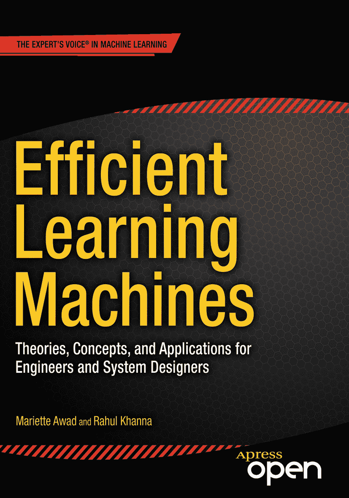

<!--

玛丽埃特·阿瓦德 与 拉胡尔·卡纳 高效学习机器：面向工程师与系统设计者的理论、概念及应用

ISBN 978-1-4302-5989-3  
电子书 ISBN 978-1-4302-5990-9  
DOI 10.1007/978-1-4302-5990-9  
© Apress 2015  

《高效学习机器：面向工程师与系统设计者的理论、概念及应用》

ApressOpen 版权声明：您有权出于非商业目的，完整复制、使用和分发本作品（电子版，未经修改）。  
常务董事：Welmoed Spahr  
首席编辑：Jeffrey Pepper (Apress)；Steve Weiss (Apress)；Patrick Hauke (Intel)  
采编编辑：Robert Hutchinson  
开发编辑：Douglas Pundick  
技术审校：Abishai Daniel, Myron Porter, Melissa Stockman  
协调编辑：Rita Fernando  
文字编辑：Lisa Vecchione  

如需了解翻译信息，请发送电子邮件至 `rights@apress.com`，或访问 [`www.apress.com`](http://www.apress.com/)。  

作品分发许可：本作品版权归 Apress Media, LLC 所有，保留所有权利。除本许可规定外，禁止使用本作品。行使本协议中的任何权利，即表示您接受本许可条款。您拥有非排他性权利，出于所有非商业目的，以目前已知或今后出现的任何媒体和格式，完整复制、使用和分发本英文作品（电子版，未经修改，但为在特定设备上格式化而进行的必要修改除外）。  

尽管本作品中的建议和信息在出版时被认为是真实准确的，但作者、编辑和出版商均不对可能存在的任何错误或遗漏承担法律责任。出版商对本文所含内容不作任何明示或暗示的担保。  

本书中可能出现商标名称、标识和图像。我们仅在编辑风格中使用这些名称、标识和图像，以维护商标所有者的利益，并无意侵犯商标权，而非在每次出现时都使用商标符号。  

本书中使用的商品名称、商标、服务标志及类似术语，即使未明确标识，也不应被视为对其是否受专有权利保护的表达。  

尽管本书中的建议和信息在出版时被认为是真实准确的，但作者、编辑和出版商均不对可能存在的任何错误或遗漏承担法律责任。出版商对本文所含内容不作任何明示或暗示的担保。  

本书通过 Springer Science+Business Media New York 在全球图书贸易中发行，地址：233 Spring Street, 6th Floor, New York, NY 10013。电话：1-800-SPRINGER，传真：(201) 348-4505，电子邮件：orders-ny@springer-sbm.com，或访问 www.springeronline.com。  

献给我的家人，尤其是埃德温，我的阳光。  
——玛丽埃特  

献给我的家人，尤其是我的母亲乌德什，她始终相信我。  
——拉胡尔  

关于 ApressOpen

## 什么是 ApressOpen？

*   ApressOpen 是一个开放获取图书项目，出版高质量的技术和商业信息。
*   ApressOpen 电子书可供全球免费非商业使用。
*   ApressOpen 电子书提供 PDF、ePub 和 Mobi 格式。
*   用户友好的 ApressOpen 免费电子书许可协议见本书版权页。
-->

# 致谢

衷心感谢 Yara Rizk（第 7 章）、Nadine Hajj（第 8 章）、Nicolas Mitri（第 9 章）和 Obada Al Zoubi（第 9 章）对本书的贡献。

我们还要感谢 Kshitij Doshi、Christian Le、John J. Jaiber、Martin Dimitrov 和 Karthik Kumar，他们帮助开发了第 11 章中详述的相位检测和工作负载指纹识别概念。

目录 第 1 章：机器学习 1 关键术语 2 开发学习机器 5 机器学习算法 6 流行的机器学习算法 10 C4.5 10 k-Means 10 支持向量机 11 Apriori 12 期望最大化 12 PageRank 13 AdaBoost（自适应增强） 13 k-最近邻 14 朴素贝叶斯 15 分类与回归树 15 数据挖掘研究中的挑战性问题 15 面向高维数据与高速数据流的扩展 16 挖掘序列数据与时间序列数据 16 从复杂数据中挖掘复杂知识 16 分布式数据挖掘与多智能体数据挖掘 16 数据挖掘过程相关问题 16 安全性、隐私与数据完整性 17 处理非静态、不平衡与代价敏感数据 17 总结 17 参考文献 17 第 2 章：机器学习与知识发现 19 知识发现 21 分类 21 聚类 22 降维 22 协同过滤 22 机器学习：分类算法 22 逻辑回归 22 随机森林 24 隐马尔可夫模型 24 多层感知器 25 机器学习：聚类算法 27 k-Means 聚类 27 模糊 k-Means（模糊 c-Means） 28 流式 k-Means 28 机器学习：降维 29 奇异值分解 29 主成分分析 30 Lanczos 算法 32 机器学习：协同过滤 33 基于用户的协同过滤 33 基于物品的协同过滤 34 加权 l-正则化交替最小二乘法 34 机器学习：相似度矩阵 35 皮尔逊相关系数 35 斯皮尔曼等级相关系数 35 欧几里得距离 36 杰卡德相似系数 36 总结 37 参考文献 38 第 3 章：用于分类的支持向量机 39 从几何角度看 SVM 39 SVM 的主要特性 41 硬间隔 SVM 43 软间隔 SVM 46 核 SVM 48 多类 SVM 50 处理不平衡数据集的 SVM 52 改进 SVM 的计算需求 54 SVM 在手写识别中的案例研究 56 预处理 56 特征提取 57 分层三阶段 SVM 58 实验结果 59 复杂度分析 61 参考文献 62 第 4 章：支持向量回归 67 SVR 概述 67 SVR：概念、数学模型与图形表示 68 核 SVR 与不同损失函数：数学模型与图形表示 72 贝叶斯线性回归 74 用于功率预测的非对称 SVR：案例研究 76 参考文献 79 第 5 章：隐马尔可夫模型 81 离散马尔可夫过程 82 定义 1 83 定义 2 83 定义 3 83 隐马尔可夫模型简介 84 隐马尔可夫模型要点 85 HMM 的三个基本问题 86 HMM 三个基本问题的解决方案 87 连续观测 HMM 92 多元高斯混合模型 93 示例：工作负载阶段识别 94 监控与观测 95 工作负载与阶段 95 用于阶段检测的混合模型 97 参考文献 104 第 6 章：仿生计算：群体智能 105 应用 106 可演化硬件 106 仿生网络 108 数据中心优化 109 仿生计算算法 110 群体智能 111 蚁群优化算法 111 粒子群优化 113 人工蜂群算法 115 细菌觅食优化算法 117 人工免疫系统 118 数据中心中的分布式管理 119 工作负载特征化 120 热优化 120 负载均衡 121 算法模型 121 参考文献 123 第 7 章：深度神经网络 127 ANN 简介 127 早期 ANN 结构 128 经典 ANN 129 ANN 训练与反向传播算法 133 DBN 概述 134 受限玻尔兹曼机 137 DNN 训练算法 138 DNN 相关研究 140 DNN 应用 140 加速 DNN 训练的并行实现 141 与 DBN 类似的深度网络 142 参考文献 142 第 8 章：皮层算法 149 皮层算法入门 149 皮层算法结构 149 皮层算法的训练 152 权重更新 154 实验结果 156 改进的皮层算法应用于阿拉伯语口语数字：案例研究 159 基于熵的权重更新规则 159 实验验证 160 参考文献 164 第 9 章：深度学习 167 层级时间记忆概述 167 层级时间记忆的演进 168 稀疏分布式表示 171 算法实现 171 空间池化器 172 时间池化器 173 相关工作 174 脉冲神经网络概述 175 Hodgkin-Huxley 模型 176 积分点火模型 176 漏积分点火模型 177 Izhikevich 模型 177 Thorpe 模型 178 SNN 中的信息编码 178 SNN 中的学习 179 SNN 变体与扩展 180 结论 182 参考文献 182 第 10 章：多目标优化 185 形式化定义 186 帕累托最优 187 支配关系 187 性能度量 188 机器学习：进化算法 189 遗传算法 190 遗传编程 191 多目标优化：一种进化方法 192 加权求和法 192 向量评估遗传算法 193 多目标遗传算法 194 小生境帕累托遗传算法 194 非支配排序遗传算法 195 强度帕累托进化算法 196 强度帕累托进化算法 II 198 帕累托存档进化策略 199 基于帕累托包络的选择算法 200 基于帕累托包络的选择算法 II 201 精英非支配排序遗传算法 201 示例：多目标优化 204 目标函数 206 参考文献 207 第 11 章：机器学习实战：示例 209 可行系统建模 211 示例 1：计算节点上的工作负载指纹识别 213 阶段确定 214 指纹识别 218 预测 221 示例 2：动态能源分配 221 学习过程：特征选择 222 学习过程：优化规划 224 学习过程：监控 225 模型训练：流程与评估 227 示例 3：入侵检测的系统方法 230 建模方案 231 入侵检测系统架构 233 配置文件与系统考量 236 传感器数据测量 237 总结 239 参考文献 239 索引 241 内容概览 关于作者 xv   关于技术审稿人 xvii   致谢 xix   第 1 章：机器学习 1   第 2 章：机器学习与知识发现 19   第 3 章：用于分类的支持向量机 39   第 4 章：支持向量回归 67   第 5 章：隐马尔可夫模型 81   第 6 章：仿生计算：群体智能 105   第 7 章：深度神经网络 127   第 8 章：皮层算法 149   第 9 章：深度学习 167   第 10 章：多目标优化 185   第 11 章：机器学习实战：示例 209   索引 241   关于作者与关于技术审稿人 关于作者 关于技术审稿人

