# 1. 机器学习

大自然是一台自制的机器，其自动化程度比任何人造机器都更加完美。以自然为蓝本创造事物，就是创造机器，而人类正是通过学习自然的内在运作方式，才成为了机器的建造者。 ——埃里克·霍弗，《人类境况反思》

机器学习（ML）是人工智能的一个分支，它系统性地运用算法来综合数据与信息之间的内在关系。例如，机器学习系统可以针对自动语音识别系统（如 iPhone 的 Siri）进行训练，将一段语音数据序列中的声学信息转换为以单词串形式表达的语义结构。

机器学习已在网络搜索、广告投放、信用评分、股市预测、基因序列分析、行为分析、智能优惠券、药物研发、天气预报、大数据分析等众多领域得到广泛应用。机器学习将在众多以用户为中心的创新发展中发挥决定性作用。

机器学习之所以得到迅速普及，是因为它能够表征大型数据阵列中的内在关系，从而解决大数据分析、行为模式识别和信息演化中的问题。此外，机器学习系统可以被训练来对流程中不断变化的条件进行分类，从而模拟操作行为的变化。随着知识体系在新思想和技术的影响下不断演进，机器学习系统能够识别出现有模型受到的干扰，并重新设计和重新训练自身，以适应新知识并与之共同演化。

机器学习的计算特性在于概括训练经验（或示例），并输出一个估计目标函数的假设。机器学习的泛化属性使其能够通过准确预测未来数据，在未见过的数据实例上表现良好。与其他优化问题不同，机器学习没有一个可以优化的明确定义的函数。相反，训练误差是测试学习误差的催化剂。泛化过程需要分类器，这些分类器输入离散或连续的特征向量，并输出一个类别。

机器学习的目标是预测计算机未知的未来事件或场景。1959 年，阿瑟·塞缪尔将机器学习描述为“赋予计算机无需明确编程即可学习能力的研究领域”（Samuel 1959）。他总结道，让计算机从经验中学习，最终应能消除对大量详细编程工作的需求。根据汤姆·M·米切尔对机器学习的定义：“如果计算机程序在 T 类任务上的性能（由 P 衡量）随着经验 E 而提高，则称该程序从关于某类任务 T 和性能度量 P 的经验 E 中学习。”艾伦·图灵的 seminal 论文（Turing 1950）引入了一个展示机器智能的基准标准，即机器必须能够以无法与人类区分的方式做出智能且灵敏的响应。

学习过程通过作用于历史经验来概括问题，发挥着至关重要的作用。经验以训练数据集的形式存在，这有助于在新的、未见过的任务上获得准确结果。训练数据集包含一个现有的问题域，学习器利用该域来构建关于该域的通用模型。这使得模型能够在新的情况下生成高度准确的预测。

## 关键术语

为方便读者理解机器学习的概念，本节定义并讨论了一些与机器学习相关的关键跨学科概念术语。

*   **分类器**：一种方法，它将新的输入作为观察或特征的未标记实例接收，并识别其所属的类别或分类。许多常用的分类器采用统计推断（概率度量）来为给定实例分类出最佳标签。
*   **混淆矩阵**（亦称误差矩阵）：一种使用矩阵中的数据来可视化分类算法性能的矩阵。它以假阳性、真阳性、假阴性和真阴性信息的形式，将预测分类与实际分类进行比较。一个二分类器系统的混淆矩阵（Kohavi and Provost, 1998）如下：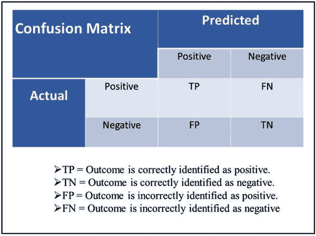
*   **准确率**（亦称错误率）：模型在数据集上做出正确（或错误）预测的比率。准确率通常通过使用一个在学习过程中从未使用过的独立测试集来估计。更复杂的准确率估计技术，如交叉验证和自助法，也常被使用，尤其是在包含少量实例的数据集上。

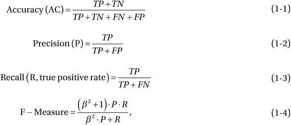

其中 β 的取值范围为 0 到无穷大（∞），用于控制分配给 P 和 R 的权重。

*   **代价**。衡量模型对既定结果进行预测（或评估）的性能（或准确度）的指标；换言之，它量化了预测值与实际值（或类别标签）之间的偏差。优化函数试图最小化代价函数。
*   **交叉验证**。一种评估模型对独立数据集泛化能力的验证技术。它定义了一个数据集，用于在训练阶段测试已训练的模型是否存在过拟合。交叉验证也可用于评估各种预测函数的性能。在 k 折交叉验证中，训练数据集被任意划分为 k 个互斥且大小相等的子样本（或称折）。模型被训练 k 次（或称 k 折），每次迭代使用 k 个子样本中的一个进行测试（交叉验证），其余 k-1 个子样本用于训练模型。将 k 次交叉验证的结果取平均值，以单一估计值的形式评估准确度。
*   **数据挖掘**。在大型数据集中进行知识发现（参见该词条）或模式检测的过程。数据挖掘所涉及的方法有助于提取准确数据，并将其转换为已知结构以供进一步评估。
*   **数据集**。符合某种模式且无排序要求的数据集合。在典型的数据集中，每一列代表一个特征，每一行代表数据集中的一个成员。
*   **维度**。定义某一属性的一组属性。维度的主要功能是过滤、分类和分组。
*   **归纳算法**。一种使用训练数据集生成模型的算法，该模型能够泛化到训练数据集之外的数据。
*   **实例**。由特征向量表征的对象，模型可基于这些特征向量进行训练以实现泛化，或用于进行预测。
*   **知识发现**。从结构化或非结构化来源中抽象出知识，作为进一步探索基础的过程。这类知识被共同表示为一种模式，并可以浓缩为一个或多个模型的形式，以便对这些模型进行查询，用于统计预测、评估和进一步的知识发现。
*   **模型**。对数据集进行描述或预测的总结性结构。每个模型都可以根据应用的特定需求进行调整。大数据应用中的数据集规模庞大，包含众多预测变量和特征，过于复杂，简单的参数模型难以从中提取有用信息。学习过程从给定的数据集中综合出模型的参数和结构。模型通常可分为参数模型（由有限参数集描述，未来预测独立于新数据集）或非参数模型（由无限参数集描述，数据分布无法用有限参数集表示）。非参数模型简单灵活，假设条件较少，但需要更大的数据集才能得出准确结论。
*   **联机分析处理（OLAP）**。一种解决多维分析查询的方法。此类查询使用两个或多个属性（或维度）对数据进行索引。OLAP 涵盖广泛的商业智能数据，通常与多维 OLAP（MOLAP）同义。OLAP 引擎支持从多个角度交互式地探索多维数据，从而能够快速执行复杂的分析查询和即席查询。OLAP 通常使用中间数据结构来存储多维数据的预计算结果，从而实现快速计算。关系型 OLAP（ROLAP）则使用基础数据和维度表的关系型数据库。
*   **模式**。对数据集属性和特性的高级规范说明。
*   **监督学习**。提取独立属性与指定依赖属性（标签）之间关联的学习技术。监督学习使用训练数据集，通过输入数据和输出值来开发预测模型。然后，该模型可以对新数据集的输出值进行预测。使用监督学习开发的模型性能取决于训练数据集的大小和方差，以便对新数据集实现更好的泛化能力和更强的预测能力。大多数归纳算法都属于监督学习范畴。
*   **无监督学习**。在没有预先指定依赖属性的情况下对实例进行分组的学习技术。该技术通常涉及通过排除纯粹的无结构噪声来学习数据中的结构化模式。聚类和降维算法通常是无监督的。
*   **特征向量**。一个 n 维数值向量，由解释变量组成，代表某个对象的实例，便于处理和统计分析。特征向量通常被加权以构建预测函数，用于评估预测的质量或拟合度。特征向量的维度可以通过各种降维技术来降低，例如主成分分析（PCA）、多线性子空间降维、等距映射和潜在语义分析（LSA）。与这些向量相关联的向量空间通常被称为特征空间。

## 开发学习机器

机器学习有助于开发那些通过经验和训练来提升特定任务性能的程序。许多大数据应用借助机器学习以最高效率运行。数据流的庞大规模、多样性和高速性，使得利用人类自然能力实时分析数据变得不切实际。社交网络的兴起和基于互联网的应用程序的广泛使用，不仅带来了数据量的增长，也增加了数据的复杂性。为了保持数据分辨率并避免数据丢失，这些数据流需要被实时分析。

大数据流的异构性以及我们如今拥有的强大计算能力，为我们提供了丰富的机会来培养能够为特定业务问题识别最佳实践的学习方法。现代计算机的复杂性能够处理海量数据、更高的复杂度以及数 TB 的存储。此外，在这些机器上运行的智能程序流可以处理并组合许多此类复杂的数据流，以开发预测模型，并从原本嘈杂的数据中提取内在模式。当你需要预测或预报一个目标值时，监督学习是合适的选择。下一步则是根据目标值，在聚类（针对离散目标值）和回归（针对数值目标值）之间做出决定。

你通过识别所有对决策过程至关重要的指标来开始机器学习的开发。机器学习的过程会综合模型以优化这些指标。由于这些指标对于为特定决策过程开发解决方案至关重要，因此在概念阶段必须仔细选择它们。

判断机器学习是否是解决特定问题的合适方法也很重要。就其本质而言，机器学习无法提供完美的准确性。对于需要在限定时间内获得高度精确结果的解决方案，机器学习可能不是首选方法。通常，以下条件有利于机器学习的应用：(a) 不需要非常高的精度；(b) 大量数据包含尚未发现的模式或需要综合的信息；(c) 由于缺乏知识或历史信息作为开发合适算法的基础，问题本身尚未被充分理解；(d) 问题需要适应不断变化的环境条件。

开发机器学习算法的过程可以分解为以下步骤：

**收集数据。** 选择所有可用数据属性中可能有助于解决问题的子集。选择所有可用数据可能是不必要的，甚至适得其反。根据问题的不同，数据可以通过数据流 API（例如 CPU 性能计数器）检索，或通过组合多个数据流来合成。在某些情况下，输入数据流（无论是原始的还是合成的）可能会经过统计预处理，以改善使用效果或减少带宽。

**预处理数据。** 以数据使用者能够理解的方式呈现数据。预处理包括以下三个步骤：
**格式化。** 数据需要以可用的格式呈现。使用行业标准格式可以将解决方案与多个供应商对接，这些供应商反过来可以混合搭配算法和数据源，例如 XML、HTML 和 SOAP。
**清洗。** 需要通过删除、替换或修复损坏或缺失的数据来清洗数据。在某些情况下，数据需要被归一化、离散化、平均化、平滑化或微分处理，以便高效使用。在其他情况下，数据可能需要以整数、双精度或字符串形式传输。
**采样。** 需要以规则或自适应间隔对数据进行采样，以最小化冗余，同时不丢失通过通信信道传输的信息。

**转换数据。** 根据算法和问题的知识来转换数据。转换可以表现为特征缩放、分解或聚合的形式。特征可以被分解以提取数据中嵌入的有用成分，或者被聚合以将多个实例组合成一个单一特征。

**训练算法。** 从转换后的数据中选择训练集和测试集。算法在训练集上进行训练，并在测试集上进行评估。转换后的训练数据集被输入算法，用于提取知识或信息。这些训练后的知识或信息被存储为一个模型，用于交叉验证和实际使用。无监督学习没有目标值，因此不需要训练步骤。

**测试算法。** 评估算法以测试其有效性和性能。此步骤能够快速确定是否可以在数据中识别出任何可学习的结构。一个在测试数据集上暴露的训练模型，会根据对该测试数据集所做的预测（这些预测指示了模型的性能）进行衡量。如果模型的性能需要改进，则通过更改数据流、采样率、转换、线性化模型、异常值移除方法和偏置方案来重复前面的步骤。

**应用强化学习。** 大多数控制理论应用需要良好的反馈机制以实现稳定运行。在许多情况下，反馈数据是稀疏的、延迟的或不具体的。在这种情况下，监督学习可能不实用，可以用强化学习（RL）来代替。与监督学习相比，强化学习采用动态性能再平衡，从与环境交互的后果中学习，而无需显式训练。

**执行。** 应用经过验证的模型来执行实际的预测任务。如果遇到新数据，则通过应用前面的步骤重新训练模型。训练过程可以与预测未来行为的实际任务共存。

## 机器学习算法

基于机器学习学习阶段所提供的输入数据与预期输出之间的底层映射关系，机器学习算法可分为以下六类：

*   **监督学习**是一种学习机制，它推断观测数据（也称为输入数据）与待预测的目标变量（因变量或标签）之间的潜在关系（图 1-1）。该学习任务使用带标签的训练数据（训练样本）来综合生成模型函数，该函数试图泛化特征向量（输入）与监督信号（输出）之间的潜在关系。特征向量会影响变化的方向和幅度，以提升函数模型的整体性能。训练数据包含观测到的输入（特征）向量和一个期望的输出值（也称为监督信号或类别标签）。基于监督学习算法训练良好的函数模型，能够准确预测隐藏在陌生或未观测数据实例中的现象的类别标签。学习算法的目标是最小化给定输入集（训练集）的误差。然而，对于受标签样本准确性和多样性影响的低质量训练集，模型可能会遇到过拟合问题，这通常表现为泛化能力差和分类错误。

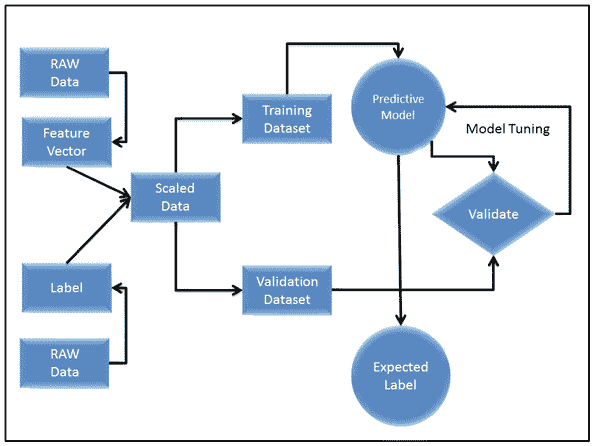

图 1-1.

监督学习的高级流程

*   **强化学习**方法涉及智能体（RL-agent）在给定环境中探索一系列自适应的动作或行为，其动机是最大化累积奖励（图 1-2）。智能体的动作会引发环境状态的可观测变化。该学习技术通过针对一组给定的实验动作和观测到的环境状态响应进行自我训练，从而综合出一个自适应模型。通常，这种方法可以被视为一种控制理论中的试错学习范式，其奖励和惩罚与一系列动作相关联。RL-agent 会根据集体经验和随之而来的奖励来改变其策略。RL 会寻找它过去探索过的、曾带来奖励的动作。为了构建所有可能的动作-奖励映射的详尽数据库或模型，需要尝试许多未经证实的动作。这些未经测试的动作可能需要多次尝试才能确定其有效性。因此，必须在探索新的可能动作与这些动作可能导致的失败可能性之间取得平衡。RL 的关键要素包括：
    *   **策略**是 RL-agent 的关键组成部分，它将控制动作映射到感知到的环境状态。
    *   **评判者**代表一个估计的价值函数，它批评根据现有策略所采取的动作。或者，评判者评估当前状态在响应根据当前策略所采取的动作时的表现。评判者智能体通过持续不断的修正来塑造策略。
    *   **奖励函数**评估对于尝试的控制动作，感知到的环境状态的即时期望程度。
    *   **模型**是规划工具，通过设想可能的未来情况来帮助预测未来的行动过程。

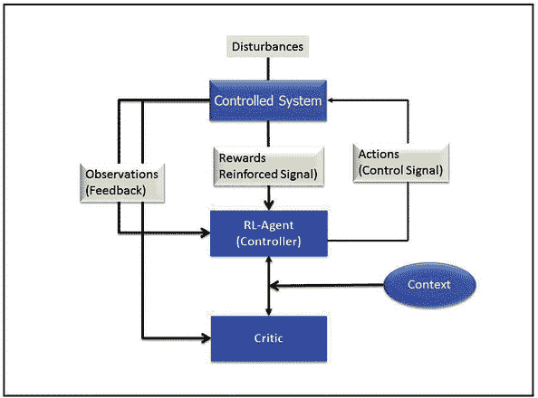

图 1-2.

强化学习的高级流程
*   **转导学习**（又称转导推理）试图通过利用训练数据集上与新案例相关的额外观测值，来预测特定测试用例上的专属模型函数（Vapnik 1998）。通过将新的个体观测值（训练数据）拟合到空间中的一个单点来建立局部模型——这与全局模型形成对比，在全局模型中，新数据必须拟合到现有模型中，而无需假设与该数据点在空间中的位置相关的任何特定信息。尽管新数据可能在一定程度上（存在一些误差）拟合到全局模型中，但创建一个能够代表整个问题空间的全局模型是一项挑战，并且在所有情况下可能并非必要。通常，如果在针对给定问题空间的模型开发过程中遇到不连续性，可以在不连续的边界处综合多个模型。在这种情况下，新观测到的数据将通过满足模型有效边界条件的模型进行处理。
*   **归纳推理**基于数据与整个假设空间的关系来估计模型函数，并使用该模型来预测训练集之外示例的输出值。这些函数可以使用多种表示方案来定义，包括线性加权多项式、逻辑规则以及概率描述（如贝叶斯网络）。许多统计学习方法从假设空间的初始解开始，然后迭代地演化它们以减少误差。许多流行的算法都属于这一类，包括支持向量机（Vapnik 1998）、神经网络模型（Carpenter 和 Grossberg 1991）以及神经模糊算法（Jang 1993）。在某些情况下，可以应用惰性学习模型，其中泛化过程可以是一项持续的任务，它基于应用于现有模型的新数据，有效地开发出更丰富的假设空间。

*   无监督学习算法旨在发现未标记数据集中隐藏的结构，而数据集的期望输出是未知的。这种机制在数据压缩、异常值检测、分类、人类学习等领域有许多应用。其通用学习方法涉及通过概率数据模型进行训练。无监督学习的两个常见例子是聚类和降维。通常，无监督学习数据集由输入 x[1], x[2], x[3]...x[n] 组成，但既不包含目标输出（如监督学习），也不包含来自环境的奖励。在这种情况下，机器学习的目标是假设输入数据的表示形式，以便进行高效的决策、预测、信息过滤和聚类。例如，无监督训练可以帮助开发基于阶段的模型，其中每个阶段通过无监督学习过程合成，代表了用于机会性调整过程的一个独特条件。此外，每个阶段可以作为一个状态，并可用于预测，以实现主动的资源分配或分发。以概率分布模型为中心的无监督学习算法通常使用最大似然估计（MLE）、最大后验概率（MAP）或贝叶斯方法。其他不基于概率分布模型的算法可能采用统计测量、量化误差、方差保持、熵间隙等方法。
*   半监督学习结合使用少量标记数据集和大量未标记数据集来生成模型函数或分类器。由于获取数据的标记过程需要大量熟练的人力投入，因此成本高昂且不切实际。相比之下，未标记数据相对便宜且易于获取。半监督机器学习方法的运作介于无监督学习（未标记训练数据）和监督学习（标记训练数据）的指导原则之间，并能显著提高学习准确性。近年来，由于大量未标记数据可用于网络数据、消息数据、股票数据、零售数据、生物数据、图像等各种应用，半监督学习获得了更大的关注。这种学习方法可以带来具有实践和理论意义的价值，尤其是在与人类学习相关的领域，如语音、视觉和手写识别，这些领域涉及少量直接指导和大量未标记经验。

### 流行的机器学习算法

本节依次介绍 IEEE 国际数据挖掘大会（ICDM）于 2006 年 12 月评选出的十大最具影响力的数据挖掘算法：C4.5、k-means、支持向量机（SVM）、Apriori、期望最大化（EM）、PageRank、AdaBoost、k-近邻（k-NN）、朴素贝叶斯以及分类与回归树（CART）（Wu 等人，2008）。

### C4.5

C4.5 分类器是数据挖掘中最常用的算法类别之一。C4.5 分类器输入一组案例，其中每个案例是一个预先分类到某个现有类别的样本。每个案例由其 n 维向量描述，该向量代表样本的属性或特征。C4.5 分类器的输出可以准确预测一个未见案例的类别。C4.5 分类算法通过综合基于树结构的模型，生成表示为决策树的分类器。树结构中的每个节点表征一个特征，相应的分支代表连接特征的可能值，而叶子节点代表终止一系列节点和分支的类别。一个实例的类别可以通过追踪从节点和分支到终止叶子节点的路径来确定。

给定一个实例集合 S，C4.5 使用分治方法生成初始树，具体如下：

*   如果列表 S 中的所有样本都属于同一类别，或者列表 S 很小，则为决策树创建一个叶子节点，并用最频繁的类别标记它。
*   否则，算法选择一个基于属性的测试，将 S 分支成多个子分支（分区）（S1, S2, …），每个子分支代表测试的一个结果。测试被放置在树的根节点，从根到叶子的每条路径都成为一个规则脚本，在叶子节点处标记一个类别。此过程递归地应用于每个子分支。
*   当前分支的每个分区代表一个子节点，而分隔 S 的测试代表树的分支。

此过程持续进行，直到每个叶子节点只包含来自一个类别的实例，或者无法进一步分区为止。C4.5 使用测试来选择具有最高归一化信息增益的属性，从而能够消除可能属于两个或多个类别的案例分类中的歧义。

### k-Means

k-means 算法是一种简单的迭代聚类算法（Lloyd 1957），它将 N 个数据点划分为 K 个不相交的子集 S[j]，以最小化平方和准则。由于平方和是欧几里得距离的平方，直观上这就是“最近”的均值，

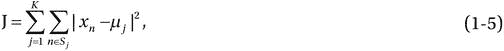

其中

x[n] = 表示第 n 个数据点的向量

μ[j] = S[j] 中数据点的几何质心

该算法由一个简单的两步重估过程组成：

分配：数据点被分配给其质心离该点最近的簇。  
更新：每个簇的质心被重新计算为分配给它的所有数据点的中心（均值）。

这两个步骤交替进行，直到满足停止准则，例如数据点的分配不再发生变化。每次迭代需要 N × K 次比较，这代表了一次迭代的时间复杂度。

### 支持向量机

支持向量机（SVM）是一种分析数据并识别模式的监督学习方法。SVM 主要用于分类、回归分析和新颖性检测。给定一个二分类学习任务中的一组训练数据，SVM 训练算法构建一个模型或分类函数，将新的观测值分配到超平面两侧的两个类别之一，使其成为一个非概率的二元线性分类器（图 1-3）。SVM 模型将观测值映射为空间中的点，以便将它们分类到由到任何类别最近观测数据点的最大距离（函数间隔）所划分的独立分区中。然后，根据新观测值落在分区的哪一侧，预测其属于哪个类别。支持向量是距离划分类别的超平面最近的数据点。支持向量机的更多细节见第 4 章。

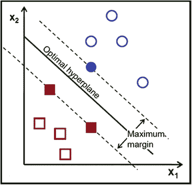

图 1-3.

SVM 算法找到使支持向量之间的最小距离最大化的超平面

### Apriori

Apriori 是一种数据挖掘方法，它通过从事务数据库中生成候选项集（Agrawal 和 Srikant，1994）来发现频繁项集，并突出显示数据库中的关联规则（总体趋势）。该方法假设频繁出现模式的任何子集也必定是频繁的。Apriori 采用广度优先搜索，通过累加满足最小支持度要求的每个项的计数，来扫描频繁 1-项集（即大小为 1 的项集）。频繁 1-项集的集合用于查找频繁 2-项集的集合，依此类推。此过程迭代进行，直到无法找到更多的频繁 k-项集。识别所有频繁项集的 Apriori 方法可归纳为以下三个步骤：

从频繁 k-项集（大小为 k）生成频繁 k+1-项集（大小为 k+1）的候选集。   扫描数据库以识别频繁 k+1-项集的候选集，并计算每个候选集的支持度。   将满足最小支持度要求的那些项集添加到大小为 k+1 的频繁项集中。

部分由于该算法的简洁性，它被广泛应用于数据挖掘应用中。人们提出了各种改进方法，特别是频繁模式增长（FP-growth）扩展，它消除了候选集生成过程。Han 等人（Han, Pei, 和 Yin，2000）提出了一种频繁模式树（FP-tree）结构，该结构存储并压缩了解释频繁模式所需的关键信息，并使用 FP-growth 通过模式片段增长来挖掘全面的频繁模式集。这种 Apriori 技术的增强版构建了一个包含所有关键信息的大型数据库，并将其压缩成一个高度紧凑的数据结构。在后续步骤中，它组装了一个条件模式基，该基表示一组相对于每个项共同出现的计数模式。从频繁项头表开始，它通过跟踪每个频繁项来遍历 FP-tree，并存储这些项的前缀路径以生成条件模式基。最后，它为条件模式基中的每个频繁项构建一个条件 FP-tree。树中的每个节点代表一个项及其计数。共享相同标签但位于不同子树上的节点通过节点链接指针连接。节点在树结构中的位置表示项的频率顺序，因此更靠近根节点的节点可能被事务数据库中的更多事务共享。

### 期望最大化

期望最大化（EM）算法便于在包含不完整数据的概率模型中进行参数估计。EM 是一种迭代方案，用于在存在隐藏或潜在变量的情况下，估计统计模型中参数的 MLE 或 MAP。EM 算法在以下两个步骤之间迭代交替：执行期望（E）步骤，该步骤使用参数的当前估计值，创建一个函数来估计缺失（未观测）数据可能补全的概率分布；以及执行最大化（M）步骤，该步骤使用在 E 步骤期间执行的当前补全来重新估计参数。这些参数估计值被迭代地用于在后续的 E 步骤中估计隐藏变量的分布。通常，EM 涉及运行一个具有以下属性的迭代算法：(a) 观测数据 X；(b) 潜在（或缺失）数据 Z；(c) 未知参数 θ；以及 (d) 似然函数 L(θ; X, Z) = P(X, Z|θ)。EM 算法使用两步法迭代计算边际似然的 MLE：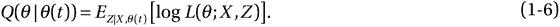 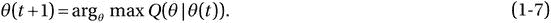

最大化（M）：找到使该量最大化的参数：   估计（E）：在给定 X 和参数当前估计值 θ(t) 的条件下，计算关于 Z 的条件分布的对数似然函数的期望值，使得

### PageRank

PageRank 是一种链接分析搜索算法，用于对万维网上超链接文档的元素进行排名，以衡量它们相对于其他链接的重要性。由拉里·佩奇和谢尔盖·布林开发的 PageRank 生成与搜索查询无关的静态排名。PageRank 模拟了社交网络中的声望概念。指向某个页面的超链接被视为一票支持。此外，PageRank 以这样一种方式解释从源页面到目标页面的超链接：排名较高的页面会提升被链接页面（源页面或目标页面）的排名。因此，来自高排名页面的反向链接比来自普通页面的反向链接更重要。从数学上讲，PageRank 可以计算为

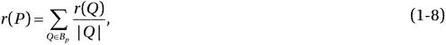

其中

r(P) = 页面 P 的排名

B [p] = 所有链接到页面 P 的页面的集合

|Q| = 从页面 Q 发出的链接数量

r(Q) = 页面 Q 的排名

### AdaBoost（自适应提升）

AdaBoost 是一种集成方法，用于将简单的弱分类器（或经验法则）进行线性组合，从而构建强分类器（Freund 和 Schapire，1997）。与任何集成方法一样，AdaBoost 使用多个学习器来解决问题，以获得更好的泛化能力和更准确的预测。强分类器可以评估为弱分类器的线性组合，如下所示：

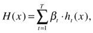

其中

H(x) = 强分类器

h [t] (x) = 弱分类器（特征）

AdaBoost 算法可总结如下：

输入：

数据集 I={(x [1],y [1]),(x [2],y [2]),(x [3],y [3]),...,(x [m] ,y [m] )},

基础学习算法 L

学习轮数 T

过程：

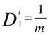              // 初始化权重分布

FOR (t = 1 到 T) DO     // 运行循环 t = T 次迭代

h [t] = L(I, D [t] )              // 使用 D [t] 从 I 训练一个弱学习器 h [t]

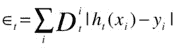              // 计算 h [t] 的误差

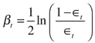              // 计算 h [t] 的权重

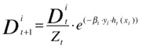       // 更新分布，

// Z [t] 是归一化因子

结束

输出：

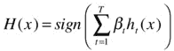// 强分类器

AdaBoost 算法是自适应的，因为它使用多次迭代来产生一个与真实分类器高度相关的强学习器。如上所示，它通过添加与真实分类器略微相关的弱学习器来进行迭代。作为自适应过程的一部分，权重向量会自我调整，以改进先前轮次中的错误分类。由此产生的分类器比弱学习器的分类器具有更高的准确性。AdaBoost 速度快、易于实现，并且具有灵活性，因为它可以与任何分类器结合使用。

### k-近邻算法

k-近邻（k-NN）分类方法会在训练集中找出与测试对象最接近的 k 个对象，并根据该邻域内最主要的类别来分配标签。该方法的三个基本要素是：

*   一组已有的带标签对象
*   用于估算对象间距离的距离度量
*   最近邻的数量（k）

为了对一个未标记对象进行分类，需要计算它与所有已标记对象之间的距离，并找出其 k 个最近邻。这些最近邻的类别标签可作为对该未标记对象进行分类的参考。k-NN 算法会计算训练集 (x, y) 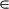 I 与测试对象  之间的相似度距离，以确定其最近邻列表 I [z]。x 代表训练对象，y 代表相应的训练类别。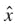 和 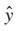 分别代表测试对象及其类别。该算法可总结如下：

输入：

训练对象 (x, y)  I 和测试对象 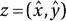

过程：

计算 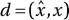 z 与每个对象 (x, y)  I 之间的距离。

选择 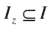，即与 z 最接近的 k 个训练对象的集合。

输出（多数类）：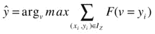

如果参数 (.) 为 TRUE，则 F(.) = 1，否则为 0，v 是类别标签。

k 值的选择需要谨慎。较小的值可能导致噪声行为，而较大的值则可能包含过多来自其他类别的点。

### 朴素贝叶斯

朴素贝叶斯是一种简单的概率分类器，它应用了贝叶斯定理，并带有特征之间相互独立的强（朴素）假设，即一个类别的某个特征的出现与另一个特征的出现无关。

假设输入特征 x [1], x [2], ... x [n] 在给定类别标签 Y 的条件下彼此条件独立，即：

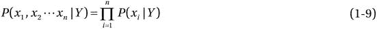

对于二分类问题（i = 0, 1），我们将 P(i|x) 定义为测量向量 x={x [1], x [2]...x [3]} 属于类别 i 的概率。此外，我们定义一个分类得分：

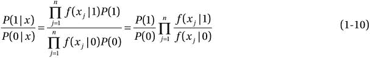 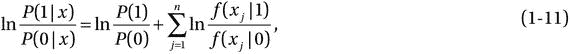

其中 P(i|x) 与 f(x|i)P(i) 成正比，而 f(x|i) 是类别 i 对象的 x 的条件分布。

朴素贝叶斯模型因其简单性和鲁棒性而异常有效且极具吸引力。由于该算法无需对大型数据集应用复杂的迭代参数估计方案，因此它非常有用，且构建和使用相对容易。它是文本分类和垃圾邮件过滤等相关领域中的流行算法。

### 分类与回归树

分类与回归树（CART）是一种非参数决策树，它使用二元递归划分方案，从包含完整学习样本的根节点开始，反复分裂两个子节点（Breiman 等人，1984 年）。树的生长过程涉及在每个节点所有可能的分裂中进行选择，使得生成的子节点“最纯”。一旦 CART 生成了一个“最大树”，它就会检查通过剪除最大树的分支而获得的较小树，以确定哪些分支对训练数据上树的整体性能贡献最小。CART 机制旨在产生一系列嵌套的剪枝树。通过评估剪枝序列中每棵树的预测性能，可以确定大小合适或“诚实”的树。

## 数据挖掘研究中的挑战性问题

数据挖掘和知识发现已成为与数据库系统、机器学习、智能信息系统、专家系统、控制理论等众多领域相关的跨学科研究领域。数据挖掘是一个重要且活跃的研究领域，但在处理可能包含噪声、不完整、冗余且本质动态的超大型数据库时，也面临着理论和实践上的挑战。Yang 和 Wu（2006 年）的一项研究回顾了数据挖掘研究中最具挑战性的问题，总结如下。

### 面向高维数据与高速数据流的扩展

设计能够处理通过高速数据流提取的极高维特征的分类器是一项挑战。为了确保决定性优势，此类情况下的数据挖掘应是一个持续的在线过程。但是，技术上的挑战阻碍了我们在存在环境漂移和概念漂移的情况下，对大量流式数据计算模型。如今，我们尝试通过增量挖掘和离线模型更新来解决这个问题，以保持对当前数据流的准确建模。通过开发内存数据库、高密度存储器和大容量存储，并辅以高性能计算基础设施，信息技术方面的挑战正在得到解决。

### 挖掘序列数据与时间序列数据

对序列化和时间序列数据进行有效的分类、聚类和预测，至今仍是一个开放的挑战。时间序列数据常常受到噪声的污染，这会对短期和长期预测产生不利影响。尽管可以使用信号处理技术或平滑方法来过滤噪声，但可能会导致过滤后的数据出现滞后。在闭环环境中，这可能会降低预测的准确性，因为我们最终可能会对过程本身过度补偿或供给不足。在某些情况下，可以通过差分预测器来纠正滞后，但这可能需要对模型本身进行大量调整。放置在数据输入/输出模块附近的噪声消除滤波器，可以在挖掘之前进行调整，以识别和清理噪声数据。

### 从复杂数据中挖掘复杂知识

复杂数据可以多种形式存在，可能需要特殊技术来提取对制定现实世界决策有用的信息。例如，信息可能以图形形式存在，需要发现大型数据中图形和结构化模式的方法。另一种复杂性可能以非独立同分布（non-iid）数据对象的形式存在，这些对象不能作为独立的单个对象进行挖掘。它们可能与其他数据对象共享应被识别的关系结构。

用于非结构化数据的最先进的数据挖掘方法，缺乏整合领域知识和知识接口的能力，无法将数据挖掘的结果与现实世界场景联系起来。

### 分布式数据挖掘与多智能体数据挖掘

在分布式数据感知环境中，发现分布式模式并关联通过不同探针流式传输的数据可能具有挑战性。目标是最大限度地减少数据交换量并降低所需的通信带宽。可以部署博弈论方法来应对这一挑战。

### 数据挖掘过程中的相关问题

自动化的数据挖掘与清洗操作能够显著提升数据挖掘效率。尽管我们可以快速处理模型并发现模式，但数据集成与数据清洗等预处理操作会产生主要成本。通过自动化降低这些成本所带来的收益，远大于试图进一步降低模型构建与模式发现成本所获得的回报。

### 安全性、隐私与数据完整性

在数据挖掘过程中确保用户隐私至关重要。保证所收集输入数据与合成个体模式的知识完整性同样不可或缺。

### 处理非静态、不平衡与成本敏感数据

数据在不同领域中动态且持续变化。历史的数据采样与模型构建试验可能并非最优方案。当基于新训练数据重新训练当前模型时，由于不同的选择偏差，可能会经历学习漂移。为进行准确预测，需要动态纠正此类偏差。

## 总结

本章通过关键术语、机器学习类型以及十大数据挖掘与机器学习算法，探讨了机器学习的核心要点。由于万维网上数据的爆炸式增长，机器学习已广泛应用于网络搜索、广告投放、信用评分、股市预测、基因序列分析、行为分析、智能优惠券、药物研发、天气预报、大数据分析等诸多领域。每天都有新的机器学习应用被探索。大数据分析与图分析已成为基于云的商业发展的重要组成部分。数据分析新领域与机器学习应用也加速了专用硬件与加速器的发展，以提升算法性能、大数据存储与数据检索能力。

