# 2. 机器学习与知识发现

知之为知之，不知为不知，是知也。——孔子《论语》

近年来，数据挖掘领域取得了显著进展。由于能够解决复杂问题，数据挖掘已应用于工程、生物科学、社交媒体、医学与商业智能等多个领域。大多数应用的主要目标是表征复杂数据流中的模式。这些模式随后与知识发现和决策相结合。在互联网时代，信息收集与时空数据的动态分析是创新以及开发更优产品与流程的关键。当数据集庞大且复杂时，使用传统统计方法处理和分析模式变得困难。大数据是指收集到的数据量巨大、形式复杂且非结构化，以至于无法使用标准数据库管理系统（如 `DBMS` 和 `RDBMS`）进行处理。与大数据相关的新兴挑战不仅包括处理日益增长的数据量，还包括需要提取、转换、分析、存储和可视化的数据流的广泛多样性与复杂性。大数据分析利用推断统计学，从信息密度低且受随机变化影响的大规模数据集中得出关于依赖性、行为与预测的结论。此类系统应能以在广泛情境下应用时产生合理答案的格式，对知识发现进行建模。大数据的特征如下：

*   **海量性**：生成的数据量巨大。从如此庞大的数据量中检测相关性与价值颇具挑战。

*   **多样性**：数据类型与来源范围广泛。

*   **高速性**：数据生成速度快。及时做出反应可能要求很高。

*   **波动性**：由于季节性和事件驱动的峰值，数据流可能高度不一致且难以管理。

*   **复杂性**：数据需要被链接、关联和相互关联，以推断非线性关系与因果效应。

现代技术进步使工业界得以涉足大数据与大数据分析。经济实惠的开源软件基础设施、更快的处理器、更便宜的存储、虚拟化、高吞吐量连接以及非结构化数据管理工具的发展，结合云计算，为高质量信息检索与更快速的分析打开了大门，使企业能够降低成本并缩短开发具有定制化功能的新产品所需的时间。

大数据与强大的分析能力可以整合起来，提供有价值的服务，例如：

*   **故障根本原因检测**：意外故障导致的计划外停机成本可能高达数十亿美元。根本原因分析（`RCA`）能够识别决定过去故障位置、规模、时间和性质的因素，并学习关联可防止此类故障再次发生的行动、条件和行为。`RCA` 将被动应对故障的方法转变为主动解决问题的方法，在问题发生前就加以解决，并避免不必要的升级。

*   **动态优惠券系统**：动态优惠券系统能够以极具选择性的方式发放折扣券，其发放方式与能够为产品或服务提供商带来最大战略利益的因素相对应。控制向选定接收者发放优惠券的因素，是基于现有地理位置、对特定产品的评估兴趣、历史消费模式、动态定价、按时间顺序的购物地点访问、产品浏览模式以及过往优惠券的兑换情况来建模的。这些因素中的每一个都会根据竞争压力、行为转变、季节性影响、外部因素以及产品成熟度动态进行加权和重新分析。优惠券会根据接收者的个人资料、情境和位置实时发放。向大量移动接收者发放优惠券的速度、精确度和准确性是需要考虑的重要因素。

*   **购物行为分析**：产品制造商尤其希望了解其竞争对手产品在卖场的热力图模式。例如，大屏幕电视制造商会想确定买家对其他电视制造商所提供功能的兴趣。这只能通过评估潜在买家在卖场中靠近竞争对手产品时的移动轨迹和停留时间来分析。此类报告可以实时地、针对单个制造商提供，也可以定期地、以汇总形式提供。这些报告可能会促使制造商发放动态优惠券，以影响仍处于决策阶段的潜在买家，同时也有助于制造商根据买家对竞争对手产品的兴趣程度，来改进、移除、保留或增强产品功能。

*   **检测欺诈行为**：与保险、医疗保健、信用卡和身份盗窃相关的各类欺诈行为每年给消费者和企业造成数十亿美元的损失。大数据和智能分析为开发实时解决方案以识别欺诈并在其发生前进行预防铺平了道路。智能分析会生成模型，用于验证与消费行为、地理位置、活动高峰和保险索赔相关的模式。如果某个模式无法验证，则会启动纠正、预防或惩罚措施。这些措施的准确性、精确性和速度对于成功隔离欺诈行为至关重要。例如，每笔交易可能会实时使用一个或多个模型评估多达 500 个属性。

*   **数据中心的工作负载资源调优与选择**：在云服务管理环境中，服务水平协议（`SLA`）定义了服务质量（`QoS`）的预期，用于管理由计算资源池构成的特定服务托管环境中的性能损失。通常，服务器系统中资源相互依赖的复杂性会导致次优行为，进而造成性能损失。一个表现良好的模型能够预测需求模式，并以及时和优化的方式主动应对动态压力。动态表征方法可以合成一个自校正的工作负载指纹码本，该码本有助于进行阶段预测，通过主动的工作负载分配和负载均衡实现持续调优。换句话说，码本表征了某些特征，这些特征会被持续重新评估，以重塑工作负载行为，从而适应与预期输出的偏差。然而，码本中最新的模型可能尚未经历过更新或未识别的模式。新的工作负载被托管在某个计算节点（在数千个潜在节点中）上，这种方式不仅能减少热热点，还能通过降低资源瓶颈来提升性能。能够实时分析并得出最优工作负载托管方案的速度，对于工作负载分配和均衡的成功至关重要。

## 知识发现

知识提取从结构化和非结构化来源收集信息，以构建知识数据库，用于从底层庞大且语义模糊的数据集中识别有意义且有用的模式。模糊数据集是其元素具有隶属度的集合。隶属度由取值在 0 到 1 之间的隶属函数定义。

提取的知识与源数据结合被重用，以生成模式的枚举，这些模式会被添加回知识库。知识发现的过程涉及对大量数据进行程序化探索，以寻找可被枚举为知识的模式。所获取的知识以模型的形式呈现，必要时可对这些模型提出特定查询。知识发现将计算机科学和机器学习（如数据库和算法）的概念与统计学的概念相结合，以解决面向用户的问题和疑问。知识可以用不同的形式来描述，例如参与者类别、属性关联模型和依赖关系。大数据中的知识发现使用核心机器学习算法，这些算法专为分类、聚类、降维和协同过滤以及可扩展的分布式系统而设计。本章讨论的是，当单台机器要处理的数据集非常大时，那些有用的机器学习算法类别。

### 分类

分类是开发能够复制人类决策的预测分析的核心。分类算法适用于边界清晰的问题，即输入遵循一组特定属性，且输出是分类的。通常，分类过程会建立一个经验档案，通过将新输入与先前观察到的模式进行匹配来评估新输入。如果模式能够匹配，则将该输入与预定义的预测行为模式关联起来。如果模式无法匹配，则将其隔离以进行进一步评估，以确定它是未发现的有效模式还是异常模式。基于机器的分类算法遵循监督学习技术，即算法通过使用精心准备的输入，从准确决策的示例（也称为训练集）中学习。分类涉及的两个主要步骤是：使用学习算法合成模型，以及利用该模型对新数据进行分类。

### 聚类

聚类是一个知识发现过程，它根据相似的属性（或特征）对给定集合中的项目进行分组。同一聚类中的成员具有相似的特征，而不同聚类中的成员则特征不同。通常，聚类涉及一个迭代的试错算法，该算法基于相似性（或相异性）假设运行，并在满足终止条件时停止。挑战在于找到一个函数，能够将两个项目（或数据点）之间的相似程度量化为一个数值。聚类的参数——例如聚类算法、距离函数、密度阈值和聚类数量——取决于具体的应用和单个数据集。

### 降维

降维是通过特征选择和特征提取来减少随机变量的过程。降维可以缩短训练时间、增强泛化能力并减少过拟合。特征选择是通过消除冗余或不相关的特征，合成原始变量的子集用于模型构建的过程。相比之下，特征提取则是通过组合属性，将高维空间转换为更低维空间的过程。

### 协同过滤

协同过滤是利用多个数据源之间的协作方法，对信息或模式进行过滤的过程。协同过滤通过收集具有相似兴趣的众多用户的偏好，并基于这些偏好做出推荐，从而探索感兴趣的领域。协同过滤算法期望在数据极其稀疏、用户和项目数量不断增长、存在同义词、数据噪声和隐私问题的情况下，仍能在短时间内做出令人满意的推荐。

机器学习基于从训练数据（模型）中习得的既定属性进行预测分析。机器学习通过将新信息与以模式形式存在的历史信息进行匹配，帮助探索有用的知识或先前未知的知识。这些模式用于过滤出新信息或模式。一旦这些新信息经过一组关联行为模式的验证，就会被整合到现有的知识库中。新信息也可能作为额外的训练数据，对现有模型进行修正。以下各节将探讨知识发现中使用的各种机器学习算法，涉及聚类、分类、降维和协同过滤。

## 机器学习：分类算法

### 逻辑回归

逻辑回归是一种概率统计分类模型，用于预测事件发生的概率。逻辑回归对分类因变量 `X` 与二分法分类结果或特征 `Y` 之间的关系进行建模。逻辑函数可以表示为

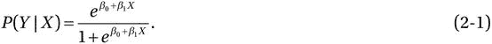

逻辑函数可以重写并转换为逻辑函数的反函数——称为 `logit` 或对数几率——这是生成逻辑回归系数的关键，

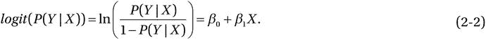

如图 2-1 所示，逻辑函数可以接收负无穷到正无穷之间的输入值范围（`β [0] +β [1] X`），并且输出（`P(Y|X)`）被限制在 0 到 1 之间。

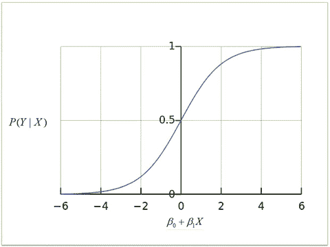

图 2-1.

逻辑函数

### 逻辑回归
P(Y|X) 的 logit 变换为线性回归提供了动态范围，并且可以转换回几率。逻辑回归方法使用回归系数 `β [0]` 和 `β [1]` 拟合回归曲线，如公式 2-1 所示，其中输出响应是二元（二分法）变量，`X` 是数值型。由于逻辑函数曲线是非线性的，因此使用 logit 变换（见公式 2-2）来执行线性回归，其中 `P(Y  |X)` 是给定 `X` 值时成功（`Y`）的概率。使用广义线性模型，可以构建一个估计的逻辑回归方程，如下所示

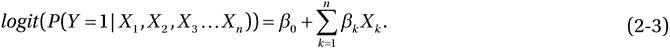

系数 `β [0]` 和 `β [k]`（`k = 1, 2, ..., n`）使用最大似然估计进行估计，以模拟因变量 `Y` 在给定 `X [k]`（`k = 1, 2, ..., n`）值时取值为 1 的概率。

逻辑回归广泛应用于结果以二元格式呈现的领域。例如，要根据身体质量指数预测血液胆固醇水平，你会使用线性回归，因为结果是连续型的。如果需要根据身体质量指数预测患糖尿病的几率，你会使用逻辑回归，因为结果是二元型的。

### 随机森林
随机森林（Breiman 2001）是一种用于分类的集成学习方法，其中“弱学习器”通过使用大量去相关决策树（即随机森林）协作形成“强学习器”。然而，随机森林并非基于单个深层树的输出来制定解决方案，而是聚合多个浅层树的输出，形成装袋法的额外一层。装袋法通过对数据集进行自助采样，使用独立的连续树构建 `n` 个预测器。这 `n` 个预测器通过平均化组合起来，以解决分类或估计问题。尽管单个分类器是弱学习器，但所有分类器组合起来就形成了一个强学习器。单个决策树具有高方差和高偏差，而随机森林通过平均多个决策树来提升估计性能。在集成术语中，决策树代表一个弱分类器。术语“森林”表示使用多个决策树来做出分类决策。

随机森林算法可以总结如下：

要构建 `B` 棵树，从原始数据集中选择 `n` 个自助样本。

对于每个自助样本，生长一棵分类树或回归树。

在树的每个节点：

– 从所有预测变量中随机选择 `m` 个预测变量（或特征子集）（随机子空间）。

– 提供最佳分割的预测变量在该节点执行二元分割。

– 下一个节点从所有预测变量中随机选择另一组 `m` 个变量，并执行上一步骤。

给定一个待分类的新数据集，取所有 `B` 棵子树的多数投票结果。

通过对树的集成进行平均，可以降低最终估计的方差。随机森林具有良好的准确性，并且能在大型数据集上高效运行。它是估计缺失数据的有效方法，即使大量数据缺失也能保持准确性。此外，随机森林可以估计变量对于分类的相对重要性。

### 隐马尔可夫模型
隐马尔可夫模型（HMM）是一个双重随机过程，其中被建模的系统是一个具有未观测（隐藏）状态的马尔可夫过程。尽管底层的随机过程是隐藏的且无法直接观测，但可以通过另一组产生观测符号序列的随机过程来观察它。在传统的马尔可夫模型中，状态对观测者是可见的，并且状态转移通过转移概率进行参数化。每个状态都有一个关于输出发射（观测变量）的概率分布。基于 HMM 的方法将系统观测与状态转移关联起来，以预测最可能的状态序列。HMM 的状态只能从观测到的发射中推断出来——因此使用了“隐藏”这一术语。由 HMM 生成的输出发射序列用于估计状态序列。HMM 是生成式模型，其中对观测和隐藏状态的联合分布进行建模。要定义一个隐马尔可夫模型，需要指定以下属性（见图 2-2）：

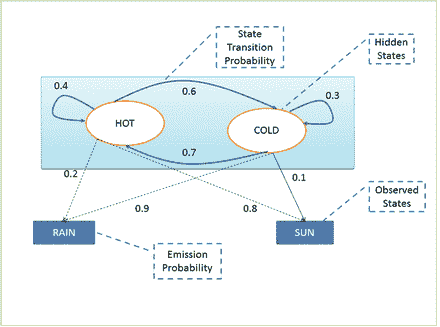

图 2-2. HMM 的属性

*   状态集合：`{S [1],S [2]...,S [n] }`
*   状态序列：`Q=q [1],q [2],...,q [t]`
*   马尔可夫链性质：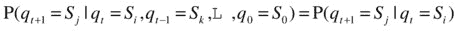
*   观测集合：`O={o [1],o [2],o [3],...,o [M] }`
*   转移概率矩阵：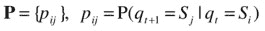
*   发射概率矩阵：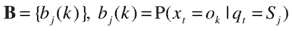
*   初始概率矩阵：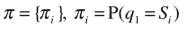
*   HMM：`M = (A,B,π)`

HMM 解决的三个基本问题可总结如下：

*   模型评估：评估给定 HMM（`M=(A,B,π)`）下观测序列的似然性。
*   路径解码：评估给定观测序列和 HMM 模型 `M=(A,B,π)` 下的最优模型状态序列（`Q`）（隐藏状态）。
*   模型训练：确定最能解释观测信号的一组模型参数。

HMM 尤其以其在时间模式识别中的应用而闻名，例如语音、手写、手势识别、词性标注、乐谱跟随、局部放电和生物信息学。有关 HMM 的更多详细信息，请参见第 5 章。

### 多层感知器
多层感知器（MLP）是一个由简单神经元组成的前馈网络，它将输入数据集映射到一组输出上。MLP 包含多个由有向图全连接的节点层，其中每个节点（输入节点除外）都是一个具有非线性激活函数的神经元。

MLP 的基本组成部分是神经元。在 MLP 中，一对神经元通过加权边在两个相邻层中连接。如图 2-3 所示，MLP 至少包含三层神经元，包括一个输入层、一个或多个隐藏层以及一个输出层。输入神经元的数量取决于输入特征的维度；输出神经元的数量由类别数决定。隐藏层的数量以及每个隐藏层中神经元的数量取决于所解决问题的类型。神经元数量过少会导致学习效率低下；神经元数量过多则会导致泛化效率低下。MLP 使用一种称为反向传播的监督学习技术来训练网络。在其简单实例中，感知器通过非线性激活函数处理加权实值输入的线性组合来计算输出 `y`，

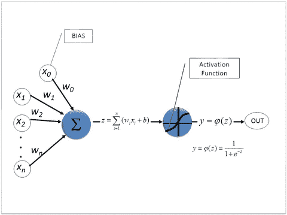

图 2-3. MLP 将输入特征馈送到输入层，并从输出层获取结果；结果通过从输入层到输出层的前馈方式计算

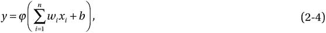

其中 `w` 表示权重向量，`x` 是输入向量，`b` 是偏置，`ϕ` 是激活函数。通常，MLP 系统选择逻辑 Sigmoid 函数 `1/(1+e^(–x))` 或双曲正切函数 `tanh(x)` 作为激活函数。这些函数提供了统计上的便利，因为它们在原点附近是线性的，并且当远离原点时会迅速饱和。

MLP 的学习过程会调整隐藏层的权重，从而减少输出误差。从随机权重开始，MLP 将输入模式信号通过网络前馈，并从输出层开始反向传播误差信号。反向传播的误差信号由实际值（`O [n] (t)`）和期望值（`T [n]`）之间的差异构成。误差函数可总结为

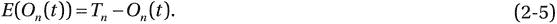

学习过程的目标是最小化误差函数。为了找到误差函数的最小值，需要对其关于权重矩阵进行微分。学习算法包括以下步骤：

在区间 `[1, –1]` 内初始化随机权重。向网络发送一个输入模式。计算网络的输出。对于输出层中的每个节点 `n`：计算输出节点 `n` 上的误差：`E(O [n] (t))=T [n] –O [n] (t)`。将 `E(O [n] (t))` 添加到所有连接到节点 `n` 的权重上。重复步骤 2。

为了影响收敛速度，从而减小权重进行自适应变化时的步长，会使用一个学习参数 `η` (< 1)。连接到第 `j` 个输出的第 `i` 个权重可以通过以下规则更新：

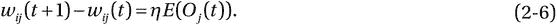

公式 2-6 表示一个迭代的权重自适应过程，其中在迭代 `(t + 1)` 时，输出误差的一部分被添加到来自迭代 `t` 的现有权重上。

MLP 通常用于监督学习的模式识别过程。由于深度学习的成功，人们对 MLP 反向传播网络重新产生了兴趣。深度学习是一种使用多个隐藏层有效训练 MLP 的方法。随着硅技术的现代进步，深度学习正在被开发，以解锁那些可以通过深层架构表示高度变化函数的领域中巨大的大数据分析潜力。

## 机器学习：聚类算法
### k-均值聚类

# k-均值聚类

k-均值聚类是一种向量量化的无监督学习算法，它将 `n` 个观测值划分为 `k` 个簇。该算法定义了 `k` 个质心，作为各自簇的原型。当使用特定的距离度量进行测量时，每个对象都会被分配到具有最近质心的簇中。当所有对象都被分配到 `k` 个簇之一时，将对象分配到簇的步骤即告完成。该过程会基于先前的 `S={S[1], S[1], ..., S[k]}` 分配重新计算质心，并将对象重新分配到最近的新的质心，如此重复。该过程持续进行，直到任意 `k` 个簇的质心不再移动。通常，`k-均值聚类`算法通过最小化对象数据与簇质心之间距离的平方和，根据对象的特征将其划分为 `k` 个组（或簇）。

对于一组给定的 `d` 维观测向量 `(x[1], x[2], ..., x[n])`，`k-均值聚类`将 `n` 个观测值划分为 `k(≤n)` 个簇集，以最小化平方和：

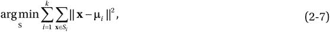

其中 `μ[i]` 是 `S[i]` 中点的均值。

`k-均值聚类`算法易于在大型数据集上实现。它在市场细分、计算机视觉、应用和工作负载画像、光学字符识别以及语音合成等领域有着广泛的应用。该算法常被用作其他算法的预处理步骤，以寻找初始配置。

### 模糊 k-均值（模糊 c-均值）

模糊 `k-均值`（也称为模糊 `c-均值` [FCM]）（Dunn 1973; Bezdek 1981）是 `k-均值`算法的一种扩展，它综合了软聚类，在软聚类中，一个对象可以以一定的概率属于多个簇。该算法在将数据对象分配到簇时提供了更高的灵活性，并允许数据对象在多个相邻簇中保持部分隶属关系。`FCM` 使用范围在 `[1, n]` 内的模糊化参数 `m`，该参数决定了簇的模糊程度。`m=1` 表示硬聚类，而 `m>1` 则表示决策空间中数据对象之间的模糊程度更高。`FCM` 算法基于最小化目标函数：

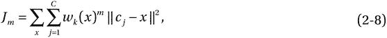

其中 `x` 是 `d` 维数据对象，`c[j]` 是簇 `j` 的 `d` 维质心（参见公式 2-10），`w[k](x)` 是 `x` 在簇 `k` 中的隶属度，该隶属度取决于模糊化参数 `m`，该参数控制赋予最近质心的权重：

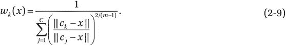

使用 `FCM`，第 `k` 个簇的 `d` 维质心 `(c[k])` 是所有点的均值，按其对该簇的隶属度进行加权：

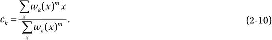

`c-均值聚类`算法综合了簇中心以及数据对象被分配到这些簇的程度。这并不转化为硬性的隶属函数。`FCM` 在图像处理中用于对图像中的对象进行聚类。

### 流式 k-均值

流式 `k-均值`是一个两步算法，包括一个流式步骤和一个球 `k-均值`步骤。流式步骤一次性遍历大小为 `n` 的数据对象，并生成最佳数量的质心——这相当于 `klog(n)` 个簇，其中 `k` 是预期的簇数量。这些簇的属性被传递给球 `k-均值`步骤，该步骤将簇的数量减少到 `k`。

#### 流式步骤

流式步骤算法一次处理一个数据对象，并决定是将该数据对象添加到现有簇还是创建一个新簇。如果簇的质心与数据点之间的距离小于`距离截止阈值`，则算法将该数据添加到现有簇，或者以 `d/(距离截止阈值)` 的概率创建一个新簇。如果距离超过截止值，则算法创建一个具有新质心的新簇。随着处理更多的数据对象，现有簇的质心可能会改变其位置。此过程会持续添加新簇，直到现有簇的数量达到`簇截止限制`。可以通过增加距离截止阈值来减少簇的数量。此步骤主要用于降维。此步骤的输出是一个缩减后的数据集，形式为多个簇，这些簇代表了大量原始数据。

#### 球 k-均值步骤

球 `k-均值`算法接收流式步骤的输出（`X` = 质心集合 > `k`），并执行多次独立运行，通过选择最佳解决方案来综合出 `k` 个簇。每次运行使用一种种子机制选择 `k` 个质心，并迭代运行球 `k-均值`算法以优化解决方案。

种子选择过程可能会调用 `k-means++` 算法以实现 `k` 个簇的最佳分布。`k-means++` 种子选择算法总结如下：

1.  从 `X` 中均匀随机选择中心 `c[1]`。
2.  通过以概率 `P(x)` 选择 `x∈X` 来选择一个新中心 `c[i]`，并将其添加到 `` 中，

    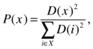

    其中 `D(x)` 是 `x` 与已选择的最近中心之间的距离。

3.  重复步骤 2，直到选出 `k` 个中心 ``。
4.  以与范数 `` 成比例的概率随机选取两个中心 ``。
5.  对于每个 ``，在其周围创建一个半径为 `` 的球。
6.  使用 `` 中包含在球内的元素重新计算新的质心 ``。

该算法在处理大量数据对象的应用中特别有用。该算法通过执行流式操作，并用由原始数据的 `k·log(n)` 个质心组成的缩减代理数据替换原始数据，从而降低原始数据集的维度。缩减后的数据作为球 `k-均值`算法的输入，该算法为其各自的簇综合并优化出 `k` 个质心。

# 机器学习：降维

机器学习通过大量特征来训练大多数回归或分类问题。这增加了复杂性，提高了计算要求，并增加了收敛到解决方案所需的时间。缓解这些问题的一个有用方法是通过综合一个更低维度的空间来降低原始特征的空间维度。在这个新的、更低维度的空间中，最重要的特征得以保留，特征之间的隐藏相关性得以揭示，不重要的特征则被丢弃。最简单、最直接且监督最少的特征缩减方法之一涉及矩阵分解的变体：奇异值分解、特征分解和非负矩阵分解。以下各节将讨论统计降维中常用的一些方法。

### 奇异值分解

奇异值分解（`SVD`）通过矩阵分析，将高维矩阵综合为低维表示。`SVD` 有助于消除矩阵表示中较不重要的部分，从而得到具有所需维数的近似表示。这有助于创建与原始矩阵高度相似但规模更小的矩阵表示。由于以下特性，`SVD` 在降维中非常有用：

*   `SVD` 将相关变量转换为一组不相关的变量，从而揭示数据项之间的对应关系。
*   `SVD` 识别出数据点变化最大的维度。

一旦识别出具有显著变化的点，就可以用更少的维度来近似原始数据点。你可以定义阈值，低于该阈值的变化可以被忽略，从而在保留数据点内在关系和兴趣点相关信息的前提下，实现高度精简的数据集。

如果 `M` 是一个 `m × n` 矩阵，那么可以将其分解为三个矩阵 `U`、`∑` 和 `V^T` 的乘积，它们具有以下特性：

*   `U` 是一个列正交矩阵。`U` 的列是 `MM^(T)` 的标准正交特征向量。
*   `V^(T)` 是正交矩阵 `V` 的转置。`V` 的列是 `M^(T)M` 的标准正交特征向量。
*   `∑` 是一个对角矩阵，除对角线外所有元素均为 `0`。`∑` 包含来自 `U` 或 `V` 的特征值的平方根，并按降序排列。

在其精确形式中，`M` 可以重写为：

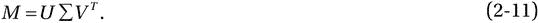

在降维过程中，你合成 `U` 和 `V`，使得它们包含原始数据中按变化程度降序排列的元素。你可以删除代表没有显著变化维度的元素。这可以通过将最小的特征值设为 `0` 来实现。公式 2-11 可以重写为其最佳秩-l 近似形式：

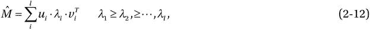

其中 `u[i]` 和 `v[i]` 分别是 `U` 和 `V` 的第 `i` 列，`λ[i]` 是对角矩阵 `∑` 的第 `i` 个元素。

### 主成分分析

# 主成分分析

当空间中有一群点时，用于表示这些点的坐标和轴是任意的。这些点相对于所选轴的方向具有一定的方差，表示在该方向上围绕平均值的分散程度。在二维系统中，模型受到第二轴垂直于第一轴的约束。但在三维及更高维情况下，你可以将第 n 轴垂直于任意两个轴构成的平面。模型受到第一轴位置的约束，该轴被定位在方差最大的方向上。这产生了一个新的特征空间，将点群压缩到高方差的轴上。你可以选择方差较大的轴，并消除方差较小的轴。图 2-4 展示了新的特征空间，该空间从一个包含 160 个特征的数据集缩减为 59 个分量（轴）。每个分量相对于其他分量都关联着一定比例的方差。第一个分量方差最大，其次是第二个分量，依此类推。

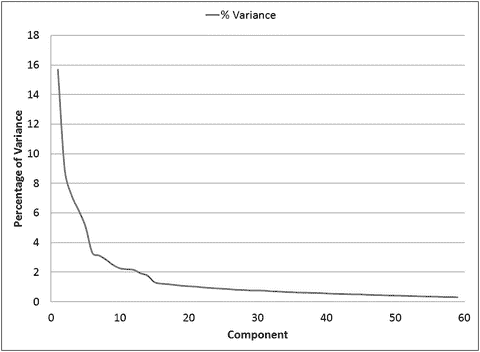

图 2-4. 一个包含 160 个特征的数据集经主成分变换后缩减为 59 个分量时，各分量的方差百分比

主成分分析（PCA）是一种广泛使用的分析技术，它通过识别模式来降低数据集的维度，同时不会显著损失信息。PCA 的目标是将高维特征空间投影到一个更小的子集中，以降低计算成本。PCA 计算新的特征，称为主成分（PC），它们是原始特征在更大变异性方向上的不相关线性组合。关键在于将特征集映射到矩阵 `M`，并合成 `MM^(T)` 或 `M^(T)M` 的特征值和特征向量。特征向量有助于简化那些可以通过沿轴进行拉伸、压缩或翻转等线性变换来建模的问题。特征值提供了这种变换发生的因子（特征向量的长度和幅度）。在新特征空间中，选择具有较大特征值的特征向量，因为对于数据分布而言，它们比具有较小特征值的特征向量包含更多信息。与下一个 PC（相对于第一个 PC 不相关）相比，第一个 PC 具有尽可能大的方差（即最大的特征值），后者是在与第一个分量正交的约束下计算的。本质上，第 i 个 PC 是与所有先前 PC 都不相关的最大方差的线性组合。

PCA 包含以下步骤：

1. 计算原始数据集的 d 维均值。
2. 计算特征的协方差矩阵。
3. 计算协方差矩阵的特征向量和特征值。
4. 按特征值递减的顺序对特征向量进行排序。
5. 选择具有最大特征值的 k 个特征向量。

特征向量值表示每个变量对 PC 轴的贡献。PC 的方向指向 m 维点中方差最大的方向。

PCA 是用于发现新的、信息丰富的、不相关特征的最广泛使用的多变量方法之一；它通过拒绝低方差特征来降低维度，并且有助于减少分类和回归分析的计算需求。

## Lanczos 算法

Lanczos 算法是一种低成本的特征分解技术，与截断 SVD 相同，区别在于它不显式计算矩阵的奇异值/向量。Lanczos 算法使用少量 Lanczos 向量，这些向量是 `M^T M` 或 `MM^T` 的特征向量，其中 `M` 是一个对称的 n × n 矩阵。

Lanczos 算法首先初始化一个任意非零向量 `x[0]`，其基数等于矩阵 `M` 的列数。该算法的第 m 步（`m<<n`）将矩阵 `M` 转换为一个三对角矩阵 `T[mm]`。迭代过程可以总结如下：

### 初始化

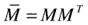

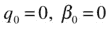

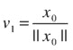

### 算法

对于 ``

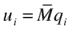

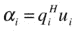

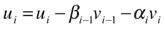

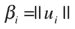

如果 `β[i] =0`，则停止

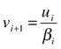

结束

完成 m 次迭代后，得到 `α[i]` 和 `β[i]`，它们分别是对称三对角矩阵 `T[mm]` 的对角线元素和次对角线元素。所得的三对角矩阵与 `` 正交相似：

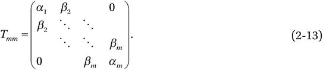

对称三对角矩阵表示给定矩阵在由相应 Lanczos 向量集 `V[m]` 张成的子空间上的投影。这些矩阵的特征值就是原始矩阵映射子空间的特征值。Lanczos 迭代本身并不直接产生特征值或特征向量；相反，它生成一个三对角矩阵（参见公式 2-13），该矩阵的特征值和特征向量通过其他方法（如 QR 算法）计算，以产生 Ritz 值和 Ritz 向量。对于特征值，如果 Lanczos 迭代次数相对于 k 足够大，则可以计算 `T[mm]` 的 k 个最小或最大特征值。如此生成的 Lanczos 向量 `v[i]` 随后构成变换矩阵：

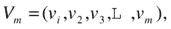

该矩阵可用于生成 Ritz 特征向量 `(V[m] ·u[m])`，即原始矩阵的近似特征向量。

# 机器学习：协同过滤

协同过滤（CF）被推荐系统所使用，其目标是根据集体用户经验（协作）来预测用户对给定项目的兴趣。主要目标是匹配具有相似兴趣的人，以生成个性化推荐。例如，假设有 M 个项目与 N 个用户。这给出了一个 M × N 的用户-项目矩阵 `X`，其中 `x[m,n]` 表示第 n 个用户对项目 m 的推荐评分。以下各节讨论推荐系统中使用的一些 CF 系统。

## 基于用户的协同过滤

基于用户的 CF 根据来自相似用户画像的集体评分，预测用户对某个项目的兴趣。用户-项目矩阵可以写成：

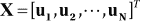

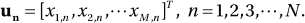

基于用户的 CF 的第一步是评估用户之间的相似度，并根据最近邻关系对用户进行排列。例如，要评估两个用户之间的相似度，可以使用余弦相似度矩阵 `u[n] ,u[a]`：

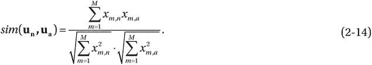

最后，测试用户 a 对测试项目 m 的预测评分 `` 计算如下：

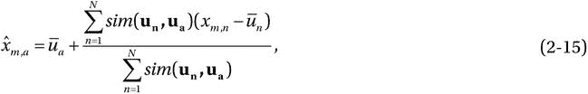

其中 `` 和 `` 分别表示用户 n 和用户 a 给出的平均评分。从公式 2-14 和 2-15 可以看出，处理 CF 是一项计算密集型任务，可能需要大量的资源池和更快的计算设备。因此，建议利用 Hadoop 平台以获得更好的性能和可扩展性。

## 基于项目的协同过滤

基于项目的 CF 计算项目之间的相似度并选择最佳匹配。其思路是找出对两个项目都进行过评分的用户，然后计算它们之间的相似度。用户-项目矩阵表示为：

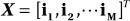

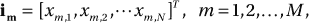

### 基于项目的协同过滤

其中`i[m]`对应于所有用户`m`对某个项目的评分，由此产生基于项目的推荐算法。

基于项目的 CF 的第一步是评估项目之间的相似度，并根据最近邻关系对项目进行排列。例如，可以使用余弦相似度矩阵来评估两个项目`i[m]`、`i[b]`之间的相似度。为了在计算相似度时消除用户之间评分尺度的差异，通过从每个共同评分对中减去用户的平均评分（Sarwar 2001）来调整余弦相似度：

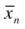

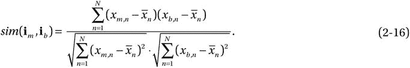

最后，测试用户`a`对测试项目`m`的预测评分计算如下：

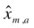

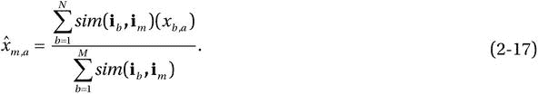

用户对某个项目的评分可以通过对同一用户评价过的相似项目的评分取平均值来估计。

### 带加权 λ 正则化的交替最小二乘法

带加权 `λ` 正则化的交替最小二乘法（ALS-WR）算法将用户-项目矩阵分解为用户-因子矩阵和项目-因子矩阵。该算法致力于揭示能够合理解释观察到的用户-项目评分的潜在因子，并搜索最优的因子权重，以最小化预测评分与实际评分之间的最小二乘误差（Zhou 2008）。

如果有多个用户和项目，则需要学习在特征空间中表示每个项目和每个用户的特征向量。目标是揭示能够将每个用户`u`与一个用户-因子向量关联起来，并将每个项目`i`与一个项目-因子向量关联起来的特征。评分由用户-因子向量和项目-因子向量的内积来描述。其思想是执行矩阵分解，以便用户和项目可以映射到共同的潜在因子中，从而可以直接进行比较。由于评分矩阵是稀疏的且未完全定义，因此分解必须仅使用已知评分进行。解决方案的质量不仅根据观察到的数据来衡量，还根据未观察数据的泛化能力来衡量。必须找到一组用户和项目特征向量，使得以下代价函数最小化：

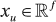

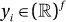

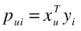

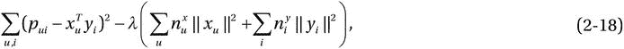

其中`u`和`i`分别表示用户`u`和项目`i`的评分数量。正则化项`λ(...)`避免了在训练数据上的过拟合。参数`λ`取决于数据，并通过数据集中的交叉验证进行调整以获得更好的泛化能力。由于搜索空间非常大（多个用户和项目），这阻碍了传统直接优化技术（如随机梯度下降）的应用。

当用户-因子或项目-因子固定时，代价函数呈现二次形式，从而可以计算全局最小值。这进而允许进行 ALS 优化，其中通过相互固定对方来交替重新计算用户-因子和项目-因子。该算法专为大规模数据集上的大规模 CF 而设计。

## 机器学习：相似度矩阵

相似度矩阵用于衡量数据点之间的相似程度。相似度矩阵与其对应的距离矩阵和替换矩阵密切相关。以下各节将介绍一些常用的相似度计算方法。

### 皮尔逊相关系数

皮尔逊相关衡量两个变量之间的线性依赖关系。皮尔逊相关系数是两个变量（`X` 和 `Y`）的协方差除以它们标准差的乘积：

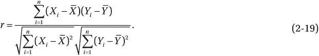

皮尔逊相关系数的取值范围为 −1 到 1。值为 1 表示 `X` 和 `Y` 之间存在完美的线性关系，即 `X` 的数据变异性与 `Y` 的变异性同步。值为 −1 表示 `X` 和 `Y` 之间存在反向关系，即 `Y` 的数据变异性与 `X` 的变异性相反。值为 0 表示变量 `X` 和 `Y` 之间缺乏线性相关性。

尽管皮尔逊系数反映了线性关系的强度，但它对极值和异常值高度敏感。如果两个变量之间存在强曲线关系而非强线性关系，则低关系强度可能会产生误导。如果 `X` 和 `Y` 未在其完整范围内进行分析，该系数也可能产生误导。

### 斯皮尔曼秩相关系数

斯皮尔曼相关系数用于对配对变量 `X` 和 `Y` 之间单调关系的强度进行统计分析。斯皮尔曼相关计算的是配对变量秩次值的皮尔逊相关。秩次（从低到高）通过将最低值分配为秩次 1，次低值分配为秩次 2，依此类推获得，如下所示：

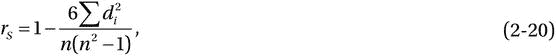

其中 `n` 是样本量，`d` 是变量对统计秩次之间的距离，由下式给出：

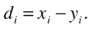

斯皮尔曼相关系数的符号表示因变量与自变量之间关联的方向。如果因变量 `Y` 与自变量 `X` 同向增加（或减少），则系数为正。如果因变量 `Y` 相对于自变量 `X` 反向增加（或减少），则系数为负。斯皮尔曼相关系数为 0 表示变量 `Y` 相对于 `X` 没有增加或减少的倾向。当 `X` 和 `Y` 越接近完美的单调函数时，斯皮尔曼相关的绝对值越大。只有当数据未被截断时，才能计算斯皮尔曼相关。虽然它对极值不太敏感，但它仅依赖于秩次而非观测值。

### 欧几里得距离

欧几里得距离是两个变量向量元素之间差值的平方和的平方根：

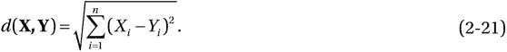

只有当两个变量在同一尺度上测量时，欧几里得距离才有效。你可以将公式 2-21 中的距离转换为倒数形式（见公式 2-22），这样如果 `X` 和 `Y`（`X – Y = 0`）相似，则返回值为 1；如果相似度降低，则趋向于 0：

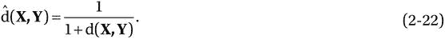

你可以验证，如果距离 `d(X,Y) = 0`（表示相似），则计算结果为 1；如果 `d(X,Y)` 增加（表示不相似），则减小至 0。

### 杰卡德相似系数

杰卡德相似系数通过衡量有限样本集 `X` 和 `Y` 之间的重叠程度来评估它们的相似性。集合 `X` 和 `Y` 不必大小相同。在数学上，该系数可以定义为样本集（`X`, `Y`）交集与并集的比值：

杰卡德距离衡量样本集之间的不相似性，通过 1 减去杰卡德系数得到：

杰卡德系数常用于衡量关键词相似度、文档相似度、新闻文章分类、自然语言处理（NLP）等。

## 总结

复杂问题的解决方案依赖于对机器学习技术的智能运用。通过采用不仅能降低特征维度，还能针对特定行为训练模型的技术，可以提高解决方案的精度、速度和准确性。不同的行为属性可以使用诸如 `k-means` 之类的聚类技术聚类成多个阶段。对应于每个聚类标签的简化数据点被分离出来，并进行训练以解决回归或分类问题。在正常的训练后操作中，一旦识别出阶段，就会使用与该阶段关联的已训练模型来预测（或估计）反馈回路的输出。

# 图 2-5 总结了一个过程控制系统，该系统能够感知大量传感器，以控制环境过程（例如，数据中心的冷却）。第一步是降低数据的维度。新数据被输入到聚类方法中，这些方法根据相似的属性和独特的特征，从给定的集合中发现组内的项目。对应于每个聚类标签的数据被分离出来，并分别进行训练以进行分类。阶段识别允许应用一个模型函数，该函数与识别出的阶段相关联。特定阶段模型的输出触发过程控制功能，这些功能作用于环境并改变传感器的输出。此外，这个过程使我们能够主动预测当前阶段的持续时间和即将到来的阶段，并据此预测输出以实现主动控制。

图 2-5. 基于机器学习的反馈控制系统：特征被转换并输入到阶段检测器；数据分类过程使用在检测到的阶段上训练的模型